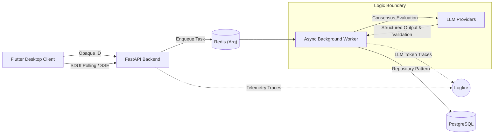

# Cognitive Quorum

**Structured, Auditable, and Deterministic AI Orchestration.**

> **Architecture:** Compound AI System, Event-Sourced DAG Orchestrator, Server-Driven UI
> **Philosophy:** Zero-Magic, Fail-Fast, Strict Typed DTOs, Zero-Math UI

Cognitive Quorum is an AI orchestration platform designed for critical cognitive expert work. Rather than operating as an unconstrained conversational chatbot, Quorum structures AI evaluation into deterministic, machine-readable reasoning atoms with full forensic traceability.

---

## 📚 Architecture Documentation

All architectural principles, domain invariants, orchestration mechanics, and presentation specifications are maintained exclusively in [`docs/architecture/`](docs/architecture/):

* **[Meta-Architecture & Verification Runbook](docs/architecture/00_README_META_ARCHITECTURE.md)**
* **[System Context & Invariants](docs/architecture/01_system_context_and_invariants.md)**
* **[Data Seeding & Ontology](docs/architecture/02_data_seeding_and_ontology.md)**
* **[Cognitive Orchestration Engine](docs/architecture/03_cognitive_orchestration_engine.md)**
* **[Server-Driven UI & Presentation](docs/architecture/04_server_driven_ui_and_presentation.md)**
* **[Resilience & Observability](docs/architecture/05_resilience_and_observability.md)**
* **[Enriched Atom Graph Engine](docs/architecture/06_enriched_atom_graph_engine.md)**
* **[EU AI Act Compliance & Governance](docs/architecture/07_eu_ai_act_compliance_architecture.md)**
* **[Matrix Theory Explanations Compendium](docs/architecture/08_matrix_explanations.md)**
* **[LLM Prompt Orchestration & Matrix Evaluation](docs/architecture/09_llm_prompt_orchestration_and_matrix_evaluation.md)**

---

## 🏗️ System Overview



---

## 🛠️ Technology Stack

* **Languages**: Python & Dart
* **Frameworks**: FastAPI, Arq, Flutter, Riverpod, Freezed, GoRouter
* **Databases**: PostgreSQL & Redis
* **Infrastructure**: Docker, Logfire OpenTelemetry Instrumentation
* **Tooling**: `uv`, `ruff`, `mypy`, `build_runner`

---

## 📦 Getting Started

1. **Dependencies**: `uv`, Docker, Flutter SDK
2. **Installation**:
   ```powershell
   git clone https://github.com/launis/quorum.git
   cd quorum
   uv sync
   ```
3. **Infrastructure Setup**:
   ```powershell
   docker-compose up -d
   ```
4. **Database Seeding**:
   ```powershell
   uv run python backend_v2/seed/run_seed.py local
   ```
5. **Local Startup**:
   ```powershell
   ./run_local.bat
   ```

---

## 🛡️ License

**Proprietary and Closed-Source.**
Copyright (c) Risto Launis. All Rights Reserved.
No permission is granted to use, copy, modify, or distribute this software under any circumstances.
