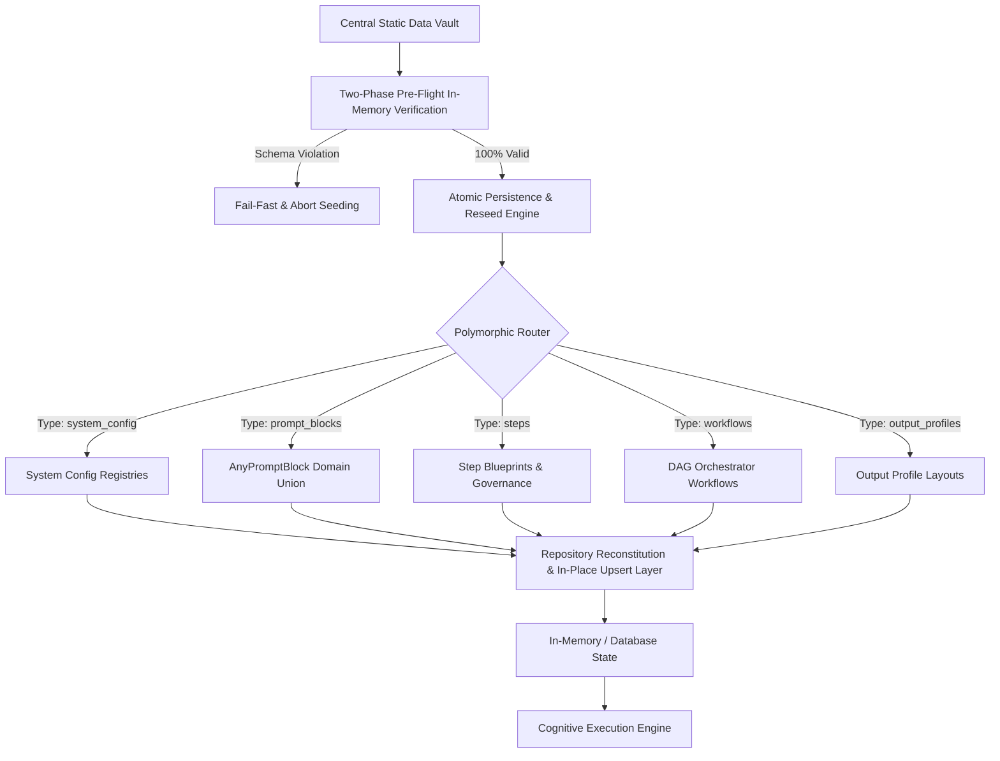

# Data Seeding & Ontology

## 1. Executive Summary
The **Data Seeding & Ontology** capability dictates that the Compound AI System is fundamentally **data-driven**, not code-driven. The entire behavior of the system—ranging from LLM instructions (PromptBlocks), allowed models, MCP tool gateways, to performative vocabularies—is defined externally in the central static data vault. The backend's primary role is to parse, validate, hydrate, and route this declarative ontology rather than hardcoding operational instructions.

## 2. Architectural Principles & Implementation

The Data Seeding & Ontology layer establishes the declarative schemas, dynamic rules, and static datasets that power the platform:

### 2.1. Polymorphic Rule Routing
All dynamic rules and criteria are modeled as a unified `PromptBlock` entity within the database. Polymorphic collection parsing automatically routes different categories of configuration data (`system_config`, `prompt_blocks`, `mcp_gateways`) into their respective Pydantic validation structures, ensuring typed domain validation before runtime execution.

### 2.2. Single Source of Truth (SSOT) Relational & JSONB Persistence Topology
The central static data vault serves as the immutable structural authority for baseline entities, while runtime persistence operates on a closed 12-table All-in-PostgreSQL 19 relational and `lz4`-compressed JSONB topology:
- **Closed 12-Table Relational Schema**: Persistence is partitioned strictly across 12 normalized tables—specifically and exhaustively: `users`, `organizations`, `workflows`, `steps`, `prompt_blocks`, `output_profiles`, `system_configs`, `executions`, `report_artifacts`, `report_binaries`, `quorum_nodes`, and `quorum_edges`. Unapproved shadow tables are statically prohibited.
- **Native RFC 9562 `uuidv7()` Keys & Virtual Timestamp Indexing**: High-volume transactional and graph tables (`executions`, `report_artifacts`, `report_binaries`, `quorum_nodes`, `quorum_edges`) enforce native PostgreSQL 19 `uuidv7()` primary keys validated by `CHECK (uuid_extract_version(id) = 7)` constraints. Temporal ordering and range scans leverage zero-storage `GENERATED ALWAYS AS (uuid_extract_timestamp(id)) VIRTUAL` columns paired with extended planner statistics (`CREATE STATISTICS`), while bijectively mapping to external Opaque Stripe IDs (`exe_`, `rep_`, `nod_`, `edg_`).
- **`lz4` TOAST Compression & Binary Payload Isolation**: Database sessions enforce `SET default_toast_compression = 'lz4'` and explicit `COMPRESSION lz4` column directives across variable-length `JSONB`, `TEXT`, and `BYTEA` payloads (`executions.frozen_context`, `executions.execution_trace`, `executions.trace_events`, `report_artifacts.sdui_json`, `report_binaries.data`, `quorum_nodes.payload`). Compiled PDF and Excel binary downloads are isolated in the dedicated `report_binaries` table (`ReportBinaryPayloadDTO`), preventing binary blob reads from bloating `ReportArtifact` metadata queries.
- **Flat FinOps Column Normalization**: Execution telemetry metrics (`prompt_tokens`, `completion_tokens`, `cached_tokens`, `reasoning_tokens`, `cumulative_synthesis_tokens`, `dag_cost_usd`, `cumulative_synthesis_cost`, `cost_estimate`, `models_used`) are persisted as first-class non-negative scalar columns on `executions` alongside `step_states` and `steps` JSONB projections, maintaining 1:1 column naming parity with `ExecutionRecord`.
- **Dynamic Response Stitching**: The underlying storage remains flat and relational across root tables, while backend APIs construct nested and stitched views (specifically combining `Workflow` entities with `OutputProfile` options) dynamically via dedicated response DTOs.

### 2.3. Dual-Tool Seed Governance & Sanitization Architecture
Seed data quality and consistency are maintained through a decoupled inspection and transformation architecture:
- **Static Heuristic Inspection**: A read-only verification engine audits referential integrity, AST pattern rules, and prompt conventions across root database collections (`prompt_blocks`, `steps`, `workflows`, `output_profiles`), returning deterministic compliance exit codes without modifying persistent state.
- **In-Memory Sanitization & Transformation**: A declarative transformation pipeline strips unauthorized formatting artifacts, screaming imperatives, and mechanical counting directives from prompt text, re-validates entities against strict domain schemas, and writes changes atomically.

### 2.4. Two-Stage In-Memory Pre-Flight Validation & Authoritative 10-Table Seeding
Database seeding enforces a two-stage protocol that isolates schema validation from relational state mutation:
- **In-Memory Pre-Flight Verification**: The seeder loads master seed data and validates 100% of collection records in memory into an immutable `ValidatedSeedBufferDTO` (`ConfigDict(strict=True, extra="forbid", frozen=True)`) in topological foreign-key order (`organizations`, `users`, `system_config`, `prompt_blocks`, `steps`, `workflows`, `output_profiles`), preserving all qualitative coaching prompts verbatim. If any record fails validation, the process halts immediately with an explicit validation error, leaving PostgreSQL 19 tables untouched.
- **Authoritative Relational Upsert & 10-Table Count Verification**: Once in-memory validation succeeds, the seeder opens an atomic `QuorumUnitOfWork` transaction and executes parameterized `$1, $2` batch upserts (`seed_collection_batch`) across all 7 seeded tables (`organizations`, `users`, `system_configs`, `prompt_blocks`, `steps`, `workflows`, `output_profiles`), followed by `verify_seed_table_counts` across all 10 core PostgreSQL 19 tables (`organizations`, `users`, `system_configs`, `prompt_blocks`, `steps`, `workflows`, `output_profiles`, `executions`, `report_artifacts`, `report_binaries`), failing fast with `AppException` if any of the 7 seeded tables reports zero rows.

### 2.5. Atomic Master Seed Persistence & PostgreSQL 19 ACID/MVCC Concurrency
Master seed file persistence and runtime database storage enforce atomic durability and transactional concurrency:
- **Temporary Replacement Writes**: Master seed file persistence writes serialized JSON to isolated temporary files, flushes and synchronizes disk buffers (`os.fsync`), verifies complete re-loadability in memory, and replaces the target file via atomic OS replacement operations.
- **PostgreSQL 19 ACID Transactions & MVCC**: Runtime database concurrency relies exclusively on PostgreSQL 19 ACID transactions (`repeatable_read` isolation in `PostgresUnitOfWork`) and Multi-Version Concurrency Control (MVCC) over `asyncpg` connection pools, eliminating OS-level file locking across concurrent execution runs.

### 2.6. In-Place Upsert Lifecycle & Entity Immutability
Runtime persistence repositories maintain state through in-place atomic upsert operations keyed by canonical Opaque Stripe IDs. Entities update their records directly without creating duplicate shadow instances or mutating unrelated collections, preserving referential integrity and audit trails across execution sessions. Authoritative PostgreSQL 19 seeded entity prefixes (`EntityPrefix.WORKFLOW`, `EntityPrefix.OUTPUT_PROFILE`, `EntityPrefix.PROMPT_BLOCK`, `EntityPrefix.STEP`, `EntityPrefix.EXECUTION`, `EntityPrefix.REPORT`, `EntityPrefix.ORGANIZATION`) are aligned 1:1 with centralized Polyfactory test model factories (`WorkflowFactory`, `SystemRulePromptBlockFactory`, `OutputProfileFactory`, `MatrixPromptBlockFactory`, `ExecutionStepFactory`, `ExecutionRecordFactory`, and `ReportArtifactFactory`), routing all generated entity and organization identifiers exclusively through `generate_opaque_id(EntityPrefix.<TYPE>)` and enforcing canonical 32-character lowercase hexadecimal RFC 9562 UUIDv7 Opaque Stripe ID formatting (`^([a-z]{2,5})_[a-fA-F0-9]{32}$`) under static AST guardrail `QGR030` across both production and test suites.

### 2.7. Y-Funnel Pre-Hook Normalization
Data transformations during initialization utilize a Y-Funnel architecture where pre-hooks normalize heterogeneous input shapes before domain validation. This keeps core Pydantic V2 domain models pure and focused strictly on business invariants rather than ingestion gymnastics.

### 2.8. Semantic Localization via Performative Lexicons
System personality traits, terminology standards, and vocabulary constraints are governed as data rather than code. Declarative lexicons defined in seed data are injected dynamically during prompt compilation, supporting multilingual enforcement without code modifications.

### 2.9. Universal Bilingual Localization (I18nText)
User-facing dynamic strings across the ontology (profile titles, layout descriptions, preambles) utilize the strictly typed `I18nText` model in both Python and Flutter. The schema mandates complete baseline translations (`en` and target locale) with structured fallback resolution, ensuring bilingual parity across backend services, frontend widgets, and PDF generators.

### 2.10. Workflow Context Governance & Step Protection
Pipeline step definitions declare explicit system core protections (`is_system_core: true`) for foundational operations (document ingestion, scoring, synthesis, forensic reporting). Studio interface and API guardrails prevent unauthorized deletion or mutation of protected resources. Step blueprints (`Step`) and workflow step rules (`NodeStrategy`) embed an authoritative `StepZone` enum (`zone_a`, `zone_b`, `zone_c`), establishing 1:1 cross-language enum parity between backend and frontend. Steps in Zone A govern raw document ingestion (with deletion locked), Zone B hosts dynamic analytical specialists, and Zone C anchors downstream aggregation funnels (scoring, synthesis, XAI reporting). This server-driven zone classification powers Dumb Painter presentation in Quorum Studio with zero heuristic branching or client-side index calculations. Step definitions additionally declare synthesis source flags (`is_synthesis_source`), enabling deterministic context boundary governance between upstream text extraction and downstream qualitative synthesis.

### 2.11. Epistemic Separation (TheoryGrounding SSOT)
Bibliographic references and academic provenance metadata are strictly decoupled from operational prompting instructions. `PromptBlock.theory_grounding` (`TheoryGrounding`) is the sole Single Source of Truth for academic citations (`citation_reference`) and source URLs (`source_url`). `PromptBlock.ai_description` contains purely operational prompt text, allowing presentation layers and PDF reports to consume structured academic citations without prompt-scraping or token bloat.

### 2.12. Structured Few-Shot Calibration Schema (ContrastivePairDTO)
Evaluation assertions and rubrics across the ontology define structured few-shot grounding via `ContrastivePairDTO`, encapsulating `acceptable` and `rejected` exemplars with enforced minimum length boundaries and equality conflict rejection. This eliminates unstructured string delimiters and manual prefix conventions from the seed vault, guaranteeing that every matrix atom provides a pristine, strongly typed boundary definition ready for prompt compilation and direct production deployment across all environments without runtime parsing shims.

### 2.13. Matrix Seed Vault Hardening & Anti-Pattern Standards
High-entropy evaluation atoms across the 14 canonical matrices enforce deterministic anti-patterns and disambiguated multi-step acceptance criteria to eliminate subjective evaluation drift:
- **Scaffolding and Prompt Parameter Disqualification**: Explicit anti-patterns disqualify user task briefings, problem constraints, headcount allocations, and external AI dispatch instructions from satisfying cognitive competence criteria.
- **Cognitive Theory Hardening**: Atoms evaluating Bloom's Revised Taxonomy and Kahneman's Dual Process Theory enforce rigorous ontological boundaries. System 1 claims require demonstrated rule-of-thumb judgment rather than textbook definitions, while System 2 claims require active step-by-step cognitive calculation rather than passive retrospective review.
- **Multi-Step Deductive Criteria**: High-entropy triage atoms specify sequential acceptance criteria requiring multi-stage causal mediators and empirical scrutiny of proxy performance indicators, ensuring consistent interpretation across multi-provider evaluation fleets.

### 2.14. Dual-Track Matrix Schema & TDA Assertion Polarity Standards
All 15 canonical matrices in the seed vault inherit from `PromptBlockBase` as strongly typed `MatrixPromptBlock` entities (`category_id: "matrix"`, `type: "float"`), organizing assessment criteria into hierarchical `MatrixScale` levels containing Test-Driven Assertion (`TDAAssertion`) models:
- **MatrixPromptBlock Structure**: Defines scale extrema (`computed_min`, `computed_max`), localizable labels (`I18nText`), target evidence inputs (`target_input_key`: `product_text`, `chat_log`, or `all`), academic theory grounding (`TheoryGrounding`), evaluative scoring participation (`is_evaluative: bool`), and an ordered collection of `MatrixScale` objects (`scales`).
- **Evaluative Scoring Participation (`is_evaluative: bool`) & Relational Identifier Invariant**:
  - *Opaque Identifier Relational Invariant*: Entity slugs (specifically: `matrix_bloom`, `matrix_toulmin`) are strictly human-readable diagnostic labels and editorial aliases. Slugs MUST NEVER be used as relational keys, foreign keys, step criteria references (`criteria_block_ids`), output profile selectors (`variance_target_block`), or state dictionary keys (`evaluative_matrices`). ALL relational bindings and state transit across the system are keyed strictly and sovereignly by canonical opaque block IDs (`blk_...`).
  - *Evaluative Matrices (10 matrices, `is_evaluative: true`)*: Directly participate in the global holistic score average (`global_score`). Encompasses 4 Track A developmental matrices (`blk_f921c7c0989b47e8` [Bloom], `blk_f6e286f050c94d60` [TaskXAI Clarity], `blk_7d8e9f0a1b2c3d4e` [HACM], `blk_c0a1e50000000001` [Causal Cohesion]) and 6 Track B diagnostic matrices (`blk_440a5fef9331451b` [Toulmin], `blk_109dab5b6b3f403a` [Kahneman], `blk_c5804a9143c34cb1` [Causal Analyst], `blk_b476f89fb732448c` [Falsifier], `blk_22e3598e06414409` [Epistemic Humility], `blk_c3bc5f3eb8e74110` [Causal & Abductive Integrity]).
  - *Specialized Role Matrices (5 matrices, `is_evaluative: false`)*: Serve specialized non-averaging architectural functions: `blk_53f32679aa514fcb` [Goodhart] (Cartesian variance X-axis), `blk_80732a33fe1947ee` [Taskguard] (security containment guard triggering `security_penalty`), `blk_fb15f8dcf23f4865` [Archivist] (statutory compliance checklist), `blk_ff72c2d79edb4ebf` [Supreme Adjudicator] (supervisory steering discipline), and `blk_6b8c766185294f7e` [XAI Reporter] (multi-specialist consensus reporting).
- **MatrixScale Hierarchy**: Each scale level defines a numerical `score` (specifically 1 to 5, or 1 to 6 for Bloom), localized scale names (`I18nText`), an evaluator directive (`ai_label`), and constituent `claims` grouping underlying `TDAAssertion` criteria.
- **TDAAssertion Schema & Mandatory Polarity Constraints**:
  - *Track A (Developmental Competence Matrices: 7 matrices)*: Level 1 designates foundational Novice capability (`Alustava / Noviisi / Tunnistava`). All constituent TDA assertions enforce `inverse_evidence: false` and `aggregation_mode: "ALL_MUST_COMPLY"`. Level 1 measures the presence of baseline capability and awards positive capability points. Higher levels build cumulatively under the Cumulative Guttman Invariant ($L_1 \subset L_2 \subset L_3 \subset L_4 \subset L_5$). Inverting Level 1 into an error detector is strictly prohibited (Inverted Rubric Paradox ban).
  - *Track B (Diagnostic Error Radar Matrices: 8 matrices)*: Levels 1 and 2 operate strictly as error radars (`Kriittinen virhe / Vakava harhaluulo / Fatal Flaw`). All Level 1–2 TDA assertions enforce `inverse_evidence: true` and `aggregation_mode: "EXISTS"`. Zero positive assertions are permitted on Levels 1–2. Under the Null Hypothesis, clean baseline passes on Levels 1–2 award zero positive capability points, while detected errors trigger deterministic malus deductions. Positive capability points accrue exclusively from affirmative criteria on Levels 3–5 (`inverse_evidence: false`), allowing evaluative Track B matrices to achieve up to 100% normalized scores feeding directly into `global_score`.

### 2.15. Deterministic Causal Cohesion Metric Matrix & Holistic Workflow Topology
The static ontology includes pure system-evaluated metric matrices that assess structural reasoning rather than LLM text generation. The Causal Cohesion BARS Matrix (`matrix_causal_cohesion`, `blk_c0a1e50000000001`) defines a 5-level developmental competence scale evaluated deterministically from graph telemetry:
- **0-Token Execution Contract**: The matrix is strictly excluded from LLM `criteria_block_ids`. It consumes topological graph metrics (`logical_cohesion_score`, `cycle_detected`, `isolated_concept_count`) directly from upstream causal discovery step outputs, eliminating model token consumption and latency overhead for structural graph scoring.
- **Topological BARS Grounding**: Scale levels reflect structural reasoning integrity under the Cumulative Guttman Invariant ($L_1 \subset L_2 \subset L_3 \subset L_4 \subset L_5$). Cyclic dependencies trigger immediate defect grounding at Level 1 (Novice), and empty proposition graphs ground safely at the Novice floor without arithmetic faults.
- **Holistic Workflow Step Integration**: Workflows integrate causal discovery as a first-class execution step positioned in Zone B, establishing causal provenance for downstream specialist steps and funneling structural cohesion scores into synthesis comparison groups.

### 2.16. Declarative MCP Gateway Ontology & Tool Capabilities
External tool permissions and capabilities are configured declaratively in the static data vault under `system_config` (entity `sys_8172bda70c8641c5`):
- **Full-Duplex Contract Parity**: Gateway configurations and tool definitions enforce 1:1 schema parity between backend `SystemConfigMCPGateways` / `AllowedMCPTool` and frontend `SystemConfigMcpGatewaysDto` / `AllowedMcpTool` models. Models define gateway transport types (`MCPTransportType`: `STREAMABLE_HTTP`, `SSE`), authentication methods (`MCPAuthType`: `NONE`, `API_KEY`, `BEARER`), endpoint URLs, and discovered tools with authoritative `ToolCapability` attributes (`search`, `document_reader`, `action`).
- **Recursive JSON Schema DTO Contracts**: External tool parameters adhere to recursive schema definitions (`MCPToolInputSchemaDTO` and `MCPToolSchemaPropertyDTO`), completely eradicating untyped JSON dictionaries across tool contracts.
- **Namespaced Tool Declarations**: Tools are declared under deterministic namespaced aliases combining gateway slug and tool identifier (specifically: `{gateway_slug}__{tool_id}`), preventing naming collisions across independent gateway providers.
- **Dynamic Studio Governance**: Tool definitions expose bilingual labels, live discovery actions, schema preview tables, and per-tool allowlist toggles in Quorum Studio, enabling administrators to configure and constrain external MCP capabilities per gateway with immediate schema validation.
- **Authoritative Seeding & Lossless `lz4`-Compressed JSONB Persistence**: System configuration documents (specifically and exhaustively: `SystemConfigMCPGateways`, `SystemConfigModelRegistry`, and `SystemSettingsDTO`) are seeded into the `system_configs` table with canonical opaque stripe IDs (`sys_...`) via `seed_collection_batch` and reconstituted via polymorphic `AnySystemConfig` validation. Step-level tool bindings and parameter overrides (`allowed_mcp_tools` and `mcp_tool_params`) are persisted on `steps`, and runtime tool audit traces (`MCPAuditTrace`) are persisted inside `executions.trace_events` and `executions.execution_trace` using `lz4`-compressed JSONB columns serialized via the binary `pydantic_core` `\x01` codec with zero schema loss.

## 3. Logical Data Flow

