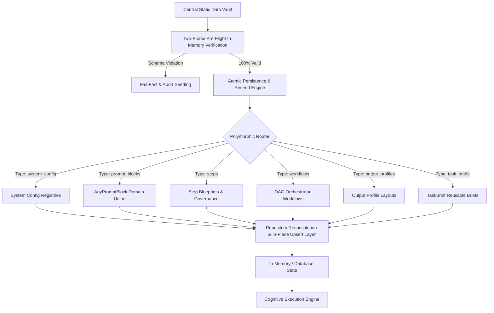

# Data Seeding & Ontology

## 1. Executive Summary
The **Data Seeding & Ontology** capability dictates that the Compound AI System is fundamentally **data-driven**, not code-driven. The entire behavior of the system—ranging from LLM instructions (PromptBlocks), allowed models, MCP tool gateways, to performative vocabularies—is defined externally in the central static data vault. The backend's primary role is to parse, validate, hydrate, and route this declarative ontology rather than hardcoding operational instructions.

## 2. Architectural Principles & Implementation

The Data Seeding & Ontology layer establishes the declarative schemas, dynamic rules, and static datasets that power the platform:

### 2.1. Polymorphic Rule Routing
All dynamic rules and criteria are modeled as a unified `PromptBlock` entity within the database. Polymorphic collection parsing automatically routes different categories of configuration data (`system_config`, `prompt_blocks`, `mcp_gateways`) into their respective Pydantic validation structures, ensuring typed domain validation before runtime execution.

### 2.2. Single Source of Truth (SSOT) Relational & JSONB Persistence Topology
The central static data vault serves as the immutable structural authority for baseline entities, while runtime persistence operates on a closed 16-table All-in-PostgreSQL 19 relational and `lz4`-compressed JSONB topology:
- **Closed 16-Table Relational Schema & Idempotent Column Evolution**: Persistence is partitioned strictly across 16 normalized tables—specifically and exhaustively: `organizations`, `users`, `invitations`, `tenant_secrets`, `system_configs`, `prompt_blocks`, `steps`, `workflows`, `output_profiles`, `task_briefs`, `executions`, `execution_assignments`, `report_artifacts`, `report_binaries`, `quorum_nodes`, and `quorum_edges`. Unapproved shadow tables are statically prohibited (`ZORM004`), every column added to an existing table (`organizations.allowed_email_domains`, `users.firebase_uid`, `users.deleted_at`, `executions.state_version`, `execution_assignments.task_brief_id` referencing `task_briefs(id) ON DELETE SET NULL` with `uuid_extract_version(task_brief_id) = 7` validation) includes a companion idempotent `ALTER TABLE ... ADD COLUMN IF NOT EXISTS` migration statement (`ZORM007`), idempotent `UPDATE executions` statements unwrap double-encoded JSONB string values (`jsonb_typeof(col) = 'string'`) across all 11 `executions` JSONB columns and normalize `metadata->'global_context_vars'->>'_sys_initiator_id'` into `initiator_id`, and idempotent `DELETE FROM system_configs WHERE name IS NULL;`, `ALTER TABLE system_configs ALTER COLUMN name DROP DEFAULT;`, and `ALTER TABLE system_configs ALTER COLUMN name SET NOT NULL;` constraint evolution statements lock required display naming on `system_configs`.
- **Native RFC 9562 `uuidv7()` Primary Keys, Universal Entity Display Columns & Relational Sovereignty**: All 13 canonical entity tables (`CANONICAL_ENTITY_PK_TABLES`: `organizations`, `users`, `invitations`, `tenant_secrets`, `execution_assignments`, `workflows`, `steps`, `prompt_blocks`, `output_profiles`, `task_briefs`, `system_configs`, `executions`, `report_artifacts`) alongside `report_binaries`, `quorum_nodes`, and `quorum_edges` enforce native PostgreSQL 19 `id UUID PRIMARY KEY DEFAULT uuidv7()` primary keys validated by `CHECK (uuid_extract_version(id) = 7)` constraints (`ZORM004`). Every named domain entity table (`CANONICAL_NAMED_ENTITY_TABLES`: `organizations`, `users`, `system_configs`, `prompt_blocks`, `steps`, `workflows`, `output_profiles`, `task_briefs`, `report_artifacts`) declares its required human-readable display column (`name`, `label`, or `title`), all foreign keys targeting entity tables use `REFERENCES <table>(id)` exclusively, and relational foreign-key (`*_id`), `name`, `label`, `title`, `slug`, and `storage_mode` columns never declare SQL `DEFAULT` clauses (`ZORM004`). Informational `slug` columns are statically barred from SQL `UNIQUE` constraints and from `WHERE` or `JOIN ... ON` query predicates (`ZORM007`). Temporal ordering and range scans on high-volume tables leverage zero-storage `GENERATED ALWAYS AS (uuid_extract_timestamp(id)) VIRTUAL` columns paired with extended planner statistics (`CREATE STATISTICS`), while bijectively mapping to external Opaque Stripe IDs (`org_`, `usr_`, `inv_`, `sec_`, `tsk_`, `wf_`, `sp_`, `blk_`, `op_`, `tbr_`, `sys_`, `exe_`, `rep_`, `nod_`, `edg_`).
- **`lz4` TOAST Compression & Binary Payload Isolation**: Database sessions enforce `SET default_toast_compression = 'lz4'` and explicit `COMPRESSION lz4` column directives across variable-length `JSONB`, `TEXT`, and `BYTEA` payloads (`executions.frozen_context`, `executions.execution_trace`, `executions.trace_events`, `execution_assignments.prefilled_input_data`, `execution_assignments.draft_input_data`, `report_artifacts.sdui_json`, `report_binaries.data`, `quorum_nodes.payload`). Compiled PDF and Excel binary downloads are isolated in the dedicated `report_binaries` table (`ReportBinaryPayloadDTO`), preventing binary blob reads from bloating `ReportArtifact` metadata queries.
- **Flat FinOps Column Normalization & Optimistic Concurrency Versioning**: Execution telemetry metrics (`prompt_tokens`, `completion_tokens`, `cached_tokens`, `reasoning_tokens`, `cumulative_synthesis_tokens`, `dag_cost_usd`, `cumulative_synthesis_cost`, `cost_estimate`, `models_used`) and optimistic concurrency version counters (`state_version`, `INTEGER NOT NULL DEFAULT 1`) are persisted as first-class scalar columns on `executions` alongside `step_states` and `steps` JSONB projections, maintaining 1:1 column naming parity with `ExecutionRecord`.
- **Stage-Partitioned Zero-ORM Entity Persistence (`PostgresEntityAdapter`)**: Relational and JSONB entity persistence (`EntityPersistencePort`) is decomposed into six single-responsibility persistence stages unified behind the `PostgresEntityAdapter` coordinator facade: (1) leaf column coercion, sentinel tenant UUIDv7 constants (`_SYSTEM_ORG_UUID7`, `_ROOT_SYSTEM_ORG_UUID7`), and parameterized upsert execution (`execute_entity_upsert`); (2) IAM (`organizations`, `users`, `invitations`, `tenant_secrets`, `execution_assignments` including nullable `task_brief_id` `EntityPrefix.TASK_BRIEF` hydration) and `system_configs` persistence; (3) polymorphic `PromptBlock` (`PROMPT_BLOCK_ADAPTER`) and `Step` persistence; (4) `Workflow`, `OutputProfile`, and `TaskBrief` persistence; (5) `ExecutionRecord`, `ReportArtifact`, and `BYTEA` `report_binaries` persistence; and (6) transactional seed batch upserts (`seed_collection_batch`), 14-table count verification (`verify_seed_table_counts`), and generic collection CRUD. Every persistence stage enforces explicit query command timeouts (`postgres_command_timeout_seconds`), strict Pydantic V2 `model_validate(strict=False)` row hydration, and RFC 7807 `STORAGE_ACCESS_FAILED` / `VALIDATION_FAILED` dual-reporting.
- **Dynamic Response Stitching**: The underlying storage remains flat and relational across root tables, while backend APIs construct nested and stitched views (specifically combining `Workflow` entities with `OutputProfile` options) dynamically via dedicated response DTOs.

### 2.3. Dual-Tool Seed Governance & Sanitization Architecture
Seed data quality and consistency are maintained through a decoupled inspection and transformation architecture:
- **Static Heuristic & Canonical Entity Inspection**: A read-only verification engine audits all 8 root database collections (`SEED_COLLECTION_ALLOWED_PREFIXES`: `organizations`, `users`, `system_config`, `prompt_blocks`, `steps`, `workflows`, `output_profiles`, and `task_briefs`) via `audit_canonical_entity_ids` alongside matrix TDA polarity, AST pattern rules, and prompt conventions. It verifies that every record declares a valid 32-hex RFC 9562 UUIDv7 Opaque Stripe `id` (`OPAQUE_STRIPE_ID_REGEX`) with its collection-specific prefix, zero duplicate IDs exist within or across collections, zero records contain banned alternative primary-key fields (`BANNED_ALTERNATIVE_PK_KEYS`), every record declares a non-empty human-readable display field (`name` or `label` per `SEED_COLLECTION_REQUIRED_DISPLAY_FIELD`), and 100% of cross-collection foreign keys (`users.organization_id`, `workflows.model_registry_id`, `workflows.mcp_gateway_id`, `workflows.default_profile_id`, `workflows.organization_id`, `output_profiles.workflow_id`, `output_profiles.organization_id`, `output_profiles.variance_target_block`, `output_profiles.user_role_target_block`, and `task_briefs.organization_id`) resolve to existing target entity `.id` records, returning deterministic compliance exit codes without modifying persistent state.
- **In-Memory Sanitization & Transformation**: A declarative transformation pipeline strips unauthorized formatting artifacts, screaming imperatives, and mechanical counting directives from prompt text, re-validates entities against strict domain schemas, and writes changes atomically.

### 2.4. Two-Stage In-Memory Pre-Flight Validation & Authoritative 14-Table Seeding
Database seeding enforces a two-stage protocol that isolates schema validation from relational state mutation:
- **In-Memory Pre-Flight Verification**: The seeder loads master seed data and validates 100% of collection records in memory into an immutable `ValidatedSeedBufferDTO` (`ConfigDict(strict=True, extra="forbid", frozen=True)`) in topological foreign-key order (`organizations`, `users`, `system_config`, `prompt_blocks`, `steps`, `workflows`, `output_profiles`, `task_briefs`), preserving all qualitative coaching prompts verbatim. When running in local validation mode (`--dry-run`), `LocalSeedSecretsSettings` additionally validates the local secret configuration in memory without mutating PostgreSQL 19 tables or invoking external authentication APIs. If any record fails validation, the process halts immediately with an explicit validation error, leaving PostgreSQL 19 tables untouched.
- **Migration Preflight, Authoritative Relational Upsert, Unified Local Secret Seeding & 14-Table Count and Schema Verification**: Once in-memory validation succeeds, the seeder opens an atomic `QuorumUnitOfWork` transaction, invokes `uow.pool_manager.apply_migrations()` to apply idempotent DDL and `ALTER TABLE ... ADD COLUMN IF NOT EXISTS` statements, verifies all 16 schema tables via `verify_schema_tables()`, resets all 12 canonical seed tables (`CANONICAL_SEED_TABLES`: `quorum_edges`, `quorum_nodes`, `report_binaries`, `report_artifacts`, `execution_assignments`, `executions`, `invitations`, `tenant_secrets`, `task_briefs`, `output_profiles`, `workflows`, `steps`, `prompt_blocks`, `system_configs`, `users`, and `organizations` in foreign-key dependency order), executes parameterized `$1, $2` batch upserts (`seed_collection_batch`) across all 8 seeded entity collections (`organizations`, `users`, `system_configs`, `prompt_blocks`, `steps`, `workflows`, `output_profiles`, `task_briefs`), re-applies `uow.pool_manager.apply_migrations()` to lock `SET NOT NULL` column constraints on freshly upserted records, encrypts and upserts the 6 baseline platform secrets (`ai_studio`, `openai`, `anthropic`, `vertex_ai`, `default_mcp_gateway`, and Root-scoped `logfire` under `SecretScope.TELEMETRY`) from `LocalSeedSecretsSettings` into `tenant_secrets` under `SystemOrganizations.ROOT_SYSTEM` while provisioning and synchronizing the `ROOT` user (`usr_0195f3a00000700a83fd6b3d77c748f4`) in Firebase Authentication (`_provision_root_firebase_user`), and runs `verify_seed_table_counts` across all 14 core PostgreSQL 19 tables (`organizations`, `users`, `invitations`, `tenant_secrets`, `system_configs`, `prompt_blocks`, `steps`, `workflows`, `output_profiles`, `task_briefs`, `executions`, `execution_assignments`, `report_artifacts`, `report_binaries`), which also hydrates all `system_configs` rows via `list_collection_documents_rows` and `hydrate_system_config_row` whenever `system_configs` or `system_config` requires at least one row, failing fast with `AppException` (`ErrorCodes.CONFIGURATION_ERROR` or `ErrorCodes.VALIDATION_FAILED`) if any of the required seeded tables reports zero rows or any `system_configs` row violates Pydantic V2 schema validation.

### 2.5. Atomic Master Seed Persistence & PostgreSQL 19 ACID/MVCC Concurrency
Master seed file persistence and runtime database storage enforce atomic durability and transactional concurrency:
- **Temporary Replacement Writes**: Master seed file persistence writes serialized JSON to isolated temporary files, flushes and synchronizes disk buffers (`os.fsync`), verifies complete re-loadability in memory, and replaces the target file via atomic OS replacement operations.
- **PostgreSQL 19 ACID Transactions & MVCC**: Runtime database concurrency relies exclusively on PostgreSQL 19 ACID transactions (`repeatable_read` isolation in `PostgresUnitOfWork`) and Multi-Version Concurrency Control (MVCC) over `asyncpg` connection pools, eliminating OS-level file locking across concurrent execution runs.

### 2.6. Single-Entity Router SSOT, Universal Blueprint CRUD + Clone Lifecycle & Three-Layer Delete Protection
Runtime persistence repositories and ingress API routers maintain ontology state through a single-entity router topology and a standardized lifecycle contract:
- **Single-Entity Router Sovereignty (1 Entity = 1 Router SSOT)**: Every domain entity possesses one authoritative API router mounted at a single canonical `/api/v2/...` endpoint prefix. Route handlers for a single entity never split across separate router packages, never attach duplicate shadow route decorators, and never mount simultaneously under multiple prefixes or legacy `/api/v1` paths. Automated OpenAPI route-table verification enforces zero `/api/v1` routes, zero doubled `/api/v2/system/system` prefixes, zero shadow prefixes (`/api/v2/execution/reports`, `/api/v2/execution/workflows`, `/api/v2/studio/profiles`, `/api/v2/studio/system-configs`), and zero duplicate path-and-method combinations across the application.
- **Standardized 5-Operation CRUD + Draft + Clone Blueprint Contract**: All seven configurable ontology blueprint entities—specifically and exhaustively: `Workflow` (`/api/v2/studio/workflows`, including `GET /{id}/ui_schema`, simulation, and extension discovery), `Step` (`/api/v2/studio/steps`), `PromptBlock` (`/api/v2/studio/prompt-blocks`), `OutputProfile` (`/api/v2/output-profiles`), `TaskBrief` (`/api/v2/studio/task-briefs`), `SystemConfigModelRegistry` (`/api/v2/studio/model-registry`), and `SystemConfigMCPGateways` (`/api/v2/studio/mcp-gateways`)—expose the complete 5-operation lifecycle (`GET /`, `POST /`, `GET /{id}`, `PUT /{id}`, `DELETE /{id}`, and `POST /{id}/clone`):
  1. *HTTP Boundary Identifier & Payload Parity*: Path parameters bind `OPAQUE_STRIPE_ID_REGEX` (`^([a-z]{2,5})_[a-fA-F0-9]{32}$`) at the router boundary, and `PUT /{id}` endpoints enforce Fail-Fast `ErrorCodes.ID_MISMATCH` (`400`) validation before delegating to the service layer.
  2. *Dynamic Polymorphic & Blueprint Draft Instantiation*: `POST /api/v2/studio/prompt-blocks/` accepts a typed `category_id: PromptBlockCategory` query parameter (defaulting to `PromptBlockCategory.SYSTEM_RULE`). Requesting `category_id=PromptBlockCategory.MATRIX` dynamically instantiates a valid `MatrixPromptBlock` draft with an initial `MatrixScale(score=1)` level, while requesting `PromptBlockCategory.SYSTEM_RULE` or `PromptBlockCategory.RUNTIME_VARIABLES` instantiates a `SystemRulePromptBlock` preserving the exact requested `category_id` (`resolved_rule_category`). Concurrently, `POST /api/v2/studio/task-briefs/` instantiates a standalone `TaskBrief` blueprint (`EntityPrefix.TASK_BRIEF = "tbr"`) via `StudioTaskBriefService.create_task_brief_draft`, enabling interactive creation and cloning of system rules, runtime variable definitions, evaluation matrices, and reusable candidate task briefs across Quorum Studio and tenant IAM surfaces.
  3. *Immutable Entity Cloning & Specialist Step Unlocking*: `POST /{id}/clone` executes pure `.model_copy(update={...})` with a freshly generated 32-hex RFC 9562 UUIDv7 identifier (`generate_opaque_id(EntityPrefix.<TYPE>)`), localized copy suffix (`original.name.with_copy_suffix()`), and zero dictionary round-trips. Cloning a `Step` resets `is_system_core=False` while preserving its informational `slug`, allowing authors to clone locked system-core steps into freely editable and deletable specialist step blueprints.
  4. *Forensic & Identity Demarcation*: Entities governed by append-only forensic immutability, cryptographic secret isolation, or identity uniqueness—specifically `ExecutionRecord`, `ExecutionAssignment`, `ReportArtifact`, `User`, `Organization`, `Invitation`, and `TenantSecretDTO`—never expose `/clone` endpoints, operating instead through deterministic state-machine transitions (`POST /exchange`, `POST /logout`, `POST /impersonate`, `PUT /{org_id}/secrets/{provider}`, `POST /{org_id}/invitations`, `POST /invitations/accept`, `GET .../preview`, `POST .../activate`, `PUT .../draft`, `POST .../submit`, `POST /{id}/revoke`, and `PATCH /{id}/extend`) within their respective single-entity routers.
- **Three-Layer Fail-Fast Delete Protection**: All blueprint `DELETE /{id}` operations enforce three sequential verification layers before repository deletion:
  1. *Layer 1 (RBAC & Tenant Isolation — `403 PermissionDeniedError`)*: Blocks `MEMBER` and `VIEWER` roles, cross-tenant deletions, and any non-`ROOT` attempt to mutate or delete `ROOT_SYSTEM` entities (`allow_system=False` on `SystemConfigMCPGateways` and `SystemConfigModelRegistry`).
  2. *Layer 2 (System-Core & Cardinality Guard — `403 ErrorCodes.SYSTEM_PROTECTED_RESOURCE`)*: Blocks deletion of foundational steps (`Step.is_system_core == True`), protocol prompt blocks (`PromptBlockCategory.PROTOCOL` when `not force_delete`), and the last remaining `SystemConfigModelRegistry`.
  3. *Layer 3 (Referential Integrity Guard — `400 ErrorCodes.DELETE_BLOCKED_BY_USAGE`)*: Blocks deletion of any `Step` actively referenced in `Workflow.steps` (`rule.task_blueprint`), any `PromptBlock` or `MatrixPromptBlock` referenced in V2 `Step` fields (`role_block_id`, `extraction_protocol_block_id`, `execution_persona_block_id`, `criteria_block_ids`), or any `OutputProfile` configured as `Workflow.default_profile_id`.
- **Cross-Entity Workflow & OutputProfile Target Block Synchronization**: Saving a `Workflow` via `StudioWorkflowService.save_workflow` automatically synchronizes all linked `OutputProfile` entities (`profile.workflow_id == workflow.id`) against `workflow.get_allowed_layout_targets` and `workflow.get_allowed_prompt_block_targets`. Unreferenced block IDs are pruned from `matrix_synthesis_groups[*].target_blocks` (deterministically coercing `view_type` from `MATRIX_3D` to `COMPARE_2D` when 2 blocks remain or `METRICS_1D` when 1 block remains, dropping empty groups, and removing `TargetBlockType.MATRIX_GRAPHS_BLOCK` from `target_block_order` when no groups remain), while stale `variance_target_block` (alongside `TargetBlockType.VARIANCE_VALIDATION_BLOCK` and `XaiExtensionType.VARIANCE_VALIDATION`) and `user_role_target_block` pointers are cleared and persisted. Conversely, saving an `OutputProfile` via `StudioOutputProfileService.save_output_profile` validates all `matrix_synthesis_groups[*].target_blocks` against `allowed_layout_targets` and validates `variance_target_block` and `user_role_target_block` against `allowed_prompt_blocks`, rejecting invalid references with `400 ErrorCodes.VALIDATION_FAILED`.
- **In-Place Upsert & Polyfactory Identifier Parity**: Runtime persistence repositories maintain state through in-place atomic upsert operations keyed by canonical Opaque Stripe IDs without creating duplicate shadow instances. Authoritative PostgreSQL 19 seeded entity prefixes (`EntityPrefix.WORKFLOW`, `EntityPrefix.OUTPUT_PROFILE`, `EntityPrefix.TASK_BRIEF`, `EntityPrefix.PROMPT_BLOCK`, `EntityPrefix.STEP`, `EntityPrefix.EXECUTION`, `EntityPrefix.REPORT`, `EntityPrefix.ORGANIZATION`) are aligned 1:1 with centralized Polyfactory test model factories (`WorkflowFactory`, `SystemRulePromptBlockFactory`, `OutputProfileFactory`, `TaskBriefFactory`, `MatrixPromptBlockFactory`, `ExecutionStepFactory`, `ExecutionRecordFactory`, and `ReportArtifactFactory`), routing all generated entity and organization identifiers exclusively through `generate_opaque_id(EntityPrefix.<TYPE>)` and enforcing canonical 32-character lowercase hexadecimal RFC 9562 UUIDv7 Opaque Stripe ID formatting (`^([a-z]{2,5})_[a-fA-F0-9]{32}$`) under static AST guardrail `QGR030` across both production and test suites.

### 2.7. Y-Funnel Pre-Hook Normalization
Data transformations during initialization utilize a Y-Funnel architecture where pre-hooks normalize heterogeneous input shapes before domain validation. This keeps core Pydantic V2 domain models pure and focused strictly on business invariants rather than ingestion gymnastics.

### 2.8. Semantic Localization via Performative Lexicons
System personality traits, terminology standards, and vocabulary constraints are governed as data rather than code. Declarative lexicons defined in seed data are injected dynamically during prompt compilation, supporting multilingual enforcement without code modifications.

### 2.9. Universal Bilingual Localization (I18nText)
User-facing dynamic strings across the ontology (profile titles, layout descriptions, preambles) utilize the strictly typed `I18nText` model in both Python and Flutter. The schema mandates complete baseline translations (`en` and target locale) with structured fallback resolution, ensuring bilingual parity across backend services, frontend widgets, and PDF generators.

### 2.10. Workflow Context Governance & Step Protection
Pipeline step definitions declare explicit system core protections (`is_system_core: true`) for foundational operations (document ingestion, scoring, synthesis, forensic reporting). Studio interface and API guardrails prevent unauthorized deletion or mutation of protected resources. Step blueprints (`Step`) and workflow step rules (`NodeStrategy`) embed an authoritative `StepZone` enum (`zone_a`, `zone_b`, `zone_c`), establishing 1:1 cross-language enum parity between backend and frontend. Steps in Zone A govern raw document ingestion (with deletion locked), Zone B hosts dynamic analytical specialists, and Zone C anchors downstream aggregation funnels (scoring, synthesis, XAI reporting). This server-driven zone classification powers Dumb Painter presentation in Quorum Studio with zero heuristic branching or client-side index calculations. Step definitions additionally declare synthesis source flags (`is_synthesis_source`), enabling deterministic context boundary governance between upstream text extraction and downstream qualitative synthesis.

### 2.11. Epistemic Separation (TheoryGrounding SSOT)
Bibliographic references and academic provenance metadata are strictly decoupled from operational prompting instructions. `PromptBlock.theory_grounding` (`TheoryGrounding`) is the sole Single Source of Truth for academic citations (`citation_reference`) and source URLs (`source_url`). `PromptBlock.ai_description` contains purely operational prompt text, allowing presentation layers and PDF reports to consume structured academic citations without prompt-scraping or token bloat.

### 2.12. Structured Few-Shot Calibration Schema (ContrastivePairDTO)
Evaluation assertions and rubrics across the ontology define structured few-shot grounding via `ContrastivePairDTO`, encapsulating `acceptable` and `rejected` exemplars with enforced minimum length boundaries and equality conflict rejection. This eliminates unstructured string delimiters and manual prefix conventions from the seed vault, guaranteeing that every matrix atom provides a pristine, strongly typed boundary definition ready for prompt compilation and direct production deployment across all environments without runtime parsing shims.

### 2.13. Matrix Seed Vault Hardening & Anti-Pattern Standards
High-entropy evaluation atoms across the 14 canonical matrices enforce deterministic anti-patterns and disambiguated multi-step acceptance criteria to eliminate subjective evaluation drift:
- **Scaffolding and Prompt Parameter Disqualification**: Explicit anti-patterns disqualify user task briefings, problem constraints, headcount allocations, and external AI dispatch instructions from satisfying cognitive competence criteria.
- **Cognitive Theory Hardening**: Atoms evaluating Bloom's Revised Taxonomy and Kahneman's Dual Process Theory enforce rigorous ontological boundaries. System 1 claims require demonstrated rule-of-thumb judgment rather than textbook definitions, while System 2 claims require active step-by-step cognitive calculation rather than passive retrospective review.
- **Multi-Step Deductive Criteria**: High-entropy triage atoms specify sequential acceptance criteria requiring multi-stage causal mediators and empirical scrutiny of proxy performance indicators, ensuring consistent interpretation across multi-provider evaluation fleets.

### 2.14. Dual-Track Matrix Schema & TDA Assertion Polarity Standards
All 15 canonical matrices in the seed vault inherit from `PromptBlockBase` as strongly typed `MatrixPromptBlock` entities (`category_id: "matrix"`, `type: "float"`), organizing assessment criteria into hierarchical `MatrixScale` levels containing Test-Driven Assertion (`TDAAssertion`) models:
- **MatrixPromptBlock Structure**: Defines scale extrema (`computed_min`, `computed_max`), localizable labels (`I18nText`), target evidence inputs (`target_input_key`: `product_text`, `chat_log`, or `all`), academic theory grounding (`TheoryGrounding`), evaluative scoring participation (`is_evaluative: bool`), and an ordered collection of `MatrixScale` objects (`scales`).
- **Evaluative Scoring Participation (`is_evaluative: bool`) & Relational Identifier Invariant**:
  - *Opaque Identifier Relational Invariant*: Entity slugs (specifically: `matrix_bloom`, `matrix_toulmin`) are strictly human-readable diagnostic labels and editorial aliases. Slugs MUST NEVER be used as relational keys, foreign keys, step criteria references (`criteria_block_ids`), output profile selectors (`variance_target_block`), or state dictionary keys (`evaluative_matrices`). ALL relational bindings and state transit across the system are keyed strictly and sovereignly by canonical opaque block IDs (`blk_...`).
  - *Evaluative Matrices (10 matrices, `is_evaluative: true`)*: Directly participate in the global holistic score average (`global_score`). Encompasses 4 Track A developmental matrices (`blk_f921c7c0989b47e8` [Bloom], `blk_f6e286f050c94d60` [TaskXAI Clarity], `blk_7d8e9f0a1b2c3d4e` [HACM], `blk_c0a1e50000000001` [Causal Cohesion]) and 6 Track B diagnostic matrices (`blk_440a5fef9331451b` [Toulmin], `blk_109dab5b6b3f403a` [Kahneman], `blk_c5804a9143c34cb1` [Causal Analyst], `blk_b476f89fb732448c` [Falsifier], `blk_22e3598e06414409` [Epistemic Humility], `blk_c3bc5f3eb8e74110` [Causal & Abductive Integrity]).
  - *Specialized Role Matrices (5 matrices, `is_evaluative: false`)*: Serve specialized non-averaging architectural functions: `blk_53f32679aa514fcb` [Goodhart] (Cartesian variance X-axis), `blk_80732a33fe1947ee` [Taskguard] (security containment guard triggering `security_penalty`), `blk_fb15f8dcf23f4865` [Archivist] (statutory compliance checklist), `blk_ff72c2d79edb4ebf` [Supreme Adjudicator] (supervisory steering discipline), and `blk_6b8c766185294f7e` [XAI Reporter] (multi-specialist consensus reporting).
- **MatrixScale Hierarchy**: Each scale level defines a numerical `score` (specifically 1 to 5, or 1 to 6 for Bloom), localized scale names (`I18nText`), an evaluator directive (`ai_label`), and constituent `claims` grouping underlying `TDAAssertion` criteria.
- **TDAAssertion Schema & Mandatory Polarity Constraints**:
  - *Track A (Developmental Competence Matrices: 7 matrices)*: Level 1 designates foundational Novice capability (`Alustava / Noviisi / Tunnistava`). All constituent TDA assertions enforce `inverse_evidence: false` and `aggregation_mode: "ALL_MUST_COMPLY"`. Level 1 measures the presence of baseline capability and awards positive capability points. Higher levels build cumulatively under the Cumulative Guttman Invariant ($L_1 \subset L_2 \subset L_3 \subset L_4 \subset L_5$). Inverting Level 1 into an error detector is strictly prohibited (Inverted Rubric Paradox ban).
  - *Track B (Diagnostic Error Radar Matrices: 8 matrices)*: Levels 1 and 2 operate strictly as error radars (`Kriittinen virhe / Vakava harhaluulo / Fatal Flaw`). All Level 1–2 TDA assertions enforce `inverse_evidence: true` and `aggregation_mode: "EXISTS"`. Zero positive assertions are permitted on Levels 1–2. Under the Null Hypothesis, clean baseline passes on Levels 1–2 award zero positive capability points, while detected errors trigger deterministic malus deductions. Positive capability points accrue exclusively from affirmative criteria on Levels 3–5 (`inverse_evidence: false`), allowing evaluative Track B matrices to achieve up to 100% normalized scores feeding directly into `global_score`.

### 2.15. Deterministic Causal Cohesion Metric Matrix & Holistic Workflow Topology
The static ontology includes pure system-evaluated metric matrices that assess structural reasoning rather than LLM text generation. The Causal Cohesion BARS Matrix (`matrix_causal_cohesion`, `blk_c0a1e50000000001`) defines a 5-level developmental competence scale evaluated deterministically from graph telemetry:
- **0-Token Execution Contract**: The matrix is strictly excluded from LLM `criteria_block_ids`. It consumes topological graph metrics (`logical_cohesion_score`, `cycle_detected`, `isolated_concept_count`) directly from upstream causal discovery step outputs, eliminating model token consumption and latency overhead for structural graph scoring.
- **Topological BARS Grounding**: Scale levels reflect structural reasoning integrity under the Cumulative Guttman Invariant ($L_1 \subset L_2 \subset L_3 \subset L_4 \subset L_5$). Cyclic dependencies trigger immediate defect grounding at Level 1 (Novice), and empty proposition graphs ground safely at the Novice floor without arithmetic faults.
- **Holistic Workflow Step Integration**: Workflows integrate causal discovery as a first-class execution step positioned in Zone B, establishing causal provenance for downstream specialist steps and funneling structural cohesion scores into synthesis comparison groups.

### 2.16. Declarative MCP Gateway Ontology & Tool Capabilities
External tool permissions and capabilities are configured declaratively in the static data vault under `system_config` (entity `sys_0195f3a00000700080008172bda70c86`):
- **Full-Duplex Contract Parity**: Gateway configurations and tool definitions enforce 1:1 schema parity between backend `SystemConfigMCPGateways` / `AllowedMCPTool` and frontend `McpGateway` / `SystemConfigMcpGatewaysDto` / `AllowedMcpTool` models. Every gateway configuration requires a non-empty human-readable `name` (`min_length=1`, persisted in `system_configs.name TEXT NOT NULL` with zero SQL `DEFAULT` fallback) alongside its informational `slug` and canonical Opaque Stripe `id` (`sys_<hex32>`). Models define gateway transport types (`MCPTransportType`: `STREAMABLE_HTTP`, `SSE`), authentication methods (`MCPAuthType`: `NONE`, `API_KEY`, `BEARER`), endpoint URLs, and discovered tools with authoritative `ToolCapability` attributes (`search`, `document_reader`, `action`).
- **Closed Recursive JSON Schema Draft 2020-12 DTO Contracts**: External tool parameters adhere to recursive JSON Schema Draft 2020-12 definitions (`MCPToolInputSchemaDTO` and `MCPToolSchemaPropertyDTO` paired 1:1 with `McpToolInputSchemaDto` and `McpToolSchemaPropertyDto`), supporting primitive and structural types (`type`), string semantic format and regular expression constraints (`format`, `pattern`), numeric bounds and divisor constraints (`minimum`, `maximum`, `exclusive_minimum`, `exclusive_maximum`, `multiple_of` with strict positivity `gt=0`), array length and uniqueness constraints (`min_items`, `max_items`, `unique_items`), composition unions (`any_of`, `one_of`, `all_of`), metadata annotations (`examples`, `deprecated`, `read_only`, `write_only`), schema references (`ref`), and root reusable definitions (`defs`), while enforcing strict unrecognized-key rejection (`extra="forbid"` and `disallowUnrecognizedKeys: true`).
- **Namespaced Tool Declarations**: Tools are declared under deterministic namespaced aliases combining gateway slug and tool identifier (specifically: `{gateway_slug}__{tool_id}`), preventing naming collisions across independent gateway providers.
- **Dynamic Studio Governance, 100% Database-Driven Secret Resolution & Default Gateway Catalog**: Tool definitions expose bilingual labels, live discovery actions (`StudioSystemConfigService.discover_mcp_gateway_tools` forwarding caller `organization_id` to `GenericMCPClient`), schema preview tables, and per-tool allowlist toggles in Quorum Studio, enabling administrators to configure and constrain external MCP capabilities per gateway with immediate schema validation. Newly drafted and cloned gateways initialize with explicit human-readable titles (`"New MCP Gateway Draft"` and `f"{existing.name} (Copy)"`), while the seeded default gateways (`sys_0195f3a00000700080008172bda70c86` with `name: "Tavily MCP Gateway"`, `slug: "default_mcp_gateway"`, and `auth_env_var: null` for Tavily web search and document extraction via `tavily_search` and `tavily_extract`, and `wikipedia_mcp` for encyclopedic search and article reading) resolve runtime authentication 100% from PostgreSQL 19 `tenant_secrets` via `SecretService.resolve_mcp_credential` and include complete multi-parameter input schemas ready for Studio parameter override authoring.
- **Authoritative Seeding & Lossless `lz4`-Compressed JSONB Persistence**: System configuration documents (specifically and exhaustively: `SystemConfigMCPGateways`, `SystemConfigModelRegistry`, and `SystemSettingsDTO`) are seeded into the `system_configs` table with canonical opaque stripe IDs (`sys_...`) and non-null `name` columns via `seed_collection_batch` and reconstituted via polymorphic `AnySystemConfig` validation. Step-level tool bindings and parameter overrides (`allowed_mcp_tools` and `mcp_tool_params`) are persisted on `steps`, and runtime tool audit traces (`MCPAuditTrace`) are persisted inside `executions.trace_events` and `executions.execution_trace` using `lz4`-compressed JSONB columns serialized via the binary `pydantic_core` `\x01` codec with zero schema loss.

## 3. Logical Data Flow

