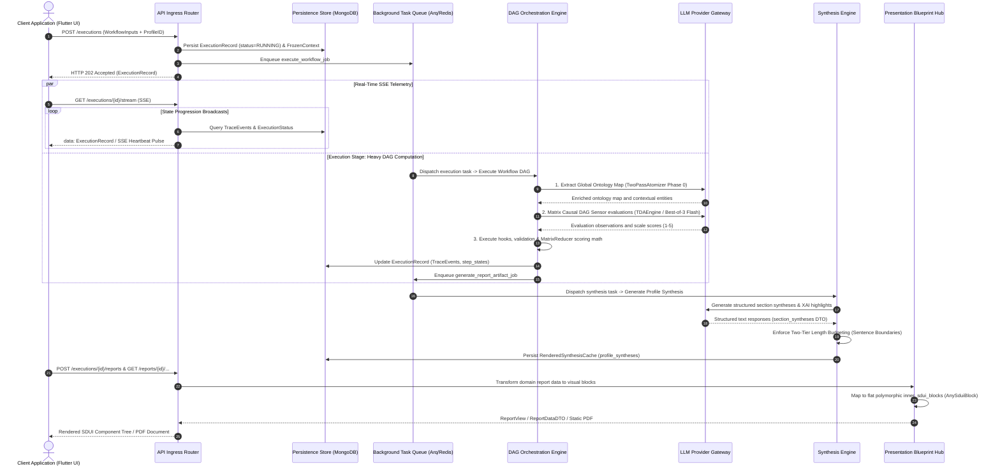

# Cognitive Orchestration Engine

## 1. Executive Summary
The **Cognitive Orchestration Engine** capability is the computational "Brain" of the Compound AI System. It is responsible for taking declarative ontology from the database (PromptBlocks, Workflows, Steps, OutputProfiles), binding it with validated user input, and executing it against foundational language models. This capability is engineered for deterministic reasoning, fault tolerance, low latency, and prefix-matching context caching, utilizing parallel consensus patterns, acyclic topological graph execution, and multi-tier output governance to guarantee robust operation across model providers.

## 2. Architectural Mechanisms & Invariants

The Cognitive Orchestration Engine combines declarative database ontology with runtime state to execute tasks against foundational language models:

### 2.1. Consensus Evaluation via Best-of-Three Flash
Critical reasoning and evaluation tasks dispatch three concurrent lightweight LLM requests (utilizing the `fast` strategy tier) wrapped in a structured `asyncio.TaskGroup`. The system aggregates the parallel responses and resolves the outcome through 2/3 majority consensus:
- **Consensus Resolution**: Requires at least two valid results out of three parallel calls, establishing consensus whenever a 2/3 majority is reached.
- **Epistemic Null Hypothesis Tie-Breaker**: For inconclusive split votes (specifically: 1 PASS, 1 FAIL, 1 ERROR), the tie is resolved using an $O(1)$ polarity mapping (`is_inverse_map`). Inverse assertions (`is_inverse=True`, evaluating the absence of error) resolve to `PASSED` under the presumption of innocence, while standard positive assertions (`is_inverse=False`, requiring affirmative proof) resolve to `FAILED` under the Null Hypothesis.
- **Forensic Guarantee**: Preserves valid evidence quotes on winning consensus while strictly forbidding quote hallucination on tie-broken or failed atoms.

### 2.2. Provider-Agnostic Static-First Context Caching
To maximize context cache survival across foundational model providers (specifically Anthropic, OpenAI, and Google Vertex AI), prompt compilers assemble context payloads using a strict "Static-First, Dynamic-Last" topology. Static components (system instructions, structural schemas, performative lexicons, and source texts) are positioned at the beginning of the prompt as an unbroken, mathematically identical prefix. Dynamic data (execution variables, dynamic parameters, and atom queries) is placed at the absolute end of the payload within dedicated `<execution_parameters>` or `<user_payload>` blocks.
The caching layer computes deterministic SHA-256 composite signatures across the static prefix to verify cache hits across requests. Cache lifecycles are hoisted to the orchestrator layer (pre-caching documents before entering parallel tasks, with teardown wrapped in a `try...finally` block after task completion) to prevent premature cache eviction during concurrent execution.

### 2.3. Unified Model Multiplexing & Sovereign Provider Routing
Domain services do not hardcode specific model strings, provider SDKs, or vendor-specific API parameters. All requests route through a centralized, database-driven Model Registry:
- **Abstract Cognitive Tiers**: Services request performance tiers (`fast`, `balanced`, `deep`, `reasoning`), and the registry dynamically resolves the active provider adapter, temperature, top_p, and routing configuration from database system configuration (`SystemConfigModelRegistry`).
- **Sovereign Provider Decoupling**: Google Cloud Vertex AI (`LLMProvider.VERTEX_AI`) and Google AI Studio (`LLMProvider.AI_STUDIO`) are completely decoupled across models, settings, adapters, and UI. Vertex AI routes through GCP Application Default Credentials (ADC) with explicit regional routing (`europe-north1` Hamina in production), while AI Studio routes through standalone environment keys (`google_api_key`).
- **Typed Relation Invariants**: Provider resolution, adapter factory lookup (`LLMCacheAdapterFactory`), and credential binding are executed strictly via typed enum relations (`provider_type: LLMProvider` or `config.provider`). Substring parsing, keyword marker lists, and string-prefix heuristics (`startswith("vertex_ai/")`) are prohibited.
- **Provider Adapter Encapsulation**: Vendor-specific behaviors (Vertex cached contents with distributed Redis locks via `VertexAICacheAdapter`, Google AI Studio caching via `AIStudioCacheAdapter`, Anthropic cache control headers, and OpenAI automatic caching) are encapsulated within concrete provider adapter implementations.
- **Live Model Garden Discovery Hub**: Available models are discovered dynamically via `LLMHandler`. For Vertex AI, models are discovered via a two-stage dynamic query: Stage 1 queries Google's primary master catalog from `settings.discovery_location` (`DISCOVERY_LOCATION` in `.env`, defaulted and stored as `us-central1`) via `client.models.list(config={'query_base': True})`, and Stage 2 validates operational availability against the configured target region (`settings.vertex_location`, specifically `europe-north1` Hamina) with resilient `genai_errors.APIError` handling that gracefully skips models not yet available in the target region without service disruption. For AI Studio and OpenAI, discovery queries their authoritative APIs directly.
- **Pricing Registry SSOT**: Token unit rates and cost metrics are resolved strictly from the authoritative LiteLLM model pricing registry, providing unified FinOps cost accounting and savings estimates without secondary shadow pricing tables.
- **Observability & GenAI Semantic Conventions**: Outbound model executions automatically trace under OpenTelemetry and Logfire semantic conventions, preserving active trace context across provider adapters, capturing unit token usage and latency metrics, recording explicit context cache hit indicators on active spans, and instrumenting external Model Context Protocol (MCP) tool calls.
- **Zero Silent Fallback Guarantee**: If an API call fails, credentials are missing, or retry limits are exhausted, the engine halts immediately with an explicit `AppException` rather than silently substituting an alternate model, preserving longitudinal consistency and audit baselines.

### 2.4. Two-Tier Concurrency Architecture & Micro-Throttling Isolation
Parallel execution enforces strict concurrency bounds across decoupled tiers:
- **Macro-Level Workflow Concurrency**: Background workers in the Arq daemon govern simultaneous workflow execution jobs (`settings.max_concurrent_workflows`).
- **Micro-Level Provider Dynamic Throttling**: The foundational model provider (`LiteLLMProvider`) manages an internal dynamic semaphore pool (`semaphore_low_rpm_threshold`, `semaphore_low_rpm_limit`, `semaphore_max_concurrency`, `semaphore_rpm_divisor`) based on provider RPM tiers, dynamically protecting external model APIs from rate-limit exhaustion.
- **Synthesis Fan-Out**: Phase 2 parallel synthesis fan-out is governed by central limits (`settings.max_concurrent_llm_steps`).
- **Pure Stateless Computation**: Execution engines (`PromptEngine`, `SynthesisEngine`, `TDAEngine`) and sub-executors operate as pure computational pipelines with zero semaphore or event primitives, eliminating recursive locks, lock starvation, and priority inversions under peak loads.

### 2.5. Data Ingestion & Context Preflight
External inputs (documents, web resources, uploaded files, and conversational transcripts) are processed through dedicated ingestion providers that extract, sanitize, and flatten raw text. Before model execution, context preflight validates token consumption against window constraints, applying deterministic pagination and chunking where required to ensure that model input limits are never exceeded.

#### Dynamic Input Provenance & Context Packaging
Ingestion and prompt packaging adhere to dynamic input provenance without hardcoded document enums, fixed triads, or static file counts:
- **Dynamic Topology Agnosticism**: Workflows configure arbitrary dynamic input keys (`input_key: str`). Processing pipelines support any number of inputs ($1, \dots, N$) deterministically.
- **Unconditional Ingress Directive Packaging**: `SourceDocumentPacker` wraps every targeted dynamic input payload unconditionally in an `<ai_context_directive document="{input_key}">` XML block. When input metadata lacks explicit descriptions or instructions, the directive envelope remains present with empty directive content, ensuring consistent document identification downstream.
- **Paragraph Directive Stripping & Provenance Tracking**: In `CausalDiscoveryEngine`, incoming text is split into sequential paragraphs `[B{i}]`. Directive tags are stripped from emitted paragraph texts to prevent models from generating spurious claims from packaging headers, while each paragraph is tagged with its originating `source_input_key`.
- **Dynamic Role Resolution**: Input roles and ownership boundaries are resolved dynamically via `ExpectedInput` schema attributes:
  * `is_endorsed_deliverable`: Marks candidate-authored work product, defining the subject population for deliverable subgraph induction and documentation volume metrics.
  * `is_chat_history`: Identifies conversational dialogue, separating candidate turns from assistant responses.
  * `is_assignment`: Quarantines evaluator task directives and task constraints into `<assignment_context>` capsules, preventing external normative instructions from being quoted as candidate work.

### 2.6. Two-Pass Atomization & Topological DAG Execution
Complex evaluation workflows decompose tasks into atomic units and structured matrix assertions:
1. **Pass 1 (Ontology Extraction)**: Extracts global domain entities, document themes, and semantic anchors into a unified `GlobalOntologyMap` injected into evaluation contexts.
2. **Matrix Causal DAG (Pre-compiled Assertions)**: Operates on pre-compiled matrix assertions carrying pre-defined causal dependencies (`FlattenedAtom.depends_on`). Local chunk claim extraction (Pass 2) and the Sliding Window Linker operate as decoupled exploratory knowledge extraction services (specifically during RAG Preflight).
These units form a Directed Acyclic Graph (DAG) whose dependencies, edge constraints, and topological order are resolved before dispatching to specialized cognitive engines.

#### Document Paragraph Indexing & Boundary Monotonicity
Ingested source text across discovery and preflight engines (`CausalDiscoveryEngine`, `TDAEngine`, `RAGPreflightService`) is indexed using strictly sequential, 0-indexed integer identifiers (`[B{i}] {paragraph}`). Because paragraph markers represent physical geometric positions rather than deduplicated domain entities, natural-language prose is never passed to `AliasEngine` for block registration. If an ingestion payload lacks valid paragraph structure, the engine triggers immediate Fail-Fast with `HTTP 422 Unprocessable Content`.

#### Packet Boundary Defense & Fault-Tolerant Atom Filtering
In `TwoPassAtomizer`, chunk packet boundaries enforce contiguous ranges (`start_block_id` to `end_block_id`), validated by format verification (`key.startswith("B") and key[1:].isdigit()`). When an extraction task produces an atom citing a block identifier outside the assigned packet bounds, `TwoPassAtomizer` logs a structured warning (`corrupted_atom_dropped`) and continues processing remaining valid atoms in the chunk rather than raising an unhandled `ValueError` that terminates the parallel `asyncio.TaskGroup`.

#### MatrixReducer Pre-Evaluation Gating
In `DAGExecutor`, invocation of `MatrixReducer.reduce_matrix(exec_record)` is strictly gated on the presence of evaluated atoms across step execution records. If an execution terminates prior to atom evaluation (specifically during preflight validation failures), `MatrixReducer` is bypassed, eliminating synthetic empty reductions and duplicate execution warnings.

#### Wave-Based Topological TaskGroup Execution & DLQ Recording
Macro step execution within `DAGExecutor` organizes workflow steps into Kahn's topological waves. Independent steps within each wave execute concurrently inside a structured `asyncio.TaskGroup`. When a step fails or is cancelled, the wave traps the failure via PEP 758 bracketless `except*` handlers, deterministically terminates sibling coroutines, and commits all cancelled and unreached steps to the Dead Letter Queue (DLQ) via `_dlq_record_step_failure`, guaranteeing that no step remains stranded in an unresolved `PENDING` state.

#### Atomic Step Transitions & Lock-Guarded State Synchronization
All DAG step state transitions are centralized in the atomic `ExecutionRecord.transition_step(step_id, status, progress, label, last_error, has_warning)` method. `DAGExecutor` acquires `async with self._update_lock:` to atomically synchronize both the `step_states` mapping and the `steps` list representation in an immutable model copy without in-place mutation, eliminating split-brain desynchronization and lock starvation without holding update locks across network requests or database commits.

#### Pure State Reduction, Event-Sourced Context Updates & Wave Propagation
Post-hook cognitive updates and pipeline deltas are processed through pure functional state reduction (`state_reducer.py`). Hook deltas (specifically `MatrixHookResultDTO` and `PassivityDetectionResultDTO`) map directly into typed fields on `GlobalContextVarsDTO` (including `evaluative_matrices` and `passivity_detected`) and merge into `ExecutionInputsDTO` without untyped dictionary accumulators or wrapper classes. When cognitive state is updated, the reducer emits a decision `TraceEvent` carrying `metadata.is_context_update = True`.
Within `DAGExecutor`, the atomic `_update_lock` processes these events, validates the incoming payload using `GlobalContextVarsDTO.model_validate`, updates the in-memory global context variables, and commits them to `ExecutionRecord.metadata.global_context_vars`. Subsequent topological waves inherit this cumulative global context on their step `HookState`, ensuring deterministic, typed transit across wave boundaries. In `LLMStrategy`, post-hook matrix scorecard outputs and evaluative matrices are preserved in the execution result to guarantee uninterrupted delivery to downstream domain parsers and state projectors.

#### TopologicalEvaluator Wave Crash Recovery
Micro-level graph evaluation within `TopologicalEvaluator` shields batch evaluation callbacks against unhandled exceptions. Catching `BaseException` (including `ExceptionGroup`, `AppException`, and runtime cancellations) during batch execution marks all pending nodes in that wave and all unreached downstream children as `ExecutionStatus.SYSTEM_ERROR` or `ExecutionStatus.BLOCKED` with explicit crash reasoning, guaranteeing that graph evaluation never halts in an unrecoverable corrupted zombie state. Nodes marked `N_A`, `BLOCKED`, or `SYSTEM_ERROR` are completely pruned from subsequent batch dispatch.

#### Causal Cohesion BARS Evaluation & Idempotent DAG Fusion
When a specialist step in Zone B binds an upstream causal discovery source (`step_obj.causal_source_step_id`), `DAGExecutor` executes argument causal fusion via `compute_causal_tda_fusion_result`. Graph telemetry is evaluated into a unified BARS score through the pure, stateless service `CausalCohesionEvaluator`:
- **Idempotent Evaluation Guard (`_evaluated_causal_sources`)**: To prevent race conditions and duplicate atom emission during concurrent DAG waves, `DAGExecutor` tracks evaluated causal sources within an in-memory set. When multiple Zone B specialist steps reference the same causal discovery source, cohesion evaluation executes exactly once. Subsequent steps reuse the upstream causal graph and fusion results without duplicate atom generation or execution trace pollution.
- **Topological BARS Scale Derivation**: `CausalCohesionEvaluator` maps topological metrics from `AntiFluffAuditDTO` (`logical_cohesion_score`, `cycle_detected`, `isolated_concept_count`) into BARS 1–5 scale levels. It enforces the Cumulative Guttman Invariant ($L_1 \subset L_2 \subset L_3 \subset L_4 \subset L_5$) against thresholds defined in central configuration (`settings.causal_cohesion_l2_threshold` through `settings.causal_cohesion_l5_threshold`). Cyclic dependencies ground the evaluation immediately at Level 1 (Novice), and zero-node graphs ground at the Novice floor without arithmetic faults.
- **Atomic Context Reconciliation**: Cohesion evaluation emits individual `AtomResultDTO` output events and a decision `TraceEvent` with `metadata.is_context_update = True` carrying `GlobalContextVarsDTO(evaluative_matrices={matrix_id: score})`. `DAGExecutor` reconciles these updates within `async with _update_lock:` directly into in-memory global context variables and commits them to `exec_record.metadata.global_context_vars` without requiring state reducer mutations, ensuring subsequent topological waves inherit the cumulative global context deterministically.

#### Bounded Deliverable Root Axiom Anchoring & Dual Fault Attribution
In autonomous causal discovery (`SlidingWindowLinker`), candidate root axioms originating from candidate-endorsed deliverables (`InDegree(v) == 0`) are identified and sorted deterministically by out-degree centrality and text sequence:
$$\text{Rank}(v) = \langle -\text{OutDegree}(v), \text{atom\_index}_{\text{asc}} \rangle$$
Up to $K_{\text{axiom}}^{\max} = 8$ top-ranked axioms are injected into a persistent `--- GLOBAL CONTEXT ANCHORS (ROOT AXIOMS) ---` header prepended to downstream chunk packets. To guarantee adequate context capacity for current-window proposition discovery, the effective root axiom quota $K_{\text{eff}}$ adapts dynamically to the current window size $W_{\text{current}}$:
$$K_{\text{eff}} = \min(K_{\text{axiom}}^{\max}, \max(0, M_{\text{win}} - W_{\text{current}})), \quad W_{\text{min}} = 12, \quad M_{\text{win}} \le 20$$
reserving a guaranteed minimum quota $W_{\text{min}} = 12$ atoms for current-window claims while bounding total window size to $M_{\text{win}} \le 20$ atoms. Crucially, root axioms participate in pairwise dependency extraction in a single deterministic topological pass without recursive graph traversal, preserving the Local Causal Markov Condition and enabling long-range inferential links ($v_{\text{root}} \xrightarrow{\mathbf{W}} u_{\text{leaf}}$) across arbitrary document horizons.

Within `CausalDiscoveryEngine`, Algorithm 1 dual fault attribution separates primary node defects (`NODE_FAILURE`) from broken warrant grounding dependencies (`WARRANT_GROUNDING_FAILURE`). When a causal edge warrant fails lexical verification ($\lambda(\mathbf{W}) = 0$) while parent claims pass, the engine attributes the failure specifically to the grounding warrant rather than improperly penalizing the underlying parent proposition.

### 2.7. Asynchronous Background Workers & Non-Blocking Handshake
Workflows and report generation execute completely outside the synchronous HTTP request-response cycle across decoupled background workers:
1. The API Ingress router receives an execution request, initializes and persists the execution record with `status=RUNNING`, persists the frozen context snapshot, and enqueues the heavy DAG job to the asynchronous Redis-backed task queue (`execute_workflow_task`).
2. The router returns an immediate `HTTP 202 Accepted` response with the execution record, preventing thread blocking.
3. The client connects to an independent Server-Sent Events (SSE) stream (`/executions/{id}/stream`) to receive real-time execution progress, status updates, and trace events while background worker processes compute the graph. The streaming endpoint queries execution state in a lightweight mode (`hydrate=False, skip_resumability=True`) decoupled from heavy blob loading, serializes payloads with null-exclusion (`exclude_none=True`), and governs polling cadence via central configuration (`settings.sse_polling_interval_seconds = 2.0`).

#### Worker Completion & Decoupled Lifecycle Sovereignty
Upon completion of the execution DAG topological sort and final telemetry aggregation in the execution worker:
- The execution worker transitions `ExecutionRecord.status` directly and unconditionally to `ExecutionStatus.PASSED` (or `FAILED` if unhandled execution exceptions occurred).
- Synthetic presentation step injections (specifically `sys_render_*`) are completely eliminated from `ExecutionRecord.steps` and `step_states`, preserving 100% semantic purity of the physical step execution timeline.
- If an output profile was specified at execution ingress, an independent report generation job is enqueued to the background queue (`generate_report_artifact_job`). This report job runs in isolation without blocking, delaying, or altering the finalized `PASSED` status of the execution record.

#### Decoupled Worker Architecture
Worker responsibilities follow strict Single Responsibility Principle (SRP) and Command Query Responsibility Segregation (CQRS) boundaries:
- **Execution Worker:** Dedicated exclusively to heavy DAG computation, atom evaluations, consensus voting, and telemetry persistence.
- **Report Worker:** Dedicated exclusively to qualitative synthesis and presentation compilation (SDUI JSON, PDF documents, and multi-tab Excel/CSV exports), persisting materialized `ReportArtifact` records via `generate_report_artifact_job`.
- **Worker Daemon Entrypoint:** Serves strictly as the pure Arq daemon runtime entrypoint (`WorkerSettings`, `startup`, `shutdown`, `health_check`). All worker coroutines are imported directly from their sovereign modules.

#### Sovereign Execution Services Subpackage
Execution services follow single responsibility partitions (`lifecycle_service.py`, `ingress_service.py`, `resumption_service.py`, `override_service.py`, `stream_service.py`, `context_service.py`) unified by a sovereign `ExecutionService` facade. External service bridges (storage, blueprint, pdf generator) are decoupled and purged from the package entrypoint, ensuring that execution services interact directly with canonical external services.

### 2.8. Sensor Caching Parity & Enriched Context Caching
The matrix sensor prompt compiler maintains $O(1)$ context cache efficiency across matrix assertion evaluations. It compiles global logic, matrix theory context, and large source documents into a static cache prefix, while dynamic, batch-specific assertion data is encapsulated in the dynamic user message. Parallel evaluation batches against the same source text achieve maximum cache hit rates.

### 2.9. Synthesis Payload Compression & Token Shield Stratification
Before qualitative text synthesis, execution states are distilled into compact payloads via dedicated synthesis payload compression:
- **Metadata Stripping**: All raw context keys, internal signatures, and intermediate trace metadata are stripped from the payload.
- **Evaluation Pruning**: Evaluations are normalized into distilled evaluation models with character-length bounds derived from central settings.
- **Token Shield Stratification**: When evaluation counts exceed configured thresholds, the Token Shield protocol allocates 70% of the evaluation budget to critical deficits (`FAILED`, `UNMET`, `NON_COMPLIANT`), sorts by quote length and atom identifier to prioritize rich forensic evidence, enables dynamic spillover to strengths, and applies a final canonical sort by atom identifier to guarantee byte-for-byte deterministic JSON serialization.
- **Fail-Fast Safeguard**: If an execution payload becomes empty after compression, the system halts with an explicit validation error rather than allowing the model to hallucinate an empty report.

### 2.10. Synthesis Source Filtering & Analytical Context Protection
Step definitions declare explicit synthesis source flags (`is_synthesis_source: bool`). The synthesis distillation pipeline strictly filters available source step DTOs, omitting unparsed raw document ingestion steps (`is_synthesis_source: false`) from text synthesis prompt envelopes. This preserves prompt token budgets exclusively for analytical specialist findings, preventing token saturation and attention dilution in the synthesis model.

### 2.11. Matrix Explanation Service & Evidence Curation
Matrix evaluations and qualitative explanation assembly are isolated within a dedicated matrix explanation service:
- **Tripartite Configuration Resolution**: Resolves quote and unmet criteria limits following priority order: Output Profile configuration override -> Global settings default.
- **Evidence Curation**: Curates supporting evidence using ranked round-robin selection across behavioral claims ranked by quote length, with candidate pre-deduplication to prevent single-claim and deduplication starvation.
- **Deficit Curation**: Curates unmet criteria sorted in ascending scale score order with alphabetical tie-breaking on claim label (critical deficits first).
- **Direct Rust Serialization**: Enforces direct C/Rust serialization via a dedicated list `TypeAdapter` to eliminate double-serialization overhead in background workers.

### 2.12. Two-Tier Length Budgeting & Sentence Boundary Preservation
Output volume and semantic coherence are governed through a two-tier length budgeting architecture:
- **Tier 1 (Prompt-Level Budgeting)**: Five canonical section budgets configured on the output profile (`synthesis_length_constraint`, `matrix_graph_length_constraint`, `row_explanation_length_constraint`, `xai_length_constraint`, and `variance_length_constraint`) are compiled directly into `<section_budget>` XML boundaries at prompt generation time, instructing the model on target character counts.
- **Tier 2 (Post-Generation Sentence Boundary Guardrail)**: If generated text exceeds the maximum character budget, a dedicated length budget enforcer scans backwards within a [60%, 100%] window of the budget ceiling to locate the nearest terminal punctuation (`.`, `!`, `?`). This trims the output cleanly at a valid sentence boundary, preventing mid-sentence and mid-word slicing while strictly respecting the character ceiling. If a required section synthesis directive or budget configuration is absent for a given profile layout, the worker logs a structured warning and gracefully omits that specific synthesis generation task without halting the pipeline or falling back to hardcoded defaults.

### 2.13. Epistemic Separation in Prompt Compilation
Prompt assembly strictly separates operational directives from bibliographic metadata:
- **Operational Directives**: Standard prompt blocks extract purely operational instruction text (`ai_description`), excluding raw URLs and citations from runtime prompt bodies to prevent token bloat and attention distraction.
- **Academic Grounding**: For matrix evaluations, academic references are injected as clean semantic context blocks (`<theory_context>`), derived exclusively from `PromptBlock.theory_grounding` (`TheoryGrounding`), activating the model's pre-trained conceptual representations without including un-actionable URL strings.

### 2.14. ExecutionEngine Protocol & Strategy Dispatch
DAG node execution decouples macro-level routing from micro-level execution pipelines:
- **ExecutionEngine Protocol**: The orchestrator delegates tasks to specialized engines conforming to the `ExecutionEngine` protocol:
  - `TDAEngine`: Evaluates matrix assertions and extractive sensor rules.
  - `SynthesisEngine`: Generates structured profile syntheses and qualitative narratives.
  - `PromptEngine`: Executes standard non-matrix structured steps.
- **Pure Compute Engine Model**: Execution engines and sub-executors are 100% pure computational pipelines with zero semaphore or event dependencies. Step dispatch transitions lifecycle status (`ExecutionStatus.RUNNING`) synchronously upon node dispatch, while concurrency limits are isolated exclusively to worker and provider layers.
- **Orthogonal Strategy Decoupling**: Node dispatch resolves via a static strategy registry based on step type, while model tier resolution (`fast`, `reasoning`, `deep`) is handled orthogonally by the model router. Any execution engine can run with any model strategy tier without altering underlying dispatch logic. All engines communicate via strict immutable request and result DTOs (`EngineExecutionRequest` and `EngineExecutionResult`) with zero permissive typing.

### 2.15. Tripartite Prompt Architecture & Four-Layer Clean Stack
All system prompts are constructed through standardized prompt builders and static prompt modules organized into three decoupled functional tiers:
1. **Common Directives**: Shared foundational building blocks, linguistic context formatting, and structured system directives utilized across all prompt pipelines.
2. **Graph Execution Directives**: Step-level operational constraints, atom extraction prompts, causal graph linking protocols, and sensor matrix evaluation system prompts governing DAG execution.
3. **Synthesis Directives**: Qualitative reporting instructions, server-driven UI mandates, section synthesis guidelines, matrix graph narratives, row explanations, variance analysis, and explainable AI instructions governing report synthesis.

Every compiled prompt strictly adheres to the Four-Layer Clean Stack hierarchy:
- **Layer 1: Static System Directives & Mandates** (Static prefix for context caching).
- **Layer 2: Theory Grounding & Epistemic Context** (Academic references in `<theory_context>`).
- **Layer 3: Matrix Objective & Extraction Protocol** (Step-level extraction behavior).
- **Layer 4: Dynamic User Payload & Execution Variables** (Runtime text payloads, atom aliases, and dynamic inputs at the absolute tail).

All prompt-building pipelines route execution through `LLMTaskExecutor` to guarantee schema validation, token usage tracking, and model strategy multiplexing.

### 2.16. Structured Grounding & CDATA Prompt Tag Compilation
Matrix sensor prompt compilation enforces structured semantic grounding with CDATA breakout protection across all evaluation assertions:
- **Structured Semantic Tags**: Discrete assertion parameters are compiled into dedicated XML blocks: `<contrastive_grounding>` (enclosing `<acceptable>` and `<rejected>` exemplars), `<acceptance_criteria>` (ordered verification instructions), `<anti_patterns>` (disqualifying conditions; for existential error radars with `inverse_evidence = true`, legitimate contextual exceptions specifically faithful summarization of cited external research are formally encoded as deterministic `anti_patterns` on the atom model, replacing meta-cognitive contextual override oscillation), and `<syntactic_anchors>` (fast-filtering lexical tokens).
- **CDATA Breakout Shielding**: All dynamic assertion text is wrapped in `<![CDATA[...]]>` containers via `TemplateProcessor.encapsulate_payload()`, strictly preventing user-authored quotation marks, XML characters (`<`, `>`, `&`), or punctuation from escaping tag boundaries and executing prompt injection.
- **Prompt Fidelity Expansion**: Structured few-shot contrastive pairs and anti-patterns provide nuanced cognitive boundaries, expanding prompt tokens (+100–400 tokens per atom) while remaining strictly bounded within model context ceilings by `MatrixSamplingStrategy`.

### 2.17. Tripartite Context Capsule Segregation
Dynamic execution inputs are encapsulated into three distinct semantic context capsules based on configured input modalities and conversational flags:
- **User Deliverable Capsule (`<user_payload>`)**: Encapsulates human-authored submissions, uploaded documents, audio transcriptions, or user turns in conversational dialogues. When inputs are configured with endorsed deliverable provenance (`ExpectedInput.is_endorsed_deliverable = True`), the submission represents the candidate's formally endorsed deliverable: adopting AI-assisted drafting, executive consultant framing, and curated jargon is permitted as authentic candidate-endorsed work product without triggering Echo Parroting penalties, while observation-layer performative pattern scanning remains active for transparent telemetry.
- **Model Output Capsule (`<ai_draft_context>`)**: Encapsulates AI assistant turns and generated responses within multi-turn dialogues (`is_chat_history == True`).
- **Assignment Context Capsule (`<assignment_context>`)**: Encapsulates external task assignments, problem briefs, evaluation criteria, and operational guidelines (`assignment` in `input_modes` or `.assignment_context` input paths).
All context capsules are shielded against CDATA breakout. Layer 1 system instructions explicitly direct foundational models that `<assignment_context>` provides framing instructions rather than authorial evidence and must never be quoted as factual proof for either `USER` or `AI` claims, eliminating prompt injection and quote hijacking.

### 2.18. Inter-Step Context Packing & Execution Trace Matrix Reduction
When workflows chain analytical findings across sequential steps, context transit preserves structured domain payloads without intermediate dictionary degradation:
- **Compound Step Target Resolution**: Downstream steps can target prior step outputs using simple step identifiers (`$steps.{step_id}`) or compound targets (`$steps.{step_id}.{block_id}`). The source document packer resolves matching outputs deterministically, verifying all explicitly referenced steps exist and serializing structured payloads (`BaseModel`, `list[BaseModel]`) into formatted JSON capsules.
- **Execution Trace Matrix Reduction**: The matrix reducer extracts evaluated atoms and behavioral extensions directly from authoritative runtime state in `ExecutionRecord.execution_trace` (`event_type == 'output'` containing `results: list[AtomResultDTO]`). Evaluated atoms are filtered and compressed into `LightweightMatrixDTO` (encapsulating scale performance breakdowns into strongly typed `LevelStatsDTO` records with zero primitive dictionary nesting), populating `evaluated_matrices` alongside `reduced_atoms` to provide downstream synthesis and dependent specialist steps with compact, zero-loss analytical state while saving context window space.
- **Deterministic Context Routing & Pruning**: Context routing (`ContextRouter.route_and_prune`) requires strongly typed `LightweightMatrixOutput` models, strictly pruning behavioral extensions according to output profile configurations. When no output profile is specified, extensions resolve deterministically to an empty dictionary rather than leaking unconstrained context. Intermediate payloads pass directly as typed DTO instances across the pipeline without double-serialization.

### 2.19. Continuous Strictness & Unified Matrix Scoring Engine
Evaluation rigor across matrix models flows through a unified scoring engine (`UnifiedScoringEngine` in `backend_v2/utils/scoring/unified_engine.py`) parameterized by a continuous strictness level bounded between 0 and 100 inclusive (`default_strictness_level` on `Workflow`):
- **Dual-Track Rubric Standard**:
  - *Track A (Developmental Progressive Competence: 7 matrices: `blk_f921c7c0989b47e8` [Bloom], `blk_53f32679aa514fcb` [Goodhart], `blk_7d8e9f0a1b2c3d4e` [HACM], `blk_ff72c2d79edb4ebf` [Supreme Adjudicator], `blk_f6e286f050c94d60` [TaskXAI Clarity], `blk_6b8c766185294f7e` [XAI Reporter], `blk_c0a1e50000000001` [Causal Cohesion])*: Level 1 designates the positive Novice capability baseline (`inverse_evidence: false`). Fulfilling Level 1 awards positive points ($\text{hit\_ratio}_1 \times w_1$). Higher levels build cumulatively under the Cumulative Guttman Invariant ($L_1 \subset L_2 \subset L_3 \subset L_4 \subset L_5$).
  - *Track B (Diagnostic Orthogonal Malus Error Radars: 8 matrices: `blk_440a5fef9331451b` [Toulmin], `blk_109dab5b6b3f403a` [Kahneman], `blk_fb15f8dcf23f4865` [Archivist], `blk_c5804a9143c34cb1` [Causal Analyst], `blk_b476f89fb732448c` [Falsifier], `blk_80732a33fe1947ee` [Taskguard], `blk_c3bc5f3eb8e74110` [Causal & Abductive Integrity], `blk_22e3598e06414409` [Epistemic Humility])*: Levels 1–2 operate strictly as error radars (`inverse_evidence: true`, `aggregation_mode: "EXISTS"`). Clean baseline passes award zero positive capability points on Levels 1–2 ($\text{hit\_ratio}_1 = 0.0, \text{hit\_ratio}_2 = 0.0$), with positive capability points accrued exclusively from affirmative criteria on Levels 3–5 (`inverse_evidence: false`). Detected errors on Levels 1–2 trigger orthogonal malus deductions.
- **Weighted Level Hit Ratio Formulation**: For each scale level $l \in \{1, \dots, L\}$ with weight $w_l = \text{score}_l$:
  $$\text{hit\_ratio}_l = \frac{k_l}{N_l}$$
  $$\text{Linear\_Ratio} = \frac{\sum_{l=1}^{L} (\text{hit\_ratio}_l \times w_l)}{\sum_{l=1}^{L} w_l}$$
  while excluding disqualified (DLQ) observations from the denominator.
- **Piecewise Continuous Exponent Dampening**: Modulates the linear ratio using a continuous piecewise exponent curve $e(S)$:
  - Free ($0 \le S \le 50$): $e(S) = 1.00 + \frac{S}{50} \times 0.25$ (from $1.00$ at $0\%$ to $1.25$ at $50\%$)
  - Normal to Strict ($50 < S \le 85$): $e(S) = 1.25 + \frac{S - 50}{35} \times 0.45$ (with calibrated default $e(70) \approx 1.5071$ at $70\%$)
  - Strict to Absolute ($85 < S \le 100$): $e(S) = 1.70 + \frac{S - 85}{15} \times 0.50$ (from $1.70$ at $85\%$ to $2.20$ at $100\%$)
  $$\text{Dampened\_Ratio} = (\text{Linear\_Ratio})^{e(S)}$$
  $$\text{Raw\_Score} = \text{math\_min} + \text{Dampened\_Ratio} \times (\text{math\_max} - \text{math\_min})$$
- **Per-Matrix Normalization Hook**: In `normalization_hook.py`, every matrix score is mapped to a standardized $[0.0, 100.0]$ range using its dynamically computed scale extrema ($\text{computed\_min}$ and $\text{computed\_max}$):
  $$\text{Normalized\_Score}_m = \left(\frac{\text{Raw\_Score}_m - \text{computed\_min}_m}{\text{computed\_max}_m - \text{computed\_min}_m}\right) \times 100.0$$
- **Gate 5 Epistemic Strictness Decoupling**: Scoring dampening strictness ($\zeta_{\text{score}} \in [0, 100]$, `default_strictness_level`) and lexical citation matching strictness ($\zeta_{\text{lex}} \in [0, 100]$, `default_lexical_strictness_level`) operate as completely independent sovereign execution parameters on `Workflow`. Scoring strictness dictates non-linear power-curve exponent dampening in `UnifiedScoringEngine`, while lexical strictness governs citation verification thresholds in `AnchorValidationService`, enabling morphological Snowball stemming for non-English inflections whenever $\zeta_{\text{lex}} < 85$ regardless of whether scoring strictness is calibrated to 100% Absolute Zero-Trust.
- **Typed Return Contract**: Returns an immutable `ScoringResultDTO` containing the normalized score, structured XAI audit trace, and per-level breakdown mapped to `dict[str, LevelStatsDTO]`, eliminating anonymous tuple passing and primitive obsession dictionaries.

### 2.20. Automated Score Deduction Penalties & Holistic Scoring Engine
Holistic evaluation scores and automated score deduction percentages are execution-tier parameters defined on `Workflow` entities and evaluated deterministically inside the scoring logic hook (`apply_scoring_logic_hook`):
- **Automated Penalty Modalities**:
  - *Security Penalty (`security_penalty`)*: Deducted when prompt injection, jailbreak attempts, or unauthorized role escape patterns are detected in inputs or `state.global_context_vars.sanitization.threat_detected`.
  - *Post-Hoc Penalty (`post_hoc_penalty`)*: Deducted when post-hoc rationalization, retrospective excuses, or confabulated causality patterns are identified in falsifier analysis.
  - *Passivity Penalty (`passivity_penalty`)*: Deducted when evasive, non-responsive, or passive avoidance behaviors are detected in candidate deliverables via `state.global_context_vars.passivity_detected`.
- **Synchronous Post-Hook Wiring (Elimination of Phantom Penalties)**: Defining `passivity_penalty > 0` on a `Workflow` requires synchronous wiring with `"enforce_passivity_penalty"` inside Step 4 Coach (`sp_25664f44773a4354`) `post_hooks`. Both configurations exist concurrently: the workflow-level penalty scalar sets the deduction magnitude, while the step-level post-hook executes the behavioral analysis and populates `state.global_context_vars.passivity_detected`.
- **Cumulative Clamping & Safety Bounds**: Cumulative penalty percentages are capped at `MAX_TOTAL_PENALTY_RATIO = 0.40` (40% maximum deduction). The effective penalty is computed as `effective_penalty = min(total_penalty, 0.40)`.
- **Token Formatting & Audit Trail**: Active penalties are formatted as tokens (`PENALTY_<TYPE>:<PERCENTAGE>`) and stored in `scoring_result.penalties_applied` within `TraceScoringPayloadDTO`, locking the evaluation score permanently upon execution completion.

### 2.21. Real-Time Step Progress Synchronization & Committer Invariants
Step execution progression and anomaly indicators (`progress: int | None`, `has_warning: bool`) are first-class domain properties synchronized across DAG orchestration and background workers:
- **Real-Time Step Advancement**: As steps process chunks and sub-tasks, progress callbacks mutate both the active step instance and the unified `steps` collection in `ExecutionRecord`.
- **Atomic Committer Persistence**: The trace committer (`ExecutionCommitter.commit_trace`) accepts and persists the current `steps` collection alongside trace events, ensuring that intermediate commits and state updates never overwrite step progression with stale or null data.
- **Worker Completion Telemetry Preservation**: When the DAG terminates, the background worker preserves verified step progression percentages and warning states during final telemetry aggregation and fallback step reconstruction, preventing timeline indicators from resetting upon task completion.

### 2.22. Commensurate Multi-Matrix Global Score Aggregation & Evaluative Gating
In `falsifier_hook.py` and `blueprint.py`, commensurate normalized scores from `state.global_context_vars.evaluative_matrices` are aggregated into the holistic `global_score` via unweighted arithmetic averaging across all $N$ completed evaluative matrices, subject to automated workflow penalties:
- **Evaluative Gating (`is_evaluative: bool`) & Relational Identifier Invariant**: Both Track A and Track B matrices calculate normalized scores $[0.0, 100.0]$ through `UnifiedScoringEngine` and `normalization_hook.py`. Gating into `evaluative_matrices` (and thus `global_score`) is governed strictly by `MatrixPromptBlock.is_evaluative`. In accordance with Quorum's relational integrity standards, `slug` values are strictly human-readable diagnostic labels and are NEVER permitted as relational foreign keys or state dictionary keys; all relational bindings, step criteria lists (`criteria_block_ids`), output profile target blocks (`variance_target_block`), and `evaluative_matrices` dictionary entries are keyed strictly and sovereignly by canonical opaque block IDs (`blk_...`):
  - *Evaluative Matrices (10 matrices, `is_evaluative: true`)*: Directly participate in the global score average. Includes 4 Track A developmental matrices (`blk_f921c7c0989b47e8` [Bloom], `blk_f6e286f050c94d60` [TaskXAI Clarity], `blk_7d8e9f0a1b2c3d4e` [HACM], `blk_c0a1e50000000001` [Causal Cohesion]) and 6 Track B diagnostic matrices (`blk_440a5fef9331451b` [Toulmin], `blk_109dab5b6b3f403a` [Kahneman], `blk_c5804a9143c34cb1` [Causal Analyst], `blk_b476f89fb732448c` [Falsifier], `blk_22e3598e06414409` [Epistemic Humility], `blk_c3bc5f3eb8e74110` [Causal & Abductive Integrity]). Track B matrices contribute full capability scores accrued from Levels 3–5 alongside Track A matrices.
  - *Specialized Role Matrices (5 matrices, `is_evaluative: false`)*: Excluded from the global score average to preserve orthogonal functionality. Includes `blk_53f32679aa514fcb` [Goodhart] (Cartesian variance X-axis), `blk_80732a33fe1947ee` [Taskguard] (security containment guard triggering `security_penalty`), `blk_fb15f8dcf23f4865` [Archivist] (statutory compliance checklist), `blk_ff72c2d79edb4ebf` [Supreme Adjudicator] (supervisory steering discipline), and `blk_6b8c766185294f7e` [XAI Reporter] (multi-specialist consensus reporting).
- **Mathematical Aggregation**:
$$\text{average\_score} = \frac{1}{N} \sum_{m=1}^{N} \text{Normalized\_Score}_m$$
$$\text{effective\_penalty} = \min(\text{total\_penalty}, 0.40)$$
$$\text{global\_score} = \text{round}(\max(0.0, \text{average\_score} \times (1.0 - \text{effective\_penalty})), 1)$$
If matrix evaluations are absent without an explicit indeterminate justification, strict fail-fast validation halts execution to protect report integrity.

### 2.23. Dynamic Capability-Driven MCP Tool Dispatching & Multi-Tool Orchestration
Quorum's Model Context Protocol (MCP) tool execution subsystem enables external computational and information-retrieval tool calling within multi-turn agentic reasoning loops (`mcp_tool_loop.py`). The orchestration architecture is governed by dynamic capability indexing, direct node-level retrieval, and zero provider branching:
- **Capability Taxonomy (`ToolCapability`)**: All tools registered in `ToolDispatcher` declare an explicit `ToolCapability` enum attribute: `ToolCapability.SEARCH` (e.g., `TavilyTool`, `WikipediaSearchTool`), `ToolCapability.DOCUMENT_READER` (e.g., `WikipediaReadTool`), or `ToolCapability.ACTION`.
- **Dynamic Capability Indexing**: `ToolDispatcher` maintains an internal index `_capability_index: dict[ToolCapability, list[BaseTool]]` populated at registration time. Orchestrators query tools dynamically via `dispatcher.get_tools_by_capability(capability)` and resolve primary tools via `dispatcher.resolve_primary_search_tool(allowed_tool_ids)`. Heuristic substring checks or hardcoded provider name matching in orchestrators are strictly prohibited.
- **Direct Node-Level Retrieval & Single Pipeline Invariance**: When a workflow step declares allowed tools (`step.allowed_mcp_tools`), `LLMNodeStrategy` executes retrieval directly via `execute_mcp_retrieval` prior to primary model generation, returning an immutable `MCPRetrievalResultDTO`. The execution flows through a single sovereign pipeline without bifurcated DAG paths or parallel runner nodes.
- **Layer 4 Dynamic Evidence Injection**: Extracted evidence payloads are injected cleanly into Layer 4 of the Four-Layer Clean Stack hierarchy as dynamic user content enclosed in `<mcp_evidence>` tags, ensuring that static Layer 1–3 prefix directives remain 100% pristine for context caching efficiency.
- **Multi-Tool OpenAI Schema Injection**: During reasoning loops, `mcp_tool_loop.py` compiles multi-tool declarations across all allowed tools, presenting standard OpenAI tool definitions to the LLM. When tool calls are generated, requests are dispatched dynamically to the appropriate tool instance.
- **Strict Input Contracts & Zero Untyped Kwargs**: Tool implementations inherit from specialized base classes (e.g., `BaseSearchTool`) and enforce strict Pydantic V2 input validation (`StandardSearchInputDTO`, `WikipediaReadInputDTO`) configured with `ConfigDict(strict=True, extra="forbid", frozen=True)`. Untyped `kwargs` subscripting is eliminated across all tool layers.
- **Audit Logging, Trace Propagation & Telemetry**: Every tool execution produces an immutable `MCPAuditTrace` entry recording tool identification, execution parameters, sanitized outputs, and execution duration. Audit traces returned in `MCPRetrievalResultDTO` are emitted via `TraceEvent.mcp_audit_traces` and merged into `frozen_context.mcp_tool_audit` by the DAG executor. External tool calls are traced under OpenTelemetry `mcp.tool_call` spans.

## 3. Logical Data Flow & Prompt Assembly Pipeline

```mermaid
flowchart TB
    subgraph DatabaseCollections["Database Collections"]
        PB["Prompt Blocks<br/>(criteria, personas, protocols, rules)"]
        WF["Workflows<br/>(input_mappings, step graphs)"]
        ST["Steps<br/>(expected_inputs, protocols)"]
        OP["Output Profiles<br/>(sections, budgets, layouts)"]
        SC["System Config<br/>(model_registry, mcp_gateways)"]
        EX["Executions<br/>(historical context, past results)"]
    end

    subgraph StaticPromptSSOT["Static Prompt Asset SSOT"]
        direction TB
        subgraph CommonDirectives["Common Directives Tier"]
            GM["Global Mandates<br/>(GLOBAL_MANDATES_XML)"]
            LD["Linguistic Directives<br/>(build_linguistic_context)"]
            PBR["System Directive Builder<br/>(build_system_directive)"]
            HP["Hook Prompts<br/>(Interaction, Curation)"]
        end
        subgraph GraphDirectives["Graph Execution Directives Tier"]
            ME["Matrix Evaluation Directives<br/>(MATRIX_SENSOR_SYSTEM_PROMPT)"]
            AE["Atom Extraction Directives<br/>(Phase 0 & 1 System Prompts)"]
            GL["Graph Linking Directives<br/>(Linker System Prompts)"]
        end
        subgraph SynthesisDirectives["Synthesis Directives Tier"]
            SD["Synthesis Directives<br/>(SYNTHESIS_SYSTEM_PROMPT)"]
            SD2["SDUI Directives<br/>(SDUI Mandates, Section Directives)"]
            STY["Style Directives<br/>(Anti-Jargon, Dynamic Tone)"]
        end
    end

    subgraph PromptBuilders["Prompt Builders (11 Programs)"]
        PFA["1. Primary DAG Prompt Factory<br/>(Layered DAG Evaluation Prompts)"]
        MSPB["2. Matrix Sensor Prompt Builder<br/>(TDA Matrix Sensor)"]
        TPA["3. Two-Pass Atomizer<br/>(Ontology & Atom Extraction)"]
        SWL["4. Sliding Window Linker<br/>(Causal Graph Linking)"]
        WRK["5. Profile Synthesis Pipeline<br/>(Exec Summary, Sections, Rows, Variance)"]
        CPS["6. Chat Parser Service<br/>(Dialogue Reconstruction)"]
        IAH["7. Interaction Role Analyzer<br/>(User Cognitive Role)"]
        TRS["8. Translation Service<br/>(Linguistic Translation)"]
        SVS["9. Source Verification Service<br/>(Claim Extraction & Search Verification)"]
        MTL["10. MCP Tool Loop<br/>(Self-Correction & Tool Dispatch)"]
        SLS["11. Studio Lexicon Service<br/>(Slop Phrase Discovery & Translation)"]
    end

    subgraph EnginesAndGateway["Execution Engines & LLM Gateway"]
        TDA["TDAEngine<br/>(Matrix Assertions)"]
        PME["PromptEngine<br/>(Structured Steps)"]
        SYN["SynthesisEngine<br/>(Profile Synthesis)"]
        EXE["LLM Task Executor<br/>(Schema Enforcement)"]
        LLM["LLM Client<br/>(Unified Model Registry)"]
    end

    PB & WF & ST --> PFA
    GM & LD --> PFA
    PFA --> TDA & PME

    ME & GM --> MSPB
    PB --> MSPB
    MSPB --> TDA

    AE --> TPA --> TDA
    GL --> SWL

    SD & HP & SD2 & STY --> WRK
    OP & EX --> WRK
    WRK --> SYN

    PBR & HP --> IAH
    PBR --> CPS & TRS & MTL & SLS
    SC --> SLS & MTL

    TDA & PME & SYN & CPS & IAH & TRS & SVS & MTL & SLS --> EXE
    EXE --> LLM
```

### 3.1. Prompt Builders & Data Feed Mapping

| # | Prompt Builder Program | Primary Responsibility | Database Collections Consumed | Static Prompt Assets Consumed |
|---|---|---|---|---|
| 1 | Primary DAG Prompt Factory | Multi-layer DAG evaluation prompt assembly across steps | `prompt_blocks`, `workflows`, `steps`, `system_config` | Global Mandates XML, Linguistic Context, PromptBlock operational texts |
| 2 | Matrix Sensor Prompt Builder | Segregated cacheable TDA matrix sensor evaluation | `prompt_blocks` (`MatrixPromptBlock`, `TDAAssertion`) | Global Mandates XML, Matrix Sensor System Prompt |
| 3 | Two-Pass Atomizer | Global ontology mapping (Phase 0 in TDA) and local claim extraction (in RAG Preflight) | None (runtime source document chunks) | Ontology & Atom Extraction System Prompts |
| 4 | Sliding Window Linker | Causal DAG dependency extraction across sliding windows (decoupled exploratory utility) | None (runtime extracted atoms) | Linker System & User Prompts |
| 5 | Profile Synthesis Pipeline | Executive summary, section syntheses, row explanations, variance, XAI highlights | `output_profiles`, `executions`, `prompt_blocks` | Synthesis System Prompt, SDUI Mandates, Section Directives, Row & Variance Directives, Profile section budgets |
| 6 | Chat Parser Service | Unstructured conversational text reconstruction into structured turns | None (raw pasted chat text) | Module-level markdown directive via System Directive Builder |
| 7 | Interaction Role Analyzer | User cognitive role classification (Passenger to Architect) | None (runtime chat history) | Interaction Objective & Rules via System Directive Builder |
| 8 | Translation Service | Text translation preserving formatting, tone, and facts | None (raw text payload) | Linguistic Context via System Directive Builder |
| 9 | Source Verification Service | External source claim extraction and search verification | None (runtime source text + search results) | Claim Extraction & Search Verification System Directives |
| 10 | MCP Tool Loop | Tool calling, evidence injection, and claim self-correction | `system_config` (`mcp_gateways`) | Self-Correction System Instruction via System Directive Builder |
| 11 | Studio Lexicon Service | Slop phrase discovery and multilingual literal translation | `system_config` (`performative_lexicons`) | Slop Discovery & Translation Directives via System Directive Builder |

### 3.2. End-to-End Execution Lifecycle

The workflow execution pipeline is partitioned into three decoupled functional stages communicating through event-driven immutable data envelopes:

#### Execution Pipeline Overview

1. **Ingress & Asynchronous Non-Blocking Handshake:**
   - The client issues `POST /executions` with the raw input payload and target output profile identifier.
   - The API Ingress router initializes and persists the `ExecutionRecord` with `status=RUNNING`, stores the frozen context snapshot, enqueues the workflow execution job to the background task queue, and returns an immediate `HTTP 202 Accepted` response to eliminate thread blocking.
2. **Real-Time SSE Telemetry & Graph Execution (Execution Stage):**
   - The client establishes an independent Server-Sent Events stream (`GET /executions/{id}/stream`) to receive real-time state broadcasts.
   - The background worker executes the Directed Acyclic Graph, orchestrating Phase 0 global ontology extraction, topological wave evaluation of matrix assertions via Best-of-Three consensus, and mathematical normalization.
   - The final execution state is committed to persistence, and the worker enqueues the subsequent synthesis stage.
3. **Structured Qualitative Synthesis (Synthesis Stage):**
   - The synthesis task distills and compresses the raw DAG evaluation state, filtering out unparsed ingestion steps via `is_synthesis_source` and applying Token Shield 70% deficit stratification.
   - The synthesis engine generates structured qualitative text (Executive Summary, Matrix Sections, Row Explanations, XAI Highlights) mapped to specific layout identifiers.
   - The Two-Tier length budget enforcer verifies character ceilings, concluding text on clean sentence boundaries before persisting the result into `RenderedSynthesisCache`.
4. **On-Demand SDUI Presentation (Presentation Stage - Dumb Painter):**
   - When the client or downstream consumer requests the visual report (`GET /executions/{id}/sdui`, `GET /executions/{id}/report`, or PDF export), the presentation blueprint transformer acts as a pure "Dumb Painter", translating domain DTOs into a flat array of `inner_sdui_blocks: list[AnySduiBlock]` with zero runtime LLM calls or domain math.
