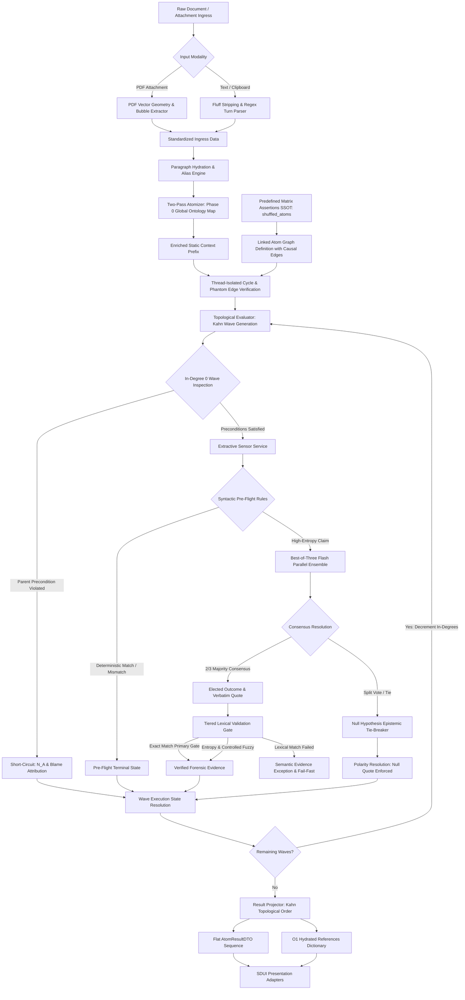

# Enriched Atom Graph Engine

## 1. Executive Summary
The **Enriched Atom Graph Engine** transforms unstructured textual documents and conversational transcripts into a causal, conditional Directed Acyclic Graph (DAG) of verified micro-claims (Atoms). By decoupling semantic extraction, causal dependency discovery, deterministic topological evaluation, and Server-Driven UI (SDUI) presentation, this capability eliminates model hallucinations, prevents the propagation of erroneous premises, and guarantees complete forensic traceability.

Through a structured pipeline incorporating two-pass map-reduce atomization, context-bounded causal linking, thread-isolated acyclic verification, wave-based topological evaluation adhering to the Local Causal Markov Condition, single-pass Best-of-Three Flash ensemble consensus with epistemic Null Hypothesis tie-breaking, tiered lexical anchoring against source evidence, and short-circuit cascade mechanics, the engine evaluates complex analytical propositions with mathematical rigor, high cache survival, and zero tolerance for statistical entropy.

## 2. Architectural Principles & Implementation

The Enriched Atom Graph Engine enforces causal determinism, evidentiary provenance, and architectural decoupling:

### 2.1. Two-Pass Map-Reduce Atomization & Global Ontology Extraction
Unstructured source documents undergo a two-pass extraction protocol that isolates global conceptual modeling from fine-grained semantic claims:
- **First Pass (Global Ontology Mapping):** Extracts all global entities, key actors, and document-wide macro-rules into a unified ontology map. This map resolves cross-chunk references, acronyms, and global business constraints across subsequent processing.
- **Second Pass (Local Chunk Claim Extraction):** Subdivides documents into deterministic text chunks and extracts fine-grained atomic propositions. Each proposition is contextualized by resolving anaphora and ambiguous pronouns against the global ontology map, producing standalone, self-contained claims. Claims derived from source evidence require verbatim textual quotes, while pure logical deductions explicitly flag deductive provenance, preventing uncited assertions from passing as empirical observations.

### 2.2. Context-Bounded Sliding Window Causal Linking
To establish causal relationships across extracted claims without exceeding model attention or context budgets, claims pass through an output-aware sliding window causal linker:
- **Bounded Window Subdivisions:** Partitions extracted claims into sliding windows with deterministic chunk overlaps. Oversized chunks exceeding atom thresholds are dynamically subdivided prior to linking.
- **Causal Edge Inference:** Identifies conditional dependencies between claims across adjacent and overlapping windows. Each discovered edge specifies a directional dependency from parent to child, accompanied by chain-of-thought rationale and an expected parent execution status required to unlock downstream evaluation.
- **Deduplication & Union:** Discovered edges across overlapping windows are merged into a unified causal graph, eliminating redundant links while preserving full multi-path dependencies.
- **Paragraph Provenance Tagging:** In `CausalDiscoveryEngine`, source text is split into sequential paragraphs `[B{i}]`. The engine tracks active input directives (`<ai_context_directive document="{input_key}">`), strips packaging directive tags from emitted paragraph texts, and assigns the originating `source_input_key` to all extracted propositions and graph nodes.
- **Deliverable Subgraph Induction & Exogenous Boundary Axiom:** When multi-document inputs are processed, the engine induces a deliverable subgraph $\mathcal{G}[\mathcal{V}_{\text{deliverable}}]$ containing nodes originating from candidate-endorsed deliverables (resolved via `ExpectedInput.is_endorsed_deliverable` or positive non-chat, non-assignment input membership). Incoming cross-document dependencies ($X_{\text{dialogue}} \to Y_{\text{deliverable}}$) provide exogenous incoming support ($\text{InDegree}_{\text{cross}}(Y) > 0$), preventing $Y$ from being classified as an isolated claim, while $X$ is strictly excluded from $\mathcal{V}_{\text{deliverable}}$ and the deliverable denominator.
- **Topological Denominator Dilution Fix:** In `DAGExecutor`, cohesion metrics ($r_{\text{iso}}$, $r_{\text{LCC}}$) are evaluated strictly over deliverable nodes, passing `total_nodes = fusion_res.total_deliverable_nodes` to `CausalCohesionEvaluator` to preserve the $[0, 1]$ ratio interval without conversational volume dilution.

### 2.3. Wave-Based Topological Evaluation & Local Causal Markov Condition
Directed Acyclic Graph evaluation is orchestrated strictly through wave-based topological sorting (Kahn's Algorithm) rather than ad-hoc event waiting or unconstrained concurrent execution.
- **Local Causal Markov Factorization:** The joint evaluation of the graph factorizes strictly across causal parents:
  $$\mathcal{P}(A_1, \dots, A_n \mid \mathcal{D}) = \prod_{k=1}^W \prod_{A_i \in \text{Wave}_k} \mathcal{P}(A_i \mid \text{Parents}_{\mathcal{G}}(A_i), \mathcal{D})$$
- **Discrete Wave Dispatch:** Within each wave, every scheduled node possesses zero unresolved incoming dependencies relative to remaining un-evaluated nodes. Because all causal parents have completed evaluation and reached terminal states, nodes within the same wave are conditionally independent given their parent outcomes and document context. This enables sound, concurrent batch evaluation.
- **Sequential In-Degree Decrement:** Downstream child dependencies are updated only after the current wave finishes execution, advancing through subsequent waves until the graph reaches terminal resolution.

### 2.4. Deterministic Short-Circuit Cascades & Blame Assignment
When causal preconditions are violated, the topological engine short-circuits execution deterministically without invoking model calls:
- **Precondition Evaluation:** Before dispatching an in-degree zero node to model evaluation, its incoming edges are compared against the resolved states of its causal parents. If any parent fails to reach the expected status required by the edge, the child node is immediately short-circuited to a not-applicable status.
- **Blame Determinism:** Short-circuited nodes record the specific parent identifiers that triggered the cascade in their runtime state, providing clear diagnostic blame attribution in audit logs.
- **Error Propagation:** If a parent node resolves to a system error or blocked state, downstream children transition immediately to blocked, preventing downstream evaluation of corrupted or unresolvable causal branches.
- **Algorithm 1 Dual Fault Attribution & Warrant Separation:** Causal fault attribution evaluates failure modes deterministically via `CausalRootCauseType`, separating independent node claim flaws (`NODE_FAILURE`) from inferential warrant or premise grounding failures (`WARRANT_GROUNDING_FAILURE`). When an antecedent premise evaluates cleanly but the warrant edge linking to the downstream conclusion fails lexical grounding or precondition validation, the fault is attributed to the inferential link (`WARRANT_GROUNDING_FAILURE`) rather than penalizing the author for an intrinsic node flaw. Precondition failures where the antecedent itself was refuted evaluate to `PRECONDITION_MISMATCH`.
- **Deliverable Isolated Concept Count Invariant:** In `compute_causal_tda_fusion_result`, `anti_fluff_audit.isolated_concept_count` is calculated strictly over deliverable nodes $\mathcal{V}_{\text{deliverable}}$, taking into account incoming exogenous cross-document support ($\text{InDegree}_{\text{cross}}(Y) > 0$). This guarantees that conversational dialogue containing unlinked propositions cannot artificially inflate deliverable isolated node counts or cause isolated ratios to exceed 1.0.
- **Unified Continuous Scoring:** In structured evaluation matrices, scoring is calculated via the UnifiedScoringEngine using weighted level ratios and continuous strictness power-curve dampening rather than legacy multi-engine branching, propagating deterministic scoring adjustments downstream.

### 2.5. Thread-Isolated Graph Verification & Cyclic Deadlock Defense
Graph structures undergo pre-flight topological verification prior to wave execution:
- **Thread-Isolated Cycle Detection:** Cycle detection algorithms on the directional graph are offloaded to dedicated worker threads, ensuring heavy graph traversal never blocks the asynchronous event loop. Any participating nodes in detected cycles are marked with system errors, preventing infinite loops and event loop deadlocks.
- **Phantom Edge Quarantine:** If an edge references a parent identifier missing from the graph definition, the dependent child is isolated and assigned an unresolved dependency status, preventing missing-key runtime exceptions during traversal.
- **Stranded Node Resolution:** After all evaluable waves complete, any remaining pending nodes (specifically nodes stranded behind cycles or unresolvable dependencies) are finalized with blocked statuses, ensuring that every node in the graph reaches an explicit terminal state.

### 2.6. Extractive Sensor Service & Deterministic Pre-Flight Evaluation
Micro-claim evaluation is managed by the extractive sensor service, enforcing a zero-reasoning principle on syntactic anchors:
- **Deterministic Syntactic Pre-Flight:** Evaluates deterministic rules (specifically literal keyword presence, negative phrase absence, and structural formatting checks) directly against source text before or without model invocation.
- **Fuzzy Anchoring with Locale Sensitivity:** Syntactic anchor checks tolerate minor optical character recognition (OCR) artifacts and typographical errors through language-tuned fuzzy matching thresholds while requiring strict matching on short substrings.
- **Bypass of High-Cognitive Steps:** When pre-flight deterministic rules definitively confirm or refute a claim, the result is recorded immediately, preserving model invocation budgets and execution latency.

### 2.7. Best-of-Three Flash Ensemble & Epistemic Null Hypothesis Tie-Breaking
For high-entropy analytical evaluations and structured matrix blocks, the sensor service executes a single-pass parallel Best-of-Three Flash ensemble:
- **Structured Parallel Dispatch:** Three independent evaluation calls are executed concurrently in a structured task group using lightweight, high-speed models.
- **Transient Error Tolerance:** Transient transport disconnects, rate limits, and service interruptions within individual ensemble calls are intercepted and tolerated without crashing the execution step. As long as the minimum consensus threshold of valid responses is met, evaluation proceeds normally.
- **Majority Consensus Resolution:** When two or more ensemble responses agree on a status, that outcome is elected as the definitive consensus, preserving the verbatim evidence quote from the first agreeing vote.
- **Epistemic Null Hypothesis Tie-Breaker:** In split or inconclusive votes (specifically split outcomes across pass, fail, and error without a majority), ties are resolved deterministically using a pre-computed atom polarity map:
  - *Inverse Assertions:* When verifying the absence of an error, anti-pattern, or negative behavior, the lack of conclusive proof resolves to passed under the legal and epistemic presumption of innocence. Furthermore, legitimate contextual exceptions (specifically faithful summarization of an explicitly cited external research report) are formally governed by deterministic `anti_patterns` within the atom definition, eliminating meta-cognitive oscillation from unconstrained contextual overrides.
  - *Positive Assertions:* When verifying the presence of concrete action, compliance, or substantiating evidence, the lack of conclusive proof resolves to failed under the Null Hypothesis.
  - *Quote Hallucination Ban:* In all tie-broken resolutions, source evidence quotes are strictly set to null, guaranteeing that unverified quotes are never synthesized or adopted from minority dissents.

### 2.8. Tiered Lexical Validation & Exact Forensic Quote Anchoring
All evidence quotes extracted by models undergo strict, multi-tiered lexical verification against the source document to eliminate quote hallucinations:
- **Anti-Ellipsis Lexical Anchoring:** Candidate evidence quotes (`source_quote`) must strictly consist of a single, continuous, unbroken character substring directly from the source material. Splicing separate sentences with ellipses (`...` or `…`) is prohibited, preserving exact lexical matching (`str.find`) in downstream verification engines without false-negative validation failures.
- **Multi-Stage Lexical Verification Pipeline (`AnchorValidationService._is_lexically_valid`):** Evaluates candidate citations against source documents through four deterministic stages:
  - *Stage 1 (Exact Substring Fast-Path & Tiered Normalization Cascade):* Normalizes source text and quotes across four formatting tiers (literal substring search, whitespace normalization, HTML tag stripping, and markdown delimiter relaxation). An exact normalized match is accepted immediately with zero transformation.
  - *Stage 2 (Length-Weighted RapidFuzz):* Evaluates string distance against locale-specific fuzz thresholds (`get_lexical_fuzz_threshold(locale)`). Quotes shorter than ten characters require 100% exact substring matching, preventing single-word false positives.
  - *Stage 3 (Morphological Stemmed Sequence Verification):* Resolves grammatical inflections across supported languages (Finnish noun cases, Swedish declensions, English conjugations, German endings, Hungarian agglutinations) via pure-Python `StemmerService` wrapping Martin Porter algorithmic Snowball stemmers. It enforces:
    - *Candidate Window Discovery*: Scans source text for contiguous windows anchored to matching content stems.
    - *Window Contiguity Guard*: Prohibits token spans exceeding quote length plus padding (`MAX_WINDOW_TOKEN_PADDING = 15` tokens or equivalent character bounds `quote_char_len + 150` characters), mathematically preventing stitching disparate words across distant paragraphs.
    - *Entropy Gate*: Preserves short words strictly under 4 characters (`MIN_STEMMABLE_WORD_LENGTH = 4`) without morphological alteration, preventing false-positive stem collisions on short acronyms, stop words, and prepositions.
    - *Absolute Strictness Invariant*: When execution strictness is absolute (`strictness_level >= 100` or `tier_threshold >= 100.0`), Stage 3 is unconditionally bypassed, enforcing 100% exact character matching.
  - *Stage 4 (Coverage Safety Net):* Evaluates longest contiguous subsequence coverage via `difflib.SequenceMatcher` against `ValidationThresholdRatio.COVERAGE_SAFETY_NET`.
- **Null Hypothesis Guardrail:** If an atom evaluates to a failed status or activates a contextual override, any associated evidence quotes are stripped and set to null, preventing audit trails from presenting citations for refuted or overridden claims. In structured sensor extraction, `BooleanEvaluationResult` enforces this invariant at the schema boundary, requiring a non-empty string when confirmed and strictly forbidding quotes when refuted or overridden.
- **Stream-Grounded Speaker Provenance Gating:** When evaluating multi-turn conversational dialogue (`ExpectedInput.is_chat_history == True` / structured dialogue tags present), candidate evidence quotes are subjected to symmetric stream provenance gating based on the claim's `target_speaker: TargetSpeaker` attribution (`USER` vs `AI`):
  - *User Agency Invariant:* Claims targeting `TargetSpeaker.USER` draw evidence strictly from human dialogue turns (`<user_payload>`). Any citation residing exclusively in model drafts (`<ai_draft_context>`) triggers a semantic provenance violation exception.
  - *Model Output Invariant:* Claims targeting `TargetSpeaker.AI` draw evidence strictly from model generation turns (`<ai_draft_context>`). Any citation residing exclusively in user inputs (`<user_payload>`) triggers a semantic provenance violation exception.
  - *Echo Parroting & Cognitive Agency Boundary:* When evaluating `TargetSpeaker.USER` competence claims within conversational dialogue, the evidence must demonstrate authentic human cognitive agency and independent reasoning. Verbatim repetition, passive echoing, or copying of preceding AI draft suggestions, environmental task rubrics, or background slogans without operational application, synthesis, or critical challenge does not satisfy cognitive competence claims for the user (Echo Parroting Guardrail).
  - *Dual-Track Attribution Standard:* Evaluative attribution follows two distinct operational tracks:
    - *Track A (Conversational Process Dialogue):* Requires authentic cognitive agency. Evaluators distinguish independent human steering from passive echoing of model outputs.
    - *Track B (Standalone Submitted Deliverables):* The final deliverable represents the candidate's endorsed output. When configured with endorsed deliverable provenance (`ExpectedInput.is_endorsed_deliverable = True`), text is evaluated directly from the primary deliverable without conversational provenance splitting. The candidate is fully entitled to incorporate AI-assisted phrasing, executive terminology, and domain jargon developed during the workflow without triggering Echo Parroting penalties, while observation-layer performative pattern scanning remains active for transparent telemetry.
  - *Single-Author Deliverable Grounding:* When evaluating non-dialogue documents (`is_chat_history == False`), `target_speaker` deterministically locks to `TargetSpeaker.USER`, and evidence quotes are verified directly against primary document text without dialogue stream splitting.
- **Assignment Context Provenance Quarantine:** When evaluation inputs include assignment briefs or environmental guidelines (`<assignment_context>`), these instructions are strictly quarantined from evidence extraction. The anchor validation service extracts assignment spans and permanently excludes them from allowed source text for both `TargetSpeaker.USER` and `TargetSpeaker.AI` claims. Any candidate quote originating from `<assignment_context>` triggers a fatal semantic provenance violation exception (`ErrorCodes.PROVENANCE_VIOLATION`), preventing candidate deliverables from falsely passing evaluations by repeating assignment prompts (Chimera verification and Quote Hijacking defense).
- **Immutable Evidence Preservation:** Validated evidence quotes are treated as immutable legal records. Text budgeting, truncation, and sentence-boundary trimming are applied strictly to synthesized editorial text, never to verbatim forensic quotes.

### 2.9. Attention Anchoring & Deterministic Alias Isolation
To protect model context windows from token bloat and prevent attention dilution, raw 32-character system identifiers are isolated from model prompts:
- **Deterministic Alias Compilation:** The prompt engine translates physical atom identifiers and document paths into compact, indexed aliases (specifically `a0`, `a1` for claims and `doc0`, `doc1` for sources).
- **Service-Layer Hydration:** Models output structured results referencing these concise aliases. Upon receipt, the service layer validates the returned aliases against the active alias registry and hydrates them back to their authoritative system identifiers before updating graph states. Unrecognized aliases trigger immediate validation exceptions.

### 2.10. Multi-Channel Conversational Ingress & Geometry Extraction
Conversational inputs and meeting transcripts enter the system through a multi-channel ingress architecture that handles heterogeneous modalities:
- **PDF Vector Geometry Channel:** Ingests document attachments and conversation transcripts in PDF format. Using vector drawing analysis and geometric bounding-box evaluation, the extractor detects speech bubbles, identifies sender alignment (distinguishing participant channels by coordinate layout), extracts speaker avatars and timestamps, and preserves chronological turn sequencing. To prevent MuPDF C-level layout conflicts when alternating between vector extraction (`page.find_tables()`) and markdown conversion, the engine enforces layout state isolation (`use_layout(False)`). If a document does not contain visual conversation geometry, it falls back to structured markdown prose extraction.
- **Clipboard & Text Ingress Channel:** Processes raw pasted transcripts by stripping system prompts, UI fluff, copy buttons, and timestamp artifacts. A fast-path regular expression engine detects conversational turn patterns, falling back to lightweight model-based boundary slicing when formatting is highly irregular. Both channels output standardized dialogue turn structures.

### 2.11. Predefined Matrix Causal DAG Execution & Enriched Context Caching
The TDA evaluation engine executes strictly against predefined matrix assertions resolved directly from the Single Source of Truth (SSOT) database ontology and Studio UI configuration:
- **Deterministic Matrix Assertion Contract:** Matrix steps require pre-compiled assertions (`shuffled_atoms`) encapsulating domain questions, scales, and pre-compiled causal dependencies (`depends_on: tuple[CausalEdge, ...]`). The engine enforces Fail-Fast validation; runtime free-form fallback is prohibited.
- **Enriched Static Context Caching:** Before DAG evaluation, the engine invokes Two-Pass Atomizer Phase 0 to construct a global ontology map (`<ontology>`). Concatenating hydrated source paragraphs with this ontology builds an unbroken, static-first context prefix (`evaluation_context`), guaranteeing high context-caching efficiency (>95% cache hit rate) across parallel model calls.
- **Decoupled Exploratory Graph Components:** Secondary extraction components—specifically Two-Pass Atomizer Phase 1 (local chunk claim extraction) and the Sliding Window Linker—operate as decoupled modules leveraged during preflight knowledge ingestion (`RAGPreflightService`) and exploratory document processing, completely separated from the deterministic matrix evaluation pipeline.

### 2.12. Result Projection & Server-Driven UI Decoupling
The graph engine maintains strict structural decoupling between internal execution states and presentation layers:
- **Topological Flattening:** The result projector applies Kahn's topological sort to the evaluated graph, projecting dynamic execution states into a sequential array of lightweight evaluation result DTOs.
- **Reference Offloading:** Static evidence (specifically resolved claims, verified source quotes, chunk identifiers, and chronological sequence indices) is segregated into an independent reference dictionary keyed by atom identifier.
- **Zero Nested Tree Complexity:** By separating flat dynamic execution results from static hydrated references, presentation adapters and client renderers consume normalized, non-redundant payloads. This eliminates complex nested tree traversal and guarantees complete semantic parity across interactive user interfaces and static document exports.

### 2.13. Strongly Typed FlattenedAtom State Transit & Anonymous Tuple Eradication
All intermediate atom transit across graph aggregation, flattening, and topological evaluation stages enforces 100% strongly typed Pydantic V2 DTOs:
- **`FlattenedAtom` Domain Model**: Atom definitions are encapsulated within the immutable `FlattenedAtom` DTO carrying strongly typed properties: `atom_id`, `question`, `extraction_rule`, `anchor_target`, `is_inverse`, `target_speaker: TargetSpeaker = TargetSpeaker.USER`, `depends_on: tuple[CausalEdge, ...]`, `contrastive_example: ContrastivePairDTO | None`, `acceptance_criteria: tuple[AcceptanceCriterion, ...]`, `anti_patterns: tuple[AntiPattern, ...]`, and `syntactic_anchors: tuple[str, ...]`.
- **Complete Eradication of Anonymous State Tuples**: Intermediate atom collections across graph hooks maintain direct typed mappings (`dict[str, FlattenedAtom]` for global deduplication and `list[FlattenedAtom]` for matrix collection arrays). Anonymous multi-element state tuples and positional indexing (`[0]`..`[5]`) are completely eradicated.
- **Transitive Causal Graph Propagation**: Transitive causal dependency chains are resolved directly through typed model properties (`FlattenedAtom.depends_on`), guaranteeing compile-time type safety and preventing positional data transposition across DAG topological sorting waves.

### 2.14. Decoupling of Evaluative Matrix TDA Atoms and Dynamic Causal Graph Propositions
The graph engine enforces strict structural, mathematical, and semantic decoupling between predefined evaluative matrix TDA assertions and unmapped dynamic causal graph propositions:
- **Evaluative Matrix TDA Atoms**: Predefined matrix assertions originating from the 14-matrix ontology in `seed_data.json` map directly to matrix scale levels (1–5). They follow the Dual-Track Rubric standard:
  - *Track A (Developmental Progressive Mastery)*: Evaluates progressive capability. A passed atom (`result_status = 1`) awards 1.0 scoring points (`points_awarded: 1.0`), which directly increments the level hit ratio.
  - *Track B (Diagnostic Two-Factor Orthogonal Malus Error Radars)*: Levels 1–2 operate as falsification error detectors (`is_inverse: true`, `is_inverse_evidence: true`). A detected error (`result_status = 1`) extracts an exact lexical citation and triggers orthogonal malus score deduction, but awards strictly 0.0 scoring points (`points_awarded: 0.0`), preventing error detections from accumulating false positive capability points. Clean levels (`result_status = 0`) award 0.0 points without penalty.
- **Dynamic Causal Graph Propositions**: Factual micro-claims extracted during exploratory document processing or dynamic causal discovery operate outside predefined BARS matrix scales. In downstream export and presentation streams, these unmapped propositions are grouped under `Logiikkamatriisi = 'Kausaalipäättely'`:
  - *Zero Point Accumulation Invariant*: Dynamic causal graph propositions verified as factual truth in the source text evaluate to `result_status = 1`, but carry strictly `points_awarded: 0.0`. They participate in topological dependency tracking and root cause attribution without altering matrix scoring totals.
  - *Cross-Surface Scoring Identity*: The 22-column rectangular streaming export (`export_flat_csv`), corporate multi-tab Excel export, and Server-Driven UI forensic breakdown enforce this mathematical scoring identity: `points_awarded = 1.0 if (atom.status == PASSED and not is_inverse_claim) else 0.0`. This prevents unmapped dynamic propositions and diagnostic error detections from leaking into total capability scores in automated machine-learning and analytics pipelines.

## 3. Logical Data Flow

