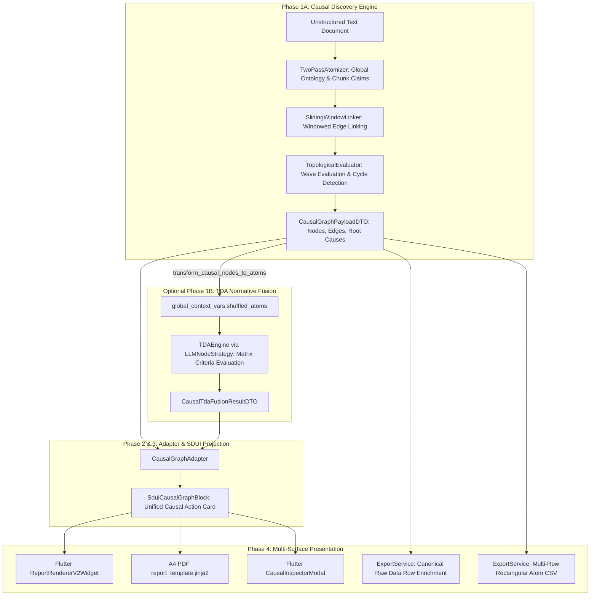

<required_context_rules>
    <rule>@[.agents/rules/00-antigravity-core.md]</rule>
    <rule>@[.agents/rules/01-python-backend.md]</rule>
    <rule>@[.agents/rules/02_flutter_desktop.md]</rule>
    <rule>@[.agents/rules/03_seed_vault.md]</rule>
    <rule>@[.agents/rules/04_directory_reference.md]</rule>
    <rule>@[.agents/rules/05_llm_architecture.md]</rule>
    <knowledge_item>@[ki_god_code_prevention.md]</knowledge_item>
    <knowledge_item>@[ki_context_enriched_decompose_verify.md]</knowledge_item>
    <knowledge_item>@[ki_tripartite_pipeline_architecture.md]</knowledge_item>
    <knowledge_item>@[ki_topological_engine.md]</knowledge_item>
    <knowledge_item>@[ki_execution_engine_protocol.md]</knowledge_item>
    <knowledge_item>@[ki_zero_permissive_typing.md]</knowledge_item>
    <knowledge_item>@[ki_dumb_painter_sdui.md]</knowledge_item>
    <knowledge_item>@[ki_prompt_orchestration_and_matrix_evaluation.md]</knowledge_item>
    <knowledge_item>@[ki_unified_matrix_scoring_strictness.md]</knowledge_item>
    <knowledge_item>@[ki_desktop_pro_tool_studio_ux.md]</knowledge_item>
    <knowledge_item>@[ki_shared_storage_driver_architecture.md]</knowledge_item>
    <knowledge_item>@[ki_dag_engine_dto_projection_rules.md]</knowledge_item>
    <knowledge_item>@[ki_python_314_concurrency_strictness.md]</knowledge_item>
    <knowledge_item>@[ki_dual_axis_localization_architecture.md]</knowledge_item>
    <knowledge_item>@[ki_workflow_context_governance.md]</knowledge_item>
    <knowledge_item>@[ki_execution_record_ssot.md]</knowledge_item>
    <knowledge_item>@[ki_opentelemetry_logfire_observability.md]</knowledge_item>
    <knowledge_item>@[ki_llm_extraction_architecture.md]</knowledge_item>
    <knowledge_item>@[ki_epic_lifecycle_workflow.md]</knowledge_item>
    <knowledge_item>@[ki_synthesis_payload_compression.md]</knowledge_item>
</required_context_rules>

# EPIC 154: Dynamic Causal Discovery Engine (Exploratory Text DAG & Argument Mapping)

> [!NOTE]
> **Scientific & Industrial Validation (2025-2026)**
> Recent computational argumentation and neuro-symbolic research (specifically and exhaustively: *ABAPC-LLM* [ArXiv 2025/2026], *CausalFusion* [OpenReview 2026], and LLM DAG Reconstruction [ACL/IJCAI 2025/2026]) demonstrates that while foundational LLMs excel at initial semantic proposition extraction and causal prior elicitation, unconstrained LLM reasoning suffers from hallucinated causal links and rationalization errors. State-of-the-art architectures mandate a hybrid paradigm: LLMs perform structured argument component extraction (premises, claims, backing) anchored to physical source discourse, while a deterministic topological engine (graph validation, Kahn's wave evaluation, thread-isolated cycle detection, and causal Markov conditions) evaluates graph validity, short-circuits cascading faults, and isolates root causes without non-deterministic LLM hallucination. EPIC 154 implements this exact neuro-symbolic architecture in Quorum.

---

## 1. Goal Description & Background (Objective & Problem Statement)

### 1.1 Objective & Strategic Scope
The objective of EPIC 154 is to establish an autonomous, exploratory causal discovery engine (`CausalDiscoveryEngine`) within Quorum's tripartite execution architecture. Unlike the normative criteria-driven `TDAEngine`, which validates text against pre-configured criteria matrices via `request.shuffled_atoms`, `CausalDiscoveryEngine` performs open-text argument mining:
1. **Autonomous Proposition Extraction:** Extracts argument premises, assumptions, claims, and conclusions directly from free-form text using the Two-Pass Atomizer.
2. **Directed Graph Construction:** Chains propositions into a directed argument graph (`LinkedAtomGraph`) via sliding window linking.
3. **Topological Fault Cascade & Blame Attribution:** Executes topological wave evaluation to detect circular reasoning (`cycle_detected`), identify orphaned arguments (fluff), and propagate blame from root causes to cascading secondary failures.
4. **Primary Use Case (Seamless Augmentation of Current Workflows):** The primary and immediate operational use case is co-execution alongside current Quorum workflows and execution runs (Phase 1A Discovery -> Phase 1B TDA Normative Evaluation). Upstream causal discovery structures argument topology and blame attribution, feeding downstream criteria matrices via Studio-driven chaining (`StepRule.causal_source_step_id`), while preserving architectural decoupling to also execute in 100% standalone mode.
5. **Zero New Output Profiles Invariant (Seamless Drop-In Presentation):** All current workflows utilize causality out of the box without requiring new output specifications, presentation profiles, or report layout changes. Because the Unified Causal Action Card (`SduiCausalGraphBlock`) is automatically synthesized and injected by `ExecutiveSummaryAdapter` inside `TargetBlockType.EXECUTIVE_SUMMARY_BLOCK` whenever causal results exist in `context.causal_result`, all existing workflows immediately render causal diagnostics in Flutter and PDF with ZERO new `OutputProfile` records and ZERO changes to `target_block_order`.

### 1.2 Core Problem Statement
Current evaluations in Quorum operate predominantly against structured matrix blueprints where atoms are pre-compiled and evaluated in isolation. When analyzing unstructured executive essays, strategic plans, or legal arguments, two architectural limitations emerge:
- **Missing Logical Topology:** A document may contain individually plausible claims that form an invalid, circular, or unsupported argument chain. Independent atom evaluations miss this structural breakdown.
- **Double-Penalization of Secondary Faults:** If foundational Premise A fails, dependent Conclusions B, C, and D also fail. Without causal blame tracing (`blame_parent_ids`), the candidate loses repetitive points across all dependent steps for a single underlying error.

EPIC 154 solves both challenges through deterministic topological blame attribution, Anti-Fluff detection, and Fair Scoring Deduplication.

### 1.3 Core Architectural Invariants & User Review Specifications

#### Primary Operational Topology: Seamless Co-Execution with Existing Workflows
The primary and immediate architectural target of EPIC 154 is **seamless co-execution alongside current Quorum workflows and execution runs**. All existing workflows in `seed_data.json` can be augmented with causal argument extraction and topological blame attribution without rewriting their evaluation matrices, and crucially, **without creating any new output specifications, layout blocks, or presentation profiles**:
- **Drop-In Compatibility with Current Workflows:** Existing coaching, evaluation, and analysis workflows can immediately adopt causal discovery by chaining an upstream `CausalDiscoveryEngine` step into their existing matrix evaluation step (`StepRule.causal_source_step_id`). Upstream discovery extracts premises, claims, and argument dependencies, transforming them into `FlattenedAtom` instances that feed the downstream `TDAEngine` and existing criteria matrices.
- **Zero New Output Profiles Invariant ("Ilman uusia tulostusmäärityksiä"):** Existing workflows bind to existing `OutputProfile` definitions (specifically and exhaustively: `default_profile`, executive profiles) which already specify `TargetBlockType.EXECUTIVE_SUMMARY_BLOCK`. Because the Unified Causal Action Card (`SduiCausalGraphBlock`) is automatically assembled and injected into `TargetBlockType.EXECUTIVE_SUMMARY_BLOCK` by `ExecutiveSummaryAdapter` whenever `context.causal_result` is present, **all current workflows immediately gain full causal visualization in Flutter and PDF with ZERO changes to `OutputProfile` records, ZERO new layout blocks in `target_block_order`, and ZERO manual profile migrations.**
- **Automatic Tabular Enrichment:** Existing workflow export pipelines (Excel "Raw Data" tab and rectangular CSV) automatically enrich their evaluated atom streams with causal status, root cause blame parent IDs, and dependent counts via `ReportHeaderResolver` without requiring separate export templates or disjoint worksheets.

#### Architectural Independence & Standalone Engine Decoupling (Standalone Preservation Mandate)
While seamless augmentation of current workflows is the primary operational use case, the **Standalone Causal Discovery Mode is a permanent, first-class architectural capability that MUST NOT be removed, deprecated, or merged into other engines**:
- **Dual Operational Modality Invariant:** The architecture permanently enforces and preserves two distinct, sovereign operational modalities:
  1. **Standalone Discovery Modality:** Autonomous, exploratory argument graph extraction and topological fault evaluation on raw, unconstrained text with zero criteria blocks, zero evaluation matrices, and zero coupling to `TDAEngine`.
  2. **Augmented Co-Execution Modality (Fusion):** Deterministic two-phase chaining (Phase 1A Discovery -> Phase 1B TDA) augmenting current workflows out of the box with zero new output profiles.
- **Sovereign Execution Pipeline:** The engine executes completely independently on open text without any dependency on `TDAEngine`, without an evaluation matrix, and without criteria blocks. Workflows can be authored purely for structural argument validation, anti-fluff screening, circular reasoning detection, and root cause diagnosis without evaluating normative criteria.
- **Independent Atom Extraction:** It does not require `request.shuffled_atoms`; instead, it autonomously extracts argument structures via `TwoPassAtomizer`, constructs `LinkedAtomGraph`, executes topological wave evaluation via `TopologicalEvaluator`, and produces `CausalGraphPayloadDTO`.
- **Scoring Isolation in Standalone Mode:** In standalone mode (workflows without criteria blocks), `apply_scoring_logic_hook` is omitted to prevent fail-fast crashes on empty matrices; argument soundness is evaluated purely via `FairScoringBreakdownDTO` and `AntiFluffAuditDTO`.
- **Topological State Semantics:** In standalone mode, node colors and states directly reflect the topological validity of arguments (defined exhaustively as: Green = validated claim, Red = refuted/failed claim, Orange = cascading fault, Grey = orphaned concept).

#### Single Pipeline Invariant, Zero-Fallback Compliance & Typed Engine Registry
`CausalDiscoveryEngine`, `TDAEngine`, `SynthesisEngine`, and `PromptEngine` remain completely decoupled `ExecutionEngine` implementations. Engine resolution is strictly decoupled from heuristic string parsing (`"atom_flattening_hook" in step_def.pre_hooks`) and criteria category guessing. Instead, engine dispatch is governed deterministically by an explicit `EngineType` enum on the step blueprint (`step_def.engine_type: EngineType`) resolved via a centralized, typed `ENGINE_REGISTRY` and `build_execution_engine(engine_type, prompt_compiler)` factory in `backend_v2/services/orchestrator/engines/registry.py`. Phase 1 analytical DAG execution resolves compute engines (`TDAEngine`, `CausalDiscoveryEngine`, `PromptEngine`, and in-DAG intermediate `SynthesisEngine`) strictly and deterministically in O(1) time without conflating Phase 1 execution with Phase 2 Report Synthesis (`synthesis_worker.py`). `CausalDiscoveryEngine` binds strictly via `StepType.CAUSAL_DISCOVERY` and `EngineType` member `CAUSAL_DISCOVERY`. It MUST NOT function as a fallback branch inside `TDAEngine`, and the engines must never be merged into a monolithic class. `TDAEngine` preserves its 100% strict Fail-Fast contract (requiring `request.shuffled_atoms`). All step blueprints in `seed_data.json` and Dart client models in `client_app_v2` maintain 1:1 Full-Duplex Serialization Parity.

#### Automatic Engine Binding & Zero UI Over-Engineering
Workflow designers in Quorum Studio (`StepBuilderView`) configure a step's functional taxonomy (`StepType`: `LLM`, `LOGIC`, `CAUSAL_DISCOVERY`) and cognitive attributes (prompt blocks, criteria, cognitive tier). The execution engine is NEVER exposed as a manual dropdown in the UI. Instead, the backend automatically and deterministically binds the step's functional definition to its appropriate compute engine (`CausalDiscoveryEngine` for `StepType.CAUSAL_DISCOVERY`, `TDAEngine` for steps with matrix criteria, `PromptEngine` for non-matrix LLM steps). This completely protects the user interface from backend infrastructure leaks, prevents dual-source-of-truth configuration conflicts, and allows new steps authored in Studio to execute dynamically via `ENGINE_REGISTRY` with zero backend code changes.

#### Causal Graph and TDA Matrix Fusion Pipeline (Two Separate Engines -> One Unified Result)
When an existing or new workflow combines normative criteria evaluation with causal graph discovery, they are chained into a two-phase deterministic analysis pipeline:
- **Dynamic Matrix Independence & Extensibility:** All evaluation matrices and argumentation frameworks (compiled from ALL configured PromptBlocks — argumentation matrices and criteria frameworks are 100% dynamic domain entities configured exclusively in Quorum Studio via `PromptBlockCategory.MATRIX` prompt blocks and loaded at runtime — they can be added, modified, or removed dynamically with zero backend code changes) are persisted in `seed_data.json`. Matrices are never hardcoded in source code: workflows can configure zero, one, or multiple dynamic matrices; matrices can be added, updated, or removed dynamically without modifying backend code.
1. **Pipeline Chaining (Discovery extracts -> TDA evaluates):**
   The workflow does not pick engines nondeterministically; rather, they are chained at the DAG layer into two deterministic phases:
   - **Phase 1A (`CausalDiscoveryEngine`):** The engine analyzes free-form text and constructs a directed argument graph (`LinkedAtomGraph`), isolating premises, claims, and conclusions into discrete atom nodes without requiring any evaluation matrix. Upon completion, the step output is persisted as strongly typed `CausalGraphPayloadDTO` in `exec_record.step_states[step.id]`. In Phase 1B (Fusion), the downstream step resolves `step.causal_source_step_id`, transforms upstream causal nodes into `FlattenedAtom` instances via `transform_causal_nodes_to_atoms`, and populates `global_context_vars.shuffled_atoms` (and `exec_record.metadata.global_context_vars.shuffled_atoms`) under `_update_lock` before invoking `LLMNodeStrategy`.
   - **Phase 1B (`TDAEngine`):** The TDA engine does not evaluate the raw text corpus randomly; rather, `DAGExecutor` transforms upstream causal nodes into `list[FlattenedAtom]` via `transform_causal_nodes_to_atoms` and populates `global_context_vars = global_context_vars.model_copy(update={"shuffled_atoms": atoms})` (and updates `exec_record.metadata.global_context_vars.shuffled_atoms`), satisfying `LLMNodeStrategy`'s mandatory `hook_state.global_context_vars.shuffled_atoms` contract and feeding `TDAEngine.request.shuffled_atoms` to evaluate against whichever dynamic criteria matrix is configured for that step (verifying: Warrant linkage, Backing evidence, dogmatic quantifiers, and matrix score scales). All input assertions MUST adhere strictly to `FlattenedAtom(V2CoreBase)` with `ConfigDict(strict=True, extra="forbid", frozen=True)`.
   - **Outcome:** A single analysis pipeline where causal discovery structures the document topology and TDA acts as the qualitative normative judge.
2. **Semantic Overlay in the User Interface:**
   The user interface does not present disjointed parallel tabs or separate duplicate reports; instead, the Flutter SDUI layer renders a single unified interactive graph (`SduiCausalGraphBlock`):
   - Directed edges between nodes depict the logical progression and causal relationships extracted by the Discovery engine.
   - In fusion mode, node colors and levels originate directly from the TDA matrix (defined exhaustively as: Green = grounded claim, Red = dogmatic assumption lacking backing).
   - In accordance with Flutter Theme Sovereignty, all visual node intents and colors MUST be resolved dynamically via `Theme.of(context).colorScheme` and registered `AppSemanticColors` (`Theme.of(context).extension<AppSemanticColors>()`), with zero direct or static `Color(...)` or `Colors.*` declarations.
   - **Outcome:** The evaluator inspects the logical structure of the text and the qualitative rigor of each argument in a single visual node representation.
3. **Causal Root Cause Attribution & Scoring Separation Invariant:**
   Causal Discovery fault attribution (`blame_parent_ids`) binds directly to TDA score deductions and verbal rationale:
   - When an author loses points under the criteria "Claim Grounding", the system avoids generic feedback and instead reports the causal path: *"Conclusion B failed because it relies on the refuted assumption in node A in paragraph [B2]"*.
   - **Scoring Hook Separation Contract (Standalone vs. Fusion Mode):** In 100% standalone mode (zero matrix criteria), the workflow does NOT attach `apply_scoring_logic_hook`, protecting execution from fail-fast crashes on missing evaluative matrices (`_evaluative_matrices` in `apply_scoring_logic_hook`); instead, standalone mode evaluates argument soundness and fault cascades purely via `FairScoringBreakdownDTO` and topological metrics (`AntiFluffAuditDTO`). `apply_scoring_logic_hook` is attached exclusively to workflows containing Phase 1B matrix evaluation steps, where it aggregates evaluative matrix scores directly from `state.global_context_vars.evaluative_matrices`.
   - **Outcome:** Total score computations and qualitative justifications form a single non-disputable and transparent evaluation audit trail.

#### Flutter UI & PDF 1:1 Presentation Parity & Streamlined Output
The interactive on-screen report view (`ReportRendererV2Widget`) and the generated A4 PDF (`report_template.jinja2`) represent the exact same document:
- **Identical Output Representation:** In both Flutter and PDF, `SduiCausalGraphBlock` renders an identical, compact, and readable **Unified Causal Action Card**, occupying at most half an A4 page in the PDF artifact.
- **Critical Causal Path Principle:** The output avoids rendering an illegible spaghetti graph of dozens of passing claims. Instead, the output renders a streamlined left-to-right error chain: `[Root Cause]` -> caused -> `[Cascading Fault]` -> resulted in -> `[Score Loss]`, accompanied by the lexical quote and prescriptive remediation. Validated passing claims are summarized in a single compact metric (defined exhaustively as: "X other claims verified logically sound").
- **Supplementary Inspection Decoupling:** Free-form graph exploration, pan-and-zoom navigation, and in-depth inspection are strictly decoupled into a dedicated modal (`CausalInspectorModal`), opened via an explicit inspection action button. The primary printed and on-screen report layout remains 100% clean, standardized, and identical across screen and paper.
- **Flutter Theme Sovereignty Invariant:** In accordance with `scripts/audit_flutter_theme_sovereignty.py`, all visual colors and states across `SduiCausalGraphWidget` and `CausalInspectorModal` MUST be derived strictly from `Theme.of(context).colorScheme` or registered `AppSemanticColors` (`Theme.of(context).extension<AppSemanticColors>()`). Direct instantiations of raw `Color(...)`, `Colors.*`, or naked `TextStyle(...)` are strictly prohibited. All typography MUST derive from `Theme.of(context).textTheme`.
- **Sealed Block Discriminator:** `SduiCausalGraphBlock` in `backend_v2/models/view/sdui.py` enforces `block_type: Literal["causal_graph"] = "causal_graph"` and `model_config = ConfigDict(title="causal_graph", strict=True, extra="forbid")`, matching Dart Freezed union key `@FreezedUnionValue('causal_graph')`.

#### Streamlined Studio-Driven OutputProfile & Unified Single Presentation Point
Adhering to `studio_driven_parameterization_mandate` and the Single Presentation Point Invariant (obeying the Feature Audit for Causal Extensions Synchronization and the Executive Summary Unification Audit), all causal evaluation results are projected into **exactly ONE presentation point**: the **Unified Causal Action Card** (`SduiCausalGraphBlock`) integrated directly as the focal empirical core of **`TargetBlockType.EXECUTIVE_SUMMARY_BLOCK`**. There is ZERO separate "causal output", "causal report", or disconnected output pipeline, and ZERO separate `CAUSAL_GRAPH_BLOCK` in `target_block_order`.
- **Integrated Executive Horizon (`target_block_order`):** Quorum Studio retains strictly `TargetBlockType.EXECUTIVE_SUMMARY_BLOCK` as the single executive overview block. The Unified Causal Action Card (`SduiCausalGraphBlock`) is not an independent layout block, but an integral sub-component and core input to the Executive Summary section. `ExecutiveSummaryAdapter` ingests `context.causal_result` as one of its inputs (alongside `distilled_inputs`, `matrix_context`, and `user_role`), assembling a unified four-part executive presentation: 1. Status & Role pill, 2. Holistic strategic narrative (`ParagraphBlock`), 3. Unified Causal Action Card (`SduiCausalGraphBlock`, rendered whenever causal results exist), and 4. Strategic recommendations (`BulletListBlock`). If the workflow lacks causal results, the section degrades cleanly to the standard holistic narrative without broken cards.
- **Holistic Executive Prose & Empirical Causal Grounding:** The Executive Summary never degenerates into a bare diagnostic fault card. The holistic strategic narrative (observations on maturity, strengths, positive nuance, and contextual assessment) remains fully preserved. In Phase 2 synthesis (`synthesis_tasks.py` -> `create_executive_summary_task`), Phase 1 causal diagnosis (`causal_result: CausalRootCauseDiagnosisDTO | CausalGraphPayloadDTO`) is injected into the LLM synthesis context inside `<causal_diagnosis>` at the dynamic payload tail. This ensures the LLM's high-level prose and the Unified Causal Action Card's empirical fault chain speak with 100% mutual coherence without contradiction.
- **Driven by SSOT Extensions (`visible_block_extensions`):** The card and surrounding report blocks (specifically and exhaustively: `AccordionBlock` and `MatrixSummaryTable`) are dynamically populated based on `OutputProfile.visible_block_extensions` (specifically and exhaustively: `remediation_steps`, `falsification`, `risk_flag`, `citation`). Bifurcated micro-toggles, separate block types, and speculative display mode switches (`causal_display_mode`) are eradicated in favor of the existing `visible_block_extensions` Single Source of Truth.
- **Executive Card Standard:** The card renders an executive, half-page linear critical causal path (`[Root Cause]` -> `[Cascading Fault]` -> `[Score Loss]`), accompanied by the lexical quote and prescriptive remediation. Deep interactive exploration is strictly decoupled into `CausalInspectorModal`.
- **Zero New Output Profiles Invariant ("Ilman uusia tulostusmäärityksiä"):** All existing workflows in `seed_data.json` maintain their existing `output_profile_id` bindings (specifically: `default_profile` and all existing workflow profile bindings in `seed_data.json`). Because `ExecutiveSummaryAdapter` automatically injects `SduiCausalGraphBlock` as the focal empirical core of `TargetBlockType.EXECUTIVE_SUMMARY_BLOCK` whenever `context.causal_result` is present, every existing workflow immediately gains full causal visualization in Flutter and PDF without requiring new `OutputProfile` definitions, new layout blocks in `target_block_order`, or presentation re-authoring.

#### Forensic Tabular Symmetry & Single Output Invariant
Output parity adheres strictly to `@[docs/implementationplans/IMPLEMENTATION_PLAN_Logic_Matrix_Excel_and_CSV_Parity_Architecture.md]`, `@[backend_v2/services/localization.py]` (`ReportHeaderResolver`), and `@[backend_v2/models/enums.py]` (`ReportAtomColumn`):
- **Canonical "Raw Data" Worksheet Integration:** In fusion mode, evaluated atom rows (`ExportForensicAtomDTO`) in Excel Tab 2 are enriched with typed scalar causal fields (specifically and exhaustively: `causal_status: str | None = None`, `blame_parent_id: str | None = None`, and `dependent_count: int | None = None`). These columns are backed by explicit enum members on `ReportAtomColumn` (`CAUSAL_STATUS = "causal_status"`, `BLAME_PARENT_ID = "blame_parent_id"`, `DEPENDENT_COUNT = "dependent_count"`) with translations defined in `@[backend_v2/l10n/fi.json]` and `@[backend_v2/l10n/en.json]` (`export_col_causal_status`, `export_col_blame_parent_id`, `export_col_dependent_count`) and resolved via `ReportHeaderResolver`. Disjoint, isolated worksheets ("Causal Graph", "Causal Diagnostics") are pruned to prevent fragmented reporting silos.
- **Rectangular Atom CSV Export (`ExportService`):** Eradicates the obsolete 2-line machine vector assumption. In accordance with the Parity Architecture, CSV export (`ExportService.export_flat_csv`) streams a multi-row rectangular atom dataset where each row corresponds to one evaluated atom (`len(flat_dtos) == len(report_dto.results)`). In fusion mode, `ExportDenormalizedFlatRowDTO` is enriched with the same atom-level causal fields (`causal_status: str | None = None`, `blame_parent_id: str | None = None`, `dependent_count: int | None = None`), encoded in UTF-8-SIG via `ReportHeaderResolver.get_all_denormalized_csv_headers()`. Anti-Synthetic Row Invariant is preserved: zero synthetic summary rows or aggregate run-level vectors injected into atom streams.

#### Five Core Stakeholder Benefits
1. **Root Cause Attribution:** The topological blame cascade (`blame_parent_ids`) isolates the foundational origin of an error chain.
2. **Anti-Fluff Shield:** Detects orphaned concepts and circular reasoning (`cycle_detected`), deducting points when an argumentative chain is missing.
3. **Prescriptive Feedback:** Surgical remediation recommendations indicating which corrections unlock downstream assertions.
4. **Visual XAI Overlay:** A unified argument map where node color reflects operational status and lexical citations expand on demand.
5. **Fair & Deduplicated Scoring:** Decouples independent root causes from cascading secondary errors, preventing repetitive scoring penalties for a single underlying fault.

#### SSOT and Pydantic V2 Contracts
All domain models (`LinkedAtomGraph`, `CausalEdgeDTO`, `CausalNodeDTO`, `CausalRootCauseDiagnosisDTO`, `AntiFluffAuditDTO`, `PrescriptiveRemediationDTO`, `FairScoringBreakdownDTO`, `SduiCausalGraphBlock`, `OutputProfile`) adhere strictly to `ConfigDict(strict=True, extra='forbid', frozen=True)` with zero naked dictionaries.

#### Four-Layer Clean Stack & High-Fidelity Prompting
LLM prompts in `CausalDiscoveryEngine` are compiled strictly through the Four-Layer Clean Stack hierarchy:
1. **Layer 1: Static System Directives & Mandates:** Static ontology instructions placed in the system prompt prefix for 100% context caching efficiency.
2. **Layer 2: Theory Grounding & Epistemic Context:** Dynamically loaded theory grounding and argumentation schemes (compiled from ALL configured PromptBlocks — argumentation matrices and criteria frameworks are 100% dynamic domain entities configured exclusively in Quorum Studio via `PromptBlockCategory.MATRIX` prompt blocks and loaded at runtime — they can be added, modified, or removed dynamically with zero backend code changes) injected into `<theory_context>`. Matrices are never hardcoded in source code: all matrices and criteria schemes are dynamic domain entities that can be added, modified, or removed in Quorum Studio with zero backend code changes.
3. **Layer 3: Extraction Protocol:** Step-level argument extraction and linking behavior.
4. **Layer 4: Dynamic User Payload & Execution Variables:** Dynamic text blocks indexed as `[B0]...[Bn]` and atom aliasing (`a0`, `a1`) placed at the tail.
- **Exact Physical Anchoring:** Extracted quotes (`source_quote`) must strictly match source text via `str.find` lexical validation; fuzzy string matching is prohibited.

#### Pruned Over-Engineering & 30% Deletion Verification (Axis 4)
- **`CausalStep` Domain Subclass: PRUNED.** Rejected in favor of the existing `Step` domain model with validation branching, avoiding class hierarchy explosion.
- **Persistent Graph Database: PRUNED.** Rejected in favor of in-memory transient graph representation (`LinkedAtomGraph`) projected directly to SDUI `SduiCausalGraphBlock` and trace JSON.
- **Separate Causal Reports & Disjoint Worksheets: PRUNED.** Banned bifurcated causal reports and separate Excel worksheets ("Causal Graph", "Causal Diagnostics"). All causal reporting is consolidated into the single unified report (`SduiCausalGraphBlock`) and canonical "Raw Data" worksheet.
- **`CausalDisplayMode` Enum & Profile Micro-Toggles: PRUNED.** Eradicated in favor of the existing `OutputProfile.visible_block_extensions` SSOT. The Unified Causal Action Card renders compactly (half-page A4 PDF budget) with interactive deep-dive decoupled into `CausalInspectorModal`.
- **8 Dedicated Pydantic V2 DTOs: RETAINED.** `CausalNodeDTO`, `CausalEdgeDTO`, `CausalGraphPayloadDTO`, `CausalRootCauseDiagnosisDTO`, `AntiFluffAuditDTO`, `PrescriptiveRemediationDTO`, `FairScoringBreakdownDTO`, and `CausalTdaFusionResultDTO` are retained as irreducible domain contracts.

---

## 2. Architectural Impact & Compliance Matrix

### 2.1 Complete Target Scope & File Inventory

#### Quantitative Scope Validation:
| Archetype / Domain Category | Target File Count | Concrete File Deliverables | Blast Radius / Invariant Impact |
| :--- | :--- | :--- | :--- |
| **New Python Modules (Engines, DTOs, Adapters)** | 4 new files | `causal_discovery_engine.py`, `registry.py`, `causal_discovery.py`, `causal_graph_adapter.py` | Standalone ExecutionEngine implementation, typed EngineRegistry, 8 Pydantic V2 DTOs, SDUI adapter |
| **Backend Orchestration & Runtime Modification** | 13 files (2 already completed) | `settings.py`, `enums.py`, `exceptions.py`, `step.py`, `strategies/registry.py`, `strategies/llm.py`, `sliding_window_linker.py`, `dag_executor.py`, `engines/__init__.py`, `engines/base.py`, `engines/tda_engine.py`, `engines/prompt_engine.py`, `engines/synthesis_engine.py` *(Completed: `dag_models.py`, `two_pass_atomizer.py`)* | Central configuration, StepType registration, CAUSAL_DISCOVERY_* ErrorCodes, priority engine dispatch, protocol telemetry labeling, wave TaskGroup execution |
| **SDUI, Presentation & Synthesis Backend** | 8 files | `step_output.py`, `sdui.py`, `base_adapter.py`, `executive_summary_adapter.py`, `blueprint.py`, `synthesis_tasks.py`, `synthesis_worker.py`, `report_template.jinja2` | Full-duplex serialization, SduiCausalGraphBlock union, AdapterContext envelope, unified Executive Summary assembly, causal prompt grounding |
| **Tabular & Flat Data Export Pipeline** | 5 files | `export_service.py`, `export.py`, `localization.py`, `fi.json`, `en.json` | SSOT ReportAtomColumn enum expansion, centralized localization in fi.json/en.json via ReportHeaderResolver, Raw Data worksheet enrichment, and rectangular multi-row atom CSV streaming via ExportDenormalizedFlatRowDTO obeying Parity Architecture |
| **Backend Fixtures, Seed & Automated Tests** | 12 files (3 new, 8 modified, 1 completed) | `test_causal_discovery_engine.py` [NEW], `test_registry.py` [NEW], `test_causal_tda_fusion.py` [NEW], `test_report_headers_l10n_parity.py`, `test_localization.py`, `test_enums.py`, `model_factories.py`, `test_enum_parity.py`, `test_sdui_semantic_parity.py`, `test_sdui_template_parity.py`, `sdui_golden_master.json`, `seed_data.json` *(Completed: `test_two_pass_atomizer.py`)* | ISTQB boundary partitions, fusion integration, 19 SDUI block parity, enum verification, Polyfactory QGR029 fixtures, seed data explicit engine_type migration, ReportAtomColumn expansion (12 columns) |
| **Frontend Presentation, Widgets, Studio & Parity** | 8 files (2 new, 6 modified) | `sdui_causal_graph_widget.dart` [NEW], `causal_inspector_modal.dart` [NEW], `enums.dart`, `workflow.dart`, `sdui_block_dto.dart`, `sdui_blocks_renderer.dart`, `app_en.arb`, `app_fi.arb` | Freezed DTOs, Dumb Painter action card with Flutter Theme Sovereignty, decoupled interactive inspector modal, block renderer dispatch, EngineType enum parity, compile-time localization |
| **Theme & Quality Gate Validation Scripts** | 2 validation scripts | `audit_flutter_theme_sovereignty.py`, `_ast_guardrails.py` | Zero raw Color/Colors.* verification, QGR029 fixture strictness check |
| **Context & Read-Only Architectural References** | 3 files | `topological_evaluator.py`, `result_projector.py`, `report_renderer_v2_widget.dart` | Read-only references verifying ExecutionEngine protocol, Kahn's sort, and UI architecture |
| **TOTAL SCOPE AGGREGATION** | **50 Active Target Files** (9 NEW, 38 MODIFIED, 3 COMPLETED) + **3 Context Files** | Total 55 System Boundaries Audited | 100% Zero-Duct-Tape, Zero-Naked-Dicts, Theme Sovereignty, and 1:1 Cross-Platform Parity Enforced |

#### Target Files:
- `[NEW] @[backend_v2/services/orchestrator/engines/causal_discovery_engine.py]`
- `[NEW] @[backend_v2/services/orchestrator/engines/registry.py]`
- `[NEW] @[backend_v2/models/dtos/causal_discovery.py]`
- `[NEW] @[backend_v2/services/sdui/adapters/causal_graph_adapter.py]`
- `[MODIFY] @[backend_v2/settings.py]`
- `[MODIFY] @[backend_v2/models/enums.py]`
- `[MODIFY] @[backend_v2/exceptions.py]`
- `[MODIFY] @[backend_v2/models/domain/step.py]`
- `[MODIFY] @[backend_v2/services/orchestrator/strategies/registry.py]`
- `[MODIFY] @[backend_v2/services/orchestrator/strategies/llm.py]`
- `[ALREADY COMPLETED] @[backend_v2/models/dtos/dag_models.py]`
- `[ALREADY COMPLETED] @[backend_v2/services/orchestrator/two_pass_atomizer.py]`
- `[MODIFY] @[backend_v2/services/orchestrator/sliding_window_linker.py]`
- `[MODIFY] @[backend_v2/models/dtos/step_output.py]`
- `[MODIFY] @[backend_v2/models/view/sdui.py]`
- `[MODIFY] @[backend_v2/services/sdui/adapters/base_adapter.py]`
- `[MODIFY] @[backend_v2/services/sdui/adapters/executive_summary_adapter.py]`
- `[MODIFY] @[backend_v2/services/blueprint.py]`
- `[MODIFY] @[backend_v2/workers/synthesis_tasks.py]`
- `[MODIFY] @[backend_v2/workers/synthesis_worker.py]`
- `[MODIFY] @[backend_v2/templates/report_template.jinja2]`
- `[MODIFY] @[backend_v2/services/export_service.py]`
- `[MODIFY] @[backend_v2/models/dtos/export.py]`
- `[MODIFY] @[backend_v2/services/localization.py]`
- `[MODIFY] @[backend_v2/l10n/fi.json]`
- `[MODIFY] @[backend_v2/l10n/en.json]`
- `[MODIFY] @[backend_v2/services/orchestrator/dag_executor.py]`
- `[MODIFY] @[backend_v2/services/orchestrator/engines/__init__.py]`
- `[MODIFY] @[backend_v2/services/orchestrator/engines/base.py]`
- `[MODIFY] @[backend_v2/services/orchestrator/engines/tda_engine.py]`
- `[MODIFY] @[backend_v2/services/orchestrator/engines/prompt_engine.py]`
- `[MODIFY] @[backend_v2/services/orchestrator/engines/synthesis_engine.py]`
- `[MODIFY] @[backend_v2/tests/unit/test_enum_parity.py]`
- `[MODIFY] @[backend_v2/tests/unit/test_report_headers_l10n_parity.py]`
- `[MODIFY] @[backend_v2/tests/unit/test_localization.py]`
- `[MODIFY] @[backend_v2/tests/unit/models/test_enums.py]`
- `[MODIFY] @[backend_v2/tests/fixtures/sdui_golden_master.json]`
- `[MODIFY] @[backend_v2/tests/integration/test_sdui_semantic_parity.py]`
- `[MODIFY] @[backend_v2/tests/unit/test_sdui_template_parity.py]`
- `[ALREADY COMPLETED] @[backend_v2/tests/unit/services/orchestrator/test_two_pass_atomizer.py]`
- `[MODIFY] @[backend_v2/seed/seed_data.json]`
- `[NEW] @[backend_v2/tests/unit/services/orchestrator/engines/test_causal_discovery_engine.py]`
- `[NEW] @[backend_v2/tests/unit/services/orchestrator/engines/test_registry.py]`
- `[NEW] @[backend_v2/tests/unit/services/orchestrator/test_causal_tda_fusion.py]`
- `[MODIFY] @[backend_v2/tests/factories/model_factories.py]`
- `[MODIFY] @[client_app_v2/lib/core/models/enums.dart]`
- `[MODIFY] @[client_app_v2/lib/features/studio/models/workflow.dart]`
- `[MODIFY] @[client_app_v2/lib/shared/models/sdui_block_dto.dart]`
- `[NEW] @[client_app_v2/lib/features/execution/views/widgets/sdui_causal_graph_widget.dart]`
- `[NEW] @[client_app_v2/lib/features/execution/presentation/causal_inspector_modal.dart]`
- `[MODIFY] @[client_app_v2/lib/features/execution/views/widgets/sdui_blocks_renderer.dart]`
- `[MODIFY] @[client_app_v2/lib/l10n/app_en.arb]`
- `[MODIFY] @[client_app_v2/lib/l10n/app_fi.arb]`
- `[VALIDATION] @[scripts/audit_flutter_theme_sovereignty.py]`
- `[VALIDATION] @[scripts/_ast_guardrails.py]`

#### Context / Read-Only Files:
- `@[backend_v2/services/orchestrator/topological_evaluator.py]`
- `@[backend_v2/services/orchestrator/result_projector.py]`
- `@[backend_v2/models/dtos/global_context.py]`
- `@[client_app_v2/lib/features/execution/views/widgets/report_renderer_v2_widget.dart]`

### 2.2 Architectural Directives (5-Column Synthesis)

| 1. Target Scope & Boundaries | 2. Eradicated Duct-Tape (Under-Engineering Ban) | 3. Approved Best Practice (Target Invariant) | 4. Pruned Over-Engineering (Complexity Slayer) | 5. Verification & Fail-Fast (Proof Anchor) |
| :--- | :--- | :--- | :--- | :--- |
| **Settings Configuration**<br>`@[backend_v2/settings.py]` | Magic constants in sliding window loops, hardcoded window sizes, fallback `getattr(settings, ...)` access. | Centralized Pydantic V2 `Settings` fields: `causal_discovery_window_size: int = 4`, `causal_discovery_overlap: int = 2`, `causal_discovery_max_atoms_per_window: int = 25`, `causal_discovery_max_total_atoms: int = 100`, `causal_secondary_fault_dampening: float = 0.25`, `two_pass_atomizer_packet_size: int = 50`. Causal discovery settings are explicitly injected into `SlidingWindowLinker` without mutating existing constructor defaults (`window_size = 4, overlap = 2`). | Speculative per-domain sliding window overrides and dynamic runtime reload factories. | `Settings.model_validate({})` strict type validation in unit tests; `test_settings.py`. |
| **SSOT Enums & ErrorCodes**<br>`@[backend_v2/models/enums.py]`<br>`@[backend_v2/exceptions.py]`<br>`@[client_app_v2/lib/core/models/enums.dart]` | Untyped string comparisons (`self.type == "llm"`), heuristic string matching, ad-hoc string literals for block types. Casing mismatch between backend snake_case and Dart camelCase. | `StepType.CAUSAL_DISCOVERY = "causal_discovery"` and `EngineType(StrEnum)` (`TDA = "tda"`, `SYNTHESIS = "synthesis"`, `PROMPT = "prompt"`, `CAUSAL_DISCOVERY = "causal_discovery"`) in `enums.py`. Mirror in Dart `enums.dart` with explicit `@JsonValue('causal_discovery') causalDiscovery`. Explicit ErrorCodes in `exceptions.py`: `CAUSAL_DISCOVERY_EMPTY_DOCUMENT` (physical empty text input, `len(text.strip()) == 0`), `CAUSAL_DISCOVERY_CYCLE_DETECTED` (circular reasoning detected in argument chain), and `CAUSAL_DISCOVERY_DATA_STARVATION` (zero extracted claims from non-empty text, or zero nodes in downstream fusion). Zero mutation to `TargetBlockType`. | Granular display mode permutations (isolated anti-fluff toggles, remediations toggles), speculative block type additions. | `backend_audit_loop.py` and `test_enum_parity.py` verifying enum and exception integrity. |
| **Pre-Implementation Atomizer Cleanups**<br>`@[backend_v2/services/orchestrator/two_pass_atomizer.py]`<br>`@[backend_v2/models/dtos/dag_models.py]`<br>`@[backend_v2/tests/unit/services/orchestrator/test_two_pass_atomizer.py]` | Returning anonymous 3-tuples (`tuple[str, str, list[str]]`) in `_calculate_packets` ("Tuple Hell"), hardcoded magic window sizes (`packet_size = 50`). | **ALREADY COMPLETED IN CODEBASE:** Encapsulated chunk packet bounds into typed immutable `ChunkPacketDTO(start_block: str, end_block: str, packet_keys: list[str])` in `dag_models.py`. Calling sites unpack canonical `packet.packet_keys`. Zero DTO code changes required for Phase 1.1; binding `packet_size` to `get_settings().two_pass_atomizer_packet_size` executes atomically when `settings.py` is extended in Phase 2.1. | Speculative packet wrapper classes or mutating canonical `packet_keys` field. | Physical verification via `view_file` on `dag_models.py` and unit tests in `test_two_pass_atomizer.py`. |
| **SlidingWindowLinker Isolation**<br>`@[backend_v2/services/orchestrator/sliding_window_linker.py]` | Hardcoded `window_size=4, overlap=2` constructor defaults mutating shared caller behavior. | **DO NOT** mutate constructor defaults in `SlidingWindowLinker.__init__`. `CausalDiscoveryEngine` constructs `SlidingWindowLinker` with explicit settings: `SlidingWindowLinker(window_size=get_settings().causal_discovery_window_size, overlap=get_settings().causal_discovery_overlap)`. Existing `TDAEngine` callers retain current behavior without parameter contamination. | Binding constructor defaults to causal-specific settings. | Regression tests for existing `SlidingWindowLinker` callers; unit tests in `test_causal_discovery_engine.py`. |
| **Step Consistency & Strategy Registry**<br>`@[backend_v2/models/domain/step.py]`<br>`@[backend_v2/services/orchestrator/strategies/registry.py]` | Raw string literal comparisons (`self.type == "llm"`, `self.type == "logic"`) bypassing `StepType` enum, duck-typing missing criteria block IDs. | Explicit `StepType.LLM` and `StepType.LOGIC` enum comparisons. Declare `engine_type: EngineType = Field(default=EngineType.PROMPT, description="Explicit ExecutionEngine responsible for computing this step.")` on `Step`. New `StepType.CAUSAL_DISCOVERY` branch allowing empty `criteria_block_ids` while enforcing `extraction_protocol_block_id` and `cognitive_tier`. `NODE_STRATEGY_REGISTRY` maps `StepType.CAUSAL_DISCOVERY -> _build_llm_strategy`, verified in `NodeStrategyFactory.create_strategy` dispatch. | Separate `CausalStep` domain model subclass or parallel step validation pipeline. | Unit tests asserting `AppException` when `extraction_protocol_block_id` is missing; `backend_audit_loop.py`. |
| **`_resolve_execution_engine` Cleanup & Typed EngineRegistry**<br>[NEW] `@[backend_v2/services/orchestrator/engines/registry.py]`<br>`@[backend_v2/services/orchestrator/dag_executor.py]` | **Pre-existing debt:** `"atom_flattening_hook" in step_def.pre_hooks` heuristic string matching and criteria block category guessing violating `ban_heuristic_identifier_matching`. | Eradicate all heuristic string parsing and category inspection loops in `_resolve_execution_engine`. Introduce typed `ENGINE_REGISTRY: dict[EngineType, Callable[[PromptCompiler], ExecutionEngine]]` and factory `build_execution_engine(engine_type, prompt_compiler)` in `registry.py`. `NodeExecutor._resolve_execution_engine` resolves deterministically via `build_execution_engine(step_def.engine_type, self.deps.prompt_compiler)` in O(1) time with Fail-Fast `AppException(ErrorCodes.VALIDATION_FAILED)`. | Heuristic substring matches, hardcoded hook tuple markers, and if-elif branching cascades. | Unit tests in `test_registry.py` proving deterministic resolution and zero heuristic hook parsing. |
| **LLM Strategy Telemetry & Dispatch**<br>`@[backend_v2/services/orchestrator/strategies/llm.py]`<br>`@[backend_v2/services/orchestrator/engines/base.py]`<br>`@[backend_v2/services/orchestrator/engines/tda_engine.py]`<br>`@[backend_v2/services/orchestrator/engines/prompt_engine.py]`<br>`@[backend_v2/services/orchestrator/engines/synthesis_engine.py]` | Permissive model strategy fallback defaulting to `"prompt"`, ignoring engine ontology for causal discovery steps. `isinstance()` runtime type-check heuristic for strategy string selection. Duck-typing `isinstance(existing_meta, BaseModel|Mapping)` cascade and untyped `meta_dict = {}` dictionary key mutation accumulator. | Add `telemetry_strategy_label: str` property to `ExecutionEngine` Protocol in `@[backend_v2/services/orchestrator/engines/base.py]`. Each engine self-reports its label (`TDAEngine` returns `"tda"`, `PromptEngine` returns `"prompt"`, `SynthesisEngine` returns `"synthesis"`, `CausalDiscoveryEngine` returns `"causal"`). In `LLMNodeStrategy`, replace `isinstance` branching and untyped duck-typing by reconstituting `_step_metadata` directly via typed `StepTraceMetadataDTO` and reading `self._engine.telemetry_strategy_label`. | Dynamic strategy router subclasses or parallel LLM execution strategies. `isinstance` cascade branches and untyped dictionary accumulators. | Unit tests verifying `engine.telemetry_strategy_label == "causal"`, `_step_metadata.model_strategy == "causal"`, and `StepTraceMetadataDTO` validation roundtrip. |
| **Causal Discovery DTOs**<br>[NEW] @[backend_v2/models/dtos/causal_discovery.py]<br>`@[backend_v2/models/dtos/step_output.py]` | Naked dictionaries (`dict[str, Any]`, `TypedDict`), anonymous state tuples ("Tuple Hell"), optional fallback keys, dangling edge reference vulnerabilities, and unverified scoring arithmetic. | Immutable Pydantic V2 DTOs (`ConfigDict(strict=True, extra="forbid", frozen=True)`): `CausalNodeDTO`, `CausalEdgeDTO`, `CausalGraphPayloadDTO`, `CausalRootCauseDiagnosisDTO`, `AntiFluffAuditDTO`, `PrescriptiveRemediationDTO`, `FairScoringBreakdownDTO`, `CausalTdaFusionResultDTO`. `CausalGraphPayloadDTO` enforces cross-field referential integrity via `@model_validator(mode='after')` verifying all edge `source_id`/`target_id`, `root_cause_node_ids`, and `isolated_node_ids` exist in `nodes`. `FairScoringBreakdownDTO` enforces mathematical identity `@model_validator(mode='after')` asserting `abs(raw_penalty_points - (deduplicated_penalty_points + dampened_savings_points)) < 1e-4` and all fields $\ge 0.0$. `StepPayloadValue` extended with `CausalGraphPayloadDTO` and `CausalTdaFusionResultDTO`. | Polymorphic node inheritance hierarchies, recursive graph wrapper classes, intermediate DTO converter factories. | `QGR001` (no naked dicts) and `QGR002` (extra="forbid") automated AST guardrail passing in audit loop. |
| **Fusion Chaining Contract**<br>`@[backend_v2/models/domain/step.py]`<br>`@[backend_v2/services/orchestrator/dag_executor.py]` | Heuristic step-order detection, runtime flag branching, passing atoms directly to `request.shuffled_atoms` while bypassing `global_context_vars.shuffled_atoms` (triggering `LLMNodeStrategy` crash). | Studio-driven parameterization: explicit first-class field `StepRule.causal_source_step_id: str \| None = None` referencing upstream causal discovery step within workflow DAG, with cross-field `@model_validator(mode='after')` on `StepRule` enforcing `causal_source_step_id ∈ self.depends_on`. In Wave $N+1$, DAG executor transforms upstream `CausalGraphPayloadDTO.nodes` to `FlattenedAtom` via `transform_causal_nodes_to_atoms`, populating `global_context_vars = global_context_vars.model_copy(update={"shuffled_atoms": atoms})` (and updating `exec_record.metadata.global_context_vars.shuffled_atoms`) to satisfy `LLMNodeStrategy`'s mandatory `hook_state.global_context_vars.shuffled_atoms` contract and feed `TDAEngine.request.shuffled_atoms`. Upstream discovery step output is persisted strictly as `CausalGraphPayloadDTO` in `exec_record.step_states[step.id]`; in Wave $N+1$, `DAGExecutor` resolves `step.causal_source_step_id`, transforms causal nodes to `FlattenedAtom`, and commits `shuffled_atoms` to `global_context_vars` under `_update_lock`. | Nondeterministic engine picking, automatic graph merging without declared contracts, bypassing `GlobalContextVarsDTO`. | Integration test in `test_causal_tda_fusion.py` asserting Pydantic `FlattenedAtom` schema validation and `GlobalContextVarsDTO` transit. |
| **Unified Executive Presentation Point**<br>`@[backend_v2/services/sdui/adapters/executive_summary_adapter.py]`<br>`@[backend_v2/services/blueprint.py]` | Speculative `CausalDisplayMode` enum, separate `CAUSAL_GRAPH_BLOCK` in `target_block_order`, parallel studio configuration cards, and dual-summary fragmentation. | Single Presentation Point & Zero New Output Profiles Invariant ("Ilman uusia tulostusmäärityksiä"): OutputProfile retains strictly `TargetBlockType.EXECUTIVE_SUMMARY_BLOCK` in `target_block_order` (zero block-type proliferation). All existing workflows in `seed_data.json` utilize causality out of the box with zero new OutputProfile records, zero layout block changes, and zero profile migrations. The causal action card is integrated as an empirical input and sub-component of Executive Summary. Prescriptive extensions (specifically and exhaustively: `remediation_steps`, `falsification`, `risk_flag`, `citation`) are governed exclusively via existing `visible_block_extensions`. | Granular micro-toggles (`show_causal_anti_fluff`, `show_causal_remediations`, `show_causal_fair_scoring`, `causal_max_nodes_rendered`), separate bifurcated display modes (`CausalDisplayMode`), duplicate layout block types in `target_block_order`. | Unit and integration tests in `test_sdui_semantic_parity.py` and `backend_audit_loop.py`. |
| **Causal Discovery Engine & Execution**<br>[NEW] `@[backend_v2/services/orchestrator/engines/causal_discovery_engine.py]`<br>`@[backend_v2/services/orchestrator/engines/__init__.py]`<br>`@[backend_v2/services/orchestrator/dag_executor.py]` | Subclassing `TDAEngine`, branching inside `TDAEngine` based on missing `shuffled_atoms`, mutating existing step execution states in-place without DTOs, routing through fallback branches in `_resolve_execution_engine`. Unquarantined cycle traversals causing stack overflow. | Autonomous `CausalDiscoveryEngine(ExecutionEngine)` cleanly implementing `execute(request: EngineExecutionRequest) -> EngineExecutionResult`, re-exported in `__all__`. `NodeExecutor._resolve_execution_engine` resolves deterministically via `build_execution_engine(step_def.engine_type, self.deps.prompt_compiler)` where `EngineType` member `CAUSAL_DISCOVERY` maps to `CausalDiscoveryEngine` in `ENGINE_REGISTRY`. Sequential DAG chaining executes strictly via immutable DTOs and `StepRule.causal_source_step_id` across Kahn's topological waves. Cycle nodes are quarantined from blame propagation upon detection, and all graph traversals enforce explicit `visited: set[str]` accumulators terminating in O(V+E) time. | Dual execution buses, speculative actor frameworks, and persistent graph database storage engines. | Unit tests in `test_causal_discovery_engine.py` asserting Fail-Fast on cycle loops and empty documents; `test_causal_tda_fusion.py`. |
| **SDUI Model, Adapter & Blueprint**<br>`@[backend_v2/models/view/sdui.py]`<br>[NEW] `@[backend_v2/services/sdui/adapters/causal_graph_adapter.py]`<br>`@[backend_v2/services/sdui/adapters/executive_summary_adapter.py]`<br>`@[backend_v2/services/sdui/adapters/base_adapter.py]`<br>`@[backend_v2/services/blueprint.py]`<br>`@[backend_v2/workers/synthesis_tasks.py]`<br>`@[backend_v2/workers/synthesis_worker.py]`<br>`@[client_app_v2/lib/shared/models/sdui_block_dto.dart]` | Client-side graph semantic calculation, client inferring root causes, generic raw JSON passing, loose block discriminators, dual-summary clutter. Deep equality checks on large collections causing UI rebuild performance degradation. | `SduiCausalGraphBlock(SduiBlockBase)` added to `AnySduiBlock` discriminated union with strict `block_type: Literal["causal_graph"] = "causal_graph"` and `ConfigDict(title="causal_graph", strict=True, extra="forbid")`. `AdapterContext` extended with typed `causal_result: CausalTdaFusionResultDTO \| CausalGraphPayloadDTO \| None = None` (in-memory only). `ExecutiveSummaryAdapter` unifies top fold: role badge $\rightarrow$ lead prose $\rightarrow$ delegates to `CausalGraphAdapter` to inject `SduiCausalGraphBlock` $\rightarrow$ bullet recommendations. 1:1 Freezed `@Freezed(equal: false, unionKey: 'block_type')` Dart model with `@FreezedUnionValue('causal_graph')`, enforcing reference equality to eliminate $O(N^2)$ deep equality passes on large graph collections during Flutter rebuilds. | Dynamic client-side layout calculators, SVG graph vector serialization over HTTP, multi-pass SDUI transformers, separate disjoint report blocks. | `test_sdui_template_parity.py` and `test_sdui_semantic_parity.py` passing 100%. |
| **Tabular Export & Rectangular Flat CSV Parity**<br>`@[backend_v2/services/export_service.py]`<br>`@[backend_v2/models/dtos/export.py]`<br>`@[backend_v2/models/enums.py]`<br>`@[backend_v2/services/localization.py]`<br>`@[backend_v2/l10n/fi.json]`<br>`@[backend_v2/l10n/en.json]`<br>`@[backend_v2/tests/unit/test_report_headers_l10n_parity.py]`<br>`@[backend_v2/tests/unit/test_localization.py]`<br>`@[backend_v2/tests/unit/models/test_enums.py]` | Legacy 2-line machine vector assumption, unlocalized column headers, missing ReportAtomColumn enums, loose dict mutation accumulators, hardcoded 9-column assertion cascade failures in 1-hop parity tests. | In fusion mode, enrich canonical `Raw Data` worksheet rows (`ExportForensicAtomDTO`) with typed columns: `causal_status`, `blame_parent_id`, and `dependent_count`. Register enum members on `ReportAtomColumn` (`CAUSAL_STATUS`, `BLAME_PARENT_ID`, `DEPENDENT_COUNT`) with localization keys in `fi.json` and `en.json` resolved via `ReportHeaderResolver`. `ExportDenormalizedFlatRowDTO` receives the same typed atom-level causal fields. `ExportService.export_flat_csv` streams a multi-row rectangular atom dataset (`len(flat_dtos) == len(report_dto.results)`) in UTF-8-SIG adhering strictly to `IMPLEMENTATION_PLAN_Logic_Matrix_Excel_and_CSV_Parity_Architecture.md` and the Anti-Synthetic Row Law. Synchronously update `test_report_headers_l10n_parity.py`, `test_localization.py`, and `models/test_enums.py` asserting 12 columns. | Disjoint parallel Excel worksheets ("Causal Graph", "Causal Diagnostics"), pivot table generators, dynamic CSV dialect negotiation, synthetic run-level summary vectors injected into atom CSV streams. | Unit tests in `test_export_service.py` asserting exact `ReportHeaderResolver` column headers, 100% row count equality (`actual_rows == len(report_dto.results)`), and typed `ExportPayloadDTO` returns. `test_report_headers_l10n_parity.py` passing with 12 columns. |
| **Regression & Integration Testing**<br>[NEW] `@[backend_v2/tests/unit/services/orchestrator/engines/test_causal_discovery_engine.py]`<br>[NEW] `@[backend_v2/tests/unit/services/orchestrator/test_causal_tda_fusion.py]`<br>`@[backend_v2/tests/fixtures/sdui_golden_master.json]`<br>`@[backend_v2/tests/integration/test_sdui_semantic_parity.py]`<br>`@[backend_v2/tests/unit/test_sdui_template_parity.py]`<br>`@[backend_v2/tests/factories/model_factories.py]` | Happy-path-only tests, mocking persistence with static dummy dicts, unasserted mock calls, raw dictionary fixtures violating AST guardrail `QGR029`. | Comprehensive ISTQB tests: equivalence partitioning, boundary value analysis, negative partitions (at least 2 negative tests per feature: empty text, single atom, circular dependency, disconnected subgraph). Integration tests for Phase 1A -> Phase 1B sequential chaining. Test fixtures MUST use Polyfactory (`model_factories.py`) with zero raw untyped dictionaries. | Flaky network integration tests, long-running end-to-end browser tests for unit logic, ad-hoc dictionary fixtures. | `uv run python scripts/backend_audit_loop.py` exiting 0 with Ruff, MyPy, and Pytest all green; `uv run python scripts/_ast_guardrails.py` passing QGR029. |

### 2.3 Deprecations & Sunset List (`What We Will REMOVE`)

| Item to Deprecate / Sunset | Replacement / Target Destination | Destructive Operation Classification | Rationale |
| :--- | :--- | :--- | :--- |
| `list[tuple[str, str, list[str]]]` in `TwoPassAtomizer._calculate_packets` | `list[ChunkPacketDTO]` in `@[backend_v2/models/dtos/dag_models.py]` | **ALREADY SUNSET / COMPLETED** | Replaced by canonical `ChunkPacketDTO(start_block, end_block, packet_keys)`. |
| Hardcoded default `packet_size = 50` in `TwoPassAtomizer._calculate_packets` | Centralized `Settings.two_pass_atomizer_packet_size` | Bind to settings SSOT in Phase 2.1 | Replaces hardcoded default 50 with centralized setting upon settings introduction. |
| Raw string comparisons `self.type == "llm"` and `self.type == "logic"` in `Step.validate_step_consistency` | Typed enum comparisons `self.type == StepType.LLM` and `self.type == StepType.LOGIC` | Eradicate string literal checks | Violates strict typing contracts and `01-python-backend.md`. |
| Heuristic pre-hook string checks (`"atom_flattening_hook" in step_def.pre_hooks` and `"synthesis_distiller_hook"`) and criteria block category inspections in `_resolve_execution_engine` | `ENGINE_REGISTRY[step_def.engine_type]` in `[NEW] @[backend_v2/services/orchestrator/engines/registry.py]` | Eradicate heuristic string parsing | Violates `ban_heuristic_identifier_matching` in `00-antigravity-core.md`. |
| Speculative `CausalStep` domain model subclass | Reused `Step` domain model with validation branching on `StepType.CAUSAL_DISCOVERY` | INTENTIONALLY DROPPED | Prevents polymorphic class explosion; adheres to Axis 4 pruning. |
| Persistent graph database storage (Neo4j / NetworkX persistence) | In-memory transient `LinkedAtomGraph` projected directly to `CausalGraphPayloadDTO` and SDUI blocks | INTENTIONALLY DROPPED | Preserves stateless execution and zero external infrastructure dependencies. |
| Granular Studio micro-toggles and speculative `CausalDisplayMode` selector | Existing `OutputProfile.visible_block_extensions` SSOT | Eradicate micro-toggle and display mode clutter | Adheres to Single Presentation Point Invariant and Axis 4 pruning. |
| Separate `TargetBlockType.CAUSAL_GRAPH_BLOCK` in `target_block_order` | Integrated directly into `TargetBlockType.EXECUTIVE_SUMMARY_BLOCK` | Eradicate block-type proliferation in Studio profiles | Eliminates dual-summary fragmentation and preserves single executive horizon. |
| Disjoint parallel Excel worksheets ("Causal Graph", "Causal Diagnostics") | Direct column enrichment (`causal_status`, `blame_parent_id`, `dependent_count`) in canonical "Raw Data" worksheet | Eradicate reporting silos | Eliminates bifurcated reporting pipelines. |
| Duck-typing cascade `isinstance(existing_meta, BaseModel|Mapping)` and untyped `meta_dict = {}` in `LLMNodeStrategy.execute` (`@[backend_v2/services/orchestrator/strategies/llm.py]`) | Explicit Pydantic V2 `StepTraceMetadataDTO.model_validate()` and Protocol property `telemetry_strategy_label` | Eradicate duck-typing and unannotated dictionary mutation accumulator | Violates `the_zero_compromise_pledge` and `zero_service_layer_fallbacks` in `00-antigravity-core.md` and AST guardrail QGR012. |

### 2.4 Retained SSOT Invariants (`What We Will RETAIN`)

- **Topological Evaluator SSOT (`ki_topological_engine.md`):** Reuses existing `TopologicalEvaluator` with Kahn's wave-based topological sort, thread-isolated cycle detection, and local causal Markov condition evaluation.
- **ExecutionEngine Protocol (`ki_execution_engine_protocol.md`):** `CausalDiscoveryEngine` implements the standardized `ExecutionEngine` protocol, delegating from `LLMNodeStrategy` without branching inside `TDAEngine`.
- **Tripartite Decoupling (`ki_tripartite_pipeline_architecture.md`):** Phase 1 (DAG execution) outputs immutable DTOs, Phase 2 (Synthesis) consumes payloads without mutating graph state, and Phase 3 (SDUI) renders Dumb Painter blocks without semantic re-computation.
- **Pydantic V2 Strictness (`ki_zero_permissive_typing.md`):** All 8 new causal DTOs enforce `ConfigDict(strict=True, extra="forbid", frozen=True)` with zero naked dictionaries or anonymous state tuples.
- **Dumb Painter SDUI Architecture (`ki_dumb_painter_sdui.md`):** Client-side Flutter widgets perform zero semantic inference; all critical path nodes, error chains, and remediations are pre-computed on the backend.
- **Four-Layer Clean Stack (`ki_prompt_orchestration_and_matrix_evaluation.md`):** Prompt compilation enforces static ontology instructions in system prompt prefix for 100% caching efficiency, dynamic theory context in `<theory_context>`, step-level extraction protocol, and dynamic user text payloads at the tail.
- **Exact Lexical Anchoring (`05_llm_architecture.md`):** All extracted quotes (`source_quote`) validate strictly via `str.find` against indexed paragraph blocks `[B0]...[Bn]`; fuzzy string matching (RapidFuzz, Levenshtein) is strictly prohibited.

### 2.5 Compliance & Modernity Gates

1. **Zero Legacy State Support Mandate:** No backward-compatibility transition shims or legacy data migration layers. System expects clean slate DB re-seeding (`uv run python backend_v2/seed/run_seed.py local`).
2. **Central Config Sovereignty:** All sliding window boundaries, token limits, packet sizes, and dampening parameters reside in `backend_v2/settings.py`. Taxonomies reside in `models/enums.py`.
3. **Pydantic Strictness:** `ConfigDict(strict=True, extra='forbid', frozen=True)` enforced across all new domain models and DTOs.
4. **Cross-Domain DTO Parity:** Python Pydantic models map 1:1 with Dart Freezed models and `@JsonEnum` definitions (`client_app_v2/lib/core/models/enums.dart`, `client_app_v2/lib/shared/models/sdui_block_dto.dart`).
5. **Static-First Caching Topology:** Static prompt prefix with unbroken instructions; dynamic document blocks appended at the tail inside `<execution_parameters>`.
6. **Python 3.14 Concurrency:** `asyncio.TaskGroup` with semaphore context management (no `asyncio.gather`).
7. **RFC-7807 Dual-Reporting:** Every `AppException` crash is preceded by a structured `logger.error` containing logical codes and parameters.
8. **Strategy + Registry Pattern:** Dynamic dispatch via static registries (`NODE_STRATEGY_REGISTRY`) with eager loading and explicit re-exports in `__all__`.
9. **AST Guardrail Mandate:** Passes static AST guardrails (`QGR001` no naked dicts, `QGR002` extra='forbid', `MBD001-MBD009` boundary integrity, `QGR029` Polyfactory fixtures).
10. **Scoped Boy Scout Rule:** Touched files (`step.py`, `dag_executor.py`, `llm.py`) have pre-existing technical debt resolved in Phase 1 before new business logic is introduced (Phase 1.1 `ChunkPacketDTO` in `two_pass_atomizer.py` and `dag_models.py` is already completed in the codebase).

### 2.6 Producer-Consumer Integration Check



- **Data Producer:** `CausalDiscoveryEngine` produces `CausalGraphPayloadDTO` containing argument nodes, directed edges, root cause IDs, and cycle flags.
- **Fusion Consumer:** `DAGExecutor` transforms upstream nodes to `FlattenedAtom` models (inheriting from `V2CoreBase` with `ConfigDict(strict=True, extra="forbid", frozen=True)`) and populates `global_context_vars.shuffled_atoms` (and `exec_record.metadata.global_context_vars.shuffled_atoms`), satisfying `LLMNodeStrategy`'s mandatory `hook_state.global_context_vars.shuffled_atoms` contract and feeding `TDAEngine.request.shuffled_atoms` when `step.causal_source_step_id` is declared.
- **SDUI Consumer:** `CausalGraphAdapter` translates `CausalTdaFusionResultDTO` or `CausalGraphPayloadDTO` into `SduiCausalGraphBlock`.
- **Surface Consumers:**
  - `SduiCausalGraphWidget` (Flutter) and Jinja2 macro (PDF) render the identical compact Unified Causal Action Card.
  - `CausalInspectorModal` (Flutter) provides decoupled interactive pan/zoom graph navigation.
  - `ExportService` enriches canonical "Raw Data" worksheet rows with causal columns (`causal_status`, `blame_parent_id`, `dependent_count`) via `ReportHeaderResolver` during fusion runs, pruning disjoint worksheets.
  - `ExportService` streams rectangular multi-row atom datasets into `ExportDenormalizedFlatRowDTO` (UTF-8-SIG), matching Excel Tab 2 row count.

---

## 3. Phased Execution Plan (Implementation Strategy)

### Phase 1: Pre-Implementation Technical Debt Cleanups (Scoped Boy Scout)

#### 1.1 Encapsulate Chunk Packet Boundaries into Typed DTO (ALREADY COMPLETED IN CODEBASE)
- **Target Files:**
  - `[VERIFIED] @[backend_v2/models/dtos/dag_models.py]`
  - `[VERIFIED] @[backend_v2/services/orchestrator/two_pass_atomizer.py]`
  - `[VERIFIED] @[backend_v2/tests/unit/services/orchestrator/test_two_pass_atomizer.py]`
- **Status:** **ALREADY COMPLETED IN CODEBASE**
- **Action / Current State:**
  - `ChunkPacketDTO` is already implemented in `dag_models.py` with canonical fields `start_block: str`, `end_block: str`, and `packet_keys: Annotated[list[str], Field(description="Keys of blocks belonging to this packet")]`, strictly enforcing `ConfigDict(strict=True, extra="forbid", frozen=True)`.
  - `TwoPassAtomizer._calculate_packets` already returns `list[ChunkPacketDTO]`. Calling sites unpack via explicit attribute access (`packet.start_block`, `packet.end_block`, `packet.packet_keys`).
  - Unit tests in `test_two_pass_atomizer.py` already verify `ChunkPacketDTO` boundaries and immutability.
  - Zero DTO changes required for Phase 1.1. In Phase 2.1, upon adding `two_pass_atomizer_packet_size` to `settings.py`, `TwoPassAtomizer._calculate_packets` dynamically binds its packet size parameter via `get_settings().two_pass_atomizer_packet_size`. Retain canonical `packet_keys` naming without mutation.

#### 1.2 SlidingWindowLinker Constructor Parameter Isolation
- **Target File:**
  - `[MODIFY] @[backend_v2/services/orchestrator/sliding_window_linker.py]`
- **Action:**
  - Preserve constructor default arguments in `SlidingWindowLinker.__init__` (`window_size = 4, overlap = 2`) without mutation, preventing parameter contamination of existing `TDAEngine` execution paths.
  - Mandate that `CausalDiscoveryEngine` constructs `SlidingWindowLinker` with explicit settings parameters: `SlidingWindowLinker(window_size=get_settings().causal_discovery_window_size, overlap=get_settings().causal_discovery_overlap)`.

#### 1.3 Step Consistency Validation Enum Modernization
- **Target File:**
  - `[MODIFY] @[backend_v2/models/domain/step.py]`
- **Action:**
  - In `Step.validate_step_consistency`, replace string literal comparisons `if self.type == "llm":` and `if self.type == "logic":` with typed enum checks `if self.type == StepType.LLM:` and `if self.type == StepType.LOGIC:`.
  - Replace `ValueError(msg)` with `AppException(ErrorCodes.VALIDATION_FAILED, msg)` across step consistency validation failures, aligning implementation with docstrings and RFC 7807 Fail-Fast standards.

#### 1.4 Execution Engine Protocol Telemetry, Typed EngineRegistry & Hook Heuristic Eradication
- **Target Files:**
  - `[NEW] @[backend_v2/services/orchestrator/engines/registry.py]`
  - `[NEW] @[backend_v2/tests/unit/services/orchestrator/engines/test_registry.py]`
  - `[MODIFY] @[backend_v2/models/enums.py]`
  - `[MODIFY] @[backend_v2/models/domain/step.py]`
  - `[MODIFY] @[backend_v2/seed/seed_data.json]`
  - `[MODIFY] @[client_app_v2/lib/core/models/enums.dart]`
  - `[MODIFY] @[client_app_v2/lib/features/studio/models/workflow.dart]`
  - `[MODIFY] @[backend_v2/services/orchestrator/engines/base.py]`
  - `[MODIFY] @[backend_v2/services/orchestrator/engines/tda_engine.py]`
  - `[MODIFY] @[backend_v2/services/orchestrator/engines/prompt_engine.py]`
  - `[MODIFY] @[backend_v2/services/orchestrator/engines/synthesis_engine.py]`
  - `[MODIFY] @[backend_v2/services/orchestrator/engines/__init__.py]`
  - `[MODIFY] @[backend_v2/services/orchestrator/strategies/llm.py]`
  - `[MODIFY] @[backend_v2/services/orchestrator/dag_executor.py]`
- **Action:**
  - Define `EngineType(StrEnum)` in `@[backend_v2/models/enums.py]`: `TDA = "tda"`, `SYNTHESIS = "synthesis"`, `PROMPT = "prompt"`, `CAUSAL_DISCOVERY = "causal_discovery"`.
  - Mirror `EngineType` in Dart `@[client_app_v2/lib/core/models/enums.dart]` with `@JsonEnum()` annotations: `tda`, `synthesis`, `prompt`, `causalDiscovery`.
  - Add explicit `engine_type: EngineType = Field(default=EngineType.PROMPT, description="Explicit ExecutionEngine responsible for computing this step.")` to `Step` in `@[backend_v2/models/domain/step.py]`.
  - Add `@JsonKey(name: 'engine_type') @Default(EngineType.prompt) EngineType engineType` to `NodeStrategy.llm` and `NodeStrategy.logic` in `@[client_app_v2/lib/features/studio/models/workflow.dart]`, and run `uv run python scripts/flutter_audit_loop.py client_app_v2/lib/features/studio/models/workflow.dart --build` ensuring zero unrecognized key failures under `disallowUnrecognizedKeys: true`.
  - Migrate all step blueprints in `@[backend_v2/seed/seed_data.json]` under `"steps"` to include explicit `"engine_type"` (`"tda"` for matrix extraction steps, `"synthesis"` for intermediate synthesis steps, `"prompt"` for general LLM steps, and `"causal_discovery"` for causal discovery steps).
  - Create `[NEW] @[backend_v2/services/orchestrator/engines/registry.py]` defining `ENGINE_REGISTRY: dict[EngineType, Callable[[PromptCompiler], ExecutionEngine]]` and factory function `build_execution_engine(engine_type: EngineType, prompt_compiler: PromptCompiler) -> ExecutionEngine` mapping `EngineType` members (`TDA -> TDAEngine(prompt_compiler)`, `SYNTHESIS -> SynthesisEngine(LLMTaskExecutor(prompt_compiler))`, `PROMPT -> PromptEngine(LLMTaskExecutor(prompt_compiler))`, and `CAUSAL_DISCOVERY -> CausalDiscoveryEngine(prompt_compiler)` registered upon Phase 3 implementation), re-exported in `engines/__init__.py`.
  - In `_resolve_execution_engine` (`@[backend_v2/services/orchestrator/dag_executor.py]`), completely eradicate `"atom_flattening_hook" in step_def.pre_hooks`, `"synthesis_distiller_hook" in step_def.pre_hooks`, and criteria block category guessing. Resolve the engine deterministically via `build_execution_engine(step_def.engine_type, self.deps.prompt_compiler)` with Fail-Fast `AppException(ErrorCodes.VALIDATION_FAILED)` on unmapped engine types.
  - Add `telemetry_strategy_label: str` property to `ExecutionEngine` Protocol in `@[backend_v2/services/orchestrator/engines/base.py]`. Implement on all existing engines (`TDAEngine` returns `"tda"`, `PromptEngine` returns `"prompt"`, `SynthesisEngine` returns `"synthesis"`).
  - In `LLMNodeStrategy`, actively eradicate the duck-typing `isinstance(existing_meta, BaseModel|Mapping)` cascade and untyped dictionary accumulator (`meta_dict = {}`). Refactor to reconstitute `_step_metadata` strictly via `StepTraceMetadataDTO` (`@[backend_v2/models/dtos/trace.py]`): unpack any pre-existing step metadata via `StepTraceMetadataDTO.model_validate(existing_meta)` if present, record `model_strategy = self._engine.telemetry_strategy_label` using the Protocol property instead of `isinstance(self._engine, SynthesisEngine)` branching, and assign the serialized DTO back into the output event without unannotated dict mutation loops.
  - Create unit tests in `[NEW] @[backend_v2/tests/unit/services/orchestrator/engines/test_registry.py]` asserting deterministic resolution across all `EngineType` values, rejection of unsupported engine types, and verifying zero residual heuristic string checks in `dag_executor.py`.

---

### Phase 2: Configuration, DTOs, Studio Foundation & Parity

#### 2.1 Centralized Settings Configuration
- **Target File:**
  - `[MODIFY] @[backend_v2/settings.py]`
- **Action:**
  - Add typed settings with PEP 593 `Annotated` syntax:
    - `causal_discovery_window_size: Annotated[int, Field(description="Sliding window size for causal argument linking")] = 4`
    - `causal_discovery_overlap: Annotated[int, Field(description="Overlap size for sliding window linking")] = 2`
    - `causal_discovery_max_atoms_per_window: Annotated[int, Field(description="Safety ceiling on claims extracted per window")] = 25`
    - `causal_discovery_max_total_atoms: Annotated[int, Field(description="Safety ceiling on total claims extracted for a document")] = 100`
    - `causal_secondary_fault_dampening: Annotated[float, Field(description="Penalty dampening factor for cascading secondary faults")] = 0.25`
    - `two_pass_atomizer_packet_size: Annotated[int, Field(description="Default block count per chunk packet in two-pass atomizer")] = 50`
  - Causal discovery settings are explicitly injected into `SlidingWindowLinker` without mutating existing constructor defaults (`window_size = 4, overlap = 2`), preventing parameter contamination of existing callers.

#### 2.2 Domain Enums & ErrorCodes Synchronization
- **Target Files:**
  - `[MODIFY] @[backend_v2/models/enums.py]`
  - `[MODIFY] @[backend_v2/exceptions.py]`
  - `[MODIFY] @[backend_v2/tests/unit/test_enum_parity.py]`
- **Action:**
  - In `backend_v2/models/enums.py`:
    - Add `StepType.CAUSAL_DISCOVERY = "causal_discovery"` (internal Python execution taxonomy; note that Dart models step strategies via the sealed `NodeStrategy` Freezed class in `workflow.dart`, so `StepType` is not serialized to Flutter).
    - Zero mutation to `TargetBlockType` (retains strict SSOT stability without block proliferation; all causal results project directly into `TargetBlockType.EXECUTIVE_SUMMARY_BLOCK`).
  - In `backend_v2/exceptions.py`:
    - Add explicit causal error codes in `ErrorCodes`: `CAUSAL_DISCOVERY_EMPTY_DOCUMENT`, `CAUSAL_DISCOVERY_CYCLE_DETECTED`, `CAUSAL_DISCOVERY_DATA_STARVATION`.
  - In `test_enum_parity.py`, assert that 1:1 cross-language parity for `TargetBlockType` remains intact with zero drift.

#### 2.3 Step Consistency, Registry Mapping & Fusion Schema Extension
- **Target Files:**
  - `[MODIFY] @[backend_v2/models/domain/step.py]`
  - `[MODIFY] @[backend_v2/services/orchestrator/strategies/registry.py]`
  - `[MODIFY] @[backend_v2/services/orchestrator/dag_executor.py]`
- **Action:**
  - In `Step.validate_step_consistency`, add explicit validation branch for `StepType.CAUSAL_DISCOVERY`: criteria blocks (`criteria_block_ids`) are not required because arguments are mined dynamically from free-form text. Enforce Fail-Fast validation ensuring `extraction_protocol_block_id` and `cognitive_tier` are non-null.
  - In `StepRule`, declare `causal_source_step_id: Annotated[str | None, Field(default=None, pattern=OPAQUE_STRIPE_ID_REGEX, description="Reference to upstream causal discovery step for fusion atom extraction.")] = None` to enable Studio-driven fusion chaining within the workflow DAG without contaminating the reusable `Step` blueprint. Add a `@model_validator(mode='after')` on `StepRule` enforcing that when `causal_source_step_id is not None`, the value MUST exist in `self.depends_on`, raising `AppException(ErrorCodes.VALIDATION_FAILED)` if violated. Concurrently update Dart `StepRule` in `@[client_app_v2/lib/features/studio/models/workflow.dart]` with `@JsonKey(name: 'causal_source_step_id') String? causalSourceStepId` to guarantee 1:1 Full-Duplex Serialization Parity under `disallowUnrecognizedKeys: true`.
  - In `strategies/registry.py`, register `StepType.CAUSAL_DISCOVERY -> _build_llm_strategy` in `NODE_STRATEGY_REGISTRY` and verify `NodeStrategyFactory.create_strategy` dispatch.
  - In `NodeExecutor.execute`, resolve execution engine when `step_def.type in (StepType.LLM, StepType.CAUSAL_DISCOVERY)`.

#### 2.4 Immutable Causal Discovery DTO Contracts
- **Target Files:**
  - `[NEW] @[backend_v2/models/dtos/causal_discovery.py]`
  - `[MODIFY] @[backend_v2/models/dtos/step_output.py]`
- **Action:**
  - In `[NEW] @[backend_v2/models/dtos/causal_discovery.py]`, create and define 8 strictly typed Pydantic V2 models (`ConfigDict(strict=True, extra="forbid", frozen=True)`):
    - Create `CausalNodeDTO`: `node_id: str`, `claim: str`, `source_quote: str | None`, `paragraph_ref: str | None`, `status: ExecutionStatus`, `blame_parent_ids: list[str]`, `dependent_child_ids: list[str]`, `tda_score: float | None = None`, `tda_level_key: str | None = None` (all visual status colors and badges resolve strictly on the client via `AppSemanticColors` from `status` and `tda_level_key`, zero raw hex color strings).
    - Create `CausalEdgeDTO`: `source_id: str`, `target_id: str`, `reasoning: str`.
    - Create `CausalGraphPayloadDTO`: `nodes: list[CausalNodeDTO]`, `edges: list[CausalEdgeDTO]`, `root_cause_node_ids: list[str]`, `cycle_detected: bool`, `isolated_node_ids: list[str]`. Enforce strict cross-field `@model_validator(mode='after')` verifying referential integrity across the graph topology: asserting that every `edge.source_id` and `edge.target_id` in `edges`, every ID in `root_cause_node_ids`, and every ID in `isolated_node_ids` strictly exists in `valid_node_ids = {n.node_id for n in self.nodes}`. If any edge or ID references an undefined or unextracted node, validation raises `ValueError` immediately.
    - Create `CausalRootCauseDiagnosisDTO`: `failing_node_id: str`, `root_cause_parent_id: str`, `paragraph_ref: str`, `explanation: str`, `penalty_points: float`.
    - Create `AntiFluffAuditDTO`: `isolated_concept_count: int`, `cycle_detected: bool`, `unsupported_claims_count: int`, `logical_cohesion_score: float`, `detected_hollow_terms: list[str]`.
    - Create `PrescriptiveRemediationDTO`: `target_node_id: str`, `required_action: str`, `unlocks_node_ids: list[str]`, `potential_score_impact: float`.
    - Create `FairScoringBreakdownDTO`: `independent_error_count: int`, `cascading_fault_count: int`, `raw_penalty_points: float`, `deduplicated_penalty_points: float`, `dampened_savings_points: float`. Enforce cross-field `@model_validator(mode='after')` validating mathematical identity and non-negativity: asserting `abs(self.raw_penalty_points - (self.deduplicated_penalty_points + self.dampened_savings_points)) < 1e-4`, `self.raw_penalty_points >= 0.0`, `self.deduplicated_penalty_points >= 0.0`, `self.dampened_savings_points >= 0.0`, `self.independent_error_count >= 0`, and `self.cascading_fault_count >= 0`.
    - Create `CausalTdaFusionResultDTO`: `graph: CausalGraphPayloadDTO`, `root_cause_diagnoses: list[CausalRootCauseDiagnosisDTO]`, `anti_fluff_audit: AntiFluffAuditDTO`, `prescriptive_remediations: list[PrescriptiveRemediationDTO]`, `fair_scoring: FairScoringBreakdownDTO`.
  - In `step_output.py`, extend `StepPayloadValue` type union (lines 30-54) with `CausalGraphPayloadDTO | CausalTdaFusionResultDTO`, and extend `StepOutputDTO.data_type` literal with `"causal"`.

#### 2.5 Presentation Localization & Cross-Platform Token Parity
- **Target Files:**
  - `[MODIFY] @[client_app_v2/lib/l10n/app_en.arb]`
  - `[MODIFY] @[client_app_v2/lib/l10n/app_fi.arb]`
- **Action:**
  - In `client_app_v2/lib/l10n/app_en.arb` and `app_fi.arb`, add compile-time localization keys for the Unified Causal Action Card and interactive inspector modal (specifically and exhaustively: `causalActionCardTitle`, `causalIntactClaimsSummary`, `causalOpenInspectorAction`, `causalInspectorTitle`, `causalRootCauseBadge`, `causalCascadingFaultBadge`, `causalRemediationLabel`).
  - Enforce compile-time type safety via `AppLocalizations` on the Flutter frontend with zero runtime missing string fallbacks.

---

### Phase 3: Engine Implementation & Orchestrator Wiring (Standalone & Optional Fusion)

#### 3.1 Autonomous Causal Discovery Engine Implementation
- **Target Files:**
  - `[NEW] @[backend_v2/services/orchestrator/engines/causal_discovery_engine.py]`
  - `[MODIFY] @[backend_v2/services/orchestrator/engines/__init__.py]`
- **Action:**
  - Implement `CausalDiscoveryEngine(ExecutionEngine)`:
    - Injects `prompt_compiler: PromptCompiler`.
    - Completely standalone with zero `TDAEngine` dependencies.
    - Constructs `SlidingWindowLinker` with explicit settings parameters: `SlidingWindowLinker(window_size=get_settings().causal_discovery_window_size, overlap=get_settings().causal_discovery_overlap)`.
    - Implements `execute(request: EngineExecutionRequest) -> EngineExecutionResult`:
      1. **Pre-flight Ingress & Hydration:** Verifies document input is non-empty (`len(text.strip()) > 0`); if empty or whitespace only, raises `AppException(ErrorCodes.CAUSAL_DISCOVERY_EMPTY_DOCUMENT)`. Initializes `AliasEngine` and indexes paragraphs (`[B0]...[Bn]`).
      2. **Four-Layer Clean Stack Prompt Compilation:** Enforces static ontology instructions in system prompt prefix for 100% context caching, dynamic theory grounding in `<theory_context>` compiled from ALL configured PromptBlocks (ensuring argumentation matrices and criteria frameworks configured via `PromptBlockCategory.MATRIX` prompt blocks remain 100% dynamic domain entities, pluggable, and omittable with zero backend code changes), step-level extraction protocol, and dynamic user payload with atom aliasing (`a0`, `a1`) at the tail.
      3. **Phase 0 (Global Ontology):** Executes `TwoPassAtomizer.execute_phase_0` to construct `GlobalOntologyMap`.
      4. **Phase 1 (Chunked Claim Extraction):** Executes `TwoPassAtomizer.execute_phase_1` to generate independent `ExtractedAtom` instances with exact physical quote anchoring via `str.find` lexical validation against indexed paragraphs. If extraction yields 0 valid argument claims from non-empty text, raises `AppException(ErrorCodes.CAUSAL_DISCOVERY_DATA_STARVATION)`.
      5. **Sliding Window Linking:** Executes `SlidingWindowLinker.link_graph` to connect atoms into a directed `LinkedAtomGraph`.
      6. **Topological Wave Execution & Cycle Traversal Defense:** Passes the graph through `EnrichedDagExecutor` / `TopologicalEvaluator` with wave evaluation, short-circuit cascades, and fault attribution. Reuses thread-isolated cycle detection: if a circular dependency is detected, sets `cycle_detected=True` and marks cyclic nodes with `ExecutionStatus.SYSTEM_ERROR` with reason `CYCLIC_DEPENDENCY_DETECTED`. In addition, all cycle-forming nodes are immediately partitioned and quarantined from causal blame propagation, and all graph traversal algorithms (transitive reachability, ancestor/descendant blame collection, and critical path extraction) MUST enforce an explicit `visited: set[str]` accumulator terminating in $O(V+E)$ time with an absolute recursion depth bounded by `len(self.nodes)` to eliminate infinite recursion and stack overflow.
      7. **Standalone Result Projection:** Projects standalone causal graph states returning an `EngineExecutionResult`.
  - Re-export `CausalDiscoveryEngine` in `backend_v2/services/orchestrator/engines/__init__.py` in `__all__`.

#### 3.2 DAG Orchestrator Wiring & Chained Fusion Execution
- **Target File:**
  - `[MODIFY] @[backend_v2/services/orchestrator/dag_executor.py]`
- **Action:**
  - Register `CausalDiscoveryEngine` in `ENGINE_REGISTRY` (`[NEW] @[backend_v2/services/orchestrator/engines/registry.py]`) under `EngineType` member `CAUSAL_DISCOVERY`, enabling `NodeExecutor` in `dag_executor.py` to dispatch seamlessly via `step_def.engine_type` without modifying branching logic or performing heuristic checks.
  - **Wave-Based Concurrency & State Transition Integration:**
    - DAG execution operates via Kahn's wave-based topological `async with asyncio.TaskGroup() as tg:` per wave, with atomic `ExecutionRecord.transition_step(...)` state transitions and PEP 758 `except* BaseException` DLQ handling.
    - Upstream causal discovery steps execute in Wave $N$, storing output strongly typed `CausalGraphPayloadDTO` in `exec_record.step_states[step_id]`. In Wave $N+1$, downstream fusion steps resolve upstream step outputs directly via `step.causal_source_step_id`.
  - **Fusion Chaining Execution (Phase 1A -> Phase 1B):**
    - When a downstream step defines `step.causal_source_step_id is not None`, the DAG executor resolves the completed upstream step's output (`CausalGraphPayloadDTO`).
    - Calls typed transformer `transform_causal_nodes_to_atoms(nodes: list[CausalNodeDTO]) -> list[FlattenedAtom]` mapping node IDs, claims, and paragraph references into `FlattenedAtom(V2CoreBase)` models enforcing `ConfigDict(strict=True, extra="forbid", frozen=True)`.
    - Populates `global_context_vars = global_context_vars.model_copy(update={"shuffled_atoms": atoms})` and commits to `exec_record.metadata.global_context_vars.shuffled_atoms`, satisfying `LLMNodeStrategy`'s mandatory `hook_state.global_context_vars.shuffled_atoms` contract and feeding `TDAEngine.request.shuffled_atoms`. If the upstream step produced 0 valid nodes or failed, Fail-Fast triggers with `AppException(ErrorCodes.CAUSAL_DISCOVERY_DATA_STARVATION)`.
  - **Scoring Hook Separation Contract:** Standalone non-matrix causal discovery workflows omit `apply_scoring_logic_hook` to prevent false-positive fail-fast crashes on missing evaluative matrices (`apply_scoring_logic_hook` raises `AppException` when `evaluative_matrices` is empty); standalone mode evaluates argument soundness purely via `FairScoringBreakdownDTO` and `AntiFluffAuditDTO`. `apply_scoring_logic_hook` executes exclusively in workflows containing Phase 1B criteria matrix evaluation, where it aggregates evaluative matrix scores directly from `state.global_context_vars.evaluative_matrices`.
  - Execute five stakeholder benefit pipelines in the orchestrator:
    1. **Root Cause Attribution:** Populates `blame_parent_ids` indicating root origins.
    2. **Anti-Fluff Shield:** Populates `AntiFluffAuditDTO` identifying orphaned concepts and hollow terms.
    3. **Prescriptive Remediation:** Populates `PrescriptiveRemediationDTO` indicating which corrections unlock downstream assertions.
    4. **Visual XAI Data Projection:** Formats node status and level overlays based on TDA scores and statuses.
    5. **Fair Scoring Deduplication:** Softens secondary cascading fault penalties using `causal_secondary_fault_dampening: float = 0.25`, preventing double-penalization.

---

### Phase 4: Presentation Parity, Studio Dispatch & Export Symmetry

#### 4.1 SDUI Model, Adapter & Blueprint Dispatch
- **Target Files:**
  - `[MODIFY] @[backend_v2/models/view/sdui.py]`
  - `[MODIFY] @[client_app_v2/lib/shared/models/sdui_block_dto.dart]`
  - `[NEW] @[backend_v2/services/sdui/adapters/causal_graph_adapter.py]`
  - `[MODIFY] @[backend_v2/services/sdui/adapters/base_adapter.py]`
  - `[MODIFY] @[backend_v2/services/sdui/adapters/executive_summary_adapter.py]`
  - `[MODIFY] @[backend_v2/services/blueprint.py]`
  - `[MODIFY] @[backend_v2/workers/synthesis_tasks.py]`
  - `[MODIFY] @[backend_v2/workers/synthesis_worker.py]`
- **Action:**
  - In `backend_v2/models/view/sdui.py`, define `SduiCausalGraphBlock(SduiBlockBase)` and append to polymorphic discriminated union `AnySduiBlock`:
    - Enforce sealed discriminator: `block_type: Literal["causal_graph"] = "causal_graph"` and `model_config = ConfigDict(title="causal_graph", strict=True, extra="forbid")`.
    - `critical_path_nodes: list[CausalNodeDTO]`
    - `critical_edges: list[CausalEdgeDTO]`
    - `root_cause_diagnoses: list[CausalRootCauseDiagnosisDTO]`
    - `anti_fluff_audit: AntiFluffAuditDTO`
    - `prescriptive_remediations: list[PrescriptiveRemediationDTO]`
    - `fair_scoring: FairScoringBreakdownDTO | None = None`
    - `intact_claims_count: int`
    - `total_claims_count: int`
    - `summary: I18nText`
    - In `_sdui_localns` namespace at the bottom of `sdui.py`, register `SduiCausalGraphBlock` and all referenced causal DTOs (`CausalNodeDTO`, `CausalEdgeDTO`, `CausalRootCauseDiagnosisDTO`, `AntiFluffAuditDTO`, `PrescriptiveRemediationDTO`, `FairScoringBreakdownDTO`), and invoke `SduiCausalGraphBlock.model_rebuild(_types_namespace=_sdui_localns)` to guarantee deferred annotations compile strictly under PEP 649 / Pydantic V2.
  - In `client_app_v2/lib/shared/models/sdui_block_dto.dart`, define Freezed class matching 1:1 discriminator with reference equality optimization (`@Freezed(equal: false)` per `ki_desktop_pro_tool_studio_ux` preventing $O(N^2)$ deep equality comparisons on large node/edge collections during Riverpod rebuilds):
    `@Freezed(equal: false, unionKey: 'block_type')`
    `@FreezedUnionValue('causal_graph')`
    `class SduiCausalGraphBlock with _$SduiCausalGraphBlock implements SduiBlockBase`
  - In `base_adapter.py`, add typed field `causal_result: CausalTdaFusionResultDTO | CausalGraphPayloadDTO | None = None` to `AdapterContext` as strictly an in-memory execution context envelope (never serialized across boundaries). Document `backend_v2/services/blueprint.py` as the single production construction site for hydration, ensuring default `None` preserves all existing unit test fixtures without regressions.
  - Implement `CausalGraphAdapter` transforming `causal_result` into `SduiCausalGraphBlock` directly populated based on `profile.visible_block_extensions`.
  - Update `ExecutiveSummaryAdapter` in `blueprint.py` to ingest `context.causal_result` and assemble `SduiCausalGraphBlock` directly within the `TargetBlockType.EXECUTIVE_SUMMARY_BLOCK` sequence (role badge -> holistic narrative -> causal action card -> strategic recommendations).
  - Update `synthesis_tasks.py` (`create_executive_summary_task`) to inject `<causal_diagnosis>` into the prompt dynamic tail whenever causal results exist, ensuring holistic prose and the action card maintain 100% semantic coherence.

#### 4.2 1:1 Presentation Parity & Flutter Theme Sovereignty (Flutter & PDF)
- **Target Files:**
  - `[MODIFY] @[backend_v2/templates/report_template.jinja2]`
  - `[NEW] @[client_app_v2/lib/features/execution/views/widgets/sdui_causal_graph_widget.dart]`
  - `[NEW] @[client_app_v2/lib/features/execution/presentation/causal_inspector_modal.dart]`
  - `[MODIFY] @[client_app_v2/lib/features/execution/views/widgets/sdui_blocks_renderer.dart]`
- **Action:**
  - In `report_template.jinja2`, implement macro `render_causal_graph_block`:
    - Renders the compact Unified Causal Action Card: linear critical root cause path (`[Root Cause]` -> `[Cascading Fault]` -> `[Score Loss]`), lexical quote card with `paragraph_ref`, prescriptive remediation card, and intact claims count chip (`"X other claims verified logically sound"`), occupying at most half an A4 page in PDF.
  - In Flutter, implement `SduiCausalGraphWidget` rendering the identical Unified Causal Action Card matching the Jinja2 macro, wrapped with `AppErrorBoundary`:
    - **Flutter Theme Sovereignty Mandate:** Zero direct `Color(...)` or `Colors.*` references. All node status styling, background tints, and badges MUST resolve strictly via `Theme.of(context).colorScheme` or `AppSemanticColors` (`Theme.of(context).extension<AppSemanticColors>()`). Typography MUST resolve strictly via `Theme.of(context).textTheme`. Naked `TextStyle(...)` instantiations are strictly prohibited.
  - Implement `CausalInspectorModal` providing interactive pan, zoom, citation exploration, and remediation simulation, decoupled from the primary report presentation and wrapped with `AppErrorBoundary`:
    - Governed strictly by Flutter Theme Sovereignty: all canvas backgrounds, graph nodes, connectors, and text styles derive from `ColorScheme`, `AppSemanticColors`, and `textTheme`.
  - Register `SduiCausalGraphBlock` in `sdui_blocks_renderer.dart`.
  - Validate Flutter code via `uv run python scripts/audit_flutter_theme_sovereignty.py client_app_v2/` asserting zero violations.

#### 4.3 Tabular Export & Rectangular Flat CSV Parity
- **Target Files:**
  - `[MODIFY] @[backend_v2/services/export_service.py]`
  - `[MODIFY] @[backend_v2/models/dtos/export.py]`
  - `[MODIFY] @[backend_v2/models/enums.py]`
  - `[MODIFY] @[backend_v2/services/localization.py]`
  - `[MODIFY] @[backend_v2/l10n/fi.json]`
  - `[MODIFY] @[backend_v2/l10n/en.json]`
  - `[MODIFY] @[backend_v2/tests/unit/test_report_headers_l10n_parity.py]`
  - `[MODIFY] @[backend_v2/tests/unit/test_localization.py]`
  - `[MODIFY] @[backend_v2/tests/unit/models/test_enums.py]`
- **Action:**
  - In `ReportAtomColumn` (`backend_v2/models/enums.py`), register explicit enum members:
    - `CAUSAL_STATUS = "causal_status"`
    - `BLAME_PARENT_ID = "blame_parent_id"`
    - `DEPENDENT_COUNT = "dependent_count"`
  - In `backend_v2/l10n/fi.json` and `en.json`, declare authoritative localization strings:
    - `fi.json`: `"export_col_causal_status": "Kausaalistatus"`, `"export_col_blame_parent_id": "Juurisyyn tunnus"`, `"export_col_dependent_count": "Riippuvuuksien lkm"`
    - `en.json`: `"export_col_causal_status": "Causal Status"`, `"export_col_blame_parent_id": "Root Cause ID"`, `"export_col_dependent_count": "Dependent Count"`
  - In `ReportHeaderResolver` (`backend_v2/services/localization.py`), extend `get_all_denormalized_csv_headers()` to append the 3 translated causal column headers (`export_col_causal_status`, `export_col_blame_parent_id`, `export_col_dependent_count`), expanding total CSV column count from 17 to 20, and extend atom column headers to resolve causal columns via `LocalizationService.translate(col.l10n_key, locale)`.
  - In `ExportForensicAtomDTO` (`backend_v2/models/dtos/export.py`), add optional typed causal fields:
    - `causal_status: Annotated[str | None, Field(default=None, description="Topological argument status (validated, cascading_fault, root_cause, orphan)")]`
    - `blame_parent_id: Annotated[str | None, Field(default=None, description="Upstream root cause identifier if cascading fault")]`
    - `dependent_count: Annotated[int | None, Field(default=None, description="Number of downstream propositions dependent on this node")]`
  - In `ExportDenormalizedFlatRowDTO` (`backend_v2/models/dtos/export.py`), add the identical typed atom-level causal fields (`causal_status`, `blame_parent_id`, `dependent_count`).
  - In `ExportService` (`backend_v2/services/export_service.py`), add Excel and CSV export support adhering strictly to `IMPLEMENTATION_PLAN_Logic_Matrix_Excel_and_CSV_Parity_Architecture.md`:
    - In fusion mode, enrich canonical `Raw Data` worksheet rows (`ExportForensicAtomDTO`) with causal status, blame parent ID, and dependent count resolved from `causal_result`. Disjoint parallel worksheets are pruned.
    - In `ExportService.export_flat_csv`, stream a multi-row rectangular atom dataset matching Excel Tab 2 row count (`actual_rows == len(report_dto.results)`), encoded in UTF-8-SIG with zero synthetic summary rows.
  - In 1-hop parity test suites, synchronously update column counts and field mappings:
    - In `backend_v2/tests/unit/test_report_headers_l10n_parity.py`: update `len(ReportAtomColumn) == 12`, `len(sheet2_rows[0]) == 12`, update CSV header assertion `assert len(reader[0]) == 20` (previously 17), and add `causal_status`, `blame_parent_id`, and `dependent_count` to `expected_atom_fields`.
    - In `backend_v2/tests/unit/test_localization.py`: assert `len(atom_headers) == len(ReportAtomColumn) == 12`.
    - In `backend_v2/tests/unit/models/test_enums.py`: assert new enum member localization keys.

### 4.4 Formal Machine-Readable Execution Protocol XML

```xml
<execution_protocol>
  <step id="1" name="PRE_IMPLEMENTATION_TECHNICAL_DEBT_CLEANUPS">
    <action>Verify ChunkPacketDTO in @[backend_v2/models/dtos/dag_models.py] and its consumption in @[backend_v2/services/orchestrator/two_pass_atomizer.py] and @[backend_v2/tests/unit/services/orchestrator/test_two_pass_atomizer.py] (already implemented in codebase with canonical packet_keys field). In Phase 2.1, bind TwoPassAtomizer default packet size dynamically to get_settings().two_pass_atomizer_packet_size.</action>
    <action>Enforce parameter isolation in @[backend_v2/services/orchestrator/sliding_window_linker.py]: preserve constructor defaults unchanged; construct SlidingWindowLinker in CausalDiscoveryEngine with explicit causal_discovery_* settings.</action>
    <action>Modernize @[backend_v2/models/domain/step.py] validate_step_consistency: replace string literal comparisons if self.type == "llm": with StepType.LLM enum checks, and replace ValueError with AppException(ErrorCodes.VALIDATION_FAILED).</action>
    <action>Define EngineType(StrEnum) in @[backend_v2/models/enums.py], add explicit engine_type: EngineType field to Step in @[backend_v2/models/domain/step.py], and update @[backend_v2/seed/seed_data.json] step blueprints with explicit engine_type.</action>
    <action>Mirror EngineType in @[client_app_v2/lib/core/models/enums.dart] and add engine_type to NodeStrategy as well as causalSourceStepId to StepRule in @[client_app_v2/lib/features/studio/models/workflow.dart], verifying build runner via flutter_audit_loop.py --build.</action>
    <action>Create [NEW] @[backend_v2/services/orchestrator/engines/registry.py] defining ENGINE_REGISTRY: dict[EngineType, Callable[[PromptCompiler], ExecutionEngine]] and factory build_execution_engine(engine_type, prompt_compiler), with unit tests in [NEW] @[backend_v2/tests/unit/services/orchestrator/engines/test_registry.py].</action>
    <action>Refactor @[backend_v2/services/orchestrator/dag_executor.py] _resolve_execution_engine to resolve deterministically via build_execution_engine(step_def.engine_type, self.deps.prompt_compiler), completely eradicating "atom_flattening_hook" and "synthesis_distiller_hook" heuristic pre-hook checks.</action>
    <action>Add telemetry_strategy_label property to ExecutionEngine Protocol in @[backend_v2/services/orchestrator/engines/base.py] and implement on all existing engines (@[backend_v2/services/orchestrator/engines/tda_engine.py], @[backend_v2/services/orchestrator/engines/prompt_engine.py], @[backend_v2/services/orchestrator/engines/synthesis_engine.py]).</action>
    <action>Update @[backend_v2/services/orchestrator/strategies/llm.py] to record model_strategy=self._engine.telemetry_strategy_label in _step_metadata using the Protocol property, actively eradicating duck-typing isinstance(existing_meta, BaseModel|Mapping) checks in favor of strict StepTraceMetadataDTO reconstitution.</action>
    <constraint invariant="universal_fail_fast">Ensure all existing tests pass 100% via backend_audit_loop.py before proceeding to new feature logic.</constraint>
  </step>

  <step id="2" name="SETTINGS_ENUMS_DTOS_AND_CAUSAL_FOUNDATION">
    <action>Add causal discovery configuration parameters, causal_secondary_fault_dampening, and two_pass_atomizer_packet_size to @[backend_v2/settings.py].</action>
    <action>Add StepType.CAUSAL_DISCOVERY to @[backend_v2/models/enums.py] and explicit CAUSAL_DISCOVERY_* ErrorCodes to @[backend_v2/exceptions.py].</action>
    <action>Update @[backend_v2/tests/unit/test_enum_parity.py] to assert 1:1 enum parity for TargetBlockType (confirming zero block-type drift).</action>
    <action>Update @[backend_v2/models/domain/step.py] validate_step_consistency to permit StepType.CAUSAL_DISCOVERY without criteria blocks while enforcing extraction_protocol_block_id and cognitive_tier; declare causal_source_step_id field on StepRule with @model_validator(mode='after') enforcing causal_source_step_id in self.depends_on.</action>
    <action>Register StepType.CAUSAL_DISCOVERY in NODE_STRATEGY_REGISTRY in @[backend_v2/services/orchestrator/strategies/registry.py] and update NodeExecutor.execute in @[backend_v2/services/orchestrator/dag_executor.py] for StepType.CAUSAL_DISCOVERY.</action>
    <action>Create strictly typed immutable [NEW] @[backend_v2/models/dtos/causal_discovery.py] (CausalNodeDTO, CausalEdgeDTO, CausalGraphPayloadDTO with referential integrity @model_validator, CausalRootCauseDiagnosisDTO, AntiFluffAuditDTO, PrescriptiveRemediationDTO, FairScoringBreakdownDTO with mathematical identity @model_validator, and CausalTdaFusionResultDTO).</action>
    <action>Extend StepPayloadValue in @[backend_v2/models/dtos/step_output.py] to include CausalGraphPayloadDTO and CausalTdaFusionResultDTO with data_type="causal".</action>
    <constraint invariant="the_zero_compromise_pledge">Enforce ConfigDict(strict=True, extra='forbid', frozen=True) on all DTOs with zero naked dicts.</constraint>
  </step>

  <step id="3" name="STANDALONE_ENGINE_IMPLEMENTATION_AND_TESTS">
    <action>Implement [NEW] @[backend_v2/services/orchestrator/engines/causal_discovery_engine.py] as a standalone engine without any TDAEngine dependencies, declaring telemetry_strategy_label property returning "causal".</action>
    <action>Update @[backend_v2/services/orchestrator/engines/__init__.py] to re-export CausalDiscoveryEngine in __all__.</action>
    <action>Enforce Four-Layer Clean Stack prompt compilation: static ontology instruction prefix for 100% caching efficiency, dynamic theory context supporting pluggable argumentation matrices (configured dynamically from PromptBlockCategory.MATRIX prompt blocks), step extraction protocol, and dynamic user payload with atom aliasing (a0, a1) at the tail.</action>
    <action>Enforce exact physical quote validation via str.find against indexed paragraph blocks, prohibiting fuzzy matching.</action>
    <action>Enforce Fail-Fast on empty input text: raise AppException(ErrorCodes.CAUSAL_DISCOVERY_EMPTY_DOCUMENT) when raw input is empty, and raise AppException(ErrorCodes.CAUSAL_DISCOVERY_DATA_STARVATION) when TwoPassAtomizer extracts 0 argument claims from non-empty text.</action>
    <action>Wire TwoPassAtomizer and SlidingWindowLinker (instantiated with explicit causal_discovery_* settings) sequentially with progress reporting callbacks.</action>
    <action>Pass generated LinkedAtomGraph to TopologicalEvaluator for wave-based topological evaluation, blame cascading, and thread-isolated cycle detection (marking cyclic nodes SYSTEM_ERROR with CYCLIC_DEPENDENCY_DETECTED, quarantining cyclic nodes from blame propagation, and enforcing visited: set[str] accumulators terminating in O(V+E) time across all graph traversals).</action>
    <action>Create comprehensive ISTQB unit tests in [NEW] @[backend_v2/tests/unit/services/orchestrator/engines/test_causal_discovery_engine.py] asserting CAUSAL_DISCOVERY_EMPTY_DOCUMENT on empty inputs, CYCLIC_DEPENDENCY_DETECTED on circular inputs, and single-atom edge cases.</action>
    <constraint invariant="single_pipeline_invariant_mandate">Keep CausalDiscoveryEngine completely separate from TDAEngine with zero shared fallback branches.</constraint>
    <constraint invariant="anti_god_file_dumping">Isolate engine logic strictly in its own file under 200 lines.</constraint>
  </step>

  <step id="4" name="DAG_ROUTER_AND_OPTIONAL_FUSION_INTEGRATION">
    <action>Register CausalDiscoveryEngine in ENGINE_REGISTRY ([NEW] @[backend_v2/services/orchestrator/engines/registry.py]) under EngineType.CAUSAL_DISCOVERY, enabling NodeExecutor in @[backend_v2/services/orchestrator/dag_executor.py] to dispatch directly via step_def.engine_type without branching or heuristic checks.</action>
    <action>Integrate into wave-based TaskGroup execution: upstream discovery executes in Wave N storing CausalGraphPayloadDTO in step_states; downstream TDA fusion step executes in Wave N+1 reading step_states[step.causal_source_step_id].</action>
    <action>Wire sequential DAG chaining: when step.causal_source_step_id is set, extract upstream CausalGraphPayloadDTO and transform nodes via transform_causal_nodes_to_atoms into FlattenedAtom instances (V2CoreBase with strict=True, extra="forbid", frozen=True), populating global_context_vars.shuffled_atoms (and exec_record.metadata.global_context_vars.shuffled_atoms) under _update_lock to satisfy LLMNodeStrategy's mandatory hook_state.global_context_vars.shuffled_atoms contract and feed downstream TDAEngine.request.shuffled_atoms.</action>
    <action>Enforce data starvation Fail-Fast: if upstream step produced 0 valid nodes or failed, raise AppException(ErrorCodes.CAUSAL_DISCOVERY_DATA_STARVATION).</action>
    <action>Implement five stakeholder benefit pipelines: Root Cause Attribution, Anti-Fluff Shield, Prescriptive Remediation, Visual XAI data projection, and Fair Scoring Deduplication.</action>
    <action>Create integration test [NEW] @[backend_v2/tests/unit/services/orchestrator/test_causal_tda_fusion.py] asserting CAUSAL_DISCOVERY_DATA_STARVATION on empty upstream graph, and verifying the five stakeholder benefits.</action>
    <action>Define typed Polyfactory factories in @[backend_v2/tests/factories/model_factories.py] (CausalNodeDTOFactory, CausalGraphPayloadDTOFactory) to enforce QGR029 typed test fixtures.</action>
    <constraint invariant="engine_override_ban">Ensure routing resolves dynamically and deterministically from step blueprint StepType without heuristic string parsing.</constraint>
  </step>

  <step id="5" name="ATOMIC_SDUI_PRESENTATION_PARITY">
    <action>Add SduiCausalGraphBlock to @[backend_v2/models/view/sdui.py] with sealed discriminator block_type: Literal["causal_graph"] = "causal_graph", append to AnySduiBlock union, and add Dart Freezed DTOs in @[client_app_v2/lib/shared/models/sdui_block_dto.dart] with @Freezed(equal: false, unionKey: 'block_type') and @FreezedUnionValue('causal_graph').</action>
    <action>Implement [NEW] @[backend_v2/services/sdui/adapters/causal_graph_adapter.py] providing build_action_card(ctx) to construct SduiCausalGraphBlock from context.causal_result.</action>
    <action>Add causal_result to AdapterContext in @[backend_v2/services/sdui/adapters/base_adapter.py] as strictly an in-memory execution context envelope, documenting @[backend_v2/services/blueprint.py] as its single production hydration site.</action>
    <action>Update @[backend_v2/services/sdui/adapters/executive_summary_adapter.py] and @[backend_v2/services/blueprint.py] to integrate SduiCausalGraphBlock directly within TargetBlockType.EXECUTIVE_SUMMARY_BLOCK based on context.causal_result, delegating card assembly to CausalGraphAdapter while preserving holistic strategic narrative and recommendations.</action>
    <action>Update @[backend_v2/workers/synthesis_worker.py] and @[backend_v2/workers/synthesis_tasks.py] to inject &lt;causal_diagnosis&gt; into create_executive_summary_task dynamic context whenever causal payload is present in execution step_states.</action>
    <action>Implement Jinja2 macro in @[backend_v2/templates/report_template.jinja2] rendering the streamlined Unified Causal Action Card (occupying at most half an A4 page in PDF).</action>
    <action>Implement [NEW] @[client_app_v2/lib/features/execution/views/widgets/sdui_causal_graph_widget.dart] in Flutter rendering the identical visual layout matching Jinja2 PDF output, wrapped with AppErrorBoundary and obeying Flutter Theme Sovereignty (resolving colors via ColorScheme / AppSemanticColors and typography via textTheme).</action>
    <action>Implement [NEW] @[client_app_v2/lib/features/execution/presentation/causal_inspector_modal.dart] in Flutter as an explicitly decoupled supplementary pro-tool modal wrapped with AppErrorBoundary and obeying Flutter Theme Sovereignty.</action>
    <action>Register SduiCausalGraphBlock handler in @[client_app_v2/lib/features/execution/views/widgets/sdui_blocks_renderer.dart].</action>
    <action>Add valid populated SduiCausalGraphBlock instance to @[backend_v2/tests/fixtures/sdui_golden_master.json].</action>
    <action>Update @[backend_v2/tests/unit/test_sdui_template_parity.py] to register SduiCausalGraphBlock in PYDANTIC_BLOCK_MODELS and DART_UNION_TYPE_MAP and assert 19 SDUI block types.</action>
    <action>Update @[backend_v2/tests/integration/test_sdui_semantic_parity.py] to verify 1:1 cross-platform SDUI parity.</action>
    <action>Run audit_flutter_theme_sovereignty.py to verify 100% theme sovereignty compliance across all new Flutter files.</action>
    <constraint invariant="sdui_contract_fracture_prevention">Ensure 100% semantic parity between Python SDUI model, Jinja macro, and Flutter Freezed representation.</constraint>
  </step>

  <step id="6" name="TABULAR_EXPORT_AND_RECTANGULAR_CSV_PARITY">
    <action>Register CAUSAL_STATUS, BLAME_PARENT_ID, and DEPENDENT_COUNT in ReportAtomColumn in @[backend_v2/models/enums.py] and add localized keys export_col_causal_status, export_col_blame_parent_id, export_col_dependent_count to @[backend_v2/l10n/fi.json] and @[backend_v2/l10n/en.json].</action>
    <action>Extend ReportHeaderResolver in @[backend_v2/services/localization.py] to resolve fusion causal columns and append them to get_all_denormalized_csv_headers() (expanding CSV header count from 17 to 20).</action>
    <action>Extend ExportForensicAtomDTO and ExportDenormalizedFlatRowDTO in @[backend_v2/models/dtos/export.py] with typed atom-level causal fields (causal_status, blame_parent_id, dependent_count).</action>
    <action>Extend @[backend_v2/services/export_service.py] to enrich canonical Raw Data worksheet rows (Tab 2) and export_flat_csv to stream rectangular multi-row atom datasets matching Excel Tab 2 row count (len(rows) == len(report_dto.results)) in UTF-8-SIG, strictly preserving Anti-Synthetic Row Invariant.</action>
    <action>Synchronously update @[backend_v2/tests/unit/test_report_headers_l10n_parity.py], @[backend_v2/tests/unit/test_localization.py], and @[backend_v2/tests/unit/models/test_enums.py] to assert 12 ReportAtomColumn members, len(reader[0]) == 20 CSV headers, and updated ExportForensicAtomDTO fields, preventing 1-hop test regression cascades.</action>
    <action>Add unit tests in test_export_service.py asserting exact ReportHeaderResolver column headers and row count parity.</action>
    <constraint invariant="universal_fail_fast">Verify tabular and flat exports adhere to RFC 7807, SSOT localization, and Pydantic extra='forbid' validation.</constraint>
  </step>

  <step id="7" name="GLOBAL_AUDIT_AND_COMPLETION_GATE">
    <action>Run global backend_audit_loop.py across all touched backend files with --test.</action>
    <action>Run global flutter_audit_loop.py across client with --build.</action>
    <action>Run audit_flutter_theme_sovereignty.py across client_app_v2 to verify zero raw colors or naked TextStyles.</action>
    <action>Run _ast_guardrails.py to verify QGR029 Polyfactory fixture compliance and zero naked dicts.</action>
    <action>Run audit_dict_eradication.py to verify zero naked dicts across all causal DTOs.</action>
    <action>Run audit_markdown_boundaries.py on EPIC_154_Dynamic_Causal_Discovery_Engine.md.</action>
    <action>If LIVE credentials configured, run test_integration_real_llm.py.</action>
    <constraint invariant="backend_audit_execution">Zero tolerance for failing tests or AST violations.</constraint>
  </step>
</execution_protocol>
```

---

## 4. Definition of Done (DoD) & Verification Plan

### 4.1 Definition of Done (DoD)
- [ ] 1. Primary Operational Co-Execution & Seamless Workflow Integration: All existing workflows in `seed_data.json` co-execute alongside Causal Discovery (Phase 1A Discovery -> Phase 1B TDA) and utilize causality out of the box with ZERO new OutputProfile records or manual profile migrations, transforming causal nodes to `FlattenedAtom` feeding `LLMNodeStrategy`'s mandatory `hook_state.global_context_vars.shuffled_atoms` and `TDAEngine.request.shuffled_atoms` via `StepRule.causal_source_step_id`.
- [ ] 2. Standalone Discovery Engine Preservation Mandate: `CausalDiscoveryEngine` is permanently retained and verified as an autonomous, sovereign `ExecutionEngine` executing on free-form text with zero matrix dependencies, zero criteria blocks, and zero `TDAEngine` coupling. Standalone workflows without criteria matrices execute cleanly without `apply_scoring_logic_hook` failures, evaluating argument soundness purely via `FairScoringBreakdownDTO` and `AntiFluffAuditDTO`.
- [ ] 3. Data starvation Fail-Fast triggers with `AppException(ErrorCodes.CAUSAL_DISCOVERY_DATA_STARVATION)` if upstream discovery produces 0 nodes or if extraction yields 0 argument claims from non-empty text.
- [ ] 4. Empty document Fail-Fast triggers with `AppException(ErrorCodes.CAUSAL_DISCOVERY_EMPTY_DOCUMENT)` on physical empty text (`len(text.strip()) == 0`).
- [ ] 5. Circular reasoning is detected without deadlock, setting `cycle_detected=True`, marking cyclic nodes `ExecutionStatus.SYSTEM_ERROR` with reason `CYCLIC_DEPENDENCY_DETECTED`, quarantining cyclic nodes from blame propagation, and terminating all traversals via `visited: set[str]` accumulators.
- [ ] 6. All extracted quotes validate strictly via `str.find` against indexed paragraph blocks `[B0]...[Bn]` (zero fuzzy matching).
- [ ] 7. Full-Duplex Serialization Parity maintained across Python Pydantic DTOs and Flutter Freezed models with zero naked dicts.
- [ ] 8. Zero New Output Profiles Invariant: `SduiCausalGraphBlock` is automatically injected into `TargetBlockType.EXECUTIVE_SUMMARY_BLOCK` by `ExecutiveSummaryAdapter` whenever `context.causal_result` is present, rendering an identical Unified Causal Action Card in Flutter and PDF (occupying at most half an A4 page in PDF) without adding new layout block types to `target_block_order` or requiring new `OutputProfile` definitions.
- [ ] 9. Deep graph inspection is decoupled into `CausalInspectorModal`.
- [ ] 10. Excel export enriches canonical "Raw Data" worksheet with causal columns via ReportHeaderResolver during fusion runs, and CSV export streams multi-row rectangular atom dataset with 100% parity.
- [ ] 11. Pre-implementation technical debt in `dag_models.py` (`ChunkPacketDTO`) is verified already completed in the codebase; pre-implementation debt in `step.py` and `dag_executor.py` is resolved in Phase 1 before new logic is introduced.
- [ ] 12. AST guardrails (`QGR001`, `QGR002`, `MBD001-MBD009`) pass 100%.
- [ ] 13. Typed Engine Registry & Zero Heuristic Hook Matching: `_resolve_execution_engine` resolves exclusively via `ENGINE_REGISTRY[step_def.engine_type]`. The heuristic checks `"atom_flattening_hook" in step_def.pre_hooks` and category inspection loops are 100% eradicated from `dag_executor.py`. Full-Duplex Serialization Parity is enforced across Python `EngineType` / `Step.engine_type` and Flutter Dart `EngineType` / `NodeStrategy.engineType` with zero unrecognized key failures under `disallowUnrecognizedKeys: true`. All step blueprints in `seed_data.json` define explicit `engine_type`.
- [ ] 14. Automatic Engine Resolution for Dynamic Steps: Steps created or customized in Quorum Studio (`StepBuilderView`) automatically resolve their appropriate `ExecutionEngine` via `StepType` and criteria ontology without requiring manual engine dropdown configuration in the UI. `ENGINE_REGISTRY` dispatches the engine in O(1) with zero code modifications or server restarts.
- [ ] 15. Flutter Theme Sovereignty Gate: `audit_flutter_theme_sovereignty.py` passes 100% with zero raw `Color(0x...)`, `Colors.*`, or naked `TextStyle(...)` in `SduiCausalGraphWidget` and `CausalInspectorModal`. All colors derive from `Theme.of(context).colorScheme` or `AppSemanticColors`, and typography from `Theme.of(context).textTheme`.
- [ ] 16. Test Fixture AST Guardrail Gate: All test fixtures for causal discovery adhere to `QGR029` via typed Polyfactory factories (`CausalNodeDTOFactory`, `CausalGraphPayloadDTOFactory`) in `model_factories.py` with zero untyped dict fixtures.
- [ ] 17. Wave-to-Wave Fusion Transit Invariant: Wave N causal discovery persists strongly typed `CausalGraphPayloadDTO` in `exec_record.step_states[step.id]`; in Wave N+1, `DAGExecutor` resolves `step.causal_source_step_id`, transforms causal nodes to `FlattenedAtom` via `transform_causal_nodes_to_atoms`, and commits `shuffled_atoms` to `global_context_vars` (and `exec_record.metadata.global_context_vars.shuffled_atoms`) under `_update_lock` to feed downstream `LLMNodeStrategy` and `TDAEngine`.
- [ ] 18. Scoring Hook Separation Contract: 100% standalone causal workflows omit `apply_scoring_logic_hook` to prevent false-positive fail-fast crashes on missing evaluative matrices; `apply_scoring_logic_hook` runs exclusively in workflows with Phase 1B criteria matrix evaluation, where it aggregates evaluative matrix scores directly from `state.global_context_vars.evaluative_matrices`.
- [ ] 19. Export Parity Test Suite Parity: `test_report_headers_l10n_parity.py`, `test_localization.py`, and `models/test_enums.py` pass 100% asserting 12 `ReportAtomColumn` members, 20 denormalized CSV headers (`len(reader[0]) == 20`), and synchronized `ExportForensicAtomDTO` field mappings with zero drift.
- [ ] 20. Strict DTO Referential Integrity & Fair Scoring Invariants: `CausalGraphPayloadDTO` validates that all edge `source_id`/`target_id`, `root_cause_node_ids`, and `isolated_node_ids` exist in `nodes`, `FairScoringBreakdownDTO` validates `raw == deduplicated + dampened_savings` with all fields $\ge 0.0$, and `SduiCausalGraphBlock` in Dart declares `@Freezed(equal: false, unionKey: 'block_type')`.

### 4.2 Automated Unit Tests
Run localized unit tests using `backend_audit_loop.py` and `flutter_audit_loop.py`:
1. **Standalone Engine Unit & Equivalence Tests:**
   ```powershell
   uv run python scripts/backend_audit_loop.py backend_v2/tests/unit/services/orchestrator/engines/test_causal_discovery_engine.py --test
   ```
   - Verifies autonomous 2-pass extraction and linking on free-form text without evaluation matrices or `TDAEngine`.
   - Verifies standalone fault attribution cascade and short-circuit propagation.
   - Verifies circular dependency isolation and orphaned concept detection (`cycle_detected=True`).
   - ISTQB negative boundary tests: empty text document (asserting `AppException`), single isolated node (0 edges), and malformed payloads.
2. **Optional Chained Fusion Integration Tests:**
   ```powershell
   uv run python scripts/backend_audit_loop.py backend_v2/tests/unit/services/orchestrator/test_causal_tda_fusion.py --test
   ```
   - Verifies optional sequential pipeline chaining across two discrete engines (Phase 1A -> Phase 1B).
   - Verifies five core stakeholder benefits (Root Cause Attribution, Anti-Fluff Shield, Prescriptive Remediation, Visual XAI Data Projection, Fair Scoring Deduplication).
3. **Frontend UI & PDF Parity Gate:**
   ```powershell
   uv run pytest backend_v2/tests/integration/test_sdui_semantic_parity.py
   uv run pytest backend_v2/tests/unit/test_sdui_template_parity.py
   ```
   - Verifies that every text token, color token, and citation rendered by Flutter `SduiCausalGraphWidget` matches 1:1 with generated PDF output.
   - Verifies via static AST inspection that `SduiCausalGraphBlock` exists across the Jinja2 template, Pydantic discriminated union, and Dart block renderer.
4. **Enum Parity & Golden Master Tests:**
   ```powershell
   uv run pytest backend_v2/tests/unit/test_enum_parity.py
   ```
   - Verifies 1:1 parity for `TargetBlockType` between Python and Dart.
5. **Export Service & Rectangular CSV Tests:**
   ```powershell
   uv run pytest backend_v2/tests/unit/services/test_export_service.py
   ```
   - Verifies Excel export enriches `Raw Data` with causal columns via `ReportHeaderResolver` during fusion runs, and asserts rectangular multi-row atom CSV output structure matching `len(report_dto.results)`.
6. **Report Header & Localization Parity Gate (1-Hop Protection):**
   ```powershell
   uv run pytest backend_v2/tests/unit/test_report_headers_l10n_parity.py backend_v2/tests/unit/test_localization.py backend_v2/tests/unit/models/test_enums.py
   ```
   - Verifies that all 12 `ReportAtomColumn` members have localized headers in fi and en, and `ExportForensicAtomDTO` fields match column enums 100%.
7. **Frontend Audit Loop & Theme Sovereignty Gate:**
   ```powershell
   uv run python scripts/flutter_audit_loop.py client_app_v2/lib/features/execution/ --build
   uv run python scripts/audit_flutter_theme_sovereignty.py client_app_v2/
   ```
   - Verifies Freezed models and SDUI block definitions achieve 1:1 parity, compiles Quorum Studio UI cleanly, and validates zero Theme Sovereignty violations.

### 4.3 AST Guardrails & Structural Tests
- `uv run python scripts/audit_dict_eradication.py`: Mathematical verification of zero naked dictionaries (`dict[str, Any]`, `TypedDict`) across `backend_v2/models/dtos/causal_discovery.py` and modified orchestrator files.
- `uv run python scripts/_ast_guardrails.py`: Static AST guardrail verification asserting zero naked dicts and QGR029 Polyfactory fixture compliance.
- `uv run python scripts/audit_markdown_boundaries.py --file docs/epic/EPIC_154_Dynamic_Causal_Discovery_Engine.md`: Verification of boundaries and anti-ambiguity compliance.

### 4.4 Manual Verification Steps
1. **Executive Summary Verification:** Run a workflow execution with causal discovery enabled. Verify that the Executive Summary section renders both the holistic strategic prose and the integrated Unified Causal Action Card without visual fragmentation, and degrades cleanly to standard prose when causal discovery is omitted.
2. **1:1 Output Parity:** Compare on-screen `SduiCausalGraphWidget` side-by-side with downloaded A4 PDF. Verify the compact Unified Causal Action Card, lexical fault quote, and prescriptive remediation card are identical.
3. **Supplementary Inspection Decoupling:** Click the on-screen action button `[ 🔍 Open Interactive Inspector ]`. Verify the modal opens independently without altering or cluttering the primary report output.
4. **Excel Verification:** Open the generated `.xlsx` artifact and verify canonical "Raw Data" worksheet contains enriched causal columns (`causal_status`, `blame_parent_id`, `dependent_count`) during fusion runs without disjoint parallel worksheets.
5. **Flat CSV Verification:** Download the generated `.csv` report and verify it is a rectangular multi-row atom CSV matching the exact evaluated atom count of Excel Tab 2 (`len(rows) == len(report_dto.results)`) in UTF-8-SIG without synthetic summary rows.

### 4.5 MANDATORY Final E2E REST API Verification Gate
Set environment variable `RUN_LIVE_E2E=true` and execute the full integration gate:
```powershell
$env:RUN_LIVE_E2E="true"; uv run pytest backend_v2/tests/integration/test_integration_real_llm.py
```

### 4.6 Falsification & Red-Teaming Matrix (Axis 5)

| Invariant / Potential Failure Point | Verification Mechanism | Expected Fail-Fast Behavior |
| :--- | :--- | :--- |
| **Empty Input Document:** Document text has 0 characters or pure whitespace (`len(text.strip()) == 0`). | `test_causal_discovery_engine.py` | Raises `AppException(ErrorCodes.CAUSAL_DISCOVERY_EMPTY_DOCUMENT)`. |
| **Claim Extraction Starvation:** Document text is non-empty, but extraction yields 0 valid argument claims. | `test_causal_discovery_engine.py` | Raises `AppException(ErrorCodes.CAUSAL_DISCOVERY_DATA_STARVATION)`. |
| **Circular Argument Deadlock:** Arguments form a directed cycle (A -> B -> A). | `test_causal_discovery_engine.py` | `TopologicalEvaluator` thread-isolated cycle detection catches cycle, sets `cycle_detected=True`, marks nodes `ExecutionStatus.SYSTEM_ERROR` with reason `CYCLIC_DEPENDENCY_DETECTED`, quarantines cyclic nodes from blame propagation, and terminates traversals via `visited: set[str]` accumulators. |
| **Dangling Edge or Orphaned Node Reference:** Graph linking outputs edges referencing nonexistent node IDs, or `root_cause_node_ids` contains an unextracted ID. | `test_causal_discovery_engine.py` | `CausalGraphPayloadDTO` cross-field `@model_validator(mode='after')` fails fast, raising Pydantic `ValidationError` asserting all IDs exist in `self.nodes`. |
| **Fair Scoring Mathematical Identity Violation:** Scoring computation produces inconsistent penalty points (`raw != deduplicated + dampened_savings`) or negative numbers. | `test_causal_discovery_engine.py` | `FairScoringBreakdownDTO` `@model_validator(mode='after')` fails fast, raising Pydantic `ValidationError`. |
| **Downstream Fusion Starvation:** Upstream discovery produces 0 nodes, but downstream TDA step expects atoms. | `test_causal_tda_fusion.py` | DAG executor raises `AppException(ErrorCodes.CAUSAL_DISCOVERY_DATA_STARVATION)` instead of silently evaluating empty text. |
| **Atom Type Mismatch or Ingress Bypass in Fusion:** Passing `ExtractedAtom` instead of `FlattenedAtom`, or bypassing `hook_state.global_context_vars.shuffled_atoms`. | `test_causal_tda_fusion.py` | `DAGExecutor` populates `global_context_vars.shuffled_atoms`; `LLMNodeStrategy` validates non-null atoms via `hook_state.global_context_vars.shuffled_atoms` with Fail-Fast `AppException(ErrorCodes.VALIDATION_FAILED)`. |
| **Wave-to-Wave Fusion Transit Failure:** Downstream TDA step specifies `causal_source_step_id`, but upstream step is missing from `step_states` or unpopulated. | `test_causal_tda_fusion.py` | Wave $N+1$ execution fails fast with `AppException(ErrorCodes.CAUSAL_DISCOVERY_DATA_STARVATION)` if upstream step output has 0 nodes or is unpopulated, preventing downstream silent evaluation. |
| **Standalone Scoring Hook Crash:** Attaching `apply_scoring_logic_hook` to a standalone non-matrix causal discovery workflow. | `test_scoring.py` / Architectural Review | `apply_scoring_logic_hook` raises `AppException(ErrorCodes.VALIDATION_FAILED)` because `evaluative_matrices` is empty. Standalone causal workflows omit this hook. |
| **1-Hop Export Parity Test Cascade Failure:** Expanding ReportAtomColumn and ExportForensicAtomDTO breaks hardcoded column count assertions and field sets in parity tests. | `test_report_headers_l10n_parity.py`, `test_localization.py` | Tests assert updated ReportAtomColumn members (len == 12) and ExportForensicAtomDTO fields with zero drift. |
| **Client Deserialization Contract Fracture:** Ingesting new schema fields (`causal_source_step_id` on `StepRule`, `engine_type` on `NodeStrategy`) before client model compilation. | `test_sdui_semantic_parity.py` / `flutter_audit_loop.py` | Dart Freezed `@JsonSerializable(disallowUnrecognizedKeys: true)` prevents unrecognized keys through synchronous Phase 1 Dart model updates. |
| **Flutter Theme Sovereignty Violation:** Using raw `Color(0x...)`, `Colors.green`, or naked `TextStyle(...)` in causal widgets. | `audit_flutter_theme_sovereignty.py` | Automated audit gate fails with fatal exit code `1`. |
| **Test Fixture Dict Pollution:** Creating `@pytest.fixture` returning raw dicts for causal models. | `_ast_guardrails.py` | Static AST check fails with `QGR029` fatal violation. |
| **KI Contract Parity:** Decoupling rules in `ki_execution_engine_protocol` and `ki_tripartite_pipeline_architecture`. | Architectural Review | Engine implements `ExecutionEngine(Protocol)` with zero cross-engine state leakage or shared mutable memory. |
| **Persistence Verification:** Repository operations assert real state mutation. | Unit & Integration Tests | Test suite tests real DTO state transitions and `ConfigDict(strict=True, extra="forbid")` validation roundtrips. |
| **SDUI Cross-Platform Parity:** Token, font, and quote divergence between PDF and Flutter. | `test_sdui_semantic_parity.py` | Validates identical DOM/Widget tokens; Jinja2 macro and Flutter widget share design tokens. |
| **Context Amnesia Prevention:** Refactoring across multiple directories exceeding session budget. | Implementation Governance | Standalone plan is divided into 7 discrete, atomic steps with explicit file lists and verification gates. |
| **Single Pipeline Invariant:** Coexistence of legacy permissive and new strict modes. | Architectural Review | Zero fallback branches; all execution flows deterministically via `StepType.CAUSAL_DISCOVERY`. |

---

## 5. Required Context & Governance (Rules & KI Registry)

See the canonical `<required_context_rules>` XML block at the top of this document for the authoritative registry of active rules and Knowledge Items.

