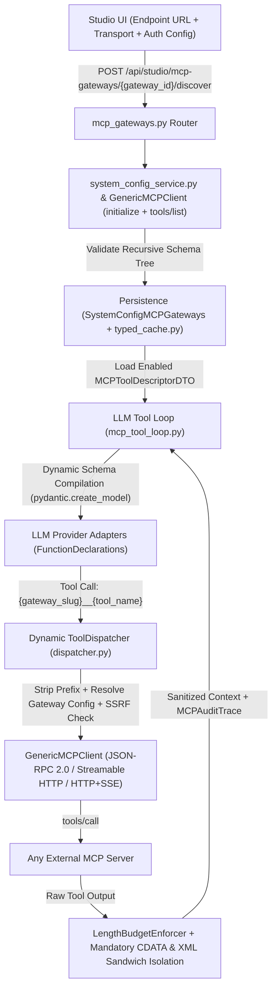

<required_context_rules>
  <rule>@[.agents/rules/00-antigravity-core.md]</rule>
  <rule>@[.agents/rules/01-python-backend.md]</rule>
  <rule>@[.agents/rules/02_flutter_desktop.md]</rule>
  <rule>@[.agents/rules/03_seed_vault.md]</rule>
  <rule>@[.agents/rules/04_directory_reference.md]</rule>
  <rule>@[.agents/rules/05_llm_architecture.md]</rule>
  <knowledge_item>@[ki_sdui_matrix_synthesis.md]</knowledge_item>
  <knowledge_item>@[ki_mcp_tool_protocol.md]</knowledge_item>
  <knowledge_item>@[ki_system_audit_trail_xai.md]</knowledge_item>
  <knowledge_item>@[ki_zero_permissive_typing.md]</knowledge_item>
  <knowledge_item>@[ki_ast_guardrail_engine.md]</knowledge_item>
  <knowledge_item>@[ki_desktop_pro_tool_studio_ux.md]</knowledge_item>
  <knowledge_item>@[ki_workflow_context_governance.md]</knowledge_item>
  <knowledge_item>@[ki_dual_axis_localization_architecture.md]</knowledge_item>
  <knowledge_item>@[ki_app_error_boundary.md]</knowledge_item>
  <knowledge_item>@[ki_api_router_ssot_governance.md]</knowledge_item>
  <knowledge_item>@[ki_global_config_sovereignty.md]</knowledge_item>
</required_context_rules>

# EPIC 159: Dynamic Model Context Protocol (MCP) Architecture & Runtime Schema Introspection

> [!NOTE]
> **Scientific & Industrial Validation (2025-2026)**
> Modern agentic AI architectures in 2025-2026 standardize external tool integration around the **Model Context Protocol (MCP)** over **JSON-RPC 2.0** using **Streamable HTTP** and **HTTP+SSE** transports rather than maintaining brittle, bespoke REST wrapper classes per external vendor. However, empirical security research and OWASP Agentic AI threat modeling (2025-2026) identify three critical attack vectors inherent to dynamic MCP ecosystems:
> 1. **Dynamic Discovery & Schema Poisoning**: Untrusted MCP servers can return deeply nested, malformed, or instruction-poisoned `inputSchema` payloads during `tools/list` introspection. Enforcing a strict, recursive Pydantic V2 schema tree (`ConfigDict(strict=True, extra="forbid", frozen=True)`) and sanitizing tool descriptions at the discovery boundary prevents arbitrary dictionary injection and schema corruption.
> 2. **Server-Side Request Forgery (SSRF) via Dynamic Gateways**: Allowing administrators or tenants to configure arbitrary MCP endpoint URLs creates an SSRF vector targeting cloud instance metadata services (`169.254.169.254`), loopback interfaces (`127.0.0.1`, `::1`, `localhost`), or private RFC 1918 / RFC 4193 subnets (`10.0.0.0/8`, `172.16.0.0/12`, `192.168.0.0/16`, `fc00::/7`). Pre-flight DNS resolution and IP range validation before opening `httpx.AsyncClient` connections are mandatory in production environments.
> 3. **Indirect Prompt Injection (XPIA) & Context Window Flooding**: External MCP servers can return multi-megabyte payloads or embedded XML tags attempting to break out of the prompt context. Enforcing deterministic character truncation via `@[backend_v2/services/length_budget_enforcer.py]` followed by mandatory `CDATA` escaping and XML Sandwich structural isolation in `@[backend_v2/models/prompts/execution/mcp_prompts.py]` neutralizes indirect prompt injection while preserving EU AI Act forensic auditability.

---

## 1. Goal Description & Background (Objective & Problem Statement)

### 1.1 Problem Statement: Current Semi-Dynamic Bottleneck
Quorum currently possesses foundational data models and Quorum Studio UI views for managing Model Context Protocol (MCP) gateways (`SystemConfigMCPGateways` in `@[backend_v2/models/domain/system_config.py]`, `@[backend_v2/api/routers/studio/mcp_gateways.py]`, `@[client_app_v2/lib/features/studio/models/mcp_gateway.dart]`, and `@[client_app_v2/lib/features/studio/views/mcp_gateway_view.dart]`). However, the runtime execution pipeline in `@[backend_v2/services/mcp/mcp_tool_loop.py]` and `@[backend_v2/services/mcp/dispatcher.py]` is only semi-dynamic:
- **Current Pipeline (Semi-Dynamic)**:
  `Studio UI (MCPGateway) -> dispatcher.py -> Hardcoded Python Wrapper Class (tavily.py / wikipedia.py)`
- `@[backend_v2/services/mcp/mcp_tool_loop.py]` instantiates a static module-level `DISPATCHER` wired to hardcoded Python tool implementations (`@[backend_v2/services/mcp/tools/tavily.py]`, `@[backend_v2/services/mcp/tools/wikipedia.py]`, `@[backend_v2/services/mcp/tavily_search_client.py]`, and `@[backend_v2/services/mcp/wikipedia_client.py]`).
- Connecting a previously unknown MCP server in Quorum Studio is impossible without authoring, testing, and deploying a new Python client class and bespoke domain DTOs (`TavilySearchRequestDTO`, `TavilyToolArgsDTO`, `TavilyApiResponseDTO`).
- Furthermore, `AllowedMCPTool` in `@[backend_v2/models/domain/system_config.py]` and `MCPFunctionDefinitionDTO` in `@[backend_v2/models/dtos/mcp.py]` represent JSON schemas using `dict[str, JsonValue]` rather than a strictly typed recursive Pydantic V2 model hierarchy.

### 1.2 Target Architecture: 100% Dynamic MCP Protocol Transport & Introspection
To make Quorum's MCP architecture (`backend_v2/services/mcp/` and `client_app_v2/lib/features/studio/`) completely dynamic so that a user can connect any previously unknown MCP server directly from Quorum Studio without violating Quorum's strict architectural invariants (**Zero Permissive Typing**, **AST Guardrails**, and **XML Sandwich Isolation**), the hardcoded Python tool wrappers are replaced with a general-purpose MCP protocol transport and runtime schema introspection pipeline:



### 1.3 Core Architectural Deliverables across Four Layers & Security Boundary
1. **Layer A — Protocol Transport & Discovery Phase (`backend_v2/services/mcp/` & Studio Router)**:
   - **Protocol-Agnostic `GenericMCPClient` (`[NEW] @[backend_v2/services/mcp/generic_mcp_client.py]`)**: Asynchronous `httpx.AsyncClient` implementation supporting both **Streamable HTTP** (`POST` JSON-RPC 2.0 messages with `application/json` and `text/event-stream` response handling) and **HTTP+SSE** (`GET` SSE stream for endpoint negotiation paired with `POST` JSON-RPC 2.0 requests) for cloud and container deployments (`Dockerfile`, `docker-compose.yml`). Executes standard MCP protocol lifecycle methods: `initialize` handshake (with `notifications/initialized`), `tools/list`, and `tools/call`.
   - **Runtime Introspection Endpoint (`POST /api/studio/mcp-gateways/{gateway_id}/discover` in `@[backend_v2/api/routers/studio/mcp_gateways.py]`)**: Connects to the target MCP gateway endpoint via `GenericMCPClient`, executes `tools/list`, validates each discovered tool's `name`, `description`, and `inputSchema` into strict recursive DTOs, and persists the discovered tool manifests into `SystemConfigMCPGateways` in `@[backend_v2/database/repositories/system.py]` and `@[backend_v2/services/cache/typed_cache.py]` so that tool schemas are cached and never re-queried from external servers at the start of every DAG execution.
2. **Layer B — Zero Permissive Typing Reconciliation (`@[backend_v2/models/dtos/mcp.py]` & `@[backend_v2/models/domain/system_config.py]`)**:
   - **Recursive JSON Schema DTOs**: Create and define `MCPToolSchemaPropertyDTO` and `MCPToolDescriptorDTO` in `@[backend_v2/models/dtos/mcp.py]` as an explicit, self-referential Pydantic V2 tree supporting JSON Schema types `string`, `number`, `integer`, `boolean`, `array`, and `object` alongside `enum`, `items`, `properties`, `required`, and `description` constraints with zero `dict[str, Any]` usage.
   - **Runtime Pydantic Model & Declaration Generation (`pydantic.create_model`)**: When `@[backend_v2/services/mcp/mcp_tool_loop.py]` prepares tools for the foundation model, `@[backend_v2/services/orchestrator/schema_factory.py]` and `@[backend_v2/llm/schema_builder.py]` dynamically compile the stored `MCPToolDescriptorDTO` (defined in `@[backend_v2/models/dtos/mcp.py]`) tree into a runtime Pydantic V2 model via `pydantic.create_model` and into `MCPToolDeclarationDTO` structures consumed by `@[backend_v2/llm/adapters/vertex_adapter.py]`, `@[backend_v2/llm/adapters/openai_adapter.py]`, `@[backend_v2/llm/adapters/ai_studio_adapter.py]`, and `@[backend_v2/llm/adapters/anthropic_adapter.py]`.
   - **Boundary Isolation on Tool Execution**: Incoming LLM tool call arguments are validated against the dynamically generated Pydantic V2 model and wrapped into a strictly typed `MCPToolInvocationDTO` envelope created in `@[backend_v2/models/dtos/mcp.py]` (where argument values are constrained to `MCPArgumentScalar` / `MCPArgumentValue`: `str | int | float | bool | list[str]`), with raw JSON serialization occurring exclusively at the external HTTP transport boundary in `[NEW] @[backend_v2/services/mcp/generic_mcp_client.py]` in compliance with `@[scripts/_ast_boundary_utils.py]` and `@[scripts/_ast_guardrails.py]`.
3. **Layer C — Namespaces & Dynamic Routing (`@[backend_v2/services/mcp/alias_registry.py]` & `@[backend_v2/services/mcp/dispatcher.py]`)**:
   - **Deterministic Namespace Prefixing**: `@[backend_v2/services/mcp/alias_registry.py]` generates a deterministic, collision-free namespace alias in the format `{gateway_slug}__{tool_name}` (for instance, `jira_mcp__search_issues`) for every enabled tool across all gateways attached to a workflow step (`@[backend_v2/models/domain/step.py]`), preserving full compatibility with `@[backend_v2/tests/unit/services/orchestrator/strategies/test_tier4_alias_collision_regression.py]`.
   - **Dynamic `ToolDispatcher` (`@[backend_v2/services/mcp/dispatcher.py]`)**: All hardcoded imports and references to `tavily` and `wikipedia` modules are purged. When the LLM emits a tool call for `{gateway_slug}__{tool_name}`, `ToolDispatcher.dispatch` parses the namespace prefix, resolves the corresponding `SystemConfigMCPGateways` configuration (endpoint URL, transport type, authentication headers resolved from environment variables, and timeout), validates that the tool is enabled on that gateway and permitted by `step.allowed_mcp_tools`, and invokes `GenericMCPClient.call_tool(tool_name, invocation_dto)`.
4. **Layer D — Flutter Studio Integration (`client_app_v2/lib/features/studio/`)**:
   - **`@[client_app_v2/lib/features/studio/models/mcp_gateway.dart]`**: Extend `McpGateway` and `AllowedMcpTool` (plus typed recursive schema property models) with `endpointUrl`, `transportType` (`McpTransportType`: `sse`, `streamableHttp`), `authType` (`McpAuthType`: `none`, `bearer`, `apiKeyHeader`), `authHeaderName`, `authEnvVar`, `timeoutSeconds`, and `enabled` allowlist state on discovered tools.
   - **`@[client_app_v2/lib/features/studio/controllers/mcp_gateways_controller.dart]`**: Add `discoverTools(String gatewayId)` to `McpGatewaysController` and `McpGatewayForm`, invoking `POST /api/studio/mcp-gateways/{gateway_id}/discover` via `@[client_app_v2/lib/core/api/studio_client.dart]` and updating the immutable Freezed state with unconditional error rethrowing after `AsyncValue.guard`.
   - **`@[client_app_v2/lib/features/studio/views/mcp_gateway_view.dart]` & `@[client_app_v2/lib/features/studio/views/mcp_gateways_master_view.dart]`**: Wrap views in `AppErrorBoundary` (resolving `DGR009`), eliminate all naked `TextStyle(` calls in favor of `Theme.of(context).textTheme`, add connection/transport/authentication configuration fields, add the "Connect and Discover Tools" action button, and render the discovered tools list with descriptions, read-only inspected parameter schemas, and per-tool Allowlist `Switch` toggles.
   - **`@[client_app_v2/lib/features/studio/views/step_builder_view.dart]` & `@[client_app_v2/lib/features/studio/views/widgets/workflow/workflow_step_card.dart]`**: In `StepBuilderView` (`step_builder_view.dart`), display dynamically discovered and enabled tools (`tool.enabled == true`) grouped by their parent `McpGateway` as interactive `FilterChip` selectors binding the canonical namespaced ID `{gateway.slug}__{tool.toolId}` to `step.allowedMcpTools` (`NodeStrategy.llm`), while `WorkflowStepCard` (`workflow_step_card.dart`) renders read-only summary badges for the step's bound MCP tools.
5. **Security, Guardrails & EU AI Act Audit Trail**:
   - **Prompt Injection & Mandatory CDATA Isolation (`@[backend_v2/models/prompts/execution/mcp_prompts.py]`)**: Every text payload returned by an external MCP server through `GenericMCPClient` is sanitized (`]]>` sequence escaping) and wrapped in mandatory `<![CDATA[...]]>` blocks and XML Sandwich structural framing (`<external_evidence_source>`), satisfying `@[backend_v2/tests/unit/guardrails/test_cdata_hardening_comprehensive.py]`.
   - **Length Budget & Timeout Enforcement (`@[backend_v2/services/length_budget_enforcer.py]`)**: External MCP responses are passed through `LengthBudgetEnforcer` and sanitization rules (`@[backend_v2/tests/unit/services/mcp/test_tool_loop_sanitization.py]`) before entering the LLM context window.
   - **SSRF & Redirect/Rebinding Firewall (`[NEW] @[backend_v2/services/mcp/url_validator.py]` & `@[backend_v2/services/studio/auth_validator.py]`)**: Strict URL and DNS/IP validator blocking internal cloud metadata endpoints (`169.254.169.254`, `fd00:ec2::254`, `metadata.google.internal`), loopback addresses, link-local ranges, and private subnets in production environments, paired with `follow_redirects=False` on `httpx.AsyncClient` and mandatory re-validation of negotiated `SSE` POST endpoint URLs.
   - **Automatic Telemetry & SDUI Audit Trail (`@[backend_v2/services/sdui/adapters/mcp_audit_adapter.py]`)**: Generic tool calls emit structured `MCPAuditTrace` records (gateway slug, tool name, execution latency in milliseconds, HTTP/JSON-RPC status, and sanitized snippet), appearing automatically in the final report's SDUI audit trail rendered via `@[backend_v2/services/sdui/sdui_mapper_service.py]`.

### 1.4 Quantitative Scope Validation Table

| Target File Path | Action | Physical Layer | Coupled 1-Hop Callers & Blast Radius |
| :--- | :--- | :--- | :--- |
| `@[backend_v2/models/enums.py]` | `[MODIFY]` | Domain / Taxonomies | `@[backend_v2/models/dtos/mcp.py]`, `@[backend_v2/models/domain/system_config.py]`, `@[backend_v2/tests/unit/test_enum_parity.py]` |
| `@[backend_v2/models/dtos/mcp.py]` | `[MODIFY]` | DTO Boundary | `@[backend_v2/models/domain/system_config.py]`, `[NEW] @[backend_v2/services/mcp/generic_mcp_client.py]`, `@[backend_v2/services/orchestrator/schema_factory.py]`, `@[backend_v2/llm/adapters/vertex_adapter.py]`, `@[backend_v2/llm/adapters/openai_adapter.py]`, `@[backend_v2/llm/adapters/ai_studio_adapter.py]`, `@[backend_v2/llm/adapters/anthropic_adapter.py]` |
| `@[backend_v2/models/domain/system_config.py]` | `[MODIFY]` | Domain Persistence Root | `@[backend_v2/seed/seed_data.json#L209-L284]`, `@[backend_v2/services/studio/system_config_service.py]`, `@[backend_v2/database/repositories/system.py]`, `@[backend_v2/services/blueprint.py]`, `@[backend_v2/services/sdui/adapters/printable_sources_adapter.py]` |
| `@[backend_v2/models/domain/mcp.py]` | `[MODIFY]` | Domain Telemetry | `@[backend_v2/services/mcp/mcp_tool_loop.py]`, `@[backend_v2/services/sdui/adapters/mcp_audit_adapter.py]` |
| `@[backend_v2/database/interfaces.py]`, `@[backend_v2/database/repositories/system.py]`, & `@[backend_v2/tests/fakes/in_memory_repositories.py]` | `[MODIFY]` | Persistence / Repository | `@[backend_v2/services/studio/system_config_service.py]`, `@[backend_v2/services/orchestrator/strategies/llm.py]`, `@[backend_v2/hooks/source_verification_hook.py]` |
| `@[backend_v2/settings.py]` & `@[backend_v2/core/test_settings.py]` | `[MODIFY]` | Core Settings | `[NEW] @[backend_v2/services/mcp/generic_mcp_client.py]`, `[NEW] @[backend_v2/services/mcp/url_validator.py]`, `@[backend_v2/tests/unit/test_settings.py]` |
| `[NEW] @[backend_v2/services/mcp/url_validator.py]` | `[NEW]` | Security / SSRF Firewall | `@[backend_v2/services/studio/system_config_service.py]`, `[NEW] @[backend_v2/services/mcp/generic_mcp_client.py]` |
| `[NEW] @[backend_v2/services/mcp/generic_mcp_client.py]` | `[NEW]` | MCP Protocol Transport | `@[backend_v2/services/studio/system_config_service.py]`, `@[backend_v2/services/mcp/dispatcher.py]` |
| `@[backend_v2/services/mcp/alias_registry.py]` | `[MODIFY]` | Namespace Resolution | `@[backend_v2/services/mcp/dispatcher.py]`, `@[backend_v2/services/mcp/mcp_tool_loop.py]`, `@[backend_v2/services/blueprint.py]` |
| `@[backend_v2/services/mcp/dispatcher.py]` | `[MODIFY]` | Dynamic Tool Routing | `@[backend_v2/services/mcp/mcp_tool_loop.py]`, `@[backend_v2/services/source_verification_service.py]` |
| `@[backend_v2/services/mcp/mcp_tool_loop.py]` & `@[backend_v2/services/mcp/__init__.py]` | `[MODIFY]` | Agentic Tool Loop | `@[backend_v2/services/orchestrator/strategies/llm.py]`, `@[backend_v2/services/source_verification_service.py]`, `@[backend_v2/hooks/source_verification_hook.py]` |
| `@[backend_v2/services/orchestrator/schema_factory.py]`, `@[backend_v2/llm/schema_builder.py]`, & `@[backend_v2/services/orchestrator/strategies/llm.py]` | `[MODIFY]` | Runtime Schema Compilation & Strategy DI | `@[backend_v2/services/mcp/dispatcher.py]`, `@[backend_v2/services/mcp/mcp_tool_loop.py]` |
| `@[backend_v2/services/studio/system_config_service.py]`, `@[backend_v2/api/routers/studio/mcp_gateways.py]`, & `@[backend_v2/services/cache/typed_cache.py]` | `[MODIFY]` | Studio API, Service & Cache | `@[backend_v2/database/repositories/system.py]`, `@[client_app_v2/lib/core/api/studio_client.dart]` |
| `@[backend_v2/services/mcp/tools/tavily.py]`, `@[backend_v2/services/mcp/tools/wikipedia.py]`, `@[backend_v2/services/mcp/tavily_search_client.py]`, `@[backend_v2/services/mcp/wikipedia_client.py]`, `@[backend_v2/models/domain/wikipedia.py]`, `@[backend_v2/models/domain/tools.py]` | `[DELETE]` | Legacy Static Wrappers | Replaced by `[NEW] @[backend_v2/services/mcp/generic_mcp_client.py]` and dynamic `ToolDispatcher` |
| `@[scripts/_ast_guardrails.py]`, `@[scripts/audit_dict_eradication.py]`, & `@[pyproject.toml]` | `[MODIFY]` | AST Guardrail & Linter Config | `@[backend_v2/tests/unit/test_enum_parity.py]`, `scripts/backend_audit_loop.py` |
| `@[client_app_v2/lib/features/studio/models/mcp_gateway.dart]` & `@[client_app_v2/lib/core/models/enums.dart]` | `[MODIFY]` | Flutter Domain / Freezed | `@[client_app_v2/lib/core/api/studio_client.dart]`, `@[client_app_v2/lib/features/studio/controllers/mcp_gateways_controller.dart]` |
| `@[client_app_v2/lib/features/studio/views/mcp_gateway_view.dart]`, `@[client_app_v2/lib/features/studio/views/mcp_gateways_master_view.dart]`, `@[client_app_v2/lib/features/studio/views/step_builder_view.dart]`, & `@[client_app_v2/lib/features/studio/views/widgets/workflow/workflow_step_card.dart]` | `[MODIFY]` | Flutter Studio Views | `@[client_app_v2/lib/features/studio/controllers/mcp_gateways_controller.dart]`, `@[client_app_v2/lib/features/studio/controllers/studio_controller.dart]` |

---

## 2. Architectural Impact & Compliance Matrix

### 2.1 Deprecations & Sunset List (`What We Will REMOVE`)

| Deprecated File / Symbol | Location | Sunset Action & Replacement Mapping |
| :--- | :--- | :--- |
| `TavilyTool`, `TAVILY_TOOL_ID`, `TAVILY_TOOL_SCHEMA` | `[DELETE] @[backend_v2/services/mcp/tools/tavily.py]` | **DELETED** — Replaced by protocol-agnostic `GenericMCPClient` in `[NEW] @[backend_v2/services/mcp/generic_mcp_client.py]`. |
| `WikipediaSearchTool`, `WikipediaReadTool`, `WIKIPEDIA_SEARCH_TOOL_ID`, `WIKIPEDIA_READ_TOOL_ID` | `[DELETE] @[backend_v2/services/mcp/tools/wikipedia.py]` | **DELETED** — Replaced by protocol-agnostic `GenericMCPClient` in `[NEW] @[backend_v2/services/mcp/generic_mcp_client.py]`. |
| `TavilySearchClient` | `[DELETE] @[backend_v2/services/mcp/tavily_search_client.py]` | **DELETED** — Replaced by `GenericMCPClient` JSON-RPC 2.0 transport in `[NEW] @[backend_v2/services/mcp/generic_mcp_client.py]`. |
| `WikipediaClient` | `[DELETE] @[backend_v2/services/mcp/wikipedia_client.py]` | **DELETED** — Replaced by `GenericMCPClient` JSON-RPC 2.0 transport in `[NEW] @[backend_v2/services/mcp/generic_mcp_client.py]`. |
| `SUPPORTED_WIKIPEDIA_LANGUAGES`, `WikimediaActionSearchItemDTO`, `WikimediaActionQueryDTO`, `WikimediaActionApiResponseDTO`, `WikimediaRestSummaryResponseDTO`, `WikipediaReadInputDTO`, `WikipediaSearchResultItem`, `WikipediaSearchResponseDTO`, `WikipediaPageSummaryResult` | `[DELETE] @[backend_v2/models/domain/wikipedia.py]` | **DELETED** — Vendor-specific MediaWiki REST models are intentionally dropped in favor of generic MCP JSON-RPC 2.0 `MCPToolCallResultDTO` created in `@[backend_v2/models/dtos/mcp.py]`. |
| `StandardSearchInputDTO`, `BaseTool`, `BaseSearchTool` | `[DELETE] @[backend_v2/models/domain/tools.py]` | **DELETED** — Static Python tool base classes are replaced by dynamic `MCPToolDescriptorDTO` schema compilation in `@[backend_v2/services/orchestrator/schema_factory.py]` and dynamic routing returning `MCPAuditTrace` in `@[backend_v2/services/mcp/dispatcher.py]`. |
| `DISPATCHER` | `@[backend_v2/services/mcp/mcp_tool_loop.py]` & `@[backend_v2/services/mcp/__init__.py]` | **REMOVED** — Module-level static `DISPATCHER` singleton is replaced by dynamically instantiated `ToolDispatcher` bound to active `SystemConfigMCPGateways` records. |
| `TavilySearchRequestDTO` | `@[backend_v2/models/dtos/mcp.py]` | **REMOVED** — Replaced by `MCPToolInvocationDTO` and `MCPJsonRpcRequestDTO` defined in `@[backend_v2/models/dtos/mcp.py]`. |
| `TavilyToolArgsDTO`, `TavilyApiResultItemDTO`, `TavilyApiResponseDTO`, `TavilySearchResult` | `@[backend_v2/models/domain/mcp.py]` | **REMOVED** — Replaced by generic `MCPToolInvocationDTO` and `MCPToolCallResultDTO` defined in `@[backend_v2/models/dtos/mcp.py]`. |
| Legacy unit tests, integration tests & scripts for static wrappers | `[DELETE] @[backend_v2/tests/unit/test_tavily_client.py]`, `[DELETE] @[backend_v2/tests/unit/test_tavily_search_client.py]`, `[DELETE] @[backend_v2/tests/unit/services/mcp/tools/test_tavily.py]`, `[DELETE] @[backend_v2/tests/unit/services/mcp/tools/test_wikipedia.py]`, `[DELETE] @[backend_v2/tests/unit/services/mcp/test_wikipedia_client.py]`, `[DELETE] @[backend_v2/tests/unit/models/domain/test_wikipedia.py]`, `[DELETE] @[backend_v2/tests/unit/models/domain/test_tools.py]`, `[DELETE] @[backend_v2/tests/integration/test_tavily_live.py]`, `[DELETE] @[backend_v2/scripts/test_tavily_live.py]` | **DELETED** — Replaced by `[NEW] @[backend_v2/tests/unit/services/mcp/test_generic_mcp_client.py]`, `[NEW] @[backend_v2/tests/unit/services/mcp/test_url_validator.py]`, `[NEW] @[backend_v2/tests/unit/services/mcp/test_alias_registry.py]`, and `[NEW] @[backend_v2/tests/integration/test_dynamic_mcp_pipeline_e2e.py]`. |
| `mcp_wikipedia_max_search_results`, `mcp_wikipedia_max_chars`, `mcp_wikipedia_timeout_seconds`, `mcp_wikipedia_user_agent` | `@[backend_v2/settings.py]` & `@[backend_v2/core/test_settings.py]` | **REMOVED** — Vendor-specific Wikipedia settings are replaced by generic MCP transport and discovery limits (`mcp_default_timeout_seconds`, `mcp_discovery_timeout_seconds`, `mcp_max_response_chars`, `mcp_allow_private_networks`) in `@[backend_v2/settings.py]`. |

### 2.2 Retained SSOT Invariants (`What We Will RETAIN`)
- **`SystemConfigMCPGateways` Persistence Root (`@[backend_v2/models/domain/system_config.py]`)**: Retained as the canonical `system_config` discriminated union member (`type: Literal["mcp_gateways"] = "mcp_gateways"`) stored in `seed_data.json` (`@[backend_v2/seed/seed_data.json#L209-L284]`) and managed by `@[backend_v2/services/studio/system_config_service.py]`.
- **Single Router SSOT (`@[backend_v2/api/routers/studio/mcp_gateways.py]`)**: Retained as the sole FastAPI router handling all `/api/studio/mcp-gateways` CRUD, cloning, and runtime tool discovery operations.
- **CDATA & XML Sandwich Prompt Firewall (`@[backend_v2/models/prompts/execution/mcp_prompts.py]`)**: `wrap_in_cdata`, `build_mcp_tool_loop_prompt`, and `build_xml_sandwich_prompt` are retained and enforced on all external MCP tool responses.
- **Forensic Citation Verification & Audit Trail (`@[backend_v2/models/domain/mcp.py]` & `@[backend_v2/services/sdui/adapters/mcp_audit_adapter.py]`)**: `MCPAuditTrace`, `MCPRetrievalResultDTO`, `MCPToolLoopResult`, `CitationExtractionResult`, and `MCPAuditAdapter` are retained so that all dynamic MCP tool calls automatically populate the EU AI Act SDUI audit trail.

### 2.3 Compliance & Modernity Gates (Quorum 2026 Invariants)
1. **Zero Legacy State Support Mandate**: No fallback shims for legacy un-namespaced tool IDs or static Python tool classes. `seed_data.json` (`@[backend_v2/seed/seed_data.json#L209-L284]`, `@[backend_v2/seed/seed_data.json#L21696-L21700]`, `@[backend_v2/seed/seed_data.json#L22022-L22026]`) is migrated cleanly and re-seeded via `uv run python backend_v2/seed/run_seed.py local`.
2. **Central Config Sovereignty**: All MCP timeouts, response character budgets, and SSRF private-network flags reside in `@[backend_v2/settings.py]`. Transport and authentication taxonomies (`MCPTransportType`, `MCPAuthType`, `JSONSchemaPropertyType`) reside in `@[backend_v2/models/enums.py]` and `@[client_app_v2/lib/core/models/enums.dart]`.
3. **Pydantic Strictness & Zero Permissive Typing**: Every new and modified DTO in `@[backend_v2/models/dtos/mcp.py]` and `@[backend_v2/models/domain/system_config.py]` enforces `model_config = ConfigDict(strict=True, extra="forbid", frozen=True)`. Raw `dict[str, JsonValue]` is eliminated from `AllowedMCPTool.input_schema` and `MCPFunctionDefinitionDTO.parameters` in favor of the recursive `MCPToolSchemaPropertyDTO` tree defined in `@[backend_v2/models/dtos/mcp.py]`.
4. **Cross-Domain DTO & Enum Parity**: Backend changes to `SystemConfigMCPGateways`, `AllowedMCPTool`, `MCPToolSchemaPropertyDTO` (defined in `@[backend_v2/models/dtos/mcp.py]`), `MCPTransportType`, and `MCPAuthType` are mirrored 1:1 in `@[client_app_v2/lib/features/studio/models/mcp_gateway.dart]` and `@[client_app_v2/lib/core/models/enums.dart]`, verified by `@[backend_v2/tests/unit/test_enum_parity.py]` and `flutter_audit_loop.py --build`.
5. **Credential Hardcoding Ban**: Gateway authentication headers never store raw secret tokens in `seed_data.json` or `db_v2.json`. `SystemConfigMCPGateways` stores only `auth_env_var: str | None` (the environment variable identifier, for instance `TAVILY_API_KEY` or `JIRA_MCP_TOKEN`), which `GenericMCPClient` resolves at runtime from environment / `Settings` at the outbound HTTP boundary.
6. **Unbounded I/O Timeout & Concurrency Mandate**: All `GenericMCPClient` HTTP requests use `async with httpx.AsyncClient(timeout=...)` bounded by `settings.mcp_default_timeout_seconds` and `asyncio.TaskGroup` for parallel multi-tool dispatch.
7. **RFC-7807 Dual-Reporting**: Every `AppException` raised during SSRF validation, MCP handshake, schema introspection, or tool execution is preceded by a structured `logger.error` call containing the exact `ErrorCodes` enum name and opaque gateway/step identifiers.
8. **Scoped Boy Scout Rule & Technical Debt Sweep**: Pre-existing technical debt identified by `scripts/audit_technical_debt.py` and `scripts/audit_flutter_theme_sovereignty.py` in touched files (`DGR009` missing `AppErrorBoundary` in `@[client_app_v2/lib/features/studio/views/mcp_gateways_master_view.dart]` and `@[client_app_v2/lib/features/studio/views/mcp_gateway_view.dart]`, 18 `PROHIBITED_NAKED_TEXT_STYLE` violations across `@[client_app_v2/lib/features/studio/views/mcp_gateway_view.dart]`, `@[client_app_v2/lib/features/studio/views/mcp_gateways_master_view.dart]`, and `@[client_app_v2/lib/features/studio/views/step_builder_view.dart]`, `limit=1` overwrite bug in `@[backend_v2/database/repositories/system.py]`, and `isinstance(..., dict)` / raw dict message assembly in `@[backend_v2/services/mcp/mcp_tool_loop.py]`) is resolved in Phase 1 before introducing new feature logic.

### 2.4 Producer-Consumer Integration Check

| Data Artifact / Contract | Producer (Origin) | Intermediate Storage / Transit | Consumer (Destination) |
| :--- | :--- | :--- | :--- |
| **Discovered Tool Manifests (`list[AllowedMCPTool]` with `MCPToolSchemaPropertyDTO` defined in `mcp.py`)** | External MCP Server (`tools/list`) parsed by `GenericMCPClient.list_tools()` in `[NEW] @[backend_v2/services/mcp/generic_mcp_client.py]` | Persisted in `SystemConfigMCPGateways.tools` via `@[backend_v2/services/studio/system_config_service.py]` & `@[backend_v2/database/repositories/system.py]`, and cached in `@[backend_v2/services/cache/typed_cache.py]` | 1) Studio UI (`@[client_app_v2/lib/features/studio/views/mcp_gateway_view.dart]`, `@[client_app_v2/lib/features/studio/views/step_builder_view.dart]`, & `@[client_app_v2/lib/features/studio/views/widgets/workflow/workflow_step_card.dart]`)<br>2) `SchemaFactory` (`@[backend_v2/services/orchestrator/schema_factory.py]`) |
| **Namespaced Function Declarations (`MCPToolDeclarationDTO` & Runtime Pydantic Model)** | `AliasRegistry` (`@[backend_v2/services/mcp/alias_registry.py]`) + `SchemaFactory` (`@[backend_v2/services/orchestrator/schema_factory.py]`) using `pydantic.create_model` | Passed in-memory via `LLMClient` / `LiteLLMProvider` to Provider Adapters (`@[backend_v2/llm/adapters/vertex_adapter.py]`, `@[backend_v2/llm/adapters/openai_adapter.py]`, `@[backend_v2/llm/adapters/anthropic_adapter.py]`, `@[backend_v2/llm/adapters/ai_studio_adapter.py]`) | Foundation Model native tool calling interface (`tools` / `function_declarations`) |
| **Validated Tool Call Envelope (`MCPToolInvocationDTO` created in `mcp.py`)** | LLM tool call response parsed & validated against dynamic Pydantic model in `@[backend_v2/services/mcp/mcp_tool_loop.py]` | Dispatched via `ToolDispatcher.dispatch()` (`@[backend_v2/services/mcp/dispatcher.py]`) | `GenericMCPClient.call_tool()` (`[NEW] @[backend_v2/services/mcp/generic_mcp_client.py]`) |
| **Sanitized Tool Output & Telemetry (`MCPAuditTrace`)** | `GenericMCPClient.call_tool()` -> `LengthBudgetEnforcer` (`@[backend_v2/services/length_budget_enforcer.py]`) -> `wrap_in_cdata()` (`@[backend_v2/models/prompts/execution/mcp_prompts.py]`) | Stored in `MCPToolLoopResult.audit_traces` (`@[backend_v2/models/domain/mcp.py]`) & `ExecutionRecord` | 1) LLM Synthesis Prompt (`build_xml_sandwich_prompt`)<br>2) `MCPAuditAdapter` (`@[backend_v2/services/sdui/adapters/mcp_audit_adapter.py]`) & `PrintableSourcesAdapter` (`@[backend_v2/services/sdui/adapters/printable_sources_adapter.py]`) -> Flutter SDUI Report View |

### 2.5 5-Column Architectural Directive Table

| 1. Target Scope & Boundaries | 2. Eradicated Duct-Tape | 3. Approved Best Practice | 4. Pruned Over-Engineering | 5. Verification & Fail-Fast |
| :--- | :--- | :--- | :--- | :--- |
| **MCP Schema & Wire DTOs**<br>`@[backend_v2/models/dtos/mcp.py]`<br>`@[backend_v2/models/domain/system_config.py]` | Raw `dict[str, JsonValue]` in `AllowedMCPTool.input_schema` and `MCPFunctionDefinitionDTO.parameters`; hardcoded `TavilySearchRequestDTO` and `TavilyToolArgsDTO`. | Recursive self-referential `MCPToolSchemaPropertyDTO` (`model_rebuild()`) and `MCPToolInputSchemaDTO` with `ConfigDict(strict=True, extra="forbid", frozen=True)`; serialization at provider adapter boundary via `.model_dump(mode="json", by_alias=True, exclude_none=True)`. | Eliminated vendor-specific tool argument DTOs across domain models; single canonical `MCPToolInvocationDTO` envelope for all MCP gateways. | `uv run python scripts/backend_audit_loop.py backend_v2/models/ --test --ast-strict`; `ValidationError` -> `AppException(ErrorCodes.VALIDATION_FAILED)` on unknown schema keys. |
| **Multi-Gateway Persistence & Studio Service**<br>`@[backend_v2/database/interfaces.py]`<br>`@[backend_v2/database/repositories/system.py]`<br>`@[backend_v2/services/studio/system_config_service.py]`<br>`@[backend_v2/tests/fakes/in_memory_repositories.py]` | `limit=1` query overwriting `doc_id = str(res_list[0]["id"])` in `update_mcp_gateways`; `list_mcp_gateways` returning only a single gateway; duplicate `slug` values on draft/clone. | `get_all_mcp_gateways() -> list[SystemConfigMCPGateways]` sorted deterministically by `(m.slug, m.id)`; in-place upsert strictly by `doc_id = gateways_data.id`; unique `slug` enforcement across all `SystemConfigMCPGateways` entities. | Reused existing `SystemConfigMCPGateways` `system_config` collection without adding parallel database collections or secondary routers. | `@[backend_v2/tests/unit/test_mcp_gateways.py]` and `@[backend_v2/tests/unit/services/studio/test_system_config_service.py]` stateful multi-gateway roundtrip persistence tests. |
| **Protocol Transport & SSRF Firewall**<br>`[NEW] @[backend_v2/services/mcp/generic_mcp_client.py]`<br>`[NEW] @[backend_v2/services/mcp/url_validator.py]` | Bespoke per-vendor HTTP wrappers (`TavilySearchClient`, `WikipediaClient`), unvalidated external endpoint URLs, and open HTTP redirect following. | Protocol-agnostic JSON-RPC 2.0 `GenericMCPClient` supporting `STREAMABLE_HTTP` and `SSE` via `httpx.AsyncClient(follow_redirects=False, timeout=...)`; pre-flight DNS/IP validation via `MCPUrlValidator` on both initial endpoint and negotiated `SSE` POST endpoint URLs; strict wire parsing via `MCPJsonRpcResponseDTO.model_validate_json` with zero `BOUNDARY_EXEMPTION_FILES` expansion. | Zero external MCP SDK dependencies (`dependency_hallucination_firewall`); implemented directly with native `httpx` and Pydantic V2 wire DTOs. | `[NEW] @[backend_v2/tests/unit/services/mcp/test_url_validator.py]` and `[NEW] @[backend_v2/tests/unit/services/mcp/test_generic_mcp_client.py]`; Fail-Fast `AppException(ErrorCodes.SECURITY_VIOLATION)` on blocked CIDR or redirect. |
| **Dynamic Schema Compilation, DI & Routing**<br>`@[backend_v2/services/orchestrator/schema_factory.py]`<br>`@[backend_v2/services/mcp/alias_registry.py]`<br>`@[backend_v2/services/mcp/dispatcher.py]`<br>`@[backend_v2/services/mcp/mcp_tool_loop.py]`<br>`@[backend_v2/services/orchestrator/strategies/llm.py]`<br>`@[backend_v2/services/source_verification_service.py]` | Module-level `DISPATCHER` singleton in `@[backend_v2/services/mcp/mcp_tool_loop.py]` and `@[backend_v2/services/mcp/__init__.py]`; duck-typing `isinstance(..., dict)` in `mcp_tool_loop.py`; static `BaseTool` and `BaseSearchTool` classes in `@[backend_v2/models/domain/tools.py]`. | Runtime Pydantic V2 model compilation via `pydantic.create_model` in `SchemaFactory`; deterministic `{gateway_slug}__{tool_id}` prefixing in `AliasRegistry`; dynamic `ToolDispatcher` injected via `ISystemRepository.get_all_mcp_gateways()` and returning `MCPAuditTrace` directly. | **30% Deletion Test Applied**: Deleted `@[backend_v2/models/domain/tools.py]` (`BaseTool`, `BaseSearchTool`, `StandardSearchInputDTO`) and pruned the redundant `ToolExecutionResult` intermediate wrapper in favor of returning `MCPAuditTrace` directly. | `[NEW] @[backend_v2/tests/unit/services/mcp/test_alias_registry.py]` and `@[backend_v2/tests/unit/services/mcp/test_dispatcher.py]`; positive ID-set check `namespaced_alias in allowed_step_tools`. |
| **Flutter Studio & Step Builder Integration**<br>`@[client_app_v2/lib/features/studio/models/mcp_gateway.dart]`<br>`@[client_app_v2/lib/features/studio/views/mcp_gateway_view.dart]`<br>`@[client_app_v2/lib/features/studio/views/mcp_gateways_master_view.dart]`<br>`@[client_app_v2/lib/features/studio/views/step_builder_view.dart]`<br>`@[client_app_v2/lib/features/studio/views/widgets/workflow/workflow_step_card.dart]` | Missing `AppErrorBoundary` (`DGR009`); 18 naked `TextStyle(` violations; untyped `Map<String, Object?> inputSchema` in `AllowedMcpTool`; manual JSON schema text editing; un-namespaced `tool.toolId` chips in `StepBuilderView`. | Strict Freezed `McpToolInputSchema` and `McpToolSchemaProperty` models; `AppErrorBoundary` wrapping; 100% `Theme.of(context).textTheme` adherence; live "Connect and Discover Tools" introspection action and per-gateway `{gateway.slug}__{tool.toolId}` `FilterChip` selectors in `StepBuilderView`. | Pruned manual raw JSON schema authoring from `McpGatewayView` in favor of read-only inspected schema tables and per-tool `enabled` allowlist switches. | `uv run python scripts/flutter_audit_loop.py client_app_v2/ --build`, `@[client_app_v2/test/features/studio/views/mcp_gateway_view_test.dart]`, and `@[client_app_v2/test/features/studio/models/mcp_gateway_test.dart]`. |

---

## 3. Phased Execution Plan (Implementation Strategy)

### Phase 1: Pre-Implementation Technical Debt Cleanups, Strict Recursive MCP Schema DTOs & Seed Vault Migration

#### 1.1 Scoped Boy Scout Technical Debt Cleanups in Touched Targets
- **`[MODIFY] @[backend_v2/services/mcp/mcp_tool_loop.py]`**:
  - Eliminate duck-typing `isinstance(strictness_val, (int, float))`, `isinstance(validation_context, dict)`, and negative `isinstance(validation_context["mcp_source_texts"], (str, int, float, bool, list))` checks as well as in-place subscript mutations (`validation_context["mcp_source_texts"] = source_texts`) by introducing a strictly typed `MCPValidationContextDTO` defined in `@[backend_v2/models/dtos/mcp.py]`.
  - Replace raw `dict[str, str]` and `list[dict[str, str]]` message structures in `_build_tool_evidence_message`, `extraction_messages`, `correction_messages`, and `final_messages` with `LLMMessageDTO` (`@[backend_v2/models/llm.py]`) and immutable `.model_copy(update=...)` transitions.
- **`[MODIFY] @[backend_v2/database/interfaces.py]`, `@[backend_v2/database/repositories/system.py]`, & `@[backend_v2/tests/fakes/in_memory_repositories.py]`**:
  - Add `get_all_mcp_gateways() -> list[SystemConfigMCPGateways]` to `ISystemRepository`, `SystemRepositoryImpl`, and `InMemorySystemRepository` (sorted deterministically by `key=lambda m: (m.slug, m.id)`).
  - Fix the single-document overwrite bug in `SystemRepositoryImpl.update_mcp_gateways(gateways_data)` where `limit=1` previously overwrote `doc_id = str(res_list[0]["id"])`; instead, upsert strictly under `doc_id = gateways_data.id` (mirroring `update_model_registry`) and eliminate `.get("id")` in `@[backend_v2/database/repositories/system.py]` by using `"id" in existing and existing["id"] is not None`.
- **`[MODIFY] @[client_app_v2/lib/features/studio/views/mcp_gateways_master_view.dart]`, `@[client_app_v2/lib/features/studio/views/mcp_gateway_view.dart]`, & `@[client_app_v2/lib/features/studio/views/step_builder_view.dart]`**:
  - Resolve fatal Dart guardrail violation `DGR009` reported by `scripts/audit_technical_debt.py` by wrapping the root view bodies of `mcp_gateways_master_view.dart` and `mcp_gateway_view.dart` in `AppErrorBoundary` from `@[client_app_v2/lib/core/error/app_error_boundary.dart]`.
  - Resolve all 18 `PROHIBITED_NAKED_TEXT_STYLE` violations reported by `scripts/audit_flutter_theme_sovereignty.py` across `mcp_gateway_view.dart` (lines 203, 258, 375, 415), `mcp_gateways_master_view.dart` (lines 56, 126, 158), and `step_builder_view.dart` (lines 305, 325, 430, 491, 539, 593, 601, 688, 696, 783, 791) by replacing direct `TextStyle(...)` instantiations with `Theme.of(context).textTheme` tokens.

#### 1.2 Taxonomies & Recursive JSON Schema DTOs (Zero Permissive Typing)
- **`[MODIFY] @[backend_v2/models/enums.py]` & `@[client_app_v2/lib/core/models/enums.dart]`**:
  - Define `MCPTransportType(StrEnum)` with values `STREAMABLE_HTTP = "streamable_http"` and `SSE = "sse"` (and corresponding `@JsonEnum(valueField: 'value') enum McpTransportType` in Dart).
  - Define `MCPAuthType(StrEnum)` with values `NONE = "none"`, `BEARER = "bearer"`, and `API_KEY_HEADER = "api_key_header"` (and corresponding `@JsonEnum(valueField: 'value') enum McpAuthType` in Dart).
  - Define `JSONSchemaPropertyType(StrEnum)` with values `STRING = "string"`, `NUMBER = "number"`, `INTEGER = "integer"`, `BOOLEAN = "boolean"`, `ARRAY = "array"`, and `OBJECT = "object"` (and corresponding `@JsonEnum(valueField: 'value') enum JsonSchemaPropertyType` in Dart).
  - Add corresponding Lax hydration aliases (`LaxMCPTransportType`, `LaxMCPAuthType`, `LaxJSONSchemaPropertyType`) in `@[backend_v2/models/enums.py]`.
- **`[MODIFY] @[backend_v2/models/dtos/mcp.py]`**:
  - Purge `TavilySearchRequestDTO`.
  - Create and define recursive `MCPToolSchemaPropertyDTO` with `model_config = ConfigDict(strict=True, extra="forbid", frozen=True)`:
    - `type: LaxJSONSchemaPropertyType`
    - `description: str = ""`
    - `enum_values: list[str] | None = Field(default=None, alias="enum")`
    - `items: MCPToolSchemaPropertyDTO | None = None` (using recursive `MCPToolSchemaPropertyDTO` created in `@[backend_v2/models/dtos/mcp.py]`)
    - `properties: dict[str, MCPToolSchemaPropertyDTO] | None = None` (mapping property names to `MCPToolSchemaPropertyDTO` defined in `@[backend_v2/models/dtos/mcp.py]`)
    - `required: list[str] | None = None`
    - Call `MCPToolSchemaPropertyDTO.model_rebuild()` after class definition to finalize self-referential recursion for `MCPToolSchemaPropertyDTO` defined in `@[backend_v2/models/dtos/mcp.py]`.
  - Create `MCPToolInputSchemaDTO` (`type: Literal["object"] = "object"`, `properties: dict[str, MCPToolSchemaPropertyDTO]`, `required: list[str] = Field(default_factory=list)`).
  - Create `MCPToolDescriptorDTO` (`tool_id: str`, `description: str`, `input_schema: MCPToolInputSchemaDTO`, `enabled: bool = True`).
  - Update `MCPFunctionDefinitionDTO` in `@[backend_v2/models/dtos/mcp.py]` to replace `parameters: dict[str, JsonValue]` with `parameters: MCPToolInputSchemaDTO` created in `@[backend_v2/models/dtos/mcp.py]`.
  - Define `type MCPArgumentScalar = str | int | float | bool` and `type MCPArgumentValue = MCPArgumentScalar | list[str] | list[int] | list[float] | list[bool]`.
  - Create `MCPToolInvocationDTO` (`gateway_id: str`, `gateway_slug: str`, `tool_id: str`, `namespaced_alias: str`, `arguments: dict[str, MCPArgumentValue]`).
  - Create JSON-RPC 2.0 wire boundary DTOs defined in `@[backend_v2/models/dtos/mcp.py]`: `MCPJsonRpcRequestDTO`, `MCPJsonRpcErrorDTO`, `MCPJsonRpcResponseDTO`, `MCPInitializeResultDTO`, `MCPToolsListResultDTO`, `MCPContentBlockDTO`, and `MCPToolCallResultDTO`.
- **`[MODIFY] @[backend_v2/models/domain/system_config.py]`**:
  - Update `AllowedMCPTool` to replace `input_schema: dict[str, JsonValue]` with `input_schema: MCPToolInputSchemaDTO` (defined in `@[backend_v2/models/dtos/mcp.py]`) and add `enabled: Annotated[bool, Field(default=True, description="Whether this discovered tool is enabled for agent execution.")] = True`.
  - Update `MCPAuditTrace` in `@[backend_v2/models/domain/system_config.py]` to add optional provenance fields `gateway_id: Annotated[str | None, Field(default=None, description="Opaque ID of the MCP gateway that executed the tool.")] = None`, `gateway_slug: Annotated[str | None, Field(default=None, description="Namespace slug of the MCP gateway.")] = None`, and `namespaced_alias: Annotated[str | None, Field(default=None, description="Full namespaced tool alias invoked by the LLM.")] = None`.
  - Update `SystemConfigMCPGateways` to enforce a non-empty single-underscore slug (`slug: Annotated[str, Field(min_length=1, pattern=r"^[a-z0-9]+(?:_[a-z0-9]+)*$", description="Collision-free gateway namespace slug without double underscores.")]`) so `{gateway_slug}__{tool_id}` splitting on `"__"` is 100% bijective, and add:
    - `endpoint_url: Annotated[str, Field(default="", description="HTTP/HTTPS endpoint URL of the external MCP server.")]`
    - `transport_type: Annotated[LaxMCPTransportType, Field(default=MCPTransportType.STREAMABLE_HTTP, description="MCP transport protocol.")]`
    - `auth_type: Annotated[LaxMCPAuthType, Field(default=MCPAuthType.NONE, description="Authentication scheme for the MCP gateway.")]`
    - `auth_header_name: Annotated[str | None, Field(default=None, description="Custom HTTP header name when auth_type is api_key_header.")]`
    - `auth_env_var: Annotated[str | None, Field(default=None, description="Name of the environment variable holding the secret token or API key.")]`
    - `timeout_seconds: Annotated[int, Field(default=30, ge=1, le=300, description="Request timeout in seconds for this MCP gateway.")]`
- **`[MODIFY] @[backend_v2/settings.py]`, `@[backend_v2/core/test_settings.py]`, & `@[backend_v2/tests/unit/test_settings.py]`**:
  - Remove `mcp_wikipedia_max_search_results`, `mcp_wikipedia_max_chars`, `mcp_wikipedia_timeout_seconds`, and `mcp_wikipedia_user_agent`, and add `mcp_default_timeout_seconds`, `mcp_discovery_timeout_seconds`, `mcp_max_response_chars`, and `mcp_allow_private_networks`.
- **`[MODIFY] @[backend_v2/seed/seed_data.json#L209-L284]`**:
  - Update `sys_8172bda70c8641c5` (`type: "mcp_gateways"`) to include `slug: "default_mcp_gateway"`, `endpoint_url`, `transport_type: "streamable_http"`, `auth_type: "bearer"`, `auth_env_var: "TAVILY_API_KEY"`, `timeout_seconds: 30`, and `enabled: true` on each tool entry, and update step `allowed_mcp_tools` references at `@[backend_v2/seed/seed_data.json#L21696-L21700]` and `@[backend_v2/seed/seed_data.json#L22022-L22026]` to use the canonical namespaced format `default_mcp_gateway__mcp_tavily_search`.
- **`[MODIFY]` Coupled Unit Test Fixtures for Atomic Schema Strictness**:
  - Synchronously update test fixtures constructing `AllowedMCPTool`, `MCPFunctionDefinitionDTO`, or `SystemConfigMCPGateways` in `@[backend_v2/tests/unit/models/domain/test_mcp.py]`, `@[backend_v2/tests/unit/models/domain/test_system_config.py]`, `@[backend_v2/tests/unit/models/dtos/test_mcp.py]`, `@[backend_v2/tests/unit/models/test_v2_core.py]`, `@[backend_v2/tests/unit/seed/test_seed_registry.py]`, `@[backend_v2/tests/unit/services/studio/test_system_config_service.py]`, and `@[backend_v2/tests/unit/services/orchestrator/test_mcp_schema_bug.py]` to use `MCPToolInputSchemaDTO` and `MCPToolSchemaPropertyDTO` defined in `@[backend_v2/models/dtos/mcp.py]`.
  - Remove `"backend_v2/models/domain/system_config.py"` from `RESIDUAL_FUTURE_PHASE_JSONVALUE_FILES` in `@[scripts/_ast_guardrails.py]` once `AllowedMCPTool.input_schema` is migrated from `dict[str, JsonValue]` to `MCPToolInputSchemaDTO`.

---

### Phase 2: Protocol Transport (`GenericMCPClient`), Security Guardrails (SSRF, CDATA, Length Budget) & Studio Discovery API

#### 2.1 SSRF URL & Network Egress Validator
- **`[NEW] @[backend_v2/services/mcp/url_validator.py]`**:
  - Create `MCPUrlValidator` with static/pure validation methods (`validate_mcp_endpoint_url(url: str, *, allow_private_networks: bool) -> str`).
  - Enforce `https://` or `http://` scheme only (reject `file://`, `ftp://`, `gopher://`, `ws://`).
  - Resolve hostname via `socket.getaddrinfo` and block:
    - Cloud metadata addresses (`169.254.169.254`, `fd00:ec2::254`, `metadata.google.internal`).
    - Loopback addresses (`127.0.0.0/8`, `::1`, `localhost`) and private/link-local CIDR blocks (`10.0.0.0/8`, `172.16.0.0/12`, `192.168.0.0/16`, `169.254.0.0/16`, `fc00::/7`, `fe80::/10`) whenever `allow_private_networks` is `False` (default in `production` environment).
  - Log structured RFC-7807 error with `ErrorCodes.SECURITY_VIOLATION` / `ErrorCodes.VALIDATION_FAILED` and raise `AppException` immediately on violation.

#### 2.2 Protocol-Agnostic `GenericMCPClient` (Streamable HTTP & HTTP+SSE)
- **`[NEW] @[backend_v2/services/mcp/generic_mcp_client.py]`**:
  - Create `GenericMCPClient` managing JSON-RPC 2.0 communication over `MCPTransportType` (`STREAMABLE_HTTP` and `SSE`):
    - **SSRF Redirect & Rebinding Defense**: Instantiate all `httpx.AsyncClient` sessions with `follow_redirects=False` and `timeout=gateway.timeout_seconds`. For `SSE` transport (`SSE` member of `MCPTransportType`), when the server emits the `endpoint` SSE event specifying the session POST URI, resolve it against the base URL and pass the resulting URL through `MCPUrlValidator.validate_mcp_endpoint_url` before sending any `POST` request.
    - **Authentication Header Resolution**: Resolve secret values exclusively at request time via `os.environ` positive membership check (`gateway.auth_env_var in os.environ`) without storing secrets in DB. Raise `AppException` (`ErrorCodes.CONFIGURATION_ERROR`) if `auth_type` requires a secret and `auth_env_var` is unset or empty in the environment.
    - **Handshake (`initialize`)**: Send JSON-RPC 2.0 `initialize` request (`protocolVersion: "2025-03-26"`, `capabilities: {}`, `clientInfo: {"name": "quorum-backend-v2", "version": "2.0.0"}`) serialized via `MCPJsonRpcRequestDTO.model_dump(mode="json", by_alias=True, exclude_none=True)`, capture `Mcp-Session-Id` header when returned by Streamable HTTP servers, and send `notifications/initialized`.
    - **Discovery (`list_tools`)**: Invoke JSON-RPC 2.0 `tools/list`, validate the wire payload strictly via `MCPJsonRpcResponseDTO.model_validate_json(response.text)` and `MCPToolsListResultDTO` defined in `@[backend_v2/models/dtos/mcp.py]`, and map each discovered tool (`name`, `description`, `inputSchema`) into `AllowedMCPTool` with recursive `MCPToolInputSchemaDTO` / `MCPToolSchemaPropertyDTO` defined in `@[backend_v2/models/dtos/mcp.py]`. Note: `BOUNDARY_EXEMPTION_FILES` in `@[scripts/_ast_guardrails.py]` is permanently locked to 15 files and is NOT expanded; `GenericMCPClient` complies 100% with AST guardrails by using `.model_validate_json()` and `.model_dump(mode="json", by_alias=True, exclude_none=True)` on the wire DTOs defined in `@[backend_v2/models/dtos/mcp.py]`.
    - **Execution (`call_tool`)**: Accept `MCPToolInvocationDTO` (defined in `@[backend_v2/models/dtos/mcp.py]`), execute JSON-RPC 2.0 `tools/call` inside `async with httpx.AsyncClient(follow_redirects=False, timeout=gateway.timeout_seconds) as client:`, parse `MCPToolCallResultDTO` (defined in `@[backend_v2/models/dtos/mcp.py]`), concatenate text content blocks, enforce character budget via `LengthBudgetEnforcer.enforce_tool_output_budget` (`@[backend_v2/services/length_budget_enforcer.py]`), and wrap the output in mandatory `CDATA` via `wrap_in_cdata` (`@[backend_v2/models/prompts/execution/mcp_prompts.py]`).

#### 2.3 Studio Introspection Endpoint, Multi-Gateway Slug Uniqueness & Cache Persistence
- **`[MODIFY] @[backend_v2/services/cache/typed_cache.py]`**:
  - Register a typed cache namespace for discovered `SystemConfigMCPGateways` tool manifests (`MCPGatewayCache` created in `@[backend_v2/services/cache/typed_cache.py]`) with deterministic invalidation upon gateway update, delete, or re-discovery.
- **`[MODIFY] @[backend_v2/services/studio/system_config_service.py]`**:
  - Update `list_mcp_gateways`, `get_mcp_gateways_by_id`, `save_mcp_gateways`, `create_mcp_gateway_draft`, `delete_mcp_gateways`, and `clone_mcp_gateways` to use `self.system_repo.get_all_mcp_gateways()` and enforce unique single-underscore `slug` values across all `SystemConfigMCPGateways` records (setting `slug=f"gateway_{new_id.split('_')[1][:8]}"` on draft creation and `slug=f"{existing.slug}_copy"` on clone, raising `AppException(ErrorCodes.VALIDATION_FAILED)` if a duplicate `slug` is submitted during `save_mcp_gateways`).
  - Add `discover_mcp_gateway_tools(self, initiator: TokenData, gateway_id: str) -> SystemConfigMCPGateways`:
    1. Enforce modification rights via `enforce_modification_rights` (`@[backend_v2/services/studio/auth_validator.py]`).
    2. Fetch existing `SystemConfigMCPGateways` by `gateway_id` from `get_all_mcp_gateways()` (raise `ResourceNotFoundError` if missing).
    3. Validate `gateway.endpoint_url` via `MCPUrlValidator.validate_mcp_endpoint_url`.
    4. Call `await generic_mcp_client.list_tools(gateway)` to introspect remote tools.
    5. Preserve existing `enabled` allowlist toggles, `capability`, and localized `I18nText` display names for previously discovered `tool_id` entries while merging newly discovered tools (`enabled=True` by default).
    6. Persist updated `SystemConfigMCPGateways` in-place via `self.system_repo.update_mcp_gateways(updated_gateway)` (`in_place_upsert_standard_mandate`) and invalidate/update the cache in `@[backend_v2/services/cache/typed_cache.py]`.
- **`[MODIFY] @[backend_v2/api/routers/studio/mcp_gateways.py]`**:
  - Add `@router.post("/{gateway_id}/discover", response_model=SystemConfigMCPGateways)` endpoint (`discover_mcp_gateway_tools`) delegating directly to `studio_service.discover_mcp_gateway_tools(current_user, gateway_id)`.

---

### Phase 3: Dynamic Pydantic Schema Factory, Namespace Routing & Legacy Wrapper Demolition

#### 3.1 Runtime Pydantic Schema Factory (`pydantic.create_model`) & LLM Adapter Wiring
- **`[MODIFY] @[backend_v2/services/orchestrator/schema_factory.py]` & `@[backend_v2/llm/schema_builder.py]`**:
  - Implement `SchemaFactory.create_mcp_tool_argument_model(namespaced_alias: str, input_schema: MCPToolInputSchemaDTO) -> type[BaseModel]` (consuming `MCPToolInputSchemaDTO` defined in `@[backend_v2/models/dtos/mcp.py]`):
    - Recursively translate `MCPToolSchemaPropertyDTO` (defined in `@[backend_v2/models/dtos/mcp.py]`) nodes (`STRING` -> `str`, `INTEGER` -> `int`, `NUMBER` -> `float`, `BOOLEAN` -> `bool`, `ARRAY` -> `list[T]`, `OBJECT` -> nested `create_model`, `enum_values` -> `Literal[...]`) into a strict runtime Pydantic V2 model (`__config__=ConfigDict(strict=True, extra="forbid", frozen=True)`) using `pydantic.create_model`.
  - Implement `SchemaFactory.build_mcp_tool_declaration(namespaced_alias: str, tool: AllowedMCPTool) -> MCPToolDeclarationDTO` producing the exact `MCPToolDeclarationDTO` contract consumed by `@[backend_v2/llm/adapters/vertex_adapter.py]`, `@[backend_v2/llm/adapters/openai_adapter.py]`, `@[backend_v2/llm/adapters/ai_studio_adapter.py]`, and `@[backend_v2/llm/adapters/anthropic_adapter.py]`, ensuring provider adapters serialize `MCPToolInputSchemaDTO` via `.model_dump(mode="json", by_alias=True, exclude_none=True)`.

#### 3.2 Deterministic Namespace Prefixing (`{gateway_slug}__{tool_name}`) & Dynamic `ToolDispatcher`
- **`[MODIFY] @[backend_v2/services/mcp/alias_registry.py]`**:
  - Implement `AliasRegistry.build_namespaced_tool_alias(gateway_slug: str, tool_id: str) -> str` returning `{normalized_gateway_slug}__{tool_id}` (using `"__"` double-underscore separator) and `AliasRegistry.parse_namespaced_tool_alias(namespaced_alias: str) -> tuple[str, str]` returning `(gateway_slug, tool_id)` (raising `AppException` with `ErrorCodes.VALIDATION_FAILED` if `"__"` is missing or malformed).
  - Retain chunking and source alias resolution helpers for Sandwich Prompting.
- **`[MODIFY] @[backend_v2/services/mcp/dispatcher.py]` & `@[backend_v2/tests/unit/services/mcp/test_dispatcher.py]`**:
  - Refactor `ToolDispatcher` to accept active `list[SystemConfigMCPGateways]` and `GenericMCPClient`:
    - Build an O(1) lookup table mapping `{gateway.slug}__{tool.tool_id}` -> `(SystemConfigMCPGateways, AllowedMCPTool)` and a corresponding table of compiled runtime Pydantic argument models via `SchemaFactory.create_mcp_tool_argument_model`.
    - Update `get_tools_by_capability(allowed_tools: list[str], capability: ToolCapability) -> list[tuple[SystemConfigMCPGateways, AllowedMCPTool]]` and `resolve_primary_search_tool(allowed_tools: list[str]) -> tuple[SystemConfigMCPGateways, AllowedMCPTool] | None` to return typed `(SystemConfigMCPGateways, AllowedMCPTool)` 2-tuples instead of deleted `BaseTool` / `BaseSearchTool` instances, and provide `build_search_arguments(tool: AllowedMCPTool, query: str) -> dict[str, MCPArgumentValue]` mapping `query` to `"query"` when present in `tool.input_schema.properties` or to the single required `STRING` property in `tool.input_schema.required` (raising `AppException` with `ErrorCodes.CONFIGURATION_ERROR` if unmappable).
    - In `ToolDispatcher.execute_tool(tool_id: str, raw_arguments: dict[str, MCPArgumentValue], allowed_step_tools: set[str], *, step_name: str, claim_text: str | None = None, reasoning: str = "") -> MCPAuditTrace`:
      1. Verify `tool_id in allowed_step_tools` (positive ID-set membership per `positive_id_set_filtering_mandate`) and verify `tool.enabled is True`.
      2. Validate `raw_arguments` against the compiled runtime Pydantic V2 model (`arg_model.model_validate(raw_arguments)`), raising `AppException` (`ErrorCodes.VALIDATION_FAILED`) on schema mismatch.
      3. Construct `MCPToolInvocationDTO` (defined in `@[backend_v2/models/dtos/mcp.py]`) and delegate to `await self._mcp_client.call_tool(gateway, invocation_dto)`.
      4. Measure wall-clock latency, log OpenTelemetry span attributes, and return `MCPAuditTrace` populated with `gateway_id=gateway.id`, `gateway_slug=gateway.slug`, `namespaced_alias=tool_id`, `step_name=step_name`, `claim_text=claim_text`, and `reasoning=reasoning`.
- **`[MODIFY] @[backend_v2/services/mcp/mcp_tool_loop.py]`, `@[backend_v2/services/mcp/__init__.py]`, & `@[backend_v2/services/orchestrator/strategies/llm.py]`**:
  - Remove module-level `DISPATCHER` from `@[backend_v2/services/mcp/mcp_tool_loop.py]` and `@[backend_v2/services/mcp/__init__.py]`, and remove all imports of `tavily` and `wikipedia`.
  - Update `execute_mcp_retrieval` and `execute_tool_loop` in `@[backend_v2/services/mcp/mcp_tool_loop.py]` and their caller `LLMNodeStrategy` in `@[backend_v2/services/orchestrator/strategies/llm.py]` to load active `SystemConfigMCPGateways` via `self.system_repo.get_all_mcp_gateways()` (and `@[backend_v2/services/cache/typed_cache.py]`) and construct `ToolDispatcher` dynamically for the current execution context.
  - Record `gateway_slug` and `namespaced_alias` in `MCPAuditTrace` so `@[backend_v2/services/sdui/adapters/mcp_audit_adapter.py]` surfaces full provenance in the SDUI audit trail.
- **`[MODIFY] @[backend_v2/services/source_verification_service.py]`, `@[backend_v2/hooks/source_verification_hook.py]`, & `@[backend_v2/tests/unit/services/test_source_verification_service.py]`**:
  - Remove static imports of `DISPATCHER` and `TAVILY_TOOL_ID`; inject `ToolDispatcher` (or resolve active `SystemConfigMCPGateways` via `ISystemRepository.get_all_mcp_gateways()`) and resolve the primary verification search tool via `dispatcher.resolve_primary_search_tool(allowed_tools)` using `ToolCapability.SEARCH`.
- **`[MODIFY] @[backend_v2/services/blueprint.py]` & `@[backend_v2/tests/unit/services/sdui/adapters/test_printable_sources_adapter.py]`**:
  - Iterate over all gateway records from `get_all_mcp_gateways()` and register both `{gateway.slug}__{tool.tool_id}` and `tool.tool_id` in `mcp_tools_map` when indexing `SystemConfigMCPGateways.tools` so `@[backend_v2/services/sdui/adapters/printable_sources_adapter.py]` and `@[backend_v2/services/sdui/adapters/mcp_audit_adapter.py]` resolve localized tool names for `MCPAuditTrace` entries.

#### 3.3 Legacy Static Wrapper Demolition & Guardrail Allowlist Sync
- Physically delete:
  - `[DELETE] @[backend_v2/services/mcp/tools/tavily.py]`
  - `[DELETE] @[backend_v2/services/mcp/tools/wikipedia.py]`
  - `[DELETE] @[backend_v2/services/mcp/tavily_search_client.py]`
  - `[DELETE] @[backend_v2/services/mcp/wikipedia_client.py]`
  - `[DELETE] @[backend_v2/models/domain/wikipedia.py]`
  - `[DELETE] @[backend_v2/models/domain/tools.py]`
  - `[DELETE] @[backend_v2/tests/unit/test_tavily_client.py]`
  - `[DELETE] @[backend_v2/tests/unit/test_tavily_search_client.py]`
  - `[DELETE] @[backend_v2/tests/unit/services/mcp/tools/test_tavily.py]`
  - `[DELETE] @[backend_v2/tests/unit/services/mcp/tools/test_wikipedia.py]`
  - `[DELETE] @[backend_v2/tests/unit/services/mcp/test_wikipedia_client.py]`
  - `[DELETE] @[backend_v2/tests/unit/models/domain/test_wikipedia.py]`
  - `[DELETE] @[backend_v2/tests/unit/models/domain/test_tools.py]`
  - `[DELETE] @[backend_v2/tests/integration/test_tavily_live.py]`
  - `[DELETE] @[backend_v2/scripts/test_tavily_live.py]`
- **`[MODIFY] @[scripts/audit_dict_eradication.py]` & `@[pyproject.toml]`**:
  - Remove `"backend_v2/tests/unit/test_tavily_search_client.py"` (and `"backend_v2/services/mcp/mcp_tool_loop.py"` once Phase 1.1 cleanups are complete) from `FROZEN_APPROVED_PER_FILE_IGNORE_PATHS` in `@[scripts/audit_dict_eradication.py]` and from `[tool.ruff.lint.per-file-ignores]` in `@[pyproject.toml]`.
- Update `@[.agents/rules/04_directory_reference.md]` to reflect the removal of `wikipedia_client.py`, `tavily_search_client.py`, `tools/tavily.py`, `tools/wikipedia.py`, `models/domain/wikipedia.py`, `models/domain/tools.py`, and their deleted unit tests, and the addition of `generic_mcp_client.py` and `url_validator.py`.

---

### Phase 4: Frontend Flutter Studio Integration, Freezed DTO Synchronization & E2E Verification Gate

#### 4.1 Freezed Models, Localization & Studio Client API
- **`[MODIFY] @[client_app_v2/lib/features/studio/models/mcp_gateway.dart]`**:
  - Add Freezed classes `McpToolSchemaProperty` and `McpToolInputSchema` mirroring `MCPToolSchemaPropertyDTO` and `MCPToolInputSchemaDTO` defined in `@[backend_v2/models/dtos/mcp.py]`.
  - Update `AllowedMcpTool` to replace `Map<String, Object?> inputSchema` with `McpToolInputSchema inputSchema` and add `@Default(true) bool enabled`.
  - Update `McpGateway` to add:
    - `@JsonKey(name: 'endpoint_url') @Default('') String endpointUrl`
    - `@JsonKey(name: 'transport_type') @Default(McpTransportType.streamableHttp) McpTransportType transportType`
    - `@JsonKey(name: 'auth_type') @Default(McpAuthType.none) McpAuthType authType`
    - `@JsonKey(name: 'auth_header_name') String? authHeaderName`
    - `@JsonKey(name: 'auth_env_var') String? authEnvVar`
    - `@JsonKey(name: 'timeout_seconds') @Default(30) int timeoutSeconds`
- **`[MODIFY] @[client_app_v2/lib/core/api/studio_client.dart]`**:
  - Add `Future<McpGateway> discoverMcpGatewayTools(String id)` calling `POST /api/studio/mcp-gateways/$id/discover`.
- **`[MODIFY] @[client_app_v2/lib/features/studio/controllers/mcp_gateways_controller.dart]`**:
  - Add `Future<McpGateway> discoverTools(String id)` on `McpGatewaysController` and `Future<void> discoverTools()` on `McpGatewayForm` (saving current connection parameters first, then invoking `discoverMcpGatewayTools(id)` and updating the Freezed state).
- **`[MODIFY] @[client_app_v2/lib/l10n/app_en.arb]` & `@[client_app_v2/lib/l10n/app_fi.arb]`**:
  - Add localization keys for endpoint URL, transport type selector, authentication type selector, authentication header name, environment variable name, timeout seconds, "Connect and Discover Tools" ("Yhdistä ja hae työkalut") button, discovered tools count badge, parameter schema preview table, and per-tool Allowlist toggle labels.

#### 4.2 Studio MCP Gateway View, Step Builder View & Workflow Step Card Integration
- **`[MODIFY] @[client_app_v2/lib/features/studio/views/mcp_gateway_view.dart]`**:
  - Add Connection & Authentication Card configuring `endpointUrl`, `transportType` (`DropdownButtonFormField<McpTransportType>` with `isExpanded: true`), `authType` (`DropdownButtonFormField<McpAuthType>` with `isExpanded: true`), conditional `authHeaderName` and `authEnvVar` fields, and `timeoutSeconds`.
  - Add prominent `FilledButton.icon` "Connect and Discover Tools" ("Yhdistä ja hae työkalut") trigger that invokes `ref.read(mcpGatewayFormProvider(id).notifier).discoverTools()`.
  - Replace the manual raw JSON schema text editor with a structured Discovered Tools Allowlist view displaying each discovered tool's `toolId`, localized display name editor, description, structured read-only parameter list (`name`, `type`, `required`, `description` from `tool.inputSchema.properties`), and an Allowlist `Switch` toggling `tool.enabled`.
- **`[MODIFY] @[client_app_v2/lib/features/studio/views/step_builder_view.dart]` & `@[client_app_v2/lib/features/studio/views/widgets/workflow/workflow_step_card.dart]`**:
  - In `StepBuilderView` (`@[client_app_v2/lib/features/studio/views/step_builder_view.dart]`), watch `mcpGatewaysControllerProvider`, filter each gateway's tools to `tool.enabled == true`, and render interactive `FilterChip` selectors grouped by `McpGateway` (`{gateway.slug}__{tool.toolId}`) so the Studio user can grant or revoke specific dynamic MCP tools on `step.allowedMcpTools` (`NodeStrategy.llm`).
  - In `WorkflowStepCard` (`@[client_app_v2/lib/features/studio/views/widgets/workflow/workflow_step_card.dart]`), render read-only summary badges displaying the bound step blueprint's configured MCP tools (`{gateway.slug}__{tool.toolId}`).

---

## 4. Definition of Done (DoD) & Verification Plan

### 4.1 Definition of Done (DoD)
- [ ] All pre-existing technical debt items in touched files (`DGR009` in `@[client_app_v2/lib/features/studio/views/mcp_gateways_master_view.dart]` and `@[client_app_v2/lib/features/studio/views/mcp_gateway_view.dart]`, 18 `PROHIBITED_NAKED_TEXT_STYLE` violations across `@[client_app_v2/lib/features/studio/views/mcp_gateway_view.dart]`, `@[client_app_v2/lib/features/studio/views/mcp_gateways_master_view.dart]`, and `@[client_app_v2/lib/features/studio/views/step_builder_view.dart]`, `limit=1` overwrite bug in `@[backend_v2/database/repositories/system.py]`, and dict duck-typing in `@[backend_v2/services/mcp/mcp_tool_loop.py]`) are resolved and both `uv run python scripts/audit_technical_debt.py` and `uv run python scripts/audit_flutter_theme_sovereignty.py` exit with `0` findings on all target files.
- [ ] Zero occurrences of `dict[str, Any]` or `dict[str, JsonValue]` exist in `AllowedMCPTool`, `MCPFunctionDefinitionDTO`, or the newly defined `MCPToolSchemaPropertyDTO`, `MCPToolDescriptorDTO`, and `MCPToolInvocationDTO` models in `@[backend_v2/models/dtos/mcp.py]`.
- [ ] Legacy static tool wrappers (`tavily.py`, `wikipedia.py`, `tavily_search_client.py`, `wikipedia_client.py`, `models/domain/wikipedia.py`, `models/domain/tools.py`) and their obsolete tests are completely deleted.
- [ ] `GenericMCPClient` supports both `STREAMABLE_HTTP` and `SSE` transports over JSON-RPC 2.0 (`initialize`, `tools/list`, `tools/call`) with `follow_redirects=False` and strict timeouts from `@[backend_v2/settings.py]`.
- [ ] `POST /api/studio/mcp-gateways/{gateway_id}/discover` introspects external MCP servers, validates recursive tool schemas, and persists them in-place to `SystemConfigMCPGateways` and `@[backend_v2/services/cache/typed_cache.py]`.
- [ ] `AliasRegistry` and `ToolDispatcher` enforce deterministic `{gateway_slug}__{tool_name}` namespace prefixing and dynamic routing without alias collisions.
- [ ] `MCPUrlValidator` blocks SSRF attempts against loopback, private subnets, HTTP redirects, SSE post-endpoint rebinding, and cloud metadata IPs (`169.254.169.254`).
- [ ] All external MCP text responses pass through `LengthBudgetEnforcer` and mandatory `CDATA` + XML Sandwich wrapping (`wrap_in_cdata`).
- [ ] Flutter Studio `McpGatewayView`, `StepBuilderView`, and `WorkflowStepCard` support configuring MCP gateways, triggering live tool discovery, toggling tool allowlists, and binding namespaced tools (`{gateway_slug}__{tool_name}`) to workflow steps.

### 4.2 Automated Unit Tests
- **Backend Quality Gate**:
  ```powershell
  uv run python scripts/backend_audit_loop.py backend_v2/ --test --ast-strict
  ```
- **Frontend Quality Gate**:
  ```powershell
  uv run python scripts/flutter_audit_loop.py client_app_v2/ --build
  ```
- **New & Updated Test Suites (enforcing ISTQB Boundary Value Analysis & >=2 negative tests per positive test)**:
  - `[NEW] @[backend_v2/tests/unit/services/mcp/test_generic_mcp_client.py]`: Positive and negative tests for `initialize`, `tools/list`, and `tools/call` over Streamable HTTP and HTTP+SSE, malformed JSON-RPC 2.0 responses, HTTP 302 redirect rejection, SSE endpoint SSRF re-validation, HTTP 401/500/timeout errors, and missing environment variable credentials.
  - `[NEW] @[backend_v2/tests/unit/services/mcp/test_url_validator.py]`: Positive and negative SSRF tests covering `169.254.169.254`, `127.0.0.1`, `localhost`, `::1`, `10.0.0.1`, `192.168.1.1`, `file:///etc/passwd`, and valid HTTPS endpoints.
  - `[NEW] @[backend_v2/tests/unit/services/mcp/test_alias_registry.py]`: Deterministic `{gateway_slug}__{tool_name}` generation, multi-gateway tool name collision isolation (`search` on two gateways), and malformed alias rejection.
  - `[MODIFY] @[backend_v2/tests/unit/test_mcp_gateways.py]` & `@[backend_v2/tests/unit/services/studio/test_system_config_service.py]`: Stateful multi-gateway repository roundtrip, unique `slug` validation, and `POST /api/studio/mcp-gateways/{gateway_id}/discover` endpoint tests.
  - `[MODIFY] @[backend_v2/tests/unit/services/mcp/test_mcp_tool_loop.py]`, `@[backend_v2/tests/unit/guardrails/test_cdata_hardening_comprehensive.py]`, `@[backend_v2/tests/unit/services/mcp/test_tool_loop_sanitization.py]`, and `@[backend_v2/tests/integration/test_tavily_e2e_full_pipeline.py]`: End-to-end tool loop tests with dynamic `MCPToolDescriptorDTO` schemas defined in `@[backend_v2/models/dtos/mcp.py]`, CDATA escaping, and length budget enforcement.
  - `[NEW] @[backend_v2/tests/integration/test_dynamic_mcp_pipeline_e2e.py]`: Full pipeline integration test spinning up an in-process mock JSON-RPC 2.0 MCP server, executing Studio discovery, compiling dynamic Pydantic schemas, dispatching `{gateway_slug}__{tool_name}` tool calls, and verifying SDUI `MCPAuditAdapter` trace output.
  - `[MODIFY] @[client_app_v2/test/features/studio/views/mcp_gateway_view_test.dart]` & `@[client_app_v2/test/features/studio/models/mcp_gateway_test.dart]`: Widget, model serialization, and controller tests verifying `McpGatewayView` discovery trigger, Allowlist toggles, `AppErrorBoundary` wrapping, and `StepBuilderView` dynamic `{gateway.slug}__{tool.toolId}` tool selection.

### 4.3 AST Guardrails & Structural Tests
- **`[MODIFY] @[scripts/_ast_guardrails.py]` & `@[backend_v2/tests/unit/test_enum_parity.py]`**:
  - Add an AST guardrail verification ensuring zero imports of deleted legacy wrapper modules (`tavily`, `wikipedia`, `tavily_search_client`, `wikipedia_client`) exist anywhere in `backend_v2/`.
  - Verify that `GenericMCPClient` is the sole class in `backend_v2/services/mcp/` permitted to perform outbound JSON-RPC 2.0 wire serialization, while `models/dtos/mcp.py` and `models/domain/system_config.py` remain 100% free of `dict[str, Any]` and `dict[str, JsonValue]`.
  - Verify 1:1 Python-to-Dart Enum parity for `MCPTransportType` / `McpTransportType`, `MCPAuthType` / `McpAuthType`, and `JSONSchemaPropertyType` / `JsonSchemaPropertyType`.

### 4.4 Manual Verification Steps
1. **Seed Vault Validation & Re-Seeding**:
   ```powershell
   uv run python backend_v2/seed/run_seed.py local --dry-run
   uv run python scripts/audit_database_atoms.py --strict
   uv run python backend_v2/seed/run_seed.py local
   ```
2. **Studio UI Discovery & Allowlist Inspection**:
   - Launch backend and Flutter desktop client (`client_app_v2`).
   - Open **Quorum Studio -> MCP Gateways**, configure an MCP server URL and transport (`Streamable HTTP` or `SSE`), and click **Connect and Discover Tools** ("Yhdistä ja hae työkalut").
   - Verify discovered tools populate with parameter schemas and that toggling individual tools on/off updates the available tool chips in **Workflow Builder -> Step Card**.
3. **SDUI & PDF Audit Trail Parity**:
   ```powershell
   uv run pytest backend_v2/tests/integration/test_sdui_semantic_parity.py
   ```

### 4.5 MANDATORY Final E2E REST API Verification Gate
```powershell
$env:RUN_LIVE_E2E="true"; uv run pytest backend_v2/tests/integration/test_integration_real_llm.py
```

---

## 5. Required Context & Governance (Rules & KI Registry)

See the canonical `<required_context_rules>` XML block at the top of this document for the authoritative registry of active rules and Knowledge Items.
