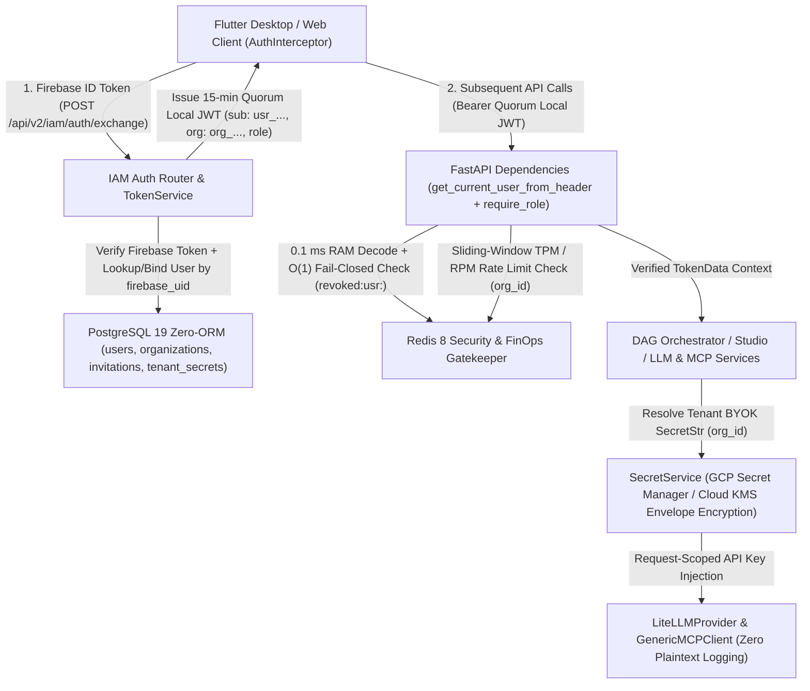

<required_context_rules>
  <rule>@[.agents/rules/00-antigravity-core.md]</rule>
  <rule>@[.agents/rules/01-python-backend.md]</rule>
  <rule>@[.agents/rules/02_flutter_desktop.md]</rule>
  <rule>@[.agents/rules/03_seed_vault.md]</rule>
  <rule>@[.agents/rules/04_directory_reference.md]</rule>
  <rule>@[.agents/rules/05_llm_architecture.md]</rule>
  <knowledge_item>@[ki_god_code_prevention.md]</knowledge_item>
  <knowledge_item>@[ki_python_314_concurrency_strictness.md]</knowledge_item>
  <knowledge_item>@[ki_zero_permissive_typing.md]</knowledge_item>
  <knowledge_item>@[ki_ast_guardrail_engine.md]</knowledge_item>
  <knowledge_item>@[ki_mcp_tool_protocol.md]</knowledge_item>
  <knowledge_item>@[ki_api_router_ssot_governance.md]</knowledge_item>
  <knowledge_item>@[ki_global_config_sovereignty.md]</knowledge_item>
  <knowledge_item>@[ki_app_error_boundary.md]</knowledge_item>
  <knowledge_item>@[ki_desktop_pro_tool_studio_ux.md]</knowledge_item>
  <knowledge_item>@[ki_dual_axis_localization_architecture.md]</knowledge_item>
  <knowledge_item>@[ki_opentelemetry_logfire_observability.md]</knowledge_item>
</required_context_rules>

# EPIC 160: B2B SaaS IAM, Token Exchange & Enterprise Hardening Architecture

> [!NOTE]
> **Scientific & Industrial Validation (2025-2026)**
> Enterprise B2B SaaS and multi-tenant agentic AI architectures in 2025-2026 converge on four foundational security standards validated by IETF specifications and cloud security frameworks:
> 1. **RFC 8693 OAuth 2.0 Token Exchange & Stateless Session Upgrade**: Forwarding external Identity Provider (IdP) tokens across internal service boundaries or querying a relational database on every HTTP request introduces 15–50 ms of per-request tail latency and couples domain schemas to third-party identity vendors.Exchanging the external IdP credential (`Firebase ID Token`) once at the API edge (`POST /api/v2/iam/auth/exchange`) for a short-lived (15-minute), internally signed `Quorum Local JWT` embedding verified tenant and role claims (`sub`, `org`, `role`) reduces per-request authorization latency to `< 0.1 ms` in RAM while decoupling downstream services from the authentication vendor.
> 2. **RFC 9562 UUIDv7 Primary Keys & Dual-Layer Tenant Isolation**: Using arbitrary external string identifiers (`Firebase UID`) as SQL primary keys causes random B-Tree page splits and index fragmentation in PostgreSQL. Enforcing RFC 9562 monotonic `uuidv7()` primary keys formatted as `PrefixedUUID7` (`usr_<hex32>`, `org_<hex32>`, `inv_<hex32>`, `sec_<hex32>`) preserves B-Tree sequential write locality while keeping `firebase_uid` as an indexed `VARCHAR(128) UNIQUE NOT NULL` lookup column. Furthermore, in asynchronous `asyncpg` connection pools, relying solely on session state (`SET LOCAL`) risks cross-tenant pool contamination; pairing explicit parameterized SQL predicates (`WHERE organization_id = $1`) with transactional `RESET quorum.current_org` cleanup guarantees deterministic SOC2 and GDPR tenant isolation.
> 3. **Dual-Tier Envelope Encryption & BYOK Secrets Governance (LLM + MCP)**: Enterprise tenants require Bring Your Own Key (BYOK) sovereignty across both foundational LLM providers (`LiteLLMProvider` in `@[backend_v2/llm/provider.py#L547-L1434]`) and external Model Context Protocol (MCP) tool gateways (`GenericMCPClient` in `@[backend_v2/services/mcp/generic_mcp_client.py#L52-L804]`). Storing credentials via Cloud Secret Manager resource references (`projects/.../secrets/...`) or Envelope Encryption (Data Encryption Keys wrapped by Key Encryption Keys in Cloud KMS / AES-256-GCM inside `tenant_secrets`) with request-scoped `pydantic.SecretStr` unwrapping prevents cross-tenant credential bleed and guarantees zero plaintext exposure in logs, DTOs, or `MCPAuditTrace` records.
> 4. **Fail-Closed Redis Kill-Switch & Edge FinOps Rate Limiting**: Stateless short-lived JWTs require an out-of-band revocation mechanism to terminate compromised sessions before the 15-minute expiration window. Checking an O(1) Redis revocation key (`revoked:usr:<id>` with 900-second TTL) under a strict **Fail-Closed** policy (`503 Service Unavailable` when Redis is unreachable) alongside per-tenant sliding-window `tpm_limit` and `rpm_limit` token buckets protects both enterprise data and LLM FinOps budgets at the API edge.

---

## 1. Goal Description & Background (Objective & Problem Statement)

### 1.1 Problem Statement: Legacy Authentication Bottlenecks & Outdated Blueprints
Four historical IAM draft documents (`docs/epic/B2B SaaS IAM-arkkitehtuuri 2026.md`, `docs/epic/B2B SaaS IAM-arkkitehtuuri 2026 vrs2.md`, `docs/epic/B2B SaaS IAM-arkkitehtuuri 2026 vrs2 - Osa 1 (Valmistelu).md`, `docs/epic/B2B SaaS IAM-arkkitehtuuri 2026 vrs2 - Osa 2 (Integraatio).md`) and `docs/KATTAVA TUOTANTOARKITEHTUURIN IMPLEMENTO.md` captured business requirements for multi-tenant B2B SaaS IAM, but their technical designs conflict with Quorum's 2026 production architecture:
- **Database Lookup on Every HTTP Request**: `TokenService.verify_token` (`@[backend_v2/services/auth/token_service.py#L94-L232]`) currently decodes the token and executes `await self.repo.get_by_id(...)` on every single API request, adding 15–50 ms of database latency per call.
- **Banned ORM & Obsolete TinyDB Bridges**: The historical documents proposed a temporary TinyDB phase followed by `SQLAlchemy 2.0` and `Alembic` migrations, which are permanently banned by Quorum's All-in-PostgreSQL 19 Sovereign Zero-ORM Architecture (`@[docs/implementationplans/IMPLEMENTATION_PLAN_PostgreSQL.md]` and `ZORM001`).
- **Primary Key Contradictions & `hashids` Bloat**: The legacy drafts alternated between raw 28-character Firebase UID strings as SQL primary keys and third-party `hashids` obfuscation, violating `OPAQUE_STRIPE_ID_REGEX` (`@[backend_v2/models/core_base.py]`), `PrefixedUUID7`, and `dependency_hallucination_firewall`.
- **Single-Role Authorization Guard**: `require_role` (`@[backend_v2/api/dependencies.py#L315-L337]`) accepts only a single `UserRole` value rather than a sequence of permitted roles (`Sequence[UserRole] | UserRole`).
- **Incomplete BYOK & MCP Secret Isolation**: In `@[backend_v2/llm/provider.py#L1659-L1846]` (`LLMFactory.create_provider`), line 1753 contains an unimplemented comment (`# Placeholder for BYOK (Bring Your Own Key) Logic`), while `GenericMCPClient._build_request_headers` (`@[backend_v2/services/mcp/generic_mcp_client.py#L235-L290]`) resolves gateway credentials solely from global `os.environ` variables without per-tenant `organization_id` secret resolution.

### 1.2 Target Architecture: Zero-ORM B2B SaaS IAM, Session Upgrade & Dual-Tier BYOK
Scheduled immediately following `@[docs/implementationplans/IMPLEMENTATION_PLAN_PostgreSQL.md]`, EPIC 160 supersedes and deletes the five obsolete historical documents, delivering a six-phase enterprise IAM and secrets governance architecture:



### 1.3 Six Core Architectural Deliverables
1. **Zero-ORM Identity & Secrets Schema (`PrefixedUUID7`)**:
   - Extend the PostgreSQL 19 DDL (`[NEW] @[backend_v2/database/migrations/001_pg19_uuidv7_schema.sql]`) and `PostgresEntityAdapter` (`[NEW] @[backend_v2/database/postgres/entity_adapter.py]`) with strict 1:1 tenant isolation (`organization_id UUID NOT NULL REFERENCES organizations(id)`), `firebase_uid VARCHAR(128) UNIQUE NOT NULL`, soft-delete `deleted_at TIMESTAMPTZ`, and two dedicated IAM tables: `invitations` (`inv_<hex32>`) and `tenant_secrets` (`sec_<hex32>`).
   - Enforce Dual-Layer Tenant Isolation across all `PostgresEntityAdapter` queries: mandatory parameterized `WHERE organization_id = $1` predicates combined with `RESET quorum.current_org` inside the `finally` block of `PostgresUnitOfWork` (`[NEW] @[backend_v2/database/postgres/uow.py]`) to eliminate connection pool contamination.
2. **Session Upgrade & Token Exchange (`POST /api/v2/iam/auth/exchange`)**:
   - Validate the incoming Firebase ID Token once in `TokenService` (`@[backend_v2/services/auth/token_service.py#L32-L232]`), resolve the persisted `User` by `firebase_uid` (checking `is_active` and `deleted_at is None`), and issue a 15-minute `Quorum Local JWT` containing `sub` (`usr_<hex32>`), `org` (`org_<hex32>`), `role` (`UserRole`), `iat`, `exp`, and `type: "access"`.
   - Decode `Quorum Local JWT` tokens completely in RAM (`< 0.1 ms`) inside `TokenService.verify_token` (`@[backend_v2/services/auth/token_service.py#L94-L232]`) with zero PostgreSQL queries on standard API requests.
3. **Enterprise Dual-Tier BYOK & Cloud Secrets Engine (`SecretService`)**:
   - Create `SecretService` in `[NEW] @[backend_v2/services/auth/secret_service.py]` and DTOs (`TenantSecretDTO`, `TenantSecretCreateDTO`, `TenantSecretResponseDTO`, `ResolvedCredentialDTO`) defined in `@[backend_v2/models/auth.py]` supporting both Cloud Secret Manager resource references (`projects/.../secrets/.../versions/latest`) and Envelope Encryption (AES-256-GCM Data Encryption Keys wrapped by Cloud KMS or local development mock KMS bridge) stored in `tenant_secrets`.
   - Realize dynamic per-tenant credential injection in `LLMFactory.create_provider` (`@[backend_v2/llm/provider.py#L1659-L1846]`) and `LiteLLMProvider` (`@[backend_v2/llm/provider.py#L547-L1434]`) as well as `GenericMCPClient._build_request_headers` (`@[backend_v2/services/mcp/generic_mcp_client.py#L235-L290]`), passing credentials strictly per request via `pydantic.SecretStr` with zero cross-tenant client caching and zero secret leakage in `MCPAuditTrace` or OpenTelemetry spans.
4. **Real-Time Redis Kill-Switch & Multi-Role Authorization Guard**:
   - Create `[NEW] @[backend_v2/core/redis_security.py]` defining `RevocationCache` and `TenantRateLimitService` over Redis.
   - When an administrator soft-deletes a user, deactivates an account, or changes a user's role or organization, immediately write `revoked:usr:{user.id}` to Redis with a 900-second TTL matching the 15-minute JWT lifetime.
   - Enforce **Fail-Closed** verification in `get_current_user_from_header` (`@[backend_v2/api/dependencies.py#L284-L308]`): if the user ID is present in `revoked:usr:{user.id}`, raise `AuthenticationError` (`ErrorCodes.AUTH_TOKEN_EXPIRED`); if Redis is unreachable, log a structured RFC 7807 error and raise `ServiceUnavailableError` (`503 Service Unavailable`, `ErrorCodes.SERVICE_UNAVAILABLE`).
   - Modernize `require_role` (`@[backend_v2/api/dependencies.py#L315-L337]`) to accept `allowed_roles: Sequence[UserRole] | UserRole`.
5. **AI FinOps Rate Limiting & Pre-Flight Quota Gatekeeper**:
   - Enforce per-tenant Redis sliding-window rate limits (`Organization.tpm_limit` and `Organization.rpm_limit`) via `TenantRateLimitService` in `[NEW] @[backend_v2/core/redis_security.py]` and `UsageService` (`@[backend_v2/services/usage_service.py#L23-L271]`), rejecting excess traffic at the API edge with HTTP `429 Too Many Requests` (`TokenLimitExceededError`, `ErrorCodes.RATE_LIMIT_EXCEEDED`).
   - Enforce pre-flight monthly USD budget verification in `UsageService.check_quota` (`@[backend_v2/services/usage_service.py#L144-L199]`) before Phase 1 DAG execution and Phase 2 report synthesis, raising `AppException` with `ErrorCodes.QUOTA_EXHAUSTED` when `current_spend >= organization.quota_limit`.
6. **B2B Invitation Flow, 1:1 Identity Collision Guard, GDPR Soft-Delete & Flutter Client Integration**:
   - Implement B2B organization invitations (`Invitation`, `InvitationCreateDTO`, `InvitationAcceptRequestDTO`, `InvitationResponseDTO` defined in `@[backend_v2/models/auth.py]`) with cryptographic single-use tokens (`secrets.token_urlsafe(32)`), 7-day expiration, and the **1:1 Flat Identity Collision Guard** rejecting cross-organization account reassignment with `409 Conflict` (`ConflictError`, `ErrorCodes.USER_ALREADY_ASSIGNED`).
   - Implement GDPR Soft-Delete anonymization (`deleted_at = datetime.now(timezone.utc)`, `is_active = False`, `email = f"deleted_{user.id}@anonymized.quorum.local"`, `name = "Anonymized User"`) in `UserService.delete_user` (`@[backend_v2/services/auth/user_service.py#L275-L354]`) and the Firebase `auth.user.deleted` webhook endpoint in `@[backend_v2/api/routers/iam/auth.py]`, preserving historical foreign-key references on `executions` and `report_artifacts`.
   - Implement Flutter `AuthInterceptor` (`[NEW] @[client_app_v2/lib/core/network/auth_interceptor.dart]`), 13-minute silent background token refresh in `@[client_app_v2/lib/features/auth/presentation/auth_controller.dart]`, root provider cache invalidation on tenant switch (`tenant_data_isolation`), and the Organization BYOK & Invitations Management UI (`[NEW] @[client_app_v2/lib/features/settings/presentation/organization_iam_settings_view.dart]`).

### 1.4 Quantitative Scope Validation Table

| Target File Path | Action | Physical Layer | Coupled 1-Hop Callers & Blast Radius |
| :--- | :--- | :--- | :--- |
| `[DELETE] @[docs/epic/B2B SaaS IAM-arkkitehtuuri 2026 vrs2 - Osa 1 (Valmistelu).md]`, `[DELETE] @[docs/epic/B2B SaaS IAM-arkkitehtuuri 2026 vrs2 - Osa 2 (Integraatio).md]`, `[DELETE] @[docs/epic/B2B SaaS IAM-arkkitehtuuri 2026 vrs2.md]`, `[DELETE] @[docs/epic/B2B SaaS IAM-arkkitehtuuri 2026.md]`, & `[DELETE] @[docs/KATTAVA TUOTANTOARKITEHTUURIN IMPLEMENTO.md]` | `[DELETE]` | Legacy Documentation Sunset | Superseded by `[NEW] @[docs/epic/EPIC_160_B2B_SaaS_IAM_and_Enterprise_Hardening.md]` |
| `[MODIFY] @[backend_v2/models/enums.py]`, `[MODIFY] @[backend_v2/exceptions.py#L129-L319]`, & `[MODIFY] @[backend_v2/settings.py]` | `[MODIFY]` | Taxonomies, ErrorCodes & Settings SSOT | `@[backend_v2/models/auth.py]`, `@[backend_v2/services/auth/token_service.py]`, `[NEW] @[backend_v2/services/auth/secret_service.py]`, `[NEW] @[backend_v2/core/redis_security.py]`, `@[backend_v2/tests/unit/test_enum_parity.py]` |
| `[MODIFY] @[backend_v2/models/auth.py#L70-L174]`, `[MODIFY] @[backend_v2/models/auth.py#L177-L216]`, `[MODIFY] @[backend_v2/models/auth.py#L222-L289]`, & `[MODIFY] @[backend_v2/models/auth.py#L411-L466]` | `[MODIFY]` | Identity, Invitation & BYOK DTOs | `@[backend_v2/services/auth/token_service.py]`, `@[backend_v2/services/auth/user_service.py]`, `@[backend_v2/services/auth/organization_service.py]`, `[NEW] @[backend_v2/services/auth/secret_service.py]`, `@[backend_v2/api/routers/iam/auth.py]` |
| `[NEW] @[backend_v2/database/migrations/001_pg19_uuidv7_schema.sql]`, `[NEW] @[backend_v2/database/postgres/entity_adapter.py]`, `[NEW] @[backend_v2/database/postgres/uow.py]`, `[MODIFY] @[backend_v2/database/interfaces.py]`, `[MODIFY] @[backend_v2/database/repositories/identity.py#L25-L272]`, `[MODIFY] @[backend_v2/services/auth/repositories.py#L15-L78]`, `[MODIFY] @[backend_v2/services/auth/repositories.py#L81-L182]`, & `[MODIFY] @[backend_v2/tests/fakes/in_memory_repositories.py]` | `[MODIFY]` / `[NEW]` | Zero-ORM Persistence & Dual-Layer Tenant Isolation | `@[backend_v2/services/auth/user_service.py]`, `@[backend_v2/services/auth/organization_service.py]`, `[NEW] @[backend_v2/services/auth/secret_service.py]`, `@[backend_v2/services/usage_service.py]` |
| `[MODIFY] @[backend_v2/services/auth/token_service.py#L32-L232]`, `[MODIFY] @[backend_v2/services/auth/user_service.py#L44-L656]`, `[MODIFY] @[backend_v2/services/auth/organization_service.py#L41-L304]`, `[NEW] @[backend_v2/services/auth/secret_service.py]`, & `[MODIFY] @[backend_v2/services/auth/__init__.py#L59-L202]` | `[MODIFY]` / `[NEW]` | Pillar 1 Auth, Invitation, GDPR & Secrets Services | `@[backend_v2/api/dependencies.py]`, `@[backend_v2/api/routers/iam/auth.py]`, `@[backend_v2/api/routers/iam/users.py]`, `@[backend_v2/api/routers/iam/organizations.py]` |
| `[NEW] @[backend_v2/core/redis_security.py]` & `[MODIFY] @[backend_v2/services/usage_service.py#L23-L271]` | `[MODIFY]` / `[NEW]` | Redis Fail-Closed Kill-Switch & FinOps Rate Limiter | `@[backend_v2/api/dependencies.py]`, `@[backend_v2/services/execution/lifecycle_service.py]`, `@[backend_v2/services/report/lifecycle_service.py]` |
| `[MODIFY] @[backend_v2/llm/provider.py#L547-L1434]`, `[MODIFY] @[backend_v2/llm/provider.py#L1659-L1846]`, `[MODIFY] @[backend_v2/services/mcp/generic_mcp_client.py#L235-L290]`, & `[MODIFY] @[backend_v2/services/mcp/dispatcher.py]` | `[MODIFY]` | Request-Scoped LLM & MCP BYOK Credential Injection | `@[backend_v2/llm/client.py]`, `@[backend_v2/services/mcp/mcp_tool_loop.py]`, `@[backend_v2/services/orchestrator/strategies/llm.py]` |
| `[MODIFY] @[backend_v2/api/dependencies.py#L284-L308]`, `[MODIFY] @[backend_v2/api/dependencies.py#L315-L337]`, `[MODIFY] @[backend_v2/api/routers/iam/auth.py#L43-L104]`, `[MODIFY] @[backend_v2/api/routers/iam/users.py#L92-L125]`, & `[MODIFY] @[backend_v2/api/routers/iam/organizations.py#L19-L46]` | `[MODIFY]` | FastAPI Dependencies & IAM REST Routers | `@[client_app_v2/lib/features/auth/data/auth_repository.dart]`, `[NEW] @[client_app_v2/lib/core/network/auth_interceptor.dart]` |
| `[MODIFY] @[client_app_v2/lib/core/models/enums.dart]`, `[MODIFY] @[client_app_v2/lib/features/auth/domain/models/user.dart]`, `[MODIFY] @[client_app_v2/lib/features/auth/data/auth_repository.dart]`, `[MODIFY] @[client_app_v2/lib/features/auth/presentation/auth_controller.dart]`, `[MODIFY] @[client_app_v2/lib/features/auth/presentation/login_screen.dart]`, `[NEW] @[client_app_v2/lib/core/network/auth_interceptor.dart]`, `[NEW] @[client_app_v2/lib/features/settings/domain/models/tenant_secret_dto.dart]`, `[NEW] @[client_app_v2/lib/features/settings/presentation/organization_iam_settings_view.dart]`, `[MODIFY] @[client_app_v2/lib/l10n/app_en.arb]`, & `[MODIFY] @[client_app_v2/lib/l10n/app_fi.arb]` | `[MODIFY]` / `[NEW]` | Flutter Riverpod 3.0 Auth Handshake, Silent Refresh & Studio BYOK UI | `@[client_app_v2/lib/features/auth/presentation/providers/user_role_provider.dart]`, `@[client_app_v2/lib/features/settings/presentation/settings_controller.dart]` |

---

## 2. Architectural Impact & Compliance Matrix

### 2.1 Deprecations & Sunset List (`What We Will REMOVE`)

<demolish>
- `LEGACY_SYSTEM`
- `JWT_SECRET`
- `JWT_ALGORITHM`
</demolish>

| Deprecated File / Symbol | Location | Sunset Action & Replacement Mapping |
| :--- | :--- | :--- |
| Historical IAM & Production Drafts | `[DELETE] @[docs/epic/B2B SaaS IAM-arkkitehtuuri 2026 vrs2 - Osa 1 (Valmistelu).md]`<br>`[DELETE] @[docs/epic/B2B SaaS IAM-arkkitehtuuri 2026 vrs2 - Osa 2 (Integraatio).md]`<br>`[DELETE] @[docs/epic/B2B SaaS IAM-arkkitehtuuri 2026 vrs2.md]`<br>`[DELETE] @[docs/epic/B2B SaaS IAM-arkkitehtuuri 2026.md]`<br>`[DELETE] @[docs/KATTAVA TUOTANTOARKITEHTUURIN IMPLEMENTO.md]` | **DELETED** — Superseded by `[NEW] @[docs/epic/EPIC_160_B2B_SaaS_IAM_and_Enterprise_Hardening.md]`. All obsolete TinyDB bridge, SQLAlchemy 2.0, Alembic, and `hashids` designs are permanently dropped. |
| `JWT_SECRET`, `JWT_ALGORITHM` | `[DELETE] @[backend_v2/services/auth/constants.py]` | **DELETED** — Module-level constants in `constants.py` are replaced by environment-injected `jwt_secret_key`, `jwt_algorithm`, and `jwt_access_token_expire_minutes` on `Settings` in `@[backend_v2/settings.py]`. |
| `LEGACY_SYSTEM` | `[MODIFY] @[backend_v2/models/auth.py#L52-L61]` | **REMOVED** — Legacy `"SYSTEM"` fallback string in `SystemOrganizations` is removed; only canonical `PrefixedUUID7` `ROOT_SYSTEM = "org_01950000000070008000000000000000"` (`OPAQUE_STRIPE_ID_REGEX`) is retained. |
| Database query inside `TokenService.verify_token` on every request | `[MODIFY] @[backend_v2/services/auth/token_service.py#L94-L232]` | **REMOVED** — Replaced by 0.1 ms in-memory `Quorum Local JWT` verification (`TokenService.verify_token`) paired with `TokenService.exchange_firebase_token` (`POST /api/v2/iam/auth/exchange`). |
| Hard SQL `DELETE` on `users` | `[MODIFY] @[backend_v2/services/auth/user_service.py#L275-L354]` & `[MODIFY] @[backend_v2/database/repositories/identity.py#L219-L228]` | **REMOVED** — Replaced by GDPR Soft-Delete anonymization (`deleted_at = NOW()`, `is_active = False`, anonymized email and display name) + immediate Redis Kill-Switch revocation (`revoked:usr:<id>`). |

### 2.2 Retained SSOT Invariants (`What We Will RETAIN`)
- **All-in-PostgreSQL 19 Sovereign Zero-ORM Engine (`@[docs/implementationplans/IMPLEMENTATION_PLAN_PostgreSQL.md]`)**: Direct `asyncpg` binary JSONB codecs, `PostgresPoolManager`, and `QuorumUnitOfWork` are retained as the sole persistence engine (`ZORM001`–`ZORM006`).
- **RFC 9562 `PrefixedUUID7` & `OPAQUE_STRIPE_ID_REGEX` (`@[backend_v2/models/core_base.py]`)**: Retained as the Single Source of Truth for all entity primary keys (`usr_<hex32>`, `org_<hex32>`, `inv_<hex32>`, `sec_<hex32>`).
- **Single Router SSOT per IAM Domain (`@[backend_v2/api/routers/iam/auth.py]`, `@[backend_v2/api/routers/iam/users.py]`, `@[backend_v2/api/routers/iam/organizations.py]`)**: Retained under `/api/v2/iam/` without creating shadow routers (`single_router_ssot_mandate`).
- **`AuthService` Facade (`@[backend_v2/services/auth/__init__.py#L59-L202]`)**: Retained under 300 lines as the immutable dependency injection router and package facade (`package_facade_and_inter_context_protocol_mandate`).

### 2.3 Compliance & Modernity Gates (Quorum 2026 Invariants)
1. **Zero Legacy State Support Mandate**: Zero backward compatibility for legacy `"SYSTEM"` organization strings, un-prefixed Firebase UID primary keys, or TinyDB transitional bridges. Clean-slate database seeding is executed via `uv run python backend_v2/seed/run_seed.py local`.
2. **Central Config Sovereignty**: All JWT lifetimes (`jwt_access_token_expire_minutes`), Redis revocation TTLs (`iam_revocation_ttl_seconds`), KMS key identifiers (`kms_master_key_id`), and rate-limiter windows reside in `@[backend_v2/settings.py]`. All role, subscription, invitation, and secret taxonomies (`UserRole`, `SubscriptionStatus`, `InvitationStatus`, `SecretScope`, `SecretStorageMode`) reside in `@[backend_v2/models/enums.py]` and `@[client_app_v2/lib/core/models/enums.dart]`.
3. **Pydantic Strictness**: Every domain model and DTO in `@[backend_v2/models/auth.py]` explicitly declares `model_config = ConfigDict(strict=True, extra="forbid", frozen=True)` and PEP 593 `Annotated` field definitions (`QGR007`).
4. **Cross-Domain DTO & Enum Parity**: Backend updates to `User`, `Organization`, `TokenExchangeResponseDTO`, `InvitationResponseDTO`, `TenantSecretResponseDTO`, and IAM enums are synchronized 1:1 with Flutter Freezed models in `@[client_app_v2/lib/features/auth/domain/models/user.dart]`, `[NEW] @[client_app_v2/lib/features/settings/domain/models/tenant_secret_dto.dart]`, and `@[client_app_v2/lib/core/models/enums.dart]`, verified via `uv run python scripts/audit_dto_parity.py` and `uv run python scripts/flutter_audit_loop.py client_app_v2/ --build`.
5. **Credential Hardcoding & DLP Logging Ban**: Raw API keys, JWT secrets, and DEKs are wrapped in `pydantic.SecretStr` and never logged, serialized into `MCPAuditTrace`, or returned in cleartext HTTP responses (`TenantSecretResponseDTO` exposes only `configured: bool` and `masked_hint: str`).
6. **Unbounded I/O Timeout & Python 3.14 Concurrency Mandate**: All Redis, KMS, Secret Manager, and Firebase calls execute inside bounded `async with asyncio.timeout(...)` contexts using thresholds from `@[backend_v2/settings.py]` and `asyncio.TaskGroup` where parallel operations occur.
7. **RFC-7807 Dual-Reporting**: Every `AuthenticationError`, `PermissionDeniedError`, `ConflictError`, `TokenLimitExceededError`, `ServiceUnavailableError`, and `ConfigurationError` is preceded by a structured `logger.error` call logging the exact `ErrorCodes` enum name and opaque entity IDs.
8. **Scoped Boy Scout Rule & Technical Debt Sweep**: Pre-flight audit via `uv run python scripts/audit_technical_debt.py` identified 14 `❌ FATAL` violations (`7 DGR003` hardcoded strings and `7 DGR007` hardcoded `Colors.*` calls) in `@[client_app_v2/lib/features/auth/presentation/login_screen.dart]` and 2 `⚠️ WARN` `TD_DICT_GET` violations in `@[backend_v2/database/repositories/identity.py#L60-L72]` and `@[backend_v2/database/repositories/identity.py#L163-L175]`. All 16 findings plus inline enum/regex debt in `@[backend_v2/models/auth.py]` are resolved in Phase 1 before new feature logic is added.

### 2.4 Producer-Consumer Integration Check

| Data Artifact / Contract | Producer (Origin) | Intermediate Storage / Transit | Consumer (Destination) |
| :--- | :--- | :--- | :--- |
| **Upgraded Session Token (`TokenExchangeResponseDTO` & `Quorum Local JWT`)** | `TokenService.exchange_firebase_token()` in `@[backend_v2/services/auth/token_service.py#L32-L232]` via `POST /api/v2/iam/auth/exchange` (`@[backend_v2/api/routers/iam/auth.py]`) | Cached in Flutter memory / secure storage and injected by `AuthInterceptor` (`[NEW] @[client_app_v2/lib/core/network/auth_interceptor.dart]`) | `get_current_user_from_header` (`@[backend_v2/api/dependencies.py#L284-L308]`) -> `TokenService.verify_token` (< 0.1 ms RAM decode) |
| **Revocation Blocklist Entry (`revoked:usr:{user_id}`)** | `UserService.delete_user`, `UserService.update_user`, `UserService.update_user_role`, and Firebase deletion webhook in `@[backend_v2/services/auth/user_service.py#L44-L656]` | Stored in Redis (`RevocationCache` in `[NEW] @[backend_v2/core/redis_security.py]`) with 900s TTL | `get_current_user_from_header` (`@[backend_v2/api/dependencies.py#L284-L308]`) O(1) Fail-Closed check on every authenticated request |
| **Tenant BYOK Secret (`TenantSecretDTO` -> `ResolvedCredentialDTO`)** | Organization Admin via `PUT /api/v2/iam/organizations/{org_id}/secrets` (`@[backend_v2/api/routers/iam/organizations.py]`) -> `SecretService.upsert_tenant_secret` (`[NEW] @[backend_v2/services/auth/secret_service.py]`) | Encrypted via Envelope Encryption (`encrypted_dek` + `ciphertext` in `tenant_secrets` table) or stored as GCP Secret Manager resource path | `SecretService.resolve_llm_key` -> `LLMFactory.create_provider` (`@[backend_v2/llm/provider.py#L1659-L1846]`) & `SecretService.resolve_mcp_credential` -> `GenericMCPClient._build_request_headers` (`@[backend_v2/services/mcp/generic_mcp_client.py#L235-L290]`) |
| **Tenant FinOps Rate & Quota State (`TenantRateLimitStatusDTO`)** | `LLMTaskExecutor` / `UsageService.track_usage` (`@[backend_v2/services/usage_service.py#L36-L142]`) & API Ingress | Redis sliding-window counters (`ratelimit:org:{org_id}:rpm`, `ratelimit:org:{org_id}:tpm`) and PostgreSQL `executions` FinOps columns | `TenantRateLimitService.enforce_rate_limits` (`[NEW] @[backend_v2/core/redis_security.py]`) & `UsageService.check_quota` (`@[backend_v2/services/usage_service.py#L144-L199]`) |
| **B2B Organization Invitation (`Invitation` & `InvitationResponseDTO`)** | `OrganizationService.create_invitation` (`@[backend_v2/services/auth/organization_service.py#L41-L304]`) | Persisted in PostgreSQL `invitations` table with SHA-256 token hash and 7-day `expires_at` | `OrganizationService.accept_invitation` (`POST /api/v2/iam/auth/invitations/accept`) enforcing the 1:1 Identity Collision Guard |

### 2.5 Five-Axis System 2 Architectural Directive Matrix

| 1. Target Scope & Boundaries | 2. Eradicated Duct-Tape (Under-Engineering Ban) | 3. Approved Best Practice (Target Invariant) | 4. Pruned Over-Engineering (Complexity Slayer) | 5. Verification & Fail-Fast (Proof Anchor) |
| :--- | :--- | :--- | :--- | :--- |
| **1. Identity Schema, Pre-Flight Tech Debt & `PrefixedUUID7` DTOs**<br>`[MODIFY] @[backend_v2/models/enums.py]`<br>`[MODIFY] @[backend_v2/models/auth.py#L70-L174]`<br>`[MODIFY] @[backend_v2/models/auth.py#L222-L289]`<br>`[NEW] @[backend_v2/database/migrations/001_pg19_uuidv7_schema.sql]`<br>`[MODIFY] @[backend_v2/database/repositories/identity.py#L25-L272]`<br>`[MODIFY] @[client_app_v2/lib/features/auth/presentation/login_screen.dart]` | Raw Firebase UID as SQL PK; `hashids` library; inline `UserRole`/`SubscriptionStatus` in `auth.py`; missing `frozen=True` on `User`/`Organization`/`TokenData`; `TD_DICT_GET` in `identity.py`; 14 `DGR003`/`DGR007` hardcoded strings and colors in `login_screen.dart`. | Native `UUID DEFAULT uuidv7()` PKs (`usr_`, `org_`, `inv_`, `sec_` via `PrefixedUUID7`); `firebase_uid VARCHAR(128) UNIQUE NOT NULL`; `deleted_at TIMESTAMPTZ`; Dual-Layer Tenant Isolation (`WHERE organization_id = $1` + `RESET quorum.current_org`); `ConfigDict(strict=True, extra="forbid", frozen=True)`. | Pruned N:M user-organization membership join tables; enforced flat 1:1 `organization_id` on `User`. | `uv run python scripts/audit_technical_debt.py` (0 findings), `test_schema_dto_naming_parity`, and `ZORM004` AST verification. |
| **2. Session Upgrade & Token Exchange Engine**<br>`[DELETE] @[backend_v2/services/auth/constants.py]`<br>`[MODIFY] @[backend_v2/services/auth/token_service.py#L32-L232]`<br>`[MODIFY] @[backend_v2/api/routers/iam/auth.py#L43-L104]` | Querying PostgreSQL on every HTTP request inside `verify_token`; hardcoded `JWT_SECRET` in `constants.py`; infinite token lifetimes; client-minted role claims. | `POST /api/v2/iam/auth/exchange` (`TokenExchangeRequestDTO` -> `TokenExchangeResponseDTO`): verifies Firebase ID Token once, mints 15-minute `Quorum Local JWT` (`sub`, `org`, `role`, `type: "access"`), and validates subsequent requests in RAM (< 0.1 ms). | Pruned custom OAuth2 refresh token database tables; delegated long-lived refresh token lifecycle to Firebase Auth SDK. | Unit tests asserting 0 DB queries during `verify_token` and fail-fast `ErrorCodes.AUTH_TOKEN_EXPIRED` on expired signatures. |
| **3. Enterprise BYOK & Cloud Secrets Governance**<br>`[NEW] @[backend_v2/services/auth/secret_service.py]`<br>`[MODIFY] @[backend_v2/llm/provider.py#L547-L1434]`<br>`[MODIFY] @[backend_v2/llm/provider.py#L1659-L1846]`<br>`[MODIFY] @[backend_v2/services/mcp/generic_mcp_client.py#L235-L290]`<br>`[MODIFY] @[backend_v2/services/mcp/dispatcher.py]` | Plaintext API keys in DB or seed files; static env fallback chains; global singletons caching tenant keys across requests; logging headers in `MCPAuditTrace`. | Dual-Tier Secret Governance: GCP Secret Manager references or Envelope Encryption (Cloud KMS / AES-256-GCM DEK in `tenant_secrets`); `pydantic.SecretStr`; request-scoped injection into `LiteLLMProvider` and `GenericMCPClient`. | Pruned dedicated external HashiCorp Vault cluster requirement for local dev; provided deterministic local AES-256-GCM KMS bridge in development/test. | Unit tests asserting zero secret leakage in logs/`MCPAuditTrace` and `test_byok_cross_tenant_isolation` proving Tenant B cannot resolve Tenant A's keys. |
| **4. Real-Time Redis Kill-Switch & Multi-Role Guard**<br>`[NEW] @[backend_v2/core/redis_security.py]`<br>`[MODIFY] @[backend_v2/api/dependencies.py#L284-L308]`<br>`[MODIFY] @[backend_v2/api/dependencies.py#L315-L337]` | Scanning PostgreSQL for revoked flags; single-role `require_role(UserRole)`; Fail-Open behavior when Redis is unreachable. | `require_role(Sequence[UserRole] | UserRole)`; Redis O(1) blocklist check `revoked:usr:{user_id}` (TTL = 900s); strict **Fail-Closed** `ServiceUnavailableError` (`503`) if Redis is down. | Pruned distributed pub/sub revocation gossip protocols in favor of deterministic O(1) Redis TTL keys. | Unit and negative ISTQB tests verifying instant `401` on revoked user and `503` Fail-Closed response on Redis connection failure. |
| **5. AI FinOps Rate Limiting & Quota Gatekeeper**<br>`[NEW] @[backend_v2/core/redis_security.py]`<br>`[MODIFY] @[backend_v2/services/usage_service.py#L23-L271]`<br>`[MODIFY] @[backend_v2/services/usage_service.py#L144-L199]` | Unisolated global rate limits; billing checks inside inner DAG loops; missing TPM/RPM enforcement at API ingress. | Redis sliding-window rate limiter keyed by `organization_id` enforcing `Organization.tpm_limit` and `Organization.rpm_limit`; pre-flight monthly `quota_limit` gatekeeper before Phase 1 DAG and Phase 2 synthesis runs. | Pruned external third-party billing microservices; used atomic Redis Lua/pipeline counters and flat PostgreSQL FinOps columns. | ISTQB boundary value tests (`limit - 1`, `limit`, `limit + 1`) asserting `429 Too Many Requests` (`ErrorCodes.RATE_LIMIT_EXCEEDED`) and `ErrorCodes.QUOTA_EXHAUSTED`. |
| **6. B2B Invitations, GDPR Soft-Delete & Flutter Client**<br>`[MODIFY] @[backend_v2/services/auth/organization_service.py#L41-L304]`<br>`[MODIFY] @[backend_v2/services/auth/user_service.py#L275-L354]`<br>`[NEW] @[client_app_v2/lib/core/network/auth_interceptor.dart]`<br>`[NEW] @[client_app_v2/lib/features/settings/presentation/organization_iam_settings_view.dart]` | Hard SQL `DELETE` breaking `executions` foreign keys; silent cross-org account merging; manual token attachment in Flutter repositories. | `invitations` table with SHA-256 hashed tokens; 1:1 Flat Identity Collision Guard (`409 Conflict` via `ErrorCodes.USER_ALREADY_ASSIGNED`); GDPR Soft-Delete anonymization (`deleted_at = NOW()`); Flutter `AuthInterceptor` + 13-min silent refresh + masked BYOK Studio UI. | Pruned manual GDPR CSV export pipelines; automated webhook for Firebase `auth.user.deleted`. | E2E integration test verifying `executions` foreign-key survival after user soft-deletion and Flutter widget tests for masked BYOK secret management. |

---

## 3. Phased Execution Plan (Implementation Strategy)

### Phase 1: Pre-Implementation Technical Debt Cleanups, Zero-ORM Identity Schema & `PrefixedUUID7` DTOs

#### 1.1 Obsolete Document Demolition & Touched-Scope Technical Debt Remediation
- Physically delete the five superseded historical documents:
  - `[DELETE] @[docs/epic/B2B SaaS IAM-arkkitehtuuri 2026 vrs2 - Osa 1 (Valmistelu).md]`
  - `[DELETE] @[docs/epic/B2B SaaS IAM-arkkitehtuuri 2026 vrs2 - Osa 2 (Integraatio).md]`
  - `[DELETE] @[docs/epic/B2B SaaS IAM-arkkitehtuuri 2026 vrs2.md]`
  - `[DELETE] @[docs/epic/B2B SaaS IAM-arkkitehtuuri 2026.md]`
  - `[DELETE] @[docs/KATTAVA TUOTANTOARKITEHTUURIN IMPLEMENTO.md]`
- **`[MODIFY] @[client_app_v2/lib/features/auth/presentation/login_screen.dart]`, `[MODIFY] @[client_app_v2/lib/l10n/app_en.arb]`, & `[MODIFY] @[client_app_v2/lib/l10n/app_fi.arb]`**:
  - Remediate all 14 `❌ FATAL` technical debt findings (`7 DGR003` hardcoded string literals on lines 153, 198, 207, 216, 225, 234, 243 and `7 DGR007` hardcoded `Colors.*` usages on lines 177, 190, 201, 210, 219, 228, 237) by replacing every literal string with `AppLocalizations.of(context)!` keys in `app_en.arb` and `app_fi.arb` and replacing every `Colors.*` reference with `Theme.of(context).colorScheme` semantic tokens.
- **`[MODIFY] @[backend_v2/database/repositories/identity.py#L60-L72]` & `[MODIFY] @[backend_v2/database/repositories/identity.py#L163-L175]`**:
  - Eliminate `TD_DICT_GET` warnings on lines 69 and 172 by delegating identity persistence through the typed `EntityPersistencePort` / `PostgresEntityAdapter` contract (`[NEW] @[backend_v2/database/postgres/entity_adapter.py]`) with zero untyped `.get()` dictionary calls.
- **`[DELETE] @[backend_v2/services/auth/constants.py]` & `[MODIFY] @[backend_v2/settings.py]`**:
  - Delete `backend_v2/services/auth/constants.py` (`JWT_SECRET`, `JWT_ALGORITHM`) and declare environment-injected settings on `Settings` in `@[backend_v2/settings.py]`: `jwt_secret_key: Annotated[SecretStr, Field(description="HMAC-SHA256 secret key for Quorum Local JWT signing")]`, `jwt_algorithm: Annotated[str, Field(default="HS256", description="JWT signing algorithm")]`, `jwt_access_token_expire_minutes: Annotated[int, Field(default=15, ge=5, le=60, description="Quorum Local JWT lifetime in minutes")]`, `iam_revocation_ttl_seconds: Annotated[int, Field(default=900, ge=300, description="Redis kill-switch TTL in seconds")]`, `kms_master_key_id: Annotated[str | None, Field(default=None, description="Cloud KMS key resource URI for BYOK envelope encryption")]`, and `firebase_webhook_secret: Annotated[SecretStr | None, Field(default=None, description="Shared HMAC secret for Firebase user deletion webhooks")]`.

#### 1.2 Taxonomies, ErrorCodes & Strict `PrefixedUUID7` Identity Models
- **`[MODIFY] @[backend_v2/models/enums.py]` & `[MODIFY] @[backend_v2/exceptions.py#L129-L319]`**:
  - Migrate `UserRole` and `SubscriptionStatus` from `@[backend_v2/models/auth.py#L25-L40]` and `@[backend_v2/models/auth.py#L43-L49]` into `@[backend_v2/models/enums.py]` (re-exporting them explicitly in `@[backend_v2/models/auth.py]` via `from backend_v2.models.enums import UserRole as UserRole, SubscriptionStatus as SubscriptionStatus`).
  - Extend `EntityPrefix` in `@[backend_v2/models/enums.py]` with `INVITATION = "inv"` and `TENANT_SECRET = "sec"`.
  - Define `InvitationStatus(StrEnum)` (`PENDING = "pending"`, `ACCEPTED = "accepted"`, `EXPIRED = "expired"`, `REVOKED = "revoked"`), `SecretScope(StrEnum)` (`LLM_PROVIDER = "llm_provider"`, `MCP_GATEWAY = "mcp_gateway"`), and `SecretStorageMode(StrEnum)` (`ENVELOPE_KMS = "envelope_kms"`, `CLOUD_SECRET_MANAGER = "cloud_secret_manager"`) in `@[backend_v2/models/enums.py]`.
  - Add `USER_ALREADY_ASSIGNED = "USER_ALREADY_ASSIGNED"`, `INVITATION_EXPIRED = "INVITATION_EXPIRED"`, and `SECRET_RESOLUTION_FAILED = "SECRET_RESOLUTION_FAILED"` to `ErrorCodes` in `@[backend_v2/exceptions.py#L129-L319]`.
- **`[MODIFY] @[backend_v2/models/auth.py#L70-L174]`, `[MODIFY] @[backend_v2/models/auth.py#L177-L216]`, `[MODIFY] @[backend_v2/models/auth.py#L222-L289]`, & `[MODIFY] @[backend_v2/models/auth.py#L411-L466]`**:
  - Enforce `model_config = ConfigDict(strict=True, extra="forbid", frozen=True)` across `Organization`, `UserBase`, `User`, `TokenData`, and all DTOs in `@[backend_v2/models/auth.py]`.
  - Bind `id` fields on `Organization` (`org_<hex32>`) and `User` (`usr_<hex32>`) to `OPAQUE_STRIPE_ID_REGEX` and `generate_uuid7_opaque_id(EntityPrefix.ORG)` / `generate_uuid7_opaque_id(EntityPrefix.USER)` from `@[backend_v2/models/core_base.py]`.
  - Add `firebase_uid: Annotated[str | None, Field(default=None, min_length=1, max_length=128, description="External Firebase Auth UID")] = None` and `deleted_at: Annotated[datetime | None, Field(default=None, description="GDPR soft-deletion timestamp")] = None` to `User`.
  - Create and define the following strict Pydantic V2 models in `@[backend_v2/models/auth.py]`:
    - Create `TokenExchangeRequestDTO` defined with `firebase_token: Annotated[str, Field(min_length=10, description="External Firebase ID Token")]`.
    - Create `TokenExchangeResponseDTO` defined with `access_token: Annotated[str, Field(min_length=10)]`, `token_type: Annotated[Literal["bearer"], Field(default="bearer")]`, `expires_in_seconds: Annotated[int, Field(ge=60)]`, `user: Annotated[User, Field(description="Authenticated user profile")]`.
    - `Invitation`: `id` (`inv_<hex32>`), `organization_id` (`org_<hex32>`), `email` (`EmailStr`), `role` (`LaxUserRole`), `token_hash` (`str`), `status` (`InvitationStatus`), `invited_by` (`usr_<hex32>`), `expires_at` (`datetime`), `created_at` (`datetime`).
    - `InvitationCreateDTO`, `InvitationAcceptRequestDTO`, and `InvitationResponseDTO` (inheriting from `BaseResponseDTO`).
    - `TenantSecretDTO`, `TenantSecretCreateDTO`, `TenantSecretResponseDTO` (exposing `id`, `organization_id`, `scope`, `target_identifier`, `storage_mode`, `configured: bool`, `masked_hint: str`, `updated_at: datetime`, and NEVER exposing raw secret bytes or plaintext keys), and `ResolvedCredentialDTO` (holding `secret_value: SecretStr`).

#### 1.3 PostgreSQL 19 Zero-ORM Identity, Invitation & Secrets Schema + Dual-Layer Tenant Isolation
- **`[NEW] @[backend_v2/database/migrations/001_pg19_uuidv7_schema.sql]`, `[NEW] @[backend_v2/database/postgres/entity_adapter.py]`, `[NEW] @[backend_v2/database/postgres/uow.py]`, & `[NEW] @[scripts/audit_zero_orm_strictness.py]`**:
  - Ensure `users` table in `001_pg19_uuidv7_schema.sql` includes `id UUID PRIMARY KEY DEFAULT uuidv7()`, `firebase_uid VARCHAR(128) UNIQUE`, `organization_id UUID REFERENCES organizations(id)`, `email VARCHAR(320) NOT NULL`, `role VARCHAR(32) NOT NULL`, `is_active BOOLEAN NOT NULL DEFAULT TRUE`, `deleted_at TIMESTAMPTZ`, and `created_at TIMESTAMPTZ GENERATED ALWAYS AS (uuid_extract_timestamp(id)) VIRTUAL`.
  - Add `invitations` and `tenant_secrets` to the closed DDL table set in `001_pg19_uuidv7_schema.sql` and register both table names in `ZORM004` inside `[NEW] @[scripts/audit_zero_orm_strictness.py]`.
  - In `PostgresUnitOfWork` (`[NEW] @[backend_v2/database/postgres/uow.py]`), enforce `RESET quorum.current_org;` inside the `finally` block prior to releasing the `asyncpg` connection back to `PostgresPoolManager`, and enforce explicit parameterized `WHERE organization_id = $1` filtering on every tenant-scoped query in `PostgresEntityAdapter` (`[NEW] @[backend_v2/database/postgres/entity_adapter.py]`).

---

### Phase 2: Session Upgrade, Token Exchange Engine & Multi-Role Guard

#### 2.1 `TokenService` Session Upgrade (`exchange_firebase_token`) & 0.1 ms RAM Verification
- **`[MODIFY] @[backend_v2/services/auth/token_service.py#L32-L232]`**:
  - Implement `async def exchange_firebase_token(self, firebase_token: str) -> TokenExchangeResponseDTO`:
    1. Verify the incoming `firebase_token` against Firebase Admin SDK (`await asyncio.to_thread(self.firebase_auth.verify_id_token, firebase_token)`) or deterministic mock token mode when `allow_mock_tokens` is enabled on `Settings` in development/test.
    2. Lookup the user by `firebase_uid` via `await self.repo.get_by_firebase_uid(firebase_uid)` (falling back to initial email binding if the user was pre-provisioned by an admin, or rejecting with `AuthenticationError` if soft-deleted `user.deleted_at is not None` or `not user.is_active`).
    3. Mint a 15-minute `Quorum Local JWT` signed with `jwt_secret_key` from `Settings` containing `sub: user.id` (`usr_<hex32>`), `org: user.organization_id` (`org_<hex32>`), `role: user.role.value`, `email: user.email`, `iat`, `exp`, and `type: "access"`.
    4. Return `TokenExchangeResponseDTO(access_token=signed_jwt, token_type="bearer", expires_in_seconds=expire_seconds, user=user)`.
  - Refactor `async def verify_token(self, token: str) -> TokenData` (`@[backend_v2/services/auth/token_service.py#L94-L232]`):
    1. Decode `token` in RAM using `jwt.decode(token, settings_jwt_secret, algorithms=[settings_jwt_algorithm])`.
    2. Validate `sub`, `role`, `org`, and `type` claims directly into `TokenData(id=..., role=..., organization_id=..., email=...)` in `< 0.1 ms` with **zero database queries**.
    3. Only when `type == "impersonation"` or during local mock token testing (`allow_mock_tokens == True`), validate impersonation constraints. On `jwt.ExpiredSignatureError`, log `ErrorCodes.AUTH_TOKEN_EXPIRED` and raise `AuthenticationError`.

#### 2.2 Token Exchange Router Endpoint & Multi-Role Dependency Guard
- **`[MODIFY] @[backend_v2/api/routers/iam/auth.py#L43-L104]`**:
  - Add `@router.post("/exchange", response_model=TokenExchangeResponseDTO)` delegating to `await auth_service.exchange_firebase_token(payload.firebase_token)`.
- **`[MODIFY] @[backend_v2/api/dependencies.py#L315-L337]`**:
  - Update `require_role(allowed_roles: Sequence[UserRole] | UserRole)` so routers can declare multi-role guards (`ADMIN` and `MANAGER` members of `UserRole`) while preserving `ROOT` superuser access and raising `PermissionDeniedError` with structured RFC 7807 logging when the caller's role is not in `allowed_roles`.

---

### Phase 3: Enterprise BYOK & Cloud Secrets Engine for LLM & MCP Services

#### 3.1 `SecretService` (Cloud Secret Manager & Envelope Encryption)
- **`[NEW] @[backend_v2/services/auth/secret_service.py]`**:
  - Create and define `SecretService` implementing Dual-Tier BYOK Secret Governance:
    - **Storage Tier 1 (`CLOUD_SECRET_MANAGER`)**: Persists the tenant's GCP Secret Manager resource URI (`projects/{project}/secrets/{name}/versions/{version}`) in `tenant_secrets` and resolves the payload at runtime within a bounded `asyncio.timeout`.
    - **Storage Tier 2 (`ENVELOPE_KMS`)**: Generates a unique 256-bit Data Encryption Key (DEK) via `secrets.token_bytes(32)`, encrypts the tenant's secret with AES-256-GCM (`cryptography.hazmat.primitives.ciphers.aead.AESGCM`), wraps the DEK using the configured Cloud KMS Key Encryption Key (or deterministic local KMS master key in development/test), and stores `encrypted_dek`, `nonce`, `ciphertext`, and `masked_hint` (`f"****{raw_secret[-4:]}"`) in `tenant_secrets`.
    - Provide `resolve_llm_key(self, organization_id: str, provider: LLMProvider) -> ResolvedCredentialDTO | None` and `resolve_mcp_credential(self, organization_id: str, gateway_id: str) -> ResolvedCredentialDTO | None` returning `ResolvedCredentialDTO(secret_value=SecretStr(...))`.

#### 3.2 Request-Scoped Credential Injection in `LiteLLMProvider` & `GenericMCPClient`
- **`[MODIFY] @[backend_v2/llm/provider.py#L547-L1434]` & `[MODIFY] @[backend_v2/llm/provider.py#L1659-L1846]`**:
  - Replace the placeholder comment at line 1753 of `LLMFactory.create_provider` (`@[backend_v2/llm/provider.py#L1659-L1846]`) with dynamic BYOK resolution via `SecretService.resolve_llm_key(organization_id=organization_id, provider=config.provider)`.
  - Ensure `LiteLLMProvider` (`@[backend_v2/llm/provider.py#L547-L1434]`) binds tenant-resolved API keys strictly to the request scope or tenant-isolated provider key (`f"{model_id}:{organization_id}"`), preventing cross-tenant credential bleed across concurrent `asyncio.TaskGroup` executions.
- **`[MODIFY] @[backend_v2/services/mcp/generic_mcp_client.py#L235-L290]` & `[MODIFY] @[backend_v2/services/mcp/dispatcher.py]`**:
  - Update `GenericMCPClient._build_request_headers` (`@[backend_v2/services/mcp/generic_mcp_client.py#L235-L290]`) and `ToolDispatcher` (`@[backend_v2/services/mcp/dispatcher.py]`) to accept `organization_id: str | None = None` and optional `SecretService`.
  - When `organization_id` has a configured `MCP_GATEWAY` secret in `tenant_secrets`, inject `resolved.secret_value.get_secret_value()` into the outbound HTTP authorization header at request time; otherwise, resolve the platform default gateway credential from `gateway.auth_env_var`.
  - Enforce zero secret leakage: verify that neither `MCPAuditTrace` nor OpenTelemetry span attributes ever record authorization headers or resolved secret strings.

#### 3.3 Organization BYOK Management Endpoints
- **`[MODIFY] @[backend_v2/api/routers/iam/organizations.py#L19-L46]`**:
  - Add `GET /api/v2/iam/organizations/{org_id}/secrets` (`response_model=list[TenantSecretResponseDTO]`), `PUT /api/v2/iam/organizations/{org_id}/secrets` (`response_model=TenantSecretResponseDTO`), and `DELETE /api/v2/iam/organizations/{org_id}/secrets/{secret_id}` guarded by `require_role` (`ROOT` and `ADMIN` members of `UserRole`) and strict tenant ownership verification (`user.organization_id == org_id` unless `user.role` is `ROOT`).

---

### Phase 4: Real-Time Redis Kill-Switch & FinOps Rate Limiting

#### 4.1 Fail-Closed Redis Kill-Switch (`RevocationCache`)
- **`[NEW] @[backend_v2/core/redis_security.py]` & `[MODIFY] @[backend_v2/api/dependencies.py#L284-L308]`**:
  - Implement `RevocationCache` in `[NEW] @[backend_v2/core/redis_security.py]` with:
    - `async def revoke_user_sessions(self, user_id: str, ttl_seconds: int) -> None`: Sets `revoked:usr:{user_id} = "1"` with `EX ttl_seconds` (900 seconds).
    - `async def assert_not_revoked(self, user_id: str) -> None`: Executes O(1) `EXISTS revoked:usr:{user_id}` inside a bounded `asyncio.timeout`. If the key exists, logs `ErrorCodes.AUTH_TOKEN_EXPIRED` and raises `AuthenticationError`. If Redis throws a connection or timeout error, enforces **Fail-Closed** security by logging `ErrorCodes.SERVICE_UNAVAILABLE` and raising `ServiceUnavailableError` (`503 Service Unavailable`).
  - Wire `RevocationCache.assert_not_revoked(token_data.id)` into `get_current_user_from_header` (`@[backend_v2/api/dependencies.py#L284-L308]`) immediately after `auth_service.verify_token(raw_token)`.

#### 4.2 Per-Tenant Redis Sliding-Window Rate Limiter & FinOps Pre-Flight Gatekeeper
- **`[NEW] @[backend_v2/core/redis_security.py]` & `[MODIFY] @[backend_v2/services/usage_service.py#L144-L199]`**:
  - Implement `TenantRateLimitService` in `[NEW] @[backend_v2/core/redis_security.py]` enforcing per-organization `rpm_limit` and `tpm_limit` using atomic Redis sliding-window counters (`ratelimit:org:{org_id}:rpm` and `ratelimit:org:{org_id}:tpm`). When exceeded, log `ErrorCodes.RATE_LIMIT_EXCEEDED` and raise `TokenLimitExceededError` (`429 Too Many Requests`).
  - Update `UsageService.check_quota` (`@[backend_v2/services/usage_service.py#L144-L199]`) to verify both the tenant's monthly USD budget (`quota_limit`) and active `SubscriptionStatus` (`ACTIVE` or `TRIAL`), raising `AppException` with `ErrorCodes.QUOTA_EXHAUSTED` in 0 ms when exhausted.

---

### Phase 5: B2B Invitation Flow, 1:1 Identity Collision Guard & GDPR Soft-Delete Webhook

#### 5.1 Cryptographic B2B Invitations & 1:1 Flat Identity Collision Guard
- **`[MODIFY] @[backend_v2/services/auth/organization_service.py#L41-L304]` & `[MODIFY] @[backend_v2/api/routers/iam/auth.py#L43-L104]`**:
  - Implement `OrganizationService.create_invitation(self, initiator: TokenData, org_id: str, payload: InvitationCreateDTO) -> InvitationResponseDTO` generating a 256-bit URL-safe token (`secrets.token_urlsafe(32)`), storing only its SHA-256 digest (`hashlib.sha256(raw_token.encode("utf-8")).hexdigest()`) in `invitations` with a 7-day `expires_at`.
  - Implement `OrganizationService.accept_invitation(self, initiator: TokenData, payload: InvitationAcceptRequestDTO) -> User`:
    - Verify token digest, `PENDING` status on `InvitationStatus`, and `expires_at > datetime.now(timezone.utc)` (raising `AppException` with `ErrorCodes.INVITATION_EXPIRED` if expired).
    - Enforce the **1:1 Flat Identity Collision Guard**: if the accepting user (`initiator.id` or `email`) already belongs to a different non-null `organization_id` (`existing_user.organization_id is not None and existing_user.organization_id != invitation.organization_id`), log `ErrorCodes.USER_ALREADY_ASSIGNED` and raise `ConflictError` (`409 Conflict`) to prevent silent cross-tenant account hijacking.

#### 5.2 GDPR Soft-Delete Anonymization & Firebase Deletion Webhook
- **`[MODIFY] @[backend_v2/services/auth/user_service.py#L275-L354]`, `[MODIFY] @[backend_v2/api/routers/iam/users.py#L92-L125]`, & `[MODIFY] @[backend_v2/api/routers/iam/auth.py#L43-L104]`**:
  - Refactor `UserService.delete_user` (`@[backend_v2/services/auth/user_service.py#L275-L354]`) to execute in-place GDPR Soft-Delete anonymization:
    1. Trigger `await self.revocation_cache.revoke_user_sessions(target_id, ttl_seconds=900)` first so active JWTs are blocked in `< 1 ms`.
    2. Update the `User` record in-place via `.model_copy(update={"is_active": False, "deleted_at": datetime.now(timezone.utc), "email": f"deleted_{target_id}@anonymized.quorum.local", "name": "Anonymized User", "firebase_uid": None})` so foreign keys on `executions` and `report_artifacts` remain 100% intact.
  - Add `POST /api/v2/iam/auth/webhooks/firebase-user-deleted` in `@[backend_v2/api/routers/iam/auth.py]` validating the `X-Quorum-Webhook-Signature` HMAC header against `firebase_webhook_secret` in `Settings` and invoking `UserService.soft_delete_by_firebase_uid(firebase_uid)`.

---

### Phase 6: Flutter Client `AuthInterceptor`, Silent Refresh & BYOK Studio UI

#### 6.1 `AuthInterceptor`, Session Upgrade Handshake & 13-Minute Silent Refresh
- **`[NEW] @[client_app_v2/lib/core/network/auth_interceptor.dart]`, `[MODIFY] @[client_app_v2/lib/features/auth/data/auth_repository.dart]`, & `[MODIFY] @[client_app_v2/lib/features/auth/presentation/auth_controller.dart]`**:
  - Implement `AuthInterceptor` and `AuthRepository.exchangeToken(String firebaseIdToken)` calling `POST /api/v2/iam/auth/exchange` upon Firebase login and caching the 15-minute `Quorum Local JWT`.
  - Configure a periodic Riverpod background refresh timer in `AuthController` (`@[client_app_v2/lib/features/auth/presentation/auth_controller.dart]`) that fetches a fresh Firebase ID Token and calls `/api/v2/iam/auth/exchange` at minute 13 (2 minutes before JWT expiry).
  - Enforce `tenant_data_isolation`: whenever `organizationId` changes or the user signs out, invalidate all tenant-cached providers (`ref.invalidate(masterDataProvider)`).

#### 6.2 Organization BYOK & Invitations Studio UI
- **`[NEW] @[client_app_v2/lib/features/settings/domain/models/tenant_secret_dto.dart]`, `[NEW] @[client_app_v2/lib/features/settings/presentation/organization_iam_settings_view.dart]`, `[MODIFY] @[client_app_v2/lib/l10n/app_en.arb]`, & `[MODIFY] @[client_app_v2/lib/l10n/app_fi.arb]`**:
  - Create Freezed models `TenantSecretResponseDto`, `TenantSecretCreateDto`, and `InvitationResponseDto` in `[NEW] @[client_app_v2/lib/features/settings/domain/models/tenant_secret_dto.dart]` synchronized 1:1 with `@[backend_v2/models/auth.py]`.
  - Build `OrganizationIamSettingsView` wrapped in `AppErrorBoundary` (`DGR009`) and `Center -> ConstrainedBox(constraints: const BoxConstraints(maxWidth: 1200))` allowing `ADMIN` and `ROOT` users to:
    1. Configure LLM Provider and MCP Gateway BYOK credentials (using `obscureText: true` input fields, `SecretStorageMode` dropdowns with `isExpanded: true`, and pill badges displaying `configured: true` and `maskedHint: "****abcd"`).
    2. Create and revoke B2B organization invitations and trigger instant user session revocation.

---

## 4. Definition of Done (DoD) & Verification Plan

### 4.1 Definition of Done (DoD)
- [ ] All five obsolete IAM and production markdown documents are physically deleted (`[DELETE]`).
- [ ] All 16 pre-existing technical debt items in touched files (14 `DGR003`/`DGR007` violations in `@[client_app_v2/lib/features/auth/presentation/login_screen.dart]` and 2 `TD_DICT_GET` warnings in `@[backend_v2/database/repositories/identity.py#L25-L272]`) are resolved, and `uv run python scripts/audit_technical_debt.py --plan docs/epic/EPIC_160_B2B_SaaS_IAM_and_Enterprise_Hardening.md --strict` exits with `0` findings.
- [ ] `users`, `organizations`, `invitations`, and `tenant_secrets` tables use native PostgreSQL 19 `UUID DEFAULT uuidv7()` primary keys mapped to `PrefixedUUID7` (`usr_`, `org_`, `inv_`, `sec_`), with `firebase_uid VARCHAR(128) UNIQUE` and Dual-Layer Tenant Isolation (`WHERE organization_id = $1` + transactional `RESET quorum.current_org`).
- [ ] `POST /api/v2/iam/auth/exchange` validates Firebase ID Tokens once and issues 15-minute `Quorum Local JWT` tokens; `TokenService.verify_token` decodes access tokens in RAM (`< 0.1 ms`) with zero database queries.
- [ ] `SecretService` supports both Cloud Secret Manager references and Envelope Encryption (AES-256-GCM + Cloud KMS) and injects `pydantic.SecretStr` credentials dynamically per `organization_id` into `LiteLLMProvider` and `GenericMCPClient` with zero secret leakage in logs or `MCPAuditTrace`.
- [ ] `RevocationCache` enforces O(1) `revoked:usr:{user_id}` checks in Redis with strict **Fail-Closed** `503 Service Unavailable` semantics when Redis is unreachable.
- [ ] `TenantRateLimitService` and `UsageService.check_quota` enforce per-tenant `tpm_limit`, `rpm_limit` (`429 Too Many Requests`), and monthly USD `quota_limit` (`ErrorCodes.QUOTA_EXHAUSTED`).
- [ ] B2B invitation acceptance enforces the **1:1 Flat Identity Collision Guard** (`409 Conflict`), and user deletion executes GDPR Soft-Delete anonymization (`deleted_at = NOW()`) preserving `executions` foreign keys.
- [ ] Flutter `AuthInterceptor`, 13-minute silent token refresh, and `OrganizationIamSettingsView` pass `flutter_audit_loop.py --build` and `audit_flutter_theme_sovereignty.py` with zero warnings.

### 4.2 Automated Unit Tests
- **Backend Quality Gate**:
  ```powershell
  uv run python scripts/backend_audit_loop.py backend_v2/ --test --ast-strict
  uv run python scripts/audit_technical_debt.py --plan docs/epic/EPIC_160_B2B_SaaS_IAM_and_Enterprise_Hardening.md --strict
  ```
- **Frontend Quality Gate**:
  ```powershell
  uv run python scripts/flutter_audit_loop.py client_app_v2/ --build
  uv run python scripts/audit_flutter_theme_sovereignty.py client_app_v2/lib/features/auth/presentation/login_screen.dart client_app_v2/lib/features/settings/presentation/organization_iam_settings_view.dart
  ```
- **New & Updated Test Suites (enforcing ISTQB Boundary Value Analysis & >=2 negative tests per positive test)**:
  - `[MODIFY] @[backend_v2/tests/unit/test_auth.py]` & `[MODIFY] @[backend_v2/tests/unit/test_auth_models.py]`: Positive and negative tests for `exchange_firebase_token`, 0 ms RAM `verify_token`, expired JWT rejection (`ErrorCodes.AUTH_TOKEN_EXPIRED`), multi-role `require_role`, 1:1 Identity Collision Guard (`409 Conflict` via `ErrorCodes.USER_ALREADY_ASSIGNED`), and GDPR Soft-Delete anonymization.
  - `[NEW] @[backend_v2/tests/unit/services/auth/test_secret_service.py]`: Envelope encryption/decryption roundtrip, Cloud Secret Manager resolution, cross-tenant secret isolation (`test_byok_cross_tenant_isolation`), invalid ciphertext rejection (`ErrorCodes.SECRET_RESOLUTION_FAILED`), and zero plaintext leakage in DTO dumps and `MCPAuditTrace`.
  - `[NEW] @[backend_v2/tests/unit/core/test_redis_security.py]`: O(1) `RevocationCache` instant revocation, **Fail-Closed** `503 Service Unavailable` when Redis fails, and ISTQB boundary tests (`limit - 1`, `limit`, `limit + 1`) for `TenantRateLimitService` TPM/RPM counters.
  - `[MODIFY] @[backend_v2/tests/unit/test_usage_service.py]`: Pre-flight `check_quota` boundary tests (`quota_limit - 0.01`, `quota_limit`, `quota_limit + 0.01`) and inactive subscription rejection.
  - `[NEW] @[client_app_v2/test/unit/core/network/auth_interceptor_test.dart]` & `[NEW] @[client_app_v2/test/features/settings/presentation/organization_iam_settings_view_test.dart]`: Unit and widget tests for token exchange handshake, 13-minute silent refresh, and masked BYOK secret configuration.

### 4.3 AST Guardrails & Structural Tests
- **`[MODIFY] @[scripts/_ast_guardrails.py]`, `[NEW] @[scripts/audit_zero_orm_strictness.py]`, & `[MODIFY] @[backend_v2/tests/unit/test_enum_parity.py]`**:
  - Verify via `ZORM001`–`ZORM006` in `[NEW] @[scripts/audit_zero_orm_strictness.py]` that `invitations` and `tenant_secrets` adhere to the closed PostgreSQL 19 Zero-ORM schema with 1:1 column-to-DTO field parity and zero `sqlalchemy` or `alembic` imports.
  - Add an AST check in `@[scripts/_ast_guardrails.py]` verifying that `TenantSecretDTO` and `ResolvedCredentialDTO` never serialize `SecretStr` via `get_secret_value()` inside logger calls or `MCPAuditTrace` instantiations.
  - Verify 1:1 Python-to-Dart Enum parity in `@[backend_v2/tests/unit/test_enum_parity.py]` for `UserRole`, `SubscriptionStatus`, `InvitationStatus`, `SecretScope`, and `SecretStorageMode`.

### 4.4 Manual Verification Steps
1. **PostgreSQL 19 Schema & Seed Vault Verification**:
   ```powershell
   docker compose up -d postgres
   uv run python backend_v2/seed/run_seed.py local --dry-run
   uv run python scripts/audit_database_atoms.py --strict
   uv run python backend_v2/seed/run_seed.py local
   ```
2. **Session Exchange, Kill-Switch & BYOK Studio Inspection**:
   - Sign in via the Flutter desktop client (`client_app_v2`) and inspect network traffic to confirm `POST /api/v2/iam/auth/exchange` returns a 15-minute `Quorum Local JWT` used on subsequent requests.
   - Open **Organization Settings -> IAM & BYOK Keys**, configure an LLM or MCP Gateway key, and verify that the UI displays only `configured: true` and the 4-character masked hint (`****abcd`).
   - Trigger user revocation/soft-deletion and confirm active sessions are rejected immediately with `401 Unauthorized` while historical execution reports remain intact.

### 4.5 MANDATORY Final E2E REST API Verification Gate
```powershell
$env:RUN_LIVE_E2E="true"; uv run pytest backend_v2/tests/integration/test_integration_real_llm.py
```

---

## 5. Required Context & Governance (Rules & KI Registry)

See the canonical `<required_context_rules>` XML block at the top of this document for the authoritative registry of active rules and Knowledge Items.
