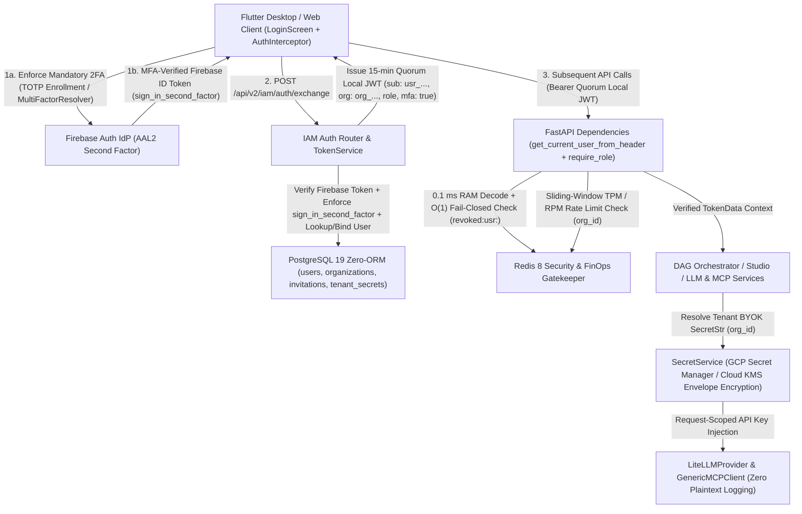

<required_context_rules>
  <rule>@[.agents/rules/00-antigravity-core.md]</rule>
  <rule>@[.agents/rules/01-python-backend.md]</rule>
  <rule>@[.agents/rules/02_flutter_desktop.md]</rule>
  <rule>@[.agents/rules/03_seed_vault.md]</rule>
  <rule>@[.agents/rules/04_directory_reference.md]</rule>
  <rule>@[.agents/rules/05_llm_architecture.md]</rule>
  <knowledge_item>@[ki_god_code_prevention.md]</knowledge_item>
  <knowledge_item>@[ki_python_314_concurrency_strictness.md]</knowledge_item>
  <knowledge_item>@[ki_zero_permissive_typing.md]</knowledge_item>
  <knowledge_item>@[ki_ast_guardrail_engine.md]</knowledge_item>
  <knowledge_item>@[ki_mcp_tool_protocol.md]</knowledge_item>
  <knowledge_item>@[ki_api_router_ssot_governance.md]</knowledge_item>
  <knowledge_item>@[ki_router_ssot_and_crud_clone_lifecycle.md]</knowledge_item>
  <knowledge_item>@[ki_global_config_sovereignty.md]</knowledge_item>
  <knowledge_item>@[ki_app_error_boundary.md]</knowledge_item>
  <knowledge_item>@[ki_desktop_pro_tool_studio_ux.md]</knowledge_item>
  <knowledge_item>@[ki_dual_axis_localization_architecture.md]</knowledge_item>
  <knowledge_item>@[ki_opentelemetry_logfire_observability.md]</knowledge_item>
  <knowledge_item>@[ki_frontend_iam_role_segregation.md]</knowledge_item>
  <knowledge_item>@[ki_workflow_context_governance.md]</knowledge_item>
</required_context_rules>

# EPIC 160: B2B SaaS IAM, Token Exchange & Enterprise Hardening Architecture

> [!NOTE]
> **Scientific & Industrial Validation (2025-2026)**
> Enterprise B2B SaaS and multi-tenant agentic AI architectures in 2025-2026 converge on four foundational security standards validated by IETF specifications and cloud security frameworks:
> 1. **RFC 8693 OAuth 2.0 Token Exchange, Mandatory MFA (NIST SP 800-63B AAL2) & Stateless Session Upgrade**: Forwarding external Identity Provider (IdP) tokens across internal service boundaries or querying a relational database on every HTTP request introduces 15–50 ms of per-request tail latency and couples domain schemas to third-party identity vendors. Exchanging the external IdP credential (`Firebase ID Token`) once at the API edge (`POST /api/v2/iam/auth/exchange`) after verifying mandatory Multi-Factor Authentication (`firebase.sign_in_second_factor` claim) for a short-lived (15-minute), internally signed `Quorum Local JWT` embedding verified tenant, role, and MFA claims (`sub`, `org`, `role`, `mfa`) reduces per-request authorization latency to `< 0.1 ms` in RAM while decoupling downstream services from the authentication vendor.
> 2. **RFC 9562 UUIDv7 Primary Keys & Dual-Layer Tenant Isolation**: Using arbitrary external string identifiers (`Firebase UID`) as SQL primary keys causes random B-Tree page splits and index fragmentation in PostgreSQL. Enforcing RFC 9562 monotonic `uuidv7()` primary keys formatted as `PrefixedUUID7` (`usr_<hex32>`, `org_<hex32>`, `inv_<hex32>`, `sec_<hex32>`) preserves B-Tree sequential write locality while keeping `firebase_uid` as an indexed `VARCHAR(128) UNIQUE NOT NULL` lookup column. Furthermore, in asynchronous `asyncpg` connection pools, relying solely on session state (`SET LOCAL`) risks cross-tenant pool contamination; pairing explicit parameterized SQL predicates (`WHERE organization_id = $1`) with transactional `RESET quorum.current_org` cleanup guarantees deterministic SOC2 and GDPR tenant isolation.
> 3. **Dual-Tier Envelope Encryption & BYOK Secrets Governance (LLM + MCP)**: Enterprise tenants require Bring Your Own Key (BYOK) sovereignty across both foundational LLM providers (`LiteLLMProvider` in `@[backend_v2/llm/provider/litellm_provider.py#L74-L429]`) and external Model Context Protocol (MCP) tool gateways (`GenericMCPClient` in `@[backend_v2/services/mcp/generic_mcp_client.py#L54-L806]`). Storing credentials via Cloud Secret Manager resource references (`projects/.../secrets/...`) or Envelope Encryption (Data Encryption Keys wrapped by Key Encryption Keys in Cloud KMS / AES-256-GCM inside `tenant_secrets`) with request-scoped `pydantic.SecretStr` unwrapping prevents cross-tenant credential bleed and guarantees zero plaintext exposure in logs, DTOs, or `MCPAuditTrace` records.
> 4. **Fail-Closed Redis Kill-Switch & Edge FinOps Rate Limiting**: Stateless short-lived JWTs require an out-of-band revocation mechanism to terminate compromised sessions before the 15-minute expiration window. Checking an O(1) Redis revocation key (`revoked:usr:<id>` with 900-second TTL) under a strict **Fail-Closed** policy (`503 Service Unavailable` when Redis is unreachable) alongside per-tenant sliding-window `tpm_limit` and `rpm_limit` token buckets protects both enterprise data and LLM FinOps budgets at the API edge.

---

## 1. Goal Description & Background (Objective & Problem Statement)

### 1.1 Problem Statement: Legacy Authentication Bottlenecks & Outdated Blueprints
Four historical IAM draft documents (`docs/epic/B2B SaaS IAM-arkkitehtuuri 2026.md`, `docs/epic/B2B SaaS IAM-arkkitehtuuri 2026 vrs2.md`, `docs/epic/B2B SaaS IAM-arkkitehtuuri 2026 vrs2 - Osa 1 (Valmistelu).md`, `docs/epic/B2B SaaS IAM-arkkitehtuuri 2026 vrs2 - Osa 2 (Integraatio).md`) captured business requirements for multi-tenant B2B SaaS IAM, but their technical designs conflict with Quorum's 2026 production architecture:
- **Database Lookup on Every HTTP Request**: `TokenService.verify_token` (`@[backend_v2/services/auth/token_service.py#L94-L232]`) currently decodes the token and executes `await self.repo.get_by_id(...)` on every single API request, adding 15–50 ms of database latency per call.
- **Banned ORM & Obsolete TinyDB Bridges**: The historical documents proposed a temporary TinyDB phase followed by `SQLAlchemy 2.0` and `Alembic` migrations, which are permanently banned by Quorum's All-in-PostgreSQL 19 Sovereign Zero-ORM Architecture (`@[docs/implementationplans/IMPLEMENTATION_PLAN_PostgreSQL.md]` and `ZORM001`).
- **Primary Key Contradictions & `hashids` Bloat**: The legacy drafts alternated between raw 28-character Firebase UID strings as SQL primary keys and third-party `hashids` obfuscation, violating `OPAQUE_STRIPE_ID_REGEX` (`@[backend_v2/models/core_base.py]`), `PrefixedUUID7`, and `dependency_hallucination_firewall`.
- **Single-Role Authorization Guard & Coarse-Grained User/Organization/Execution RBAC**: `require_role` (`@[backend_v2/api/dependencies.py#L410-L454]`) accepts only a single `UserRole` value rather than a sequence of permitted roles (`Sequence[UserRole] | UserRole`). Furthermore, `UserService.list_users` (`@[backend_v2/services/auth/user_service.py#L692-L707]`) currently exposes the entire organization user list to `MEMBER` and `VIEWER` roles instead of restricting `MEMBER` and `VIEWER` to their own profile (`initiator.id == target_id`), `ExecutionLifecycleService.list_executions` (`@[backend_v2/services/execution/lifecycle_service.py#L51-L94]`) and `ExecutionLifecycleService.get_execution` (`@[backend_v2/services/execution/lifecycle_service.py#L96-L143]`) expose all organization executions (`e.organization_id == org_id`) to `MEMBER` and `VIEWER` roles instead of isolating `MEMBER` and `VIEWER` to their own executions (`e.created_by == initiator.id`), `OrganizationService.update_organization` (`@[backend_v2/services/auth/organization_service.py#L320-L360]`) restricts all organization updates to `ROOT` instead of allowing `MANAGER` and `ADMIN` roles to update their own organization's profile metadata (`name`, `contact_email`), `UserService.update_user` (`@[backend_v2/services/auth/user_service.py#L432-L562]`) lacks role-hierarchy escalation checks on `updates.role` and `LAST_ADMIN_PROTECTION` checks on `updates.is_active = False`, `UserService._count_org_admins` (`@[backend_v2/services/auth/user_service.py#L287-L297]`) does not filter out deactivated or soft-deleted administrators (`is_active` and `deleted_at is None`), and there is no cryptographic time-bound task assignment mechanism (`ExecutionAssignment`) for inviting new or existing users via email link to complete a specific workflow run within an activation or hard-deadline window.
- **Incomplete BYOK & MCP Secret Isolation**: In `@[backend_v2/llm/provider/provider_factory.py#L107-L176]` (`LLMFactory._resolve_provider_api_key`) and `@[backend_v2/llm/provider/provider_factory.py#L178-L301]` (`LLMFactory.create_provider`), provider credential resolution relies solely on global environment variables without per-tenant `organization_id` secret resolution, while `GenericMCPClient._build_request_headers` (`@[backend_v2/services/mcp/generic_mcp_client.py#L237-L292]`) resolves gateway credentials solely from global `os.environ` variables without per-tenant `organization_id` secret resolution.

### 1.2 Target Architecture: Zero-ORM B2B SaaS IAM, Session Upgrade & Dual-Tier BYOK
Scheduled immediately following `@[docs/implementationplans/IMPLEMENTATION_PLAN_PostgreSQL.md]` and the 12-table native `UUIDv7` unification (`@[docs/arkkitehtuurin_parannuskohteet.md]` Luku 2), EPIC 160 supersedes and deletes the four obsolete historical IAM draft documents, delivering a six-phase enterprise IAM and secrets governance architecture:



### 1.3 Six Core Architectural Deliverables
1. **Zero-ORM Identity, Secrets & Task Assignment Schema (`PrefixedUUID7` over Native PostgreSQL 19 `UUIDv7`)**:
   - Extend the PostgreSQL 19 DDL (`[MODIFY] @[backend_v2/database/migrations/001_pg19_uuidv7_schema.sql]`) and `PostgresEntityAdapter` (`[MODIFY] @[backend_v2/database/postgres/entity_adapter.py]`) with strict 1:1 tenant isolation (`organization_id UUID NOT NULL REFERENCES organizations(id)` bridged via `_to_pg_uuid` / `_from_pg_uuid` to `PrefixedUUID7` `org_<hex32>`), `firebase_uid VARCHAR(128) UNIQUE NOT NULL`, soft-delete `deleted_at TIMESTAMPTZ`, and three dedicated tables using `id UUID PRIMARY KEY DEFAULT uuidv7()`: `invitations` (`inv_<hex32>`), `tenant_secrets` (`sec_<hex32>`), and `execution_assignments` (`tsk_<hex32>`), registering all three tables and their explicit column names in `[MODIFY] @[scripts/audit_zero_orm_strictness.py]` (`ZORM004` and `ZORM006`).
   - Enforce Dual-Layer Tenant Isolation across all `PostgresEntityAdapter` queries: mandatory parameterized `WHERE organization_id = $1` predicates combined with `RESET quorum.current_org` inside the `finally` block of `PostgresUnitOfWork` (`[MODIFY] @[backend_v2/database/postgres/uow.py]`) to eliminate connection pool contamination.
2. **Mandatory 2FA (AAL2) Enforcement, Session Upgrade, Headless CLI/E2E Exchange & Token Exchange (`POST /api/v2/iam/auth/exchange`)**:
   - Direct all interactive user accounts to authenticate with Multi-Factor Authentication (2FA / TOTP): in Flutter (`@[client_app_v2/lib/features/auth/presentation/auth_controller.dart]` and `@[client_app_v2/lib/features/auth/presentation/login_screen.dart]`), users with enrolled 2FA resolve `FirebaseAuthMultiFactorException` via `MultiFactorResolver`, while un-enrolled accounts (`user.multiFactor.enrolledFactors.isEmpty`) are intercepted and guided through mandatory TOTP 2FA enrollment (`TotpMultiFactorGenerator`) before token exchange.
   - Validate the incoming credential once at `POST /api/v2/iam/auth/exchange` in `TokenService` (`@[backend_v2/services/auth/token_service.py#L32-L232]`):
     1. **Interactive IdP Mode (`use_firebase_auth=True`)**: Verify the Firebase ID Token, enforce that the decoded token contains a verified second factor (`firebase.sign_in_second_factor` when `require_mfa` is enabled on `Settings`, raising `AuthenticationError` with `ErrorCodes.MFA_REQUIRED` if missing), and resolve the persisted `User` by `firebase_uid` (checking `is_active` and `deleted_at is None`).
     2. **Headless CLI, E2E & Local Dev Exchange Mode (`allow_mock_tokens=True` or environment-injected `service_auth_secret` on `Settings`)**: To support automated CLI processes (`@[scripts/run_e2e_variance_test.py]`), live E2E suites (`@[backend_v2/tests/integration/test_integration_real_llm.py]`), and local `run_local.bat` sessions (`USE_FIREBASE_AUTH=false`) without violating `single_pipeline_invariant_mandate` or `ban_heuristic_identifier_matching`, allow exchanging `target_user_id` (defaulting to `settings.mock_admin_user_id`) at `POST /api/v2/iam/auth/exchange` when `allow_mock_tokens` on `Settings` is `True` or when a valid `service_auth_secret` (`SecretStr`) is supplied, resolving the seeded `User` from PostgreSQL once and issuing the exact same signed 15-minute `Quorum Local JWT` containing `sub` (`usr_<hex32>`), `org` (`org_<hex32>`), `role` (`UserRole`), `mfa: True`, `iat`, `exp`, and `type: "access"`.
   - Eradicate `token.startswith("mock-token:")` prefix branching and database lookups from `TokenService.verify_token` (`@[backend_v2/services/auth/token_service.py#L94-L232]`): decode all `Quorum Local JWT` tokens completely in RAM (`< 0.1 ms`) with zero PostgreSQL queries on API requests, and update `@[scripts/run_e2e_variance_test.py]` and `@[backend_v2/tests/integration/test_integration_real_llm.py]` to exchange and auto-refresh (before minute 13 during long-running polling loops) genuine `Quorum Local JWT` tokens via `POST /api/v2/iam/auth/exchange`.
3. **Enterprise Dual-Tier BYOK & Cloud Secrets Engine (`SecretService`)**:
   - Create `SecretService` in `[NEW] @[backend_v2/services/auth/secret_service.py]` and DTOs (`TenantSecretDTO`, `TenantSecretCreateDTO`, `TenantSecretResponseDTO`, `ResolvedCredentialDTO`) defined in `@[backend_v2/models/auth.py]` supporting both Cloud Secret Manager resource references (`projects/.../secrets/.../versions/latest`) and Envelope Encryption (AES-256-GCM Data Encryption Keys wrapped by Cloud KMS or local development mock KMS bridge) stored in `tenant_secrets`.
   - Realize dynamic per-tenant credential injection in `LLMFactory._resolve_provider_api_key` (`@[backend_v2/llm/provider/provider_factory.py#L107-L176]`), `LLMFactory.create_provider` (`@[backend_v2/llm/provider/provider_factory.py#L178-L301]`), and `LiteLLMProvider` (`@[backend_v2/llm/provider/litellm_provider.py#L74-L429]`) as well as `GenericMCPClient._build_request_headers` (`@[backend_v2/services/mcp/generic_mcp_client.py#L237-L292]`), passing credentials strictly per request via `pydantic.SecretStr` with zero cross-tenant client caching and zero secret leakage in `MCPAuditTrace` or OpenTelemetry spans.
4. **Real-Time Redis Kill-Switch & Multi-Role Authorization Guard**:
   - Create `[NEW] @[backend_v2/core/redis_security.py]` defining `RevocationCache` and `TenantRateLimitService` over Redis.
   - When an administrator soft-deletes a user, deactivates an account, or changes a user's role or organization, immediately write `revoked:usr:{user.id}` to Redis with a 900-second TTL matching the 15-minute JWT lifetime.
   - Enforce **Fail-Closed** verification in `get_current_user_from_header` (`@[backend_v2/api/dependencies.py#L379-L403]`): if the user ID is present in `revoked:usr:{user.id}`, raise `AuthenticationError` (`ErrorCodes.AUTH_TOKEN_EXPIRED`); if Redis is unreachable, log a structured RFC 7807 error and raise `ServiceUnavailableError` (`503 Service Unavailable`, `ErrorCodes.SERVICE_UNAVAILABLE`).
   - Modernize `require_role` (`@[backend_v2/api/dependencies.py#L410-L454]`) to accept `allowed_roles: Sequence[UserRole] | UserRole`.
5. **AI FinOps Rate Limiting & Pre-Flight Quota Gatekeeper**:
   - Enforce per-tenant Redis sliding-window rate limits (`Organization.tpm_limit` and `Organization.rpm_limit`) via `TenantRateLimitService` in `[NEW] @[backend_v2/core/redis_security.py]` and `UsageService` (`@[backend_v2/services/usage_service.py#L23-L271]`), rejecting excess traffic at the API edge with HTTP `429 Too Many Requests` (`TokenLimitExceededError`, `ErrorCodes.RATE_LIMIT_EXCEEDED`).
   - Enforce pre-flight monthly USD budget verification in `UsageService.check_quota` (`@[backend_v2/services/usage_service.py#L216-L276]`) before Phase 1 DAG execution and Phase 2 report synthesis, raising `AppException` with `ErrorCodes.QUOTA_EXHAUSTED` when `current_spend >= organization.quota_limit`.
6. **B2B Invitation Flow, Time-Bound Execution Assignments (`ExecutionAssignment`), 4-Tier RBAC Matrix, GDPR Soft-Delete & Separated Flutter Views**:
   - Implement B2B organization invitations (`Invitation`, `InvitationCreateDTO`, `InvitationAcceptRequestDTO`, `InvitationResponseDTO` defined in `@[backend_v2/models/auth.py]`) with cryptographic single-use tokens (`secrets.token_urlsafe(32)`), 7-day expiration, and the **1:1 Flat Identity Collision Guard** rejecting cross-organization account reassignment with `409 Conflict` (`ConflictError`, `ErrorCodes.USER_ALREADY_ASSIGNED`).
   - Implement **Time-Bound Execution Assignments (`ExecutionAssignment` / `tsk_<hex32>`) with Combined Just-In-Time (JIT) User Onboarding** (`[NEW] @[backend_v2/services/execution/assignment_service.py]`, `@[backend_v2/models/domain/execution.py]`, and `@[backend_v2/api/routers/execution/executions.py#L57-L82]`):
     - Allows `ADMIN` and `MANAGER` roles to send an email link (`/task/<raw_256bit_token>`, stored as a SHA-256 `token_hash` in `execution_assignments`) binding a recipient (`assigned_email`) to a specific `workflow_id`, pre-filled `locked_inputs` (`WorkflowInputs` locked by the sender), and `assignee_input_keys` (`list[str]` filled by the recipient).
     - **Combined JIT User Onboarding**: If the recipient is a new user, the link token serves as cryptographic proof of `assigned_email` and guides the recipient through creating their account (`name`, `language`, password, and mandatory 2FA enrollment) into `organization_id` (`MEMBER` member of `UserRole`) before opening the assigned task.
     - **SafeLinks-Immune Two-Phase Activation & Dual-Clock Expiration**: `GET /api/v2/execution/executions/assignments/preview` is 100% side-effect-free so corporate email security scanners (Microsoft Defender SafeLinks, Proofpoint, Mimecast) never trigger the timer. The relative countdown (`activated_at = NOW()`) starts exclusively on an authenticated human `POST /api/v2/execution/executions/assignments/{assignment_id}/activate`. Task expiration enforces the server-authoritative UTC formula $\text{effective\_expires\_at} = \min(\text{hard\_deadline\_at}, \text{activated\_at} + \text{relative\_duration\_seconds})$ with a configurable `assignment_submission_grace_seconds` window, draft auto-save (`PUT .../draft`), single-shot atomic submission (`SUBMITTED` status on `AssignmentStatus` binding `execution_id = exe_<hex32>`), and `AssignmentResultVisibility` (`CONFIRMATION_ONLY` vs. `FULL_REPORT_ACCESS`).
   - Enforce a deterministic **4-Tier RBAC Governance Matrix (`VIEWER`/`MEMBER` vs. `MANAGER` vs. `ADMIN` vs. `ROOT`)**:
     - `VIEWER` and `MEMBER` roles access and update exclusively their own user profile (`initiator.id == target_id` in `UserService.get_user`, `UserService.list_users`, and `UserService.update_user` in `@[backend_v2/services/auth/user_service.py#L45-L826]`) and view exclusively their own executions (`e.created_by == initiator.id` in `ExecutionLifecycleService.list_executions` and `ExecutionLifecycleService.get_execution` in `@[backend_v2/services/execution/lifecycle_service.py#L23-L248]`), modifying only their own display name (`name`), UI language (`language`: `SystemLocale`), and theme (`theme_mode`) while rejecting self-mutation of `role`, `organization_id`, `is_active`, or `password` with `PermissionDeniedError`.
     - `MANAGER` and `ADMIN` roles (alongside `ROOT`) read organization-level data (`OrganizationService.get_organization`, `UserService.list_users`, and `ExecutionLifecycleService.list_executions` scoped to `initiator.organization_id`), update their own organization's profile metadata (`name` and `contact_email` in `OrganizationService.update_organization` in `@[backend_v2/services/auth/organization_service.py#L320-L360]`), and manage time-bound execution assignments (`ExecutionAssignmentService`), while platform FinOps and subscription fields (`quota_limit`, `tpm_limit`, `rpm_limit`, `tier`, `subscription_status`, `is_active`, `billing_id`) remain locked to `ROOT`.
     - `ADMIN` (alongside `ROOT`) exclusively holds general user management, role assignment, and BYOK privileges within the organization: inviting general users (`OrganizationService.create_invitation`), updating user roles (`UserService.update_user_role`), soft-deleting users (`UserService.delete_user`), and managing BYOK secrets (`SecretService`), whereas `MANAGER` is strictly prohibited from mutating user roles, deleting users, or mutating BYOK keys (`PermissionDeniedError`).
   - Implement GDPR Soft-Delete anonymization (`deleted_at = datetime.now(timezone.utc)`, `is_active = False`, `email = f"deleted_{user.id}@anonymized.quorum.local"`, `name = "Anonymized User"`) in `UserService.delete_user` (`@[backend_v2/services/auth/user_service.py#L310-L430]`) and the Firebase `auth.user.deleted` webhook endpoint in `@[backend_v2/api/routers/iam/auth.py]`, preserving historical foreign-key references on `executions` and `report_artifacts`.
   - Implement Flutter `AuthInterceptor` (`[MODIFY] @[client_app_v2/lib/core/network/interceptors/auth_interceptor.dart]`), 13-minute silent background token refresh in `@[client_app_v2/lib/features/auth/presentation/auth_controller.dart]`, root provider cache invalidation on tenant switch (`tenant_data_isolation`), and **three strictly separated role-aware Flutter views**:
     1. `UserProfileSettingsView` (`[NEW] @[client_app_v2/lib/features/settings/presentation/user_profile_settings_view.dart]`) for all authenticated roles (`VIEWER`, `MEMBER`, `MANAGER`, `ADMIN`, `ROOT`) to view their own identity metadata and update their own `name`, `language`, and `theme_mode` with full-duplex PostgreSQL persistence via `SettingsController` (`[MODIFY] @[client_app_v2/lib/features/settings/presentation/settings_controller.dart]`).
     2. `OrganizationIamSettingsView` (`[NEW] @[client_app_v2/lib/features/settings/presentation/organization_iam_settings_view.dart]`) restricted to `MANAGER`, `ADMIN`, and `ROOT` roles, allowing `MANAGER` to edit organization profile details (`name`, `contact_email`) and manage execution assignments while restricting general user role governance, session revocation, and BYOK secrets management to `ADMIN` and `ROOT`.
     3. `TaskAssignmentPortalView` (`[NEW] @[client_app_v2/lib/features/execution/views/task_assignment_portal_view.dart]`) mounted at `/task/:token` in `@[client_app_v2/lib/router/router.dart#L55-L116]` for recipients of time-bound execution links to complete JIT account onboarding + 2FA, activate their timed task, auto-save drafts, and submit their assigned inputs before `effective_expires_at`.

### 1.4 Quantitative Scope Validation Table

| Target File Path | Action | Physical Layer | Coupled 1-Hop Callers & Blast Radius |
| :--- | :--- | :--- | :--- |
| `[DELETE] @[docs/epic/B2B SaaS IAM-arkkitehtuuri 2026 vrs2 - Osa 1 (Valmistelu).md]`, `[DELETE] @[docs/epic/B2B SaaS IAM-arkkitehtuuri 2026 vrs2 - Osa 2 (Integraatio).md]`, `[DELETE] @[docs/epic/B2B SaaS IAM-arkkitehtuuri 2026 vrs2.md]`, & `[DELETE] @[docs/epic/B2B SaaS IAM-arkkitehtuuri 2026.md]` | `[DELETE]` | Legacy Documentation Sunset | Superseded by `[NEW] @[docs/epic/EPIC_160_B2B_SaaS_IAM_and_Enterprise_Hardening.md]` |
| `[MODIFY] @[backend_v2/models/enums.py]`, `[MODIFY] @[backend_v2/exceptions.py#L129-L319]`, & `[MODIFY] @[backend_v2/settings.py]` | `[MODIFY]` | Taxonomies, ErrorCodes & Settings SSOT | `@[backend_v2/models/auth.py]`, `@[backend_v2/services/auth/token_service.py]`, `[NEW] @[backend_v2/services/auth/secret_service.py]`, `[NEW] @[backend_v2/core/redis_security.py]`, `@[backend_v2/tests/unit/test_enum_parity.py]` |
| `[MODIFY] @[backend_v2/models/auth.py#L112-L230]`, `[MODIFY] @[backend_v2/models/auth.py#L233-L274]`, `[MODIFY] @[backend_v2/models/auth.py#L280-L358]`, `[MODIFY] @[backend_v2/models/auth.py#L440-L469]`, `[MODIFY] @[backend_v2/models/auth.py#L501-L556]`, `[MODIFY] @[backend_v2/models/auth.py#L573-L582]`, `[MODIFY] @[backend_v2/models/auth.py#L585-L598]`, `[MODIFY] @[backend_v2/models/domain/execution.py#L85-L129]`, & `[DELETE] @[backend_v2/services/auth/constants.py]` | `[MODIFY]` / `[DELETE]` | Identity, Invitation, Task Assignment & BYOK DTOs + Constants Sunset | `@[backend_v2/services/auth/token_service.py]`, `@[backend_v2/services/auth/user_service.py]`, `@[backend_v2/services/auth/organization_service.py]`, `[NEW] @[backend_v2/services/auth/secret_service.py]`, `[NEW] @[backend_v2/services/execution/assignment_service.py]`, `@[backend_v2/api/routers/iam/auth.py]`, `[MODIFY] @[backend_v2/tests/unit/test_organization_service.py]`, `[MODIFY] @[backend_v2/tests/unit/test_token_service.py]`, `[MODIFY] @[backend_v2/tests/unit/test_user_service.py]`, `[MODIFY] @[backend_v2/tests/unit/services/studio/test_auth_validator.py]` |
| `[MODIFY] @[backend_v2/database/migrations/001_pg19_uuidv7_schema.sql]`, `[MODIFY] @[backend_v2/database/postgres/entity_adapter.py]`, `[MODIFY] @[backend_v2/database/postgres/uow.py]`, `[MODIFY] @[scripts/audit_zero_orm_strictness.py]`, `[MODIFY] @[backend_v2/database/interfaces.py]`, `[MODIFY] @[backend_v2/database/repositories/identity.py#L25-L272]`, `[MODIFY] @[backend_v2/services/auth/repositories.py#L15-L78]`, `[MODIFY] @[backend_v2/services/auth/repositories.py#L81-L182]`, & `[MODIFY] @[backend_v2/tests/fakes/in_memory_repositories.py]` | `[MODIFY]` | Zero-ORM Persistence & Dual-Layer Tenant Isolation | `@[backend_v2/services/auth/user_service.py]`, `@[backend_v2/services/auth/organization_service.py]`, `[NEW] @[backend_v2/services/auth/secret_service.py]`, `[NEW] @[backend_v2/services/execution/assignment_service.py]`, `@[backend_v2/services/usage_service.py]` |
| `[MODIFY] @[backend_v2/services/auth/token_service.py#L32-L232]`, `[MODIFY] @[backend_v2/services/auth/user_service.py#L45-L826]`, `[MODIFY] @[backend_v2/services/auth/organization_service.py#L41-L360]`, `[NEW] @[backend_v2/services/auth/secret_service.py]`, `[NEW] @[backend_v2/services/execution/assignment_service.py]`, `[MODIFY] @[backend_v2/services/execution/lifecycle_service.py#L23-L248]`, & `[MODIFY] @[backend_v2/services/auth/__init__.py#L59-L202]` | `[MODIFY]` / `[NEW]` | Pillar 1 Auth, Invitation, Task Assignment, Execution Visibility, GDPR & Secrets Services | `@[backend_v2/api/dependencies.py]`, `@[backend_v2/api/routers/iam/auth.py]`, `@[backend_v2/api/routers/iam/users.py]`, `@[backend_v2/api/routers/iam/organizations.py]`, `@[backend_v2/api/routers/execution/executions.py]` |
| `[NEW] @[backend_v2/core/redis_security.py]` & `[MODIFY] @[backend_v2/services/usage_service.py#L23-L271]` | `[MODIFY]` / `[NEW]` | Redis Fail-Closed Kill-Switch & FinOps Rate Limiter | `@[backend_v2/api/dependencies.py]`, `@[backend_v2/services/execution/lifecycle_service.py]`, `@[backend_v2/services/report/lifecycle_service.py]` |
| `[MODIFY] @[backend_v2/llm/provider/litellm_provider.py#L74-L429]`, `[MODIFY] @[backend_v2/llm/provider/provider_factory.py#L107-L176]`, `[MODIFY] @[backend_v2/llm/provider/provider_factory.py#L178-L301]`, `[MODIFY] @[backend_v2/services/mcp/generic_mcp_client.py#L237-L292]`, & `[MODIFY] @[backend_v2/services/mcp/dispatcher.py]` | `[MODIFY]` | Request-Scoped LLM & MCP BYOK Credential Injection | `@[backend_v2/llm/client.py]`, `@[backend_v2/services/mcp/mcp_tool_loop.py]`, `@[backend_v2/services/orchestrator/strategies/llm_strategy/__init__.py]` |
| `[MODIFY] @[backend_v2/api/dependencies.py#L379-L403]`, `[MODIFY] @[backend_v2/api/dependencies.py#L410-L454]`, `[MODIFY] @[backend_v2/api/routers/iam/auth.py#L43-L104]`, `[MODIFY] @[backend_v2/api/routers/iam/auth.py#L107-L148]`, `[MODIFY] @[backend_v2/api/routers/iam/auth.py#L163-L217]`, `[MODIFY] @[backend_v2/api/routers/iam/auth.py#L220-L234]`, `[MODIFY] @[backend_v2/api/routers/iam/auth.py#L237-L303]`, `[MODIFY] @[backend_v2/api/routers/iam/auth.py#L306-L371]`, `[MODIFY] @[backend_v2/api/routers/iam/auth.py#L374-L399]`, `[MODIFY] @[backend_v2/api/routers/iam/users.py#L19-L47]`, `[MODIFY] @[backend_v2/api/routers/iam/users.py#L71-L89]`, `[MODIFY] @[backend_v2/api/routers/iam/users.py#L92-L125]`, `[MODIFY] @[backend_v2/api/routers/iam/organizations.py#L19-L46]`, `[MODIFY] @[backend_v2/api/routers/iam/organizations.py#L69-L88]`, `[MODIFY] @[backend_v2/api/routers/execution/executions.py#L57-L82]`, `[MODIFY] @[scripts/run_e2e_variance_test.py#L875-L986]`, `[MODIFY] @[scripts/run_e2e_variance_test.py#L1539-L1593]`, `[MODIFY] @[scripts/run_e2e_variance_test.py#L1596-L2014]`, & `[MODIFY] @[backend_v2/tests/integration/test_integration_real_llm.py#L298-L547]` | `[MODIFY]` | FastAPI Dependencies, IAM & Execution Assignment REST Routers, & Headless CLI / E2E Token Exchange | `@[client_app_v2/lib/features/auth/data/auth_repository.dart]`, `[MODIFY] @[client_app_v2/lib/core/network/interceptors/auth_interceptor.dart]`, `@[scripts/run_e2e_variance_test.py]`, `@[backend_v2/tests/integration/test_integration_real_llm.py]` |
| `[MODIFY] @[client_app_v2/lib/core/models/enums.dart]`, `[MODIFY] @[client_app_v2/lib/router/router.dart#L55-L227]`, `[MODIFY] @[client_app_v2/lib/router/scaffold_with_nav.dart#L19-L147]`, `[MODIFY] @[client_app_v2/lib/features/auth/domain/models/user.dart]`, `[MODIFY] @[client_app_v2/lib/features/auth/data/auth_repository.dart]`, `[MODIFY] @[client_app_v2/lib/features/auth/presentation/auth_controller.dart]`, `[MODIFY] @[client_app_v2/lib/features/auth/presentation/login_screen.dart]`, `[MODIFY] @[client_app_v2/lib/features/execution/views/new_execution_view.dart#L319-L756]`, `[MODIFY] @[client_app_v2/lib/features/settings/presentation/settings_controller.dart]`, `[MODIFY] @[client_app_v2/lib/core/network/interceptors/auth_interceptor.dart]`, `[NEW] @[client_app_v2/lib/features/settings/domain/models/tenant_secret_dto.dart]`, `[NEW] @[client_app_v2/lib/features/settings/presentation/user_profile_settings_view.dart]`, `[NEW] @[client_app_v2/lib/features/settings/presentation/organization_iam_settings_view.dart]`, `[NEW] @[client_app_v2/lib/features/execution/views/task_assignment_portal_view.dart]`, `[MODIFY] @[client_app_v2/lib/l10n/app_en.arb]`, & `[MODIFY] @[client_app_v2/lib/l10n/app_fi.arb]` | `[MODIFY]` / `[NEW]` | Flutter Riverpod 3.0 Auth Handshake, Silent Refresh, Adaptive Navigation Shell, Separated User Profile View, Studio Organization IAM/BYOK UI, Direct Task Assignment Builder in `NewExecutionView`, & Task Assignment Portal View | `@[client_app_v2/lib/features/auth/presentation/providers/user_role_provider.dart]`, `@[client_app_v2/lib/features/settings/presentation/settings_controller.dart]` |

---

## 2. Architectural Impact & Compliance Matrix

### 2.1 Deprecations & Sunset List (`What We Will REMOVE`)

<demolish>
- `LEGACY_SYSTEM`
- `JWT_SECRET`
- `JWT_ALGORITHM`
- `LEGACY_SYSTEM_ROOT_USER_ID`
- `LEGACY_SYSTEM_ORG_ID`
- `LEGACY_ROOT_MASTER_ID`
- `TokenPayload`
- `LoginResponse`
- `verify_user_token`
</demolish>

| Deprecated File / Symbol | Location | Sunset Action & Replacement Mapping |
| :--- | :--- | :--- |
| Historical IAM Drafts | `[DELETE] @[docs/epic/B2B SaaS IAM-arkkitehtuuri 2026 vrs2 - Osa 1 (Valmistelu).md]`<br>`[DELETE] @[docs/epic/B2B SaaS IAM-arkkitehtuuri 2026 vrs2 - Osa 2 (Integraatio).md]`<br>`[DELETE] @[docs/epic/B2B SaaS IAM-arkkitehtuuri 2026 vrs2.md]`<br>`[DELETE] @[docs/epic/B2B SaaS IAM-arkkitehtuuri 2026.md]` | **DELETED** — Superseded by `[NEW] @[docs/epic/EPIC_160_B2B_SaaS_IAM_and_Enterprise_Hardening.md]`. All obsolete TinyDB bridge, SQLAlchemy 2.0, Alembic, and `hashids` designs are permanently dropped. |
| `JWT_SECRET`, `JWT_ALGORITHM`, `LEGACY_SYSTEM_ROOT_USER_ID`, `LEGACY_SYSTEM_ORG_ID`, `LEGACY_ROOT_MASTER_ID` | `[DELETE] @[backend_v2/services/auth/constants.py]` | **DELETED** — Module-level JWT constants in `constants.py` are replaced by environment-injected `jwt_secret_key`, `jwt_algorithm`, and `jwt_access_token_expire_minutes` on `Settings` in `@[backend_v2/settings.py]`. Legacy UUIDv4 and un-prefixed root constants (`LEGACY_SYSTEM_ROOT_USER_ID`, `LEGACY_SYSTEM_ORG_ID`, `LEGACY_ROOT_MASTER_ID`) are permanently eradicated (`the_no_legacy_mandate`), while canonical `SYSTEM_ROOT_USER_ID = "usr_01950000000070008000000000000001"` is relocated to `@[backend_v2/models/auth.py]` (and re-exported in `@[backend_v2/services/auth/__init__.py]`). |
| `LEGACY_SYSTEM` | `[MODIFY] @[backend_v2/models/auth.py#L82-L103]` | **REMOVED** — Legacy `"SYSTEM"` fallback string in `SystemOrganizations` is removed; only canonical `PrefixedUUID7` `ROOT_SYSTEM = "org_01950000000070008000000000000000"` (`OPAQUE_STRIPE_ID_REGEX`) is retained. |
| `TokenPayload`, `LoginResponse`, `verify_user_token` (`POST /api/v2/iam/auth/verify`), duplicate `/api/v2/iam/auth/users*` shadow routes, & union coercion in `OrganizationService.update_organization` | `[MODIFY] @[backend_v2/models/auth.py#L573-L582]`, `[MODIFY] @[backend_v2/models/auth.py#L585-L598]`, `[MODIFY] @[backend_v2/api/routers/iam/auth.py#L43-L104]`, `[MODIFY] @[backend_v2/api/routers/iam/auth.py#L163-L217]`, `[MODIFY] @[backend_v2/api/routers/iam/auth.py#L220-L234]`, `[MODIFY] @[backend_v2/api/routers/iam/auth.py#L237-L303]`, `[MODIFY] @[backend_v2/api/routers/iam/auth.py#L306-L371]`, `[MODIFY] @[backend_v2/api/routers/iam/organizations.py#L69-L88]`, & `[MODIFY] @[backend_v2/services/auth/organization_service.py#L320-L360]` | **REMOVED** — Legacy `TokenPayload`, `LoginResponse`, and `POST /api/v2/iam/auth/verify` are replaced by `TokenExchangeRequestDTO`, `TokenExchangeResponseDTO`, and `POST /api/v2/iam/auth/exchange`. Duplicate shadow `/auth/users*` endpoints in `auth.py` are deleted in favor of canonical `@[backend_v2/api/routers/iam/users.py]` (`single_router_ssot_mandate`). The `OrganizationUpdateDTO | OrganizationCreate` union and `isinstance` coercion branch in `OrganizationService.update_organization` are eliminated so updates accept exclusively `OrganizationUpdateDTO` (`the_zero_compromise_pledge`). |
| Database query and `mock-token:` string prefix branching inside `TokenService.verify_token` on every request | `[MODIFY] @[backend_v2/services/auth/token_service.py#L94-L232]`, `[MODIFY] @[scripts/run_e2e_variance_test.py#L875-L986]`, `[MODIFY] @[scripts/run_e2e_variance_test.py#L1539-L1593]`, `[MODIFY] @[scripts/run_e2e_variance_test.py#L1596-L2014]`, & `[MODIFY] @[backend_v2/tests/integration/test_integration_real_llm.py#L298-L547]` | **REMOVED** — Replaced by 0.1 ms in-memory `Quorum Local JWT` verification (`TokenService.verify_token`) paired with `TokenService.exchange_firebase_token` (`POST /api/v2/iam/auth/exchange`) serving both interactive 2FA users and headless CLI / E2E runners (`ban_heuristic_identifier_matching` & `single_pipeline_invariant_mandate`). |
| Hard SQL `DELETE` on `users` | `[MODIFY] @[backend_v2/services/auth/user_service.py#L310-L430]` & `[MODIFY] @[backend_v2/database/repositories/identity.py#L219-L228]` | **REMOVED** — Replaced by GDPR Soft-Delete anonymization (`deleted_at = NOW()`, `is_active = False`, anonymized email and display name) + immediate Redis Kill-Switch revocation (`revoked:usr:<id>`). |

### 2.2 Retained SSOT Invariants (`What We Will RETAIN`)
- **All-in-PostgreSQL 19 Sovereign Zero-ORM Engine (`@[docs/implementationplans/IMPLEMENTATION_PLAN_PostgreSQL.md]`)**: Direct `asyncpg` binary JSONB codecs, `PostgresPoolManager`, and `QuorumUnitOfWork` are retained as the sole persistence engine (`ZORM001`–`ZORM006`).
- **RFC 9562 `PrefixedUUID7` & `OPAQUE_STRIPE_ID_REGEX` (`@[backend_v2/models/core_base.py]`)**: Retained as the Single Source of Truth for all entity primary keys (`usr_<hex32>`, `org_<hex32>`, `inv_<hex32>`, `sec_<hex32>`).
- **Single Router SSOT per IAM Domain (`@[backend_v2/api/routers/iam/auth.py]`, `@[backend_v2/api/routers/iam/users.py]`, `@[backend_v2/api/routers/iam/organizations.py]`)**: Retained under `/api/v2/iam/` without creating shadow routers (`single_router_ssot_mandate`).
- **`AuthService` Facade (`@[backend_v2/services/auth/__init__.py#L59-L202]`)**: Retained under 300 lines as the immutable dependency injection router and package facade (`package_facade_and_inter_context_protocol_mandate`).

### 2.3 Compliance & Modernity Gates (Quorum 2026 Invariants)
1. **Zero Legacy State Support Mandate**: Zero backward compatibility for legacy `"SYSTEM"` organization strings, un-prefixed Firebase UID primary keys, or TinyDB transitional bridges. Clean-slate database seeding is executed via `uv run python backend_v2/seed/run_seed.py local`.
2. **Central Config Sovereignty**: All JWT lifetimes (`jwt_access_token_expire_minutes`), Redis revocation TTLs (`iam_revocation_ttl_seconds`), KMS key identifiers (`kms_master_key_id`), and rate-limiter windows reside in `@[backend_v2/settings.py]`. All role, subscription, invitation, and secret taxonomies (`UserRole`, `SubscriptionStatus`, `InvitationStatus`, `SecretScope`, `SecretStorageMode`) reside in `@[backend_v2/models/enums.py]` and `@[client_app_v2/lib/core/models/enums.dart]`.
3. **Pydantic Strictness**: Every domain model and DTO in `@[backend_v2/models/auth.py]` explicitly declares `model_config = ConfigDict(strict=True, extra="forbid", frozen=True)` and PEP 593 `Annotated` field definitions (`QGR007`).
4. **Cross-Domain DTO & Enum Parity**: Backend updates to `User`, `Organization`, `TokenExchangeResponseDTO`, `InvitationResponseDTO`, `TenantSecretResponseDTO`, and IAM enums are synchronized 1:1 with Flutter Freezed models in `@[client_app_v2/lib/features/auth/domain/models/user.dart]`, `[NEW] @[client_app_v2/lib/features/settings/domain/models/tenant_secret_dto.dart]`, and `@[client_app_v2/lib/core/models/enums.dart]`, verified via `uv run python scripts/audit_dto_parity.py` and `uv run python scripts/flutter_audit_loop.py client_app_v2/ --build`.
5. **Credential Hardcoding & DLP Logging Ban**: Raw API keys, JWT secrets, and DEKs are wrapped in `pydantic.SecretStr` and never logged, serialized into `MCPAuditTrace`, or returned in cleartext HTTP responses (`TenantSecretResponseDTO` exposes only `configured: bool` and `masked_hint: str`).
6. **Unbounded I/O Timeout & Python 3.14 Concurrency Mandate**: All Redis, KMS, Secret Manager, and Firebase calls execute inside bounded `async with asyncio.timeout(...)` contexts using thresholds from `@[backend_v2/settings.py]` and `asyncio.TaskGroup` where parallel operations occur.
7. **RFC-7807 Dual-Reporting**: Every `AuthenticationError`, `PermissionDeniedError`, `ConflictError`, `TokenLimitExceededError`, `ServiceUnavailableError`, and `ConfigurationError` is preceded by a structured `logger.error` call logging the exact `ErrorCodes` enum name and opaque entity IDs.
8. **Scoped Boy Scout Rule & Technical Debt Sweep**: Pre-flight audit via `uv run python scripts/audit_technical_debt.py --plan docs/epic/EPIC_160_B2B_SaaS_IAM_and_Enterprise_Hardening.md` identified 18 findings across direct target files: 14 `❌ FATAL` violations (`7 DGR003` hardcoded strings and `7 DGR007` hardcoded `Colors.*` calls) in `@[client_app_v2/lib/features/auth/presentation/login_screen.dart]`, 2 `⚠️ WARN` `TD_DICT_GET` violations in `@[backend_v2/database/repositories/identity.py#L60-L72]` and `@[backend_v2/database/repositories/identity.py#L163-L175]`, and 2 `⚠️ WARN` `TD_ISTQB_NEGATIVE` findings in `@[backend_v2/tests/unit/test_auth.py]` and `@[backend_v2/tests/unit/test_usage_service.py]`. Additionally, `uv run python scripts/audit_flutter_theme_sovereignty.py client_app_v2/lib/features/auth/presentation/login_screen.dart` identified 8 Theme Sovereignty violations (7 `PROHIBITED_STATIC_COLORS_PALETTE` and 1 `PROHIBITED_NAKED_TEXT_STYLE` on line 177), and AST inspection of `@[backend_v2/api/dependencies.py#L379-L403]` and `@[backend_v2/api/dependencies.py#L410-L454]` identified a raw string error code (`"AUTH_TOKEN_MISSING"`) and a missing RFC 7807 `logger.error` call before `PermissionDeniedError`. All 18 technical debt findings, the naked `TextStyle` violation, the RFC 7807 dependency guard debt, and inline enum/regex debt in `@[backend_v2/models/auth.py]` are resolved in Phase 1 before new feature logic is added.

### 2.4 Producer-Consumer Integration Check

| Data Artifact / Contract | Producer (Origin) | Intermediate Storage / Transit | Consumer (Destination) |
| :--- | :--- | :--- | :--- |
| **Upgraded Session Token (`TokenExchangeResponseDTO` & `Quorum Local JWT`)** | `TokenService.exchange_firebase_token()` in `@[backend_v2/services/auth/token_service.py#L32-L232]` via `POST /api/v2/iam/auth/exchange` (`@[backend_v2/api/routers/iam/auth.py]`) | Cached in Flutter memory / secure storage (`[MODIFY] @[client_app_v2/lib/core/network/interceptors/auth_interceptor.dart]`) and in headless CLI / E2E runners (`@[scripts/run_e2e_variance_test.py]`, `@[backend_v2/tests/integration/test_integration_real_llm.py]`) with automatic 13-minute refresh | `get_current_user_from_header` (`@[backend_v2/api/dependencies.py#L379-L403]`) -> `TokenService.verify_token` (< 0.1 ms RAM decode) |
| **Revocation Blocklist Entry (`revoked:usr:{user_id}`)** | `UserService.delete_user`, `UserService.update_user`, `UserService.update_user_role`, and Firebase deletion webhook in `@[backend_v2/services/auth/user_service.py#L44-L656]` | Stored in Redis (`RevocationCache` in `[NEW] @[backend_v2/core/redis_security.py]`) with 900s TTL | `get_current_user_from_header` (`@[backend_v2/api/dependencies.py#L379-L403]`) O(1) Fail-Closed check on every authenticated request |
| **Tenant BYOK Secret (`TenantSecretDTO` -> `ResolvedCredentialDTO`)** | Organization Admin via `PUT /api/v2/iam/organizations/{org_id}/secrets` (`@[backend_v2/api/routers/iam/organizations.py]`) -> `SecretService.upsert_tenant_secret` (`[NEW] @[backend_v2/services/auth/secret_service.py]`) | Encrypted via Envelope Encryption (`encrypted_dek` + `ciphertext` in `tenant_secrets` table) or stored as GCP Secret Manager resource path | `SecretService.resolve_llm_key` -> `LLMFactory._resolve_provider_api_key` (`@[backend_v2/llm/provider/provider_factory.py#L107-L176]`), `LLMFactory.create_provider` (`@[backend_v2/llm/provider/provider_factory.py#L178-L301]`), & `LiteLLMProvider` (`@[backend_v2/llm/provider/litellm_provider.py#L74-L429]`), and `SecretService.resolve_mcp_credential` -> `GenericMCPClient._build_request_headers` (`@[backend_v2/services/mcp/generic_mcp_client.py#L237-L292]`) |
| **Tenant FinOps Rate & Quota State (`TenantRateLimitStatusDTO`)** | `LLMTaskExecutor` / `UsageService.track_usage` (`@[backend_v2/services/usage_service.py#L36-L142]`) & API Ingress | Redis sliding-window counters (`ratelimit:org:{org_id}:rpm`, `ratelimit:org:{org_id}:tpm`) and PostgreSQL `executions` FinOps columns | `TenantRateLimitService.enforce_rate_limits` (`[NEW] @[backend_v2/core/redis_security.py]`) & `UsageService.check_quota` (`@[backend_v2/services/usage_service.py#L216-L276]`) |
| **B2B Organization Invitation (`Invitation` & `InvitationResponseDTO`)** | `OrganizationService.create_invitation` (`@[backend_v2/services/auth/organization_service.py#L41-L360]`) restricted to `ADMIN` and `ROOT` | Persisted in PostgreSQL `invitations` table with SHA-256 token hash and 7-day `expires_at` | `OrganizationService.accept_invitation` (`POST /api/v2/iam/auth/invitations/accept`) enforcing the 1:1 Identity Collision Guard |
| **Time-Bound Execution Assignment (`ExecutionAssignment` & `ExecutionAssignmentResponseDTO`)** | `ExecutionAssignmentService.create_assignment` (`[NEW] @[backend_v2/services/execution/assignment_service.py]`) invoked by `MANAGER`, `ADMIN`, or `ROOT` | Persisted in PostgreSQL `execution_assignments` (`id: tsk_<hex32>`, SHA-256 `token_hash`, `locked_inputs`, `hard_deadline_at`, `relative_duration_seconds`, `activated_at`, `result_visibility`) | `TaskAssignmentPortalView` (`[NEW] @[client_app_v2/lib/features/execution/views/task_assignment_portal_view.dart]`) -> `GET .../preview` (SafeLinks-immune read) -> JIT User Onboarding + 2FA -> `POST .../activate` -> `POST .../submit` -> `ExecutionIngressService.start_execution` (`@[backend_v2/services/execution/ingress_service.py#L306-L533]`) |
| **Self-Service User Profile (`name`, `language`, `theme_mode`) & Organization Profile (`name`, `contact_email`)** | `UserProfileSettingsView` (`[NEW] @[client_app_v2/lib/features/settings/presentation/user_profile_settings_view.dart]`) & `OrganizationIamSettingsView` (`[NEW] @[client_app_v2/lib/features/settings/presentation/organization_iam_settings_view.dart]`) | `PUT /api/v2/iam/users/{id}` (`UserUpdate`) and `PUT /api/v2/iam/organizations/{id}` (`OrganizationUpdateDTO`) persisted in PostgreSQL `users` and `organizations` tables | Hydrated into `User` (`TokenExchangeResponseDTO`), `SettingsController` (`@[client_app_v2/lib/features/settings/presentation/settings_controller.dart]`), and `OrganizationIamSettingsView` |

### 2.5 Five-Axis System 2 Architectural Directive Matrix

| 1. Target Scope & Boundaries | 2. Eradicated Duct-Tape (Under-Engineering Ban) | 3. Approved Best Practice (Target Invariant) | 4. Pruned Over-Engineering (Complexity Slayer) | 5. Verification & Fail-Fast (Proof Anchor) |
| :--- | :--- | :--- | :--- | :--- |
| **1. Identity Schema, Pre-Flight Tech Debt & `PrefixedUUID7` DTOs**<br>`[MODIFY] @[backend_v2/models/enums.py]`<br>`[MODIFY] @[backend_v2/models/auth.py#L112-L230]`<br>`[MODIFY] @[backend_v2/models/auth.py#L280-L358]`<br>`[MODIFY] @[backend_v2/models/domain/execution.py#L85-L129]`<br>`[MODIFY] @[backend_v2/database/migrations/001_pg19_uuidv7_schema.sql]`<br>`[MODIFY] @[backend_v2/database/postgres/entity_adapter.py]`<br>`[MODIFY] @[backend_v2/database/postgres/uow.py]`<br>`[MODIFY] @[scripts/audit_zero_orm_strictness.py]`<br>`[MODIFY] @[backend_v2/database/repositories/identity.py#L25-L272]`<br>`[MODIFY] @[client_app_v2/lib/features/auth/presentation/login_screen.dart]`<br>`[MODIFY] @[client_app_v2/lib/features/execution/views/new_execution_view.dart#L460-L490]`<br>`[MODIFY] @[backend_v2/tests/unit/test_auth.py]`<br>`[MODIFY] @[backend_v2/tests/unit/test_usage_service.py]` | Raw Firebase UID as SQL PK; `hashids` library; inline `UserRole`/`SubscriptionStatus` in `auth.py`; missing `frozen=True` on `User`/`Organization`/`TokenData`; `TD_DICT_GET` in `identity.py`; `TD_ISTQB_NEGATIVE` in `test_auth.py` and `test_usage_service.py`; 14 `DGR003`/`DGR007` hardcoded strings and colors plus 1 `PROHIBITED_NAKED_TEXT_STYLE` in `login_screen.dart` and 1 `DGR007` (`Colors.grey.shade600`) in `new_execution_view.dart`. | Native PostgreSQL 19 `UUID PRIMARY KEY DEFAULT uuidv7()` bridged via `_to_pg_uuid` / `_from_pg_uuid` to RFC 9562 `PrefixedUUID7` (`usr_<hex32>`, `org_<hex32>`, `inv_<hex32>`, `sec_<hex32>`, `tsk_<hex32>`); `firebase_uid VARCHAR(128) UNIQUE NOT NULL`; `deleted_at TIMESTAMPTZ`; Dual-Layer Tenant Isolation (`WHERE organization_id = $1` + `RESET quorum.current_org`); `ConfigDict(strict=True, extra="forbid", frozen=True)`. | Pruned N:M user-organization membership join tables; enforced flat 1:1 `organization_id` on `User`. | `uv run python scripts/audit_technical_debt.py` (0 findings), `audit_flutter_theme_sovereignty.py` (0 findings), `test_schema_dto_naming_parity`, and `ZORM004`/`ZORM006` AST verification. |
| **2. Session Upgrade, Mandatory 2FA Gate, Headless CLI Exchange & Token Exchange Engine**<br>`[DELETE] @[backend_v2/services/auth/constants.py]`<br>`[MODIFY] @[backend_v2/services/auth/token_service.py#L32-L232]`<br>`[MODIFY] @[backend_v2/api/routers/iam/auth.py#L43-L104]`<br>`[MODIFY] @[scripts/run_e2e_variance_test.py#L875-L986]`<br>`[MODIFY] @[scripts/run_e2e_variance_test.py#L1539-L1593]`<br>`[MODIFY] @[scripts/run_e2e_variance_test.py#L1596-L2014]`<br>`[MODIFY] @[backend_v2/tests/integration/test_integration_real_llm.py#L298-L547]`<br>`[MODIFY] @[backend_v2/tests/unit/test_organization_service.py]`<br>`[MODIFY] @[backend_v2/tests/unit/test_token_service.py]`<br>`[MODIFY] @[backend_v2/tests/unit/test_user_service.py]`<br>`[MODIFY] @[backend_v2/tests/unit/services/studio/test_auth_validator.py]` | Querying PostgreSQL on every HTTP request inside `verify_token`; `token.startswith("mock-token:")` string prefix branching; raw `Bearer mock-token:` headers in `run_e2e_variance_test.py` and `test_integration_real_llm.py`; allowing single-factor (password-only) sessions without 2FA; hardcoded `JWT_SECRET` and legacy UUIDv4 root constants (`LEGACY_SYSTEM_ROOT_USER_ID`, `LEGACY_SYSTEM_ORG_ID`, `LEGACY_ROOT_MASTER_ID`) in `constants.py`; infinite token lifetimes; client-minted role claims; unverified email fallback binding. | `POST /api/v2/iam/auth/exchange` (`TokenExchangeRequestDTO` -> `TokenExchangeResponseDTO`): verifies Firebase ID Token with mandatory 2FA (`firebase.sign_in_second_factor` when `require_mfa` on `Settings` is `True`) OR exchanges `target_user_id` for headless CLI / E2E / local dev sessions when `allow_mock_tokens` is `True` or `service_auth_secret` matches, mints 15-minute `Quorum Local JWT` (`sub`, `org`, `role`, `mfa: True`, `type: "access"`), validates all subsequent requests in RAM (< 0.1 ms), and auto-refreshes CLI tokens before minute 13 during long-running E2E polling. | Pruned custom OAuth2 refresh token database tables and parallel M2M token verification pipelines; unified all UI and CLI callers onto `Quorum Local JWT`. | Unit tests asserting 0 DB queries during `verify_token`, Fail-Fast `AuthenticationError` (`ErrorCodes.MFA_REQUIRED`) on single-factor tokens, `ConflictError` (`ErrorCodes.USER_ALREADY_ASSIGNED`) on UID collision, and `ErrorCodes.AUTH_TOKEN_EXPIRED` on expired signatures. |
| **3. Enterprise BYOK & Cloud Secrets Governance**<br>`[NEW] @[backend_v2/services/auth/secret_service.py]`<br>`[MODIFY] @[backend_v2/llm/provider/litellm_provider.py#L74-L429]`<br>`[MODIFY] @[backend_v2/llm/provider/provider_factory.py#L107-L176]`<br>`[MODIFY] @[backend_v2/llm/provider/provider_factory.py#L178-L301]`<br>`[MODIFY] @[backend_v2/services/mcp/generic_mcp_client.py#L237-L292]`<br>`[MODIFY] @[backend_v2/services/mcp/dispatcher.py]` | Plaintext API keys in DB or seed files; silent fallback to `os.environ` when a configured tenant BYOK secret fails decryption; global singletons caching tenant keys across requests; logging headers in `MCPAuditTrace`. | Dual-Tier Secret Governance: GCP Secret Manager references or Envelope Encryption (Cloud KMS / AES-256-GCM DEK in `tenant_secrets`); `pydantic.SecretStr`; async pre-resolution before `_build_request_headers`; Fail-Fast `ConfigurationError` (`ErrorCodes.SECRET_RESOLUTION_FAILED`) on decryption failure. | Pruned dedicated external HashiCorp Vault cluster requirement for local dev; provided deterministic local AES-256-GCM KMS bridge in development/test. | Unit tests asserting zero secret leakage in logs/`MCPAuditTrace` and `test_byok_cross_tenant_isolation` proving Tenant B cannot resolve Tenant A's keys. |
| **4. Real-Time Redis Kill-Switch & Multi-Role Guard**<br>`[NEW] @[backend_v2/core/redis_security.py]`<br>`[MODIFY] @[backend_v2/api/dependencies.py#L379-L403]`<br>`[MODIFY] @[backend_v2/api/dependencies.py#L410-L454]` | Scanning PostgreSQL for revoked flags; single-role `require_role(UserRole)`; raw `"AUTH_TOKEN_MISSING"` string error code; missing RFC 7807 `logger.error` in `require_role`; Fail-Open behavior when Redis is unreachable. | `require_role(Sequence[UserRole] | UserRole)` with RFC 7807 `logger.error` and `ErrorCodes.PERMISSION_DENIED`; Redis O(1) blocklist check `revoked:usr:{user_id}` (TTL = 900s); strict **Fail-Closed** `ServiceUnavailableError` (`503`) if Redis is down. | Pruned distributed pub/sub revocation gossip protocols in favor of deterministic O(1) Redis TTL keys. | Unit and negative ISTQB tests verifying instant `401` on revoked user and `503` Fail-Closed response on Redis connection failure. |
| **5. AI FinOps Rate Limiting & Quota Gatekeeper**<br>`[NEW] @[backend_v2/core/redis_security.py]`<br>`[MODIFY] @[backend_v2/services/usage_service.py#L23-L271]`<br>`[MODIFY] @[backend_v2/services/usage_service.py#L216-L276]` | Unisolated global rate limits; billing checks inside inner DAG loops; missing TPM/RPM enforcement at API ingress. | Redis sliding-window rate limiter keyed by `organization_id` enforcing `Organization.tpm_limit` and `Organization.rpm_limit`; pre-flight monthly `quota_limit` gatekeeper before Phase 1 DAG and Phase 2 synthesis runs. | Pruned external third-party billing microservices; used atomic Redis Lua/pipeline counters and flat PostgreSQL FinOps columns. | ISTQB boundary value tests (`limit - 1`, `limit`, `limit + 1`) asserting `429 Too Many Requests` (`ErrorCodes.RATE_LIMIT_EXCEEDED`) and `ErrorCodes.QUOTA_EXHAUSTED`. |
| **6. B2B Invitations, Time-Bound Execution Assignments (`ExecutionAssignment`), 4-Tier RBAC Matrix, GDPR Soft-Delete & Separated Flutter Views**<br>`[MODIFY] @[backend_v2/services/auth/organization_service.py#L41-L360]`<br>`[MODIFY] @[backend_v2/services/auth/user_service.py#L45-L826]`<br>`[NEW] @[backend_v2/services/execution/assignment_service.py]`<br>`[MODIFY] @[backend_v2/services/execution/lifecycle_service.py#L23-L248]`<br>`[MODIFY] @[backend_v2/api/routers/execution/executions.py#L57-L82]`<br>`[MODIFY] @[client_app_v2/lib/router/router.dart#L55-L227]`<br>`[MODIFY] @[client_app_v2/lib/router/scaffold_with_nav.dart#L19-L147]`<br>`[MODIFY] @[client_app_v2/lib/features/execution/views/new_execution_view.dart#L319-L756]`<br>`[MODIFY] @[client_app_v2/lib/features/settings/presentation/settings_controller.dart]`<br>`[MODIFY] @[client_app_v2/lib/core/network/interceptors/auth_interceptor.dart]`<br>`[NEW] @[client_app_v2/lib/features/settings/presentation/user_profile_settings_view.dart]`<br>`[NEW] @[client_app_v2/lib/features/settings/presentation/organization_iam_settings_view.dart]`<br>`[NEW] @[client_app_v2/lib/features/execution/views/task_assignment_portal_view.dart]` | Hard SQL `DELETE` breaking `executions` foreign keys; silent cross-org account merging; `MEMBER`/`VIEWER` listing all org users and all org executions; starting task timers on `GET` / email open (broken by SafeLinks bots); allowing multi-submit quota drain from a single task link; placeholder `SettingsRoute` (`"V2 WIP"`) in `router.dart`; local-only language state in `SharedPreferencesAsync` unsynced with `User.language`. | `invitations` and `execution_assignments` tables with SHA-256 hashed tokens; Two-Phase SafeLinks-Immune Task Activation (`GET .../preview` read-only, `POST .../activate` starts `activated_at`); Dual-Clock Expiration ($\min(\text{hard\_deadline\_at}, \text{activated\_at} + \text{relative\_duration\_seconds})$); Combined JIT User Onboarding + 2FA; Locked vs. Assignee Input Partitioning; `AssignmentResultVisibility` (`CONFIRMATION_ONLY` vs. `FULL_REPORT_ACCESS`); 4-Tier RBAC Matrix (`VIEWER`/`MEMBER` self-only users and executions, `MANAGER` org metadata & task assignments, `ADMIN` invitations/users/BYOK, `ROOT` FinOps limits); GDPR Soft-Delete anonymization (`deleted_at = NOW()`); separated `UserProfileSettingsView` (`/settings`), `OrganizationIamSettingsView` (`/organization`), direct task assignment builder in `NewExecutionView`, and `TaskAssignmentPortalView` (`/task/:token`). | Pruned background cron polling daemons for expired task links (evaluated deterministically against server UTC clock on read/write) and reused `ExecutionIngressService.start_execution` as the single execution pipeline. | E2E and unit tests verifying `VIEWER`/`MEMBER` vs. `MANAGER` vs. `ADMIN` RBAC boundaries, SafeLinks-immune `GET` preview idempotency, ISTQB BVA deadline rejection (`ErrorCodes.ASSIGNMENT_EXPIRED`), single-shot atomic submission (`ErrorCodes.ASSIGNMENT_ALREADY_SUBMITTED`), `executions` foreign-key survival after soft-deletion, and Flutter widget tests. |

---

## 3. Phased Execution Plan (Implementation Strategy)

### Phase 1: Pre-Implementation Technical Debt Cleanups, Zero-ORM Identity Schema & `PrefixedUUID7` DTOs

#### 1.1 Obsolete Document Demolition & Touched-Scope Technical Debt Remediation
- Physically delete the four superseded historical IAM draft documents:
  - `[DELETE] @[docs/epic/B2B SaaS IAM-arkkitehtuuri 2026 vrs2 - Osa 1 (Valmistelu).md]`
  - `[DELETE] @[docs/epic/B2B SaaS IAM-arkkitehtuuri 2026 vrs2 - Osa 2 (Integraatio).md]`
  - `[DELETE] @[docs/epic/B2B SaaS IAM-arkkitehtuuri 2026 vrs2.md]`
  - `[DELETE] @[docs/epic/B2B SaaS IAM-arkkitehtuuri 2026.md]`
- **`[MODIFY] @[client_app_v2/lib/features/auth/presentation/login_screen.dart]`, `[MODIFY] @[client_app_v2/lib/features/execution/views/new_execution_view.dart#L460-L490]`, `[MODIFY] @[client_app_v2/lib/l10n/app_en.arb]`, & `[MODIFY] @[client_app_v2/lib/l10n/app_fi.arb]`**:
  - Remediate all 14 `❌ FATAL` technical debt findings (`7 DGR003` hardcoded string literals on lines 153, 198, 207, 216, 225, 234, 243 and `7 DGR007` hardcoded `Colors.*` usages on lines 177, 190, 201, 210, 219, 228, 237) plus the `PROHIBITED_NAKED_TEXT_STYLE` violation on line 177 of `@[client_app_v2/lib/features/auth/presentation/login_screen.dart]` and the `DGR007` (`Colors.grey.shade600`) violation on line 476 of `@[client_app_v2/lib/features/execution/views/new_execution_view.dart#L460-L490]` by replacing every literal string with `AppLocalizations.of(context)!` keys in `app_en.arb` and `app_fi.arb`, replacing every `Colors.*` reference with `Theme.of(context).colorScheme` semantic tokens, and replacing raw `TextStyle` definitions with `Theme.of(context).textTheme.bodySmall?.copyWith(color: Theme.of(context).colorScheme.onSurfaceVariant)`.
- **`[MODIFY] @[backend_v2/database/repositories/identity.py#L60-L72]` & `[MODIFY] @[backend_v2/database/repositories/identity.py#L163-L175]`**:
  - Eliminate `TD_DICT_GET` warnings on lines 69 and 172 by delegating identity persistence through the typed `EntityPersistencePort` / `PostgresEntityAdapter` contract (`[MODIFY] @[backend_v2/database/postgres/entity_adapter.py]`) with zero untyped `.get()` dictionary calls.
- **`[MODIFY] @[backend_v2/tests/unit/test_auth.py]`, `[MODIFY] @[backend_v2/tests/unit/test_auth_models.py]`, `[MODIFY] @[backend_v2/tests/unit/test_usage_service.py]`, `[MODIFY] @[backend_v2/tests/unit/test_organization_service.py]`, `[MODIFY] @[backend_v2/tests/unit/test_token_service.py]`, `[MODIFY] @[backend_v2/tests/unit/test_user_service.py]`, & `[MODIFY] @[backend_v2/tests/unit/services/studio/test_auth_validator.py]`**:
  - Remediate the 2 `TD_ISTQB_NEGATIVE` warnings in `@[backend_v2/tests/unit/test_auth.py]` and `@[backend_v2/tests/unit/test_usage_service.py]` by adding explicit negative partition test functions (`test_*_failure`, `test_*_invalid`, `test_*_error`) and atomically synchronizing all IAM test fixtures with `ROOT_SYSTEM = "org_01950000000070008000000000000000"` in `SystemOrganizations`, `SYSTEM_ROOT_USER_ID = "usr_01950000000070008000000000000001"` in `@[backend_v2/models/auth.py]`, and `OPAQUE_STRIPE_ID_REGEX`.
- **`[DELETE] @[backend_v2/services/auth/constants.py]` & `[MODIFY] @[backend_v2/settings.py]`**:
  - Delete `backend_v2/services/auth/constants.py` (eradicating `JWT_SECRET`, `JWT_ALGORITHM`, `LEGACY_SYSTEM_ROOT_USER_ID`, `LEGACY_SYSTEM_ORG_ID`, and `LEGACY_ROOT_MASTER_ID`, and relocating canonical `SYSTEM_ROOT_USER_ID = "usr_01950000000070008000000000000001"` to `@[backend_v2/models/auth.py]` and re-exporting it in `@[backend_v2/services/auth/__init__.py]`) and declare environment-injected settings on `Settings` in `@[backend_v2/settings.py]`: `jwt_secret_key: Annotated[SecretStr, Field(description="HMAC-SHA256 secret key for Quorum Local JWT signing")]`, `jwt_algorithm: Annotated[str, Field(default="HS256", description="JWT signing algorithm")]`, `jwt_access_token_expire_minutes: Annotated[int, Field(default=15, ge=5, le=60, description="Quorum Local JWT lifetime in minutes")]`, `require_mfa: Annotated[bool, Field(default=True, description="Enforce mandatory Multi-Factor Authentication (2FA) claim on token exchange")] = True`, `service_auth_secret: Annotated[SecretStr | None, Field(default=None, description="Shared secret for headless CLI/CI service token exchange")] = None`, `iam_revocation_ttl_seconds: Annotated[int, Field(default=900, ge=300, description="Redis kill-switch TTL in seconds")]`, `assignment_submission_grace_seconds: Annotated[int, Field(default=60, ge=0, le=600, description="Grace window in seconds for in-flight task assignment submissions")] = 60`, `kms_master_key_id: Annotated[str | None, Field(default=None, description="Cloud KMS key resource URI for BYOK envelope encryption")]`, and `firebase_webhook_secret: Annotated[SecretStr | None, Field(default=None, description="Shared HMAC secret for Firebase user deletion webhooks")]`.

#### 1.2 Taxonomies, ErrorCodes & Strict `PrefixedUUID7` Identity & Assignment Models
- **`[MODIFY] @[backend_v2/models/enums.py]` & `[MODIFY] @[backend_v2/exceptions.py#L129-L319]`**:
  - Migrate `UserRole` and `SubscriptionStatus` from `@[backend_v2/models/auth.py#L48-L63]` and `@[backend_v2/models/auth.py#L66-L79]` into `@[backend_v2/models/enums.py]` (re-exporting them explicitly in `@[backend_v2/models/auth.py]` via `from backend_v2.models.enums import UserRole as UserRole, SubscriptionStatus as SubscriptionStatus`).
  - Extend `EntityPrefix` in `@[backend_v2/models/enums.py]` with `INVITATION = "inv"`, `TENANT_SECRET = "sec"`, and `ASSIGNMENT = "tsk"`.
  - Define `InvitationStatus(StrEnum)` (`PENDING = "pending"`, `ACCEPTED = "accepted"`, `EXPIRED = "expired"`, `REVOKED = "revoked"`), `AssignmentStatus(StrEnum)` (`PENDING = "pending"`, `ACTIVATED = "activated"`, `SUBMITTED = "submitted"`, `COMPLETED = "completed"`, `EXPIRED = "expired"`, `REVOKED = "revoked"`), `AssignmentResultVisibility(StrEnum)` (`CONFIRMATION_ONLY = "confirmation_only"`, `FULL_REPORT_ACCESS = "full_report_access"`), `SecretScope(StrEnum)` (`LLM_PROVIDER = "llm_provider"`, `MCP_GATEWAY = "mcp_gateway"`), and `SecretStorageMode(StrEnum)` (`ENVELOPE_KMS = "envelope_kms"`, `CLOUD_SECRET_MANAGER = "cloud_secret_manager"`) in `@[backend_v2/models/enums.py]`.
  - Add `MFA_REQUIRED = "MFA_REQUIRED"`, `USER_ALREADY_ASSIGNED = "USER_ALREADY_ASSIGNED"`, `INVITATION_EXPIRED = "INVITATION_EXPIRED"`, `ASSIGNMENT_EXPIRED = "ASSIGNMENT_EXPIRED"`, `ASSIGNMENT_ALREADY_SUBMITTED = "ASSIGNMENT_ALREADY_SUBMITTED"`, `IDENTITY_MISMATCH = "IDENTITY_MISMATCH"`, and `SECRET_RESOLUTION_FAILED = "SECRET_RESOLUTION_FAILED"` to `ErrorCodes` in `@[backend_v2/exceptions.py#L129-L319]`.
- **`[MODIFY] @[backend_v2/models/auth.py#L112-L230]`, `[MODIFY] @[backend_v2/models/auth.py#L233-L274]`, `[MODIFY] @[backend_v2/models/auth.py#L280-L358]`, `[MODIFY] @[backend_v2/models/auth.py#L440-L469]`, `[MODIFY] @[backend_v2/models/auth.py#L501-L556]`, `[MODIFY] @[backend_v2/models/auth.py#L573-L582]`, `[MODIFY] @[backend_v2/models/auth.py#L585-L598]`, & `[MODIFY] @[backend_v2/models/domain/execution.py#L85-L129]`**:
  - Enforce `model_config = ConfigDict(strict=True, extra="forbid", frozen=True)` across `Organization`, `OrganizationUpdateDTO`, `UserBase`, `User`, `TokenData`, and all DTOs in `@[backend_v2/models/auth.py]`, and delete the obsolete legacy `TokenPayload` (`@[backend_v2/models/auth.py#L573-L582]`) and `LoginResponse` (`@[backend_v2/models/auth.py#L585-L598]`) DTOs (`the_no_legacy_mandate`).
  - Bind `id` fields on `Organization` (`org_<hex32>`) and `User` (`usr_<hex32>`) to `OPAQUE_STRIPE_ID_REGEX` and `generate_uuid7_opaque_id(EntityPrefix.ORG)` / `generate_uuid7_opaque_id(EntityPrefix.USER)` from `@[backend_v2/models/core_base.py]`.
  - Add `firebase_uid: Annotated[str | None, Field(default=None, min_length=1, max_length=128, description="External Firebase Auth UID")] = None` and `deleted_at: Annotated[datetime | None, Field(default=None, description="GDPR soft-deletion timestamp")] = None` to `User`, and add `mfa_verified: Annotated[bool, Field(default=True, description="Whether the session satisfied Multi-Factor Authentication")] = True` to `TokenData`.
  - Create and define the following strict Pydantic V2 models in `@[backend_v2/models/auth.py]` and `@[backend_v2/models/domain/execution.py]`:
    - Create `TokenExchangeRequestDTO` defined with `firebase_token: Annotated[str | None, Field(default=None, min_length=10, description="External Firebase ID Token for interactive sessions")] = None`, `target_user_id: Annotated[PrefixedUUID7 | None, Field(default=None, description="Target seeded user ID for headless CLI, E2E, or local development token exchange")] = None`, `service_auth_secret: Annotated[SecretStr | None, Field(default=None, description="Optional shared service secret for headless M2M token exchange")] = None`, and a strict `@model_validator(mode="after")` enforcing mutual exclusivity (`(self.firebase_token is not None) ^ (self.target_user_id is not None)`, logging `ErrorCodes.VALIDATION_FAILED` and raising `ValueError` immediately if neither or both are supplied).
    - Create `TokenExchangeResponseDTO` defined with `access_token: Annotated[str, Field(min_length=10)]`, `token_type: Annotated[Literal["bearer"], Field(default="bearer")]`, `expires_in_seconds: Annotated[int, Field(ge=60)]`, `user: Annotated[User, Field(description="Authenticated user profile")]`.
    - Create `CliSessionStateDTO` defined with `access_token: Annotated[str, Field(min_length=10)]`, `expires_at_monotonic: Annotated[float, Field(ge=0.0)]`, and `user_id: Annotated[PrefixedUUID7, Field(description="Authenticated CLI user ID")]` (`ConfigDict(strict=True, extra="forbid", frozen=True)`) to encapsulate headless CLI / E2E session state without naked dicts or tuples (`the_zero_compromise_pledge` & `ban_anonymous_state_tuples`).
    - `Invitation`: `id` (`inv_<hex32>`), `organization_id` (`org_<hex32>`), `email` (`EmailStr`), `role` (`LaxUserRole`), `token_hash` (`str`), `status` (`InvitationStatus`), `invited_by` (`usr_<hex32>`), `expires_at` (`datetime`), `created_at` (`datetime`).
    - `InvitationCreateDTO`, `InvitationAcceptRequestDTO`, and `InvitationResponseDTO` (inheriting from `BaseResponseDTO`).
    - `ExecutionAssignment`: `id` (`tsk_<hex32>`), `organization_id` (`org_<hex32>`), `assigned_email` (`EmailStr`), `assigned_user_id` (`PrefixedUUID7 | None`), `invited_role` (`LaxUserRole`, defaulting to `"MEMBER"` on `UserRole`), `workflow_id` (`PrefixedUUID7`), `output_profile_id` (`PrefixedUUID7 | None`), `target_locale` (`SystemLocale`), `locked_inputs` (`WorkflowInputs`), `assignee_input_keys` (`list[str]`), `draft_inputs` (`WorkflowInputs`), `token_hash` (`str`), `status` (`AssignmentStatus`), `result_visibility` (`AssignmentResultVisibility`), `hard_deadline_at` (`datetime`), `relative_duration_seconds` (`int | None`), `activated_at` (`datetime | None`), `submitted_at` (`datetime | None`), `execution_id` (`PrefixedUUID7 | None`), `created_by` (`PrefixedUUID7`), `created_at` (`datetime`).
    - `ExecutionAssignmentCreateDTO`, `ExecutionAssignmentPreviewDTO`, `ExecutionAssignmentOnboardingRequestDTO`, `ExecutionAssignmentDraftDTO`, `ExecutionAssignmentSubmitDTO`, and `ExecutionAssignmentResponseDTO` (inheriting from `BaseResponseDTO`).
    - `TenantSecretDTO`, `TenantSecretCreateDTO`, `TenantSecretResponseDTO` (exposing `id`, `organization_id`, `scope`, `target_identifier`, `storage_mode`, `configured: bool`, `masked_hint: str`, `updated_at: datetime`, and NEVER exposing raw secret bytes or plaintext keys), and `ResolvedCredentialDTO` (holding `secret_value: SecretStr`).

#### 1.3 PostgreSQL 19 Zero-ORM Identity, Invitation, Task Assignment & Secrets Schema + Dual-Layer Tenant Isolation
- **`[MODIFY] @[backend_v2/database/migrations/001_pg19_uuidv7_schema.sql]`, `[MODIFY] @[backend_v2/database/postgres/entity_adapter.py]`, `[MODIFY] @[backend_v2/database/postgres/uow.py]`, & `[MODIFY] @[scripts/audit_zero_orm_strictness.py]`**:
  - Extend `users` table in `@[backend_v2/database/migrations/001_pg19_uuidv7_schema.sql]` (`id UUID PRIMARY KEY DEFAULT uuidv7()` bridged to `PrefixedUUID7` `usr_<hex32>`, `organization_id UUID NOT NULL REFERENCES organizations(id)`) with `firebase_uid VARCHAR(128) UNIQUE` and `deleted_at TIMESTAMPTZ`.
  - Add `invitations` (`id UUID PRIMARY KEY DEFAULT uuidv7()` bridged to `inv_<hex32>`), `tenant_secrets` (`id UUID PRIMARY KEY DEFAULT uuidv7()` bridged to `sec_<hex32>`), and `execution_assignments` (`id UUID PRIMARY KEY DEFAULT uuidv7()` bridged to `tsk_<hex32>`) to the closed DDL table set in `@[backend_v2/database/migrations/001_pg19_uuidv7_schema.sql]`, expand `CLOSED_POSTGRES_TABLES` in `ZORM004` inside `[MODIFY] @[scripts/audit_zero_orm_strictness.py]` from 12 to 15 tables (`"invitations"`, `"tenant_secrets"`, `"execution_assignments"`), and register their column names in `APPROVED_ADAPTER_RECORD_COLUMNS` (`ZORM006`).
  - In `PostgresUnitOfWork` (`[MODIFY] @[backend_v2/database/postgres/uow.py]`), enforce `RESET quorum.current_org;` inside the `finally` block prior to releasing the `asyncpg` connection back to `PostgresPoolManager`, and enforce explicit parameterized `WHERE organization_id = $1` filtering on every tenant-scoped query in `PostgresEntityAdapter` (`[MODIFY] @[backend_v2/database/postgres/entity_adapter.py]`).

---

### Phase 2: Session Upgrade, Token Exchange Engine, Headless CLI Governance & Multi-Role Guard

#### 2.1 `TokenService` Session Upgrade (`exchange_firebase_token`), Mandatory 2FA Enforcement & 0.1 ms RAM Verification
- **`[MODIFY] @[backend_v2/services/auth/token_service.py#L32-L232]`**:
  - Implement `async def exchange_firebase_token(self, payload: TokenExchangeRequestDTO) -> TokenExchangeResponseDTO`:
    1. **Branch A — Interactive IdP Exchange (`payload.firebase_token is not None`)**:
       - Verify `payload.firebase_token` against Firebase Admin SDK (`await asyncio.to_thread(self.firebase_auth.verify_id_token, payload.firebase_token)`).
       - Enforce **Mandatory Two-Factor Authentication (2FA / NIST SP 800-63B AAL2)**: when `require_mfa` on `Settings` is `True`, verify that the decoded Firebase ID token contains a non-empty `firebase.sign_in_second_factor` claim (`totp`, `phone`, or WebAuthn second factor). If `sign_in_second_factor` is missing or empty, log a structured RFC 7807 error with `ErrorCodes.MFA_REQUIRED.name` and raise `AuthenticationError` (`ErrorCodes.MFA_REQUIRED.value`), refusing to issue a `Quorum Local JWT` to any single-factor session.
       - Lookup the user by `firebase_uid` via `await self.repo.get_by_firebase_uid(firebase_uid)`. If no record matches `firebase_uid`, perform a deterministic first-time pre-provisioned account bind by email ONLY when the Firebase token's `email_verified` claim is `True` and the matched `User` has `user.firebase_uid is None` (if `user.firebase_uid` is already bound to a different UID, log `ErrorCodes.USER_ALREADY_ASSIGNED` and raise `ConflictError`).
    2. **Branch B — Headless CLI, E2E Runner & Local Dev Exchange (`payload.target_user_id is not None`)**:
       - Permit exchanging `payload.target_user_id` ONLY when `allow_mock_tokens` on `Settings` is `True` (`use_firebase_auth=False` on PostgreSQL 19 as configured in `run_local.bat`, or `environment="development"`) OR when `payload.service_auth_secret` matches the environment-injected `service_auth_secret` on `Settings` via `secrets.compare_digest`. If neither condition is satisfied, log `ErrorCodes.PERMISSION_DENIED` and raise `AuthenticationError`.
       - Resolve `user = await self.repo.get_by_id(payload.target_user_id)`.
    3. Reject with `AuthenticationError` (`ErrorCodes.AUTHENTICATION_FAILED`) if no matching user exists, if `user.deleted_at is not None`, or if `not user.is_active`.
    4. Mint a 15-minute `Quorum Local JWT` signed with `jwt_secret_key` from `Settings` containing `sub: user.id` (`usr_<hex32>`), `org: user.organization_id` (`org_<hex32>`), `role: user.role.value`, `email: user.email`, `mfa: True`, `iat`, `exp`, and `type: "access"`.
    5. Return `TokenExchangeResponseDTO(access_token=signed_jwt, token_type="bearer", expires_in_seconds=expire_seconds, user=user)`.
  - Refactor `async def verify_token(self, token: str) -> TokenData` (`@[backend_v2/services/auth/token_service.py#L94-L232]`):
    1. Permanently delete all `token.startswith("mock-token:")` string prefix checks and per-request database queries (`ban_heuristic_identifier_matching` & `single_pipeline_invariant_mandate`).
    2. Decode `token` in RAM using `jwt.decode(token, settings_jwt_secret, algorithms=[settings_jwt_algorithm])`.
    3. Validate `sub`, `role`, `org`, `mfa`, and `type` claims directly into `TokenData(id=..., role=..., organization_id=..., email=..., mfa_verified=...)` in `< 0.1 ms` with **zero database queries** (rejecting tokens with `ErrorCodes.MFA_REQUIRED` when `require_mfa` on `Settings` is `True` and `mfa` claim is not `True`). On `jwt.ExpiredSignatureError`, log `ErrorCodes.AUTH_TOKEN_EXPIRED` and raise `AuthenticationError`.

#### 2.2 Token Exchange Router Endpoint, IAM Router SSOT Consolidation & Multi-Role Dependency Guard
- **`[MODIFY] @[backend_v2/api/routers/iam/auth.py#L43-L104]`, `[MODIFY] @[backend_v2/api/routers/iam/auth.py#L107-L148]`, `[MODIFY] @[backend_v2/api/routers/iam/auth.py#L163-L217]`, `[MODIFY] @[backend_v2/api/routers/iam/auth.py#L220-L234]`, `[MODIFY] @[backend_v2/api/routers/iam/auth.py#L237-L303]`, `[MODIFY] @[backend_v2/api/routers/iam/auth.py#L306-L371]`, `[MODIFY] @[backend_v2/api/routers/iam/auth.py#L374-L399]`, `[MODIFY] @[backend_v2/api/routers/iam/users.py#L19-L47]`, `[MODIFY] @[backend_v2/api/routers/iam/users.py#L71-L89]`, & `[MODIFY] @[backend_v2/api/routers/iam/organizations.py#L19-L46]`**:
  - Replace the legacy `@router.post("/verify", response_model=LoginResponse)` endpoint (`@[backend_v2/api/routers/iam/auth.py#L43-L104]`) with `@router.post("/exchange", response_model=TokenExchangeResponseDTO)` delegating strictly to `await auth_service.exchange_firebase_token(payload)`.
  - Delete the four duplicate shadow `/auth/users*` routes (`create_user` at `#L163-L217`, `list_users` at `#L220-L234`, `delete_user` at `#L237-L303`, and `update_user` at `#L306-L371`) from `@[backend_v2/api/routers/iam/auth.py]` and expose `POST /api/v2/iam/users` (`UserCreate` -> `User`) and `PUT /api/v2/iam/users/{id}` (`UserUpdate` -> `User`) exclusively in canonical `@[backend_v2/api/routers/iam/users.py]` (`single_router_ssot_mandate`).
  - Eliminate direct `await auth_service.repo.get_by_id(...)` repository calls from `impersonate_user` (`@[backend_v2/api/routers/iam/auth.py#L107-L148]`) and `get_my_profile` (`@[backend_v2/api/routers/iam/auth.py#L374-L399]`), delegating both endpoints strictly through `AuthService` methods (`anemic_routers`).
  - Remove the catch-all `try ... except Exception` blocks in `get_all_organizations` (`@[backend_v2/api/routers/iam/organizations.py#L19-L46]`) and `get_all_users` (`@[backend_v2/api/routers/iam/users.py#L19-L47]`) that previously swallowed `PermissionDeniedError` (`403`) into `500 Internal Server Error` (`the_duct_tape_ban` & `universal_fail_fast`).
- **`[MODIFY] @[backend_v2/api/dependencies.py#L379-L403]` & `[MODIFY] @[backend_v2/api/dependencies.py#L410-L454]`**:
  - Replace the raw string literal `"AUTH_TOKEN_MISSING"` in `get_current_user_from_header` (`@[backend_v2/api/dependencies.py#L379-L403]`) with `ErrorCodes.AUTHENTICATION_FAILED.value`.
  - Update `require_role(allowed_roles: Sequence[UserRole] | UserRole)` so routers can declare multi-role guards (`ADMIN` and `MANAGER` members of `UserRole`) while preserving `ROOT` superuser access, logging a structured RFC 7807 `logger.error` with `ErrorCodes.PERMISSION_DENIED.name`, and raising `PermissionDeniedError` with `"error_code": ErrorCodes.PERMISSION_DENIED.value` in `details` (`QGR009`) when the caller's role is not in `allowed_roles`.

#### 2.3 Headless CLI, E2E Variance Runner (`run_e2e_variance_test.py`) & Background Worker Session Governance
- **`[MODIFY] @[scripts/run_e2e_variance_test.py#L875-L986]`, `[MODIFY] @[scripts/run_e2e_variance_test.py#L1539-L1593]`, `[MODIFY] @[scripts/run_e2e_variance_test.py#L1596-L2014]`, & `[MODIFY] @[backend_v2/tests/integration/test_integration_real_llm.py#L298-L547]`**:
  - Replace all hardcoded `"Authorization": f"Bearer mock-token:{settings.mock_admin_user_id}"` headers in `trigger_execution` (`@[scripts/run_e2e_variance_test.py#L875-L986]`), `poll_database_for_execution` (`@[scripts/run_e2e_variance_test.py#L1539-L1593]`), `run_variance_test` (`@[scripts/run_e2e_variance_test.py#L1596-L2014]`), and `test_real_llm_pdf_execution` (`@[backend_v2/tests/integration/test_integration_real_llm.py#L298-L547]`) with a deterministic, strictly typed CLI Token Exchange & Auto-Refresh helper (`_get_or_refresh_cli_session(base_url: str, target_user_id: PrefixedUUID7, current_session: CliSessionStateDTO | None = None) -> CliSessionStateDTO`):
    1. **Initial Token Exchange (Zero `or` Fallbacks)**: Requires an explicit `target_user_id: PrefixedUUID7` passed from `settings.mock_admin_user_id` at the caller boundary (`anti_lazy_fallback_mandate`), calls `POST {base_url}/iam/auth/exchange` with `TokenExchangeRequestDTO(target_user_id=target_user_id, service_auth_secret=configured_service_secret)`, validates the response via `TokenExchangeResponseDTO.model_validate(response.json())`, and returns an immutable `CliSessionStateDTO(access_token=dto.access_token, expires_at_monotonic=time.monotonic() + dto.expires_in_seconds - 120.0, user_id=dto.user.id)`.
    2. **Automatic 13-Minute Refresh in Long-Running Polling Loops**: Checks `current_session is None or time.monotonic() >= current_session.expires_at_monotonic`. Because multi-step production E2E variance runs (`poll_database_for_execution` in `@[scripts/run_e2e_variance_test.py#L1539-L1593]`) execute for 20–120 minutes while a `Quorum Local JWT` expires in 15 minutes, the polling loop automatically re-invokes `POST {base_url}/iam/auth/exchange` whenever `< 120 seconds` remain before token expiry, preventing mid-run `401 AUTH_TOKEN_EXPIRED` failures.
    3. **Background Arq Worker (`backend_v2/workers/execution_worker.py` & `backend_v2/workers/report_worker.py`) Execution Context**: Background Arq workers do not make loopback HTTP calls with Bearer tokens; they execute directly over `PostgresUnitOfWork` using the persisted `ExecutionRecord.organization_id` and `ExecutionRecord.user_id` validated at API ingress, resolving credentials deterministically via `SecretService`.

---

### Phase 3: Enterprise BYOK & Cloud Secrets Engine for LLM & MCP Services

#### 3.1 `SecretService` (Cloud Secret Manager & Envelope Encryption — Single-Pipeline Non-Nullable Resolution)
- **`[NEW] @[backend_v2/services/auth/secret_service.py]`**:
  - Create and define `SecretService` implementing Dual-Tier BYOK Secret Governance with a **Single-Pipeline Non-Nullable Contract** (zero `| None` return types and zero caller fallback branches):
    - **Storage Tier 1 (`CLOUD_SECRET_MANAGER`)**: Persists the tenant's GCP Secret Manager resource URI (`projects/{project}/secrets/{name}/versions/{version}`) in `tenant_secrets` and resolves the payload at runtime within a bounded `asyncio.timeout`.
    - **Storage Tier 2 (`ENVELOPE_KMS`)**: Generates a unique 256-bit Data Encryption Key (DEK) via `secrets.token_bytes(32)`, encrypts the tenant's secret with AES-256-GCM (`cryptography.hazmat.primitives.ciphers.aead.AESGCM`), wraps the DEK using the configured Cloud KMS Key Encryption Key (or deterministic local KMS master key in development/test), and stores `encrypted_dek`, `nonce`, `ciphertext`, and `masked_hint` (`f"****{raw_secret[-4:]}"`) in `tenant_secrets`.
    - Provide `async def resolve_llm_key(self, organization_id: PrefixedUUID7, provider: LLMProvider) -> ResolvedCredentialDTO` and `async def resolve_mcp_credential(self, organization_id: PrefixedUUID7, gateway: SystemConfigMCPGateways) -> ResolvedCredentialDTO` returning a non-nullable `ResolvedCredentialDTO(secret_value=SecretStr(...))`:
      1. If a `TenantSecretDTO` record exists for `(organization_id, provider.value)` or `(organization_id, gateway.id)`, `SecretService` decrypts/fetches and returns it; if decryption or Secret Manager lookup fails, it immediately logs `ErrorCodes.SECRET_RESOLUTION_FAILED` and raises `ConfigurationError` (with **zero fallback** to platform keys).
      2. If no `TenantSecretDTO` record is configured for that tenant, `SecretService` resolves the platform credential from typed `Settings` (or `gateway.auth_env_var` for MCP gateways); if the required credential is not configured or empty, `SecretService` immediately logs `ErrorCodes.SECRET_RESOLUTION_FAILED` and raises `ConfigurationError` Fail-Fast.

#### 3.2 Request-Scoped Credential Injection in `LiteLLMProvider` & `GenericMCPClient`
- **`[MODIFY] @[backend_v2/llm/provider/litellm_provider.py#L74-L429]`, `[MODIFY] @[backend_v2/llm/provider/provider_factory.py#L107-L176]`, & `[MODIFY] @[backend_v2/llm/provider/provider_factory.py#L178-L301]`**:
  - Update `LLMFactory._resolve_provider_api_key` (`@[backend_v2/llm/provider/provider_factory.py#L107-L176]`) and `LLMFactory.create_provider` (`@[backend_v2/llm/provider/provider_factory.py#L178-L301]`) to receive the non-nullable `ResolvedCredentialDTO` from `SecretService.resolve_llm_key(organization_id=organization_id, provider=config.provider)` with zero `if/else` fallback branches in `LLMFactory`.
  - Ensure `LiteLLMProvider` (`@[backend_v2/llm/provider/litellm_provider.py#L74-L429]`) binds tenant-resolved API keys strictly to the request scope or tenant-isolated provider key (`f"{model_id}:{organization_id}"`), preventing cross-tenant credential bleed across concurrent `asyncio.TaskGroup` executions.
- **`[MODIFY] @[backend_v2/services/mcp/generic_mcp_client.py#L237-L292]` & `[MODIFY] @[backend_v2/services/mcp/dispatcher.py]`**:
  - Update `ToolDispatcher` (`@[backend_v2/services/mcp/dispatcher.py]`) and `GenericMCPClient` (`@[backend_v2/services/mcp/generic_mcp_client.py#L237-L292]`) to resolve MCP credentials asynchronously via `await secret_service.resolve_mcp_credential(organization_id=organization_id, gateway=gateway)` when `gateway.auth_type != MCPAuthType.NONE` prior to synchronous header assembly in `_build_request_headers(self, gateway: SystemConfigMCPGateways, resolved_credential: ResolvedCredentialDTO | None = None)` (where `resolved_credential` is mandatory whenever `gateway.auth_type != MCPAuthType.NONE`, raising `ConfigurationError` Fail-Fast if missing).
  - Enforce zero secret leakage: verify that neither `MCPAuditTrace` nor OpenTelemetry span attributes ever record authorization headers or resolved secret strings.

#### 3.3 Organization BYOK Management Endpoints
- **`[MODIFY] @[backend_v2/api/routers/iam/organizations.py#L19-L46]`**:
  - Add `GET /api/v2/iam/organizations/{org_id}/secrets` (`response_model=list[TenantSecretResponseDTO]`), `PUT /api/v2/iam/organizations/{org_id}/secrets` (`response_model=TenantSecretResponseDTO`), and `DELETE /api/v2/iam/organizations/{org_id}/secrets/{secret_id}` guarded by `require_role` (`ROOT` and `ADMIN` members of `UserRole`) and strict tenant ownership verification (`user.organization_id == org_id` unless `user.role` is `ROOT`).
  - Record structured security audit events (`TENANT_SECRET_UPSERTED` and `TENANT_SECRET_DELETED`) via `audit_service.log_event` in `SecretService`, logging exclusively metadata (`secret_id`, `scope`, `provider`, `gateway_id`, `storage_mode`, `masked_hint`) with zero plaintext secret values.

---

### Phase 4: Real-Time Redis Kill-Switch & FinOps Rate Limiting

#### 4.1 Fail-Closed Redis Kill-Switch (`RevocationCache`)
- **`[NEW] @[backend_v2/core/redis_security.py]` & `[MODIFY] @[backend_v2/api/dependencies.py#L379-L403]`**:
  - Implement `RevocationCache` in `[NEW] @[backend_v2/core/redis_security.py]` with:
    - `async def revoke_user_sessions(self, user_id: str, ttl_seconds: int) -> None`: Sets `revoked:usr:{user_id} = "1"` with `EX ttl_seconds` (900 seconds).
    - `async def assert_not_revoked(self, user_id: str) -> None`: Executes O(1) `EXISTS revoked:usr:{user_id}` inside a bounded `asyncio.timeout`. If the key exists, logs `ErrorCodes.AUTH_TOKEN_EXPIRED` and raises `AuthenticationError`. If Redis throws a connection or timeout error, enforces **Fail-Closed** security by logging `ErrorCodes.SERVICE_UNAVAILABLE` and raises `ServiceUnavailableError` (`503 Service Unavailable`).
  - Wire `RevocationCache.assert_not_revoked(token_data.id)` into `get_current_user_from_header` (`@[backend_v2/api/dependencies.py#L379-L403]`) immediately after `auth_service.verify_token(raw_token)`.

#### 4.2 Per-Tenant Redis Sliding-Window Rate Limiter & FinOps Pre-Flight Gatekeeper
- **`[NEW] @[backend_v2/core/redis_security.py]` & `[MODIFY] @[backend_v2/services/usage_service.py#L216-L276]`**:
  - Implement `TenantRateLimitService` in `[NEW] @[backend_v2/core/redis_security.py]` enforcing per-organization `rpm_limit` and `tpm_limit` using atomic Redis sliding-window counters (`ratelimit:org:{org_id}:rpm` and `ratelimit:org:{org_id}:tpm`). When exceeded, log `ErrorCodes.RATE_LIMIT_EXCEEDED` and raise `TokenLimitExceededError` (`429 Too Many Requests`).
  - Update `UsageService.check_quota` (`@[backend_v2/services/usage_service.py#L216-L276]`) to verify both the tenant's monthly USD budget (`quota_limit`) and active `SubscriptionStatus` (`ACTIVE` or `TRIAL`), raising `AppException` with `ErrorCodes.QUOTA_EXHAUSTED` in 0 ms when exhausted.

---

### Phase 5: B2B Invitation Flow, Time-Bound Execution Assignments (`ExecutionAssignment`), 4-Tier RBAC Matrix, Self-Service Profile & GDPR Soft-Delete Webhook

#### 5.1 Cryptographic B2B Invitations & 1:1 Flat Identity Collision Guard
- **`[MODIFY] @[backend_v2/services/auth/organization_service.py#L41-L360]` & `[MODIFY] @[backend_v2/api/routers/iam/auth.py#L43-L104]`**:
  - Implement `OrganizationService.create_invitation(self, initiator: TokenData, org_id: str, payload: InvitationCreateDTO) -> InvitationResponseDTO` generating a 256-bit URL-safe token (`secrets.token_urlsafe(32)`), storing only its SHA-256 digest (`hashlib.sha256(raw_token.encode("utf-8")).hexdigest()`) in `invitations` with a 7-day `expires_at`.
    1. Enforce that ONLY `ADMIN` (for their own `initiator.organization_id == org_id`) and `ROOT` members of `UserRole` can create or revoke invitations; reject `MANAGER`, `MEMBER`, and `VIEWER` members of `UserRole` with `PermissionDeniedError` (`ErrorCodes.PERMISSION_DENIED`).
    2. **Invitation Role Hierarchy Guard**: Reject any attempt by a non-`ROOT` `ADMIN` to create an invitation assigning the `ROOT` member of `UserRole` (`PermissionDeniedError`, `ErrorCodes.PERMISSION_DENIED`), and reject creating a duplicate `PENDING` invitation for the same `(org_id, payload.email)` with `ConflictError` (`ErrorCodes.CONFLICT_ERROR`).
    3. Record structured audit events (`INVITATION_CREATED` and `INVITATION_REVOKED`) via `self.audit_service.log_event`.
  - Implement `OrganizationService.accept_invitation(self, initiator: TokenData, payload: InvitationAcceptRequestDTO) -> User`:
    - Verify token digest, `PENDING` status on `InvitationStatus`, and `expires_at > datetime.now(timezone.utc)` (raising `AppException` with `ErrorCodes.INVITATION_EXPIRED` if expired).
    - Enforce the **1:1 Flat Identity Collision Guard**: if the accepting user (`initiator.id` or `email`) already belongs to a different non-null `organization_id` (`existing_user.organization_id is not None and existing_user.organization_id != invitation.organization_id`), log `ErrorCodes.USER_ALREADY_ASSIGNED` and raise `ConflictError` (`409 Conflict`) to prevent silent cross-tenant account hijacking.
    - Transition the invitation status to `ACCEPTED` on `InvitationStatus` and record `INVITATION_ACCEPTED` via `self.audit_service.log_event`.

#### 5.2 4-Tier RBAC Governance (`VIEWER`/`MEMBER` vs. `MANAGER` vs. `ADMIN` vs. `ROOT`) & Self-Service Profile (`name`, `language`, `theme_mode`)
- **`[MODIFY] @[backend_v2/services/auth/user_service.py#L45-L826]`, `[MODIFY] @[backend_v2/services/auth/organization_service.py#L41-L360]`, & `[MODIFY] @[backend_v2/services/execution/lifecycle_service.py#L23-L248]`**:
  - Enforce the following deterministic **4-Tier Role-Based Access Control Matrix**:
    | Capability / Boundary | `VIEWER` & `MEMBER` | `MANAGER` | `ADMIN` | `ROOT` |
    | :--- | :---: | :---: | :---: | :---: |
    | **Read/Update Own User Profile** (`name`, `language`, `theme_mode`) | Allowed (Self Only) | Allowed (Self Only) | Allowed (Self Only) | Allowed (Self Only) |
    | **Read Executions & Execution Reports** (`list_executions`, `get_execution`) | Allowed (**Self-Created Only**: `e.created_by == initiator.id`) | Allowed (**All Org Executions**: `e.organization_id == org_id`) | Allowed (**All Org Executions**: `e.organization_id == org_id`) | Allowed (All Orgs) |
    | **Read Organization Details & Organization Member List** | Denied (`403`) | Allowed (Own Org) | Allowed (Own Org) | Allowed (All Orgs) |
    | **Update Organization Profile Metadata** (`name`, `contact_email`) | Denied (`403`) | **Allowed (Own Org)** | **Allowed (Own Org)** | Allowed (All Orgs) |
    | **Create, Extend & Revoke Time-Bound Task Assignments (`ExecutionAssignment`)** | Denied (`403`) | **Allowed (Own Org — `MEMBER` assignee scope)** | **Allowed (Own Org)** | Allowed (All Orgs) |
    | **Invite General Users, Assign Roles, Soft-Delete Users & Manage BYOK Keys** | Denied (`403`) | **Denied (`403`)** | **Allowed (Own Org)** | Allowed (All Orgs) |
    | **Mutate Platform FinOps & Billing Quotas** (`quota_limit`, `tpm_limit`, `rpm_limit`, `tier`, `subscription_status`, `is_active`) | Denied (`403`) | Denied (`403`) | Denied (`403`) | **Allowed (All Orgs)** |
  - **Self-Service User Profile Guard, Role Hierarchy & `LAST_ADMIN_PROTECTION` Hardening (`UserService` in `@[backend_v2/services/auth/user_service.py#L45-L826]`)**:
    1. In `UserService.list_users(self, initiator: TokenData)` (`@[backend_v2/services/auth/user_service.py#L692-L707]`): when `initiator.role` is `MEMBER` or `VIEWER` on `UserRole`, return exclusively `[u for u in all_users if u.id == initiator.id]`. When `initiator.role` is `MANAGER` or `ADMIN` on `UserRole`, return users belonging to `initiator.organization_id`.
    2. In `UserService.get_user(self, initiator: TokenData, target_id: str)` (`@[backend_v2/services/auth/user_service.py#L709-L751]`): allow `initiator.id == target_id` for all roles, allow `MANAGER` and `ADMIN` on `UserRole` when `user.organization_id == initiator.organization_id`, and reject cross-user lookups by `MEMBER` or `VIEWER` with `PermissionDeniedError`.
    3. In `UserService.update_user(self, initiator_id: str, target_id: str, updates: UserUpdate)` (`@[backend_v2/services/auth/user_service.py#L432-L562]`): when `initiator_id == target_id` (self-update), permit updating `name` (display name), `language` (`SystemLocale`: `fi` or `en`), and `theme_mode` (`"system"`, `"light"`, `"dark"`), and reject any attempt by a non-`ROOT` user to self-mutate `role`, `organization_id`, `is_active`, or `password` with `PermissionDeniedError` (`ErrorCodes.PERMISSION_DENIED`). Ensure `MANAGER` cannot update any other user's record (`initiator_id != target_id` raises `PermissionDeniedError`).
    4. **Unified Role Hierarchy & Privilege Escalation Guard**: In `UserService.update_user` (`@[backend_v2/services/auth/user_service.py#L432-L562]`) and `UserService.update_user_role` (`@[backend_v2/services/auth/user_service.py#L564-L690]`), enforce numeric role hierarchy (`ROOT: 40 > ADMIN: 30 > MANAGER: 20 > MEMBER: 10 > VIEWER: 5`) whenever `updates.role` or `new_role` is specified so a non-`ROOT` `ADMIN` can never promote a user to `ROOT` or modify a user with higher privileges (`PermissionDeniedError`, `ErrorCodes.PERMISSION_DENIED`).
    5. **Soft-Delete Aware `LAST_ADMIN_PROTECTION` on Role Demotion & Account Deactivation**: Update `UserService._count_org_admins` (`@[backend_v2/services/auth/user_service.py#L287-L297]`) to count only active, non-deleted administrators (`u.organization_id == org_id` and `ADMIN` role on `UserRole` and `u.is_active and u.deleted_at is None`), and enforce `LAST_ADMIN_PROTECTION` (`ConflictError`, `ErrorCodes.CONFLICT_ERROR`) in `UserService.update_user` (`@[backend_v2/services/auth/user_service.py#L432-L562]`) both when demoting the last active `ADMIN` (`updates.role` is not `None` and not `ADMIN` on `UserRole`) and when deactivating the last active `ADMIN` (`updates.is_active is False`).
    6. **Immediate Redis Kill-Switch on Privilege Mutation**: Whenever `UserService.update_user` (`@[backend_v2/services/auth/user_service.py#L432-L562]`) or `UserService.update_user_role` (`@[backend_v2/services/auth/user_service.py#L564-L690]`) changes a user's `role`, `organization_id`, or deactivates the account (`is_active = False`), immediately invoke `await self.revocation_cache.revoke_user_sessions(target_id, ttl_seconds=900)` so any active 15-minute `Quorum Local JWT` carrying stale role claims is invalidated in `< 1 ms`.
  - **Organization Profile vs. Platform FinOps Split (`OrganizationService.get_organization`, `OrganizationService.update_organization` in `@[backend_v2/services/auth/organization_service.py#L41-L360]`, `AuthService.update_organization` in `@[backend_v2/services/auth/__init__.py#L148-L152]`, & `PUT /api/v2/iam/organizations/{id}` in `@[backend_v2/api/routers/iam/organizations.py#L69-L88]`)**:
    1. Restrict `OrganizationService.get_organization` and `OrganizationService.list_organizations` to `MANAGER`, `ADMIN`, and `ROOT` members of `UserRole` (rejecting `MEMBER` and `VIEWER` with `PermissionDeniedError`).
    2. Eliminate the legacy `OrganizationUpdateDTO | OrganizationCreate` union and `isinstance(data, OrganizationUpdateDTO)` coercion branch in `OrganizationService.update_organization(self, initiator: TokenData, org_id: PrefixedUUID7, data: OrganizationUpdateDTO) -> Organization` (`@[backend_v2/services/auth/organization_service.py#L320-L360]`), `AuthService.update_organization` (`@[backend_v2/services/auth/__init__.py#L148-L152]`), and `PUT /api/v2/iam/organizations/{id}` (`@[backend_v2/api/routers/iam/organizations.py#L69-L88]`) so organization updates accept **exclusively `data: OrganizationUpdateDTO`** (`the_zero_compromise_pledge`), while `POST /api/v2/iam/organizations` handles `OrganizationCreate`. Allow `MANAGER` and `ADMIN` members of `UserRole` (when `initiator.organization_id == org_id`) to update organization profile fields (`name` and `contact_email`), while raising `PermissionDeniedError` (`ErrorCodes.PERMISSION_DENIED`) if a `MANAGER` or `ADMIN` payload includes non-null mutations to platform-governed fields (`quota_limit`, `tpm_limit`, `rpm_limit`, `tier`, `subscription_status`, `is_active`, `billing_id`), and record `ORGANIZATION_UPDATED` via `self.audit_service.log_event`.
  - **Peer Execution Isolation in `ExecutionLifecycleService` (`@[backend_v2/services/execution/lifecycle_service.py#L23-L248]`)**:
    1. In `ExecutionLifecycleService.list_executions` (`@[backend_v2/services/execution/lifecycle_service.py#L51-L94]`) and `ExecutionLifecycleService.get_execution` (`@[backend_v2/services/execution/lifecycle_service.py#L96-L143]`): permit org-wide execution visibility (`e.organization_id == initiator.organization_id`) exclusively for `MANAGER` and `ADMIN` members of `UserRole` (and global visibility for `ROOT`). For `MEMBER` and `VIEWER` members of `UserRole`, restrict visibility strictly to executions they created (`e.created_by == initiator.id`), preventing task participants from seeing peer executions within the same organization.

#### 5.3 GDPR Soft-Delete Anonymization & Firebase Deletion Webhook
- **`[MODIFY] @[backend_v2/services/auth/user_service.py#L310-L430]`, `[MODIFY] @[backend_v2/api/routers/iam/users.py#L92-L125]`, & `[MODIFY] @[backend_v2/api/routers/iam/auth.py#L43-L104]`**:
  - Refactor `UserService.delete_user` (`@[backend_v2/services/auth/user_service.py#L310-L430]`) to execute in-place GDPR Soft-Delete anonymization:
    1. Trigger `await self.revocation_cache.revoke_user_sessions(target_id, ttl_seconds=900)` first so active JWTs are blocked in `< 1 ms`.
    2. Update the `User` record in-place via `.model_copy(update={"is_active": False, "deleted_at": datetime.now(timezone.utc), "email": f"deleted_{target_id}@anonymized.quorum.local", "name": "Anonymized User", "firebase_uid": None})` so foreign keys on `executions` and `report_artifacts` remain 100% intact.
  - Add `POST /api/v2/iam/auth/webhooks/firebase-user-deleted` in `@[backend_v2/api/routers/iam/auth.py]` validating the `X-Quorum-Webhook-Signature` HMAC header against `firebase_webhook_secret` in `Settings` and invoking `UserService.soft_delete_by_firebase_uid(firebase_uid)`.

#### 5.4 Time-Bound Execution Assignments (`ExecutionAssignmentService`), SafeLinks-Immune Activation & Combined JIT User Onboarding
- **`[NEW] @[backend_v2/services/execution/assignment_service.py]` & `[MODIFY] @[backend_v2/api/routers/execution/executions.py#L57-L82]`**:
  - Create `ExecutionAssignmentService` in `[NEW] @[backend_v2/services/execution/assignment_service.py]` and expose endpoints under `/api/v2/execution/executions/assignments` in `@[backend_v2/api/routers/execution/executions.py#L57-L82]` (`single_router_ssot_mandate`):
    1. **Create Task Assignment (`POST /api/v2/execution/executions/assignments`)**:
       - Guarded by `require_role` (`ROOT`, `ADMIN`, and `MANAGER` members of `UserRole`).
       - Generates a 256-bit token (`secrets.token_urlsafe(32)`), persists only its SHA-256 digest (`token_hash`) in `execution_assignments` (`id: tsk_<hex32>`), and binds `organization_id`, `assigned_email`, `workflow_id`, `output_profile_id`, `target_locale`, `locked_inputs` (`WorkflowInputs` pre-filled by the sender), `assignee_input_keys` (`list[str]` required from the recipient), `result_visibility` (`AssignmentResultVisibility`), `hard_deadline_at` (`TIMESTAMPTZ`), and optional `relative_duration_seconds` (`int | None`).
       - Enforces Role Scope: `MANAGER` can assign tasks with `invited_role` set to `"MEMBER"` on `UserRole` (never `ADMIN`, `MANAGER`, or `ROOT`).
    2. **SafeLinks-Immune Idempotent Preview (`GET /api/v2/execution/executions/assignments/preview?token=...`)**:
       - Performs a **100% side-effect-free read** by `token_hash` returning `ExecutionAssignmentPreviewDTO` (`assignment_id`, `organization_name`, `workflow_name`, `assigned_email`, `requires_account_creation: bool`, `status`, `hard_deadline_at`, `relative_duration_seconds`, `activated_at`, `remaining_seconds`, `server_now_utc`).
       - Never mutates `status` or sets `activated_at` on `GET`, neutralizing premature countdown triggers from corporate email security scanners (Microsoft Defender SafeLinks, Proofpoint, Mimecast) and email tracking pixel pre-fetchers.
    3. **Combined Just-In-Time (JIT) User Onboarding (`POST /api/v2/execution/executions/assignments/onboard`)**:
       - When `requires_account_creation` is `True` (no existing `User` matches `assigned_email`), accepts `ExecutionAssignmentOnboardingRequestDTO` (`token`, `name`, `language`, `firebase_token` with verified 2FA claim `firebase.sign_in_second_factor`), verifies the token digest and `hard_deadline_at > datetime.now(timezone.utc)`, enforces the 1:1 Identity Collision Guard (`ErrorCodes.USER_ALREADY_ASSIGNED`), provisions the new `User` (`usr_<hex32>`) in `assignment.organization_id` with `role` set to `"MEMBER"` on `UserRole`, binds `assigned_user_id = user.id`, and returns a signed 15-minute `Quorum Local JWT` (`TokenExchangeResponseDTO`).
    4. **Explicit Human Task Activation (`POST /api/v2/execution/executions/assignments/{assignment_id}/activate`)**:
       - Requires an authenticated session whose email matches `assignment.assigned_email` (if `initiator.email.lower() != assignment.assigned_email.lower()`, logs `ErrorCodes.IDENTITY_MISMATCH` and raises `PermissionDeniedError`).
       - Verifies `datetime.now(timezone.utc) <= assignment.hard_deadline_at` (else transitions to `EXPIRED` on `AssignmentStatus` and raises `AppException` with `ErrorCodes.ASSIGNMENT_EXPIRED`).
       - Atomically sets `status` to `ACTIVATED` on `AssignmentStatus` and `activated_at = datetime.now(timezone.utc)` (idempotent if already `ACTIVATED`), starting the relative countdown window.
    5. **Draft Checkpointing (`PUT /api/v2/execution/executions/assignments/{assignment_id}/draft`)**:
       - While `status` is `ACTIVATED` on `AssignmentStatus` and `datetime.now(timezone.utc) <= effective_expires_at`, persists `draft_inputs` in `execution_assignments` so browser refreshes or network drops never lose user work.
    6. **Single-Shot Atomic Submission & Execution Trigger (`POST /api/v2/execution/executions/assignments/{assignment_id}/submit`)**:
       - Computes server-authoritative deadline:
         $$\text{effective\_expires\_at} = \min(\text{hard\_deadline\_at}, \text{activated\_at} + \text{relative\_duration\_seconds})$$
         (when `relative_duration_seconds` is set, else `hard_deadline_at`), plus `assignment_submission_grace_seconds` from `Settings` for in-flight uploads.
       - If `datetime.now(timezone.utc) > effective_expires_at + grace`, logs `ErrorCodes.ASSIGNMENT_EXPIRED` and raises `AppException`.
       - If `assignment.status` is `SUBMITTED` on `AssignmentStatus` or `assignment.execution_id is not None`, logs `ErrorCodes.ASSIGNMENT_ALREADY_SUBMITTED` and raises `ConflictError` (`409 Conflict`), preventing multi-submit FinOps quota drain.
       - Merges `assignment.locked_inputs` (authoritative sender inputs that cannot be overridden by the recipient) with the recipient's `assignee_inputs`, invokes `ExecutionIngressService.start_execution` (`@[backend_v2/services/execution/ingress_service.py#L306-L533]`), atomically updates `status` to `SUBMITTED` on `AssignmentStatus`, `submitted_at = datetime.now(timezone.utc)`, and `execution_id = record.id`, and records `ASSIGNMENT_SUBMITTED` via `audit_service.log_event`.
       - Enforces `AssignmentResultVisibility`: when `assignment.result_visibility` is `CONFIRMATION_ONLY` on `AssignmentResultVisibility`, `ExecutionLifecycleService.get_execution` and report endpoints return only submission confirmation metadata to the `MEMBER` assignee while exposing full forensic SDUI/PDF reports to `MANAGER`, `ADMIN`, and `ROOT`.

---

### Phase 6: Flutter Client `AuthInterceptor`, Silent Refresh & Separated User/Organization Views

#### 6.1 Mandatory 2FA Enrollment/Challenge Flow, `AuthInterceptor`, Session Upgrade Handshake & 13-Minute Silent Refresh
- **`[MODIFY] @[client_app_v2/lib/core/network/interceptors/auth_interceptor.dart]`, `[MODIFY] @[client_app_v2/lib/features/auth/domain/models/user.dart]`, `[MODIFY] @[client_app_v2/lib/features/auth/data/auth_repository.dart]`, `[MODIFY] @[client_app_v2/lib/features/auth/presentation/auth_controller.dart]`, & `[MODIFY] @[client_app_v2/lib/features/auth/presentation/login_screen.dart]`**:
  - Direct all user accounts to use Two-Factor Authentication (2FA) in `AuthController` and `LoginScreen`:
    1. **Enrolled 2FA Challenge**: When `FirebaseAuth.instance.signInWithEmailAndPassword` throws `FirebaseAuthMultiFactorException`, capture the `MultiFactorResolver` in `AuthController` and display the 6-digit TOTP verification view in `LoginScreen` to complete second-factor authentication before calling `POST /api/v2/iam/auth/exchange`.
    2. **Mandatory First-Time 2FA Enrollment**: When a user signs in with a first factor but `user.multiFactor.enrolledFactors.isEmpty` (or when `POST /api/v2/iam/auth/exchange` returns `ErrorCodes.MFA_REQUIRED`), block workspace entry in `AuthController` and guide the user through mandatory TOTP 2FA enrollment (`user.multiFactor.getSession()` -> `TotpMultiFactorGenerator.generateSecret` -> provisioning URI / secret display + 6-digit TOTP confirmation) before executing `AuthRepository.exchangeToken(firebaseIdToken)`.
  - **Strict Freezed DTO Hydration & `@Riverpod(keepAlive: true)` Codegen in `AuthRepository` (`@[client_app_v2/lib/features/auth/data/auth_repository.dart]`)**:
    1. Replace the manual `final authRepositoryProvider = Provider<AuthRepository>(...)` declaration (`@[client_app_v2/lib/features/auth/data/auth_repository.dart#L11-L16]`) with `@Riverpod(keepAlive: true) AuthRepository authRepository(Ref ref)` (`manual_riverpod_providers`).
    2. Define Freezed `TokenExchangeRequestDto` and `TokenExchangeResponseDto` in `@[client_app_v2/lib/features/auth/domain/models/user.dart]` with `@JsonSerializable(explicitToJson: true, disallowUnrecognizedKeys: true)` and explicit `@JsonKey(name: 'snake_case')` annotations (`freezed_explicit_to_json` & `silent_json_fallbacks`).
    3. Eliminate `token ?? ''` (`silent_json_fallbacks`), raw `response.data['user']` map indexing (`@[client_app_v2/lib/features/auth/data/auth_repository.dart#L56-L61]`), and raw `'HTTP_401'` string comparisons (`#L73-L85`); hydrate responses strictly via `TokenExchangeResponseDto.fromJson(response.data as Map<String, dynamic>)`.
  - Update `AuthInterceptor` (`@[client_app_v2/lib/core/network/interceptors/auth_interceptor.dart#L11-L52]`), `AuthRepository.exchangeToken(String firebaseIdToken)`, `AuthRepository.debugSignInWithMockToken` (`@[client_app_v2/lib/features/auth/data/auth_repository.dart#L102-L123]`), and `AuthController.debugMockLogin` (`@[client_app_v2/lib/features/auth/presentation/auth_controller.dart#L64-L89]`) so both interactive 2FA login (`firebase_token`) and local developer debug login (`target_user_id`) call `POST /api/v2/iam/auth/exchange` via `TokenExchangeRequestDto` to obtain and cache a cryptographically signed 15-minute `Quorum Local JWT` instead of sending raw `mock-token:` strings, and synchronize the authenticated user's persisted `user.language` and `user.themeMode` with `SettingsController` (`@[client_app_v2/lib/features/settings/presentation/settings_controller.dart]`).
  - Configure a periodic Riverpod background refresh timer in `AuthController` (`@[client_app_v2/lib/features/auth/presentation/auth_controller.dart]`) that fetches a fresh MFA-verified Firebase ID Token (or re-exchanges `target_user_id` in local debug mode) and calls `/api/v2/iam/auth/exchange` at minute 13 (2 minutes before JWT expiry).
  - Enforce `tenant_data_isolation`: whenever `organizationId` changes or the user signs out, invalidate all tenant-cached providers (`ref.invalidate(masterDataProvider)`).

#### 6.2 Separated User Profile View (`UserProfileSettingsView`), Organization IAM Studio UI (`OrganizationIamSettingsView`), Direct Task Assignment Builder in `NewExecutionView` & Task Assignment Portal (`TaskAssignmentPortalView`)
- **`[MODIFY] @[client_app_v2/lib/router/router.dart#L55-L227]`, `[MODIFY] @[client_app_v2/lib/router/scaffold_with_nav.dart#L19-L147]`, `[MODIFY] @[client_app_v2/lib/features/execution/views/new_execution_view.dart#L319-L756]`, `[MODIFY] @[client_app_v2/lib/features/settings/presentation/settings_controller.dart]`, `[NEW] @[client_app_v2/lib/features/settings/domain/models/tenant_secret_dto.dart]`, `[NEW] @[client_app_v2/lib/features/settings/presentation/user_profile_settings_view.dart]`, `[NEW] @[client_app_v2/lib/features/settings/presentation/organization_iam_settings_view.dart]`, `[NEW] @[client_app_v2/lib/features/execution/views/task_assignment_portal_view.dart]`, `[MODIFY] @[client_app_v2/lib/l10n/app_en.arb]`, & `[MODIFY] @[client_app_v2/lib/l10n/app_fi.arb]`**:
  - Create Freezed models `TenantSecretResponseDto`, `TenantSecretCreateDto`, `InvitationResponseDto`, `ExecutionAssignmentPreviewDto`, `ExecutionAssignmentCreateDto`, and `ExecutionAssignmentResponseDto` in `[NEW] @[client_app_v2/lib/features/settings/domain/models/tenant_secret_dto.dart]` synchronized 1:1 with `@[backend_v2/models/auth.py]` and `@[backend_v2/models/domain/execution.py]`.
  - **Adaptive Navigation Shell & Route Guard Wiring (`@[client_app_v2/lib/router/router.dart#L55-L227]` & `@[client_app_v2/lib/router/scaffold_with_nav.dart#L19-L147]`)**:
    1. Replace the placeholder `"Settings (V2 WIP)"` `Scaffold` in `SettingsRoute` (`@[client_app_v2/lib/router/router.dart#L220-L227]`) with `UserProfileSettingsView` (`/settings`), visible in `NavigationRail` and `NavigationBar` for all authenticated roles (`VIEWER`, `MEMBER`, `MANAGER`, `ADMIN`, `ROOT`).
    2. Add `TypedStatefulShellBranch<OrganizationBranch>` (`OrganizationSettingsRoute` at `/organization`) rendering `OrganizationIamSettingsView`, and expose an **Organization & IAM** navigation destination in `ScaffoldWithNav` (`@[client_app_v2/lib/router/scaffold_with_nav.dart#L19-L147]`) exclusively when `user.role` is `MANAGER`, `ADMIN`, or `ROOT` (enforcing route redirect to `/dashboard` if a `MEMBER` or `VIEWER` navigates to `/organization`).
    3. Register `@TypedGoRoute<TaskAssignmentRoute>(path: '/task/:token')` rendering `TaskAssignmentPortalView` and update the `redirect` guard in `@[client_app_v2/lib/router/router.dart#L66-L105]` so unauthenticated users opening `/task/:token` are permitted directly onto `TaskAssignmentPortalView` without being redirected to `/login` (enabling inline JIT user registration + 2FA enrollment on the same route).
  - Build **View 1 — `UserProfileSettingsView`** in `[NEW] @[client_app_v2/lib/features/settings/presentation/user_profile_settings_view.dart]` wrapped in `AppErrorBoundary` (`DGR009`) and `Center -> ConstrainedBox(constraints: const BoxConstraints(maxWidth: 1200))`:
    - Accessible to **all authenticated roles (`VIEWER`, `MEMBER`, `MANAGER`, `ADMIN`, `ROOT`)** for managing their personal profile.
    - Displays read-only identity attributes (`email`, `role` pill badge, `organizationId`, and 2FA verification status) and editable controls for the user's own **display name (`name`)**, **preferred UI language (`language`: `fi` / `en`)**, and **theme (`themeMode`)**.
    - Updating `name`, `language`, or `themeMode` executes an optimistic update via `SettingsController` (`@[client_app_v2/lib/features/settings/presentation/settings_controller.dart]`) and `AuthController`, persisting the change both to `SharedPreferencesAsync` and to PostgreSQL via `PUT /api/v2/iam/users/{id}`.
  - Build **View 2 — `OrganizationIamSettingsView`** in `[NEW] @[client_app_v2/lib/features/settings/presentation/organization_iam_settings_view.dart]` wrapped in `AppErrorBoundary` (`DGR009`) and `Center -> ConstrainedBox(constraints: const BoxConstraints(maxWidth: 1200))` + **Direct Assignment Action in `NewExecutionView` (`@[client_app_v2/lib/features/execution/views/new_execution_view.dart#L319-L756]`)**:
    - Accessible exclusively to **`MANAGER`, `ADMIN`, and `ROOT` roles** (hidden and blocked for `MEMBER` and `VIEWER`).
    - **Organization Profile & Time-Bound Task Assignments Section (`MANAGER`, `ADMIN`, and `ROOT`)**:
      1. Displays FinOps quota telemetry (`quota_limit`, `tpm_limit`, `rpm_limit`) as read-only indicators and provides editable fields for organization metadata (`name` and `contact_email`) persisted via `PUT /api/v2/iam/organizations/{id}`.
      2. **Task Assignment Creation & Management UI (in `NewExecutionView` and `OrganizationIamSettingsView`)**:
         - In `NewExecutionView` (`@[client_app_v2/lib/features/execution/views/new_execution_view.dart#L319-L756]`), alongside the primary `Start AI Execution` button, render an `OutlinedButton.icon` (**"Assign as Time-Bound Task"**) for `MANAGER`, `ADMIN`, and `ROOT` roles. Clicking it opens the Task Assignment Configuration Dialog pre-populated with the currently selected `workflowId`, `profileId`, and filled background inputs (`locked_inputs`), allowing the sender to:
           - Select which workflow input slots are **Locked by Sender (`locked_inputs`)** vs. **Required from Assignee (`assignee_input_keys`)** using interactive `FilterChip` widgets (`studio_unified_visual_design_system`),
           - Enter `assigned_email`,
           - Select `hard_deadline_at` (date & time picker) and optional `relative_duration_seconds` (duration selector for countdown from task activation),
           - Select `result_visibility` (`confirmationOnly` vs. `fullReportAccess` on `AssignmentResultVisibility`),
           - Submit `POST /api/v2/execution/executions/assignments` and display a one-time copyable Magic Task Link card (`/task/<token>`).
         - In `OrganizationIamSettingsView`, render the **Task Assignments Management Panel** displaying all organization assignments with pill-shaped status badges (`PENDING`, `ACTIVATED`, `SUBMITTED`, `COMPLETED`, `EXPIRED`, `REVOKED`), live deadline/activation telemetry, actions to create a new assignment, extend `hard_deadline_at`, or revoke `PENDING`/`ACTIVATED` links, and a direct button to open the generated execution report (`ExecutionReportRoute`) once `SUBMITTED`/`COMPLETED`.
    - **User Invitations, Role Governance & BYOK Secrets Section (`ADMIN` and `ROOT` only; read-only/hidden for `MANAGER`)**:
      1. Create and revoke general B2B organization invitations (`InvitationCreateDTO` to invite new users into the admin's own organization), update member roles, and trigger instant user session revocation / GDPR soft-deletion.
      2. Configure LLM Provider and MCP Gateway BYOK credentials (using `obscureText: true` input fields, `SecretStorageMode` dropdowns with `isExpanded: true`, and pill badges displaying `configured: true` and `maskedHint: "****abcd"`).
  - Build **View 3 — `TaskAssignmentPortalView`** in `[NEW] @[client_app_v2/lib/features/execution/views/task_assignment_portal_view.dart]` mounted at `@TypedGoRoute<TaskAssignmentRoute>(path: '/task/:token')` in `@[client_app_v2/lib/router/router.dart#L55-L227]` wrapped in `AppErrorBoundary` (`DGR009`):
    - Fetches read-only preview metadata via `GET /api/v2/execution/executions/assignments/preview?token=...` without starting the timer.
    - If `requiresAccountCreation` is `true`, renders an inline **Just-In-Time (JIT) User Onboarding + 2FA Enrollment** flow (`name`, `language`, password, and TOTP 2FA setup) calling `POST /api/v2/execution/executions/assignments/onboard`. If the user already exists, prompts login + 2FA challenge (or detects `IDENTITY_MISMATCH` if signed in as a different email and offers a one-click account switch).
    - Displays the task briefing, deadline window, and an explicit **"Start Task"** button calling `POST /api/v2/execution/executions/assignments/{id}/activate`.
    - Once activated, renders a tamper-proof countdown timer synchronized with `server_now_utc` / `remaining_seconds`, displays only the `assignee_input_keys` slots, auto-saves drafts via `PUT .../draft`, and submits the task via `POST .../submit` (rendering either a completion confirmation view when `resultVisibility` is `confirmationOnly` on `AssignmentResultVisibility` or navigating to the live execution/report view when `resultVisibility` is `fullReportAccess` on `AssignmentResultVisibility`).

---

## 4. Definition of Done (DoD) & Verification Plan

### 4.1 Definition of Done (DoD)
- [ ] All four obsolete IAM draft markdown documents are physically deleted (`[DELETE]`).
- [ ] All 19 pre-existing technical debt items in touched files (14 `DGR003`/`DGR007` violations in `@[client_app_v2/lib/features/auth/presentation/login_screen.dart]`, 1 `DGR007` violation on line 476 of `@[client_app_v2/lib/features/execution/views/new_execution_view.dart#L460-L490]`, 2 `TD_DICT_GET` warnings in `@[backend_v2/database/repositories/identity.py#L25-L272]`, and 2 `TD_ISTQB_NEGATIVE` warnings in `@[backend_v2/tests/unit/test_auth.py]` and `@[backend_v2/tests/unit/test_usage_service.py]`) plus the `PROHIBITED_NAKED_TEXT_STYLE` violation on line 177 of `@[client_app_v2/lib/features/auth/presentation/login_screen.dart]` and RFC 7807 guard debt in `@[backend_v2/api/dependencies.py#L379-L403]` and `@[backend_v2/api/dependencies.py#L410-L454]` are resolved in Phase 1, and `uv run python scripts/audit_technical_debt.py --plan docs/epic/EPIC_160_B2B_SaaS_IAM_and_Enterprise_Hardening.md --strict` exits with `0` findings.
- [ ] `users`, `organizations`, `invitations`, `tenant_secrets`, and `execution_assignments` tables use PostgreSQL 19 `UUID PRIMARY KEY DEFAULT uuidv7()` columns bridged via `_to_pg_uuid` / `_from_pg_uuid` to RFC 9562 `PrefixedUUID7` identifiers (`usr_<hex32>`, `org_<hex32>`, `inv_<hex32>`, `sec_<hex32>`, `tsk_<hex32>`), with `firebase_uid VARCHAR(128) UNIQUE` and Dual-Layer Tenant Isolation (`WHERE organization_id = $1` + transactional `RESET quorum.current_org`).
- [ ] All user accounts are directed to use Two-Factor Authentication (2FA / MFA): Flutter `LoginScreen` and `AuthController` enforce mandatory TOTP 2FA enrollment (`TotpMultiFactorGenerator`) for un-enrolled accounts and 2FA challenge resolution (`MultiFactorResolver`) for enrolled accounts, while `POST /api/v2/iam/auth/exchange` verifies the Firebase ID Token's `firebase.sign_in_second_factor` claim (`ErrorCodes.MFA_REQUIRED` if absent) OR validates a headless CLI / E2E `target_user_id` exchange (governed by `allow_mock_tokens` on `Settings` or `secrets.compare_digest` against `service_auth_secret` on `Settings`) before issuing a 15-minute `Quorum Local JWT`; `TokenService.verify_token` decodes access tokens in RAM (`< 0.1 ms`) with zero database queries and zero `mock-token:` string prefix branches.
- [ ] Headless CLI and E2E runners (`@[scripts/run_e2e_variance_test.py]` and `@[backend_v2/tests/integration/test_integration_real_llm.py]`) exchange an explicit `target_user_id: PrefixedUUID7` via `POST /api/v2/iam/auth/exchange` using `_get_or_refresh_cli_session` (`CliSessionStateDTO`) with zero `or` fallbacks or naked dicts, and automatically renew the cached `Quorum Local JWT` before the 13-minute mark (`expires_in_seconds - 120`) during long-running execution polling loops without `401 Unauthorized` interruptions.
- [ ] `SecretService` supports both Cloud Secret Manager references and Envelope Encryption (AES-256-GCM + Cloud KMS) and injects `pydantic.SecretStr` credentials dynamically per `organization_id` into `LiteLLMProvider` and `GenericMCPClient` with zero secret leakage in logs or `MCPAuditTrace`.
- [ ] `RevocationCache` enforces O(1) `revoked:usr:{user_id}` checks in Redis with strict **Fail-Closed** `503 Service Unavailable` semantics when Redis is unreachable.
- [ ] `TenantRateLimitService` and `UsageService.check_quota` enforce per-tenant `tpm_limit`, `rpm_limit` (`429 Too Many Requests`), and monthly USD `quota_limit` (`ErrorCodes.QUOTA_EXHAUSTED`).
- [ ] B2B invitation acceptance enforces the **1:1 Flat Identity Collision Guard** (`409 Conflict`), the 4-Tier RBAC Matrix restricts `VIEWER`/`MEMBER` to their own profile (`name`, `language`, `theme_mode`) and their own created executions (`e.created_by == initiator.id`), permits `MANAGER` and `ADMIN` to view organization data, update organization profile metadata (`name`, `contact_email`), and manage time-bound execution assignments (`ExecutionAssignmentService`), restricts general user invitations, role assignments, and BYOK secrets exclusively to `ADMIN` and `ROOT`, prevents non-`ROOT` `ADMIN` privilege escalation to `ROOT` across both invitations and user updates, enforces soft-delete aware `LAST_ADMIN_PROTECTION` on both role demotion and `is_active = False` deactivation, triggers immediate Redis session revocation (`RevocationCache.revoke_user_sessions`) on role/status mutations, records structured security audit events (`audit_service.log_event`) across all IAM, assignment, and BYOK mutations, and executes GDPR Soft-Delete anonymization (`deleted_at = NOW()`) preserving `executions` foreign keys.
- [ ] `ExecutionAssignmentService` and `TaskAssignmentPortalView` (`/task/:token`) enforce SafeLinks-immune read-only `GET .../preview`, Combined JIT User Onboarding + 2FA, explicit human `POST .../activate`, server-authoritative Dual-Clock expiration ($\min(\text{hard\_deadline\_at}, \text{activated\_at} + \text{relative\_duration\_seconds})$) with `assignment_submission_grace_seconds`, locked vs. assignee input partitioning, draft auto-save, single-shot atomic submission (`ErrorCodes.ASSIGNMENT_ALREADY_SUBMITTED` on replay), and `AssignmentResultVisibility` (`CONFIRMATION_ONLY` vs. `FULL_REPORT_ACCESS`).
- [ ] Flutter `AuthInterceptor`, 13-minute silent token refresh, `UserProfileSettingsView` (with full-duplex `name` and `language` persistence), `OrganizationIamSettingsView`, and `TaskAssignmentPortalView` pass `flutter_audit_loop.py --build` and `audit_flutter_theme_sovereignty.py` with zero warnings.

### 4.2 Automated Unit Tests
- **Backend Quality Gate**:
  ```powershell
  uv run python scripts/backend_audit_loop.py backend_v2/ --test --ast-strict
  uv run python scripts/audit_technical_debt.py --plan docs/epic/EPIC_160_B2B_SaaS_IAM_and_Enterprise_Hardening.md --strict
  ```
- **Frontend Quality Gate**:
  ```powershell
  uv run python scripts/flutter_audit_loop.py client_app_v2/ --build
  uv run python scripts/audit_flutter_theme_sovereignty.py client_app_v2/lib/features/auth/presentation/login_screen.dart client_app_v2/lib/features/execution/views/new_execution_view.dart client_app_v2/lib/features/settings/presentation/user_profile_settings_view.dart client_app_v2/lib/features/settings/presentation/organization_iam_settings_view.dart client_app_v2/lib/features/execution/views/task_assignment_portal_view.dart
  ```
- **New & Updated Test Suites (enforcing ISTQB Boundary Value Analysis & >=2 negative tests per positive test)**:
  - `[MODIFY] @[backend_v2/tests/unit/test_auth.py]`, `[MODIFY] @[backend_v2/tests/unit/test_auth_models.py]`, `[MODIFY] @[backend_v2/tests/unit/test_organization_service.py]`, `[MODIFY] @[backend_v2/tests/unit/test_token_service.py]`, `[MODIFY] @[backend_v2/tests/unit/test_user_service.py]`, & `[MODIFY] @[backend_v2/tests/unit/services/studio/test_auth_validator.py]`: Positive and negative tests for `exchange_firebase_token`, mandatory 2FA verification (`ErrorCodes.MFA_REQUIRED` when `firebase.sign_in_second_factor` is missing), headless CLI / E2E `exchange_headless_user_token` (`target_user_id` allowed under `allow_mock_tokens=True` or valid `service_auth_secret`, and rejected with `401 Unauthorized` when `allow_mock_tokens=False` and `service_auth_secret` is missing or invalid), 0 ms RAM `verify_token`, expired JWT rejection (`ErrorCodes.AUTH_TOKEN_EXPIRED`), multi-role `require_role`, 4-Tier RBAC boundaries (`VIEWER`/`MEMBER` self-only access and self-update of `name`/`language`, `MANAGER` organization metadata update vs. `403` on invitations/user edits/FinOps quotas, `ADMIN` organization invitation and member management), privilege escalation rejection (`ADMIN` attempting to invite or promote a user to `ROOT`), soft-delete aware `LAST_ADMIN_PROTECTION` on both role demotion and `is_active = False` deactivation, immediate `RevocationCache.revoke_user_sessions` triggers on role/status changes, structured `audit_service.log_event` assertions across IAM/BYOK mutations, 1:1 Identity Collision Guard (`409 Conflict` via `ErrorCodes.USER_ALREADY_ASSIGNED`), GDPR Soft-Delete anonymization, and canonical `SYSTEM_ROOT_USER_ID` / `ROOT_SYSTEM` `PrefixedUUID7` fixtures.
  - `[NEW] @[backend_v2/tests/unit/services/execution/test_assignment_service.py]`: SafeLinks-immune `GET .../preview` idempotency (verifying `activated_at` remains `None` across repeated `GET` calls), JIT new-user onboarding + 2FA binding, `ErrorCodes.IDENTITY_MISMATCH` when activated by a different logged-in email, ISTQB Boundary Value Analysis on Dual-Clock deadlines (`effective_expires_at - 1s`, `effective_expires_at`, `effective_expires_at + grace`, and `effective_expires_at + grace + 1s` raising `ErrorCodes.ASSIGNMENT_EXPIRED`), locked input immutability (verifying assignee payload cannot override `locked_inputs`), single-shot atomic submission (`ErrorCodes.ASSIGNMENT_ALREADY_SUBMITTED` on second submit), peer execution isolation in `ExecutionLifecycleService` (`MEMBER` sees only `e.created_by == initiator.id`), and `CONFIRMATION_ONLY` on `AssignmentResultVisibility` report gating.
  - `[NEW] @[backend_v2/tests/unit/services/auth/test_secret_service.py]`: Envelope encryption/decryption roundtrip, Cloud Secret Manager resolution, cross-tenant secret isolation (`test_byok_cross_tenant_isolation`), invalid ciphertext rejection (`ErrorCodes.SECRET_RESOLUTION_FAILED`), and zero plaintext leakage in DTO dumps and `MCPAuditTrace`.
  - `[NEW] @[backend_v2/tests/unit/core/test_redis_security.py]`: O(1) `RevocationCache` instant revocation, **Fail-Closed** `503 Service Unavailable` when Redis fails, and ISTQB boundary tests (`limit - 1`, `limit`, `limit + 1`) for `TenantRateLimitService` TPM/RPM counters.
  - `[MODIFY] @[backend_v2/tests/unit/test_usage_service.py]`: Pre-flight `check_quota` boundary tests (`quota_limit - 0.01`, `quota_limit`, `quota_limit + 0.01`) and inactive subscription rejection.
  - `[NEW] @[client_app_v2/test/unit/core/network/auth_interceptor_test.dart]`, `[NEW] @[client_app_v2/test/features/settings/presentation/user_profile_settings_view_test.dart]`, `[NEW] @[client_app_v2/test/features/settings/presentation/organization_iam_settings_view_test.dart]`, & `[NEW] @[client_app_v2/test/features/execution/views/task_assignment_portal_view_test.dart]`: Unit and widget tests for token exchange handshake, 13-minute silent refresh, self-service `name` and `language` updates in `UserProfileSettingsView`, role-gated `MANAGER` vs. `ADMIN` controls in `OrganizationIamSettingsView`, masked BYOK secret configuration, and `/task/:token` onboarding, activation countdown, and submission in `TaskAssignmentPortalView`.

### 4.3 AST Guardrails & Structural Tests
- **`[MODIFY] @[scripts/_ast_guardrails.py]`, `[MODIFY] @[scripts/audit_zero_orm_strictness.py]`, & `[MODIFY] @[backend_v2/tests/unit/test_enum_parity.py]`**:
  - Verify via `ZORM001`–`ZORM006` in `[MODIFY] @[scripts/audit_zero_orm_strictness.py]` that `invitations`, `tenant_secrets`, and `execution_assignments` adhere to the closed PostgreSQL 19 Zero-ORM schema with 1:1 column-to-DTO field parity and zero `sqlalchemy` or `alembic` imports.
  - Add an AST check in `@[scripts/_ast_guardrails.py]` verifying that `TenantSecretDTO` and `ResolvedCredentialDTO` never serialize `SecretStr` via `get_secret_value()` inside logger calls or `MCPAuditTrace` instantiations.
  - Verify 1:1 Python-to-Dart Enum parity in `@[backend_v2/tests/unit/test_enum_parity.py]` for `UserRole`, `SubscriptionStatus`, `InvitationStatus`, `AssignmentStatus`, `AssignmentResultVisibility`, `SecretScope`, and `SecretStorageMode`.

### 4.4 Manual Verification Steps
1. **PostgreSQL 19 Schema & Seed Vault Verification**:
   ```powershell
   docker compose up -d postgres
   uv run python backend_v2/seed/run_seed.py local --dry-run
   uv run python scripts/audit_database_atoms.py --strict
   uv run python backend_v2/seed/run_seed.py local
   ```
2. **Session Exchange, Separated User/Organization Views, Time-Bound Task Link, Kill-Switch & BYOK Studio Inspection**:
   - Sign in via the Flutter desktop client (`client_app_v2`) and inspect network traffic to confirm `POST /api/v2/iam/auth/exchange` returns a 15-minute `Quorum Local JWT` used on subsequent requests.
   - Open **User Profile Settings (`UserProfileSettingsView`)** as `VIEWER` or `MEMBER`, update `name` and `language` (`fi` / `en`), and verify the UI language switches immediately and persists to PostgreSQL while organization settings and peer executions remain restricted.
   - Sign in as `MANAGER`, open **Organization Settings (`OrganizationIamSettingsView`)**, verify that organization `name` and `contact_email` can be updated and create a **Time-Bound Task Assignment (`ExecutionAssignment`)** with a 30-minute relative window and a hard deadline while general user role mutations and BYOK key mutations remain restricted.
   - Open the generated `/task/<token>` link in an unauthenticated session, verify that `GET .../preview` does not start the timer, complete JIT account creation + 2FA, click **Start Task** (`POST .../activate`), fill in the required inputs, and submit (`POST .../submit`).
   - Sign in as `ADMIN`, open **Organization Settings -> IAM & BYOK Keys**, invite a new user to the organization, configure an LLM or MCP Gateway key, and verify that the UI displays only `configured: true` and the 4-character masked hint (`****abcd`).
   - Trigger user revocation/soft-deletion and confirm active sessions are rejected immediately with `401 Unauthorized` while historical execution reports remain intact.

### 4.5 MANDATORY Final E2E REST API Verification Gate
```powershell
$env:RUN_LIVE_E2E="true"; uv run pytest backend_v2/tests/integration/test_integration_real_llm.py
```

---

## 5. Required Context & Governance (Rules & KI Registry)

See the canonical `<required_context_rules>` XML block at the top of this document for the authoritative registry of active rules and Knowledge Items.
