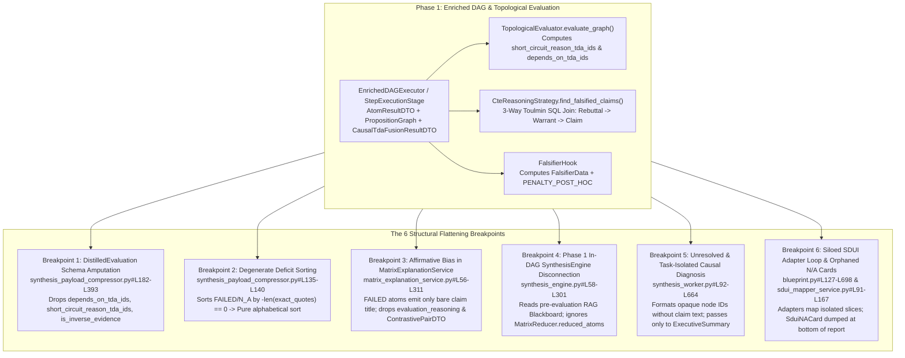

<required_context_rules>
  <rule>@[.agents/rules/00-antigravity-core.md]</rule>
  <rule>@[.agents/rules/01-python-backend.md]</rule>
  <rule>@[.agents/rules/02_flutter_desktop.md]</rule>
  <rule>@[.agents/rules/04_directory_reference.md]</rule>
  <rule>@[.agents/rules/05_llm_architecture.md]</rule>
  <knowledge_item>@[ki_god_code_prevention.md]</knowledge_item>
  <knowledge_item>@[ki_sdui_matrix_synthesis.md]</knowledge_item>
</required_context_rules>

# EPIC 161: Topological Intelligence Preservation Across Distillation, Synthesis & SDUI Reporting

> [!NOTE]
> **Scientific & Industrial Validation (2025-2026)**
> Modern 2025–2026 LLM evaluation research (*TRACE: Toulmin-based Reasoning Assessment through Constructive Elements*, *CausalGraph2LLM*, *CausalGraphBench*, and Concept-Level Counterfactual Graph Discovery) establishes that correlation-based scorecard aggregation suffers from severe affirmative bias and prompt encoding sensitivity when causal warrant chains, rebuttals, and counterfactual/contrastive failure boundaries are flattened prior to synthesis. Preserving explicit Toulmin warrant-rebuttal structures, topological short-circuit blast radii, and frontier-scoped contrastive anchors across distillation and synthesis produces mechanism-transparent, non-spurious analytical evaluations.

## 1. Goal Description & Background (Objective & Problem Statement)

Quorum's Phase 1 Enriched DAG and Topological Evaluation pipeline computes rich causal and epistemic structures—specifically and exhaustively: `AtomResultDTO` dependency edges (`depends_on_tda_ids`), topological circuit-breaker roots (`short_circuit_reason_tda_ids`), poison-pill inverse hits (`is_inverse_evidence`), `PropositionGraph` causal root-cause chains (`CausalTdaFusionResultDTO`), PostgreSQL 19 3-way Toulmin falsification joins (`CteReasoningStrategy.find_falsified_claims`), and `FalsifierHook` post-hoc rationalization penalties (`PENALTY_POST_HOC`).

However, ground-truth inspection of `@[backend_v2/services/orchestrator/]`, `@[backend_v2/workers/]`, and `@[backend_v2/services/sdui/]` proves that **six structural flattening breakpoints** amputate this topological intelligence before or during synthesis and SDUI rendering. As a result, final reports read as compartmentalized scorecard compilations rather than a unified causal and epistemic argument.

### 1.1 The Six Structural Flattening Breakpoints

1. **Breakpoint 1 — Schema Amputation & Micro-CoT Tail Guillotine in `DistilledEvaluation` (`@[backend_v2/models/domain/synthesis.py#L131-L155]`, `@[backend_v2/models/dtos/atom_evaluation.py#L21-L40]`, `@[backend_v2/settings.py]` & `@[backend_v2/services/orchestrator/synthesis_payload_compressor.py#L182-L393]`)**:
   - Upstream `@[backend_v2/models/dtos/atom_result.py#L82-L172]` (`AtomResultDTO`) and `@[backend_v2/services/orchestrator/topological_evaluator.py#L56-L175]` (lines `156–162`) preserve `depends_on_tda_ids: list[str]`, `short_circuit_reason_tda_ids: list[str]`, `is_inverse_evidence: bool`, and `contextual_override: bool`.
   - When `SynthesisPayloadCompressor._clean_and_distill_payload` (`@[backend_v2/services/orchestrator/synthesis_payload_compressor.py#L182-L393]`, specifically lines `239–352` and `298–333`) converts `EvaluatedAtomDTO` into `DistilledEvaluation`, it retains only five fields (`specifically and exhaustively: atom_id, status, exact_quotes, semantic_reasoning, extensions`). The causal dependency edges (`depends_on_tda_ids`), topological circuit-breaker origins (`short_circuit_reason_tda_ids`), and poison-pill inverse hits (`is_inverse_evidence`) are permanently erased.
   - Worse still, `ReasoningStepDTO` (`@[backend_v2/models/dtos/atom_evaluation.py#L21-L40]`) orders Micro-CoT reasoning sequentially as `step_1_identify_premise` $\rightarrow$ `step_2_scan_source` $\rightarrow$ `step_3_evaluate_anti_patterns` $\rightarrow$ `step_4_final_conclusion`. Because `@[backend_v2/services/orchestrator/synthesis_payload_compressor.py#L182-L393]` (lines `268–270` and `340–342`) slices `semantic_reasoning[: settings.max_synthesis_reasoning_length]` at `300` characters (`@[backend_v2/settings.py]`, line `296`), the first `300` characters capture only `step_1_identify_premise` and part of `step_2_scan_source` while guillotining off `step_3_evaluate_anti_patterns` (the anti-pattern violation) and `step_4_final_conclusion` (the rejection verdict) at the tail of the string. Additionally, lines `265–266` and `336–338` drop evaluations whenever `valid_quotes` is empty and `semantic_reasoning` is absent, affecting short-circuited `ExecutionStatus.N_A` atoms whose `evaluation_reasoning` is `None`.

2. **Breakpoint 2 — Mathematically Degenerate Deficit Stratification (`@[backend_v2/services/orchestrator/synthesis_payload_compressor.py#L135-L140]`)**:
   - In `_prune_and_stratify_evaluations` (`@[backend_v2/services/orchestrator/synthesis_payload_compressor.py#L105-L179]`), passing evaluations (`strengths`) and non-passing deficits (`deficits`, comprising `FAILED` and `N_A`) are sorted using `sort_key` (`@[backend_v2/services/orchestrator/synthesis_payload_compressor.py#L135-L140]`, `key=lambda e: (-len(e.exact_quotes), e.atom_id)`) to stay under the `300,000`-character (`~75,000` token) budget enforced in `@[backend_v2/services/orchestrator/synthesis_distiller.py#L43-L115]` (lines `46–49`).
   - However, `@[backend_v2/models/dtos/atom_result.py#L139-L172]` (`validate_cognitive_vs_system_state`, lines `151–160`) enforces a strict mathematical invariant: whenever `status == ExecutionStatus.FAILED` or `status == ExecutionStatus.N_A`, `source_quotes` is forced to `None` (`len(exact_quotes) == 0`).
   - Consequently, `-len(e.exact_quotes)` evaluates to `0` for **100% of failed and short-circuited atoms**. When `len(deficits)` exceeds `deficit_budget`, Quorum truncates deficits in **arbitrary alphabetical order of `atom_id`** rather than preserving `FAILED`/`N_A` deficits and prioritizing active inverse evidence (`is_inverse_evidence`) and topological out-degree (how many downstream claims a failed root atom short-circuited).

3. **Breakpoint 3 — Affirmative Bias, Unlinked `N_A` Short-Circuits & Contrastive Blindness in `MatrixExplanationService` (`@[backend_v2/services/orchestrator/matrix_explanation_service.py#L56-L311]`)**:
   - When `hit_status == ExecutionStatus.PASSED` (lines `216–242` of `@[backend_v2/services/orchestrator/matrix_explanation_service.py#L56-L311]`), `assemble_matrices_to_explain` extracts both the claim label and supporting lexical quotes.
   - When `hit_status == ExecutionStatus.FAILED` (lines `243–252` of `@[backend_v2/services/orchestrator/matrix_explanation_service.py#L56-L311]`), it appends **only** the bare localized claim title (`tda_to_claim[tda_id]`) into `UNMET CRITERIA / DEFICITS:`. It discards:
     - `atom_res.evaluation_reasoning` (the forensic reason why the evidence failed verification, including `step_3_evaluate_anti_patterns` and `step_4_final_conclusion`),
     - `tda.contrastive_example` (`ContrastivePairDTO(acceptable=..., rejected=...)` defined in `@[backend_v2/models/domain/matrix.py#L94-L129]`) and `tda.anti_patterns` (`@[backend_v2/models/domain/matrix.py#L66-L77]`),
     - `tda.inverse_evidence` (`is_inverse_evidence` poison hits where an active anti-pattern was detected),
     - `ExecutionStatus.N_A` short-circuited atoms (`short_circuit_reason_tda_ids`), which are completely ignored because the `if/elif` branch checks only `ExecutionStatus.PASSED` and `ExecutionStatus.FAILED`. Furthermore, because `TopologicalEvaluator.evaluate_graph` (`@[backend_v2/services/orchestrator/topological_evaluator.py#L56-L175]`, lines `156–162`) leaves `evaluation_reasoning = None` on `ExecutionStatus.N_A` atoms, explaining why a short-circuited claim was blocked requires **transitively resolving both the upstream parent blocker's claim label AND the upstream parent blocker's `evaluation_reasoning`** via `short_circuit_reason_tda_ids`.
   - Furthermore, `@[backend_v2/workers/synthesis_tasks.py#L336-L427]` (`create_row_explanations_task`, lines `406–413`) sends **only** `MATRICES TO EXPLAIN:\n{matrices_json}` to the LLM—without `distilled_inputs` or `causal_diagnosis`.

4. **Breakpoint 4 — Phase 1 In-DAG `SynthesisEngine` Disconnection (`@[backend_v2/services/orchestrator/engines/synthesis_engine.py#L58-L301]`)**:
   - `SynthesisEngine.execute()` (`@[backend_v2/services/orchestrator/engines/synthesis_engine.py#L58-L301]`, lines `78–215` and `101–188`) calls `MatrixReducer.reduce_matrix()` (`@[backend_v2/services/orchestrator/matrix_reducer.py#L121-L239]`), which produces `matrix_reducer_output.reduced_atoms` (containing all `FAILED` and `DLQ` atoms with their `evaluation_reasoning`) and `raw_extensions`.
   - Yet in lines `170–188` of `@[backend_v2/services/orchestrator/engines/synthesis_engine.py#L58-L301]`, `SynthesisEngine` **never serializes `matrix_reducer_output.reduced_atoms` into `user_message_parts`**. It injects only `raw_extensions` and `global_atom_blackboard.to_markdown_synthesis_injection()`.
   - Worse still, `global_atom_blackboard` (`@[backend_v2/models/domain/blackboard.py#L133-L184]`) is populated during Phase 1B RAG preflight (`@[backend_v2/services/orchestrator/rag_preflight_service.py#L134-L305]`, lines `276–305`) *before* matrix evaluation, topological short-circuiting, or Toulmin falsification occurs. And `ReducedAtomDTO` (`@[backend_v2/models/dtos/atom_evaluation.py#L43-L67]`) itself drops `depends_on_tda_ids`, `short_circuit_reason_tda_ids`, and `is_inverse_evidence`.

5. **Breakpoint 5 — Opaque Node IDs & Task Isolation in `synthesis_worker.py` (`@[backend_v2/workers/synthesis_worker.py#L92-L664]`)**:
   - In lines `394–433` of `@[backend_v2/workers/synthesis_worker.py#L92-L664]`, the worker builds `causal_diagnosis_text` from `CausalTdaFusionResultDTO` (`@[backend_v2/services/orchestrator/dag_executor/causal_tda_fusion.py#L392-L465]`), formatting raw node IDs (`- Root Parent {diag.root_cause_parent_id} -> Failing Node {diag.failing_node_id}: {diag.explanation}`) without resolving the human-readable `PropositionNode.claim` statements or `WarrantEdge.relation_type` (`warrants`, `rebuts`, `supports`) from `causal_payload.graph`.
   - Even this raw string is passed **exclusively** to `create_executive_summary_task` (line `436` of `@[backend_v2/workers/synthesis_worker.py#L92-L664]`). `create_matrix_sections_tasks`, `create_xai_highlights_task`, and `create_row_explanations_task` (lines `440–473`) receive zero causal diagnosis or Toulmin falsification context (`FalsifiedClaimMatch` from `@[backend_v2/database/postgres/graph_adapter.py#L347-L431]` and `@[backend_v2/models/domain/proposition_graph.py#L343-L391]`).

6. **Breakpoint 6 — Siloed SDUI Adapters & Disembodied `SduiNACard` Rendering (`@[backend_v2/services/blueprint.py#L127-L698]` & `@[backend_v2/services/sdui/sdui_mapper_service.py#L91-L167]`)**:
   - `BlueprintTransformer.build_report_dto` (`@[backend_v2/services/blueprint.py#L127-L698]`, lines `574–658` and `607–658`) iterates over `profile.target_block_order` and invokes each SDUI adapter (`@[backend_v2/services/sdui/adapters/]`) over its own isolated data slice.
   - `SduiMapperService.map_report_to_sdui` (`@[backend_v2/services/sdui/sdui_mapper_service.py#L91-L167]`, lines `110–165` and `146–160`) extracts `SduiNACard` entries via `_extract_na_cards` and appends them at the very bottom of `inner_sdui_blocks`, visually severed from the matrix row or causal graph node where the dependency chain broke.
   - Furthermore, lines `584–592` of `@[backend_v2/services/blueprint.py#L127-L698]` contain an inline `if type(content) is dict:` check scanning `execution.execution_trace` for `causal_result`, bypassing typed envelope extraction.

### 1.2 The 5-Pillar Asymmetric Epistemic Distillation & Token Budget Mathematical Proof

To achieve maximum analytical accuracy and preserve full DAG tension (`FAILED` and `N_A` causal chains, Micro-CoT conclusions, and contrastive rubric boundaries) **without** breaching the `300,000`-character (`~75,000` token) ceiling enforced in `@[backend_v2/services/orchestrator/synthesis_distiller.py#L43-L115]` (lines `46–49`), this Epic enforces the **5-Pillar Asymmetric Epistemic Distillation Architecture**:

1. **Pillar 1 — Asymmetric Compression (`PASSED` Compactness vs. `FAILED`/`N_A` Zero-Loss Retention)**:
   - Retain mechanical noise stripping (`_HEAVY_KEYS_TO_EXCLUDE`: `shuffled_atoms`, `hydrated_references`, `_step_metadata`, and duplicate quote arrays) in `@[backend_v2/services/orchestrator/synthesis_payload_compressor.py#L182-L393]`.
   - Keep `ExecutionStatus.PASSED` evaluations compact (claim + curated `exact_quotes` capped at `max_synthesis_quote_length = 300`).
   - Enforce **zero-loss retention** for `ExecutionStatus.FAILED`, `ExecutionStatus.N_A`, and `is_inverse_evidence == True` evaluations: bypass the empty-quote dropout gates at lines `265–266` and `336–338` of `@[backend_v2/services/orchestrator/synthesis_payload_compressor.py#L182-L393]` whenever `status in (ExecutionStatus.FAILED, ExecutionStatus.N_A)` or `is_inverse_evidence` is `True`.
2. **Pillar 2 — Micro-CoT Tail (`step_3` & `step_4`) Preservation**:
   - Raise `max_synthesis_reasoning_length` in `@[backend_v2/settings.py]` (line `296`) from `300` to `1500` characters so that `step_3_evaluate_anti_patterns` and `step_4_final_conclusion` from `ReasoningStepDTO` (`@[backend_v2/models/dtos/atom_evaluation.py#L21-L40]`) are never guillotined off during `_clean_and_distill_payload` (`@[backend_v2/services/orchestrator/synthesis_payload_compressor.py#L182-L393]`, lines `268–270` and `340–342`).
3. **Pillar 3 — Transitive Parent-to-Child `N_A` Short-Circuit Hydration**:
   - Because `TopologicalEvaluator.evaluate_graph` (`@[backend_v2/services/orchestrator/topological_evaluator.py#L56-L175]`, lines `156–162`) leaves `evaluation_reasoning = None` on `ExecutionStatus.N_A` atoms, `@[backend_v2/services/orchestrator/matrix_explanation_service.py#L56-L311]` and `@[backend_v2/models/dtos/lightweight_matrix.py#L125-L177]` must transitively bind each `N_A` atom via `short_circuit_reason_tda_ids` to its upstream failed parent's localized claim label **and** the upstream parent's `evaluation_reasoning` (`[Blocked Claim] <-- SHORT-CIRCUITED BY PREREQUISITE FAILURE: [Parent Claim: <parent evaluation_reasoning>]`).
4. **Pillar 4 — Boundary-Scoped Developmental Frontier ($S + 1$) Contrastive & Anti-Pattern Injection**:
   - A BARS matrix row has scales `computed_min..computed_max`. If a row achieves score $S$, the user does **not** require contrastive pairs for scales $1 \dots S$ (already passed) or scales $S+2 \dots \text{max}$ (distant ceiling).
   - Contrastive gap analysis is injected **exclusively at the immediate developmental frontier ($S + 1$)**:
     - **Frontier Deficit ($S + 1$)**: Inject full `evaluation_reasoning` + `tda.anti_patterns` (`@[backend_v2/models/domain/matrix.py#L66-L77]`) + `ContrastivePairDTO(rejected, acceptable)` (`@[backend_v2/models/domain/matrix.py#L94-L129]`) for failed atoms in scale $S+1$ (capped at `MAX_CONTRASTIVE_DEFICITS_PER_ROW = 3` frontier atoms per row).
     - **Poison / Inverse Evidence Hits (`is_inverse_evidence == True`)**: Always retained regardless of scale level.
     - **Topological Root-Cause Blockers (`short_circuit_reason_tda_ids`)**: Retained with their transitive upstream parent claim label and parent failure reasoning.
5. **Pillar 5 — Cross-Task Unified `CausalSynthesisBriefDTO` & 3-Way Toulmin Rebuttal Fan-Out**:
   - Inject `CausalSynthesisBriefDTO` (combining human-readable `PropositionNode.claim` fault chains from `@[backend_v2/services/orchestrator/dag_executor/causal_tda_fusion.py#L392-L465]` and PostgreSQL 19 3-way Toulmin `FalsifiedClaimMatch` rebuttals from `@[backend_v2/database/postgres/graph_adapter.py#L347-L431]`) into **all four parallel synthesis tasks** in `@[backend_v2/workers/synthesis_worker.py#L92-L664]` (`create_executive_summary_task`, `create_matrix_sections_tasks`, `create_xai_highlights_task`, `create_row_explanations_task`) as well as Phase 1 in-DAG `SynthesisEngine` (`@[backend_v2/services/orchestrator/engines/synthesis_engine.py#L58-L301]`).
6. **Token Footprint Calculation**:
   - Per matrix row: at most `3` frontier failed atoms $\times$ (`600` chars average full 4-step Micro-CoT `evaluation_reasoning` + `260` chars `contrastive_example` and `anti_patterns` + `140` chars transitive dependency lineage) $\approx 3,000$ chars ($\approx 750$ tokens) per row.
   - Across `20` matrix rows: $20 \times 3,000 = 60,000$ chars ($\approx 15,000$ tokens), representing `20.0%` of the `300,000`-character budget while preserving 100% of the epistemic failure signal.

### 1.3 Quantitative Scope Summary Table

| Metric / Dimension | Count / Bound | Target Subsystems |
| :--- | :--- | :--- |
| **Structural Flattening Breakpoints Eradicated** | `6` | Distillation, Matrix Explanation, Causal Fusion, Phase 1 `SynthesisEngine`, Phase 2 `SynthesisWorker`, SDUI Projection |
| **Epistemic Accuracy Pillars Enforced** | `5` | Asymmetric Compression, Micro-CoT Tail Preservation (`1500` chars), Transitive `N_A` Parent Hydration, Frontier $S+1$ Contrastive Anchoring, 4-Task Causal/Toulmin Fan-Out |
| **Execution Phases** | `4` | Phase 1 (Tech Debt & Topological Envelope), Phase 2 (Contrastive & Synthesis Convergence), Phase 3 (SDUI & Flutter Parity), Phase 4 (Verification & E2E Gate) |
| **Frontier Contrastive Ceiling (`MAX_CONTRASTIVE_DEFICITS_PER_ROW`)** | `3` atoms / row at scale $S+1$ | `@[backend_v2/services/orchestrator/matrix_explanation_service.py#L56-L311]` |
| **Micro-CoT Reasoning Ceiling (`max_synthesis_reasoning_length`)** | `1500` chars (raised from `300`) | `@[backend_v2/settings.py]` & `@[backend_v2/services/orchestrator/synthesis_payload_compressor.py#L182-L393]` |
| **Worst-Case Token Footprint Delta (20 Matrices)** | `<= 60,000` chars (`~15,000` tokens, `20.0%` of budget) | `@[backend_v2/services/orchestrator/synthesis_distiller.py#L43-L115]` |

---

## 2. Architectural Impact & Compliance Matrix

### Deprecations & Sunset List (`What We Will REMOVE`)

| Symbol / File / Field | Current Location | Target Destination / Disposition |
| :--- | :--- | :--- |
| `if type(content) is dict:` trace inspection loop | `@[backend_v2/services/blueprint.py#L127-L698]` (lines `584–592`) | **INTENTIONALLY DROPPED** — Replaced by strict `TypeAdapter` / `StepOutputDTO` envelope projection without raw dictionary type checks. |
| `300`-character Micro-CoT tail guillotine (`max_synthesis_reasoning_length = 300`) & empty-quote dropout on `FAILED`/`N_A` | `@[backend_v2/settings.py]` (line `296`) & `@[backend_v2/services/orchestrator/synthesis_payload_compressor.py#L182-L393]` (lines `265–270`, `336–342`) | **INTENTIONALLY DROPPED** — Raised `max_synthesis_reasoning_length` to `1500` chars to preserve `ReasoningStepDTO` (`@[backend_v2/models/dtos/atom_evaluation.py#L21-L40]`) `step_3_evaluate_anti_patterns` and `step_4_final_conclusion`, and bypassed empty-quote dropout for `FAILED`, `N_A`, and `is_inverse_evidence` evaluations. |
| Degenerate quote-length sort key `(-quotes_count, atom_id)` on `deficits` | `@[backend_v2/services/orchestrator/synthesis_payload_compressor.py#L135-L140]` | **INTENTIONALLY DROPPED** — Replaced for `deficits` by topological priority sort key `(-int(item.is_inverse_evidence), -item.topological_out_degree, len(item.short_circuit_reason_tda_ids), atom_id)`. |
| Bare claim-title-only `FAILED` branch & ignored `N_A` branch in `assemble_matrices_to_explain` | `@[backend_v2/services/orchestrator/matrix_explanation_service.py#L56-L311]` (lines `243–252`) | **INTENTIONALLY DROPPED** — Replaced by structured [NEW] `MatrixFailureDeficitDTO` collection defined in `@[backend_v2/models/dtos/synthesis.py]` carrying full `evaluation_reasoning`, `is_inverse_evidence`, transitive `short_circuited_by_claims` (parent claim + parent `evaluation_reasoning`), `anti_patterns`, and frontier $S+1$ `ContrastivePairDTO` anchors. |
| Task-isolated opaque node ID string formatting for `causal_diagnosis_text` | `@[backend_v2/workers/synthesis_worker.py#L92-L664]` (lines `394–433`) | **INTENTIONALLY DROPPED** — Replaced by deterministic [NEW] `CausalSynthesisBriefDTO` defined in `@[backend_v2/models/dtos/synthesis.py]` resolved with human-readable claim texts and `FalsifiedClaimMatch` Toulmin rebuttals, injected across all four synthesis tasks. |

### Retained SSOT Invariants (`What We Will RETAIN`)

- **5-Tier Regression Defense Architecture**:
  1. **DTO & Interface Isolation**: Lock all Pydantic V2 (`ConfigDict(strict=True, extra="forbid", frozen=True)`) and Flutter Freezed boundary schemas before mutating service or worker implementations.
  2. **Two-Stage Testing Pipeline**: Run localized unit tests during iterative steps, followed by the global completion gates (`backend_audit_loop.py` and `flutter_audit_loop.py`).
  3. **Circuit Breaker & Dirty Rollback**: Execute `git restore . ; git clean -fd` immediately upon 3 consecutive test or quality gate failures.
  4. **Phased Execution Order**: Isolate pre-existing technical debt cleanups and foundational DTO enrichment in Phase 1 before introducing synthesis and SDUI feature logic in Phases 2–3.
  5. **Atomic Checkpoint Commits**: Commit each verified logical step individually with explicit workspace-relative file paths in English.
- **Tripartite Rendering Boundary (`tripartite_rendering_boundary`)**: SDUI adapters (`@[backend_v2/services/sdui/adapters/]`) remain 100% pure synchronous/deterministic data mappers with zero LLM calls.
- **Alias Engine Isolation (`alias_engine_llm_isolation_mandate`)**: All raw Opaque Stripe IDs (`tda_...`, `blk_...`, `stp_...`) are translated into deterministic short aliases via `@[backend_v2/utils/alias_engine.py]` or resolved to localized claim labels before prompt compilation.
- **Four-Layer Clean Stack Hierarchy (`four_layer_clean_stack_hierarchy`)**: Static XML synthesis rules reside strictly in `@[backend_v2/models/prompts/synthesis/synthesis_directives.py]` (Layer 1), while dynamic `CausalSynthesisBriefDTO` and `MatrixFailureDeficitDTO` payloads are injected exclusively at the tail `user` message (Layer 4).

### 5-Column Architectural Directive Table

| 1. Target Scope & Boundaries | 2. Eradicated Duct-Tape (Under-Engineering Ban) | 3. Approved Best Practice (Target Invariant) | 4. Pruned Over-Engineering (Complexity Slayer) | 5. Verification & Fail-Fast (Proof Anchor) |
| :--- | :--- | :--- | :--- | :--- |
| **`@[backend_v2/models/domain/synthesis.py#L131-L155]`** **`@[backend_v2/models/dtos/atom_evaluation.py#L21-L40]`** **`@[backend_v2/settings.py]`** **`@[backend_v2/services/orchestrator/synthesis_payload_compressor.py#L105-L179]`** **`@[backend_v2/services/orchestrator/synthesis_payload_compressor.py#L135-L140]`** **`@[backend_v2/services/orchestrator/synthesis_payload_compressor.py#L182-L393]`** | Eradicate dropping `depends_on_tda_ids`, `short_circuit_reason_tda_ids`, and `is_inverse_evidence` during `_clean_and_distill_payload` (lines `239–352` and `298–333`). Eradicate slicing `semantic_reasoning` at `300` chars (lines `268–270`, `340–342`), which cuts off `step_3_evaluate_anti_patterns` and `step_4_final_conclusion` from `ReasoningStepDTO`, and eradicate dropping quote-less `FAILED`/`N_A` atoms (lines `265–266`, `336–338`). Eradicate sorting deficits by `-len(e.exact_quotes)` (always `0` for `FAILED`/`N_A` per `@[backend_v2/models/dtos/atom_result.py#L139-L172]`). | Raise `max_synthesis_reasoning_length` to `1500` in `@[backend_v2/settings.py]` (line `296`). Enrich `DistilledEvaluation` (`ConfigDict(extra="forbid", strict=True, frozen=True)`) with `depends_on_tda_ids: list[str]`, `short_circuit_reason_tda_ids: list[str]`, `is_inverse_evidence: bool`, and `topological_out_degree: int`. Retain all `FAILED`/`N_A`/`is_inverse_evidence` evaluations in `_clean_and_distill_payload` and sort `deficits` by `(-int(e.is_inverse_evidence), -e.topological_out_degree, len(e.short_circuit_reason_tda_ids), atom_id)`. | Do NOT create a separate compressor service or secondary distillation pass. Mutate `DistilledEvaluation`, `settings.py`, and `_prune_and_stratify_evaluations` in-place within the single compressor pipeline. | `uv run python scripts/backend_audit_loop.py backend_v2/services/orchestrator/synthesis_payload_compressor.py --test --ast-strict` + BVA unit test proving 4-step Micro-CoT `step_3`/`step_4` tails and root-cause `FAILED`/`N_A` atoms with `topological_out_degree > 0` survive compression intact. |
| **`@[backend_v2/models/dtos/lightweight_matrix.py#L27-L42]`** **`@[backend_v2/models/dtos/lightweight_matrix.py#L125-L177]`** **`@[backend_v2/models/dtos/synthesis.py]`** **`@[backend_v2/services/orchestrator/matrix_explanation_service.py#L56-L311]`** | Eradicate compressing `ExecutionStatus.FAILED` atoms into bare localized claim titles (lines `198–296` and `243–252`) while discarding `evaluation_reasoning`, `ContrastivePairDTO` (`@[backend_v2/models/domain/matrix.py#L94-L129]`), `anti_patterns` (`@[backend_v2/models/domain/matrix.py#L66-L77]`), `is_inverse_evidence`, and `ExecutionStatus.N_A` (`short_circuit_reason_tda_ids` from `@[backend_v2/services/orchestrator/topological_evaluator.py#L56-L175]`, lines `156–162`). | Create [NEW] `MatrixFailureDeficitDTO` (`ConfigDict(extra="forbid", strict=True, frozen=True)`) defined in `@[backend_v2/models/dtos/synthesis.py]` containing `claim: str`, `status: Literal["FAILED", "N_A"]`, `scale_score: int`, `evaluation_reasoning: str \| None`, `is_inverse_evidence: bool`, `short_circuited_by_claims: list[str]` (transitively formatted with upstream blocker parent claim + parent `evaluation_reasoning`), `anti_patterns: list[str]`, and frontier-scoped `contrastive_rejected: str \| None` / `contrastive_acceptable: str \| None` (populated for `scale_score == achieved_score + 1`, capped at `3` per row) on `MatrixExplanationContextDTO`. | Do NOT inject `ContrastivePairDTO` for already-passed scales ($\le S$) or distant ceiling scales ($\ge S+2$). Restrict contrastive pairs strictly to the immediate developmental frontier ($S+1$) to cap token growth under `<= 20%` of budget. | `uv run python scripts/backend_audit_loop.py backend_v2/services/orchestrator/matrix_explanation_service.py --test --ast-strict` + unit tests verifying frontier contrastive injection at $S+1$ and transitive parent-to-child `N_A` blocker reasoning hydration. |
| **`@[backend_v2/services/orchestrator/dag_executor/causal_tda_fusion.py#L38-L87]`** **`@[backend_v2/services/orchestrator/dag_executor/causal_tda_fusion.py#L392-L465]`** **`@[backend_v2/database/postgres/graph_adapter.py#L347-L431]`** **`@[backend_v2/models/domain/proposition_graph.py#L343-L391]`** **`@[backend_v2/models/dtos/causal_discovery.py]`** **`@[backend_v2/services/orchestrator/dag_executor/step_execution_stage.py#L211-L363]`** | Eradicate emitting unresolved node IDs (`root_cause_parent_id`, `failing_node_id`) without human-readable claim text, and eradicate leaving `CteReasoningStrategy.find_falsified_claims()` (`FalsifiedClaimMatch`) uncalled in dead-code isolation. | Enrich `CausalRootCauseDiagnosisDTO` with resolved `root_cause_claim: str`, `failing_node_claim: str`, and `warrant_relation: Literal["supports", "rebuts", "warrants"]`. Wire `find_falsified_claims()` into the causal fusion stage so `CausalTdaFusionResultDTO` carries `falsified_claims: list[FalsifiedClaimMatch]`. | Do NOT build a new graph database engine or recursive Python graph walker; leverage the existing PostgreSQL 19 3-way SQL join (`find_falsified_claims`) and existing `compute_causal_tda_fusion_result` node index. | `uv run python scripts/backend_audit_loop.py backend_v2/services/orchestrator/dag_executor/causal_tda_fusion.py --test --ast-strict` + integration test asserting `FalsifiedClaimMatch` hydration and non-empty `root_cause_claim` resolution. |
| **`@[backend_v2/services/orchestrator/engines/synthesis_engine.py#L58-L301]`** **`@[backend_v2/services/orchestrator/matrix_reducer.py#L121-L239]`** **`@[backend_v2/models/dtos/atom_evaluation.py#L43-L67]`** | Eradicate the Phase 1 `SynthesisEngine` bug where `matrix_reducer_output.reduced_atoms` is computed (lines `101–188`) but never injected into `user_message_parts` (lines `170–188` of `@[backend_v2/services/orchestrator/engines/synthesis_engine.py#L58-L301]`), and eradicate stripping `depends_on_tda_ids`, `short_circuit_reason_tda_ids`, and `is_inverse_evidence` from `ReducedAtomDTO`. | Enrich `ReducedAtomDTO` with `depends_on_tda_ids: list[str]`, `short_circuit_reason_tda_ids: list[str]`, and `is_inverse_evidence: bool`. Inject `matrix_reducer_output.reduced_atoms` (aliased via `AliasEngine`) into `SynthesisEngine.execute()` alongside `raw_extensions` and `global_atom_blackboard`. | Do NOT maintain divergent epistemic contracts between Phase 1 in-DAG `SynthesisEngine` and Phase 2 `SynthesisWorker`. Both must consume reduced failure deficits and short-circuit lineage. | `uv run python scripts/backend_audit_loop.py backend_v2/services/orchestrator/engines/synthesis_engine.py --test --ast-strict` + unit test asserting `reduced_atoms` failure reasoning and short-circuit lineage appear in the compiled prompt payload. |
| **`@[backend_v2/workers/synthesis_worker.py#L92-L664]`** **`@[backend_v2/workers/synthesis_tasks.py#L61-L137]`** **`@[backend_v2/workers/synthesis_tasks.py#L140-L241]`** **`@[backend_v2/workers/synthesis_tasks.py#L244-L333]`** **`@[backend_v2/workers/synthesis_tasks.py#L336-L427]`** **`@[backend_v2/models/prompts/synthesis/synthesis_directives.py]`** | Eradicate passing `causal_diagnosis_text` only to `create_executive_summary_task` (lines `394–468` and `436` of `@[backend_v2/workers/synthesis_worker.py#L92-L664]`) while starving `create_matrix_sections_tasks`, `create_xai_highlights_task`, and `create_row_explanations_task` (lines `406–413` of `synthesis_tasks.py`) of causal and Toulmin falsification context. | Create [NEW] `CausalSynthesisBriefDTO` defined in `@[backend_v2/models/dtos/synthesis.py]` (combining resolved `CausalRootCauseDiagnosisDTO` chains, `FalsifiedClaimMatch` Toulmin rebuttals, and post-hoc fidelity penalties) and inject it in `synthesis_worker.py` into all four synthesis task constructors (`create_executive_summary_task`, `create_matrix_sections_tasks`, `create_xai_highlights_task`, `create_row_explanations_task`) governed by static XML mandates in `synthesis_directives.py`. | Do NOT add extra sequential LLM calls or post-processing LLM rewrite passes in `synthesis_worker.py`; preserve the single-wave `asyncio.TaskGroup` fan-out architecture. | `uv run python scripts/backend_audit_loop.py backend_v2/workers/ --test --ast-strict` + unit tests verifying all 4 synthesis tasks receive the resolved `CausalSynthesisBriefDTO` in their tail user payload. |
| **`@[backend_v2/services/blueprint.py#L127-L698]`** **`@[backend_v2/services/sdui/sdui_mapper_service.py#L91-L167]`** **`@[backend_v2/services/sdui/adapters/causal_graph_adapter.py#L32-L185]`** **`@[backend_v2/models/dtos/report_data.py]`** **`@[backend_v2/models/view/sdui.py]`** | Eradicate `if type(content) is dict:` in lines `584–592` of `@[backend_v2/services/blueprint.py#L127-L698]` and eradicate dumping disconnected `SduiNACard` blocks at the bottom of the report (lines `146–160` of `@[backend_v2/services/sdui/sdui_mapper_service.py#L91-L167]`) severed from the matrix and causal graph. | Extract `CausalTdaFusionResultDTO` via typed `StepOutputDTO` / `TypeAdapter` validation in `blueprint.py`. Bind topological short-circuit lineage (`short_circuited_by_claims`) directly into matrix row explanations and `CausalGraphAdapter` node metadata, and verify 1:1 Backend-Jinja-Flutter SDUI parity. | Do NOT invent new bespoke SDUI widget primitives; enrich existing `SduiMatrixSummaryTableBlock`, `SduiCausalGraphBlock`, and `SduiXaiHighlightsBlock` schemas to display the linked causal argument cleanly. | `uv run pytest backend_v2/tests/integration/test_sdui_semantic_parity.py` + `uv run python scripts/backend_audit_loop.py backend_v2/services/sdui/ --test --ast-strict`. |

### Producer-Consumer Integration Check

- **Producer:**
  1. Phase 1 DAG Orchestration (`@[backend_v2/services/orchestrator/topological_evaluator.py#L56-L175]`, `@[backend_v2/services/orchestrator/dag_executor/causal_tda_fusion.py#L392-L465]`, `@[backend_v2/database/postgres/graph_adapter.py#L347-L431]`, `@[backend_v2/services/orchestrator/dag_executor/step_execution_stage.py#L211-L363]`) produces `AtomResultDTO` (with 4-step `ReasoningStepDTO` from `@[backend_v2/models/dtos/atom_evaluation.py#L21-L40]`, `depends_on_tda_ids`, `short_circuit_reason_tda_ids`, `is_inverse_evidence`) and `CausalTdaFusionResultDTO` (with resolved `root_cause_claim`, `failing_node_claim`, and `falsified_claims: list[FalsifiedClaimMatch]`).
  2. Asymmetric Distillation & Matrix Reduction (`@[backend_v2/settings.py]`, `@[backend_v2/services/orchestrator/synthesis_payload_compressor.py#L105-L179]`, `@[backend_v2/services/orchestrator/synthesis_payload_compressor.py#L182-L393]`, `@[backend_v2/services/orchestrator/matrix_reducer.py#L121-L239]`, `@[backend_v2/services/orchestrator/matrix_explanation_service.py#L56-L311]`) produces `DistilledEvaluation` (with `1500`-char Micro-CoT reasoning ceiling preserving `step_3` and `step_4`), `ReducedAtomDTO`, and `MatrixExplanationContextDTO` (containing `unmet_deficits: list[MatrixFailureDeficitDTO]`).
- **Consumer:**
  1. Phase 1 In-DAG `SynthesisEngine` (`@[backend_v2/services/orchestrator/engines/synthesis_engine.py#L58-L301]`) consumes `matrix_reducer_output.reduced_atoms`.
  2. Phase 2 `SynthesisWorker` & `synthesis_tasks.py` (`@[backend_v2/workers/synthesis_worker.py#L92-L664]`, `@[backend_v2/workers/synthesis_tasks.py#L61-L137]`, `@[backend_v2/workers/synthesis_tasks.py#L140-L241]`, `@[backend_v2/workers/synthesis_tasks.py#L244-L333]`, `@[backend_v2/workers/synthesis_tasks.py#L336-L427]`) consume `CausalSynthesisBriefDTO`, `DistilledEvaluation`, and `MatrixExplanationContextDTO` across all four parallel synthesis tasks (`create_executive_summary_task`, `create_matrix_sections_tasks`, `create_xai_highlights_task`, `create_row_explanations_task`).
  3. Phase 3 SDUI & Presentation Layer (`@[backend_v2/services/blueprint.py#L127-L698]`, `@[backend_v2/services/sdui/sdui_mapper_service.py#L91-L167]`, `@[backend_v2/services/sdui/adapters/causal_graph_adapter.py#L32-L185]`, `@[backend_v2/services/sdui/adapters/matrix_summary_table_adapter.py]`, `@[backend_v2/services/pdf_generator.py]`, and `@[client_app_v2/lib/shared/models/sdui_block_dto.dart]`) consumes the synthesized report and renders inline topological lineage across Flutter Desktop and Jinja2 PDF outputs.

---

## 3. Phased Execution Plan (Implementation Strategy)

### Phase 1: Pre-Implementation Technical Debt Cleanups & Typed Topological Envelope Foundation
- **Scoped Boy Scout Technical Debt Cleanups**:
  1. Remove the raw `if type(content) is dict:` inspection loop in lines `584–592` of `@[backend_v2/services/blueprint.py#L127-L698]` and replace it with strict `StepOutputDTO` and `TypeAdapter(CausalTdaFusionResultDTO | CausalGraphPayloadDTO)` projection.
  2. Wire the dead-code PostgreSQL 19 3-way Toulmin SQL join `@[backend_v2/database/postgres/graph_adapter.py#L347-L431]` (`CteReasoningStrategy.find_falsified_claims`) returning `list[FalsifiedClaimMatch]` (`@[backend_v2/models/domain/proposition_graph.py#L343-L391]`) into `@[backend_v2/services/orchestrator/dag_executor/causal_tda_fusion.py#L392-L465]` and `@[backend_v2/services/orchestrator/dag_executor/step_execution_stage.py#L211-L363]`.
- **DTO & Schema Enrichment (Full-Duplex Serialization Parity)**:
  1. Enrich `DistilledEvaluation` in `@[backend_v2/models/domain/synthesis.py#L131-L155]` (`ConfigDict(strict=True, extra="forbid", frozen=True)`) with `depends_on_tda_ids: list[str]`, `short_circuit_reason_tda_ids: list[str]`, `is_inverse_evidence: bool`, and `topological_out_degree: int`.
  2. Enrich `ReducedAtomDTO` in `@[backend_v2/models/dtos/atom_evaluation.py#L43-L67]` (`ConfigDict(strict=True, extra="forbid", frozen=True)`) with `depends_on_tda_ids: list[str]`, `short_circuit_reason_tda_ids: list[str]`, and `is_inverse_evidence: bool`, and populate them in `@[backend_v2/services/orchestrator/matrix_reducer.py#L121-L239]`.
  3. Enrich `CausalRootCauseDiagnosisDTO` and `CausalTdaFusionResultDTO` in `@[backend_v2/models/dtos/causal_discovery.py]` and `@[backend_v2/services/orchestrator/dag_executor/causal_tda_fusion.py#L392-L465]` with resolved `root_cause_claim: str`, `failing_node_claim: str`, `warrant_relation: Literal["supports", "rebuts", "warrants"]`, and `falsified_claims: list[FalsifiedClaimMatch]`.
- **Asymmetric Epistemic Distillation, Micro-CoT Tail Preservation & Topological Deficit Stratification Fix**:
  1. Raise `max_synthesis_reasoning_length` from `300` to `1500` characters in `@[backend_v2/settings.py]` (line `296`) so `step_3_evaluate_anti_patterns` and `step_4_final_conclusion` from `ReasoningStepDTO` (`@[backend_v2/models/dtos/atom_evaluation.py#L21-L40]`) survive intact.
  2. Update `_clean_and_distill_payload` (`@[backend_v2/services/orchestrator/synthesis_payload_compressor.py#L182-L393]`, lines `239–352`, `265–270`, `298–333`, and `336–342`) to bypass the empty-quote dropout check when `status in (ExecutionStatus.FAILED, ExecutionStatus.N_A)` or `is_inverse_evidence` is `True`, compute `topological_out_degree` (count of downstream atoms listing `atom_id` in `depends_on_tda_ids` or `short_circuit_reason_tda_ids`), and preserve `depends_on_tda_ids`, `short_circuit_reason_tda_ids`, and `is_inverse_evidence`.
  3. Replace the degenerate deficit sort key in `_prune_and_stratify_evaluations` (`@[backend_v2/services/orchestrator/synthesis_payload_compressor.py#L105-L179]`, specifically `sort_key` at `@[backend_v2/services/orchestrator/synthesis_payload_compressor.py#L135-L140]`) so `deficits` sort by `(-int(item.is_inverse_evidence), -item.topological_out_degree, len(item.short_circuit_reason_tda_ids), atom_id)`.

### Phase 2: Orchestration, Frontier Contrastive Deficit Injection & Synthesis Convergence
- **Frontier Contrastive Deficit Injection & Transitive `N_A` Parent Hydration (`MatrixExplanationService`)**:
  1. Create [NEW] `MatrixFailureDeficitDTO` (`ConfigDict(strict=True, extra="forbid", frozen=True)`) defined in `@[backend_v2/models/dtos/synthesis.py]` and referenced alongside `@[backend_v2/models/dtos/lightweight_matrix.py#L27-L42]` and `@[backend_v2/models/dtos/lightweight_matrix.py#L125-L177]` with fields `claim: str`, `status: Literal["FAILED", "N_A"]`, `scale_score: int`, `evaluation_reasoning: str | None`, `is_inverse_evidence: bool`, `short_circuited_by_claims: list[str]`, `anti_patterns: list[str]`, `contrastive_rejected: str | None`, and `contrastive_acceptable: str | None`.
  2. Upgrade `MatrixExplanationService.assemble_matrices_to_explain` (`@[backend_v2/services/orchestrator/matrix_explanation_service.py#L56-L311]`, lines `198–296`, `216–242`, and `243–252`) to capture full `evaluation_reasoning` and `is_inverse_evidence` from `AtomResultDTO` / `ReducedAtomDTO`, transitively resolve `ExecutionStatus.N_A` (`short_circuit_reason_tda_ids` from `@[backend_v2/services/orchestrator/topological_evaluator.py#L56-L175]`, lines `156–162`) into localized upstream blocker claim names **paired with the upstream blocker parent's `evaluation_reasoning`** (`short_circuited_by_claims`), and attach `tda.contrastive_example` (`ContrastivePairDTO` from `@[backend_v2/models/domain/matrix.py#L94-L129]`) and `tda.anti_patterns` (`@[backend_v2/models/domain/matrix.py#L66-L77]`) **strictly at the developmental frontier** (`scale_score == achieved_score + 1`, capped at `MAX_CONTRASTIVE_DEFICITS_PER_ROW = 3`).
- **Phase 1 In-DAG `SynthesisEngine` Convergence**:
  1. Fix `@[backend_v2/services/orchestrator/engines/synthesis_engine.py#L58-L301]` (lines `78–215`, `101–188`, and `170–188`) so `matrix_reducer_output.reduced_atoms` is serialized with `AliasEngine` aliases into `user_message_parts` alongside `raw_extensions` and `global_atom_blackboard` (`@[backend_v2/models/domain/blackboard.py#L133-L184]` populated in `@[backend_v2/services/orchestrator/rag_preflight_service.py#L134-L305]`, lines `276–305`).
- **Phase 2 Unified `CausalSynthesisBriefDTO` Fan-Out**:
  1. Create [NEW] `CausalSynthesisBriefDTO` defined in `@[backend_v2/models/dtos/synthesis.py]` encapsulating resolved root-cause fault chains (`root_cause_claim -> failing_node_claim`), `FalsifiedClaimMatch` Toulmin rebuttals (`rebuttal_claim -> invalidated_warrant -> falsified_claim`), and post-hoc fidelity penalties.
  2. Refactor `@[backend_v2/workers/synthesis_worker.py#L92-L664]` (lines `394–468`, `394–433`, and `436`) and `@[backend_v2/workers/synthesis_tasks.py#L61-L137]`, `@[backend_v2/workers/synthesis_tasks.py#L140-L241]`, `@[backend_v2/workers/synthesis_tasks.py#L244-L333]`, and `@[backend_v2/workers/synthesis_tasks.py#L336-L427]` (lines `406–413`) to pass the formatted `CausalSynthesisBriefDTO` into all four tasks (`create_executive_summary_task`, `create_matrix_sections_tasks`, `create_xai_highlights_task`, and `create_row_explanations_task`).
  3. Add static XML reasoning mandates (`<causal_tda_diagnosis_mandate>`, `<contrastive_frontier_mandate>`) in `@[backend_v2/models/prompts/synthesis/synthesis_directives.py]`.

### Phase 3: Frontend Flutter UI, Jinja PDF & Freezed SDUI DTO Synchronization
- **Inline Topological & Short-Circuit Lineage in SDUI Blocks**:
  1. Update `@[backend_v2/models/dtos/report_data.py]`, `@[backend_v2/models/view/sdui.py]`, `@[backend_v2/services/sdui/adapters/matrix_summary_table_adapter.py]`, and `@[backend_v2/services/sdui/adapters/causal_graph_adapter.py#L32-L185]` to bind `short_circuited_by_claims` and `falsified_warrant_claims` directly onto matrix row items and causal graph nodes.
  2. Refactor `@[backend_v2/services/sdui/sdui_mapper_service.py#L91-L167]` (lines `110–165` and `146–160`) so short-circuit (`N_A`) lineage is anchored contextually within its parent matrix summary table and causal graph block rather than orphaned at the bottom of the report.
- **Tripartite Cross-Domain Parity (Backend Python, Jinja2 PDF, Flutter Freezed)**:
  1. Update Jinja2 PDF templates (`@[backend_v2/templates/]`) and `@[backend_v2/services/pdf_generator.py]` to render inline short-circuit blocker badges and Toulmin rebuttal links.
  2. Synchronize Flutter Freezed models (`@[client_app_v2/lib/shared/models/sdui_block_dto.dart]`, `@[client_app_v2/lib/features/execution/models/causal_discovery_dto.dart]`) and SDUI widgets (`@[client_app_v2/lib/features/execution/views/widgets/sdui_matrix_table_widget.dart]`, `@[client_app_v2/lib/features/execution/views/widgets/sdui_causal_graph_widget.dart]`) and run Freezed code generation.

### Phase 4: Verification & E2E Integration Gate
- Execute comprehensive unit, ISTQB Boundary Value Analysis (BVA), Equivalence Partitioning (`heterogeneous_payload_testing_mandate`), AST guardrail verification, Cross-Domain SDUI Semantic Parity (`@[backend_v2/tests/integration/test_sdui_semantic_parity.py]`), and the live E2E REST API verification gate.

---

## 4. Definition of Done (DoD) & Verification Plan

- **Definition of Done (DoD):**
  1. `DistilledEvaluation` (`@[backend_v2/models/domain/synthesis.py#L131-L155]`) and `ReducedAtomDTO` (`@[backend_v2/models/dtos/atom_evaluation.py#L43-L67]`) retain `depends_on_tda_ids`, `short_circuit_reason_tda_ids`, and `is_inverse_evidence` with 100% Full-Duplex Serialization Parity (`ConfigDict(strict=True, extra="forbid", frozen=True)`), and `max_synthesis_reasoning_length` in `@[backend_v2/settings.py]` is raised to `1500` so `step_3_evaluate_anti_patterns` and `step_4_final_conclusion` of `ReasoningStepDTO` (`@[backend_v2/models/dtos/atom_evaluation.py#L21-L40]`) survive compression intact.
  2. `SynthesisPayloadCompressor._clean_and_distill_payload` (`@[backend_v2/services/orchestrator/synthesis_payload_compressor.py#L182-L393]`) retains all `ExecutionStatus.FAILED`, `ExecutionStatus.N_A`, and `is_inverse_evidence` evaluations without empty-quote dropout, and `_prune_and_stratify_evaluations` (`@[backend_v2/services/orchestrator/synthesis_payload_compressor.py#L105-L179]` and `sort_key` at `@[backend_v2/services/orchestrator/synthesis_payload_compressor.py#L135-L140]`) sorts non-passing deficits deterministically by `(-int(item.is_inverse_evidence), -item.topological_out_degree, len(item.short_circuit_reason_tda_ids), atom_id)`.
  3. `MatrixExplanationService.assemble_matrices_to_explain` (`@[backend_v2/services/orchestrator/matrix_explanation_service.py#L56-L311]`) populates `MatrixFailureDeficitDTO` with full `evaluation_reasoning`, `is_inverse_evidence`, transitive `short_circuited_by_claims` (upstream parent claim + parent `evaluation_reasoning`), `anti_patterns`, and frontier $S+1$ `ContrastivePairDTO` anchors (`<= 3` per row), staying strictly within the `300,000`-character budget (`@[backend_v2/services/orchestrator/synthesis_distiller.py#L43-L115]`).
  4. `CausalTdaFusionResultDTO` (`@[backend_v2/services/orchestrator/dag_executor/causal_tda_fusion.py#L392-L465]`) resolves human-readable claim texts and hydrates `falsified_claims: list[FalsifiedClaimMatch]` from `@[backend_v2/database/postgres/graph_adapter.py#L347-L431]`.
  5. Phase 1 `SynthesisEngine` (`@[backend_v2/services/orchestrator/engines/synthesis_engine.py#L58-L301]`, lines `170–188`) injects `matrix_reducer_output.reduced_atoms`, and Phase 2 `SynthesisWorker` (`@[backend_v2/workers/synthesis_worker.py#L92-L664]`, lines `394–468`) injects `CausalSynthesisBriefDTO` into all four synthesis tasks.
  6. Zero `if type(content) is dict:` checks remain in `@[backend_v2/services/blueprint.py#L127-L698]` (lines `584–592`), and 1:1 Backend-Jinja-Flutter SDUI semantic parity passes 100%.
- **Automated Unit Tests:**
  - `$env:UV_NO_SYNC="1"; $env:UV_OFFLINE="1"; uv run --no-sync --offline python scripts/backend_audit_loop.py backend_v2/ --test`
  - `$env:UV_NO_SYNC="1"; $env:UV_OFFLINE="1"; uv run --no-sync --offline python scripts/flutter_audit_loop.py client_app_v2/ --build`
  - `uv run pytest backend_v2/tests/integration/test_sdui_semantic_parity.py`
- **AST Guardrails & Structural Tests:**
  - `uv run pytest backend_v2/tests/unit/scripts/test_ast_guardrails.py`
  - `$env:UV_NO_SYNC="1"; $env:UV_OFFLINE="1"; uv run --no-sync --offline python scripts/audit_technical_debt.py --targets backend_v2/services/orchestrator/ backend_v2/services/sdui/ backend_v2/services/blueprint.py backend_v2/workers/ --include-one-hop`
- **MANDATORY Final E2E REST API Verification Gate:**
  - Windows / PowerShell: `$env:RUN_LIVE_E2E="true"; uv run pytest backend_v2/tests/integration/test_integration_real_llm.py`
  - Unix / Bash: `RUN_LIVE_E2E="true" uv run pytest backend_v2/tests/integration/test_integration_real_llm.py`

## 5. Required Context & Governance (Rules & KI Registry)

See the canonical `<required_context_rules>` XML block at the top of this document for the authoritative registry of active rules and Knowledge Items.
