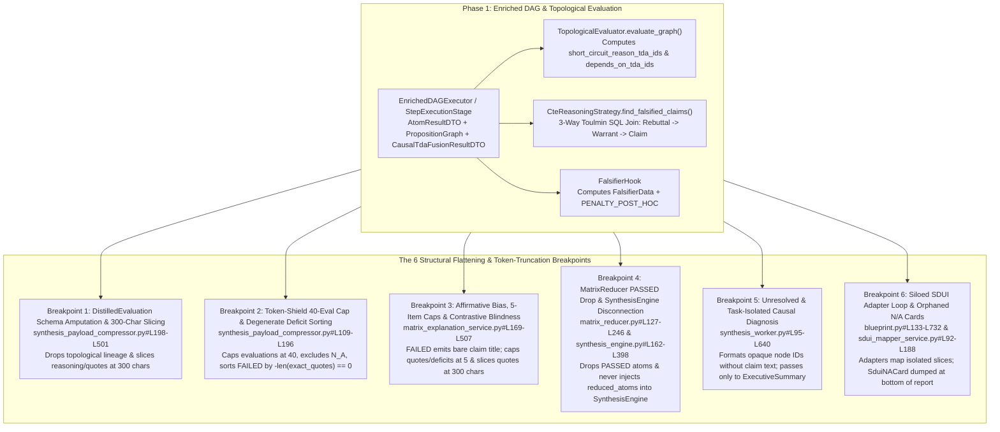

<required_context_rules>
  <rule>@[.agents/rules/00-antigravity-core.md]</rule>
  <rule>@[.agents/rules/01-python-backend.md]</rule>
  <rule>@[.agents/rules/02_flutter_desktop.md]</rule>
  <rule>@[.agents/rules/04_directory_reference.md]</rule>
  <rule>@[.agents/rules/05_llm_architecture.md]</rule>
  <knowledge_item>@[ki_god_code_prevention.md]</knowledge_item>
  <knowledge_item>@[ki_sdui_matrix_synthesis.md]</knowledge_item>
</required_context_rules>

# EPIC 161: Topological Intelligence Preservation Across Distillation, Synthesis & SDUI Reporting

> [!NOTE]
> **Scientific & Industrial Validation (2025-2026)**
> Modern 2025–2026 LLM evaluation research (*TRACE: Toulmin-based Reasoning Assessment through Constructive Elements*, *CausalGraph2LLM*, *CausalGraphBench*, and Concept-Level Counterfactual Graph Discovery) establishes that correlation-based scorecard aggregation suffers from severe affirmative bias and prompt encoding sensitivity when causal warrant chains, rebuttals, and counterfactual/contrastive failure boundaries are flattened or artificially truncated prior to synthesis. Preserving explicit Toulmin warrant-rebuttal structures, topological short-circuit blast radii, complete 4-step Micro-CoT reasoning, verbatim evidence quotes, and full contrastive rubric anchors across distillation and synthesis produces mechanism-transparent, non-spurious analytical evaluations.

## 1. Goal Description & Background (Objective & Problem Statement)

Quorum's Phase 1 Enriched DAG and Topological Evaluation pipeline computes rich causal and epistemic structures—specifically and exhaustively: `AtomResultDTO` dependency edges (`depends_on_tda_ids`), topological circuit-breaker roots (`short_circuit_reason_tda_ids`), poison-pill inverse hits (`is_inverse_evidence`), `PropositionGraph` causal root-cause chains (`CausalTdaFusionResultDTO`), PostgreSQL 19 3-way Toulmin falsification joins (`CteReasoningStrategy.find_falsified_claims`), and `FalsifierHook` post-hoc rationalization penalties (`PENALTY_POST_HOC`).

However, ground-truth inspection of `@[backend_v2/settings.py]`, `@[backend_v2/services/orchestrator/]`, `@[backend_v2/workers/]`, and `@[backend_v2/services/sdui/]` proves that **six structural flattening and token-saving truncation breakpoints** amputate this topological intelligence before or during synthesis and SDUI rendering. None of these truncations originate from the intentional 1-atom `development` fast-profile rules in `Settings._enforce_environment_limits` (`@[backend_v2/settings.py#L965-L1026]`); instead, they are hardcoded in production synthesis settings and orchestrator services. As a result, final reports read as compartmentalized scorecard compilations rather than a unified causal and epistemic argument.

### 1.1 The Six Structural Flattening & Token-Truncation Breakpoints

1. **Breakpoint 1 — Schema Amputation & `300`-Character Mid-Sentence Guillotine in `DistilledEvaluation` (`@[backend_v2/models/domain/synthesis.py#L131-L180]`, `@[backend_v2/models/dtos/atom_evaluation.py#L21-L40]`, `@[backend_v2/settings.py]` & `@[backend_v2/services/orchestrator/synthesis_payload_compressor.py#L198-L501]`)**:
   - Upstream `@[backend_v2/models/dtos/atom_result.py#L82-L172]` (`AtomResultDTO`) and `@[backend_v2/services/orchestrator/topological_evaluator.py#L56-L175]` (lines `156–162`) preserve `depends_on_tda_ids: list[str]`, `short_circuit_reason_tda_ids: list[str]`, `is_inverse_evidence: bool`, and `contextual_override: bool`.
   - When `SynthesisPayloadCompressor._clean_and_distill_payload` (`@[backend_v2/services/orchestrator/synthesis_payload_compressor.py#L198-L501]`, specifically lines `239–352` and `298–333`) converts `EvaluatedAtomDTO` into `DistilledEvaluation`, it retains only five fields (`specifically and exhaustively: atom_id, status, exact_quotes, semantic_reasoning, extensions`). The causal dependency edges (`depends_on_tda_ids`), topological circuit-breaker origins (`short_circuit_reason_tda_ids`), and poison-pill inverse hits (`is_inverse_evidence`) are permanently erased.
   - Worse still, `ReasoningStepDTO` (`@[backend_v2/models/dtos/atom_evaluation.py#L21-L40]`) orders Micro-CoT reasoning sequentially as `step_1_identify_premise` $\rightarrow$ `step_2_scan_source` $\rightarrow$ `step_3_evaluate_anti_patterns` $\rightarrow$ `step_4_final_conclusion`. Because `@[backend_v2/services/orchestrator/synthesis_payload_compressor.py#L198-L501]` (lines `268–277` and `340–350`) slices `semantic_reasoning[: settings.max_synthesis_reasoning_length]` and `exact_quotes` (`q[: settings.max_synthesis_quote_length]`) at `300` characters (`@[backend_v2/settings.py]`, lines `286–288` and `296–298`), the first `300` characters of `semantic_reasoning` capture only `step_1_identify_premise` and part of `step_2_scan_source` while guillotining off `step_3_evaluate_anti_patterns` (the anti-pattern violation) and `step_4_final_conclusion` (the rejection verdict), and evidence quotes are severed mid-sentence. Additionally, lines `265–266` and `336–338` drop evaluations whenever `valid_quotes` is empty and `semantic_reasoning` is absent, affecting short-circuited `ExecutionStatus.N_A` atoms whose `evaluation_reasoning` is `None`.

2. **Breakpoint 2 — "Token Shield" `40`-Evaluation Cap & Mathematically Degenerate Deficit Stratification (`@[backend_v2/settings.py]` & `@[backend_v2/services/orchestrator/synthesis_payload_compressor.py#L109-L196]`)**:
   - In `@[backend_v2/settings.py]` (lines `283–285`), `max_synthesis_evaluations` defaults to `40` (`"Max evaluations for synthesis token shield"`), causing `_prune_and_stratify_evaluations` (`@[backend_v2/services/orchestrator/synthesis_payload_compressor.py#L109-L196]`) to drop evaluations exceeding `40` per step even though line `122` already supports unbounded mode when `limit == 0` (`if limit == 0 or len(evals) <= limit: return list(evals)`).
   - Furthermore, when a positive `limit > 0` is active, `_prune_and_stratify_evaluations` (lines `142–143`) partitions only `ExecutionStatus.PASSED` and `ExecutionStatus.FAILED` while dropping `ExecutionStatus.N_A`, and sorts `deficits` using `sort_key` (`@[backend_v2/services/orchestrator/synthesis_payload_compressor.py#L141-L144]`, `key=lambda e: (-len(e.exact_quotes), e.atom_id)`).
   - However, `@[backend_v2/models/dtos/atom_result.py#L138-L172]` (`validate_cognitive_vs_system_state`, lines `151–160`) enforces a strict mathematical invariant: whenever `status == ExecutionStatus.FAILED` or `status == ExecutionStatus.N_A`, `source_quotes` is forced to `None` (`len(exact_quotes) == 0`). Consequently, `-len(e.exact_quotes)` evaluates to `0` for **100% of failed and short-circuited atoms**, truncating deficits in arbitrary alphabetical order of `atom_id`.

3. **Breakpoint 3 — Affirmative Bias, Unlinked `N_A` Short-Circuits, Contrastive Blindness & `5`-Item / `300`-Char Caps in `MatrixExplanationService` (`@[backend_v2/settings.py]`, `@[backend_v2/utils/ranked_round_robin.py#L13-L80]` & `@[backend_v2/services/orchestrator/matrix_explanation_service.py#L169-L507]`)**:
   - When `hit_status == ExecutionStatus.PASSED` (lines `216–242` of `@[backend_v2/services/orchestrator/matrix_explanation_service.py#L169-L507]`), `assemble_matrices_to_explain` extracts the claim label and supporting lexical quotes, but slices every quote at `cleaned[:max_quote_len]` (`300` chars at lines `86` and `133`) and caps total quotes per matrix at `max_synthesis_quotes_per_matrix = 5` (`@[backend_v2/settings.py]`, lines `289–291`, passed to `ranked_round_robin_select` at lines `258–264`).
   - When `hit_status == ExecutionStatus.FAILED` (lines `243–252` of `@[backend_v2/services/orchestrator/matrix_explanation_service.py#L169-L507]`), it appends **only** the bare localized claim title (`tda_to_claim[tda_id]`) into `UNMET CRITERIA / DEFICITS:` and caps the list at `[:effective_max_unmet]` (`max_synthesis_unmet_criteria_per_matrix = 5` in `@[backend_v2/settings.py]`, lines `292–295`, sliced at line `270`). It discards:
     - `atom_res.evaluation_reasoning` (the forensic reason why the evidence failed verification, including `step_3_evaluate_anti_patterns` and `step_4_final_conclusion`),
     - `tda.contrastive_example` (`ContrastivePairDTO(acceptable=..., rejected=...)` defined in `@[backend_v2/models/domain/matrix.py#L94-L129]`) and `tda.anti_patterns` (`@[backend_v2/models/domain/matrix.py#L66-L77]`),
     - `tda.inverse_evidence` (`is_inverse_evidence` poison hits where an active anti-pattern was detected),
     - `ExecutionStatus.N_A` short-circuited atoms (`short_circuit_reason_tda_ids`), which are completely ignored because the `if/elif` branch checks only `ExecutionStatus.PASSED` and `ExecutionStatus.FAILED`. Furthermore, because `TopologicalEvaluator.evaluate_graph` (`@[backend_v2/services/orchestrator/topological_evaluator.py#L56-L175]`, lines `156–162`) leaves `evaluation_reasoning = None` on `ExecutionStatus.N_A` atoms, explaining why a short-circuited claim was blocked requires **transitively resolving both the upstream parent blocker's claim label AND the upstream parent blocker's `evaluation_reasoning`** via `short_circuit_reason_tda_ids`.
   - Furthermore, `@[backend_v2/workers/synthesis_tasks.py#L351-L439]` (`create_row_explanations_task`, lines `406–413`) sends **only** `MATRICES TO EXPLAIN:\n{matrices_json}` to the LLM—without `distilled_inputs` or `causal_diagnosis`.

4. **Breakpoint 4 — `MatrixReducer` Token-Compression Drop of `PASSED` Atoms & Phase 1 In-DAG `SynthesisEngine` Disconnection (`@[backend_v2/services/orchestrator/matrix_reducer.py#L127-L246]` & `@[backend_v2/services/orchestrator/engines/synthesis_engine.py#L162-L398]`)**:
   - In `MatrixReducer.reduce_matrix()` (`@[backend_v2/services/orchestrator/matrix_reducer.py#L127-L246]`, lines `198–206`), Quorum explicitly drops boolean `ExecutionStatus.PASSED` atoms (`if atom.status == ExecutionStatus.PASSED and not has_extracted_data: continue` under the comment `# Token-compression cascade: Drop unstarted/pending atoms and boolean PASSED atoms to save context window`), and `ReducedAtomDTO` (`@[backend_v2/models/dtos/atom_evaluation.py#L43-L82]`) strips `depends_on_tda_ids`, `short_circuit_reason_tda_ids`, and `is_inverse_evidence`.
   - Worse still, in lines `170–188` of `@[backend_v2/services/orchestrator/engines/synthesis_engine.py#L162-L398]`, `SynthesisEngine.execute()` **never serializes `matrix_reducer_output.reduced_atoms` into `user_message_parts`**. It injects only `raw_extensions` and `global_atom_blackboard.to_markdown_synthesis_injection()`, where `global_atom_blackboard` (`@[backend_v2/models/domain/blackboard.py#L133-L184]`) is populated during Phase 1B RAG preflight (`@[backend_v2/services/orchestrator/rag_preflight_service.py#L134-L305]`, lines `276–305`) *before* matrix evaluation, topological short-circuiting, or Toulmin falsification occurs.

5. **Breakpoint 5 — Opaque Node IDs, Task Isolation, Cognitive Tier Downgrade & Conflicting Length Budget Double-Injection in `synthesis_worker.py` & `synthesis_tasks.py` (`@[backend_v2/workers/synthesis_worker.py#L95-L640]` & `@[backend_v2/workers/synthesis_tasks.py#L351-L439]`)**:
   - In lines `394–433` of `@[backend_v2/workers/synthesis_worker.py#L95-L640]`, the worker builds `causal_diagnosis_text` from `CausalTdaFusionResultDTO` (`@[backend_v2/services/orchestrator/dag_executor/causal_tda_fusion.py#L394-L494]`), formatting raw node IDs (`- Root Parent {diag.root_cause_parent_id} -> Failing Node {diag.failing_node_id}: {diag.explanation}`) without resolving the human-readable `PropositionNode.claim` statements or `WarrantEdge.relation_type` (`warrants`, `rebuts`, `supports`) from `causal_payload.graph`.
   - Even this raw string is passed **exclusively** to `create_executive_summary_task` (line `436` of `@[backend_v2/workers/synthesis_worker.py#L95-L640]`). `create_matrix_sections_tasks`, `create_xai_highlights_task`, and `create_row_explanations_task` (lines `440–473`) receive zero causal diagnosis or Toulmin falsification context (`FalsifiedClaimMatch` from `@[backend_v2/database/postgres/graph_adapter.py#L348-L432]` and `@[backend_v2/models/domain/proposition_graph.py#L344-L392]`).
   - Worse still, `create_row_explanations_task` (`@[backend_v2/workers/synthesis_tasks.py#L351-L439]`, lines `370–375`) ignores the worker's `CognitiveTier.BALANCED` `client` (`@[backend_v2/workers/synthesis_worker.py#L95-L640]`, lines `328–333`) and instantiates a downgraded `CognitiveTier.FAST` client, while lines `311–314` of `@[backend_v2/workers/synthesis_worker.py#L95-L640]` inject `<global_length_constraint_chars>{active_profile_dto.synthesis_length_constraint}</global_length_constraint_chars>` into `base_dynamic_parts`, colliding with each task's own `<section_budget>` tag (`@[backend_v2/workers/synthesis_tasks.py#L58-L139]` line `109`, `@[backend_v2/workers/synthesis_tasks.py#L142-L251]` line `212`, and `@[backend_v2/workers/synthesis_tasks.py#L254-L348]` line `313`).

6. **Breakpoint 6 — Siloed SDUI Adapters & Disembodied `SduiNACard` Rendering (`@[backend_v2/services/blueprint.py#L133-L732]` & `@[backend_v2/services/sdui/sdui_mapper_service.py#L92-L188]`)**:
   - `BlueprintTransformer.build_report_dto` (`@[backend_v2/services/blueprint.py#L133-L732]`, lines `574–658` and `607–658`) iterates over `profile.target_block_order` and invokes each SDUI adapter (`@[backend_v2/services/sdui/adapters/]`) over its own isolated data slice.
   - `SduiMapperService.map_report_to_sdui` (`@[backend_v2/services/sdui/sdui_mapper_service.py#L92-L188]`, lines `110–165` and `146–160`) extracts `SduiNACard` entries via `_extract_na_cards` and appends them at the very bottom of `inner_sdui_blocks`, visually severed from the matrix row or causal graph node where the dependency chain broke.
   - Furthermore, lines `584–592` of `@[backend_v2/services/blueprint.py#L133-L732]` contain an inline `if type(content) is dict:` check scanning `execution.execution_trace` for `causal_result`, bypassing typed envelope extraction.

### 1.2 The 5-Pillar Zero-Loss Epistemic Distillation Architecture

To achieve maximum analytical accuracy and preserve 100% of evaluated DAG intelligence (`PASSED`, `FAILED`, and `N_A` causal chains, complete 4-step Micro-CoT reasoning, verbatim evidence quotes, and full contrastive rubric boundaries) while keeping mechanical duplication stripped and preserving the `300,000`-character (`~75,000` token) Fail-Fast safety ceiling in `@[backend_v2/services/orchestrator/synthesis_distiller.py#L43-L115]` (lines `46–49`), this Epic enforces the **5-Pillar Zero-Loss Epistemic Distillation Architecture**:

1. **Pillar 1 — Mechanical Duplication Stripping Only & Unbounded Evaluation Retention (`max_synthesis_evaluations = 0`)**:
   - Retain mechanical noise stripping (`_HEAVY_KEYS_TO_EXCLUDE`: `shuffled_atoms`, `hydrated_references`, `_step_metadata`, and duplicate raw/verified quote copies) in `@[backend_v2/services/orchestrator/synthesis_payload_compressor.py#L198-L501]`.
   - Set `max_synthesis_evaluations = 0` (unbounded mode by default) in `@[backend_v2/settings.py]` (line `283`) so `_prune_and_stratify_evaluations` (`@[backend_v2/services/orchestrator/synthesis_payload_compressor.py#L109-L196]`, line `122`) retains all evaluations without the artificial `40`-evaluation "Token Shield" cap.
   - Enforce **zero-loss retention** for `ExecutionStatus.FAILED`, `ExecutionStatus.N_A`, and `is_inverse_evidence == True` evaluations: bypass the empty-quote dropout gates at lines `265–266` and `336–338` of `@[backend_v2/services/orchestrator/synthesis_payload_compressor.py#L198-L501]` whenever `status in (ExecutionStatus.FAILED, ExecutionStatus.N_A)` or `is_inverse_evidence` is `True`.
   - In `MatrixReducer.reduce_matrix()` (`@[backend_v2/services/orchestrator/matrix_reducer.py#L127-L246]`, lines `198–206`), remove the `if atom.status == ExecutionStatus.PASSED and not has_extracted_data: continue` token-compression drop so all evaluated atoms (`PASSED`, `FAILED`, `N_A`, `DLQ`) survive in `ReducedAtomDTO`.
2. **Pillar 2 — Zero Mid-Sentence Character Slicing & SSOT Clipper Segregation in `settings.py` (`strict_configuration_segregation`)**:
   - Set `max_synthesis_reasoning_length = 0` and `max_synthesis_quote_length = 0` (unbounded defaults) in `@[backend_v2/settings.py]` (lines `286–288` and `296–298`).
   - Update `@[backend_v2/services/orchestrator/synthesis_payload_compressor.py#L198-L501]` (lines `268–277` and `340–350`) and `@[backend_v2/services/orchestrator/matrix_explanation_service.py#L169-L507]` (lines `86` and `133`) so that character slicing (`[:max_len]`) is applied **only** when a positive bound (`> 0`) is explicitly configured. By default (`0`), all four steps of `ReasoningStepDTO` (`@[backend_v2/models/dtos/atom_evaluation.py#L21-L40]`: `step_1_identify_premise`, `step_2_scan_source`, `step_3_evaluate_anti_patterns`, `step_4_final_conclusion`) and all verbatim `exact_quotes` / `source_quotes` survive 100% intact.
   - When an explicit positive evaluation cap (`max_synthesis_evaluations > 0`) is configured, `_prune_and_stratify_evaluations` (`@[backend_v2/services/orchestrator/synthesis_payload_compressor.py#L109-L196]`) includes `ExecutionStatus.N_A` in `deficits`, uses `synthesis_deficit_stratification_ratio: float = 0.7` from `@[backend_v2/settings.py]` (replacing hardcoded `0.7` at line `145`), and sorts `deficits` deterministically by topological priority `(-int(item.is_inverse_evidence), -item.topological_out_degree, len(item.short_circuit_reason_tda_ids), atom_id)`.
   - Centralize all remaining hardcoded module-level clipper and threshold constants into `@[backend_v2/settings.py]` per `strict_configuration_segregation`:
     - Add `max_citation_span_chars: int = 0` (unbounded default; enforced only when `> 0`), `min_multi_segment_floor_chars: int = 30`, and `min_entropy_gate_chars: int = 10` to `Settings`, replacing hardcoded `1000`/`30`/`10` constants in `@[backend_v2/services/orchestrator/two_pass_atomizer.py#L255-L361]` (lines `336–342`), `@[backend_v2/services/orchestrator/anchor_validation/lexical_normalizer.py#L79-L150]`, `@[backend_v2/services/orchestrator/anchor_validation/lexical_normalizer.py#L153-L169]`, `@[backend_v2/services/orchestrator/anchor_validation/lexical_matcher.py#L68-L284]`, `@[backend_v2/services/orchestrator/anchor_validation/evidence_validator.py#L23-L65]`, `@[backend_v2/services/orchestrator/anchor_validation/evidence_validator.py#L259-L326]`, and `@[backend_v2/services/orchestrator/anchor_validation/evidence_validator.py#L329-L368]`.
     - Add `min_synthesis_quote_length: int = 15` to `Settings`, replacing hardcoded `15` at line `132` of `@[backend_v2/services/orchestrator/matrix_explanation_service.py#L169-L507]`.
     - Add `web_fetcher_max_extracted_chars: int = 0` (unbounded default; slicing only when `> 0`) and `web_fetcher_min_extracted_chars: int = 150` to `Settings`, replacing hardcoded `_MAX_EXTRACTED_TEXT_CHARS = 5000` and `_MIN_EXTRACTED_TEXT_CHARS = 150` in `@[backend_v2/services/web_fetcher.py#L81-L102]` and `@[backend_v2/services/web_fetcher.py#L104-L134]`.
     - Wire `@[backend_v2/hooks/archival.py#L117-L159]` (`_build_precedent_dto`) and `@[backend_v2/hooks/archival.py#L162-L240]` (`retrieve_precedent_hook`) to `settings.max_precedent_scan_depth` and `settings.max_precedent_return_count` (defined at lines `638–639` of `@[backend_v2/settings.py]`) and add `archival_verdict_part_max_chars: int = 0` and `archival_verdict_summary_max_chars: int = 0` (unbounded defaults; slicing only when `> 0`) in `@[backend_v2/settings.py]`, eradicating the hardcoded `_RECENT_EXECUTIONS_SCAN_LIMIT = 5`, `_MAX_PRECEDENTS_RETURNED = 3`, `_VERDICT_PART_MAX_CHARS = 50`, and `_VERDICT_SUMMARY_MAX_CHARS = 150` constants at lines `30–33` of `@[backend_v2/hooks/archival.py]`.
3. **Pillar 3 — Transitive Parent-to-Child `N_A` Short-Circuit Hydration**:
   - Because `TopologicalEvaluator.evaluate_graph` (`@[backend_v2/services/orchestrator/topological_evaluator.py#L56-L175]`, lines `156–162`) leaves `evaluation_reasoning = None` on `ExecutionStatus.N_A` atoms, `@[backend_v2/services/orchestrator/matrix_explanation_service.py#L169-L507]` and `@[backend_v2/models/dtos/lightweight_matrix.py#L126-L189]` transitively bind each `N_A` atom via `short_circuit_reason_tda_ids` to its upstream failed parent's localized claim label **and** the upstream parent's `evaluation_reasoning` (`[Blocked Claim] <-- SHORT-CIRCUITED BY PREREQUISITE FAILURE: [Parent Claim: <parent evaluation_reasoning>]`).
4. **Pillar 4 — Full Unbounded Deficit & Quote Retention in `MatrixExplanationService` (`max_synthesis_quotes_per_matrix = 0`, `max_synthesis_unmet_criteria_per_matrix = 0`)**:
   - Set `max_synthesis_quotes_per_matrix = 0` and `max_synthesis_unmet_criteria_per_matrix = 0` (unbounded defaults when `OutputProfile.max_quotes_per_matrix` and `OutputProfile.max_unmet_criteria_per_matrix` are `None`) in `@[backend_v2/settings.py]` (lines `289–295`).
   - In `MatrixExplanationService.assemble_matrices_to_explain` (`@[backend_v2/services/orchestrator/matrix_explanation_service.py#L169-L507]`, lines `257–270`), when `effective_max_quotes <= 0`, pass `max_items=len(quote_candidates)` into `ranked_round_robin_select` (`@[backend_v2/utils/ranked_round_robin.py#L13-L80]`), and when `effective_max_unmet <= 0`, retain all `unmet_deficits` without slicing `[:effective_max_unmet]`.
   - Populate `MatrixFailureDeficitDTO` with full `evaluation_reasoning`, `is_inverse_evidence`, transitive `short_circuited_by_claims`, `tda.anti_patterns` (`@[backend_v2/models/domain/matrix.py#L66-L77]`), and `tda.contrastive_example` (`ContrastivePairDTO(rejected, acceptable)` from `@[backend_v2/models/domain/matrix.py#L94-L129]`) across **all** `ExecutionStatus.FAILED` and `ExecutionStatus.N_A` deficits without artificial scale filtering or per-row caps.
5. **Pillar 5 — Cross-Task Unified `CausalSynthesisBriefDTO`, `CognitiveTier.BALANCED` Client Parity & Single `<section_budget>` Sovereignty**:
   - Inject `CausalSynthesisBriefDTO` (combining human-readable `PropositionNode.claim` fault chains from `@[backend_v2/services/orchestrator/dag_executor/causal_tda_fusion.py#L394-L494]` and PostgreSQL 19 3-way Toulmin `FalsifiedClaimMatch` rebuttals from `@[backend_v2/database/postgres/graph_adapter.py#L348-L432]`) into **all four parallel synthesis tasks** in `@[backend_v2/workers/synthesis_worker.py#L95-L640]` (`create_executive_summary_task`, `create_matrix_sections_tasks`, `create_xai_highlights_task`, `create_row_explanations_task`) as well as Phase 1 in-DAG `SynthesisEngine` (`@[backend_v2/services/orchestrator/engines/synthesis_engine.py#L162-L398]`).
   - Unify `create_row_explanations_task` (`@[backend_v2/workers/synthesis_tasks.py#L351-L439]`, lines `336–375`) to accept and execute with the same shared `CognitiveTier.BALANCED` `client: LLMClient` instance created in `@[backend_v2/workers/synthesis_worker.py#L95-L640]` (lines `328–333` and `463–473`) as the other three synthesis tasks, eliminating the downgraded `CognitiveTier.FAST` instantiation.
   - Remove the conflicting `<global_length_constraint_chars>` injection from `base_dynamic_parts` in `@[backend_v2/workers/synthesis_worker.py#L95-L640]` (lines `311–314`) so that each synthesis task (`create_executive_summary_task`, `create_matrix_sections_tasks`, `create_xai_highlights_task`, `create_row_explanations_task`) obeys exclusively its own `<section_budget>` tag when its length constraint is positive (`> 0`), and applies zero length constraint when its `<section_budget>` is `0` or `None`.
6. **Preservation of 1-Atom `development` Fast-Profile Limits**:
   - All 1-atom `development` environment clamps in `Settings._enforce_environment_limits` (`@[backend_v2/settings.py#L965-L1026]`, specifically and exhaustively: `max_tool_calls_per_step = 1`, `max_development_chunks = 1`, `matrix_sampling_limit = 1`, `rag_preflight_chunk_size = 4000`, `schema_max_localized_anchors = 2`, `schema_max_quotes_target = 1`, `schema_max_quote_length = 50`, `schema_max_evaluations = 1`, `max_precedent_scan_depth = 0`, `max_precedent_return_count = 0`, `tda_linker_window_size = 2`, `tda_linker_overlap = 0`, `ensemble_parallelism = 1`, `ensemble_min_consensus = 1`, `dev_max_thinking_budget = 0`) remain 100% untouched.

### 1.3 Quantitative Scope Summary Table

| Metric / Dimension | Count / Bound | Target Subsystems |
| :--- | :--- | :--- |
| **Structural Flattening & Token-Truncation Breakpoints Eradicated** | `6` | Distillation, Matrix Reduction, Matrix Explanation, Causal Fusion, Phase 1 `SynthesisEngine`, Phase 2 `SynthesisWorker`, SDUI Projection |
| **Epistemic Accuracy Pillars Enforced** | `5` | Unbounded Evaluation Retention (`0`), Zero Mid-Sentence Character Slicing (`0`), Transitive `N_A` Parent Hydration, Full Contrastive & Quote Retention (`0`), 4-Task Causal/Toulmin Fan-Out |
| **Execution Phases** | `4` | Phase 1 (Tech Debt, Zero-Truncation Settings & Topological Envelope), Phase 2 (Contrastive & Synthesis Convergence), Phase 3 (SDUI & Flutter Parity), Phase 4 (Verification & E2E Gate) |
| **Default Synthesis Truncation Caps (`max_synthesis_*`)** | `0` (unbounded by default; slices only if explicitly configured `> 0`) | `@[backend_v2/settings.py]`, `@[backend_v2/services/orchestrator/synthesis_payload_compressor.py#L109-L196]`, `@[backend_v2/services/orchestrator/synthesis_payload_compressor.py#L198-L501]`, `@[backend_v2/services/orchestrator/matrix_explanation_service.py#L169-L507]` |
| **Hard Fail-Fast Context Ceiling (`_MAX_SAFE_PAYLOAD_CHARS`)** | `300,000` chars (`~75,000` tokens) | `@[backend_v2/services/orchestrator/synthesis_distiller.py#L43-L115]` |
| **1-Atom `development` Mode Fast-Profile Clamps** | `100%` preserved (`0` modifications) | `@[backend_v2/settings.py#L965-L1026]` (`Settings._enforce_environment_limits`) |

---

## 2. Architectural Impact & Compliance Matrix

### Deprecations & Sunset List (`What We Will REMOVE`)

| Symbol / File / Field | Current Location | Target Destination / Disposition |
| :--- | :--- | :--- |
| `if type(content) is dict:` trace inspection loop | `@[backend_v2/services/blueprint.py#L133-L732]` (lines `584–592`) | **INTENTIONALLY DROPPED** — Replaced by strict `TypeAdapter` / `StepOutputDTO` envelope projection without raw dictionary type checks. |
| `300`-character mid-sentence slicing (`max_synthesis_reasoning_length = 300`, `max_synthesis_quote_length = 300`), `40`-evaluation token shield (`max_synthesis_evaluations = 40`), & empty-quote dropout on `FAILED`/`N_A` | `@[backend_v2/settings.py]` (lines `283–288`, `296–298`) & `@[backend_v2/services/orchestrator/synthesis_payload_compressor.py#L198-L501]` (lines `265–277`, `336–350`) | **INTENTIONALLY DROPPED** — Set `max_synthesis_evaluations = 0`, `max_synthesis_reasoning_length = 0`, and `max_synthesis_quote_length = 0` (unbounded defaults; slice only when `> 0`) so full 4-step `ReasoningStepDTO` (`@[backend_v2/models/dtos/atom_evaluation.py#L21-L40]`) and verbatim quotes survive intact, and bypassed empty-quote dropout for `FAILED`, `N_A`, and `is_inverse_evidence` evaluations. |
| Degenerate quote-length sort key `(-quotes_count, atom_id)` & exclusion of `N_A` on `deficits` | `@[backend_v2/services/orchestrator/synthesis_payload_compressor.py#L109-L196]` & `@[backend_v2/services/orchestrator/synthesis_payload_compressor.py#L141-L144]` | **INTENTIONALLY DROPPED** — Included `ExecutionStatus.N_A` in `deficits` and replaced deficit sort key with topological priority `(-int(item.is_inverse_evidence), -item.topological_out_degree, len(item.short_circuit_reason_tda_ids), atom_id)` when an explicit positive `limit > 0` is configured. |
| Token-compression drop of boolean `ExecutionStatus.PASSED` atoms in `MatrixReducer.reduce_matrix` | `@[backend_v2/services/orchestrator/matrix_reducer.py#L127-L246]` (lines `198–206`) | **INTENTIONALLY DROPPED** — Removed `if atom.status == ExecutionStatus.PASSED and not has_extracted_data: continue` so all completed evaluations (`PASSED`, `FAILED`, `N_A`, `DLQ`) and their topological lineage are preserved in `ReducedAtomDTO`. |
| Bare claim-title-only `FAILED` branch, ignored `N_A` branch, & `5`-item caps (`max_synthesis_quotes_per_matrix = 5`, `max_synthesis_unmet_criteria_per_matrix = 5`) in `assemble_matrices_to_explain` | `@[backend_v2/settings.py]` (lines `289–295`) & `@[backend_v2/services/orchestrator/matrix_explanation_service.py#L169-L507]` (lines `86`, `133`, `243–270`) | **INTENTIONALLY DROPPED** — Set `max_synthesis_quotes_per_matrix = 0` and `max_synthesis_unmet_criteria_per_matrix = 0` (unbounded defaults when `OutputProfile` overrides are `None`), and replaced bare claim strings with [NEW] `MatrixFailureDeficitDTO` defined in `@[backend_v2/models/dtos/synthesis.py]` carrying full `evaluation_reasoning`, `is_inverse_evidence`, transitive `short_circuited_by_claims` (parent claim + parent `evaluation_reasoning`), `anti_patterns`, and `ContrastivePairDTO` across all `FAILED` and `N_A` deficits. |
| Task-isolated opaque node ID string formatting for `causal_diagnosis_text`, conflicting `<global_length_constraint_chars>` + `<section_budget>` double-injection, & downgraded `CognitiveTier.FAST` client instantiation in `create_row_explanations_task` | `@[backend_v2/workers/synthesis_worker.py#L95-L640]` (lines `311–314`, `394–433`, `463–473`) & `@[backend_v2/workers/synthesis_tasks.py#L351-L439]` (lines `370–375`) | **INTENTIONALLY DROPPED** — Replaced by deterministic [NEW] `CausalSynthesisBriefDTO` defined in `@[backend_v2/models/dtos/synthesis.py]` injected across all four synthesis tasks, unified `create_row_explanations_task` to share the `CognitiveTier.BALANCED` `client: LLMClient` instance, and removed `<global_length_constraint_chars>` from `base_dynamic_parts` so each section obeys only its own `<section_budget>` (unbounded if `0` or `None`). |
| Hardcoded clipper/threshold magic numbers outside `settings.py` (`exact_quote[:1000]` in `two_pass_atomizer.py`, `MAX_CITATION_SPAN_CHARS = 1000` / `MIN_MULTI_SEGMENT_FLOOR_CHARS = 30` / `MIN_ENTROPY_GATE_CHARS = 10` in `lexical_normalizer.py`, `0.7` in `synthesis_payload_compressor.py`, `15` in `matrix_explanation_service.py`, `_MAX_EXTRACTED_TEXT_CHARS = 5000` / `_MIN_EXTRACTED_TEXT_CHARS = 150` in `web_fetcher.py`, and `_RECENT_EXECUTIONS_SCAN_LIMIT = 5` / `_MAX_PRECEDENTS_RETURNED = 3` / `_VERDICT_PART_MAX_CHARS = 50` / `_VERDICT_SUMMARY_MAX_CHARS = 150` in `archival.py`) | `@[backend_v2/services/orchestrator/two_pass_atomizer.py#L255-L361]`, `@[backend_v2/services/orchestrator/anchor_validation/lexical_normalizer.py#L79-L150]`, `@[backend_v2/services/orchestrator/anchor_validation/lexical_normalizer.py#L153-L169]`, `@[backend_v2/services/orchestrator/synthesis_payload_compressor.py#L109-L196]`, `@[backend_v2/services/orchestrator/matrix_explanation_service.py#L169-L507]`, `@[backend_v2/services/web_fetcher.py#L81-L102]`, `@[backend_v2/services/web_fetcher.py#L104-L134]`, `@[backend_v2/hooks/archival.py#L117-L159]`, & `@[backend_v2/hooks/archival.py#L162-L240]` | **INTENTIONALLY DROPPED** — Centralize all threshold and clipper configurations into `@[backend_v2/settings.py]` (`strict_configuration_segregation`), wire `archival.py` to `settings.max_precedent_scan_depth` and `settings.max_precedent_return_count`, and set all text clippers (`max_citation_span_chars = 0`, `web_fetcher_max_extracted_chars = 0`, `archival_verdict_part_max_chars = 0`, and `archival_verdict_summary_max_chars = 0`) to `0` (unbounded defaults; slice only when `> 0`). |

### Retained SSOT Invariants (`What We Will RETAIN`)

- **5-Tier Regression Defense Architecture**:
  1. **DTO & Interface Isolation**: Lock all Pydantic V2 (`ConfigDict(strict=True, extra="forbid", frozen=True)`) and Flutter Freezed boundary schemas before mutating service or worker implementations.
  2. **Two-Stage Testing Pipeline**: Run localized unit tests during iterative steps, followed by the global completion gates (`backend_audit_loop.py` and `flutter_audit_loop.py`).
  3. **Circuit Breaker & Dirty Rollback**: Execute `git restore . ; git clean -fd` immediately upon 3 consecutive test or quality gate failures.
  4. **Phased Execution Order**: Isolate pre-existing technical debt cleanups, zero-truncation settings, and foundational DTO enrichment in Phase 1 before introducing synthesis and SDUI feature logic in Phases 2–3.
  5. **Atomic Checkpoint Commits**: Commit each verified logical step individually with explicit workspace-relative file paths in English.
- **1-Atom `development` Mode Fast-Profile Sovereignty**: `Settings._enforce_environment_limits` (`@[backend_v2/settings.py#L965-L1026]`) is 100% preserved without modification.
- **Tripartite Rendering Boundary (`tripartite_rendering_boundary`)**: SDUI adapters (`@[backend_v2/services/sdui/adapters/]`) remain 100% pure synchronous/deterministic data mappers with zero LLM calls.
- **Alias Engine Isolation (`alias_engine_llm_isolation_mandate`)**: All raw Opaque Stripe IDs (`tda_...`, `blk_...`, `stp_...`) are translated into deterministic short aliases via `@[backend_v2/utils/alias_engine.py]` or resolved to localized claim labels before prompt compilation.
- **Four-Layer Clean Stack Hierarchy (`four_layer_clean_stack_hierarchy`)**: Static XML synthesis rules reside strictly in `@[backend_v2/models/prompts/synthesis/synthesis_directives.py]` (Layer 1), while dynamic `CausalSynthesisBriefDTO` and `MatrixFailureDeficitDTO` payloads are injected exclusively at the tail `user` message (Layer 4).

### 5-Column Architectural Directive Table

| 1. Target Scope & Boundaries | 2. Eradicated Duct-Tape (Under-Engineering Ban) | 3. Approved Best Practice (Target Invariant) | 4. Pruned Over-Engineering (Complexity Slayer) | 5. Verification & Fail-Fast (Proof Anchor) |
| :--- | :--- | :--- | :--- | :--- |
| **`@[backend_v2/models/domain/synthesis.py#L131-L180]`** **`@[backend_v2/models/dtos/atom_evaluation.py#L21-L40]`** **`@[backend_v2/settings.py]`** **`@[backend_v2/services/orchestrator/synthesis_payload_compressor.py#L109-L196]`** **`@[backend_v2/services/orchestrator/synthesis_payload_compressor.py#L141-L144]`** **`@[backend_v2/services/orchestrator/synthesis_payload_compressor.py#L198-L501]`** **`@[backend_v2/services/orchestrator/two_pass_atomizer.py#L255-L361]`** **`@[backend_v2/services/orchestrator/anchor_validation/lexical_normalizer.py#L79-L150]`** **`@[backend_v2/services/orchestrator/anchor_validation/lexical_normalizer.py#L153-L169]`** **`@[backend_v2/services/orchestrator/anchor_validation/lexical_matcher.py#L68-L284]`** **`@[backend_v2/services/orchestrator/anchor_validation/evidence_validator.py#L23-L65]`** **`@[backend_v2/services/orchestrator/anchor_validation/evidence_validator.py#L259-L326]`** **`@[backend_v2/services/orchestrator/anchor_validation/evidence_validator.py#L329-L368]`** **`@[backend_v2/services/web_fetcher.py#L81-L102]`** **`@[backend_v2/services/web_fetcher.py#L104-L134]`** **`@[backend_v2/hooks/archival.py#L117-L159]`** **`@[backend_v2/hooks/archival.py#L162-L240]`** | Eradicate dropping `depends_on_tda_ids`, `short_circuit_reason_tda_ids`, and `is_inverse_evidence` during `_clean_and_distill_payload` (lines `239–352` and `298–333`). Eradicate the `40`-eval cap (`max_synthesis_evaluations = 40`), `300`-char slicing (`max_synthesis_reasoning_length = 300`, `max_synthesis_quote_length = 300` at lines `268–277`, `340–350`), and dropping quote-less `FAILED`/`N_A` atoms (lines `265–266`, `336–338`). Eradicate excluding `N_A` and sorting deficits by `-len(e.exact_quotes)` (always `0` for `FAILED`/`N_A` per `@[backend_v2/models/dtos/atom_result.py#L138-L172]`). Eradicate hardcoded clipper/threshold magic numbers outside `settings.py` (`exact_quote[:1000]` in `two_pass_atomizer.py`, `1000`/`30`/`10` in `lexical_normalizer.py`, `0.7` in `synthesis_payload_compressor.py`, `5000`/`150` in `web_fetcher.py`, and `5`/`3`/`50`/`150` in `archival.py`). | Set `max_synthesis_evaluations = 0`, `max_synthesis_reasoning_length = 0`, and `max_synthesis_quote_length = 0` (unbounded defaults; slice only when `> 0`) in `@[backend_v2/settings.py]` (lines `283–288`, `296–298`). Centralize `max_citation_span_chars = 0`, `min_multi_segment_floor_chars = 30`, `min_entropy_gate_chars = 10`, `synthesis_deficit_stratification_ratio = 0.7`, `min_synthesis_quote_length = 15`, `web_fetcher_max_extracted_chars = 0`, `web_fetcher_min_extracted_chars = 150`, `archival_verdict_part_max_chars = 0`, and `archival_verdict_summary_max_chars = 0` in `@[backend_v2/settings.py]`, and wire `archival.py` to `settings.max_precedent_scan_depth` and `settings.max_precedent_return_count`. Enrich `DistilledEvaluation` (`ConfigDict(extra="forbid", strict=True, frozen=True)`) with `depends_on_tda_ids: list[str]`, `short_circuit_reason_tda_ids: list[str]`, `is_inverse_evidence: bool`, and `topological_out_degree: int`. Retain all `FAILED`/`N_A`/`is_inverse_evidence` evaluations in `_clean_and_distill_payload` and, when `limit > 0`, include `N_A` in `deficits` sorted by `(-int(e.is_inverse_evidence), -e.topological_out_degree, len(e.short_circuit_reason_tda_ids), atom_id)`. | Do NOT create a separate compressor service or touch the 1-atom `development` fast profile in `Settings._enforce_environment_limits` (`@[backend_v2/settings.py#L965-L1026]`). Mutate `DistilledEvaluation`, `settings.py`, and `_prune_and_stratify_evaluations` in-place within the single compressor pipeline. | `uv run python scripts/backend_audit_loop.py backend_v2/services/orchestrator/synthesis_payload_compressor.py backend_v2/hooks/archival.py backend_v2/services/web_fetcher.py --test --ast-strict` + BVA unit tests proving full 4-step Micro-CoT reasoning, full verbatim quotes, and root-cause `FAILED`/`N_A` atoms survive compression intact. |
| **`@[backend_v2/models/dtos/lightweight_matrix.py#L27-L42]`** **`@[backend_v2/models/dtos/lightweight_matrix.py#L126-L189]`** **`@[backend_v2/models/dtos/synthesis.py]`** **`@[backend_v2/utils/ranked_round_robin.py#L13-L80]`** **`@[backend_v2/services/orchestrator/matrix_explanation_service.py#L169-L507]`** | Eradicate compressing `ExecutionStatus.FAILED` atoms into bare localized claim titles (lines `198–296` and `243–252`) while discarding `evaluation_reasoning`, `ContrastivePairDTO` (`@[backend_v2/models/domain/matrix.py#L94-L129]`), `anti_patterns` (`@[backend_v2/models/domain/matrix.py#L66-L77]`), `is_inverse_evidence`, and `ExecutionStatus.N_A` (`short_circuit_reason_tda_ids` from `@[backend_v2/services/orchestrator/topological_evaluator.py#L56-L175]`, lines `156–162`). Eradicate default `5`-item caps (`max_synthesis_quotes_per_matrix = 5`, `max_synthesis_unmet_criteria_per_matrix = 5`), hardcoded `15`-char minimum quote length (line `132`), and `300`-char quote slicing (lines `86`, `133`, `257–270`). | Set `max_synthesis_quotes_per_matrix = 0` and `max_synthesis_unmet_criteria_per_matrix = 0` in `@[backend_v2/settings.py]` (lines `289–295`) and read `min_synthesis_quote_length` from `Settings`. Create [NEW] `MatrixFailureDeficitDTO` (`ConfigDict(extra="forbid", strict=True, frozen=True)`) defined in `@[backend_v2/models/dtos/synthesis.py]` containing `claim: str`, `status: Literal["FAILED", "N_A"]`, `scale_score: int`, `evaluation_reasoning: str \| None`, `is_inverse_evidence: bool`, `short_circuited_by_claims: list[str]` (transitively formatted with upstream blocker parent claim + parent `evaluation_reasoning`), `anti_patterns: list[str]`, `contrastive_rejected: str \| None`, and `contrastive_acceptable: str \| None` across all `FAILED` and `N_A` deficits on `MatrixExplanationContextDTO`. Pass `len(quote_candidates)` to `ranked_round_robin_select` when `effective_max_quotes <= 0`. | Do NOT filter out contrastive pairs or anti-patterns by scale level or impose artificial per-row deficit caps when `OutputProfile` limits are unset (`None`). | `uv run python scripts/backend_audit_loop.py backend_v2/services/orchestrator/matrix_explanation_service.py --test --ast-strict` + unit tests verifying full unbounded deficit/quote retention, contrastive pair hydration, and transitive parent-to-child `N_A` blocker reasoning hydration. |
| **`@[backend_v2/services/orchestrator/dag_executor/causal_tda_fusion.py#L40-L89]`** **`@[backend_v2/services/orchestrator/dag_executor/causal_tda_fusion.py#L394-L494]`** **`@[backend_v2/database/postgres/graph_adapter.py#L348-L432]`** **`@[backend_v2/models/domain/proposition_graph.py#L344-L392]`** **`@[backend_v2/models/dtos/causal_discovery.py]`** **`@[backend_v2/services/orchestrator/dag_executor/step_execution_stage.py#L238-L403]`** | Eradicate emitting unresolved node IDs (`root_cause_parent_id`, `failing_node_id`) without human-readable claim text, and eradicate leaving `CteReasoningStrategy.find_falsified_claims()` (`FalsifiedClaimMatch`) uncalled in dead-code isolation. | Enrich `CausalRootCauseDiagnosisDTO` with resolved `root_cause_claim: str`, `failing_node_claim: str`, and `warrant_relation: Literal["supports", "rebuts", "warrants"]`. Wire `find_falsified_claims()` into the causal fusion stage so `CausalTdaFusionResultDTO` carries `falsified_claims: list[FalsifiedClaimMatch]`. | Do NOT build a new graph database engine or recursive Python graph walker; leverage the existing PostgreSQL 19 3-way SQL join (`find_falsified_claims`) and existing `compute_causal_tda_fusion_result` node index. | `uv run python scripts/backend_audit_loop.py backend_v2/services/orchestrator/dag_executor/causal_tda_fusion.py --test --ast-strict` + integration test asserting `FalsifiedClaimMatch` hydration and non-empty `root_cause_claim` resolution. |
| **`@[backend_v2/services/orchestrator/engines/synthesis_engine.py#L162-L398]`** **`@[backend_v2/services/orchestrator/matrix_reducer.py#L127-L246]`** **`@[backend_v2/models/dtos/atom_evaluation.py#L43-L82]`** | Eradicate dropping boolean `ExecutionStatus.PASSED` atoms in `MatrixReducer.reduce_matrix` (lines `198–206` of `@[backend_v2/services/orchestrator/matrix_reducer.py#L127-L246]`), eradicate the Phase 1 `SynthesisEngine` bug where `matrix_reducer_output.reduced_atoms` is computed (lines `101–188`) but never injected into `user_message_parts` (lines `170–188` of `@[backend_v2/services/orchestrator/engines/synthesis_engine.py#L162-L398]`), and eradicate stripping `depends_on_tda_ids`, `short_circuit_reason_tda_ids`, and `is_inverse_evidence` from `ReducedAtomDTO`. | Retain all completed evaluations (`PASSED`, `FAILED`, `N_A`, `DLQ`) in `MatrixReducer.reduce_matrix`. Enrich `ReducedAtomDTO` with `depends_on_tda_ids: list[str]`, `short_circuit_reason_tda_ids: list[str]`, and `is_inverse_evidence: bool`. Inject `matrix_reducer_output.reduced_atoms` (aliased via `AliasEngine`) into `SynthesisEngine.execute()` alongside `raw_extensions` and `global_atom_blackboard`. | Do NOT maintain divergent epistemic contracts between Phase 1 in-DAG `SynthesisEngine` and Phase 2 `SynthesisWorker`. Both must consume reduced evaluations and short-circuit lineage. | `uv run python scripts/backend_audit_loop.py backend_v2/services/orchestrator/engines/synthesis_engine.py --test --ast-strict` + unit test asserting `reduced_atoms` reasoning, quotes, and short-circuit lineage appear in the compiled prompt payload. |
| **`@[backend_v2/workers/synthesis_worker.py#L95-L640]`** **`@[backend_v2/workers/synthesis_tasks.py#L58-L139]`** **`@[backend_v2/workers/synthesis_tasks.py#L142-L251]`** **`@[backend_v2/workers/synthesis_tasks.py#L254-L348]`** **`@[backend_v2/workers/synthesis_tasks.py#L351-L439]`** **`@[backend_v2/models/prompts/synthesis/synthesis_directives.py]`** | Eradicate passing `causal_diagnosis_text` only to `create_executive_summary_task` (lines `394–468` and `436` of `@[backend_v2/workers/synthesis_worker.py#L95-L640]`) while starving `create_matrix_sections_tasks`, `create_xai_highlights_task`, and `create_row_explanations_task` (lines `406–413` of `synthesis_tasks.py`) of causal and Toulmin falsification context. Eradicate the conflicting `<global_length_constraint_chars>` + `<section_budget>` double-injection in `synthesis_worker.py` (lines `311–314`) and the downgraded `CognitiveTier.FAST` client instantiation in `create_row_explanations_task` (lines `370–375`). | Create [NEW] `CausalSynthesisBriefDTO` defined in `@[backend_v2/models/dtos/synthesis.py]` (combining resolved `CausalRootCauseDiagnosisDTO` chains, `FalsifiedClaimMatch` Toulmin rebuttals, and post-hoc fidelity penalties) and inject it in `synthesis_worker.py` into all four synthesis task constructors (`create_executive_summary_task`, `create_matrix_sections_tasks`, `create_xai_highlights_task`, `create_row_explanations_task`) governed by static XML mandates in `synthesis_directives.py`. Pass the shared `CognitiveTier.BALANCED` `client: LLMClient` instance into `create_row_explanations_task`, and remove `<global_length_constraint_chars>` from `base_dynamic_parts` so each task obeys only its own `<section_budget>` (unbounded when `0` or `None`). | Do NOT add extra sequential LLM calls or post-processing LLM rewrite passes in `synthesis_worker.py`; preserve the single-wave `asyncio.TaskGroup` fan-out architecture. | `uv run python scripts/backend_audit_loop.py backend_v2/workers/ --test --ast-strict` + unit tests verifying all 4 synthesis tasks receive the resolved `CausalSynthesisBriefDTO`, share the `CognitiveTier.BALANCED` client, and obey only their own `<section_budget>`. |
| **`@[backend_v2/services/blueprint.py#L133-L732]`** **`@[backend_v2/services/sdui/sdui_mapper_service.py#L92-L188]`** **`@[backend_v2/services/sdui/adapters/causal_graph_adapter.py#L34-L331]`** **`@[backend_v2/models/dtos/report_data.py]`** **`@[backend_v2/models/view/sdui.py]`** | Eradicate `if type(content) is dict:` in lines `584–592` of `@[backend_v2/services/blueprint.py#L133-L732]` and eradicate dumping disconnected `SduiNACard` blocks at the bottom of the report (lines `146–160` of `@[backend_v2/services/sdui/sdui_mapper_service.py#L92-L188]`) severed from the matrix and causal graph. | Extract `CausalTdaFusionResultDTO` via typed `StepOutputDTO` / `TypeAdapter` validation in `blueprint.py`. Bind topological short-circuit lineage (`short_circuited_by_claims`) directly into matrix row explanations and `CausalGraphAdapter` node metadata, and verify 1:1 Backend-Jinja-Flutter SDUI parity. | Do NOT invent new bespoke SDUI widget primitives; enrich existing `SduiMatrixSummaryTableBlock`, `SduiCausalGraphBlock`, and `SduiXaiHighlightsBlock` schemas to display the linked causal argument cleanly. | `uv run pytest backend_v2/tests/integration/test_sdui_semantic_parity.py` + `uv run python scripts/backend_audit_loop.py backend_v2/services/sdui/ --test --ast-strict`. |

### Producer-Consumer Integration Check

- **Producer:**
  1. Phase 1 DAG Orchestration (`@[backend_v2/services/orchestrator/topological_evaluator.py#L56-L175]`, `@[backend_v2/services/orchestrator/dag_executor/causal_tda_fusion.py#L394-L494]`, `@[backend_v2/database/postgres/graph_adapter.py#L348-L432]`, `@[backend_v2/services/orchestrator/dag_executor/step_execution_stage.py#L238-L403]`) produces `AtomResultDTO` (with 4-step `ReasoningStepDTO` from `@[backend_v2/models/dtos/atom_evaluation.py#L21-L40]`, `depends_on_tda_ids`, `short_circuit_reason_tda_ids`, `is_inverse_evidence`) and `CausalTdaFusionResultDTO` (with resolved `root_cause_claim`, `failing_node_claim`, and `falsified_claims: list[FalsifiedClaimMatch]`).
  2. Zero-Loss Epistemic Distillation & Matrix Reduction (`@[backend_v2/settings.py]`, `@[backend_v2/services/orchestrator/synthesis_payload_compressor.py#L109-L196]`, `@[backend_v2/services/orchestrator/synthesis_payload_compressor.py#L198-L501]`, `@[backend_v2/services/orchestrator/matrix_reducer.py#L127-L246]`, `@[backend_v2/services/orchestrator/matrix_explanation_service.py#L169-L507]`) produces `DistilledEvaluation` (with unbounded `0` defaults for `max_synthesis_evaluations`, `max_synthesis_reasoning_length`, and `max_synthesis_quote_length` preserving full 4-step Micro-CoT reasoning and verbatim quotes), `ReducedAtomDTO` (preserving all `PASSED`, `FAILED`, `N_A`, and `DLQ` evaluations), and `MatrixExplanationContextDTO` (containing unbounded `unmet_deficits: list[MatrixFailureDeficitDTO]` and full quotes when `OutputProfile` caps are `None`).
- **Consumer:**
  1. Phase 1 In-DAG `SynthesisEngine` (`@[backend_v2/services/orchestrator/engines/synthesis_engine.py#L162-L398]`) consumes `matrix_reducer_output.reduced_atoms`.
  2. Phase 2 `SynthesisWorker` & `synthesis_tasks.py` (`@[backend_v2/workers/synthesis_worker.py#L95-L640]`, `@[backend_v2/workers/synthesis_tasks.py#L58-L139]`, `@[backend_v2/workers/synthesis_tasks.py#L142-L251]`, `@[backend_v2/workers/synthesis_tasks.py#L254-L348]`, `@[backend_v2/workers/synthesis_tasks.py#L351-L439]`) consume `CausalSynthesisBriefDTO`, `DistilledEvaluation`, and `MatrixExplanationContextDTO` across all four parallel synthesis tasks (`create_executive_summary_task`, `create_matrix_sections_tasks`, `create_xai_highlights_task`, `create_row_explanations_task`).
  3. Phase 3 SDUI & Presentation Layer (`@[backend_v2/services/blueprint.py#L133-L732]`, `@[backend_v2/services/sdui/sdui_mapper_service.py#L92-L188]`, `@[backend_v2/services/sdui/adapters/causal_graph_adapter.py#L34-L331]`, `@[backend_v2/services/sdui/adapters/matrix_summary_table_adapter.py]`, `@[backend_v2/services/pdf_generator.py]`, and `@[client_app_v2/lib/shared/models/sdui_block_dto.dart]`) consumes the synthesized report and renders inline topological lineage across Flutter Desktop and Jinja2 PDF outputs.

---

## 3. Phased Execution Plan (Implementation Strategy)

### Phase 1: Pre-Implementation Technical Debt Cleanups, Zero-Truncation Settings & Typed Topological Envelope Foundation
- **Scoped Boy Scout Technical Debt Cleanups**:
  1. Remove the raw `if type(content) is dict:` inspection loop in lines `584–592` of `@[backend_v2/services/blueprint.py#L133-L732]` and replace it with strict `StepOutputDTO` and `TypeAdapter(CausalTdaFusionResultDTO | CausalGraphPayloadDTO)` projection.
  2. Wire the dead-code PostgreSQL 19 3-way Toulmin SQL join `@[backend_v2/database/postgres/graph_adapter.py#L348-L432]` (`CteReasoningStrategy.find_falsified_claims`) returning `list[FalsifiedClaimMatch]` (`@[backend_v2/models/domain/proposition_graph.py#L344-L392]`) into `@[backend_v2/services/orchestrator/dag_executor/causal_tda_fusion.py#L394-L494]` and `@[backend_v2/services/orchestrator/dag_executor/step_execution_stage.py#L238-L403]`.
- **DTO & Schema Enrichment & Zero-Loss `MatrixReducer` Retention (Full-Duplex Serialization Parity)**:
  1. Enrich `DistilledEvaluation` in `@[backend_v2/models/domain/synthesis.py#L131-L180]` (`ConfigDict(strict=True, extra="forbid", frozen=True)`) with `depends_on_tda_ids: list[str]`, `short_circuit_reason_tda_ids: list[str]`, `is_inverse_evidence: bool`, and `topological_out_degree: int`.
  2. Enrich `ReducedAtomDTO` in `@[backend_v2/models/dtos/atom_evaluation.py#L43-L82]` (`ConfigDict(strict=True, extra="forbid", frozen=True)`) with `depends_on_tda_ids: list[str]`, `short_circuit_reason_tda_ids: list[str]`, and `is_inverse_evidence: bool`, remove the `if atom.status == ExecutionStatus.PASSED and not has_extracted_data: continue` token-compression drop at lines `198–206` of `@[backend_v2/services/orchestrator/matrix_reducer.py#L127-L246]`, and populate the enriched fields on every reduced atom.
  3. Enrich `CausalRootCauseDiagnosisDTO` and `CausalTdaFusionResultDTO` in `@[backend_v2/models/dtos/causal_discovery.py]` and `@[backend_v2/services/orchestrator/dag_executor/causal_tda_fusion.py#L394-L494]` with resolved `root_cause_claim: str`, `failing_node_claim: str`, `warrant_relation: Literal["supports", "rebuts", "warrants"]`, and `falsified_claims: list[FalsifiedClaimMatch]`.
- **Zero-Truncation Synthesis Settings, SSOT Clipper Segregation, Full Micro-CoT & Quote Preservation & Topological Deficit Stratification Fix**:
  1. In `@[backend_v2/settings.py]` (lines `283–298`), set `max_synthesis_evaluations = 0`, `max_synthesis_quote_length = 0`, `max_synthesis_quotes_per_matrix = 0`, `max_synthesis_unmet_criteria_per_matrix = 0`, and `max_synthesis_reasoning_length = 0` (unbounded defaults; slicing occurs only when an explicit positive bound `> 0` is configured), and add `max_citation_span_chars: int = 0`, `min_multi_segment_floor_chars: int = 30`, `min_entropy_gate_chars: int = 10`, `synthesis_deficit_stratification_ratio: float = 0.7`, `min_synthesis_quote_length: int = 15`, `web_fetcher_max_extracted_chars: int = 0`, `web_fetcher_min_extracted_chars: int = 150`, `archival_verdict_part_max_chars: int = 0`, and `archival_verdict_summary_max_chars: int = 0` (with all text clippers defaulting to `0 = unbounded`), while leaving `Settings._enforce_environment_limits` (`@[backend_v2/settings.py#L965-L1026]`) 100% untouched.
  2. Update `_clean_and_distill_payload` (`@[backend_v2/services/orchestrator/synthesis_payload_compressor.py#L198-L501]`, lines `239–352`, `265–277`, `298–333`, and `336–350`) to bypass the empty-quote dropout check when `status in (ExecutionStatus.FAILED, ExecutionStatus.N_A)` or `is_inverse_evidence` is `True`, slice `semantic_reasoning` and `exact_quotes` only when `max_synthesis_reasoning_length > 0` or `max_synthesis_quote_length > 0`, compute `topological_out_degree` (count of downstream atoms listing `atom_id` in `depends_on_tda_ids` or `short_circuit_reason_tda_ids`), and preserve `depends_on_tda_ids`, `short_circuit_reason_tda_ids`, and `is_inverse_evidence`.
  3. Update `_prune_and_stratify_evaluations` (`@[backend_v2/services/orchestrator/synthesis_payload_compressor.py#L109-L196]`, specifically `sort_key` at `@[backend_v2/services/orchestrator/synthesis_payload_compressor.py#L141-L144]`) to read `synthesis_deficit_stratification_ratio` from `Settings` (replacing hardcoded `0.7` at line `145`), include `ExecutionStatus.N_A` in `deficits` alongside `ExecutionStatus.FAILED`, and sort `deficits` by `(-int(item.is_inverse_evidence), -item.topological_out_degree, len(item.short_circuit_reason_tda_ids), atom_id)` whenever a positive `limit > 0` is configured, and update legacy test assertions in `@[backend_v2/tests/unit/services/orchestrator/test_matrix_reducer.py]`, `@[backend_v2/tests/unit/services/orchestrator/test_synthesis_distiller.py]`, and `@[backend_v2/tests/unit/test_epic93_contract_verification.py]`.
  4. Replace hardcoded clipper and threshold constants in `@[backend_v2/services/orchestrator/two_pass_atomizer.py#L255-L361]` (lines `336–342`), `@[backend_v2/services/orchestrator/anchor_validation/lexical_normalizer.py#L79-L150]`, `@[backend_v2/services/orchestrator/anchor_validation/lexical_normalizer.py#L153-L169]`, `@[backend_v2/services/orchestrator/anchor_validation/lexical_matcher.py#L68-L284]`, `@[backend_v2/services/orchestrator/anchor_validation/evidence_validator.py#L23-L65]`, `@[backend_v2/services/orchestrator/anchor_validation/evidence_validator.py#L259-L326]`, `@[backend_v2/services/orchestrator/anchor_validation/evidence_validator.py#L329-L368]`, and `@[backend_v2/services/web_fetcher.py#L81-L102]` / `@[backend_v2/services/web_fetcher.py#L104-L134]` with `get_settings()` resolution (`strict_configuration_segregation`), and wire `@[backend_v2/hooks/archival.py#L117-L159]` (`_build_precedent_dto`) and `@[backend_v2/hooks/archival.py#L162-L240]` (`retrieve_precedent_hook`) to `settings.max_precedent_scan_depth`, `settings.max_precedent_return_count`, `archival_verdict_part_max_chars`, and `archival_verdict_summary_max_chars` (slicing verdicts only when `> 0`).

### Phase 2: Orchestration, Contrastive Deficit Injection & Synthesis Convergence
- **Full Contrastive Deficit Injection, Unbounded Quote/Deficit Retention & Transitive `N_A` Parent Hydration (`MatrixExplanationService`)**:
  1. Create [NEW] `MatrixFailureDeficitDTO` (`ConfigDict(strict=True, extra="forbid", frozen=True)`) defined in `@[backend_v2/models/dtos/synthesis.py]` and referenced alongside `@[backend_v2/models/dtos/lightweight_matrix.py#L27-L42]` and `@[backend_v2/models/dtos/lightweight_matrix.py#L126-L189]` with fields `claim: str`, `status: Literal["FAILED", "N_A"]`, `scale_score: int`, `evaluation_reasoning: str | None`, `is_inverse_evidence: bool`, `short_circuited_by_claims: list[str]`, `anti_patterns: list[str]`, `contrastive_rejected: str | None`, and `contrastive_acceptable: str | None`.
  2. Upgrade `MatrixExplanationService.assemble_matrices_to_explain` (`@[backend_v2/services/orchestrator/matrix_explanation_service.py#L169-L507]`, lines `86`, `133`, `198–296`, `216–242`, and `243–270`) to preserve full verbatim quotes without slicing when `max_synthesis_quote_length <= 0`, pass `max_items=effective_max_quotes if effective_max_quotes > 0 else len(quote_candidates)` to `ranked_round_robin_select` (`@[backend_v2/utils/ranked_round_robin.py#L13-L80]`), retain all `unmet_deficits` when `effective_max_unmet <= 0`, capture full `evaluation_reasoning` and `is_inverse_evidence` from `AtomResultDTO` / `ReducedAtomDTO`, transitively resolve `ExecutionStatus.N_A` (`short_circuit_reason_tda_ids` from `@[backend_v2/services/orchestrator/topological_evaluator.py#L56-L175]`, lines `156–162`) into localized upstream blocker claim names **paired with the upstream blocker parent's `evaluation_reasoning`** (`short_circuited_by_claims`), and attach `tda.contrastive_example` (`ContrastivePairDTO` from `@[backend_v2/models/domain/matrix.py#L94-L129]`) and `tda.anti_patterns` (`@[backend_v2/models/domain/matrix.py#L66-L77]`) across all `FAILED` and `N_A` deficits.
- **Phase 1 In-DAG `SynthesisEngine` Convergence**:
  1. Fix `@[backend_v2/services/orchestrator/engines/synthesis_engine.py#L162-L398]` (lines `78–215`, `101–188`, and `170–188`) so `matrix_reducer_output.reduced_atoms` is serialized with `AliasEngine` aliases into `user_message_parts` alongside `raw_extensions` and `global_atom_blackboard` (`@[backend_v2/models/domain/blackboard.py#L133-L184]` populated in `@[backend_v2/services/orchestrator/rag_preflight_service.py#L134-L305]`, lines `276–305`).
- **Phase 2 Unified `CausalSynthesisBriefDTO` Fan-Out, `CognitiveTier.BALANCED` Client Parity & Single `<section_budget>` Sovereignty**:
  1. Create [NEW] `CausalSynthesisBriefDTO` defined in `@[backend_v2/models/dtos/synthesis.py]` encapsulating resolved root-cause fault chains (`root_cause_claim -> failing_node_claim`), `FalsifiedClaimMatch` Toulmin rebuttals (`rebuttal_claim -> invalidated_warrant -> falsified_claim`), and post-hoc fidelity penalties.
  2. Refactor `@[backend_v2/workers/synthesis_worker.py#L95-L640]` (lines `311–314`, `328–333`, `394–473`, and `436`) and `@[backend_v2/workers/synthesis_tasks.py#L58-L139]`, `@[backend_v2/workers/synthesis_tasks.py#L142-L251]`, `@[backend_v2/workers/synthesis_tasks.py#L254-L348]`, and `@[backend_v2/workers/synthesis_tasks.py#L351-L439]` (lines `336–413`) to:
     - pass the formatted `CausalSynthesisBriefDTO` into all four tasks (`create_executive_summary_task`, `create_matrix_sections_tasks`, `create_xai_highlights_task`, and `create_row_explanations_task`),
     - pass the shared `CognitiveTier.BALANCED` `client: LLMClient` instance into `create_row_explanations_task` (eradicating its downgraded `CognitiveTier.FAST` instantiation), and
     - remove the conflicting `<global_length_constraint_chars>` injection from `base_dynamic_parts` so each task obeys exclusively its own `<section_budget>` tag (and applies zero length constraint if `<section_budget>` is `0` or `None`).
  3. Add static XML reasoning mandates (`<causal_tda_diagnosis_mandate>`, `<contrastive_frontier_mandate>`) in `@[backend_v2/models/prompts/synthesis/synthesis_directives.py]`.

### Phase 3: Frontend Flutter UI, Jinja PDF & Freezed SDUI DTO Synchronization
- **Inline Topological & Short-Circuit Lineage in SDUI Blocks**:
  1. Update `@[backend_v2/models/dtos/causal_discovery.py]`, `@[backend_v2/models/dtos/report_data.py]`, `@[backend_v2/models/view/sdui.py]`, `@[backend_v2/services/orchestrator/engines/causal_discovery_engine.py]`, `@[backend_v2/services/sdui/adapters/matrix_summary_table_adapter.py]`, and `@[backend_v2/services/sdui/adapters/causal_graph_adapter.py#L34-L331]` to bind `short_circuited_by_claims` and `falsified_warrant_claims` directly onto matrix row items and causal graph nodes.
  2. Refactor `@[backend_v2/services/sdui/sdui_mapper_service.py#L92-L188]` (lines `110–165` and `146–160`) so short-circuit (`N_A`) lineage is anchored contextually within its parent matrix summary table and causal graph block rather than orphaned at the bottom of the report.
- **Tripartite Cross-Domain Parity (Backend Python, Jinja2 PDF, Flutter Freezed)**:
  1. Update Jinja2 PDF templates (`@[backend_v2/templates/]`) and `@[backend_v2/services/pdf_generator.py]` to render inline short-circuit blocker badges and Toulmin rebuttal links.
  2. Synchronize Flutter Freezed models (`@[client_app_v2/lib/shared/models/sdui_block_dto.dart]`, `@[client_app_v2/lib/features/execution/models/causal_discovery_dto.dart]`, `@[client_app_v2/lib/features/execution/models/report_data_v2_dto.dart]`) and SDUI widgets (`@[client_app_v2/lib/features/execution/views/widgets/sdui_matrix_table_widget.dart]`, `@[client_app_v2/lib/features/execution/views/widgets/sdui_causal_graph_widget.dart]`) and run Freezed code generation.

### Phase 4: Verification & E2E Integration Gate
- Execute comprehensive unit, ISTQB Boundary Value Analysis (BVA), Equivalence Partitioning (`heterogeneous_payload_testing_mandate`), AST guardrail verification, Cross-Domain SDUI Semantic Parity (`@[backend_v2/tests/integration/test_sdui_semantic_parity.py]`), and the live E2E REST API verification gate.

---

## 4. Definition of Done (DoD) & Verification Plan

- **Definition of Done (DoD):**
  1. `DistilledEvaluation` (`@[backend_v2/models/domain/synthesis.py#L131-L180]`) and `ReducedAtomDTO` (`@[backend_v2/models/dtos/atom_evaluation.py#L43-L82]`) retain `depends_on_tda_ids`, `short_circuit_reason_tda_ids`, and `is_inverse_evidence` with 100% Full-Duplex Serialization Parity (`ConfigDict(strict=True, extra="forbid", frozen=True)`), `MatrixReducer.reduce_matrix` (`@[backend_v2/services/orchestrator/matrix_reducer.py#L127-L246]`) retains all `PASSED`, `FAILED`, `N_A`, and `DLQ` atoms, and `max_synthesis_evaluations`, `max_synthesis_reasoning_length`, `max_synthesis_quote_length`, `max_synthesis_quotes_per_matrix`, and `max_synthesis_unmet_criteria_per_matrix` in `@[backend_v2/settings.py]` default to `0` (unbounded) while `Settings._enforce_environment_limits` (`@[backend_v2/settings.py#L965-L1026]`) remains 100% untouched.
  2. `SynthesisPayloadCompressor._clean_and_distill_payload` (`@[backend_v2/services/orchestrator/synthesis_payload_compressor.py#L198-L501]`) retains all `ExecutionStatus.FAILED`, `ExecutionStatus.N_A`, and `is_inverse_evidence` evaluations without empty-quote dropout or mid-sentence character slicing, and `_prune_and_stratify_evaluations` (`@[backend_v2/services/orchestrator/synthesis_payload_compressor.py#L109-L196]` and `sort_key` at `@[backend_v2/services/orchestrator/synthesis_payload_compressor.py#L141-L144]`) includes `ExecutionStatus.N_A` in `deficits` and sorts non-passing deficits deterministically by `(-int(item.is_inverse_evidence), -item.topological_out_degree, len(item.short_circuit_reason_tda_ids), atom_id)` when `limit > 0`.
  3. `MatrixExplanationService.assemble_matrices_to_explain` (`@[backend_v2/services/orchestrator/matrix_explanation_service.py#L169-L507]`) populates `MatrixFailureDeficitDTO` with full `evaluation_reasoning`, `is_inverse_evidence`, transitive `short_circuited_by_claims` (upstream parent claim + parent `evaluation_reasoning`), `anti_patterns`, and `ContrastivePairDTO` anchors across all `FAILED` and `N_A` deficits without artificial 5-item or 3-item caps, staying within the `300,000`-character Fail-Fast ceiling (`@[backend_v2/services/orchestrator/synthesis_distiller.py#L43-L115]`).
  4. `CausalTdaFusionResultDTO` (`@[backend_v2/services/orchestrator/dag_executor/causal_tda_fusion.py#L394-L494]`) resolves human-readable claim texts and hydrates `falsified_claims: list[FalsifiedClaimMatch]` from `@[backend_v2/database/postgres/graph_adapter.py#L348-L432]`.
  5. Phase 1 `SynthesisEngine` (`@[backend_v2/services/orchestrator/engines/synthesis_engine.py#L162-L398]`, lines `170–188`) injects `matrix_reducer_output.reduced_atoms`, and Phase 2 `SynthesisWorker` (`@[backend_v2/workers/synthesis_worker.py#L95-L640]`, lines `311–314`, `328–333`, `394–473`) injects `CausalSynthesisBriefDTO` into all four synthesis tasks, shares the `CognitiveTier.BALANCED` `client: LLMClient` instance across all four tasks including `create_row_explanations_task` (`@[backend_v2/workers/synthesis_tasks.py#L351-L439]`), and removes `<global_length_constraint_chars>` from `base_dynamic_parts` so each section obeys only its own `<section_budget>` (unbounded when `0` or `None`).
  6. Zero `if type(content) is dict:` checks remain in `@[backend_v2/services/blueprint.py#L133-L732]` (lines `584–592`), all clipper and threshold constants across `@[backend_v2/services/orchestrator/two_pass_atomizer.py#L255-L361]`, `@[backend_v2/services/orchestrator/anchor_validation/lexical_normalizer.py#L79-L150]`, `@[backend_v2/services/orchestrator/anchor_validation/lexical_normalizer.py#L153-L169]`, `@[backend_v2/services/orchestrator/synthesis_payload_compressor.py#L109-L196]`, `@[backend_v2/services/orchestrator/matrix_explanation_service.py#L169-L507]`, `@[backend_v2/services/web_fetcher.py#L81-L102]`, `@[backend_v2/services/web_fetcher.py#L104-L134]`, `@[backend_v2/hooks/archival.py#L117-L159]`, and `@[backend_v2/hooks/archival.py#L162-L240]` are resolved exclusively from `@[backend_v2/settings.py]` (`strict_configuration_segregation`), and 1:1 Backend-Jinja-Flutter SDUI semantic parity passes 100%.
- **Automated Unit Tests:**
  - `$env:UV_NO_SYNC="1"; $env:UV_OFFLINE="1"; uv run --no-sync --offline python scripts/backend_audit_loop.py backend_v2/ --test`
  - `$env:UV_NO_SYNC="1"; $env:UV_OFFLINE="1"; uv run --no-sync --offline python scripts/flutter_audit_loop.py client_app_v2/ --build`
  - `uv run pytest backend_v2/tests/integration/test_sdui_semantic_parity.py`
- **AST Guardrails & Structural Tests:**
  - `uv run pytest backend_v2/tests/unit/scripts/test_ast_guardrails.py`
  - `$env:UV_NO_SYNC="1"; $env:UV_OFFLINE="1"; uv run --no-sync --offline python scripts/audit_technical_debt.py --targets backend_v2/services/orchestrator/ backend_v2/services/sdui/ backend_v2/services/blueprint.py backend_v2/services/web_fetcher.py backend_v2/hooks/archival.py backend_v2/workers/ --include-one-hop`
- **MANDATORY Final E2E REST API Verification Gate:**
  - Windows / PowerShell: `$env:RUN_LIVE_E2E="true"; uv run pytest backend_v2/tests/integration/test_integration_real_llm.py`
  - Unix / Bash: `RUN_LIVE_E2E="true" uv run pytest backend_v2/tests/integration/test_integration_real_llm.py`

## 5. Required Context & Governance (Rules & KI Registry)

See the canonical `<required_context_rules>` XML block at the top of this document for the authoritative registry of active rules and Knowledge Items.
