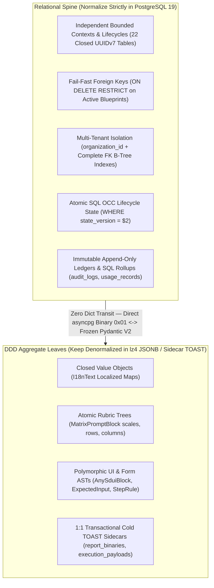

<required_context_rules>
  <rule>@[.agents/rules/00-antigravity-core.md]</rule>
  <rule>@[.agents/rules/01-python-backend.md]</rule>
  <rule>@[.agents/rules/02_flutter_desktop.md]</rule>
  <rule>@[.agents/rules/03_seed_vault.md]</rule>
  <rule>@[.agents/rules/04_directory_reference.md]</rule>
  <rule>@[.agents/rules/05_llm_architecture.md]</rule>
  <knowledge_item>@[ki_api_router_ssot_governance.md]</knowledge_item>
  <knowledge_item>@[ki_deterministic_hardening_state.md]</knowledge_item>
  <knowledge_item>@[ki_frontend_iam_role_segregation.md]</knowledge_item>
  <knowledge_item>@[ki_global_config_sovereignty.md]</knowledge_item>
  <knowledge_item>@[ki_god_code_prevention.md]</knowledge_item>
  <knowledge_item>@[ki_mcp_gateway_architecture.md]</knowledge_item>
  <knowledge_item>@[ki_router_ssot_and_crud_clone_lifecycle.md]</knowledge_item>
  <knowledge_item>@[ki_zero_permissive_typing.md]</knowledge_item>
</required_context_rules>

# EPIC 165: Zero-Compromise PostgreSQL 19 Schema Sovereignty, Pragmatic Normalization & Fail-Fast Persistence

> [!NOTE]
> **Scientific & Industrial Validation (2025-2026)**
> Modern high-assurance analytical AI platforms operating on PostgreSQL 19 enforce a hybrid relational-document storage topology:
> 1. **Relational Spine with `JSONB` / `lz4` TOAST Aggregate Leaves**: Bounded contexts, multi-tenant ownership (`organization_id`), cross-aggregate dependencies, and high-frequency Optimistic Concurrency Control (`state_version`, `version`) are enforced via normalized RFC 9562 UUIDv7 primary/foreign keys, B-Tree indexes, and kernel-level `ON DELETE RESTRICT` / `ON DELETE CASCADE` constraints, while self-contained Domain-Driven Design (DDD) value trees (`I18nText`, `MatrixPromptBlock` rubrics, `AnySduiBlock` layouts, `StepRule` canvas topologies) remain atomic `JSONB` leaves validated at persistence boundaries via Rust-backed Pydantic V2 (`ConfigDict(strict=True, extra="forbid", frozen=True)`).
> 2. **1:1 Cold `lz4` TOAST Sidecar Separation (`execution_payloads`, `report_binaries`)**: Separating hot lifecycle and FinOps scalar rows (`executions`, `report_artifacts`) from multi-megabyte cold context, trace, and PDF binary payloads (`execution_payloads`, `report_binaries` with `COMPRESSION lz4`) prevents PostgreSQL MVCC tuple bloat during high-frequency DAG step updates while retaining 100% single-database ACID transactionality without local filesystem split-brain (`*_storage_path`).
> 3. **Single-Statement Atomic SQL Optimistic Concurrency Control (OCC) & SQLSTATE Fail-Fast Translation**: Executing `UPDATE executions SET ..., state_version = state_version + 1 WHERE id = $1 AND state_version = $2 RETURNING state_version` eliminates Time-of-Check to Time-of-Use (TOCTOU) race conditions inherent in two-step `SELECT`-then-`UPSERT` patterns, while deterministic translation of PostgreSQL `SQLSTATE 23503` (`ForeignKeyViolationError` -> HTTP 400 `ErrorCodes.DELETE_BLOCKED_BY_USAGE`) and `SQLSTATE 23505` (`UniqueViolationError` -> HTTP 409 `ErrorCodes.CONFLICT`) enforces kernel-level referential integrity across all API boundaries.

> [!IMPORTANT]
> **Pre-Production Zero-Compromise Mandate:** Quorum V2 is pre-production—zero historical production databases require live transitional shims, dual-column compatibility bridges, or permissive migration fallbacks. Only `@[backend_v2/seed/seed_data.json#L1-L50]` and `@[backend_v2/seed/seed_data.json#L1-L260]` (preserving 100% of human-authored qualitative prompts under `prompt_preservation_mandate`) must hydrate cleanly via `@[backend_v2/seed/run_seed.py#L671-L749]`. Under this greenfield freedom, this Epic eliminates **5 systemic persistence anti-patterns** (including the entire Firestore-era untyped `StorageDriver` dictionary layer, `system_configs` Single-Table Inheritance, `executions` dual-state/filesystem split-brain, V1 ghost repositories, and permissive `ON DELETE SET NULL` blueprint lobotomies) while preserving **6 textbook PostgreSQL 19 `JSONB` / `lz4` TOAST Aggregate Leaf patterns** where naive 1990s 3NF decomposition would actively harm performance and clone atomicity.

---

## 1. Goal Description & Background (Objective & Problem Statement)

### 1.1 First Principles: Pragmatic PostgreSQL 19 Normalization & Fail-Fast Referential Law

Optimal PostgreSQL 19 architecture for an analytical AI platform combines a **Strict Relational Spine** (enforcing Bounded Contexts, Opaque Stripe UUIDv7 Foreign Keys, B-Tree indexes, and atomic SQL Optimistic Concurrency Control) with **Typed `JSONB` / `lz4` TOAST Aggregate Leaves** (validated at persistence and API boundaries via Pydantic V2 `ConfigDict(strict=True, extra="forbid", frozen=True)`):



#### 1.1.1 Normalization Decision Matrix

| Architectural Criterion | Normalize to Dedicated SQL Table / Column | Keep Denormalized in Typed `JSONB` / Sidecar |
| :--- | :--- | :--- |
| **Bounded Context & Router SSOT** | Entities possess independent CRUD+Clone routers (`1 Entity = 1 Router SSOT`), RBAC policies, or distinct `EntityPrefix` IDs (`task_briefs`, `model_registries`, `mcp_gateways`). | Sub-objects exist solely inside one parent aggregate root and are authored, cloned, versioned, and deleted atomically with that parent (`MatrixRow`, `SduiBlock`, `I18nText`). |
| **Referential Integrity & Delete Semantics** | External aggregates reference the entity and require kernel-enforced `ON DELETE RESTRICT`, `ON DELETE CASCADE`, or audit-only `ON DELETE SET NULL`. | Never targeted by external Foreign Keys outside the parent aggregate (or captured inside immutable historical execution snapshots). |
| **Mutation Frequency & MVCC Tuple Width** | Scalar columns mutate independently at high frequency (`status`, `progress`, `state_version`) or append unboundedly (`audit_logs`, `usage_records`). | Document tree is compiled or saved as a cohesive unit and read in full on $O(1)$ primary-key lookup, or isolated in a 1:1 cold `lz4` sidecar table. |
| **Query & FinOps Aggregation Pattern** | Filtered, sorted, paginated, or aggregated across rows in SQL (`WHERE organization_id = $1`, `SUM(cost_usd)`). | Projected directly to Python/Flutter domain models after fetching the parent row by primary key. |

#### 1.1.2 Fail-Fast Referential Delete & Multi-Tenant Ownership Laws (Zero Silent Blueprint Lobotomy)

A critical distinction in textbook relational design—aligned directly with Layer 3 (`ErrorCodes.DELETE_BLOCKED_BY_USAGE`) of `@[ki_router_ssot_and_crud_clone_lifecycle.md]`—is **never using `ON DELETE SET NULL` on active blueprint, task assignment, or tenant ownership dependencies**:

* **`ON DELETE RESTRICT` (Fail-Fast Blueprint, Profile & Published Task Protection):** Mandatory whenever deleting a referenced target (`prompt_blocks`, `task_briefs`, `steps`, `output_profiles`, `model_registries`, `mcp_gateways`) would silently lobotomize an active `Step`, `OutputProfile`, `Workflow`, or published `ExecutionAssignment` (`execution_assignments.task_brief_id`, `execution_assignments.output_profile_id`, `execution_assignments.workflow_id`). `PostgresEntityAdapter` catches `asyncpg.ForeignKeyViolationError`, logs structured context via RFC 7807 Dual-Reporting (`ZORM003`), and raises `AppException(ErrorCodes.DELETE_BLOCKED_BY_USAGE, status_code=400)`.
* **`ON DELETE CASCADE` (Owned Child Aggregate & Strict Multi-Tenant Lifecycle):** Used when the child table has zero independent existence outside its parent (`report_binaries -> report_artifacts`, `execution_payloads -> executions`, `step_criteria_blocks -> steps`, `workflow_step_refs -> workflows`, `quorum_nodes / quorum_edges -> executions`, `output_profiles -> workflows`, `tenant_secrets.mcp_gateway_id -> mcp_gateways`) **and on all tenant-owned `organization_id` Foreign Keys** (`prompt_blocks`, `task_briefs`, `steps`, `workflows`, `output_profiles`, `execution_assignments`, `invitations`, `tenant_secrets`, `mcp_gateways`). System-owned templates MUST bind explicitly to `ROOT_SYSTEM` (`org_0195f3a0000070008000000000000001` on `SystemOrganizations`) with `organization_id UUID NOT NULL REFERENCES organizations(id) ON DELETE CASCADE`—never `ON DELETE SET NULL`, which would turn a deleted customer tenant's private rows into `organization_id = NULL` global `SYSTEM` templates.
* **`ON DELETE SET NULL` (Historical Actor Attribution Only):** Reserved exclusively for optional historical actor and execution linkage references (`users.created_by`, `executions.created_by`, `execution_assignments.assigned_user_id`, `execution_assignments.execution_id`) so user deletion never destroys immutable historical execution or audit records.

---

### 1.2 Current-to-Target Schema Sovereignty Matrix (16 Current Tables -> Closed 22-Table Target Topology)

Audited schema and driver sources: `@[backend_v2/database/migrations/001_pg19_uuidv7_schema.sql#L1-L407]`, `@[backend_v2/database/driver.py#L86-L207]`, `@[backend_v2/database/postgres/storage_driver.py#L186-L556]`, and `@[scripts/audit_zero_orm_strictness.py#L407-L427]`.

| Current Table / Layer | Current Anti-Pattern / State | Severity | Zero-Compromise Target Table(s) & Invariant |
| :--- | :--- | :--- | :--- |
| **Generic `StorageDriver` & Phantom Collections** (`audit_logs`, `usage`, `usage_aggregates`, `executions/{id}/audit_trails`, `global_settings`, `concepts`, `references`, `claims`, `banned_phrases`, `prompts`, `components`/`roles`, `task_blueprints`, `agents`) | Untyped Firestore-era `dict[str, Any]` driver (`PostgresStorageDriver._collections`) silently absorbing unmapped/invalid writes into volatile process RAM; `StorageBackend` still lists `FIRESTORE` and `LOCAL`. | **P0 CRITICAL** | **Decommission and drop the `StorageDriver` and `PostgresStorageDriver` layer completely.** Route 100% of active repositories (and the zero-storage-logic `UnifiedWorkflowRepository(uow_factory)` V2 composite protocol facade) through typed `EntityPersistencePort` (`QuorumUnitOfWork`). Create `audit_logs` (`aud_`) and `usage_records` (`usg_`); drop `usage_aggregates` shadow counters and all 8 dead V1 ghost repositories/protocols. Lock `StorageBackend` exclusively to `POSTGRES`. |
| **`PostgresStorageDriver.query` / `.count`** | `SELECT * FROM <table>` across all tenants + Python list comprehension filter/sort/slice + `copy.deepcopy` + broken filter keys (`user_id`, lowercase `"completed"`, dead `matrix_id`). | **P0 CRITICAL** | **Zero generic Python-side filtering.** Expose explicit typed query methods on `EntityPersistencePort` backed by parameterized `$1, $2` SQL `WHERE`, `ORDER BY`, `LIMIT`, and `SELECT COUNT(*)`. |
| **`system_configs`** | Single-Table Inheritance packing `SystemConfigModelRegistry` and `SystemConfigMCPGateways` with 0 shared domain columns, shared `sys_` prefix, ambiguous `workflows` FKs, and banned `parsing_mode` / `api_key` fields. | **P1 HIGH** | **Split into 2 tables & 2 `seed_data.json` collections:** `model_registries` (`mrg_`) and `mcp_gateways` (`mcp_`) with separate `ON DELETE RESTRICT` FKs on `workflows` and `ON DELETE CASCADE` FK on `tenant_secrets.mcp_gateway_id`. |
| **`executions`** | 41-column wide row with duplicate `steps` + `step_states`, duplicate `active_profile_id` + `output_profile_id`, `pdf_report_path` shadow cache, wide `profile_syntheses` JSONB on the hot row, `>100KB` local file offload (`*_storage_path`), physical `created_at`, and non-atomic `SELECT`-then-`UPSERT` OCC. | **P1 HIGH** | **Split into `executions` (lean lifecycle + FinOps scalars + canonical `steps` + `VIRTUAL` `created_at` + single-statement SQL OCC) + `execution_payloads` (1:1 `lz4` TOAST sidecar storing `raw_inputs`, `frozen_context` retaining `mcp_tool_audit`, `context_variables`, `execution_trace`, and Stage 2 `profile_syntheses`).** Drop `step_states`, `active_profile_id`, `pdf_report_path`, and `*_storage_path` outright with zero `@computed_field` shims while preserving `ExecutionRecord.profile_syntheses` (`dict[str, RenderedSynthesisCache]`) under `feature_sovereignty_mandate`. |
| **`task_briefs` <-> `execution_assignments`** (Reusable Task Templates vs. Published Cohort Assignments) | Macro 2-table split (`tbr_` template vs. `tsk_` per-recipient cohort assignment with optional `batch_id`) is textbook, **but** suffers from 5 implementation defects: (1) live mutable lookup without `task_brief_snapshot` on published assignments; (2) silent `strict=False` fallback returning `None` in `_validate_and_resolve_task_brief`; (3) `ON DELETE SET NULL` on `task_brief_id`/`output_profile_id` contradicting `DELETE_BLOCKED_BY_USAGE` + full-table Python scan in `_check_active_assignment_usage`; (4) `task_briefs.organization_id ON DELETE SET NULL` turning deleted tenant briefs into global `NULL`/`SYSTEM` briefs; (5) dual persistence (`TaskBriefRepositoryImpl` via `StorageDriver` vs. `EntityPersistencePort`) and missing `batch_id`/`task_brief_id`/`token_hash` SQL queries & indexes. | **P1 HIGH** | Preserve the 2-table `task_briefs` (1) <-> `execution_assignments` (N, grouped by indexed nullable `batch_id`) architecture, and harden: (1) freeze `task_brief_snapshot JSONB` (`TaskAssignmentBriefDTO | None`, paired via `CHECK ((task_brief_id IS NULL AND task_brief_snapshot IS NULL) OR (task_brief_id IS NOT NULL AND task_brief_snapshot IS NOT NULL))`) on `execution_assignments` at publication time; (2) drop the `strict=False` parameter in `_validate_and_resolve_task_brief` (100% Fail-Fast); (3) enforce **`ON DELETE RESTRICT`** on `execution_assignments.task_brief_id`, `output_profile_id`, and `workflow_id`; (4) enforce `organization_id UUID NOT NULL REFERENCES organizations(id) ON DELETE CASCADE` (using `ROOT_SYSTEM` UUIDv7 for system templates); (5) route `StudioTaskBriefService` directly through `EntityPersistencePort` and add $O(1)$ SQL queries + B-Tree indexes (`idx_execution_assignments_org_created`, `idx_execution_assignments_batch_id`, `idx_execution_assignments_task_brief_id`, `idx_execution_assignments_execution_id`). |
| **`steps` / `workflows` / `output_profiles`** | `steps.criteria_block_ids` and `workflows.steps[*].task_blueprint` JSONB arrays requiring $O(N)$ Python delete scans; missing `workflows.default_profile_id` FK; untyped `TEXT` on `output_profiles.*_target_block`; weak `ON DELETE SET NULL` on active block/registry FKs and `organization_id`; missing SQL OCC check on `workflows.version`. | **P1 HIGH** | Add `step_criteria_blocks` and `workflow_step_refs` junction/projection tables (`ON DELETE RESTRICT`); convert `variance_target_block` and `user_role_target_block` to `UUID` FKs with **`ON DELETE RESTRICT`**, and bind `workflows.default_profile_id` as `UUID REFERENCES output_profiles(id) ON DELETE NO ACTION DEFERRABLE INITIALLY DEFERRED` (deferrable to transaction `COMMIT` in PostgreSQL 19 while raising `SQLSTATE 23503` -> `ErrorCodes.DELETE_BLOCKED_BY_USAGE` on orphaned default profile deletes); upgrade `steps.*_block_id` and `workflows.*_id` from `SET NULL` to **`RESTRICT`**; enforce `organization_id UUID NOT NULL REFERENCES organizations(id) ON DELETE CASCADE` and atomic SQL `WHERE version = $2` OCC on `workflows`. |
| **`users`** | `created_by TEXT` instead of `UUID REFERENCES users(id)`; missing `organization_id` B-Tree index. | **P2 MEDIUM** | Convert `users.created_by` (and `executions.created_by`) to `UUID REFERENCES users(id) ON DELETE SET NULL`; add `idx_users_organization_id` and SQL `CHECK` constraint on `role`. |
| **`tenant_secrets`** | `scope = 'mcp_gateway'` stores unvalidated `target_identifier VARCHAR(128)` without FK cascade when an MCP gateway is deleted; missing org index. | **P2 MEDIUM** | Add `mcp_gateway_id UUID REFERENCES mcp_gateways(id) ON DELETE CASCADE` + SQL `CHECK` discriminator enforcing `mcp_gateway_id IS NOT NULL` iff `scope = 'mcp_gateway'`, plus `idx_tenant_secrets_org_id`. |
| **`prompt_blocks`** | Cohesive 4-category LLM prompt brick table (`matrix`, `system_rule`, `execution_persona`, `protocol`); lacks SQL discriminator `CHECK`, org index, and non-null `organization_id`; stale `sr_` prefix in `audit_database_atoms.py`. | **P2 LOW** | Keep 1 table (`prompt_blocks`); enforce `organization_id UUID NOT NULL REFERENCES organizations(id) ON DELETE CASCADE`; add SQL `CHECK` locking non-applicable nullable columns per `category_id`, add `idx_prompt_blocks_org_id`, and drop `EntityPrefix.STEP_REFERENCE` from `prompt_blocks` atom rules. |
| **`organizations`**, **`invitations`**, **`report_artifacts` + `report_binaries`**, **`quorum_nodes` + `quorum_edges`** | Clean normalized PostgreSQL 19 tables and `lz4` binary/graph sidecars (missing FK B-Tree indexes on `invitations` and `report_artifacts`, and physical `created_at` on `report_artifacts`/`report_binaries`). | **TEXTBOOK (Minor Polish)** | Preserve exact table designs; convert `report_artifacts.created_at` to `VIRTUAL` UUIDv7 extraction and add FK B-Tree indexes (`idx_invitations_org_id`, `idx_report_artifacts_execution_id`, `idx_report_artifacts_profile_id`). |

**Closed 22-Table Target PostgreSQL 19 Topology (`CLOSED_POSTGRES_TABLES`):**
Specifically and exhaustively: `organizations`, `users`, `invitations`, `tenant_secrets`, `model_registries`, `mcp_gateways`, `prompt_blocks`, `task_briefs`, `steps`, `step_criteria_blocks`, `workflows`, `workflow_step_refs`, `output_profiles`, `executions`, `execution_payloads`, `execution_assignments`, `report_artifacts`, `report_binaries`, `quorum_nodes`, `quorum_edges`, `audit_logs`, and `usage_records`.

---

### 1.3 Deep Forensic Analysis of Current Persistence Anti-Patterns (Findings 1–8 Verbatim)

#### Finding 1 [P0 CRITICAL]: Firestore-Era Generic `StorageDriver`, Silent Volatile RAM Fallback & Dead V1 Ghost Layer

* **Forensic Anchors:**
  * `@[backend_v2/database/driver.py#L86-L207]` (`type StorageDocument = dict[str, StorageValue]`, `backend_v2/database/driver.py#L1-L143`)
  * `@[backend_v2/database/postgres/storage_driver.py#L47-L76]`, `@[backend_v2/database/postgres/storage_driver.py#L186-L556]`, `@[backend_v2/database/postgres/storage_driver.py#L218-L247]`, and `@[backend_v2/database/postgres/storage_driver.py#L291-L324]` (`_CANONICAL_COLLECTION_ALIASES` and `self._collections` RAM fallback, `backend_v2/database/postgres/storage_driver.py#L1-L195`)
  * `@[backend_v2/database/postgres/entity_adapter/seed_and_collection_stage.py#L321-L362]` (`upsert_collection_document_row` swallowing `AppException`, `ValueError`, `KeyError`, `TypeError` and returning `False` with zero logging)
  * `@[backend_v2/models/enums.py#L272-L277]` (`FIRESTORE` and `LOCAL` enum remnants alongside `POSTGRES`)
  * `@[backend_v2/api/dependencies.py#L327-L336]` (wiring V1 ghost repositories `KnowledgeRepositoryImpl`, `AgentRepositoryImpl`, `ComponentRepositoryImpl`, `TaskBlueprintRepositoryImpl`)
* **Root Cause:** Quorum V2 currently maintains **two parallel persistence architectures** in violation of `single_pipeline_invariant_mandate` and `zero_compromise_cutover_mandate`:
  1. **Modern Hexagonal Zero-ORM Pipeline (`EntityPersistencePort` in `@[backend_v2/database/interfaces.py#L414-L447]`):** Used directly by `ExecutionAssignmentService`, `SecretService`, `TokenService` (defined in `auth/` alongside `AuthService`), and `PostgresGraphAdapter`—passing frozen Pydantic V2 models directly into parameterized `asyncpg` SQL.
  2. **Legacy NoSQL Dictionary Pipeline (`StorageDriver` / `PostgresStorageDriver`):** Hydrates `asyncpg` rows into Pydantic models inside `PostgresEntityAdapter`, **dumps them back into untyped `dict[str, Any]` JSON dicts**, `copy.deepcopy`s them inside `PostgresStorageDriver`, and re-hydrates them a second time inside `backend_v2/database/repositories/*.py`. Worse, whenever a collection name is absent from `_CANONICAL_COLLECTION_ALIASES` or fails validation in `upsert_collection_document_row`, `PostgresStorageDriver` **silently stores the document in `self._collections` process RAM** instead of raising `AppException`.
* **Active Runtime Failures Caused by This Dual Layer:**
  1. **100% Cross-Process Loss of MCP Grounding Audit Trails (`@[backend_v2/database/repositories/execution.py#L33-L110]`, `@[backend_v2/database/repositories/execution.py#L112-L218]`):** `_offload_payloads` strips `mcp_tool_audit` out of `frozen_context` and writes to `f"executions/{doc_id}/audit_trails"`, which has no SQL table—stranding MCP tool traces in the Arq worker's private RAM while FastAPI reads `mcp_tool_audit=[]` from PostgreSQL.
  2. **Volatile Compliance Audit Logs & Mutable Shadow Usage Counters (`@[backend_v2/database/repositories/audit.py#L26-L325]`, `@[backend_v2/services/usage_service.py#L25-L406]`):** Both `"audit_logs"` and `"usage"` vanish on restart, and `UsageService._upsert_usage_aggregates` maintains a secondary mutable counter collection `"usage_aggregates"` that directly violates `universal_ssot_and_normalization_mandate` (*"NEVER define secondary shadow tables"*).
  3. **Dead V1 Ghost Repositories & Silent RAM Sinks:** Unmounted V1 repositories—specifically and exhaustively `KnowledgeRepositoryImpl` (`@[backend_v2/database/repositories/knowledge.py#L30-L219]`), `ComponentRepositoryImpl` (`@[backend_v2/database/repositories/component.py#L17-L242]`), `AgentRepositoryImpl` (`@[backend_v2/database/repositories/components/agent.py#L17-L163]`), `RoleRepositoryImpl` (`@[backend_v2/database/repositories/components/role.py#L17-L145]`), `TaskBlueprintRepositoryImpl` (`@[backend_v2/database/repositories/components/task_blueprint.py#L18-L167]`), `MatrixRepositoryImpl` (`@[backend_v2/database/repositories/components/matrix.py#L18-L168]`), `ExecutionPersonaRepositoryImpl` (`@[backend_v2/database/repositories/components/execution_persona.py#L18-L145]`), `ExtractionProtocolRepositoryImpl` (`@[backend_v2/database/repositories/components/extraction_protocol.py#L18-L145]`), and `SystemRepositoryImpl.update_system_settings` (`doc_id="global_settings"` in `@[backend_v2/database/repositories/system.py#L198-L213]`)—have zero mounted V2 routers (`@[backend_v2/api/routers/system/configs.py#L71-L117]` serves static `StrictnessAnchor` enums only) yet remain wired in `dependencies.py`, `interfaces.py`, and constructor pass-throughs (`comp_repo: IComponentRepository | None`).

---

#### Finding 2 [P0 CRITICAL]: Full-Table `SELECT *` Scans, Broken Repository Filter Keys & Unauthenticated Token Loops

* **Forensic Anchors:**
  * `@[backend_v2/database/postgres/storage_driver.py#L424-L477]` (`query` and `count`)
  * `@[backend_v2/database/repositories/execution.py#L428-L451]`
  * `@[backend_v2/services/execution/assignment_service.py#L762-L778]` and `@[backend_v2/services/execution/assignment_service.py#L1706-L1722]`
  * `@[backend_v2/database/repositories/workflow.py#L33-L67]` and `@[backend_v2/main.py#L72-L130]`
* **Root Cause & Concrete Defects:**
  1. **Cross-Tenant Full-Table Hydration:** `PostgresStorageDriver.query()` executes `SELECT * FROM <table>` with zero `WHERE` or `LIMIT`, decompressing TOAST blobs across every tenant in PostgreSQL, converting Pydantic -> `dict` -> `deepcopy` -> Pydantic, and slicing in Python.
  2. **Broken Filter Keys Silently Returning Empty Sets:**
     * `ExecutionRepositoryImpl.get_all_executions` filters on `user_id`, whereas `ExecutionRecord` and `executions` define `created_by`—deterministically returning `[]` whenever `user_id` is supplied.
     * `ExecutionRepositoryImpl.get_recent_completed_executions` compares against lowercase `"completed"`, whereas `ExecutionStatus.COMPLETED` serializes as `"COMPLETED"`.
     * `ExecutionRepositoryImpl.count_executions_by_matrix` scans 100% of `executions` looking for a nonexistent V1 `matrix_id` path, always returning `0`.
  3. **$O(N)$ Unauthenticated Portal Token Scan:** `ExecutionAssignmentService._find_assignment_by_token_hash` fetches every `execution_assignments` row in the database into Python RAM on public `/by-token/{token}/preview` requests despite `token_hash TEXT NOT NULL UNIQUE` already owning an $O(1)$ unique B-Tree index in PostgreSQL.
  4. **Legacy Disk Fallbacks:** `WorkflowRepositoryImpl.get_workflow_by_id` still falls back to reading `data/workflows/{workflow_id}.json` from disk, and `main.py` still contains legacy `data/workflows` and `execution_trace_storage_path` disk checks.

---

#### Finding 3 [P1 HIGH]: `system_configs` Single-Table Inheritance Kitchen Sink & `seed_data.json` Schema Drift

* **Forensic Anchors:**
  * `@[backend_v2/database/migrations/001_pg19_uuidv7_schema.sql#L1-L407]` (lines 82–105 and 179–180)
  * `@[backend_v2/models/domain/system_config.py#L151-L208]` and `@[backend_v2/models/domain/system_config.py#L383-L443]`
  * `@[backend_v2/seed/seed_registry.py#L23-L34]` and `@[backend_v2/seed/seed_data.json#L1-L50]` (`@[backend_v2/seed/seed_data.json#L1-L260]`)
* **Root Cause:** Even though the API layer already enforces `1 Entity = 1 Router SSOT` with two separate routers (`/api/v2/studio/model-registry` and `/api/v2/studio/mcp-gateways` per `@[ki_router_ssot_and_crud_clone_lifecycle.md]`), persistence and seeding still cram `SystemConfigModelRegistry` and `SystemConfigMCPGateways` into one `system_configs` table under one shared `sys_` prefix:
  * **Zero Shared Domain Columns:** Model registries leave 7 MCP columns `NULL`/unused; MCP gateways leave `default_provider` and `tier_definitions` `NULL`.
  * **Cross-Type Foreign Key Vulnerability:** `workflows.model_registry_id` and `workflows.mcp_gateway_id` both reference `system_configs(id)` and validate `^sys_[a-fA-F0-9]{32}$`—PostgreSQL cannot reject binding an MCP Gateway UUID into `model_registry_id` or vice versa, and cannot enforce `NOT NULL` on `tier_definitions` or `endpoint_url`.
  * **Orphaned BYOK MCP Secrets:** `tenant_secrets` (`@[backend_v2/database/migrations/001_pg19_uuidv7_schema.sql#L1-L407]`, lines 108–133) stores `target_identifier = "sys_..."` as plain `VARCHAR(128)` when `scope = 'mcp_gateway'`, lacking a cascading Foreign Key to clean up encrypted secrets when a custom MCP gateway is deleted.
  * **Banned Legacy Keys in `ModelProfile` & `seed_data.json`:** `ModelProfile` still permits `api_key: str | None` (violating 100% DB-only BYOK `tenant_secrets` in `@[ki_global_config_sovereignty.md]`) and `parsing_mode: str | None`, and `@[backend_v2/seed/seed_data.json#L17-L205]` still contains 12 occurrences of banned `"parsing_mode": "STRUCTURED_JSON"`.

---

#### Finding 4 [P1 HIGH]: `executions` Intra-Row Duplication, Non-Transactional File Offload & Non-Atomic OCC

* **Forensic Anchors:**
  * `@[backend_v2/database/migrations/001_pg19_uuidv7_schema.sql#L1-L407]` (lines 249–330)
  * `@[backend_v2/models/domain/execution.py#L249-L520]` (`backend_v2/models/domain/execution.py#L221-L320`)
  * `@[backend_v2/services/execution/override_service.py#L36-L488]`
  * `@[backend_v2/services/report/compilation_service.py#L33-L301]`
  * `@[backend_v2/database/postgres/entity_adapter/execution_and_report_stage.py#L301-L420]`
* **Root Cause (5 Coupled Defects):**
  1. **Intra-Row State Duplication (`steps` vs. `step_states`):** Every step's `scorecard_atoms` and token metrics are duplicated in both `steps` (`JSONB` list) and `step_states` (`JSONB` map). `ExecutionOverrideService.override_atom` mutates `step_states` without updating `steps`, causing immediate post-override split-brain, while `ReportCompilationService` injects synthetic `"sys_render_{profile_id}"` keys into `step_states` in violation of `ban_heuristic_identifier_matching`.
  2. **Duplicate Profile Foreign Keys (`active_profile_id` vs. `output_profile_id`):** Two overlapping nullable Foreign Keys to `output_profiles(id)` exist on the same `executions` row.
  3. **Shadow `pdf_report_path` Cache & Misplaced Hot-Row `profile_syntheses` Payload:** `pdf_report_path` duplicates binary report location owned authoritatively by `report_artifacts` + `report_binaries` (`universal_ssot_and_normalization_mandate`), whereas `profile_syntheses` (`dict[str, RenderedSynthesisCache]`, populated by Stage 2 `synthesis_worker.py` and consumed by `BlueprintTransformer`, `DistributionFormatter`, `SynthesisDistiller`, `ExecutionOverrideService.clear_profile_synthesis`, `ReportCompilationService`, and Flutter `ProfileSynthesisEntryDto`) has no column in `report_artifacts` (`@[backend_v2/models/domain/report_artifact.py#L22-L79]`) and bloats the hot `executions` tuple instead of residing in the 1:1 cold `lz4` `execution_payloads` sidecar (`feature_sovereignty_mandate`).
  4. **Non-Transactional Filesystem Offload (`*_storage_path`):** Offloading `>100KB` `frozen_context`, `execution_trace`, and `context_variables` blobs to `data/files/executions/{id}/*.json` splits one logical record across PostgreSQL and local disk without ACID rollback guarantees.
  5. **TOCTOU Race in Optimistic Concurrency Control (`save_execution_row`):** `save_execution_row` executes a separate `SELECT state_version` before `INSERT ... ON CONFLICT (id) DO UPDATE`, allowing two concurrent writers reading the same `state_version` to pass the check and clobber each other instead of enforcing an atomic single-statement `UPDATE ... SET state_version = state_version + 1 WHERE id = $1 AND state_version = $2`.

---

#### Finding 5 [P1 HIGH]: `task_briefs` <-> `execution_assignments` Published Cohort Mutability, Silent `strict=False` Fallback & Multi-Tenant `ON DELETE SET NULL` Escalation

* **Forensic Anchors:**
  * `@[docs/implementationplans/TRACKER_Independent_Task_Briefs_Architecture.md#L1-L120]`
  * `@[backend_v2/database/migrations/001_pg19_uuidv7_schema.sql#L1-L407]` (`task_briefs` and `execution_assignments` DDL, lines 400–485)
  * `@[backend_v2/models/domain/execution.py#L541-L677]`, `@[backend_v2/models/auth.py#L109-L128]`, and `@[backend_v2/services/studio/auth_validator.py#L30-L54]`
  * `@[backend_v2/services/studio/task_brief_service.py#L29-L255]` (`_check_active_assignment_usage`)
  * `@[backend_v2/services/execution/assignment_service.py#L150-L1959]` (`_validate_and_resolve_task_brief`)
* **Architectural Verdict on the 2-Table Split (`task_briefs` vs. `execution_assignments`):**
  * Separating reusable **Task Brief Templates (`task_briefs`, `tbr_<hex32>`)** from **Published Cohort Assignments (`execution_assignments`, `tsk_<hex32>`)** is **100% textbook relational design** (1:N Definition/Catalog vs. Dispatched Recipient Instance). Extracting `task_briefs` out of `prompt_blocks` cured the Single-Table Inheritance smell where human task briefs carried 14 `NULL` BARS matrix columns.
  * Modeling a published subset of recipients (`POST /api/v2/assignments/batch`, 1 to 500 recipients) as individual rows in `execution_assignments` sharing a cohort `batch_id UUID` is also the right relational grain: each recipient requires an independent single-use token digest (`token_hash TEXT NOT NULL UNIQUE`), an independent state lifecycle (`status: pending -> activated -> submitted -> expired/revoked`), an independent activation countdown (`activated_at` + `relative_duration_seconds`), independent `draft_inputs`, and a 1:1 `execution_id` link, while avoiding a 3-table join on hot portal token lookups.
* **Five Concrete Structural Defects in the Current Implementation:**
  1. **Retroactive Mutation of Published Cohort Assignments (`immutable_history_snapshot` Violation):** `execution_assignments` stores only `task_brief_id` and resolves `TaskBrief` dynamically at preview/list time (`_validate_and_resolve_task_brief`). If an administrator edits `TaskBrief.instruction_text` in Studio after publishing a task to a cohort—or after assignees have already submitted responses—every published and historical assignment retroactively renders the modified instructions, falsifying the historical audit trail of what the assignee actually answered.
  2. **Silent `strict=False` Fallback Compromise:** `_validate_and_resolve_task_brief` defines `strict: bool = True`, and both `preview_assignment` and `_to_hydrated_assignment_response` pass `strict=False`. If `task_brief_repo` is unconfigured, the brief row is missing, or tenant ownership fails, the service silently returns `task_brief=None` instead of crashing Fail-Fast with `AppException` (`zero_backward_compatibility_planning_ban`).
  3. **`ON DELETE SET NULL` vs. `ON DELETE RESTRICT` Contradiction:** SQL declares `task_brief_id UUID REFERENCES task_briefs(id) ON DELETE SET NULL` (and `output_profile_id ... ON DELETE SET NULL`), which silently strips task instructions from published assignments on DB delete, while `StudioTaskBriefService._check_active_assignment_usage` loads 100% of `execution_assignments` across all tenants into Python RAM (`list_execution_assignments()`) to raise `ErrorCodes.DELETE_BLOCKED_BY_USAGE`.
  4. **Critical Multi-Tenant Leak via `organization_id ON DELETE SET NULL`:** `SystemOrganizations.is_system(org_id)` evaluates `return not org_id or org_id in (cls.ROOT_SYSTEM.value, "SYSTEM")`. Because `organization_id IS NULL` means "globally accessible `SYSTEM` template", declaring `organization_id UUID REFERENCES organizations(id) ON DELETE SET NULL` on `task_briefs`, `prompt_blocks`, `steps`, `workflows`, and `output_profiles` means that deleting a customer tenant organization sets its private rows' `organization_id` to `NULL`—**instantly promoting that customer's private task briefs and workflows into global `SYSTEM` resources visible to all other tenants**.
  5. **Dual Persistence Pipeline & Missing Cohort Indexes:** `StudioTaskBriefService` persists `task_briefs` through legacy `TaskBriefRepositoryImpl` (`StorageDriver`) while `ExecutionAssignmentService` persists `execution_assignments` through `EntityPersistencePort` (`QuorumUnitOfWork`), and `execution_assignments` lacks B-Tree indexes on `(organization_id, created_at DESC)`, `(batch_id)`, `(task_brief_id)`, and `(execution_id)`.

---

#### Finding 6 [P2 MEDIUM]: Permissive `SET NULL` Blueprint FKs, Untyped `TEXT` IDs, Non-Virtual `created_at` & Missing Indexes

* **Forensic Anchors:** `@[backend_v2/database/migrations/001_pg19_uuidv7_schema.sql#L1-L407]`, `@[backend_v2/database/repositories/components/prompt_block.py#L18-L268]`, `@[scripts/audit_database_atoms.py#audit_collection]`.
* **Concrete Schema Sovereignty Gaps:**
  1. **Permissive `ON DELETE SET NULL` Violating Fail-Fast Layer 3:** `steps.role_block_id`, `steps.extraction_protocol_block_id`, `steps.execution_persona_block_id`, `workflows.mcp_gateway_id`, `workflows.model_registry_id`, `execution_assignments.task_brief_id`, and `execution_assignments.output_profile_id` currently declare `ON DELETE SET NULL`, which silently corrupts active blueprints or published assignments if triggered directly instead of enforcing `ON DELETE RESTRICT` (`ErrorCodes.DELETE_BLOCKED_BY_USAGE`).
  2. **Missing & Untyped `TEXT` Foreign Keys:** `workflows.default_profile_id UUID` has no `FOREIGN KEY` constraint; `output_profiles.variance_target_block` and `user_role_target_block` store `blk_<hex32>` IDs as raw `TEXT` with zero DB referential check; `users.created_by` and `executions.created_by` use `TEXT` instead of `UUID REFERENCES users(id) ON DELETE SET NULL`.
  3. **Physical Duplicate `created_at` Columns & Historical Scrubbing Bloat in Migration SQL:** `executions`, `report_artifacts`, and `report_binaries` store physical `TIMESTAMPTZ DEFAULT CURRENT_TIMESTAMP` columns instead of zero-storage `GENERATED ALWAYS AS (uuid_extract_timestamp(id)) VIRTUAL` (`zero_orm_ddl_column_evolution_and_preflight_mandate`), and `001_pg19_uuidv7_schema.sql` carries legacy dirty-data `DELETE` / `UPDATE` scrubbing blocks (lines 101–105, 451–485, 533–576) that are unnecessary in a clean pre-production schema seeded from `seed_data.json`.
  4. **Missing Foreign Key & Tenant B-Tree Indexes Across 14 Tables:** Only `task_briefs` and `quorum_nodes`/`quorum_edges` have secondary indexes; all other Foreign Keys and `organization_id` predicates trigger sequential scans on tenant queries and `RESTRICT`/`CASCADE` checks.
  5. **`steps.criteria_block_ids` Full-Table Delete Guard:** `PromptBlockRepositoryImpl.delete_prompt_block` loads every step in Python to check `criteria_block_ids` membership instead of enforcing a normalized `step_criteria_blocks` junction table with `ON DELETE RESTRICT`.

---

#### Finding 7 [P0 CRITICAL]: Complete Forensic Catalog of Silent Error Swallows & Missing Fail-Fast Paths Across Adapter, Repository & Service Boundaries (12 Sites)

A line-by-line audit of `backend_v2/database/postgres/`, `backend_v2/database/repositories/`, `backend_v2/services/execution/`, and `backend_v2/services/usage_service.py` against `universal_fail_fast`, `rfc7807_dual_reporting_mandate`, `the_duct_tape_ban`, and `zero_service_layer_fallbacks` reveals **12 concrete silent error swallows, silent fallback defaults, and non-RFC-7807 exception paths** that must be eradicated:

| # | Forensic Location | Current Silent Swallow / Non-Fail-Fast Behavior | Mandatory Fail-Fast Replacement |
| :--- | :--- | :--- | :--- |
| **1** | `@[backend_v2/database/postgres/entity_adapter/seed_and_collection_stage.py#L293-L318]` | Catches `except AppException: return None` and returns `None` on unknown collection names—**silently disguising PostgreSQL connection timeouts (`STORAGE_ACCESS_FAILED`), corrupt rows (`VALIDATION_FAILED`), and invalid UUID prefixes as `None` (HTTP 404 Not Found)**. | Drop `get_collection_document_row` (along with the generic collection dictionary layer); in all typed `get_*_row` methods, propagate `AppException` (`STORAGE_ACCESS_FAILED` / `VALIDATION_FAILED`) immediately and return `None` strictly when `await conn.fetchrow(...) is None`. |
| **2** | `@[backend_v2/database/postgres/entity_adapter/seed_and_collection_stage.py#L321-L362]` (`list_`, `upsert_`, `delete_`, `clear_collection_document_row`) | `upsert_collection_document_row` injects `payload.setdefault("type", "model_registry")` and catches `(AppException, ValueError, KeyError, TypeError)` -> `return False` with zero `logger.error`; `delete_collection_document_row` catches `AppException` -> `return False`; `list_` and `clear_` return `[]` / `None` on unmapped collections. | Drop all 5 generic `*_collection_document*` functions. Replace `delete_collection_document` with typed `delete_<entity>(id)` methods that validate UUIDv7 prefixes Fail-Fast (`ErrorCodes.VALIDATION_FAILED`) and never swallow `AppException`. |
| **3** | `@[backend_v2/database/postgres/storage_driver.py#L186-L556]` | When a collection is unmapped or `upsert_collection_document` returns `False`, silently falls back to `self._collections` in-memory dict (stranding `audit_logs`, `usage`, `usage_aggregates`, `executions/{id}/audit_trails`, and `global_settings` in volatile RAM). | Drop `PostgresStorageDriver` and `StorageDriver` completely (`ZORM008`). |
| **4** | `@[backend_v2/database/postgres/entity_adapter/iam_and_system_stage.py#L915-L971]`, `@[backend_v2/database/postgres/entity_adapter/prompt_block_and_step_stage.py#L143-L240]`, `@[backend_v2/database/postgres/entity_adapter/workflow_and_profile_stage.py#L209-L250]`, `@[backend_v2/database/postgres/entity_adapter/execution_and_report_stage.py#L241-L298]`, `@[backend_v2/database/postgres/graph_adapter.py#L433-L754]`, `@[backend_v2/database/repositories/identity.py#L28-L310]` | Only `hydrate_system_config_row` wraps `.model_validate()` in `try...except ValidationError` -> `logger.error` + `AppException(ErrorCodes.VALIDATION_FAILED)`. All other **12 table hydrators** (`organization`, `user`, `invitation`, `tenant_secret`, `execution_assignment`, `prompt_block`, `step`, `workflow`, `output_profile`, `task_brief`, `execution`, `report_artifact`), `get_report_binary_row`, `_hydrate_proposition_node`, and `IdentityRepositoryImpl.get_organization`/`get_user`/`get_user_by_email` call `.model_validate(..., strict=False)` unwrapped—leaking raw `ValidationError` without RFC 7807 `logger.error` or `AppException`. | Extract a single SSOT helper `validate_hydrated_row(model_cls_or_adapter, payload, *, table_name: str, entity_id: str) -> T` in `coercion_and_constants.py` that catches `ValidationError`, logs `logger.error` with `ErrorCodes.VALIDATION_FAILED`, `table_name`, and `entity_id`, and raises `AppException(ErrorCodes.VALIDATION_FAILED, status_code=500)`. Enforce across 100% of row hydrators. |
| **5** | `@[backend_v2/database/postgres/entity_adapter/prompt_block_and_step_stage.py#L143-L240]` & `@[backend_v2/database/postgres/entity_adapter/iam_and_system_stage.py#L915-L971]` | `hydrate_prompt_block_row` uses an `if/elif/else` chain where any unknown or corrupted `category_id` **silently falls through to `else: return SystemRulePromptBlock.model_validate(...)`** (`pydantic_discriminated_union_mandate` violation). Similarly, `hydrate_system_config_row` falls through to `SystemConfigModelRegistry` for any `row["type"] != "mcp_gateways"`. | Dispatch `hydrate_prompt_block_row` strictly through `PromptBlockAdapter.validate_python(payload, strict=False)` inside `validate_hydrated_row(...)` so any invalid `category_id` crashes Fail-Fast with `ErrorCodes.VALIDATION_FAILED`; split `system_configs` into dedicated `hydrate_model_registry_row` and `hydrate_mcp_gateway_row` functions. |
| **6** | `@[backend_v2/database/postgres/entity_adapter/coercion_and_constants.py#L289-L334]` & `delete_*` handlers | Catches `Exception` and translates **all** `asyncpg` database errors indiscriminately into HTTP 500 `ErrorCodes.STORAGE_ACCESS_FAILED`—masking PostgreSQL `ForeignKeyViolationError` (`SQLSTATE 23503`) on `ON DELETE RESTRICT` and `UniqueViolationError` (`SQLSTATE 23505`) on `UNIQUE` constraints. | Centralize an SSOT `translate_postgres_exception(exc, *, operation: str, table_name: str, entity_id: str) -> AppException` helper in `coercion_and_constants.py`: map `SQLSTATE 23503` on `DELETE` to HTTP 400 `ErrorCodes.DELETE_BLOCKED_BY_USAGE`, `SQLSTATE 23503` on `INSERT`/`UPDATE` to HTTP 422 `ErrorCodes.VALIDATION_FAILED`, `SQLSTATE 23505` to HTTP 409 `ErrorCodes.CONFLICT`, and transport/I/O errors to HTTP 500 `ErrorCodes.STORAGE_ACCESS_FAILED` (always preceded by RFC 7807 `logger.error`). |
| **7** | `@[backend_v2/services/execution/assignment_service.py#L150-L1959]` (`_validate_and_resolve_task_brief`) | `strict: bool = False` in `preview_assignment` and `_to_hydrated_assignment_response` silently returns `None` when `task_brief_repo` is missing, the `TaskBrief` row is missing, or tenant access fails. | Drop the `strict` parameter completely. Resolve published assignment instructions from the immutable `task_brief_snapshot` column (and fail fast with `ResourceNotFoundError` / `AuthorizationError` when validating `task_brief_id` at assignment creation). |
| **8** | `@[backend_v2/database/repositories/execution.py#L30-L481]` (`_hydrate_payloads` & `update_execution`) | (1) `_hydrate_payloads` silently replaces an empty/corrupt offloaded `execution_trace` file (`not blob_data.strip()`) with `[]` if status is `PENDING`/`RUNNING`; (2) `update_execution` silently defaults missing `state_version` to `1` and returns `False` instead of raising `ResourceNotFoundError` when `existing_doc` is missing during OCC update. | Eliminate filesystem blob offload (`*_storage_path`) via the transactional `execution_payloads` table; enforce single-statement SQL OCC (`UPDATE executions SET ..., state_version = state_version + 1 WHERE id = $1 AND state_version = $2`), distinguishing missing `id` (`ResourceNotFoundError` 404) from mismatched `state_version` (`ErrorCodes.CONFLICT` 409). |
| **9** | `@[backend_v2/database/repositories/workflow.py#L30-L394]` | (1) `get_workflow_definition` falls back to `data/workflows/{id}.json` on disk; (2) `get_step_by_id` falls back to scanning all `workflows` and validating `StepRule` references in `wf["steps"]` as `Step` models; (3) `create_workflow` / `create_step` use `setdefault("version", 1)` and `setdefault("status", "draft")`. | Drop disk fallback and dead embedded-step scan in `get_step_by_id`; route `Workflow` and `Step` directly through `EntityPersistencePort` using strongly typed `Workflow` and `Step` domain models with backend-generated UUIDv7 IDs. |
| **10** | `@[backend_v2/database/repositories/system.py#L25-L213]` | `update_system_settings` writes `doc_id="global_settings"` into volatile RAM; `create_system_config` falls back to generating non-UUIDv7 `doc_id = f"cfg_{config_data.type}"` when `id` is falsy. | Drop `update_system_settings` and `get_system_settings` (along with `SystemSettingsDTO`, created in legacy V1 config layer); require canonical `mrg_<hex32>` and `mcp_<hex32>` UUIDv7 IDs on `SystemConfigModelRegistry` and `SystemConfigMCPGateways` via `EntityPersistencePort`. |
| **11** | `@[backend_v2/database/postgres/graph_adapter.py#L433-L754]` (`_MATERIALIZE_WAVE_SQL`) | `inserted_edges` CTE uses `ON CONFLICT (run_id, source_id, target_id, relation_type) DO NOTHING RETURNING edge_id`, silently dropping updated `causal_weight` values and omitting conflicting edges from `RETURNING`. | Use `ON CONFLICT (run_id, source_id, target_id, relation_type) DO UPDATE SET causal_weight = EXCLUDED.causal_weight RETURNING edge_id` so wave edge materialization is 100% deterministic and idempotent. |
| **12** | `@[backend_v2/services/usage_service.py#L25-L406]` (`get_usage_report`) & `@[backend_v2/database/repositories/identity.py#L28-L310]` (`get_org_usage_total`) | (1) `get_usage_report` falls back from shadow `usage_aggregates` to `usage_records`, and if `get_organization(entity_id)` returns `None`, **silently leaves `quota_limit_usd=None`** instead of raising `ResourceNotFoundError`; (2) `get_org_usage_total` sums `executions.cost_estimate` in Python, silently ignoring `cost_estimate is None` rows and out-of-band `usage_records`. | Compute both `get_usage_report` and `check_quota` directly from the authoritative `usage_records` table via parameterized SQL `SUM(...)` / `COUNT(*)`; raise `AppException(ErrorCodes.RESOURCE_NOT_FOUND, status_code=404)` if the target `organization_id` does not exist. |

---

#### Finding 8 [P0 CRITICAL]: Non-Swallow Security (IDOR), Transactional FK Ordering, OCC & CRUD+Clone Lifecycle Violations Across Studio Services

Beyond silent error swallows and table normalization, auditing the Studio service and repository boundary against `in_place_upsert_standard_mandate`, `id_backend_generation_authority_mandate`, `uow_transactional_concurrency_mandate`, `service_tenant_rbac_isolation_mandate`, `english_language_mandate`, and `hermetic_test_fixtures_mandate` reveals **6 additional high-impact architectural defects**:

1. **[P0 SECURITY — Cross-Tenant IDOR Overwrite & Client-Defined ID Creation on `PUT`]:**
   * `@[backend_v2/services/studio/prompt_block_service.py#L31-L279]` (`save_prompt_block`), `@[backend_v2/services/studio/workflow_service.py#L47-L929]` (`save_workflow` and `save_step`), and `@[backend_v2/services/studio/output_profile_service.py#L26-L322]` (`save_output_profile`) call `enforce_modification_rights(initiator, data.organization_id)` on the **untrusted request payload** without first fetching `existing` from PostgreSQL and verifying `enforce_modification_rights(initiator, existing.organization_id)`. Any authenticated `ADMIN` of Tenant A sending `PUT /api/v2/studio/workflows/{id_of_Tenant_B_or_ROOT_SYSTEM}` with `data.organization_id = "org_A"` passes RBAC and **overwrites and hijacks Tenant B's or `ROOT_SYSTEM`'s entity in-place**.
   * Furthermore, all 5 Studio `save_*` methods (including `@[backend_v2/services/studio/task_brief_service.py#L29-L255]`) allow external `PUT /{id}` callers to insert brand-new rows with client-invented UUIDs when `existing is None` because `create_*_draft` and `clone_*` delegate to public `save_*`. Public `save_*` MUST strictly enforce the 4-Phase In-Place Upsert Protocol (`existing is None -> raise ResourceNotFoundError` and preserve `existing.organization_id` for non-`ROOT` callers), while `create_*_draft` and `clone_*` invoke a private `_insert_validated_*` helper.
2. **[P0 CRASH & TORN WRITES — Inverted FK Insertion Order in `clone_workflow` & Multi-Autocommit Tears]:**
   * In `@[backend_v2/services/studio/workflow_service.py#L47-L929]`, `clone_workflow` executes `_clone_workflow_profiles` (inserting `output_profiles` with `workflow_id = new_id`) **before** `save_workflow(initiator, new_id, cloned_workflow)` across separate autocommitted transactions—guaranteed to crash in PostgreSQL 19 with `ForeignKeyViolationError` (`output_profiles_workflow_id_fkey`) whenever cloning a workflow with attached profiles.
   * Likewise, `save_workflow` + `_sync_output_profiles_for_workflow` and `@[backend_v2/database/repositories/identity.py#L28-L310]` (`delete_org_data`) mutate multiple tables across independent autocommitted connections instead of executing inside one atomic `async with uow:` transaction (`uow_transactional_concurrency_mandate`)—and with `ON DELETE CASCADE` on `organization_id`, `delete_org_data` reduces to a single atomic `DELETE FROM organizations WHERE id = $1`.
3. **[P1 HIGH — Missing `Workflow` Optimistic Concurrency Control & Broken V1 `AppendOnlyRepositoryBase`]:**
   * `uow_transactional_concurrency_mandate` requires OCC on both `ExecutionRecord` and `Workflow`, yet `@[backend_v2/database/postgres/entity_adapter/workflow_and_profile_stage.py#L253-L297]` overwrites `workflows.version` blindly without checking `WHERE version = $expected_version`, allowing silent lost updates between concurrent Studio editors.
   * `@[backend_v2/database/repositories/base.py#L39-L62]` (`AppendOnlyRepositoryBase._increment_version`, used in `@[backend_v2/database/repositories/components/prompt_block.py#L18-L268]`) appends `"_v2"` to UUIDv7 IDs and writes `"is_latest": False`, crashing `parse_prefixed_uuid7` and violating `OPAQUE_STRIPE_ID_REGEX`. `AppendOnlyRepositoryBase` must be dropped completely.
4. **[P1 HIGH — Missing Database-Level `workflow_step_refs` `ON DELETE RESTRICT` Guard for `Workflow.steps[*].task_blueprint`]:**
   * Preventing deletion of a `Step` referenced inside `workflows.steps` `JSONB` currently forces `@[backend_v2/services/studio/workflow_service.py#L47-L929]` (`delete_step`) to load 100% of all workflows across all tenants into Python RAM. Adding a lightweight projection table `workflow_step_refs (workflow_id UUID REFERENCES workflows(id) ON DELETE CASCADE, step_id UUID REFERENCES steps(id) ON DELETE RESTRICT, PRIMARY KEY (workflow_id, step_id))` synced atomically inside `upsert_workflow` preserves `Workflow.steps` `JSONB` for canvas ordering while enforcing kernel-level `ON DELETE RESTRICT` on `steps`.
5. **[P2 MEDIUM — Clone `slug` Semantics, Mixed Finnish in English Code & RBAC Read/List Asymmetry]:**
   * Per `@[ki_router_ssot_and_crud_clone_lifecycle.md]` and `slug_data_relation_ban`, Studio entity clones (`Workflow`, `Step`, `PromptBlock`, `OutputProfile`, `TaskBrief`, `ModelRegistry`) preserve `original.slug` as non-unique informational metadata, whereas `MCPGateway` clones (`@[backend_v2/services/studio/system_config_service.py#L44-L746]`) generate `{original.slug}_copy` / `{original.slug}_copy_N` matching `_SINGLE_UNDERSCORE_SLUG_PATTERN` (`^[a-z0-9]+(?:_[a-z0-9]+)*$`) for `{gateway.slug}__{tool_id}` namespacing—any hyphenated `-copy` fallback must be banned.
   * `create_workflow_draft` and `create_step_draft` in `@[backend_v2/services/studio/workflow_service.py#L47-L929]` hardcode mixed Finnish/English strings (`"en": "New Työnkulku"`, `"en": "New Askel"`) in violation of `english_language_mandate`.
   * `@[backend_v2/services/studio/system_config_service.py#L44-L746]` exhibits RBAC asymmetry: `list_mcp_gateways` permits `ADMIN` while `get_mcp_gateways` blocks `ADMIN` with `403`, and `get_all_system_configs` / `list_mcp_gateways` return `[]` instead of raising `PermissionDeniedError` for unauthorized roles (`VIEWER` / `USER`), while blocking `ADMIN` read-only access to model registries referenced by tenant workflows.
6. **[P2 MEDIUM — Missing Constraint-Enforcing `InMemoryUnitOfWork` / `InMemoryEntityAdapter` (`hermetic_test_fixtures_mandate`)]:**
   * Unit tests missed the `clone_workflow` FK crash and `ON DELETE SET NULL` behavior because `@[backend_v2/tests/fakes/in_memory_uow.py#L2010-L2084]` (`backend_v2/tests/fakes/in_memory_uow.py#L1-L561`) does not yet enforce `ON DELETE RESTRICT` (`DELETE_BLOCKED_BY_USAGE`), `ON DELETE CASCADE`, `UNIQUE` (`CONFLICT`), and `version`/`state_version` OCC across all 22 tables.

---

### 1.4 Canonical PostgreSQL 19 22-Table DDL & Pydantic V2 Schema Specifications

#### 1.4.1 Evolved PostgreSQL 19 DDL Definitions (`001_pg19_uuidv7_schema.sql`)

```sql
-- 0. Idempotent Pre-Production Schema Cutover Gate (when legacy STI system_configs exists on local Docker volumes)
DO $$
BEGIN
    IF EXISTS (
        SELECT 1 FROM information_schema.tables
        WHERE table_schema = 'public' AND table_name = 'system_configs'
    ) THEN
        DROP TABLE IF EXISTS
            report_binaries, report_artifacts, quorum_edges, quorum_nodes,
            execution_assignments, execution_payloads, executions,
            workflow_step_refs, step_criteria_blocks, output_profiles,
            workflows, steps, task_briefs, prompt_blocks,
            tenant_secrets, mcp_gateways, model_registries, system_configs,
            audit_logs, usage_records, invitations, users, organizations
        CASCADE;
    END IF;
END $$;

-- 1. model_registries (mrg_<hex32>) & mcp_gateways (mcp_<hex32>) replacing system_configs
-- Note: Zero UNIQUE constraint on slug (enforced by ZORM007); name is TEXT NOT NULL matching SystemConfigModelRegistry / SystemConfigMCPGateways.
CREATE TABLE IF NOT EXISTS model_registries (
    id UUID PRIMARY KEY DEFAULT uuidv7() CHECK (uuid_extract_version(id) = 7),
    slug TEXT,
    name TEXT NOT NULL,
    default_provider TEXT NOT NULL,
    tier_definitions JSONB NOT NULL,
    created_at TIMESTAMPTZ GENERATED ALWAYS AS (uuid_extract_timestamp(id)) VIRTUAL
);

CREATE TABLE IF NOT EXISTS mcp_gateways (
    id UUID PRIMARY KEY DEFAULT uuidv7() CHECK (uuid_extract_version(id) = 7),
    organization_id UUID NOT NULL REFERENCES organizations(id) ON DELETE CASCADE,
    slug TEXT NOT NULL,
    name TEXT NOT NULL,
    endpoint_url TEXT NOT NULL,
    transport_type TEXT NOT NULL,
    auth_type TEXT NOT NULL,
    auth_env_var TEXT,
    auth_header_name TEXT,
    timeout_seconds INTEGER NOT NULL CHECK (timeout_seconds >= 1 AND timeout_seconds <= 300),
    tools JSONB NOT NULL,
    created_at TIMESTAMPTZ GENERATED ALWAYS AS (uuid_extract_timestamp(id)) VIRTUAL
);
CREATE INDEX IF NOT EXISTS idx_mcp_gateways_org_id ON mcp_gateways(organization_id);

-- 2. tenant_secrets with cascading mcp_gateway_id Foreign Key (declared in CREATE TABLE + ALTER TABLE for ZORM007 parity)
ALTER TABLE tenant_secrets
    ADD COLUMN IF NOT EXISTS mcp_gateway_id UUID REFERENCES mcp_gateways(id) ON DELETE CASCADE;
CREATE INDEX IF NOT EXISTS idx_tenant_secrets_org_id ON tenant_secrets(organization_id);
CREATE INDEX IF NOT EXISTS idx_tenant_secrets_mcp_gateway_id ON tenant_secrets(mcp_gateway_id);

-- 3. step_criteria_blocks, workflow_step_refs & Deferrable Circular workflows.default_profile_id FK
CREATE TABLE IF NOT EXISTS step_criteria_blocks (
    step_id UUID NOT NULL REFERENCES steps(id) ON DELETE CASCADE,
    prompt_block_id UUID NOT NULL REFERENCES prompt_blocks(id) ON DELETE RESTRICT,
    position INTEGER NOT NULL CHECK (position >= 0),
    PRIMARY KEY (step_id, prompt_block_id)
);
CREATE INDEX IF NOT EXISTS idx_step_criteria_blocks_block_id ON step_criteria_blocks(prompt_block_id);

CREATE TABLE IF NOT EXISTS workflow_step_refs (
    workflow_id UUID NOT NULL REFERENCES workflows(id) ON DELETE CASCADE,
    step_id UUID NOT NULL REFERENCES steps(id) ON DELETE RESTRICT,
    PRIMARY KEY (workflow_id, step_id)
);
CREATE INDEX IF NOT EXISTS idx_workflow_step_refs_step_id ON workflow_step_refs(step_id);

-- Circular FK workflows.default_profile_id -> output_profiles(id) uses ON DELETE NO ACTION DEFERRABLE INITIALLY DEFERRED
-- (PostgreSQL 19 never defers ON DELETE RESTRICT; NO ACTION DEFERRABLE defers intra-transaction checks to COMMIT while raising SQLSTATE 23503 on orphan deletes).
ALTER TABLE workflows
    DROP CONSTRAINT IF EXISTS workflows_default_profile_id_fkey,
    ADD CONSTRAINT workflows_default_profile_id_fkey
        FOREIGN KEY (default_profile_id) REFERENCES output_profiles(id)
        ON DELETE NO ACTION DEFERRABLE INITIALLY DEFERRED;

-- 4. execution_assignments with 1:1 ExecutionAssignment Column Parity, Frozen Snapshot & ON DELETE RESTRICT
CREATE TABLE IF NOT EXISTS execution_assignments (
    id UUID PRIMARY KEY DEFAULT uuidv7() CHECK (uuid_extract_version(id) = 7),
    organization_id UUID NOT NULL REFERENCES organizations(id) ON DELETE CASCADE,
    workflow_id UUID NOT NULL REFERENCES workflows(id) ON DELETE RESTRICT,
    output_profile_id UUID REFERENCES output_profiles(id) ON DELETE RESTRICT,
    task_brief_id UUID REFERENCES task_briefs(id) ON DELETE RESTRICT,
    task_brief_snapshot JSONB,
    batch_id UUID,
    assigned_email TEXT NOT NULL,
    assigned_user_id UUID REFERENCES users(id) ON DELETE SET NULL,
    invited_role TEXT NOT NULL DEFAULT 'viewer' CHECK (invited_role IN ('root', 'admin', 'user', 'viewer')),
    token_hash TEXT NOT NULL UNIQUE,
    status TEXT NOT NULL DEFAULT 'pending' CHECK (status IN ('pending', 'activated', 'submitted', 'expired', 'revoked')),
    email_delivery_status TEXT NOT NULL DEFAULT 'pending' CHECK (email_delivery_status IN ('pending', 'sent', 'failed')),
    result_visibility TEXT NOT NULL DEFAULT 'confirmation_only' CHECK (result_visibility IN ('confirmation_only', 'immediate_report')),
    locked_inputs JSONB NOT NULL DEFAULT '{}'::jsonb,
    assignee_input_keys JSONB NOT NULL DEFAULT '[]'::jsonb,
    draft_inputs JSONB NOT NULL DEFAULT '{}'::jsonb,
    target_locale TEXT NOT NULL DEFAULT 'en',
    hard_deadline_at TIMESTAMPTZ,
    relative_duration_seconds INTEGER CHECK (relative_duration_seconds IS NULL OR relative_duration_seconds >= 60),
    activated_at TIMESTAMPTZ,
    submitted_at TIMESTAMPTZ,
    execution_id UUID REFERENCES executions(id) ON DELETE SET NULL,
    created_by UUID NOT NULL REFERENCES users(id) ON DELETE RESTRICT,
    created_at TIMESTAMPTZ GENERATED ALWAYS AS (uuid_extract_timestamp(id)) VIRTUAL,
    CONSTRAINT enforce_assignment_task_brief_snapshot_parity CHECK (
        (task_brief_id IS NULL AND task_brief_snapshot IS NULL)
        OR (task_brief_id IS NOT NULL AND task_brief_snapshot IS NOT NULL)
    )
);
CREATE INDEX IF NOT EXISTS idx_execution_assignments_org_created ON execution_assignments(organization_id, id DESC);
CREATE INDEX IF NOT EXISTS idx_execution_assignments_batch_id ON execution_assignments(batch_id);
CREATE INDEX IF NOT EXISTS idx_execution_assignments_task_brief_id ON execution_assignments(task_brief_id);
CREATE INDEX IF NOT EXISTS idx_execution_assignments_execution_id ON execution_assignments(execution_id);

-- 5. Lean 30-Column executions Table + 1:1 lz4 execution_payloads Sidecar Table (retaining profile_syntheses)
CREATE TABLE IF NOT EXISTS executions (
    id UUID PRIMARY KEY DEFAULT uuidv7() CHECK (uuid_extract_version(id) = 7),
    organization_id UUID NOT NULL REFERENCES organizations(id) ON DELETE CASCADE,
    workflow_id UUID NOT NULL REFERENCES workflows(id) ON DELETE RESTRICT,
    workflow_version INTEGER NOT NULL DEFAULT 1 CHECK (workflow_version >= 1),
    state_version INTEGER NOT NULL DEFAULT 1 CHECK (state_version >= 1),
    output_profile_id UUID REFERENCES output_profiles(id) ON DELETE SET NULL,
    status TEXT NOT NULL,
    target_locale TEXT NOT NULL,
    progress INTEGER CHECK (progress IS NULL OR (progress >= 0 AND progress <= 100)),
    status_message TEXT,
    steps JSONB NOT NULL DEFAULT '[]'::jsonb,
    source_identity_manifest JSONB NOT NULL DEFAULT '{}'::jsonb,
    is_resumable BOOLEAN NOT NULL DEFAULT FALSE,
    prompt_tokens BIGINT NOT NULL DEFAULT 0 CHECK (prompt_tokens >= 0),
    completion_tokens BIGINT NOT NULL DEFAULT 0 CHECK (completion_tokens >= 0),
    cached_tokens BIGINT NOT NULL DEFAULT 0 CHECK (cached_tokens >= 0),
    reasoning_tokens BIGINT NOT NULL DEFAULT 0 CHECK (reasoning_tokens >= 0),
    cumulative_synthesis_tokens BIGINT NOT NULL DEFAULT 0 CHECK (cumulative_synthesis_tokens >= 0),
    dag_cost_usd NUMERIC(14, 6) NOT NULL DEFAULT 0,
    cumulative_synthesis_cost NUMERIC(14, 6) NOT NULL DEFAULT 0,
    cost_estimate NUMERIC(14, 6) NOT NULL DEFAULT 0,
    models_used JSONB NOT NULL DEFAULT '{}'::jsonb,
    execution_summary JSONB,
    metadata JSONB,
    duration_ms BIGINT NOT NULL DEFAULT 0 CHECK (duration_ms >= 0),
    error TEXT,
    created_by UUID REFERENCES users(id) ON DELETE SET NULL,
    created_at TIMESTAMPTZ GENERATED ALWAYS AS (uuid_extract_timestamp(id)) VIRTUAL,
    updated_at TIMESTAMPTZ NOT NULL DEFAULT CURRENT_TIMESTAMP,
    completed_at TIMESTAMPTZ
);
CREATE INDEX IF NOT EXISTS idx_executions_org_id_created ON executions(organization_id, id DESC);
CREATE INDEX IF NOT EXISTS idx_executions_workflow_id ON executions(workflow_id);
CREATE INDEX IF NOT EXISTS idx_executions_created_by ON executions(created_by);
CREATE INDEX IF NOT EXISTS idx_executions_status ON executions(status);

CREATE TABLE IF NOT EXISTS execution_payloads (
    execution_id UUID PRIMARY KEY REFERENCES executions(id) ON DELETE CASCADE,
    raw_inputs JSONB COMPRESSION lz4 NOT NULL,
    frozen_context JSONB COMPRESSION lz4,
    context_variables JSONB COMPRESSION lz4 NOT NULL,
    execution_trace JSONB COMPRESSION lz4 NOT NULL,
    profile_syntheses JSONB COMPRESSION lz4 NOT NULL DEFAULT '{}'::jsonb,
    updated_at TIMESTAMPTZ NOT NULL DEFAULT CURRENT_TIMESTAMP
);

-- 6. Append-Only audit_logs (aud_<hex32>) & usage_records (usg_<hex32>) Ledgers
CREATE TABLE IF NOT EXISTS audit_logs (
    id UUID PRIMARY KEY DEFAULT uuidv7() CHECK (uuid_extract_version(id) = 7),
    organization_id UUID REFERENCES organizations(id) ON DELETE CASCADE,
    actor_id UUID REFERENCES users(id) ON DELETE SET NULL,
    execution_id UUID REFERENCES executions(id) ON DELETE CASCADE,
    event_type TEXT NOT NULL,
    resource_type TEXT NOT NULL,
    resource_id TEXT NOT NULL,
    details JSONB NOT NULL DEFAULT '{}'::jsonb,
    created_at TIMESTAMPTZ GENERATED ALWAYS AS (uuid_extract_timestamp(id)) VIRTUAL
);
CREATE INDEX IF NOT EXISTS idx_audit_logs_org_created ON audit_logs(organization_id, id DESC);
CREATE INDEX IF NOT EXISTS idx_audit_logs_execution_id ON audit_logs(execution_id);

CREATE TABLE IF NOT EXISTS usage_records (
    id UUID PRIMARY KEY DEFAULT uuidv7() CHECK (uuid_extract_version(id) = 7),
    organization_id UUID NOT NULL REFERENCES organizations(id) ON DELETE CASCADE,
    user_id UUID REFERENCES users(id) ON DELETE SET NULL,
    execution_id UUID REFERENCES executions(id) ON DELETE SET NULL,
    model_name TEXT NOT NULL,
    prompt_tokens BIGINT NOT NULL DEFAULT 0 CHECK (prompt_tokens >= 0),
    completion_tokens BIGINT NOT NULL DEFAULT 0 CHECK (completion_tokens >= 0),
    cached_tokens BIGINT NOT NULL DEFAULT 0 CHECK (cached_tokens >= 0),
    reasoning_tokens BIGINT NOT NULL DEFAULT 0 CHECK (reasoning_tokens >= 0),
    cost_usd NUMERIC(14, 6) NOT NULL DEFAULT 0 CHECK (cost_usd >= 0),
    created_at TIMESTAMPTZ GENERATED ALWAYS AS (uuid_extract_timestamp(id)) VIRTUAL
);
CREATE INDEX IF NOT EXISTS idx_usage_records_org_created ON usage_records(organization_id, id DESC);
CREATE INDEX IF NOT EXISTS idx_usage_records_execution_id ON usage_records(execution_id);
```

---

### 1.5 Quantitative Scope Summary

| Metric / Category | Count | Details |
| :--- | :--- | :--- |
| **PostgreSQL 19 Schema Topology** | **22 Tables** | `organizations`, `users`, `invitations`, `tenant_secrets`, `model_registries`, `mcp_gateways`, `prompt_blocks`, `task_briefs`, `steps`, `step_criteria_blocks`, `workflows`, `workflow_step_refs`, `output_profiles`, `executions`, `execution_payloads`, `execution_assignments`, `report_artifacts`, `report_binaries`, `quorum_nodes`, `quorum_edges`, `audit_logs`, `usage_records` |
| **Deleted Legacy Driver, V1 Ghost & Companion Test Files (`[DELETE]`)** | **21** | 11 production modules (`backend_v2/database/driver.py`, `backend_v2/database/postgres/storage_driver.py`, `backend_v2/models/domain/knowledge.py`, `backend_v2/database/repositories/knowledge.py`, `backend_v2/database/repositories/component.py`, `backend_v2/database/repositories/components/agent.py`, `backend_v2/database/repositories/components/role.py`, `backend_v2/database/repositories/components/task_blueprint.py`, `backend_v2/database/repositories/components/matrix.py`, `backend_v2/database/repositories/components/execution_persona.py`, `backend_v2/database/repositories/components/extraction_protocol.py`) + 10 companion unit test modules |
| **Backend Database, Model, Service, Worker, LLM & Seed Files (`[MODIFY]`)** | **74** | Migrations, `PostgresEntityAdapter` stages, `PostgresGraphAdapter`, `EntityPersistencePort`, `UnifiedWorkflowRepository(uow_factory)` V2 composite protocol facade, domain/DTO models (`execution.py`, `system_config.py`, `task_brief.py`, `auth.py`, `studio.py`, `output_profile.py`, `trace.py`, `node_execution.py`, `enums.py`), Studio/Execution/Orchestrator/Report/LLM/Worker callers, `seed_data.json`, `seed_registry.py`, `run_seed.py` |
| **Frontend Flutter Freezed Models & Views (`[MODIFY]`)** | **13** | `@[client_app_v2/lib/features/execution/models/execution_record.dart#L15-L162]`, `@[client_app_v2/lib/features/execution/models/execution_step.dart#L1-L45]`, `@[client_app_v2/lib/features/execution/views/execution_view.dart]`, `@[client_app_v2/lib/features/studio/models/model_config.dart]`, `@[client_app_v2/lib/features/studio/views/model_registry_view.dart]`, `@[client_app_v2/lib/features/studio/models/mcp_gateway.dart]`, Studio Freezed models (`task_brief.dart`, `workflow.dart`, `prompt_block.dart`, `output_profile.dart`), `@[client_app_v2/lib/core/models/enums.dart]` |
| **Audit Scripts, Fakes, Factories, Rules, KIs & Test Suites (`[MODIFY]` / `[NEW]`)** | **40** | `@[scripts/audit_zero_orm_strictness.py#L407-L427]`, `@[scripts/audit_database_atoms.py#L328-L786]`, `@[scripts/audit_technical_debt.py#L253-L579]`, `@[scripts/_ast_guardrails.py#L111-L130]`, `@[scripts/audit_dict_eradication.py#L169-L628]`, `@[scripts/audit_skills_architecture.py#L160-L175]`, operational seed/variance CLI scripts, `InMemoryUnitOfWork`, `InMemoryUnifiedWorkflowRepository`, `model_factories.py`, `.agents/rules/`, `[NEW]` `@[ki_zero_orm_postgres_enforcement.md]`, and companion test suites |

---

## 2. Architectural Impact & Compliance Matrix

### 2.1 Complexity Slayer (30% Deletion Test)

#### 2.1.1 Seven Structures That MUST NOT Be Over-Normalized into Additional Child Tables

1. **Cohort Assignments (`execution_assignments.batch_id`):** Keep published cohort assignments in the single `execution_assignments` table grouped by an indexed `batch_id UUID` + frozen `task_brief_snapshot JSONB` rather than splitting into a separate `assignment_batches` parent table + `execution_assignments` child table—keeping public magic-link `/by-token/{token}/preview`, `activate`, and `submit` lookups as single-row $O(1)$ operations with zero `JOIN` overhead.
2. **`I18nText` Localized Maps (`label`, `name`, `description`, `user_role_label`, `custom_preface`):** Keep as typed `JSONB` Value Objects (`dict[SystemLocale, str]`). Extracting an `i18n_translations` table adds 3–6 joins to every Studio read and slows `clone` with zero SQL analytical benefit.
3. **`MatrixPromptBlock` Rubric Hierarchy (`scales`, `rows`, `columns`, `TDAAssertion`, `ContrastiveExample`):** Keep inside `prompt_blocks` `JSONB`. A BARS matrix is an atomic DDD Aggregate Root authored, cloned, and compiled into prompts as one unit; historical evaluations snapshot atoms independently.
4. **`OutputProfile.content_blocks` (`AnySduiBlock`) & `Workflow.expected_inputs` (`ExpectedInput`):** Keep as typed `JSONB` AST trees validated via Pydantic V2 Discriminated Unions.
5. **`Workflow.steps` (`list[StepRule]` DAG Canvas Topology):** Keep DAG topological edges, `input_mapping`, and `output_key` inside `workflows.steps` `JSONB` (backed by a GIN containment index and lightweight `workflow_step_refs` `ON DELETE RESTRICT` guard) so Studio canvas saves and clones stay atomic single-row operations.
6. **1:1 Cold `lz4` TOAST Sidecars (`report_binaries` and new `execution_payloads`):** Keep multi-MB PDF bytes and cold execution traces/contexts in dedicated 1:1 PostgreSQL sidecar tables rather than merging them into hot metadata rows or shattering `ScorecardAtomDTO` / `TraceEvent` arrays into millions of EAV rows.
7. **Flat FinOps Scalar Columns on `executions` (`prompt_tokens`, `completion_tokens`, `cached_tokens`, `reasoning_tokens`, `dag_cost_usd`, `cost_estimate`):** Keep scalar `BIGINT` / `NUMERIC` columns directly on `executions` for sub-millisecond SQL rollups.

#### 2.1.2 Zero-Compromise Pre-Production Deletions (Zero Transitional Shims)

Because there is no production database legacy to coddle, the following layers and shims MUST be **dropped outright** rather than wrapped in adapters or `@computed_field` bridges:

* **Drop Generic NoSQL Driver Layer (Retaining `UnifiedWorkflowRepository(uow_factory)` as Pure V2 Composite Protocol Facade):** Decommission `backend_v2/database/driver.py`, `backend_v2/database/postgres/storage_driver.py`, generic `*_collection_document_row` dictionary functions in `seed_and_collection_stage.py`, and `StorageBackend.FIRESTORE` / `StorageBackend.LOCAL`. Retain `UnifiedWorkflowRepository(uow_factory: UnitOfWorkFactory)` (`@[backend_v2/database/repository.py#L25-L52]`) and `InMemoryUnifiedWorkflowRepository` (`@[backend_v2/tests/fakes/in_memory_repositories.py#L1515-L2185]`) strictly as a zero-storage-logic V2 composite protocol facade over the 9 active `EntityPersistencePort`-backed repositories (`Workflow`, `Execution`, `ReportArtifact`, `PromptBlock`, `TaskBrief`, `OutputProfile`, `Identity`, `Audit`, `System`)—eliminating unnecessary signature churn across ~95 worker/report/test callers while eradicating 100% of `StorageDriver` dictionary indirection.
* **Drop Dead V1 Ghost Protocols, Models & Repositories:** Decommission `IKnowledgeRepository` (`knowledge.py` + `models/domain/knowledge.py`), `IComponentRepository` (`component.py` + all dead `comp_repo` constructor pass-throughs across services, hooks, strategies, and workers), `IAgentRepository` (`agent.py`), `IRoleRepository` (`role.py`), `ITaskBlueprintRepository` (`task_blueprint.py`), `IMatrixRepository` (`matrix.py`), `IExecutionPersonaRepository` (`execution_persona.py`), `IExtractionProtocolRepository` (`extraction_protocol.py`), `SystemSettingsDTO` (`get_system_settings` / `update_system_settings`), `count_executions_by_matrix`, and `data/workflows/*.json` disk fallbacks.
* **Drop Mutable `usage_aggregates` Shadow Collection:** Decommission `upsert_usage_aggregate`, `UsageAggregateDTO`, `UsageAggregateUpdateDTO`, and `UsageService._upsert_usage_aggregates`; compute usage totals directly from append-only `usage_records` via indexed SQL `SUM(...)` / `COUNT(*)` queries.
* **Drop `ExecutionRecord.step_states`, `active_profile_id`, `pdf_report_path`, and `*_storage_path` Atomically (While Relocating `profile_syntheses` to `execution_payloads`):** Synchronize removal of `step_states`, `active_profile_id`, `pdf_report_path`, and `*_storage_path` across PostgreSQL DDL, Python `ExecutionRecord`, `ExecutionCreateDTO`, `ExecutionUpdateDTO`, `NodeExecutionUpdateDTO`, and Flutter Freezed `ExecutionRecord` in one atomic Full-Duplex cutover (`audit_dto_parity.py --fail-on-mismatch`) with **zero `@computed_field` compatibility shims**, while retaining `ExecutionRecord.profile_syntheses` (`dict[str, RenderedSynthesisCache]`) and storing it in `execution_payloads.profile_syntheses` (`COMPRESSION lz4`).
* **Drop `strict=False` Fallback in `ExecutionAssignmentService._validate_and_resolve_task_brief` & Nullable `organization_id` Fallbacks:** Require canonical `ROOT_SYSTEM` (`org_0195f3a0000070008000000000000001` on `SystemOrganizations`) on all system-owned tenant-scoped records and enforce 100% Fail-Fast resolution of `task_brief_snapshot` / `task_brief_id`.

---

### 2.2 Deprecations & Sunset List (`What We Will REMOVE`)

<demolish>
- `StorageDriver`
- `PostgresStorageDriver`
- `AppendOnlyRepositoryBase`
- `KnowledgeRepositoryImpl`
- `ComponentRepositoryImpl`
- `AgentRepositoryImpl`
- `RoleRepositoryImpl`
- `TaskBlueprintRepositoryImpl`
- `MatrixRepositoryImpl`
- `ExecutionPersonaRepositoryImpl`
- `ExtractionProtocolRepositoryImpl`
- `IKnowledgeRepository`
- `IComponentRepository`
- `IAgentRepository`
- `IRoleRepository`
- `ITaskBlueprintRepository`
- `IMatrixRepository`
- `IExecutionPersonaRepository`
- `IExtractionProtocolRepository`
- `InMemoryKnowledgeRepository`
- `InMemoryComponentRepository`
- `InMemoryAgentRepository`
- `InMemoryRoleRepository`
- `InMemoryTaskBlueprintRepository`
- `InMemoryMatrixRepository`
- `InMemoryExecutionPersonaRepository`
- `InMemoryExtractionProtocolRepository`
- `SystemSettingsDTO`
- `UsageAggregateDTO`
- `UsageAggregateUpdateDTO`
- `SystemConfigUnion`
- `get_collection_document_row`
- `upsert_collection_document_row`
- `delete_collection_document_row`
- `list_collection_document_rows`
- `clear_collection_document_rows`
- `get_collection_document`
- `upsert_collection_document`
- `delete_collection_document`
- `list_collection_documents`
- `clear_collection_documents`
- `_offload_payloads`
- `_hydrate_payloads`
- `_check_active_assignment_usage`
- `_upsert_usage_aggregates`
- `upsert_usage_aggregate`
- `count_executions_by_matrix`
- `get_system_settings`
- `update_system_settings`
- `frozen_context_storage_path`
- `execution_trace_storage_path`
- `context_variables_storage_path`
- `pdf_report_path`
</demolish>

| Symbol / File / Field | Current Location | Target Destination / Disposition |
| :--- | :--- | :--- |
| `StorageDriver`, `Filter`, `QueryCondition`, `FilterOperator`, `SortOrder` | `[DELETE] @[backend_v2/database/driver.py]` | `INTENTIONALLY DROPPED` — Replaced 100% by typed `EntityPersistencePort` methods on `QuorumUnitOfWork`. |
| `PostgresStorageDriver` | `[DELETE] @[backend_v2/database/postgres/storage_driver.py]` | `INTENTIONALLY DROPPED` — Eliminates `self._collections` volatile RAM fallback and `SELECT *` Python list filtering. |
| `get_collection_document_row`, `upsert_collection_document_row`, `delete_collection_document_row`, `list_collection_document_rows`, `clear_collection_document_rows` | `@[backend_v2/database/postgres/entity_adapter/seed_and_collection_stage.py#L321-L362]` | `INTENTIONALLY DROPPED` — Replaced by typed entity methods on `PostgresEntityAdapter` (including `SecretService.delete_tenant_secret`). |
| `AppendOnlyRepositoryBase` | `@[backend_v2/database/repositories/base.py#L39-L62]` | `INTENTIONALLY DROPPED` — Eliminates `_v2` suffix ID corruption on `PromptBlock` updates. |
| Dead V1 Ghost Models & Repositories (`KnowledgeRepositoryImpl`, `ComponentRepositoryImpl`, `AgentRepositoryImpl`, `RoleRepositoryImpl`, `TaskBlueprintRepositoryImpl`, `MatrixRepositoryImpl`, `ExecutionPersonaRepositoryImpl`, `ExtractionProtocolRepositoryImpl`) | `[DELETE] @[backend_v2/models/domain/knowledge.py]`, `[DELETE] @[backend_v2/database/repositories/knowledge.py]`, `[DELETE] @[backend_v2/database/repositories/component.py]`, `[DELETE] @[backend_v2/database/repositories/components/agent.py]`, `[DELETE] @[backend_v2/database/repositories/components/role.py]`, `[DELETE] @[backend_v2/database/repositories/components/task_blueprint.py]`, `[DELETE] @[backend_v2/database/repositories/components/matrix.py]`, `[DELETE] @[backend_v2/database/repositories/components/execution_persona.py]`, `[DELETE] @[backend_v2/database/repositories/components/extraction_protocol.py]` | `INTENTIONALLY DROPPED` — Unmounted V1 models, repositories, protocols, fakes, and dead `comp_repo` DI pass-throughs removed. |
| `system_configs` STI table & `EntityPrefix.SYSTEM_CONFIG` (`sys_`) | `@[backend_v2/database/migrations/001_pg19_uuidv7_schema.sql#L1-L407]`, `@[backend_v2/models/enums.py#L246-L269]` | `SPLIT & RENAMED` — Split into `model_registries` (`EntityPrefix.MODEL_REGISTRY = "mrg"`) and `mcp_gateways` (`EntityPrefix.MCP_GATEWAY = "mcp"`). |
| `ModelProfile.api_key` & `ModelProfile.parsing_mode` (`LlmModelConfig.apiKey` / `parsingMode`) | `@[backend_v2/models/domain/system_config.py#L151-L208]`, `@[backend_v2/seed/seed_data.json#L17-L205]`, `@[client_app_v2/lib/features/studio/models/model_config.dart]` | `INTENTIONALLY DROPPED` — Enforces 100% DB-only BYOK `tenant_secrets` and native Pydantic structured outputs across Backend, Seed, and Flutter Studio. |
| `ExecutionRecord.step_states`, `active_profile_id`, `pdf_report_path`, `*_storage_path` | `@[backend_v2/models/domain/execution.py#L249-L520]`, `@[client_app_v2/lib/features/execution/models/execution_record.dart#L15-L162]` | `INTENTIONALLY DROPPED` — Consolidated into `ExecutionRecord.steps`, `output_profile_id`, `report_artifacts`, and `execution_payloads` (`COMPRESSION lz4`, which also stores `profile_syntheses`). |
| `usage_aggregates` shadow collection, `UsageAggregateDTO`, `UsageAggregateUpdateDTO`, & `UsageService._upsert_usage_aggregates` | `@[backend_v2/models/domain/base.py#L414-L435]`, `@[backend_v2/services/usage_service.py#L25-L406]` | `INTENTIONALLY DROPPED` — Replaced by parameterized SQL `SUM(...)` / `COUNT(*)` rollups over `usage_records`. |

---

### 2.3 Retained SSOT Invariants (`What We Will RETAIN`)

* **Qualitative Coaching Prompts in `@[backend_v2/seed/seed_data.json#L1-L50]` (`@[backend_v2/seed/seed_data.json#L1-L260]`):** 100% of `system_prompt`, `ai_description`, `instruction_text`, matrix `scales`/`rows`/`columns`, `TDAAssertion`, and `ContrastiveExample` natural-language coaching texts are preserved verbatim (`prompt_preservation_mandate`).
* **Stage 2 `ExecutionRecord.profile_syntheses` (`dict[str, RenderedSynthesisCache]` & Flutter `ProfileSynthesisEntryDto`):** Retained on `ExecutionRecord` (`feature_sovereignty_mandate`) and relocated off the hot `executions` tuple into `execution_payloads.profile_syntheses` (`JSONB COMPRESSION lz4 NOT NULL DEFAULT '{}'::jsonb`).
* **`UnifiedWorkflowRepository(uow_factory: UnitOfWorkFactory)` & `InMemoryUnifiedWorkflowRepository` V2 Composite Facade:** Retained as a zero-storage-logic composite protocol over the 9 active `EntityPersistencePort`-backed repositories (`Workflow`, `Execution`, `ReportArtifact`, `PromptBlock`, `TaskBrief`, `OutputProfile`, `Identity`, `Audit`, `System`).
* **2-Table `task_briefs` (1) <-> `execution_assignments` (N, grouped by nullable `batch_id`) Architecture:** Retained as the canonical relational decomposition for reusable task templates vs. dispatched cohort recipient assignments, hardened with `task_brief_snapshot JSONB` (`enforce_assignment_task_brief_snapshot_parity`) and `ON DELETE RESTRICT`.
* **6 Typed `JSONB` / `lz4` TOAST Aggregate Leaf Structures:** `I18nText`, `MatrixPromptBlock` rubric hierarchy, `OutputProfile.content_blocks` (`AnySduiBlock`), `Workflow.expected_inputs` (`ExpectedInput`), `Workflow.steps` (`list[StepRule]`), and 1:1 cold `lz4` TOAST sidecars (`report_binaries`, `execution_payloads`).
* **Native `asyncpg` Binary `0x01` JSONB Codec & `QuorumUnitOfWork` Transaction Boundary:** Retained in `@[backend_v2/database/postgres/pool.py#L422-L652]` and `@[backend_v2/database/postgres/uow.py#L185-L435]`.

---

### 2.4 5-Column Zero-Compromise Architectural Directive Table

| 1. Target Scope & Boundaries | 2. Eradicated Duct-Tape & Fallbacks (Banned) | 3. Approved Sovereign Best Practice (Target Invariant) | 4. Pruned Over-Engineering (Complexity Slayer) | 5. Verification & Fail-Fast (Proof Anchor) |
| :--- | :--- | :--- | :--- | :--- |
| **Hexagonal Persistence Cutover, Unified Row Hydration/SQLSTATE Fail-Fast, Audit/Usage Ledgers & V1 Ghost Deletion:** `@[backend_v2/database/driver.py#L86-L207]`, `@[backend_v2/database/postgres/storage_driver.py#L186-L556]`, `@[backend_v2/database/repository.py#L25-L52]`, `@[backend_v2/database/postgres/entity_adapter/coercion_and_constants.py#L289-L334]`, `@[backend_v2/database/postgres/entity_adapter/seed_and_collection_stage.py#L321-L362]`, `@[backend_v2/database/postgres/graph_adapter.py#L433-L754]`, `@[backend_v2/database/interfaces.py#L414-L447]`, `@[backend_v2/database/repositories/audit.py#L26-L325]`, `@[backend_v2/services/usage_service.py#L25-L406]`, `@[backend_v2/services/auth/secret_service.py#L140-L1170]`, `@[backend_v2/api/dependencies.py#L327-L336]`, `@[backend_v2/models/enums.py#L272-L277]` | Drop `StorageDriver`, `PostgresStorageDriver` (`self._collections` RAM dict + `_CANONICAL_COLLECTION_ALIASES`), all 5 `*_collection_document*` functions in `seed_and_collection_stage.py` (which swallowed `AppException` into `None` or `False` and injected `setdefault("type", "model_registry")`), unwrapped `.model_validate()` calls across 12 entity hydrators, `else: SystemRulePromptBlock` fallthrough in `hydrate_prompt_block_row`, generic `Exception -> STORAGE_ACCESS_FAILED` masking of SQLSTATE `23503`/`23505`, `ON CONFLICT DO NOTHING` in `graph_adapter.py`, `"executions/{id}/audit_trails"` subcollection stripping, mutable `"usage_aggregates"` shadow counters (`UsageAggregateDTO`, `UsageAggregateUpdateDTO`), silent `if org:` skip in `UsageService.get_usage_report`, `StorageBackend.FIRESTORE`/`LOCAL`, `data/workflows/*.json` disk fallbacks, `get_step_by_id` embedded-step fallback in `workflow.py`, and all 8 dead V1 ghost repositories/protocols (`IKnowledgeRepository`, `IComponentRepository`, `IAgentRepository`, `IRoleRepository`, `ITaskBlueprintRepository`, `IMatrixRepository`, `IExecutionPersonaRepository`, `IExtractionProtocolRepository`, `SystemSettingsDTO`) plus dead `comp_repo` pass-throughs. | Route 100% of active repositories (and the retained zero-storage-logic `UnifiedWorkflowRepository(uow_factory)` V2 composite facade) directly through typed `EntityPersistencePort` (`PostgresEntityAdapter` + `InMemoryEntityAdapter` for unit tests) returning frozen Pydantic V2 models directly from `asyncpg` binary `0x01` rows; enforce a single SSOT `validate_hydrated_row(...)` helper (catching `ValidationError` -> `logger.error` + `AppException(VALIDATION_FAILED, status_code=500)`) and `PromptBlockAdapter` discriminated union dispatch across all hydrators; enforce an SSOT `translate_postgres_exception(...)` helper mapping SQLSTATE `23503` on `DELETE` to HTTP 400 `ErrorCodes.DELETE_BLOCKED_BY_USAGE` and SQLSTATE `23505` to HTTP 409 `ErrorCodes.CONFLICT`; create append-only UUIDv7 PostgreSQL 19 tables `audit_logs` (`aud_`) and `usage_records` (`usg_`) with `VIRTUAL` `created_at` and indexed SQL `SUM(...)` / `COUNT(*)` FinOps rollups (failing fast with `RESOURCE_NOT_FOUND` on unknown `org_id`); enforce `WHERE`, `ORDER BY`, `LIMIT`, and `COUNT(*)` strictly in parameterized SQL (`created_by`, `COMPLETED`, $O(1)$ `token_hash`). | Do NOT build a generic dynamic filter/ORM DSL, and do NOT force ~95 worker/report/test callers to unpack 9 individual repository arguments when `UnifiedWorkflowRepository(uow_factory)` provides a pure zero-storage-logic V2 protocol facade; expose explicit domain-typed query methods on `EntityPersistencePort` (`list_executions_filtered`, `get_execution_assignment_by_token_hash`, `list_audit_logs`, `aggregate_organization_usage`). | Extend `@[scripts/audit_zero_orm_strictness.py#L407-L427]` (`ZORM008`) to ban `StorageDriver` imports, unwrapped `.model_validate()` in stage modules, and generic `SELECT *` list scans; integration tests proving RFC 7807 `AppException` on corrupt DB rows (`VALIDATION_FAILED`), FK delete violations (`DELETE_BLOCKED_BY_USAGE`), unique violations (`CONFLICT`), and DB timeouts (`STORAGE_ACCESS_FAILED`). |
| **Ontological Split of `system_configs` -> `model_registries` & `mcp_gateways`:** `@[backend_v2/database/migrations/001_pg19_uuidv7_schema.sql#L1-L407]`, `@[backend_v2/models/domain/system_config.py#L151-L208]`, `@[backend_v2/llm/client.py#L51-L947]`, `@[backend_v2/services/cache/typed_cache.py#L340-L418]`, `@[backend_v2/models/enums.py#L246-L269]`, `@[backend_v2/seed/seed_registry.py#L23-L34]`, `@[backend_v2/seed/seed_data.json#L1-L50]`, `@[client_app_v2/lib/features/studio/models/model_config.dart]`, `@[client_app_v2/lib/features/studio/views/model_registry_view.dart]`, `@[client_app_v2/lib/features/studio/models/mcp_gateway.dart]` | Drop `system_configs` STI table, `SystemConfigUnion`, `EntityPrefix.SYSTEM_CONFIG` (`sys_`), `SystemConfigID.MCP_GATEWAYS`, duplicate `EntityPrefix.ORG`, shared `workflows` FKs, unlinked string-only `target_identifier` for MCP secrets, and banned `ModelProfile.api_key` and `ModelProfile.parsing_mode` fields across Python, `seed_data.json` (all 12 `"parsing_mode"` entries), and Flutter `LlmModelConfig` / `ModelRegistryView`. | Create dedicated UUIDv7 tables `model_registries` (`mrg_`, `slug TEXT`, `name TEXT NOT NULL`, `default_provider TEXT NOT NULL`, `tier_definitions JSONB NOT NULL`, `VIRTUAL` `created_at`) and `mcp_gateways` (`mcp_`, `organization_id UUID NOT NULL REFERENCES organizations(id) ON DELETE CASCADE`, `slug TEXT NOT NULL`, `name TEXT NOT NULL`, `endpoint_url TEXT NOT NULL`, `transport_type TEXT NOT NULL`, `auth_type TEXT NOT NULL`, `auth_env_var TEXT`, `auth_header_name TEXT`, `timeout_seconds INTEGER NOT NULL`, `tools JSONB NOT NULL`, `VIRTUAL` `created_at`) with zero `UNIQUE` constraint on `slug` (`ZORM007`); bind separate **`ON DELETE RESTRICT`** FKs on `workflows.model_registry_id` and `workflows.mcp_gateway_id`; add `mcp_gateway_id UUID REFERENCES mcp_gateways(id) ON DELETE CASCADE` + scope `CHECK` constraint on `tenant_secrets` (derived in `upsert_tenant_secret_row` from `parse_prefixed_uuid7(secret.target_identifier, EntityPrefix.MCP_GATEWAY)` when `scope == SecretScope.MCP_GATEWAY`); synchronize `McpGateway.organizationId` in Flutter; split `"system_config"` in `seed_data.json` and operational scripts into `"model_registries"` and `"mcp_gateways"`. | Do NOT normalize `ModelRegistry.tier_definitions` or `MCPGateway.tools` (`list[AllowedMCPTool]`) into child tables—preserve both as strict Pydantic-validated `JSONB` Aggregate Leaves; touch ZERO qualitative prompts in `seed_data.json`. | PostgreSQL `ForeignKeyViolationError` -> RFC 7807 `ErrorCodes.DELETE_BLOCKED_BY_USAGE` tests when deleting a referenced `model_registry` or `mcp_gateway`, and `ON DELETE CASCADE` test proving `tenant_secrets` cleanup on unreferenced custom gateway deletion; `run_seed.py local --dry-run` + `audit_database_atoms.py --strict` + `audit_dto_parity.py --fail-on-mismatch` + Flutter `domain_parity_test.dart` 100% green. |
| **Atomic `executions` + `execution_payloads` Sidecar Cutover & Single-Statement SQL OCC:** `@[backend_v2/database/migrations/001_pg19_uuidv7_schema.sql#L1-L407]`, `@[backend_v2/models/domain/execution.py#L249-L520]`, `@[backend_v2/database/postgres/entity_adapter/execution_and_report_stage.py#L301-L420]`, `@[backend_v2/services/execution/override_service.py#L36-L488]`, `@[backend_v2/services/report/compilation_service.py#L33-L301]`, `@[client_app_v2/lib/features/execution/models/execution_record.dart#L15-L162]`, `@[client_app_v2/lib/features/execution/models/execution_step.dart#L1-L45]`, `@[client_app_v2/lib/features/execution/views/execution_view.dart]` | Drop `ExecutionRecord.step_states` (with zero `@computed_field` transition shims), `active_profile_id` duplication, `sys_render_{profile_id}` fake step keys, `pdf_report_path` shadow cache, `*_storage_path` local file offload, physical `executions.created_at`, and non-atomic `SELECT`-before-`UPSERT` OCC checks. | Normalize into: (1) lean 30-column `executions` table (`VIRTUAL` `created_at`, single `output_profile_id`, FinOps scalars, `models_used DEFAULT '{}'::jsonb`, `duration_ms BIGINT NOT NULL DEFAULT 0`, canonical `steps: list[ExecutionStep]`, and single-statement atomic OCC `UPDATE executions SET ..., state_version = state_version + 1 WHERE id = $1 AND state_version = $2 RETURNING state_version` raising HTTP 409 `ErrorCodes.CONFLICT` on 0 rows), and (2) transactional 1:1 `execution_payloads` sidecar (`execution_id UUID PK REFERENCES executions(id) ON DELETE CASCADE`, `lz4`-compressed `raw_inputs`, `frozen_context` retaining `mcp_tool_audit`, `context_variables`, `execution_trace`, and `profile_syntheses`); synchronize Flutter Freezed `ExecutionRecord` (`disallowUnrecognizedKeys: true`, preserving `profileSyntheses` while removing `stepStates`, `activeProfileId`, `pdfReportPath`, and `*_StoragePath`). | Do NOT delete `ExecutionRecord.profile_syntheses` (`RenderedSynthesisCache` required by Stage 2 synthesis and `BlueprintTransformer`) and do NOT decompose `ScorecardAtomDTO` or `TraceEvent` lists into millions of fine-grained OLTP rows—keep `lz4` TOAST `JSONB` in `execution_payloads` alongside normalized `quorum_nodes` and `quorum_edges`. | Concurrent `asyncio.TaskGroup` OCC race test asserting deterministic `ErrorCodes.CONFLICT` with zero lost updates; `override_atom` + `audit_dto_parity.py --fail-on-mismatch` + `test_sdui_semantic_parity.py` proving 100% single-source atom state and Stage 2 synthesis cache integrity across Backend, PDF, and Flutter. |
| **`task_briefs` <-> `execution_assignments` Publication Snapshot, `ON DELETE RESTRICT` & Multi-Tenant `organization_id` Hardening:** `@[backend_v2/database/migrations/001_pg19_uuidv7_schema.sql#L1-L407]`, `@[backend_v2/models/domain/task_brief.py#L27-L86]`, `@[backend_v2/models/domain/execution.py#L541-L677]`, `@[backend_v2/models/auth.py#L109-L128]`, `@[backend_v2/models/dtos/studio.py#L297-L315]`, `@[backend_v2/services/studio/task_brief_service.py#L29-L255]`, `@[backend_v2/services/studio/auth_validator.py#L30-L54]`, `@[backend_v2/services/execution/assignment_service.py#L150-L1959]` | Drop `strict=False` silent `None` fallback in `_validate_and_resolve_task_brief`; drop `ON DELETE SET NULL` on `execution_assignments.task_brief_id` and `output_profile_id`; drop `ON DELETE SET NULL` and `None` defaults on `organization_id` across `task_briefs`, `prompt_blocks`, `steps`, `workflows`, `output_profiles`, and `mcp_gateways` (which leaked deleted tenant rows as `NULL` / `SYSTEM` rows); drop full-table Python scans in `_check_active_assignment_usage`, `_find_assignment_by_token_hash`, and `get_assignment_by_execution_id`. | Preserve exact 1:1 `ExecutionAssignment` column names (`assigned_email`, `hard_deadline_at`, `locked_inputs`, `assignee_input_keys`, `target_locale`, `invited_role`, `email_delivery_status`, `result_visibility`, nullable `batch_id`, `created_by NOT NULL ON DELETE RESTRICT`) and freeze `task_brief_snapshot JSONB` (`TaskAssignmentBriefDTO | None` paired with `task_brief_id` via `enforce_assignment_task_brief_snapshot_parity`) at publication time, mapping `task_brief=assignment.task_brief_snapshot` onto `ExecutionAssignmentResponseDTO` / `ExecutionAssignmentPreviewDTO`; enforce **`ON DELETE RESTRICT`** on `execution_assignments.task_brief_id`, `output_profile_id`, and `workflow_id`; populate `"organization_id": "org_0195f3a0000070008000000000000001"` across all 123 system seed rows and enforce `organization_id UUID NOT NULL REFERENCES organizations(id) ON DELETE CASCADE` across Studio models, DTOs, and Flutter Freezed models; add $O(1)$ SQL queries + B-Tree indexes (`idx_execution_assignments_org_created`, `idx_execution_assignments_batch_id`, `idx_execution_assignments_task_brief_id`, `idx_execution_assignments_execution_id`). | Do NOT introduce a 3rd `assignment_batches` parent table—keep published cohort rows in `execution_assignments` grouped by indexed nullable `batch_id` + frozen `task_brief_snapshot JSONB` for 0-join magic-link portal lookups. | Integration tests proving: (1) editing a `TaskBrief` after publishing an assignment does NOT alter the published assignment's `task_brief_snapshot`; (2) assignments without `task_brief_id` cleanly satisfy `enforce_assignment_task_brief_snapshot_parity`; (3) deleting a `TaskBrief` referenced by an assignment raises DB-enforced `ErrorCodes.DELETE_BLOCKED_BY_USAGE`; (4) deleting a tenant organization cascades its `task_briefs` with zero cross-tenant leakage. |
| **Fail-Fast `ON DELETE RESTRICT` Blueprint FKs, `step_criteria_blocks`, `workflow_step_refs` & Complete Indexing:** `@[backend_v2/database/migrations/001_pg19_uuidv7_schema.sql#L1-L407]`, `@[backend_v2/database/repositories/components/prompt_block.py#L18-L268]`, `@[backend_v2/services/studio/workflow_service.py#L47-L929]`, `@[scripts/audit_database_atoms.py#audit_collection]` | Drop permissive `ON DELETE SET NULL` on active blueprint FKs (`steps.*_block_id`, `workflows.*_id`), unvalidated `TEXT` ID columns (`variance_target_block`, `user_role_target_block`, `users.created_by`, `executions.created_by`), unindexed FK columns across 14 tables, historical dirty-DB `UPDATE`/`DELETE` SQL patches in `001_pg19_uuidv7_schema.sql`, Python full-table delete loops on `criteria_block_ids` and `workflows.steps[*].task_blueprint`, and stale `EntityPrefix.STEP_REFERENCE` in `prompt_blocks` atom rules. | Enforce **`ON DELETE RESTRICT`** on active blueprint Foreign Keys (`steps.*_block_id`, `step_criteria_blocks.prompt_block_id`, `workflow_step_refs.step_id`, `output_profiles.variance_target_block`, `output_profiles.user_role_target_block`, `workflows.model_registry_id`, `workflows.mcp_gateway_id`) and **`ON DELETE NO ACTION DEFERRABLE INITIALLY DEFERRED`** on circular `workflows.default_profile_id`; parse/format `users.created_by` and `executions.created_by` via `_parse_optional_uuid7(..., EntityPrefix.USER)` against `UUID REFERENCES users(id) ON DELETE SET NULL`; add `step_criteria_blocks` and `workflow_step_refs` junction/projection tables; add SQL `CHECK` enum/discriminator constraints and `VIRTUAL` `created_at` across all 16 UUIDv7-PK tables; create B-Tree indexes on every FK and `organization_id` column. | Keep `I18nText`, `MatrixPromptBlock` (`scales`, `rows`, `columns`), `OutputProfile.content_blocks`, and `Workflow.steps` (`list[StepRule]`) as typed `JSONB` Aggregate Leaves. | PostgreSQL `EXPLAIN` test verifying `Index Scan` on tenant/FK predicates; negative integration tests proving deleting any referenced `PromptBlock`, `Step`, `OutputProfile` (including `default_profile_id` at `COMMIT`), `ModelRegistry`, or `MCPGateway` raises RFC 7807 `AppException(DELETE_BLOCKED_BY_USAGE)`. |
| **Studio Multi-Tenant IDOR Closure, Single-UoW Transactionality, `Workflow` OCC & Hermetic Test Parity:** `@[backend_v2/services/studio/prompt_block_service.py#L31-L279]`, `@[backend_v2/services/studio/workflow_service.py#L47-L929]`, `@[backend_v2/services/studio/output_profile_service.py#L26-L322]`, `@[backend_v2/services/studio/system_config_service.py#L44-L746]`, `@[backend_v2/database/repositories/base.py#L39-L62]`, `@[backend_v2/tests/fakes/in_memory_uow.py#L2010-L2084]` | Drop payload-only RBAC checks in `save_prompt_block`, `save_workflow`, `save_step`, and `save_output_profile` (cross-tenant IDOR hijack); drop client-defined ID insertion via `PUT /{id}`; drop inverted FK insertion order in `clone_workflow`; drop `AppendOnlyRepositoryBase` (`_v2` ID corruption); drop hyphenated `-copy` slugs, mixed Finnish `"New Työnkulku"`/`"New Askel"` literals, and `list`/`get` RBAC asymmetry on `StudioSystemConfigService`. | Enforce strict 4-Phase In-Place Upsert across all Studio `save_*` methods (fetch `existing` first -> `ResourceNotFoundError` if missing -> `enforce_modification_rights(initiator, existing.organization_id)` -> preserve `existing.organization_id` for non-`ROOT`); execute `clone_workflow` (insert `Workflow` first, then `OutputProfile`s, then bind `default_profile_id`) and `save_workflow` + `_sync_output_profiles_for_workflow` inside a single atomic `async with uow:`; enforce atomic SQL `WHERE version = $2` OCC on `workflows`; preserve informational `original.slug` on Studio clones and `{original.slug}_copy` (`_SINGLE_UNDERSCORE_SLUG_PATTERN`) on `MCPGateway` clones, pure English code literals, and symmetric `ROOT`/`ADMIN` read RBAC on `model_registries`/`mcp_gateways`; implement a constraint-enforcing `InMemoryUnitOfWork` / `InMemoryEntityAdapter` for unit tests. | Do NOT introduce separate revision history tables for Studio drafts—use in-place `version = version + 1` OCC on `workflows` and immutable snapshots on `executions` / `execution_assignments`. | Negative IDOR security tests proving Tenant A `PUT` on Tenant B or `ROOT_SYSTEM` IDs raises `PermissionDeniedError` (403) and unknown IDs raises `ResourceNotFoundError` (404); PostgreSQL integration test proving `clone_workflow` with attached profiles succeeds atomically in one UoW and concurrent `save_workflow` raises `ErrorCodes.CONFLICT` (409). |
| **Single-Pipeline Governance Lock Across `audit_technical_debt.py`, `_ast_guardrails.py`, `audit_dict_eradication.py`, `.agents/rules/` & Knowledge Items (`ki_*.md`):** `@[scripts/audit_technical_debt.py#L253-L579]`, `@[scripts/_ast_guardrails.py#L111-L130]`, `@[scripts/audit_dict_eradication.py#L874-L964]`, `@[scripts/audit_skills_architecture.py#L160-L175]`, `@[.agents/rules/01-python-backend.md]`, `@[.agents/rules/03_seed_vault.md]`, `@[.agents/rules/04_directory_reference.md]`, `@[.agents/skills/tier2-hardening-backend/SKILL.md]` | Drop `BOUNDARY_EXEMPTION_FILES` entries for `storage_driver.py` and `seed_and_collection_stage.py` in `_ast_guardrails.py` (locking `storage_driver.py` into `QGR017` retired monoliths); drop `EntityPrefix.SYSTEM_CONFIG` (`^sys_[0-9a-fA-F]{32}$`) and `Filter`/`QueryCondition` operator whitelists; drop stale `self.driver.get`/`self.driver.query`, `15-table`/`16-table`, `8-Collection`, and `SystemConfig` references in `.agents/rules/` and Knowledge Items. | Extend `_PythonTechnicalDebtVisitor` in `audit_technical_debt.py` with `TD_EXCEPT_SWALLOW_RETURN` (catching `Exception`/`AppException`/`ValidationError` and returning `None`/`False`/`[]`/`{}` without `logger.error` + `raise AppException`), `TD_LEGACY_STORAGE_DRIVER` (banning `StorageDriver`, `PostgresStorageDriver`, `Filter`, `QueryCondition`, `AppendOnlyRepositoryBase`, and dead V1 ghost repository symbols), and `TD_UNWRAPPED_HYDRATION` (banning direct `.model_validate(`/`.validate_python(` in `backend_v2/database/postgres/` outside `validate_hydrated_row`); restrict `CANONICAL_ENTITY_PK_TABLES` in `audit_zero_orm_strictness.py` strictly to the 16 UUIDv7-PK tables (`ZORM004`); synchronize `.agents/rules/01-python-backend.md`, `03_seed_vault.md`, `04_directory_reference.md`, and canonical KIs (`[NEW]` `@[ki_zero_orm_postgres_enforcement.md]`, `ki_router_ssot_and_crud_clone_lifecycle.md`, `ki_global_config_sovereignty.md`, `ki_mcp_gateway_architecture.md`, `ki_zero_permissive_typing.md`). | Do NOT create separate standalone linter scripts for each new persistence check—integrate directly into `audit_technical_debt.py`, `_ast_guardrails.py`, `audit_zero_orm_strictness.py`, and `audit_skills_architecture.py`. | `uv run python scripts/audit_technical_debt.py --targets backend_v2/ --include-one-hop`, `uv run python scripts/audit_skills_architecture.py` (pairwise rule & static checker orthogonality), and unit tests in `test_audit_technical_debt.py`, `test_ast_guardrails.py`, `test_audit_dict_eradication.py`, and `test_audit_skills_architecture.py`. |

---

### 2.5 Producer-Consumer Integration Check

* **Producer 1 (`@[backend_v2/seed/seed_data.json#L1-L50]` & `@[backend_v2/seed/run_seed.py#L671-L749]`):** Hydrates the 9 canonical seed collections (`organizations`, `users`, `model_registries`, `mcp_gateways`, `prompt_blocks`, `task_briefs`, `steps`, `workflows`, `output_profiles`)—seeding `mcp_gateways` prior to `_seed_local_secrets` so `.env.secrets.local` (`tenant_secrets` with `mcp_gateway_id` FK bound to `mcp_0195f3a00000700080008172bda70c86`) satisfies `ON DELETE CASCADE`—into the 22-table PostgreSQL 19 schema with 100% of system-owned tenant-scoped templates (123 seed rows) attributed to `ROOT_SYSTEM` (`org_0195f3a0000070008000000000000001`).
* **Consumer 1 (`PostgresEntityAdapter` in `@[backend_v2/database/postgres/entity_adapter/__init__.py]` & Studio / Execution Services):** Reads and writes strictly typed, frozen Pydantic V2 domain models directly over binary `0x01` `asyncpg` connections via `validate_hydrated_row` and `translate_postgres_exception`, populating `step_criteria_blocks` and `workflow_step_refs` junction tables atomically and translating `SQLSTATE 23503` / `23505` into RFC 7807 `ErrorCodes.DELETE_BLOCKED_BY_USAGE` (400) and `ErrorCodes.CONFLICT` (409).
* **Producer 2 (`ExecutionAssignmentService` in `@[backend_v2/services/execution/assignment_service.py#L150-L1959]`):** Validates optional `task_brief_id` existence and tenant access Fail-Fast at assignment publication time and freezes `task_brief_snapshot: TaskAssignmentBriefDTO | None` (`enforce_assignment_task_brief_snapshot_parity`) into `execution_assignments` inside a single atomic `async with uow:` batch transaction.
* **Consumer 2 (Public Magic-Link Portal & Cohort Management in `@[backend_v2/services/execution/assignment_service.py#L150-L1959]` & Flutter `TaskAssignmentPortalView`):** Resolves `get_execution_assignment_by_token_hash` in $O(1)$ via the `token_hash` unique B-Tree index and projects `task_brief=assignment.task_brief_snapshot` onto `ExecutionAssignmentResponseDTO` and `ExecutionAssignmentPreviewDTO` without live `task_briefs` mutation drift.
* **Producer 3 (DAG Orchestrator, `ExecutionOverrideService`, `synthesis_worker.py`, & `PostgresEntityAdapter.save_execution_row` in `@[backend_v2/database/postgres/entity_adapter/execution_and_report_stage.py#L301-L420]`):** Persists hot lifecycle state and canonical `steps: list[ExecutionStep]` into `executions` with single-statement `WHERE state_version = $2` SQL OCC and cold `lz4`-compressed payloads (`raw_inputs`, `frozen_context` including `mcp_tool_audit`, `context_variables`, `execution_trace`, and `profile_syntheses`) into `execution_payloads` within one atomic transaction.
* **Consumer 3 (SDUI/PDF Report Services & Flutter Freezed `@[client_app_v2/lib/features/execution/models/execution_record.dart#L15-L162]` / `@[client_app_v2/lib/features/execution/models/execution_step.dart#L1-L45]`):** Consumes `ExecutionRecord.steps` and `ExecutionRecord.profile_syntheses` across Backend Python, Jinja PDF, and Flutter Desktop with zero `step_states`, `active_profile_id`, `pdf_report_path`, or `*_storage_path` shadow fields.

---

## 3. Phased Execution Plan (Implementation Strategy)

### Phase 1: Pre-Implementation Cleanups, Fail-Fast Hydrator & Exception Translation Gate, Studio IDOR & 4-Phase In-Place Upsert Hardening, Single-UoW Transactionality & `StorageDriver` / V1 Ghost Repository Eradication

* **Pre-Flight Technical Debt & Orchestrator Fragility Gate:**
  * Verified `0` technical debt findings across target database/service modules and their 1-hop callers via `scripts/audit_technical_debt.py --include-one-hop`.
  * **DAG Orchestrator Permission Gate (`orchestrator_god_object_fragility`):** Removing dead `comp_repo: IComponentRepository | None` constructor parameters from `backend_v2/services/orchestrator/` files requires explicit `"PERMISSION GRANTED to mutate DAG Orchestrator ecosystem"` in the Phase 1 implementation plan prior to `/tier2-execute`, followed by the full `backend_audit_loop.py` gate.
* **Target Files:**
  * **Deleted Legacy Driver & Dead V1 Ghost Production Modules (`[DELETE]`):**
    * `[DELETE]` `@[backend_v2/database/driver.py]`
    * `[DELETE]` `@[backend_v2/database/postgres/storage_driver.py]`
    * `[DELETE]` `@[backend_v2/models/domain/knowledge.py]`
    * `[DELETE]` `@[backend_v2/database/repositories/knowledge.py]`
    * `[DELETE]` `@[backend_v2/database/repositories/component.py]`
    * `[DELETE]` `@[backend_v2/database/repositories/components/agent.py]`
    * `[DELETE]` `@[backend_v2/database/repositories/components/role.py]`
    * `[DELETE]` `@[backend_v2/database/repositories/components/task_blueprint.py]`
    * `[DELETE]` `@[backend_v2/database/repositories/components/matrix.py]`
    * `[DELETE]` `@[backend_v2/database/repositories/components/execution_persona.py]`
    * `[DELETE]` `@[backend_v2/database/repositories/components/extraction_protocol.py]`
  * **Deleted Companion V1 Unit Test Modules (`[DELETE]`):**
    * `[DELETE]` `@[backend_v2/tests/unit/models/domain/test_knowledge_dtos.py]`
    * `[DELETE]` `@[backend_v2/tests/unit/database/repositories/test_knowledge.py]`
    * `[DELETE]` `@[backend_v2/tests/unit/database/repositories/test_component.py]`
    * `[DELETE]` `@[backend_v2/tests/unit/database/repositories/components/test_agent.py]`
    * `[DELETE]` `@[backend_v2/tests/unit/database/repositories/components/test_role.py]`
    * `[DELETE]` `@[backend_v2/tests/unit/database/repositories/components/test_task_blueprint.py]`
    * `[DELETE]` `@[backend_v2/tests/unit/database/repositories/components/test_matrix.py]`
    * `[DELETE]` `@[backend_v2/tests/unit/database/repositories/components/test_execution_persona.py]`
    * `[DELETE]` `@[backend_v2/tests/unit/database/repositories/components/test_extraction_protocol.py]`
    * `[DELETE]` `@[backend_v2/tests/unit/database/repositories/test_base.py]`
  * **Modified Database, Domain, Service, Orchestrator, LLM & Worker Modules (`[MODIFY]`):**
    * `[MODIFY]` `@[backend_v2/database/migrations/001_pg19_uuidv7_schema.sql#L1-L407]`
    * `[MODIFY]` `@[backend_v2/database/__init__.py]`
    * `[MODIFY]` `@[backend_v2/database/postgres/__init__.py]`
    * `[MODIFY]` `@[backend_v2/database/postgres/entity_adapter/__init__.py]`
    * `[MODIFY]` `@[backend_v2/database/postgres/entity_adapter/coercion_and_constants.py#L289-L334]`
    * `[MODIFY]` `@[backend_v2/database/postgres/entity_adapter/iam_and_system_stage.py#L915-L971]`
    * `[MODIFY]` `@[backend_v2/database/postgres/entity_adapter/prompt_block_and_step_stage.py#L143-L240]`
    * `[MODIFY]` `@[backend_v2/database/postgres/entity_adapter/workflow_and_profile_stage.py#L209-L250]`
    * `[MODIFY]` `@[backend_v2/database/postgres/entity_adapter/execution_and_report_stage.py#L241-L298]`
    * `[MODIFY]` `@[backend_v2/database/postgres/entity_adapter/seed_and_collection_stage.py#L321-L362]`
    * `[MODIFY]` `@[backend_v2/database/postgres/graph_adapter.py#L433-L754]`
    * `[MODIFY]` `@[backend_v2/database/interfaces.py#L414-L447]`
    * `[MODIFY]` `@[backend_v2/database/factory.py#L132-L167]`
    * `[MODIFY]` `@[backend_v2/database/repository.py#L25-L52]`
    * `[MODIFY]` `@[backend_v2/database/repositories/__init__.py]`
    * `[MODIFY]` `@[backend_v2/database/repositories/components/__init__.py]`
    * `[MODIFY]` `@[backend_v2/database/repositories/base.py#L39-L62]`
    * `[MODIFY]` `@[backend_v2/database/repositories/audit.py#L26-L325]`
    * `[MODIFY]` `@[backend_v2/database/repositories/identity.py#L28-L310]`
    * `[MODIFY]` `@[backend_v2/database/repositories/workflow.py#L30-L394]`
    * `[MODIFY]` `@[backend_v2/database/repositories/system.py#L25-L213]`
    * `[MODIFY]` `@[backend_v2/database/repositories/execution.py#L30-L481]`
    * `[MODIFY]` `@[backend_v2/database/repositories/report_artifact.py#L26-L192]`
    * `[MODIFY]` `@[backend_v2/database/repositories/components/prompt_block.py#L18-L268]`
    * `[MODIFY]` `@[backend_v2/database/repositories/components/output_profile.py#L17-L162]`
    * `[MODIFY]` `@[backend_v2/database/repositories/components/task_brief.py#L17-L147]`
    * `[MODIFY]` `@[backend_v2/models/domain/base.py#L414-L435]`
    * `[MODIFY]` `@[backend_v2/models/dtos/system.py]`
    * `[MODIFY]` `@[backend_v2/models/enums.py#L272-L277]`
    * `[MODIFY]` `@[backend_v2/services/auth/secret_service.py#L140-L1170]`
    * `[MODIFY]` `@[backend_v2/services/usage_service.py#L25-L406]`
    * `[MODIFY]` `@[backend_v2/services/studio/prompt_block_service.py#L31-L279]`
    * `[MODIFY]` `@[backend_v2/services/studio/workflow_service.py#L47-L929]`
    * `[MODIFY]` `@[backend_v2/services/studio/output_profile_service.py#L26-L322]`
    * `[MODIFY]` `@[backend_v2/services/studio/task_brief_service.py#L29-L255]`
    * `[MODIFY]` `@[backend_v2/services/studio/system_config_service.py#L44-L746]`
    * `[MODIFY]` `@[backend_v2/services/blueprint.py#L90-L1081]`
    * `[MODIFY]` `@[backend_v2/services/execution/facade.py#L70-L719]`
    * `[MODIFY]` `@[backend_v2/services/execution/override_service.py#L36-L488]`
    * `[MODIFY]` `@[backend_v2/services/report/__init__.py#L42-L297]`
    * `[MODIFY]` `@[backend_v2/services/report/format_reader_service.py#L22-L229]`
    * `[MODIFY]` `@[backend_v2/services/orchestrator/dag_executor/__init__.py#L78-L177]`
    * `[MODIFY]` `@[backend_v2/services/orchestrator/dag_executor/workflow_bootstrap_stage.py#WorkflowBootstrapStage]`
    * `[MODIFY]` `@[backend_v2/services/orchestrator/strategies/base.py#L106-L132]`
    * `[MODIFY]` `@[backend_v2/services/orchestrator/strategies/logic.py]`
    * `[MODIFY]` `@[backend_v2/services/orchestrator/strategies/llm_strategy/blueprint_and_metadata_stage.py]`
    * `[MODIFY]` `@[backend_v2/core/hook_registry.py]`
    * `[MODIFY]` `@[backend_v2/llm/handler.py]`
    * `[MODIFY]` `@[backend_v2/worker.py]`
    * `[MODIFY]` `@[backend_v2/workers/report_worker.py]`
    * `[MODIFY]` `@[backend_v2/workers/synthesis_reducers.py#persist_profile_synthesis_atomic]`
    * `[MODIFY]` `@[backend_v2/workers/synthesis_worker.py#execute_synthesis_phase]`
    * `[MODIFY]` `@[backend_v2/api/dependencies.py#L327-L336]`
    * `[MODIFY]` `@[backend_v2/main.py#L72-L130]`
    * `[MODIFY]` `@[scripts/ablation_live_executor.py]`
  * **Companion Test, Fake & Factory Files (`[MODIFY]`):**
    * `[MODIFY]` `@[backend_v2/tests/fakes/__init__.py]`
    * `[MODIFY]` `@[backend_v2/tests/fakes/in_memory_repositories.py]`
    * `[MODIFY]` `@[backend_v2/tests/fakes/in_memory_uow.py#L2010-L2084]`
    * `[MODIFY]` `@[backend_v2/tests/factories/model_factories.py]`
    * `[MODIFY]` `@[backend_v2/tests/unit/fakes/test_in_memory_repositories.py]`
    * `[MODIFY]` `@[backend_v2/tests/unit/database/test___init__.py]`
    * `[MODIFY]` `@[backend_v2/tests/unit/database/test_repository.py]`
    * `[MODIFY]` `@[backend_v2/tests/unit/database/postgres/entity_adapter/test_coercion_and_constants.py]`
    * `[MODIFY]` `@[backend_v2/tests/unit/database/postgres/entity_adapter/test_iam_and_system_stage.py]`
    * `[MODIFY]` `@[backend_v2/tests/unit/database/postgres/entity_adapter/test_prompt_block_and_step_stage.py]`
    * `[MODIFY]` `@[backend_v2/tests/unit/database/postgres/entity_adapter/test_workflow_and_profile_stage.py]`
    * `[MODIFY]` `@[backend_v2/tests/unit/database/postgres/entity_adapter/test_execution_and_report_stage.py]`
    * `[MODIFY]` `@[backend_v2/tests/unit/database/postgres/entity_adapter/test_seed_and_collection_stage.py]`
    * `[MODIFY]` `@[backend_v2/tests/unit/services/studio/test_task_brief_service.py]`
    * `[MODIFY]` `@[backend_v2/tests/unit/core/test_hook_registry.py]`
    * `[MODIFY]` `@[backend_v2/tests/unit/test_dependencies.py]`
    * `[MODIFY]` `@[backend_v2/tests/unit/test_interfaces.py]`
    * `[MODIFY]` `@[backend_v2/tests/unit/test_repositories_v2.py]`
* **Implementation Mandates:**
  1. **Unified Fail-Fast Hydrator & SQLSTATE Exception Translation Gate (`coercion_and_constants.py`):**
     * Implement `validate_hydrated_row(model_cls_or_adapter, payload, *, table_name: str, entity_id: str) -> T` in `@[backend_v2/database/postgres/entity_adapter/coercion_and_constants.py#L289-L334]`, catching Pydantic `ValidationError`, logging `logger.error` with `ErrorCodes.VALIDATION_FAILED`, `table_name`, and `entity_id` (`rfc7807_dual_reporting_mandate`), and raising `AppException(ErrorCodes.VALIDATION_FAILED, status_code=500)`. Enforce `validate_hydrated_row` across all entity hydrators (`organization`, `user`, `invitation`, `tenant_secret`, `execution_assignment`, `prompt_block`, `step`, `workflow`, `output_profile`, `task_brief`, `execution`, `report_artifact`, `audit_log`, `usage_record`), `get_report_binary_row`, and `_hydrate_proposition_node`.
     * Replace the `if/elif/else: SystemRulePromptBlock` fallthrough in `hydrate_prompt_block_row` (`@[backend_v2/database/postgres/entity_adapter/prompt_block_and_step_stage.py#L143-L240]`) with `PromptBlockAdapter.validate_python(payload, strict=False)` wrapped in `validate_hydrated_row`, and validate `Workflow.steps` (`list[StepRule]`) via `TypeAdapter(list[StepRule])` inside `validate_hydrated_row`.
     * Implement `translate_postgres_exception(exc: Exception, *, operation: str, table_name: str, entity_id: str) -> AppException` in `coercion_and_constants.py`: map PostgreSQL `SQLSTATE 23503` (`ForeignKeyViolationError`) on `DELETE` to `AppException(ErrorCodes.DELETE_BLOCKED_BY_USAGE, status_code=400)`, `SQLSTATE 23503` on `INSERT`/`UPDATE` to `AppException(ErrorCodes.VALIDATION_FAILED, status_code=422)`, `SQLSTATE 23505` (`UniqueViolationError`) to `AppException(ErrorCodes.CONFLICT, status_code=409)`, and all other database I/O exceptions to `AppException(ErrorCodes.STORAGE_ACCESS_FAILED, status_code=500)`, always preceded by structured `logger.error`.
     * In `@[backend_v2/database/postgres/graph_adapter.py#L433-L754]` (`_MATERIALIZE_WAVE_SQL`), replace `ON CONFLICT (run_id, source_id, target_id, relation_type) DO NOTHING RETURNING edge_id` with `ON CONFLICT (run_id, source_id, target_id, relation_type) DO UPDATE SET causal_weight = EXCLUDED.causal_weight RETURNING edge_id`.
  2. **Studio Multi-Tenant IDOR Closure, 4-Phase In-Place Upsert & Single-UoW Transactionality:**
     * Refactor `save_prompt_block`, `save_workflow`, `save_step`, `save_output_profile`, and `save_task_brief` across `@[backend_v2/services/studio/prompt_block_service.py#L31-L279]`, `@[backend_v2/services/studio/workflow_service.py#L47-L929]`, `@[backend_v2/services/studio/output_profile_service.py#L26-L322]`, and `@[backend_v2/services/studio/task_brief_service.py#L29-L255]` to strictly enforce the 4-Phase In-Place Upsert Protocol: (a) fetch `existing` by `id` first and raise `ResourceNotFoundError` (`404`) if `existing is None` (preventing external `PUT /{id}` callers from inserting client-defined IDs); (b) verify `enforce_modification_rights(initiator, existing.organization_id)` on the persisted entity before inspecting the request payload (closing the cross-tenant IDOR overwrite vulnerability); (c) preserve `existing.organization_id` for non-`ROOT` callers; (d) extract private `_insert_validated_*` helpers for `create_*_draft` and `clone_*`.
     * Fix `clone_workflow` in `@[backend_v2/services/studio/workflow_service.py#L47-L929]` to execute inside a single `async with uow:` transaction with parent-before-child FK ordering: (a) insert cloned `Workflow` with `default_profile_id=None`, (b) insert cloned `OutputProfile` rows referencing `workflow_id=new_id`, and (c) update `Workflow.default_profile_id` to the cloned default profile UUID.
     * Execute `save_workflow` + `_sync_output_profiles_for_workflow`, `delete_workflow`, `delete_prompt_block`, `delete_org_data` (`DELETE FROM organizations WHERE id = $1`), and `create_batch_assignments` each within a single atomic `async with uow:` transaction boundary (`uow_transactional_concurrency_mandate`).
     * Preserve `original.slug` as non-unique informational metadata on Studio entity clones (`Workflow`, `Step`, `PromptBlock`, `OutputProfile`, `TaskBrief`, `ModelRegistry`) per `@[ki_router_ssot_and_crud_clone_lifecycle.md]`, keep `{original.slug}_copy` / `{original.slug}_copy_N` (`_SINGLE_UNDERSCORE_SLUG_PATTERN`) on `MCPGateway` clones (banning hyphenated `-copy`), replace mixed Finnish strings (`"New Työnkulku"` -> `"New Workflow"`, `"New Askel"` -> `"New Step"`) in `workflow_service.py`, and enforce symmetric `ROOT`/`ADMIN` read RBAC and `PermissionDeniedError` (`403`) for unauthorized roles in `@[backend_v2/services/studio/system_config_service.py#L44-L746]`.
  3. **`StorageDriver` / `PostgresStorageDriver` / V1 Ghost Repository Eradication & Direct `EntityPersistencePort` Cutover:**
     * Add `audit_logs` (`EntityPrefix.AUDIT_LOG = "aud"`) and `usage_records` (`EntityPrefix.USAGE_RECORD = "usg"`) DDL tables and typed `EntityPersistencePort` persistence/aggregation methods (`insert_audit_log`, `list_audit_logs`, `insert_usage_record`, `aggregate_organization_usage`, plus `delete_tenant_secret` replacing `SecretService`'s call to `delete_collection_document`) to `@[backend_v2/database/interfaces.py#L414-L447]`, `PostgresEntityAdapter`, and `InMemoryEntityAdapter`.
     * Route `AuditRepositoryImpl` (`@[backend_v2/database/repositories/audit.py#L26-L325]`), `UsageService` (`@[backend_v2/services/usage_service.py#L25-L406]`), and MCP tool audit logging directly to `audit_logs` and `usage_records` via `EntityPersistencePort`. Drop the shadow `usage_aggregates` collection, `UsageAggregateDTO`, `UsageAggregateUpdateDTO`, `SystemSettingsDTO`, and `UsageService._upsert_usage_aggregates`, and raise `ResourceNotFoundError` (`404`) in `UsageService.get_usage_report` when `get_organization(org_id)` is `None`.
     * Migrate all 9 active V2 repositories (`Workflow`, `Execution`, `ReportArtifact`, `PromptBlock`, `TaskBrief`, `OutputProfile`, `Identity`, `Audit`, `System`) and the retained zero-storage-logic `UnifiedWorkflowRepository(uow_factory: UnitOfWorkFactory)` composite protocol facade (`@[backend_v2/database/repository.py#L25-L52]`) from `StorageDriver` onto `UnitOfWorkFactory` / `EntityPersistencePort`, drop `AppendOnlyRepositoryBase`, drop disk fallbacks (`data/workflows/*.json`) and embedded-step fallback scans in `workflow.py`, drop dead `comp_repo` / `IComponentRepository` pass-throughs and dead V1 `LLMHandler` model-lookup helpers, lock `StorageBackend` exclusively to `POSTGRES` in `@[backend_v2/models/enums.py#L272-L277]`, and delete all 11 legacy driver / V1 ghost modules and their 10 companion test files listed above.
* **Phase 1 Verification Command:**
  * `$env:UV_NO_SYNC="1"; $env:UV_OFFLINE="1"; uv run --no-sync --offline python scripts/backend_audit_loop.py backend_v2/database/ backend_v2/services/ backend_v2/workers/ backend_v2/worker.py backend_v2/core/hook_registry.py backend_v2/llm/handler.py backend_v2/api/dependencies.py backend_v2/main.py scripts/ablation_live_executor.py backend_v2/tests/unit/database/ backend_v2/tests/unit/services/studio/ backend_v2/tests/unit/core/test_hook_registry.py backend_v2/tests/unit/fakes/test_in_memory_repositories.py backend_v2/tests/unit/test_dependencies.py backend_v2/tests/unit/test_interfaces.py backend_v2/tests/unit/test_repositories_v2.py --test --ast-strict`

---

### Phase 2: 22-Table PostgreSQL 19 DDL Evolution, `system_configs` Split (`model_registries` & `mcp_gateways`), Junction Tables (`step_criteria_blocks` & `workflow_step_refs`), `Workflow.version` SQL OCC & Typed UUID Foreign Keys

* **Target Files:**
  * `[MODIFY]` `@[backend_v2/database/migrations/001_pg19_uuidv7_schema.sql#L1-L407]`
  * `[MODIFY]` `@[backend_v2/models/enums.py#L246-L269]`
  * `[MODIFY]` `@[backend_v2/models/domain/__init__.py]`
  * `[MODIFY]` `@[backend_v2/models/domain/system_config.py#L151-L208]`
  * `[MODIFY]` `@[backend_v2/models/domain/workflow.py#L25-L232]`
  * `[MODIFY]` `@[backend_v2/models/domain/output_profile.py#L44-L435]`
  * `[MODIFY]` `@[backend_v2/models/dtos/system.py]`
  * `[MODIFY]` `@[backend_v2/models/auth.py#L1421-L1497]`
  * `[MODIFY]` `@[backend_v2/database/interfaces.py#L414-L447]`
  * `[MODIFY]` `@[backend_v2/database/repositories/system.py#L25-L213]`
  * `[MODIFY]` `@[backend_v2/database/postgres/entity_adapter/__init__.py]`
  * `[MODIFY]` `@[backend_v2/database/postgres/entity_adapter/coercion_and_constants.py#L289-L334]`
  * `[MODIFY]` `@[backend_v2/database/postgres/entity_adapter/iam_and_system_stage.py#L915-L971]`
  * `[MODIFY]` `@[backend_v2/database/postgres/entity_adapter/prompt_block_and_step_stage.py#L373-L418]`
  * `[MODIFY]` `@[backend_v2/database/postgres/entity_adapter/workflow_and_profile_stage.py#L253-L297]`
  * `[MODIFY]` `@[backend_v2/database/postgres/entity_adapter/execution_and_report_stage.py#L241-L298]`
  * `[MODIFY]` `@[backend_v2/database/postgres/entity_adapter/seed_and_collection_stage.py#L169-L223]`
  * `[MODIFY]` `@[backend_v2/services/studio/system_config_service.py#L44-L746]`
  * `[MODIFY]` `@[backend_v2/services/auth/secret_service.py#L140-L1170]`
  * `[MODIFY]` `@[backend_v2/services/cache/typed_cache.py#L340-L418]`
  * `[MODIFY]` `@[backend_v2/llm/client.py#L51-L947]`
  * `[MODIFY]` `@[backend_v2/llm/handler.py]`
  * `[MODIFY]` `@[backend_v2/hooks/llm.py]`
  * `[MODIFY]` `@[backend_v2/main.py#L72-L130]`
  * `[MODIFY]` `@[backend_v2/seed/seed_registry.py#L23-L34]`
  * `[MODIFY]` `@[backend_v2/seed/run_seed.py#L671-L749]`
  * `[MODIFY]` `@[backend_v2/seed/seed_data.json#L1-L50]` (`@[backend_v2/seed/seed_data.json#L1-L260]`)
  * `[MODIFY]` `@[scripts/audit_database_atoms.py#audit_collection]`
  * `[MODIFY]` `@[scripts/sanitize_seed_vault.py]`
  * `[MODIFY]` `@[scripts/ablation_live_executor.py]`
  * `[MODIFY]` `@[scripts/diff_executions.py]`
  * `[MODIFY]` `@[scripts/run_e2e_variance_test.py]`
  * `[MODIFY]` `@[client_app_v2/lib/core/models/enums.dart]`
  * `[MODIFY]` `@[client_app_v2/lib/features/studio/models/model_config.dart]`
  * `[MODIFY]` `@[client_app_v2/lib/features/studio/views/model_registry_view.dart]`
  * `[MODIFY]` `@[client_app_v2/lib/features/studio/models/mcp_gateway.dart]`
  * **Companion Test & Factory Files:**
    * `[MODIFY]` `@[backend_v2/tests/factories/model_factories.py]`
    * `[MODIFY]` `@[backend_v2/tests/fakes/in_memory_repositories.py]`
    * `[MODIFY]` `@[backend_v2/tests/fakes/in_memory_uow.py#L2010-L2084]`
    * `[MODIFY]` `@[backend_v2/tests/unit/models/dtos/test_system.py]`
    * `[MODIFY]` `@[backend_v2/tests/unit/database/repositories/test_system.py]`
    * `[MODIFY]` `@[backend_v2/tests/unit/database/repositories/test_system_model_registry.py]`
    * `[MODIFY]` `@[backend_v2/tests/unit/seed/test_run_seed.py]`
    * `[MODIFY]` `@[backend_v2/tests/unit/scripts/test_audit_database_atoms.py]`
    * `[MODIFY]` `@[backend_v2/tests/unit/scripts/test_sanitize_seed_vault.py]`
    * `[MODIFY]` `@[backend_v2/tests/unit/scripts/test_ablation_live_executor.py]`
    * `[MODIFY]` `@[backend_v2/tests/unit/scripts/test_diff_executions.py]`
    * `[MODIFY]` `@[backend_v2/tests/unit/scripts/test_run_e2e_variance_test.py]`
    * `[MODIFY]` `@[backend_v2/tests/unit/test_enum_parity.py]`
    * `[MODIFY]` `@[client_app_v2/test/core/models/enums_test.dart]`
    * `[MODIFY]` `@[client_app_v2/test/features/studio/models/mcp_gateway_test.dart]`
    * `[MODIFY]` `@[client_app_v2/test/models/domain_parity_test.dart]`
* **Implementation Mandates:**
  1. **22-Table Declarative PostgreSQL 19 DDL Evolution (`@[backend_v2/database/migrations/001_pg19_uuidv7_schema.sql#L1-L407]`):**
     * Prepend the idempotent pre-production cutover `DO $$` block (dropping legacy tables when `information_schema.tables` contains `'system_configs'`) so existing Docker `quorum_v2` volumes cleanly recreate all `VIRTUAL` `created_at` columns and split tables prior to `run_seed.py local`.
     * Split `system_configs` into `model_registries` (`EntityPrefix.MODEL_REGISTRY = "mrg"`, `slug TEXT`, `name TEXT NOT NULL`, `default_provider TEXT NOT NULL`, `tier_definitions JSONB NOT NULL`, `VIRTUAL` `created_at`) and `mcp_gateways` (`EntityPrefix.MCP_GATEWAY = "mcp"`, `organization_id UUID NOT NULL REFERENCES organizations(id) ON DELETE CASCADE`, `slug TEXT NOT NULL`, `name TEXT NOT NULL`, `endpoint_url TEXT NOT NULL`, `transport_type TEXT NOT NULL`, `auth_type TEXT NOT NULL`, `auth_env_var TEXT`, `auth_header_name TEXT`, `timeout_seconds INTEGER NOT NULL`, `tools JSONB NOT NULL`, `VIRTUAL` `created_at`) with zero `UNIQUE` constraint on `slug` (`ZORM007`). Drop `EntityPrefix.SYSTEM_CONFIG` (`sys_`), `SystemConfigUnion`, `SystemConfigID.MCP_GATEWAYS`, and duplicate `EntityPrefix.ORG`; split `ISystemRepository.delete_system_config` into `delete_model_registry` and `delete_mcp_gateways`; update `MCPGatewayCache` (`typed_cache.py`), `main.py` (`verify_seed_table_counts`), and `workflows.model_registry_id` (`REFERENCES model_registries(id) ON DELETE RESTRICT`) / `workflows.mcp_gateway_id` (`REFERENCES mcp_gateways(id) ON DELETE RESTRICT`).
     * Add `mcp_gateway_id UUID REFERENCES mcp_gateways(id) ON DELETE CASCADE` to `tenant_secrets` (in both `CREATE TABLE IF NOT EXISTS` and `ALTER TABLE tenant_secrets ADD COLUMN IF NOT EXISTS` for `ZORM007` parity) with a SQL `CHECK` constraint enforcing `(scope = 'mcp_gateway' AND mcp_gateway_id IS NOT NULL) OR (scope IN ('llm_provider', 'telemetry') AND mcp_gateway_id IS NULL)` plus `idx_tenant_secrets_org_id` and `idx_tenant_secrets_mcp_gateway_id`. In `upsert_tenant_secret_row`, derive SQL `mcp_gateway_id` via `parse_prefixed_uuid7(secret.target_identifier, EntityPrefix.MCP_GATEWAY)` when `scope == SecretScope.MCP_GATEWAY` (else `None`), and ensure `run_seed.py` seeds `mcp_gateways` prior to `_seed_local_secrets`.
     * Drop `ModelProfile.api_key` and `ModelProfile.parsing_mode` across `@[backend_v2/models/domain/system_config.py#L151-L208]`, `llm/client.py`, `hooks/llm.py`, `llm/handler.py`, and Flutter `LlmModelConfig` (`model_config.dart`) / `ModelRegistryView` (`model_registry_view.dart`), and add `@JsonKey(name: 'organization_id') required String organizationId` to Flutter `McpGateway` (`mcp_gateway.dart`).
     * Create `step_criteria_blocks` (`step_id UUID REFERENCES steps(id) ON DELETE CASCADE`, `prompt_block_id UUID REFERENCES prompt_blocks(id) ON DELETE RESTRICT`, `position INTEGER NOT NULL`, `PRIMARY KEY (step_id, prompt_block_id)`) and `workflow_step_refs` (`workflow_id UUID REFERENCES workflows(id) ON DELETE CASCADE`, `step_id UUID REFERENCES steps(id) ON DELETE RESTRICT`, `PRIMARY KEY (workflow_id, step_id)`), synced atomically via `UNNEST` inside `upsert_step_row` and `upsert_workflow_row`. Drop full-table Python delete scans in `PromptBlockRepositoryImpl.delete_prompt_block` and `StudioWorkflowService.delete_step`, relying on PostgreSQL `ON DELETE RESTRICT` + `translate_postgres_exception` (`ErrorCodes.DELETE_BLOCKED_BY_USAGE`).
     * Upgrade `steps.role_block_id`, `steps.extraction_protocol_block_id`, and `steps.execution_persona_block_id` from `ON DELETE SET NULL` to **`ON DELETE RESTRICT`**; add `FOREIGN KEY (default_profile_id) REFERENCES output_profiles(id) ON DELETE NO ACTION DEFERRABLE INITIALLY DEFERRED` on `workflows`; convert `output_profiles.variance_target_block` and `output_profiles.user_role_target_block` from `TEXT` to `UUID REFERENCES prompt_blocks(id) ON DELETE RESTRICT`; convert `users.created_by` and `executions.created_by` from `TEXT` to `UUID REFERENCES users(id) ON DELETE SET NULL` (converting `usr_<hex32>` via `_parse_optional_uuid7(..., EntityPrefix.USER)` and `_format_optional_uuid7(..., EntityPrefix.USER)` in `iam_and_system_stage.py` and `execution_and_report_stage.py`).
     * Convert `executions.created_at` and `report_artifacts.created_at` to `TIMESTAMPTZ GENERATED ALWAYS AS (uuid_extract_timestamp(id)) VIRTUAL` (and drop redundant `report_binaries.created_at` or keep `updated_at`), add SQL `CHECK` discriminator constraints on `prompt_blocks.category_id` and `users.role`, add complete B-Tree indexes across all Foreign Key and `organization_id` columns, and drop obsolete dirty-DB `UPDATE`/`DELETE` scrubbing blocks from `001_pg19_uuidv7_schema.sql`.
     * Enforce single-statement SQL Optimistic Concurrency Control (`WHERE version = $2`) on `workflows` in `upsert_workflow_row`, raising `AppException(ErrorCodes.CONFLICT, status_code=409)` when `version` mismatches.
  2. **Source-Level `seed_data.json` Structural Split & Zero-Prompt-Mutation Guarantee (`@[backend_v2/seed/seed_data.json#L1-L50]`):**
     * Following `@[.agents/rules/03_seed_vault.md]` (`vault_mutation_protocol`) and `prompt_preservation_mandate`, create a timestamped backup in `backend_v2/seed/backups/` and split `"system_config"` in `@[backend_v2/seed/seed_data.json#L1-L50]` (`@[backend_v2/seed/seed_data.json#L1-L260]`), `@[backend_v2/seed/seed_registry.py#L23-L34]`, `@[backend_v2/seed/run_seed.py#L671-L749]`, and the 4 operational CLI scripts (`sanitize_seed_vault.py`, `ablation_live_executor.py`, `diff_executions.py`, `run_e2e_variance_test.py`) into `"model_registries"` (`mrg_<hex32>`, dropping the 12 banned `"parsing_mode": "STRUCTURED_JSON"` entries) and `"mcp_gateways"` (`mcp_0195f3a00000700080008172bda70c86`, with `"organization_id": "org_0195f3a0000070008000000000000001"`), updating `workflows[*].model_registry_id` and `workflows[*].mcp_gateway_id` references accordingly while preserving 100% of `system_prompt` and `ai_description` coaching text verbatim.
     * Drop stale `EntityPrefix.STEP_REFERENCE` from `prompt_blocks` validation in `@[scripts/audit_database_atoms.py#audit_collection]`.
* **Phase 2 Verification Command:**
  * `$env:UV_NO_SYNC="1"; $env:UV_OFFLINE="1"; uv run --no-sync --offline python backend_v2/seed/run_seed.py local --dry-run; uv run --no-sync --offline python scripts/audit_database_atoms.py --strict; uv run --no-sync --offline python scripts/backend_audit_loop.py backend_v2/models/ backend_v2/database/ backend_v2/llm/ backend_v2/hooks/llm.py backend_v2/services/studio/system_config_service.py backend_v2/services/auth/secret_service.py backend_v2/services/cache/typed_cache.py backend_v2/seed/ scripts/audit_database_atoms.py scripts/sanitize_seed_vault.py scripts/ablation_live_executor.py scripts/diff_executions.py scripts/run_e2e_variance_test.py backend_v2/tests/unit/models/ backend_v2/tests/unit/seed/ backend_v2/tests/unit/scripts/ backend_v2/tests/unit/test_enum_parity.py --test --ast-strict; uv run --no-sync --offline python scripts/flutter_audit_loop.py client_app_v2/lib/features/studio/ --build`

---

### Phase 3: `task_briefs` <-> `execution_assignments` Publication Snapshot (`task_brief_snapshot JSONB`), `ON DELETE RESTRICT`, `organization_id NOT NULL ON DELETE CASCADE` & $O(1)$ Indexed SQL Query Pushdown

* **Target Files:**
  * `[MODIFY]` `@[backend_v2/database/migrations/001_pg19_uuidv7_schema.sql#L1-L407]`
  * `[MODIFY]` `@[backend_v2/models/domain/execution.py#L541-L677]`
  * `[MODIFY]` `@[backend_v2/models/auth.py#L109-L128]`
  * `[MODIFY]` `@[backend_v2/models/domain/task_brief.py#L27-L86]`
  * `[MODIFY]` `@[backend_v2/models/domain/prompt_blocks.py#L38-L67]`
  * `[MODIFY]` `@[backend_v2/models/domain/step.py#L42-L225]`
  * `[MODIFY]` `@[backend_v2/models/domain/workflow.py#L25-L232]`
  * `[MODIFY]` `@[backend_v2/models/domain/output_profile.py#L44-L435]`
  * `[MODIFY]` `@[backend_v2/models/dtos/studio.py#L297-L315]`
  * `[MODIFY]` `@[backend_v2/models/dtos/output_profile.py]`
  * `[MODIFY]` `@[backend_v2/database/interfaces.py#L414-L447]`
  * `[MODIFY]` `@[backend_v2/database/postgres/entity_adapter/iam_and_system_stage.py#L806-L853]`
  * `[MODIFY]` `@[backend_v2/database/postgres/entity_adapter/execution_and_report_stage.py#list_execution_rows]`
  * `[MODIFY]` `@[backend_v2/services/execution/assignment_service.py#L150-L1959]`
  * `[MODIFY]` `@[backend_v2/services/studio/task_brief_service.py#L29-L255]`
  * `[MODIFY]` `@[backend_v2/services/studio/auth_validator.py#L30-L54]`
  * `[MODIFY]` `@[backend_v2/seed/seed_data.json#L1-L50]`
  * `[MODIFY]` `@[client_app_v2/lib/features/studio/models/task_brief.dart]`
  * `[MODIFY]` `@[client_app_v2/lib/features/studio/models/workflow.dart]`
  * `[MODIFY]` `@[client_app_v2/lib/features/studio/models/prompt_block.dart]`
  * `[MODIFY]` `@[client_app_v2/lib/features/studio/models/output_profile.dart]`
  * **Companion Test & Factory Files:**
    * `[MODIFY]` `@[backend_v2/tests/factories/model_factories.py]`
    * `[MODIFY]` `@[backend_v2/tests/fakes/in_memory_repositories.py]`
    * `[MODIFY]` `@[backend_v2/tests/fakes/in_memory_uow.py#L2010-L2084]`
    * `[MODIFY]` `@[backend_v2/tests/unit/models/domain/test_task_brief.py]`
    * `[MODIFY]` `@[backend_v2/tests/unit/services/execution/test_assignment_service.py]`
    * `[MODIFY]` `@[backend_v2/tests/unit/services/studio/test_task_brief_service.py]`
    * `[MODIFY]` `@[client_app_v2/test/unit/features/studio/models/task_brief_test.dart]`
* **Implementation Mandates:**
  1. **Immutable `task_brief_snapshot JSONB` Parity on `execution_assignments`:**
     * Add `task_brief_snapshot: Annotated[TaskAssignmentBriefDTO | None, Field(default=None, description="Frozen publication-time snapshot of TaskBrief instructions and metadata when task_brief_id is set")] = None` paired with an `@model_validator(mode="after")` enforcing `(self.task_brief_id is None) == (self.task_brief_snapshot is None)` on `ExecutionAssignment` in `@[backend_v2/models/domain/execution.py#L541-L677]` and matching `CONSTRAINT enforce_assignment_task_brief_snapshot_parity` on `execution_assignments` in `@[backend_v2/database/migrations/001_pg19_uuidv7_schema.sql#L1-L407]`.
     * In `@[backend_v2/services/execution/assignment_service.py#L150-L1959]`, populate `task_brief_snapshot` at assignment creation (`create_assignment` and `create_batch_assignments`) whenever `task_brief_id` is supplied after Fail-Fast validation of `task_brief_id`, drop the `strict: bool = False` parameter from `_validate_and_resolve_task_brief`, and project `task_brief=assignment.task_brief_snapshot` onto `ExecutionAssignmentResponseDTO` and `ExecutionAssignmentPreviewDTO` (retaining exact wire key `task_brief` for 1:1 Flutter `ExecutionAssignmentResponseDto` / `ExecutionAssignmentPreviewDto` parity) with zero live `task_briefs` lookup drift.
  2. **Kernel-Level `ON DELETE RESTRICT` & `organization_id NOT NULL ON DELETE CASCADE` (123 Seed Rows):**
     * Enforce `ON DELETE RESTRICT` on `execution_assignments.task_brief_id`, `execution_assignments.output_profile_id`, and `execution_assignments.workflow_id` in `@[backend_v2/database/migrations/001_pg19_uuidv7_schema.sql#L1-L407]`, and drop the full-table Python scan `_check_active_assignment_usage` in `@[backend_v2/services/studio/task_brief_service.py#L29-L255]`.
     * Hydrate `"organization_id": "org_0195f3a0000070008000000000000001"` (`ROOT_SYSTEM` on `SystemOrganizations`) across all **123** system-owned seed records currently missing `organization_id` or set to `"SYSTEM"` (`1` in `mcp_gateways`, `90` in `prompt_blocks`, `2` in `task_briefs`, `3` in `workflows`, `21` in `steps`, and `3` in `output_profiles`) in `@[backend_v2/seed/seed_data.json#L1-L50]`; update `StudioAuthValidator.resolve_create_organization_id` (`@[backend_v2/services/studio/auth_validator.py#L30-L54]`) to return `ROOT_SYSTEM` instead of `None`; and enforce `organization_id UUID NOT NULL REFERENCES organizations(id) ON DELETE CASCADE` across all tenant-scoped SQL tables, Python domain models (`PromptBlockBase`, `TaskBrief`, `Step`, `Workflow`, `OutputProfile`, `ExecutionAssignment`, `SystemConfigMCPGateways`), DTO subclasses (`WorkflowResponseDTO`, `StepResponseDTO`, `TaskBriefResponseDTO` in `models/dtos/studio.py` and `models/dtos/output_profile.py`), and Flutter Studio Freezed models (`task_brief.dart`, `workflow.dart`, `prompt_block.dart`, `output_profile.dart`), preventing deleted tenant rows from ever becoming `NULL` global `SYSTEM` templates.
  3. **$O(1)$ Indexed SQL Query Pushdown:**
     * Expose and implement `get_execution_assignment_by_token_hash(token_hash: str) -> ExecutionAssignment | None`, `get_execution_assignment_by_execution_id(execution_id: str) -> ExecutionAssignment | None`, `list_execution_assignments_by_organization(organization_id: str, *, batch_id: str | None = None, limit: int = 100) -> list[ExecutionAssignment]`, and `list_executions_filtered(*, organization_id: str | None = None, created_by: str | None = None, workflow_id: str | None = None, status: ExecutionStatus | None = None, limit: int = 100) -> list[ExecutionRecord]` on `EntityPersistencePort` (`@[backend_v2/database/interfaces.py#L414-L447]`) and `PostgresEntityAdapter` using parameterized `$1, $2` SQL `WHERE`, `ORDER BY id DESC`, and `LIMIT` clauses backed by `idx_execution_assignments_org_created`, `idx_execution_assignments_batch_id`, `idx_execution_assignments_task_brief_id`, `idx_execution_assignments_execution_id`, and `idx_executions_org_id_created`.
     * Replace the $O(N)$ Python table scans in `ExecutionAssignmentService._find_assignment_by_token_hash`, `get_assignment_by_execution_id`, and `list_assignments` with these $O(1)$ indexed SQL methods, and drop `count_executions_by_matrix` from `ExecutionRepositoryImpl`.
* **Phase 3 Verification Command:**
  * `$env:UV_NO_SYNC="1"; $env:UV_OFFLINE="1"; uv run --no-sync --offline python scripts/backend_audit_loop.py backend_v2/models/ backend_v2/database/ backend_v2/services/execution/assignment_service.py backend_v2/services/studio/ backend_v2/tests/unit/models/domain/test_task_brief.py backend_v2/tests/unit/services/execution/test_assignment_service.py backend_v2/tests/unit/services/studio/test_task_brief_service.py --test --ast-strict; uv run --no-sync --offline python scripts/flutter_audit_loop.py client_app_v2/lib/features/studio/ --build`

---

### Phase 4: `executions` + `execution_payloads` (`COMPRESSION lz4`) 1:1 Sidecar Split, Atomic Single-Statement `state_version` SQL OCC, Full-Duplex `ExecutionRecord.step_states` Eradication, Constraint-Enforcing `InMemoryUnitOfWork` & `audit_zero_orm_strictness.py` 22-Table Gate

* **DAG Orchestrator Permission Gate (`orchestrator_god_object_fragility`):**
  * Mutating `backend_v2/services/orchestrator/dag_executor/` and `backend_v2/services/orchestrator/strategies/llm_strategy/engine_retry_stage.py` to remove `step_states` / `active_profile_id` references requires explicit `"PERMISSION GRANTED to mutate DAG Orchestrator ecosystem"` in the Phase 4 implementation plan prior to `/tier2-execute`, followed by the full `backend_audit_loop.py` gate.
* **Target Files:**
  * `[MODIFY]` `@[backend_v2/database/migrations/001_pg19_uuidv7_schema.sql#L1-L407]`
  * `[MODIFY]` `@[backend_v2/models/domain/execution.py#L249-L520]` (`backend_v2/models/domain/execution.py#L221-L320`)
  * `[MODIFY]` `@[backend_v2/models/execution_core.py#L70-L123]`
  * `[MODIFY]` `@[backend_v2/models/state.py]`
  * `[MODIFY]` `@[backend_v2/models/dtos/trace.py#L66-L128]`
  * `[MODIFY]` `@[backend_v2/models/dtos/node_execution.py]`
  * `[MODIFY]` `@[backend_v2/database/postgres/entity_adapter/execution_and_report_stage.py#L301-L420]`
  * `[MODIFY]` `@[backend_v2/database/repositories/execution.py#L30-L481]`
  * `[MODIFY]` `@[backend_v2/services/blueprint.py#L90-L1081]`
  * `[MODIFY]` `@[backend_v2/services/execution/assignment_service.py#L150-L1959]`
  * `[MODIFY]` `@[backend_v2/services/execution/context_service.py]`
  * `[MODIFY]` `@[backend_v2/services/execution/ingress_service.py]`
  * `[MODIFY]` `@[backend_v2/services/execution/override_service.py#L36-L488]`
  * `[MODIFY]` `@[backend_v2/services/execution/lifecycle_service.py#L25-L324]`
  * `[MODIFY]` `@[backend_v2/services/execution/resumption_service.py#L30-L242]`
  * `[MODIFY]` `@[backend_v2/services/orchestrator/dag_executor/execution_committer.py#L41-L143]`
  * `[MODIFY]` `@[backend_v2/services/orchestrator/dag_executor/workflow_bootstrap_stage.py#WorkflowBootstrapStage]`
  * `[MODIFY]` `@[backend_v2/services/orchestrator/dag_executor/step_execution_stage.py]`
  * `[MODIFY]` `@[backend_v2/services/orchestrator/dag_executor/wave_orchestrator_stage.py]`
  * `[MODIFY]` `@[backend_v2/services/orchestrator/strategies/llm_strategy/engine_retry_stage.py]`
  * `[MODIFY]` `@[backend_v2/services/report/compilation_service.py#L33-L301]`
  * `[MODIFY]` `@[backend_v2/services/report/lifecycle_service.py#L36-L464]`
  * `[MODIFY]` `@[backend_v2/services/export/metadata_resolver.py#ExportMetadataResolver]`
  * `[MODIFY]` `@[backend_v2/services/sdui/sdui_mapper_service.py#L33-L194]`
  * `[MODIFY]` `@[backend_v2/workers/execution_worker.py#_mark_execution_failed]`
  * `[MODIFY]` `@[backend_v2/workers/synthesis_reducers.py#persist_profile_synthesis_atomic]`
  * `[MODIFY]` `@[backend_v2/workers/synthesis_worker.py#execute_synthesis_phase]`
  * `[MODIFY]` `@[scripts/reconcile_storage.py#L59-L71]`
  * `[MODIFY]` `@[scripts/diff_executions.py]`
  * `[MODIFY]` `@[scripts/run_e2e_variance_test.py]`
  * `[MODIFY]` `@[scripts/audit_zero_orm_strictness.py#L407-L427]` (`@[scripts/audit_zero_orm_strictness.py#L834-L1028]`)
  * `[MODIFY]` `@[scripts/audit_technical_debt.py#L253-L579]`
  * `[MODIFY]` `@[scripts/_ast_guardrails.py#L111-L130]`
  * `[MODIFY]` `@[scripts/audit_dict_eradication.py#L169-L628]`
  * `[MODIFY]` `@[scripts/audit_skills_architecture.py#L160-L175]`
  * `[MODIFY]` `@[.agents/rules/01-python-backend.md]`
  * `[MODIFY]` `@[.agents/rules/03_seed_vault.md]`
  * `[MODIFY]` `@[.agents/rules/04_directory_reference.md]`
  * `[MODIFY]` `@[.agents/skills/tier2-hardening-backend/SKILL.md]`
  * `[NEW]` `@[ki_zero_orm_postgres_enforcement.md]`
  * `[MODIFY]` `@[backend_v2/tests/fakes/in_memory_uow.py#L2010-L2084]` (`backend_v2/tests/fakes/in_memory_uow.py#L1-L561`)
  * `[MODIFY]` `@[client_app_v2/lib/features/execution/models/execution_record.dart#L15-L162]`
  * `[MODIFY]` `@[client_app_v2/lib/features/execution/models/execution_step.dart#L15-L45]` (`@[client_app_v2/lib/features/execution/models/execution_step.dart#L1-L45]`)
  * `[MODIFY]` `@[client_app_v2/lib/features/execution/views/execution_view.dart]`
  * `[MODIFY]` `@[client_app_v2/lib/features/execution/views/dashboard_view.dart]`
  * `[MODIFY]` `@[client_app_v2/lib/shared/widgets/result_dashboard.dart]`
  * **Companion Test & Factory Files:**
    * `[MODIFY]` `@[backend_v2/tests/factories/model_factories.py]`
    * `[MODIFY]` `@[backend_v2/tests/fakes/in_memory_repositories.py]`
    * `[MODIFY]` `@[backend_v2/tests/unit/database/test_postgres.py]`
    * `[MODIFY]` `@[backend_v2/tests/unit/database/postgres/entity_adapter/test_execution_and_report_stage.py]`
    * `[MODIFY]` `@[backend_v2/tests/unit/scripts/test_audit_zero_orm_strictness.py]`
    * `[MODIFY]` `@[backend_v2/tests/unit/scripts/test_audit_technical_debt.py]`
    * `[MODIFY]` `@[backend_v2/tests/unit/scripts/test_ast_guardrails.py]`
    * `[MODIFY]` `@[backend_v2/tests/unit/scripts/test_audit_dict_eradication.py]`
    * `[MODIFY]` `@[backend_v2/tests/unit/scripts/test_audit_skills_architecture.py]`
    * `[MODIFY]` `@[backend_v2/tests/unit/scripts/test_reconcile_storage.py]`
    * `[MODIFY]` `@[backend_v2/tests/unit/scripts/test_scripts_cli_help.py]`
    * `[MODIFY]` `@[backend_v2/tests/integration/test_sdui_semantic_parity.py]`
    * `[MODIFY]` `@[client_app_v2/test/unit/features/execution/models/execution_record_test.dart]`
    * `[MODIFY]` `@[client_app_v2/test/unit/features/execution/models/execution_step_test.dart]`
* **Implementation Mandates:**
  1. **`executions` + `execution_payloads` (`COMPRESSION lz4`) 1:1 Sidecar Split & Single-Statement SQL OCC:**
     * Split `executions` in `@[backend_v2/database/migrations/001_pg19_uuidv7_schema.sql#L1-L407]` and `@[backend_v2/database/postgres/entity_adapter/execution_and_report_stage.py#L301-L420]` into the lean 30-column `executions` table (`models_used DEFAULT '{}'::jsonb`, `duration_ms BIGINT NOT NULL DEFAULT 0`) and the 1:1 `execution_payloads` sidecar table (`execution_id UUID PRIMARY KEY REFERENCES executions(id) ON DELETE CASCADE`, `raw_inputs JSONB COMPRESSION lz4 NOT NULL`, `frozen_context JSONB COMPRESSION lz4` retaining `mcp_tool_audit`, `context_variables JSONB COMPRESSION lz4 NOT NULL`, `execution_trace JSONB COMPRESSION lz4 NOT NULL`, and `profile_syntheses JSONB COMPRESSION lz4 NOT NULL DEFAULT '{}'::jsonb`).
     * Drop `_offload_payloads` and `_hydrate_payloads` local filesystem offload (`frozen_context_storage_path`, `execution_trace_storage_path`, `context_variables_storage_path`) from `@[backend_v2/database/repositories/execution.py#L30-L481]`.
     * Replace the two-step `SELECT state_version`-then-`UPSERT` in `save_execution_row` with an atomic single-statement SQL OCC update (`UPDATE executions SET ..., state_version = state_version + 1 WHERE id = $1 AND state_version = $2 RETURNING state_version`) paired with `INSERT INTO execution_payloads ... ON CONFLICT (execution_id) DO UPDATE` inside the same transaction, distinguishing missing `id` (`ResourceNotFoundError` 404) from stale `state_version` (`AppException(ErrorCodes.CONFLICT, status_code=409)`). For lean list projections (`list_executions_filtered`), omit joining cold `execution_payloads` blobs unless hydrating a single execution by primary key (`get_execution_row`).
  2. **Full-Duplex Eradication of `ExecutionRecord.step_states`, `active_profile_id`, `pdf_report_path` & `*_storage_path` (Preserving `profile_syntheses`):**
     * Drop `step_states`, `active_profile_id`, `pdf_report_path`, `frozen_context_storage_path`, `execution_trace_storage_path`, and `context_variables_storage_path` from `@[backend_v2/models/domain/execution.py#L249-L520]` (`backend_v2/models/domain/execution.py#L221-L320`), `@[backend_v2/models/execution_core.py#L70-L123]`, `@[backend_v2/models/state.py]`, `@[backend_v2/models/dtos/trace.py#L66-L128]` (`ExecutionCreateDTO` & `ExecutionUpdateDTO`), and `@[backend_v2/models/dtos/node_execution.py]` (`NodeExecutionUpdateDTO`) with **zero `@computed_field` transition shims**, while retaining `ExecutionRecord.profile_syntheses: dict[str, RenderedSynthesisCache]` and its immutable helpers (`with_updated_profile_synthesis`, `with_cleared_profile_syntheses`).
     * Update `ExecutionRecord.with_updated_step_state`, `ExecutionOverrideService.override_atom` (`@[backend_v2/services/execution/override_service.py#L36-L488]`), `ExecutionAssignmentService.redact_execution_for_confirmation_only`, `ExecutionContextService`, `ExecutionIngressService`, `ExecutionLifecycleService`, `ExecutionResumptionService`, DAG Orchestrator stages (`ExecutionCommitter`, `WorkflowBootstrapStage`, `StepExecutionStage`, `WaveOrchestratorStage`, `EngineRetryStage`), `BlueprintTransformer`, `ReportCompilationService` (dropping synthetic `"sys_render_{profile_id}"` step keys), `ExportMetadataResolver`, `SduiMapperService`, CLI scripts (`reconcile_storage.py`, `diff_executions.py`, `run_e2e_variance_test.py`), and background workers (`execution_worker.py`, `synthesis_reducers.py`, `synthesis_worker.py`) to read and mutate `ExecutionRecord.steps` (`list[ExecutionStep]`) and `output_profile_id` exclusively.
     * Synchronize Flutter Freezed models and views in `@[client_app_v2/lib/features/execution/models/execution_record.dart#L15-L162]`, `@[client_app_v2/lib/features/execution/models/execution_step.dart#L15-L45]` (`@[client_app_v2/lib/features/execution/models/execution_step.dart#L1-L45]`), `@[client_app_v2/lib/features/execution/views/execution_view.dart]` (replacing `record.activeProfileId` with `record.outputProfileId`), `@[client_app_v2/lib/features/execution/views/dashboard_view.dart]`, and `@[client_app_v2/lib/shared/widgets/result_dashboard.dart]`, dropping `stepStates`, `activeProfileId`, `pdfReportPath`, and `*_StoragePath` while preserving `profileSyntheses` (`ProfileSynthesisEntryDto`) and `@JsonSerializable(disallowUnrecognizedKeys: true)` under `uv run python scripts/audit_dto_parity.py --fail-on-mismatch`.
  3. **Constraint-Enforcing `InMemoryUnitOfWork` & 22-Table `audit_zero_orm_strictness.py` (`ZORM004`–`ZORM008`):**
     * Upgrade `@[backend_v2/tests/fakes/in_memory_uow.py#L2010-L2084]` (`backend_v2/tests/fakes/in_memory_uow.py#L1-L561`) and `InMemoryEntityAdapter` to enforce `ON DELETE RESTRICT` (`ErrorCodes.DELETE_BLOCKED_BY_USAGE` 400), `ON DELETE NO ACTION DEFERRABLE` (`workflows.default_profile_id`), `ON DELETE CASCADE` (including `organization_id` and `tenant_secrets.mcp_gateway_id`), `UNIQUE` constraints (`ErrorCodes.CONFLICT` 409), and `state_version` / `version` OCC across all 22 tables.
     * Update `CLOSED_POSTGRES_TABLES` (22 tables), `CANONICAL_ENTITY_PK_TABLES` (strictly the **16** UUIDv7-PK tables—adding `model_registries`, `mcp_gateways`, `audit_logs`, `usage_records` and dropping `system_configs`, while **excluding** composite/sidecar tables `step_criteria_blocks`, `workflow_step_refs`, `execution_payloads`, `report_binaries`, `quorum_nodes`, `quorum_edges` so `ZORM004` remains exact), `CANONICAL_NAMED_ENTITY_TABLES`, and `APPROVED_ADAPTER_RECORD_COLUMNS` in `@[scripts/audit_zero_orm_strictness.py#L407-L427]` (`@[scripts/audit_zero_orm_strictness.py#L834-L1028]`), and add `ZORM008` banning `StorageDriver` imports, unwrapped `.model_validate(` calls in `entity_adapter/` stage modules, and unparameterized `SELECT *` list scans.
  4. **Single-Pipeline Governance Lock in `audit_technical_debt.py`, `_ast_guardrails.py`, `audit_dict_eradication.py`, `.agents/rules/` & Knowledge Items (`ki_*.md`):**
     * **Extend `@[scripts/audit_technical_debt.py#L253-L579]`:** Add 3 fatal AST technical debt checks so every pre-flight `--targets --include-one-hop` sweep permanently enforces the single persistence pipeline:
       1. `TD_EXCEPT_SWALLOW_RETURN`: Flag `except (Exception, AppException, ValidationError)` blocks that return `None`, `False`, `[]`, or `{}` without `logger.error` and `raise AppException(...)`.
       2. `TD_LEGACY_STORAGE_DRIVER`: Flag any import or attribute reference to `StorageDriver`, `PostgresStorageDriver`, `Filter`, `QueryCondition`, `AppendOnlyRepositoryBase`, or dead V1 ghost repository classes (`KnowledgeRepositoryImpl`, `ComponentRepositoryImpl`, `AgentRepositoryImpl`, `RoleRepositoryImpl`, `TaskBlueprintRepositoryImpl`).
       3. `TD_UNWRAPPED_HYDRATION`: Flag direct `.model_validate(` or `.validate_python(` calls inside `backend_v2/database/postgres/` outside `validate_hydrated_row(...)`.
     * **Tighten `@[scripts/_ast_guardrails.py#L111-L130]` & `@[scripts/audit_dict_eradication.py#L169-L628]`:** Drop `"backend_v2/database/postgres/storage_driver.py"` and `"backend_v2/database/postgres/entity_adapter/seed_and_collection_stage.py"` from `BOUNDARY_EXEMPTION_FILES`, add `"backend_v2/database/postgres/storage_driver.py"` and `"backend_v2/database/driver.py"` to `QGR017` retired monoliths, update `_QGR030_ENTITY_PREFIXES` (`mrg`, `mcp`, `tbr`, `tsk`, `aud`, `usg`, `inv`, `sec`; scope retired `sys_` detection strictly to `^sys_[0-9a-fA-F]{32}$` and `EntityPrefix.SYSTEM_CONFIG` so `sys_rag_*` and `_sys_initiator_id` never collide), and drop obsolete `Filter`/`QueryCondition` (`_QGR031_*`) exemptions.
     * **Synchronize `.agents/rules/` & Knowledge Items (`ki_*.md`):**
       1. Update `@[.agents/rules/01-python-backend.md]` (`primary_key_lookup_o1_mandate`, `in_place_upsert_standard_mandate`, `crud_and_clone_lifecycle_standard_mandate`, `zero_orm_ddl_column_evolution_and_preflight_mandate`, `service_layer_hydration_firewall`), `@[.agents/rules/03_seed_vault.md]`, and `@[.agents/rules/04_directory_reference.md]` to codify the single `EntityPersistencePort` pipeline, the 22-table PostgreSQL 19 topology, `validate_hydrated_row`, `translate_postgres_exception`, `ON DELETE RESTRICT` on active blueprints/assignments, `organization_id UUID NOT NULL REFERENCES organizations(id) ON DELETE CASCADE` (`ROOT_SYSTEM`), and the 9-collection `seed_data.json`.
       2. Create and synchronize `[NEW]` `@[ki_zero_orm_postgres_enforcement.md]` (alongside updating `ki_router_ssot_and_crud_clone_lifecycle.md`, `ki_global_config_sovereignty.md`, `ki_mcp_gateway_architecture.md`, and `ki_zero_permissive_typing.md`) in `<appDataDir>\knowledge\`, register `ki_zero_orm_postgres_enforcement.md` in `DEFAULT_CANONICAL_KI_ARTIFACTS` (`@[scripts/audit_skills_architecture.py#L160-L175]`) and `@[.agents/skills/tier2-hardening-backend/SKILL.md]`, verify pairwise rule and static checker orthogonality via `uv run python scripts/audit_skills_architecture.py` (`pairwise_rule_and_guardrail_orthogonality_mandate`), and route architectural manifesto updates via `/tier7-describe-architecture` (`dual_axis_documentation_mandate`).
* **Phase 4 Verification Command:**
  * `$env:UV_NO_SYNC="1"; $env:UV_OFFLINE="1"; uv run --no-sync --offline python scripts/audit_technical_debt.py --targets backend_v2/database backend_v2/services --include-one-hop; uv run --no-sync --offline python scripts/audit_skills_architecture.py; uv run --no-sync --offline python scripts/backend_audit_loop.py backend_v2/ scripts/audit_zero_orm_strictness.py scripts/audit_technical_debt.py scripts/_ast_guardrails.py scripts/audit_dict_eradication.py scripts/audit_skills_architecture.py scripts/reconcile_storage.py scripts/diff_executions.py scripts/run_e2e_variance_test.py backend_v2/tests/unit/scripts/ --test --ast-strict; uv run --no-sync --offline python scripts/flutter_audit_loop.py client_app_v2/ --build`

---

## 4. Definition of Done (DoD) & Verification Plan

* **Definition of Done (DoD):**
  1. **Closed 22-Table PostgreSQL 19 Schema Sovereignty:** `@[backend_v2/database/migrations/001_pg19_uuidv7_schema.sql#L1-L407]` and `@[scripts/audit_zero_orm_strictness.py#L407-L427]` enforce the exact 22-table topology (`organizations`, `users`, `invitations`, `tenant_secrets`, `model_registries`, `mcp_gateways`, `prompt_blocks`, `task_briefs`, `steps`, `step_criteria_blocks`, `workflows`, `workflow_step_refs`, `output_profiles`, `executions`, `execution_payloads`, `execution_assignments`, `report_artifacts`, `report_binaries`, `quorum_nodes`, `quorum_edges`, `audit_logs`, `usage_records`) with `VIRTUAL` `created_at` columns across all 16 UUIDv7-PK tables, complete B-Tree FK/tenant indexes, `ON DELETE RESTRICT` on active blueprint and assignment dependencies (`ON DELETE NO ACTION DEFERRABLE INITIALLY DEFERRED` on circular `workflows.default_profile_id`), and `organization_id UUID NOT NULL REFERENCES organizations(id) ON DELETE CASCADE` across all tenant-scoped tables.
  2. **100% `EntityPersistencePort` Cutover & Zero Generic `StorageDriver`:** All 11 legacy driver and dead V1 ghost production modules (`driver.py`, `storage_driver.py`, `models/domain/knowledge.py`, `knowledge.py`, `component.py`, `agent.py`, `role.py`, `task_blueprint.py`, `matrix.py`, `execution_persona.py`, `extraction_protocol.py`), their 10 companion test files, `AppendOnlyRepositoryBase`, `usage_aggregates`, and dead `comp_repo` pass-throughs are eradicated; `UnifiedWorkflowRepository(uow_factory)` operates strictly as a zero-storage-logic V2 protocol facade; and all entity hydrators enforce `validate_hydrated_row` and `translate_postgres_exception` (`SQLSTATE 23503` -> `ErrorCodes.DELETE_BLOCKED_BY_USAGE` 400, `SQLSTATE 23505` -> `ErrorCodes.CONFLICT` 409).
  3. **Full-Duplex `ExecutionRecord` & Sidecar Parity (Preserving Stage 2 `profile_syntheses`):** `ExecutionRecord.step_states`, `active_profile_id`, `pdf_report_path`, and `*_storage_path` are completely removed across PostgreSQL 19, Python (`@[backend_v2/models/domain/execution.py#L249-L520]`), and Flutter (`@[client_app_v2/lib/features/execution/models/execution_record.dart#L15-L162]`, `@[client_app_v2/lib/features/execution/models/execution_step.dart#L15-L45]`, `@[client_app_v2/lib/features/execution/views/execution_view.dart]`), while cold payloads (`raw_inputs`, `frozen_context` including `mcp_tool_audit`, `context_variables`, `execution_trace`, and Stage 2 `profile_syntheses`) are stored transactionally in `execution_payloads` (`COMPRESSION lz4`).
  4. **Zero-Prompt-Mutation `seed_data.json` Continuity:** `@[backend_v2/seed/seed_data.json#L1-L50]` (`@[backend_v2/seed/seed_data.json#L1-L260]`) preserves 100% of `system_prompt` and `ai_description` texts verbatim while cleanly seeding `model_registries` (`mrg_`), `mcp_gateways` (`mcp_`), and `ROOT_SYSTEM` `organization_id` across all 123 system-owned tenant-scoped seed records via `uv run python backend_v2/seed/run_seed.py local`.
  5. **Single-Pipeline Governance Lock (`audit_technical_debt.py`, `_ast_guardrails.py`, `.agents/rules/`, & KIs):** `@[scripts/audit_technical_debt.py#L253-L579]` enforces `TD_EXCEPT_SWALLOW_RETURN`, `TD_LEGACY_STORAGE_DRIVER`, and `TD_UNWRAPPED_HYDRATION`; `@[scripts/_ast_guardrails.py#L111-L130]` removes `storage_driver.py` and `seed_and_collection_stage.py` from `BOUNDARY_EXEMPTION_FILES`; and `.agents/rules/` plus canonical Knowledge Items (`ki_zero_orm_postgres_enforcement.md`, `ki_router_ssot_and_crud_clone_lifecycle.md`, `ki_global_config_sovereignty.md`, `ki_mcp_gateway_architecture.md`, `ki_zero_permissive_typing.md`) are 100% synchronized and verified via `scripts/audit_skills_architecture.py`.
* **Automated Unit & Global Audit Gates:**
  * `$env:UV_NO_SYNC="1"; $env:UV_OFFLINE="1"; uv run --no-sync --offline python backend_v2/seed/run_seed.py local --dry-run`
  * `$env:UV_NO_SYNC="1"; $env:UV_OFFLINE="1"; uv run --no-sync --offline python scripts/audit_database_atoms.py --strict`
  * `$env:UV_NO_SYNC="1"; $env:UV_OFFLINE="1"; uv run --no-sync --offline python backend_v2/seed/run_seed.py local`
  * `$env:UV_NO_SYNC="1"; $env:UV_OFFLINE="1"; uv run --no-sync --offline python scripts/audit_technical_debt.py --targets backend_v2/database backend_v2/services --include-one-hop`
  * `$env:UV_NO_SYNC="1"; $env:UV_OFFLINE="1"; uv run --no-sync --offline python scripts/backend_audit_loop.py backend_v2/ --test --ast-strict`
  * `$env:UV_NO_SYNC="1"; $env:UV_OFFLINE="1"; uv run --no-sync --offline python scripts/flutter_audit_loop.py client_app_v2/ --build`
* **AST Guardrails & Structural Tests:**
  * `$env:UV_NO_SYNC="1"; $env:UV_OFFLINE="1"; uv run --no-sync --offline python scripts/audit_zero_orm_strictness.py`
  * `$env:UV_NO_SYNC="1"; $env:UV_OFFLINE="1"; uv run --no-sync --offline python scripts/audit_dto_parity.py --fail-on-mismatch`
  * `$env:UV_NO_SYNC="1"; $env:UV_OFFLINE="1"; uv run --no-sync --offline python scripts/audit_skills_architecture.py`
  * `$env:UV_NO_SYNC="1"; $env:UV_OFFLINE="1"; uv run --no-sync --offline python scripts/audit_markdown_boundaries.py --file docs/epic/EPIC_165_Postgres_19_Zero_ORM_Normalization_And_Schema_Sovereignty.md --fix`
  * `$env:UV_NO_SYNC="1"; $env:UV_OFFLINE="1"; uv run --no-sync --offline python scripts/audit_epic_coverage.py --epic docs/epic/EPIC_165_Postgres_19_Zero_ORM_Normalization_And_Schema_Sovereignty.md`
* **MANDATORY Final E2E REST API Verification Gate (Windows 11 PowerShell):**
  * `$env:RUN_LIVE_E2E="true"; uv run pytest backend_v2/tests/integration/test_integration_real_llm.py`

---

## 5. Required Context & Governance (Rules & KI Registry)

See the canonical `<required_context_rules>` XML block at the top of this document for the authoritative registry of active rules and Knowledge Items.
