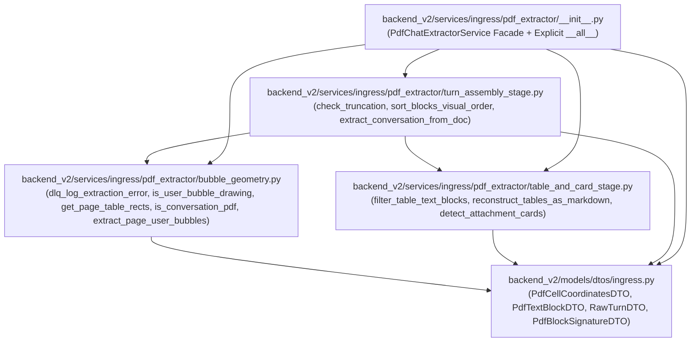

<required_context_rules>
    <rule>@[.agents/rules/00-antigravity-core.md]</rule>
    <rule>@[.agents/rules/01-python-backend.md]</rule>
    <rule>@[.agents/rules/04_directory_reference.md]</rule>
    <knowledge_item>@[ki_god_code_prevention.md]</knowledge_item>
    <knowledge_item>@[ki_deterministic_hardening_state.md]</knowledge_item>
    <knowledge_item>@[ki_zero_permissive_typing.md]</knowledge_item>
    <knowledge_item>@[ki_chat_ingress_and_provenance_architecture.md]</knowledge_item>
</required_context_rules>

# Symbol Migration Map: `pdf_chat_extractor.py` Decomposition

## 1. Monolith Archetype & Baseline Metrics

- **Source Monolith**: `[DELETE] @[backend_v2/services/ingress/pdf_chat_extractor.py]` (682 lines, 16 AST symbols: 4 Pydantic DTO classes and 1 stateless service class with 11 static methods).
- **Monolith Archetype**: **Archetype C — Ingress / Parser / Anti-Corruption Layer (ACL)**. The service executes a sequential multi-stage geometric extraction pipeline over PyMuPDF (`fitz.Document` and `fitz.Page`) objects to reconstruct structured multi-turn AI chat conversations (`list[ChatTurnAnchorDTO]`) from browser-printed PDF exports.
- **Target Domain Subpackage**: `backend_v2/services/ingress/pdf_extractor/` (`<= 250` lines per stage module, `< 150` lines for the canonical package facade).
- **Canonical DTO Relocation Target**: `@[backend_v2/models/dtos/ingress.py#L51-L68]` (relocating the 4 inline DTOs out of the service layer in compliance with `strict_model_location` and `QGR029`).
- **Pre-Flight Baseline Audit (`[BASELINE]`)**:
  - Command: `uv run python scripts/backend_audit_loop.py backend_v2/services/ingress/pdf_chat_extractor.py --test`
  - Unit Tests: `25 passed` in `[DELETE] @[backend_v2/tests/unit/services/ingress/test_pdf_chat_extractor.py]`
  - Line Coverage: **96%** (311 statements, 12 missed: lines `171, 209, 222-223, 242-244, 456-457, 479, 602, 618`). Exceeds the `>= 75%` pre-decomposition threshold; no `Phase 0: Coverage Bootstrap` is required.

---

## 2. Internal Symbol & Stage Inventory ($\mathcal{I}_{orig}$)

| Original Symbol in `[DELETE] @[backend_v2/services/ingress/pdf_chat_extractor.py]` | AST Line Bounds | Target Module | Target Public / Exported Symbol | Migration Phase |
| :--- | :--- | :--- | :--- | :--- |
| `_USER_BUBBLE_MIN_WIDTH_RATIO`, `_USER_BUBBLE_MIN_X0_RATIO`, `_USER_BUBBLE_MIN_X1_RATIO`, `_CANVAS_MAX_SIZE_RATIO`, `_SHORT_PROMPT_MIN_WIDTH` | `#L35-L41` | `[NEW] @[backend_v2/services/ingress/pdf_extractor/bubble_geometry.py]` | `_USER_BUBBLE_MIN_WIDTH_RATIO`, `_USER_BUBBLE_MIN_X0_RATIO`, `_USER_BUBBLE_MIN_X1_RATIO`, `_CANVAS_MAX_SIZE_RATIO`, `_SHORT_PROMPT_MIN_WIDTH` | Phase 1 |
| `_ORPHAN_TOKEN_MAX_WIDTH`, `_ORPHAN_TOKEN_MAX_CHARS`, `_PRINT_MARGIN_VERTICAL_PT`, `_PAGE_ZERO_TITLE_MAX_Y0` | `#L44-L47` | `[NEW] @[backend_v2/services/ingress/pdf_extractor/turn_assembly_stage.py]` | `_ORPHAN_TOKEN_MAX_WIDTH`, `_ORPHAN_TOKEN_MAX_CHARS`, `_PRINT_MARGIN_VERTICAL_PT`, `_PAGE_ZERO_TITLE_MAX_Y0` | Phase 3 |
| `_ATTACHMENT_BOX_DIM_PT`, `_ATTACHMENT_BOX_TOLERANCE_PT` | `#L50-L51` | `[NEW] @[backend_v2/services/ingress/pdf_extractor/table_and_card_stage.py]` | `_ATTACHMENT_BOX_DIM_PT`, `_ATTACHMENT_BOX_TOLERANCE_PT` | Phase 2 |
| `_TRUNCATION_INDICATORS` | `#L54-L59` | `[NEW] @[backend_v2/services/ingress/pdf_extractor/turn_assembly_stage.py]` | `_TRUNCATION_INDICATORS` | Phase 3 |
| `DrawingItemValue` | `#L61-L61` | `[NEW] @[backend_v2/services/ingress/pdf_extractor/bubble_geometry.py]` | `DrawingItemValue` | Phase 1 |
| `PdfCellCoordinatesDTO` | `#L63-L71` | `@[backend_v2/models/dtos/ingress.py#L51-L68]` | `PdfCellCoordinatesDTO` (re-exported in `[NEW] @[backend_v2/services/ingress/pdf_extractor/__init__.py]`) | Phase 1 |
| `PdfTextBlockDTO` | `#L74-L85` | `@[backend_v2/models/dtos/ingress.py#L51-L68]` | `PdfTextBlockDTO` (re-exported in `[NEW] @[backend_v2/services/ingress/pdf_extractor/__init__.py]`) | Phase 1 |
| `RawTurnDTO` | `#L88-L94` | `@[backend_v2/models/dtos/ingress.py#L51-L68]` | `RawTurnDTO` (re-exported in `[NEW] @[backend_v2/services/ingress/pdf_extractor/__init__.py]`) | Phase 1 |
| `PdfBlockSignatureDTO` | `#L97-L107` | `@[backend_v2/models/dtos/ingress.py#L51-L68]` | `PdfBlockSignatureDTO` (re-exported in `[NEW] @[backend_v2/services/ingress/pdf_extractor/__init__.py]`) | Phase 1 |
| `PdfChatExtractorService._is_user_bubble_drawing` | `#L116-L173` | `[NEW] @[backend_v2/services/ingress/pdf_extractor/bubble_geometry.py]` | `is_user_bubble_drawing` (delegated from `PdfChatExtractorService._is_user_bubble_drawing`) | Phase 1 |
| `PdfChatExtractorService._dlq_log_extraction_error` | `#L175-L183` | `[NEW] @[backend_v2/services/ingress/pdf_extractor/bubble_geometry.py]` | `dlq_log_extraction_error` (delegated from `PdfChatExtractorService._dlq_log_extraction_error`) | Phase 1 |
| `PdfChatExtractorService._get_page_table_rects` | `#L185-L248` | `[NEW] @[backend_v2/services/ingress/pdf_extractor/bubble_geometry.py]` | `get_page_table_rects` (delegated from `PdfChatExtractorService._get_page_table_rects`) | Phase 1 |
| `PdfChatExtractorService.is_conversation_pdf` | `#L250-L272` | `[NEW] @[backend_v2/services/ingress/pdf_extractor/bubble_geometry.py]` | `is_conversation_pdf` (delegated from `PdfChatExtractorService.is_conversation_pdf`) | Phase 1 |
| `PdfChatExtractorService._extract_page_user_bubbles` | `#L274-L297` | `[NEW] @[backend_v2/services/ingress/pdf_extractor/bubble_geometry.py]` | `extract_page_user_bubbles` (delegated from `PdfChatExtractorService._extract_page_user_bubbles`) | Phase 1 |
| `PdfChatExtractorService._check_truncation` | `#L299-L340` | `[NEW] @[backend_v2/services/ingress/pdf_extractor/turn_assembly_stage.py]` | `check_truncation` (delegated from `PdfChatExtractorService._check_truncation`) | Phase 3 |
| `PdfChatExtractorService._sort_blocks_visual_order` | `#L342-L357` | `[NEW] @[backend_v2/services/ingress/pdf_extractor/turn_assembly_stage.py]` | `sort_blocks_visual_order` (delegated from `PdfChatExtractorService._sort_blocks_visual_order`) | Phase 3 |
| `PdfChatExtractorService._filter_table_text_blocks` | `#L359-L382` | `[NEW] @[backend_v2/services/ingress/pdf_extractor/table_and_card_stage.py]` | `filter_table_text_blocks` (delegated from `PdfChatExtractorService._filter_table_text_blocks`) | Phase 2 |
| `PdfChatExtractorService._reconstruct_tables_as_markdown` | `#L384-L459` | `[NEW] @[backend_v2/services/ingress/pdf_extractor/table_and_card_stage.py]` | `reconstruct_tables_as_markdown` (delegated from `PdfChatExtractorService._reconstruct_tables_as_markdown`) | Phase 2 |
| `PdfChatExtractorService._detect_attachment_cards` | `#L461-L499` | `[NEW] @[backend_v2/services/ingress/pdf_extractor/table_and_card_stage.py]` | `detect_attachment_cards` (delegated from `PdfChatExtractorService._detect_attachment_cards`) | Phase 2 |
| `PdfChatExtractorService.extract_conversation` | `#L501-L682` | `[NEW] @[backend_v2/services/ingress/pdf_extractor/turn_assembly_stage.py]` | `extract_conversation_from_doc` (delegated from `PdfChatExtractorService.extract_conversation`) | Phase 3 |
| `PdfChatExtractorService` | `#L113-L682` | `[NEW] @[backend_v2/services/ingress/pdf_extractor/__init__.py]` | `PdfChatExtractorService` (canonical package facade `< 150` lines) | Phase 4 |

---

## 3. Target Subpackage Topology & Acyclic Dependency Order

- **Strict Acyclic Leaf-First Order**:
  1. `@[backend_v2/models/dtos/ingress.py#L51-L68]` (Zero service dependencies; imports only `pydantic` and `V2CoreBase`/`BaseDTO`).
  2. `[NEW] @[backend_v2/services/ingress/pdf_extractor/bubble_geometry.py]` (Imports `PdfCellCoordinatesDTO` from `backend_v2.models.dtos.ingress`; zero dependencies on sibling sub-modules).
  3. `[NEW] @[backend_v2/services/ingress/pdf_extractor/table_and_card_stage.py]` (Imports `PdfTextBlockDTO` from `backend_v2.models.dtos.ingress`; zero dependencies on sibling sub-modules).
  4. `[NEW] @[backend_v2/services/ingress/pdf_extractor/turn_assembly_stage.py]` (Imports `ChatTurnAnchorDTO`, `PdfBlockSignatureDTO`, `PdfTextBlockDTO`, `RawTurnDTO` from `backend_v2.models.dtos.ingress`, `extract_page_user_bubbles` from `bubble_geometry`, and `detect_attachment_cards`, `filter_table_text_blocks`, `reconstruct_tables_as_markdown` from `table_and_card_stage`).
  5. `[NEW] @[backend_v2/services/ingress/pdf_extractor/__init__.py]` (Top-level package facade importing from leaf modules and re-exporting all public contracts with explicit `__all__` and `Symbol as Symbol` aliases).

---

## 4. 1-Hop Consumer Blast Radius & Import Rewiring Map

| Consumer File | AST Symbol & Line Span | Current Import / Patch Target | Target Import / Patch Target (Phase 4) |
| :--- | :--- | :--- | :--- |
| `@[backend_v2/services/ingress/__init__.py]` | Module Root | Exports `ChatIngressParser`, `MultiChannelIngressService` | Also re-export `PdfChatExtractorService as PdfChatExtractorService` from `backend_v2.services.ingress.pdf_extractor` |
| `@[backend_v2/services/ingress/multi_channel_ingress_service.py#L27-L197]` | `MultiChannelIngressService` (`#L27-L197`), `_extract_pdf_channel_sync` (`#L51-L86`) | `from backend_v2.services.ingress.pdf_chat_extractor import PdfChatExtractorService` | `from backend_v2.services.ingress.pdf_extractor import PdfChatExtractorService` |
| `@[backend_v2/services/document_extraction.py#L93-L156]` | `DocumentExtractionService._extract_pdf_sync` (`#L93-L156`) | `from backend_v2.services.ingress.pdf_chat_extractor import PdfChatExtractorService` | `from backend_v2.services.ingress.pdf_extractor import PdfChatExtractorService` |
| `@[scripts/run_e2e_variance_test.py#L277-L411]` | `load_inputs_from_path` (`#L277-L411`) | `from backend_v2.services.ingress.pdf_chat_extractor import PdfChatExtractorService` | `from backend_v2.services.ingress.pdf_extractor import PdfChatExtractorService` |
| `@[backend_v2/tests/unit/test_document_extraction.py#L145-L175]` | `test_pdf_extraction_routes_to_conversation_extractor` (`#L145-L175`) | `patch("backend_v2.services.ingress.pdf_chat_extractor.PdfChatExtractorService")` | `patch("backend_v2.services.document_extraction.PdfChatExtractorService")` |
| `@[backend_v2/tests/unit/scripts/test_run_e2e_variance_test.py#L1066-L1127]` | `TestPdfLoadingAndSpecialCases` (`#L1066-L1127`) | `patch("backend_v2.services.ingress.pdf_chat_extractor.PdfChatExtractorService.is_conversation_pdf")` and `patch("backend_v2.services.ingress.pdf_chat_extractor.PdfChatExtractorService.extract_conversation")` | `patch("backend_v2.services.ingress.pdf_extractor.PdfChatExtractorService.is_conversation_pdf")` and `patch("backend_v2.services.ingress.pdf_extractor.PdfChatExtractorService.extract_conversation")` |
| `[DELETE] @[backend_v2/tests/unit/services/ingress/test_pdf_chat_extractor.py]` | Full test module (`#L1-L580`) | Monolithic test file importing `backend_v2.services.ingress.pdf_chat_extractor` | Split into 4 dedicated unit test modules under `backend_v2/tests/unit/services/ingress/pdf_extractor/` |
| `@[scripts/_ast_guardrails.py#L1865-L1910]` | `visit_Import` (`#L1865-L1910`), `visit_ImportFrom` (`@[scripts/_ast_guardrails.py#L1912-L2011]`) | Enforces retired monolith import bans (`QGR017`) | Add `backend_v2.services.ingress.pdf_chat_extractor` to `QGR017` retired monolith import ban |

---

## 5. Exhaustive Unit Test Decomposition Map

| Original Test Symbol in `[DELETE] @[backend_v2/tests/unit/services/ingress/test_pdf_chat_extractor.py]` | AST Line Bounds | Target Modular Test Suite |
| :--- | :--- | :--- |
| `_create_conversation_pdf` (`#L23-L79`), `_create_non_conversation_pdf` (`#L82-L93`), `_create_truncated_pdf` (`#L96-L115`) | `#L23-L115` | Shared builders replicated into respective stage test suites (`test_bubble_geometry.py`, `test_turn_assembly_stage.py`, `test_pdf_extractor_facade.py`) |
| `TestConversationDetection` (`test_detects_conversation_pdf_with_user_bubbles`, `test_rejects_normal_document_pdf`, `test_rejects_empty_pdf`, `test_ ignores_full_width_background_rects`) | `#L122-L162` | `[NEW] @[backend_v2/tests/unit/services/ingress/pdf_extractor/test_bubble_geometry.py]` |
| `TestInternalHelpers.test_is_user_bubble_drawing_branches`, `test_get_page_table_rects_exceptions`, `test_get_page_table_rects_success` | `#L352-L443` | `[NEW] @[backend_v2/tests/unit/services/ingress/pdf_extractor/test_bubble_geometry.py]` |
| `TestInternalHelpers.test_filter_table_text_blocks`, `test_reconstruct_tables_as_markdown`, `test_detect_attachment_cards` | `#L445-L530` | `[NEW] @[backend_v2/tests/unit/services/ingress/pdf_extractor/test_table_and_card_stage.py]` |
| `TestTurnSegmentation` (`#L169-L249`), `TestHeaderFooterAndOrphanFiltering` (`#L256-L315`), `TestTruncationGuard` (`#L322-L345`), `TestInternalHelpers.test_extract_conversation_edge_cases` (`#L532-L580`) | `#L169-L345`, `#L532-L580` | `[NEW] @[backend_v2/tests/unit/services/ingress/pdf_extractor/test_turn_assembly_stage.py]` and `[NEW] @[backend_v2/tests/unit/services/ingress/pdf_extractor/test_pdf_extractor_facade.py]` |
