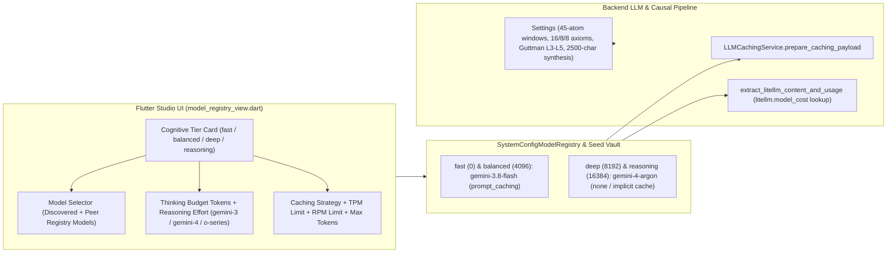

# IMPLEMENTATION PLAN: Gemini 4 Argon Hybrid Registry, Causal Settings Calibration & Studio Model Controls

<required_context_rules>
    <!-- Global & Domain Architectural Mandates -->
    <rule>@[.agents/rules/00-antigravity-core.md]</rule>
    <rule>@[.agents/rules/01-python-backend.md]</rule>
    <rule>@[.agents/rules/02_flutter_desktop.md]</rule>
    <rule>@[.agents/rules/03_seed_vault.md]</rule>
    <rule>@[.agents/rules/04_directory_reference.md]</rule>
    <rule>@[.agents/rules/05_llm_architecture.md]</rule>

    <!-- Relevant Subsystem Knowledge Items -->
    <knowledge_item>@[ki_llm_provider_architecture.md]</knowledge_item>
    <knowledge_item>@[ki_dag_orchestration_and_agent_execution.md]</knowledge_item>
    <knowledge_item>@[ki_seed_vault_and_database_migrations.md]</knowledge_item>
    <knowledge_item>@[ki_flutter_mvvm_and_sdui_architecture.md]</knowledge_item>
</required_context_rules>

## 1. Executive Summary & Architectural Goal
This plan recalibrates Quorum V2's causal graph discovery, Guttman cohesion thresholds, and synthesis character budgets in `@[backend_v2/settings.py#L67-L1399]` to unlock the multi-hop abductive reasoning capacity of `gemini-4-argon`, while migrating the canonical Google AI Studio and Google Cloud Vertex AI model registries in `@[backend_v2/seed/seed_data.json#L1-L130]` and Studio draft templates in `@[backend_v2/services/studio/system_config_service.py#L370-L423]` to a cost-and-quality optimal Hybrid Stack:
1. **`fast` (`thinking_budget_tokens: 0`) and `balanced` (`thinking_budget_tokens: 4096`)**: Retained on `gemini/gemini-3.8-flash` (and `vertex_ai/gemini-3.8-flash`) with `caching_strategy: "prompt_caching"`. Per official Google Gemini API deprecation and release documentation, `gemini-3.8-flash` is the active current-generation fast model (replacing deprecated `gemini-3.5-flash` and `gemini-3.7-flash`, with no shutdown date announced) at \$0.75/1M input and \$3.75/1M output tokens. In contrast, the Gemini 4 API exposes only the flagship `gemini-4-argon` endpoint at \$2.00/1M input and \$10.00/1M output tokens regardless of `thinking_level` (`low`, `medium`, `high`), with no separate `gemini-4-argon-lite` or `gemini-4-carbon` API endpoint.
2. **`deep` (`thinking_budget_tokens: 8192`) and `reasoning` (`thinking_budget_tokens: 16384`)**: Upgraded to `gemini/gemini-4-argon` (and `vertex_ai/gemini-4-argon`) with `caching_strategy: "none"`, leveraging Google's automatic 95% Implicit Caching on Gemini 4 without triggering unsupported explicit `caches.create` calls.
3. **Backend Adapter & Cost Registry Safeguards**: Updates `@[backend_v2/llm/provider/litellm_response_stage.py#L62-L284]` so `litellm.completion_cost` resolves prefixed Gemini 4 keys (`gemini/gemini-4-argon` and `vertex_ai/gemini-4-argon`) in `litellm.model_cost` without throwing `BadRequestError`, and updates `@[backend_v2/llm/caching_service.py#L27-L182]` so `LLMCachingService.prepare_caching_payload` short-circuits explicit adapter caching after running `_run_purity_scanner` when `config.caching_strategy == "none"`.
4. **Quorum Studio UI Full Control Parity**: Updates `@[client_app_v2/lib/features/studio/views/model_registry_view.dart#L535-L963]` to recognize `gemini-4` and `gpt-5` reasoning models, populate each tier's model dropdown with all peer models configured in the active registry alongside live API discovery, and expose `cachingStrategy`, `tpmLimit`, and `rpmLimit` controls directly in each cognitive tier card.



---

## 2. Target Files & Architectural Boundaries

| Target File Path | Action | Architectural Layer | Exact AST / Component Scope | Pre-Existing Tech Debt |
| :--- | :--- | :--- | :--- | :--- |
| `@[backend_v2/settings.py#L67-L1399]` | MODIFY | Configuration / SSOT | `Settings` (`#L67-L1399`), `validate_linker_axiom_budgets` (`#L1360-L1376`) | None (0 AST warnings) |
| `@[backend_v2/llm/provider/litellm_response_stage.py#L62-L284]` | MODIFY | LLM Provider / FinOps | `extract_litellm_content_and_usage` (`#L62-L284`) | None (0 AST warnings) |
| `@[backend_v2/llm/caching_service.py#L27-L182]` | MODIFY | LLM Caching Facade | `LLMCachingService` (`#L27-L182`), `prepare_caching_payload` (`#L45-L79`) | None (0 AST warnings) |
| `@[backend_v2/services/studio/system_config_service.py#L370-L423]` | MODIFY | Studio Service | `StudioSystemConfigService.create_system_config_draft` (`#L370-L423`) | None (0 AST warnings) |
| `@[backend_v2/seed/seed_data.json#L1-L130]` | MODIFY | Seed Vault SSOT | `system_configs` (`mrg_0195f3a00000700e826807f3bfa3454d`, `mrg_0195f3a00000700b81c2d3e4f5a60718`) | None |
| `@[client_app_v2/lib/features/studio/views/model_registry_view.dart#L535-L963]` | MODIFY | Flutter Studio View | `_ModelRegistryViewState.build` (`#L535-L865`), `_isReasoningModel` (`#L953-L962`) | None |
| `@[backend_v2/tests/unit/test_settings.py#L309-L334]` | MODIFY | Backend Unit Tests | `test_settings_causal_defaults` (`#L309-L334`), `test_validate_linker_axiom_budgets_invariants` (`#L442-L463`) | None |
| `@[backend_v2/tests/unit/services/orchestrator/test_causal_cohesion_scoring.py#L485-L510]` | MODIFY | Backend Unit Tests | `test_causal_cohesion_l3_isolation_baseline_boundary_passed` (`#L485-L510`), `test_causal_cohesion_l3_isolation_baseline_boundary_failed` (`#L513-L538`), `test_causal_cohesion_strategic_foresight_cross_case_calibration` (`#L541-L581`), `test_causal_cohesion_level_4_failure_blocks_level_5` (`#L640-L672`), `test_causal_cohesion_subgraph_cumulative_guttman_invariant` (`#L802-L824`) | None |
| `@[backend_v2/tests/unit/llm/provider/test_litellm_response_stage.py#L257-L335]` | MODIFY | Backend Unit Tests | `test_extract_litellm_content_and_usage_variants_and_error_paths` (`#L257-L335`) | None |
| `@[backend_v2/tests/unit/llm/test_caching_service.py#L178-L229]` | MODIFY | Backend Unit Tests | `test_prepare_caching_payload_and_pre_cache_forward_config_and_credential` (`#L178-L229`) | None |
| `@[backend_v2/tests/unit/services/studio/test_system_config_service.py#L280-L291]` | MODIFY | Backend Unit Tests | `test_create_model_registry_draft` (`#L280-L292`) | None |
| `@[client_app_v2/test/features/studio/views/model_registry_view_test.dart#L43-L764]` | MODIFY | Flutter Widget Tests | `ModelRegistryView Desktop Pro Tool UX Tests` (`#L43-L764`) | None |

---

<execution_protocol>

### Step 1: Recalibrate Causal, Cohesion, Synthesis & MCP Defaults in `settings.py`
<step number="1" Execution="Sequential">
- **Objective**: Expand the causal linker window, axiom budgets, causal discovery window parameters, Guttman L3/L4/L5 cohesion thresholds, synthesis character budgets, and MCP presentation character limit in `Settings` while preserving the `validate_linker_axiom_budgets` invariant (`linker_max_root_axioms + linker_max_bridge_axioms <= linker_max_global_root_axioms`).
- **TARGET**: `@[backend_v2/settings.py#L67-L1399]`
- **TARGET**: `@[backend_v2/tests/unit/test_settings.py#L397-L439]`
- **TARGET**: `@[backend_v2/tests/unit/services/orchestrator/test_causal_cohesion_scoring.py#L584-L637]`
- **CONTEXT**: `@[backend_v2/services/orchestrator/causal_cohesion_evaluator.py#L41-L66]`
- **Implementation Spec**:
  1. In `@[backend_v2/settings.py#L67-L1399]`, update the following 17 field defaults and synchronize their inline descriptions:
     - `linker_max_atoms_per_window: int = Field(default=45, ge=5, le=200, ...)` (at `#L373-L379`)
     - `linker_max_global_root_axioms: int = Field(default=16, ge=2, le=50, ...)` (at `#L389-L395`)
     - `linker_max_root_axioms: int = Field(default=8, ge=1, le=25, ...)` (at `#L397-L403`)
     - `linker_max_bridge_axioms: int = Field(default=8, ge=1, le=25, ...)` (at `#L405-L411`)
     - `causal_discovery_window_size: int = Field(default=6, ge=2, le=20, ...)` (at `#L430-L436`)
     - `causal_discovery_max_atoms_per_window: int = Field(default=45, ge=5, le=100, ...)` (at `#L438-L444`)
     - `causal_discovery_max_total_atoms: int = Field(default=200, ge=20, le=500, ...)` (at `#L446-L452`)
     - `causal_cohesion_l3_isolation_max: float = Field(default=0.30, ge=0.0, le=1.0, ...)` (at `#L454-L460`)
     - `causal_cohesion_l4_isolation_max: float = Field(default=0.20, ge=0.0, le=1.0, ...)` (at `#L462-L468`)
     - `causal_cohesion_l5_isolation_max: float = Field(default=0.12, ge=0.0, le=1.0, ...)` (at `#L470-L476`)
     - `causal_cohesion_l3_lcc_min: float = Field(default=0.45, ge=0.0, le=1.0, ...)` (at `#L478-L484`)
     - `causal_cohesion_l4_lcc_min: float = Field(default=0.60, ge=0.0, le=1.0, ...)` (at `#L486-L492`)
     - `default_synthesis_length_constraint: int = Field(default=2500, ge=100, le=10000, ...)` (at `#L728-L733`)
     - `default_row_explanation_length_constraint: int = Field(default=600, ge=50, le=2000, ...)` (at `#L734-L740`)
     - `default_matrix_graph_length_constraint: int = Field(default=900, ge=100, le=3000, ...)` (at `#L741-L746`)
     - `default_variance_length_constraint: int = Field(default=1000, ge=100, le=3000, ...)` (at `#L747-L753`)
     - `mcp_presentation_max_chars: int = Field(default=800, ge=50, le=2000, ...)` (at `#L798-L804`)
  2. In `@[backend_v2/tests/unit/test_settings.py#L397-L439]`:
     - Update `test_settings_causal_defaults` (`#L309-L334`) to assert all 17 recalibrated defaults on `Settings(_env_file=None)`.
     - Update `test_validate_linker_axiom_budgets_invariants` (`#L442-L463`) to test exact boundary conditions (`8 + 8 == 16` passes, `9 + 8 > 16` raises `ValidationError`).
  3. In `@[backend_v2/tests/unit/services/orchestrator/test_causal_cohesion_scoring.py#L584-L637]`:
     - Update `test_causal_cohesion_l3_isolation_baseline_boundary_passed` (`#L485-L510`) to test 3 isolated atoms out of 10 (`isolation_ratio == 0.30 <= 0.30`, LCC `7/10 == 0.70 >= 0.45`).
     - Update `test_causal_cohesion_l3_isolation_baseline_boundary_failed` (`#L513-L538`) to test 4 isolated atoms out of 10 (`isolation_ratio == 0.40 > 0.30`).
     - Update `test_causal_cohesion_strategic_foresight_cross_case_calibration` (`#L541-L581`), `test_causal_cohesion_level_4_failure_blocks_level_5` (`#L640-L672`), and `test_causal_cohesion_subgraph_cumulative_guttman_invariant` (`#L802-L824`) so their graph node counts and assertions align with `l3_isolation_max=0.30`, `l4_isolation_max=0.20`, `l5_isolation_max=0.12`, `l3_lcc_min=0.45`, and `l4_lcc_min=0.60`.
- **Verification**:
  - `uv run python scripts/backend_audit_loop.py backend_v2/settings.py backend_v2/tests/unit/test_settings.py backend_v2/tests/unit/services/orchestrator/test_causal_cohesion_scoring.py --test --ast-strict`
</step>

### Step 2: Harden LiteLLM Cost Lookup & Implicit Caching Short-Circuit for `gemini-4-argon`
<step number="2" Execution="Sequential">
- **Objective**: Ensure `extract_litellm_content_and_usage` resolves provider-prefixed Gemini 4 models (`gemini/gemini-4-argon`, `vertex_ai/gemini-4-argon`) in `litellm.model_cost` without throwing `BadRequestError`, and ensure `LLMCachingService.prepare_caching_payload` short-circuits explicit cache adapter execution when `config.caching_strategy == "none"` while still enforcing static prompt purity.
- **TARGET**: `@[backend_v2/llm/provider/litellm_response_stage.py#L62-L284]`
- **TARGET**: `@[backend_v2/llm/caching_service.py#L27-L182]`
- **TARGET**: `@[backend_v2/tests/unit/llm/provider/test_litellm_response_stage.py#L257-L335]`
- **TARGET**: `@[backend_v2/tests/unit/llm/test_caching_service.py#L178-L229]`
- **CONTEXT**: `@[backend_v2/llm/adapters/ai_studio_adapter.py#L71-L111]`
- **Implementation Spec**:
  1. In `@[backend_v2/llm/provider/litellm_response_stage.py#L62-L284]` (`#L208-L214`), replace the unconditional `base_model_name = model_name.split("/")[-1]` pass to `litellm.completion_cost` with:
     ```python
     base_model_name = model_name.split("/")[-1] if "/" in model_name else model_name
     model_cost_registry = _safe_static_getattr(litellm, "model_cost", None)
     cost_model_name = (
         model_name
         if model_cost_registry is not None and model_name in model_cost_registry
         else base_model_name
     )
     cost = litellm.completion_cost(completion_response=response, model=cost_model_name)
     ```
  2. In `@[backend_v2/llm/caching_service.py#L27-L182]` (`prepare_caching_payload` at `#L45-L79`), compute `flat_messages = compiled_prompt.to_flat_messages()`, run `await cls._run_purity_scanner(flat_messages)`, and immediately check:
     ```python
     if config is not None and config.caching_strategy == "none":
         return CachingPayloadResultDTO(messages=flat_messages, kwargs={})
     ```
     before calling `LLMCacheAdapterFactory.get_adapter(provider_name, model_name=model_name)`. Because `LLMCachingService.pre_cache_document` delegates to `cls.prepare_caching_payload`, pre-warming calls in `TwoPassAtomizer` and `EnrichedDAGExecutor` automatically become safe no-ops after purity scanning when `caching_strategy == "none"`.
  3. In `@[backend_v2/tests/unit/llm/provider/test_litellm_response_stage.py#L257-L335]`, add unit assertions in `test_extract_litellm_content_and_usage_variants_and_error_paths` verifying that when `model_name="gemini/gemini-4-argon"` is present in `litellm.model_cost`, `litellm.completion_cost` is invoked with `model="gemini/gemini-4-argon"`, and when an unprefixed model is used, it falls back to `base_model_name`.
  4. In `@[backend_v2/tests/unit/llm/test_caching_service.py#L178-L229]`, expand `test_prepare_caching_payload_and_pre_cache_forward_config_and_credential` to verify:
     - Positive case: when `config.caching_strategy == "none"`, `prepare_caching_payload` and `pre_cache_document` return `CachingPayloadResultDTO(messages=flat_messages, kwargs={})` without invoking `LLMCacheAdapterFactory.get_adapter`.
     - Negative case: when `config.caching_strategy == "none"` and `static_messages` contains a UUID or ISO-8601 timestamp, `prepare_caching_payload` still raises `AppException` (`ErrorCodes.VALIDATION_FAILED`).
- **Verification**:
  - `uv run python scripts/backend_audit_loop.py backend_v2/llm/provider/litellm_response_stage.py backend_v2/llm/caching_service.py backend_v2/tests/unit/llm/provider/test_litellm_response_stage.py backend_v2/tests/unit/llm/test_caching_service.py --test --ast-strict`
</step>

### Step 3: Upgrade Studio Draft Templates & Seed Vault Model Registries to the Hybrid Stack
<step number="3" Execution="Sequential">
- **Objective**: Update `StudioSystemConfigService.create_system_config_draft` and the two Google model registries in `backend_v2/seed/seed_data.json` (`Google AI Studio Stack` and `Google Cloud Vertex AI Sovereign Stack`) to use `gemini-3.8-flash` for `fast` and `balanced` (`caching_strategy: "prompt_caching"`) and `gemini-4-argon` for `deep` and `reasoning` (`caching_strategy: "none"`).
- **TARGET**: `@[backend_v2/services/studio/system_config_service.py#L370-L423]`
- **TARGET**: `@[backend_v2/seed/seed_data.json#L1-L130]`
- **TARGET**: `@[backend_v2/tests/unit/services/studio/test_system_config_service.py#L280-L291]`
- **CONTEXT**: `@[backend_v2/models/domain/system_config.py#L158-L209]`
- **Implementation Spec**:
  1. In `@[backend_v2/services/studio/system_config_service.py#L370-L423]`, update `create_system_config_draft` so the default `tier_definitions` initialize with complete, production-ready `ModelProfile` configurations:
     - `CognitiveTier.FAST`: `provider=LLMProvider.AI_STUDIO`, `model_name="gemini/gemini-3.8-flash"`, `temperature=0.1`, `max_tokens=32768`, `thinking_budget_tokens=0`, `caching_strategy="prompt_caching"`, `supports_grounding=False`, `tpm_limit=4000000`, `rpm_limit=200`.
     - `CognitiveTier.BALANCED`: `provider=LLMProvider.AI_STUDIO`, `model_name="gemini/gemini-3.8-flash"`, `temperature=1.0`, `max_tokens=65536`, `thinking_budget_tokens=4096`, `caching_strategy="prompt_caching"`, `supports_grounding=False`, `tpm_limit=4000000`, `rpm_limit=60`.
     - `CognitiveTier.DEEP`: `provider=LLMProvider.AI_STUDIO`, `model_name="gemini/gemini-4-argon"`, `temperature=1.0`, `max_tokens=65536`, `thinking_budget_tokens=8192`, `caching_strategy="none"`, `supports_grounding=True`, `tpm_limit=4000000`, `rpm_limit=60`.
     - `CognitiveTier.REASONING`: `provider=LLMProvider.AI_STUDIO`, `model_name="gemini/gemini-4-argon"`, `temperature=1.0`, `max_tokens=65536`, `thinking_budget_tokens=16384`, `caching_strategy="none"`, `supports_grounding=False`, `tpm_limit=4000000`, `rpm_limit=60`.
  2. In `@[backend_v2/seed/seed_data.json#L1-L130]`:
     - In `"Google Cloud Vertex AI Sovereign Stack"` (`id: "mrg_0195f3a00000700b81c2d3e4f5a60718"`):
       - Keep `fast` (`thinking_budget_tokens: 0`, `max_tokens: 32768`, `temperature: 0.1`, `caching_strategy: "prompt_caching"`, `rpm_limit: 200`, `tpm_limit: 4000000`) and `balanced` (`thinking_budget_tokens: 4096`, `max_tokens: 65536`, `temperature: 1.0`, `caching_strategy: "prompt_caching"`, `rpm_limit: 60`, `tpm_limit: 4000000`) on `"vertex_ai/gemini-3.8-flash"`.
       - Update `deep` to `model_name: "vertex_ai/gemini-4-argon"`, `thinking_budget_tokens: 8192`, `max_tokens: 65536`, `temperature: 1.0`, `caching_strategy: "none"`, `supports_grounding: true`, `rpm_limit: 60`, `tpm_limit: 4000000`.
       - Update `reasoning` to `model_name: "vertex_ai/gemini-4-argon"`, `thinking_budget_tokens: 16384`, `max_tokens: 65536`, `temperature: 1.0`, `caching_strategy: "none"`, `supports_grounding: false`, `rpm_limit: 60`, `tpm_limit: 4000000`.
     - In `"Google AI Studio Stack"` (`id: "mrg_0195f3a00000700e826807f3bfa3454d"`):
       - Keep `fast` (`thinking_budget_tokens: 0`, `max_tokens: 32768`, `temperature: 0.1`, `caching_strategy: "prompt_caching"`, `rpm_limit: 200`, `tpm_limit: 4000000`) and `balanced` (`thinking_budget_tokens: 4096`, `max_tokens: 65536`, `temperature: 1.0`, `caching_strategy: "prompt_caching"`, `rpm_limit: 60`, `tpm_limit: 4000000`) on `"gemini/gemini-3.8-flash"`.
       - Update `deep` to `model_name: "gemini/gemini-4-argon"`, `thinking_budget_tokens: 8192`, `max_tokens: 65536`, `temperature: 1.0`, `caching_strategy: "none"`, `supports_grounding: true`, `rpm_limit: 60`, `tpm_limit: 4000000`.
       - Update `reasoning` to `model_name: "gemini/gemini-4-argon"`, `thinking_budget_tokens: 16384`, `max_tokens: 65536`, `temperature: 1.0`, `caching_strategy: "none"`, `supports_grounding: false`, `rpm_limit: 60`, `tpm_limit: 4000000`.
  3. In `@[backend_v2/tests/unit/services/studio/test_system_config_service.py#L280-L291]`, expand `test_create_model_registry_draft` to assert that `FAST` and `BALANCED` use `"gemini/gemini-3.8-flash"` with `caching_strategy == "prompt_caching"`, and `DEEP` and `REASONING` use `"gemini/gemini-4-argon"` with `caching_strategy == "none"` and `thinking_budget_tokens` of `8192` and `16384`.
- **Verification**:
  - `uv run python scripts/validate_seed_integrity.py`
  - `uv run python scripts/backend_audit_loop.py backend_v2/services/studio/system_config_service.py backend_v2/tests/unit/services/studio/test_system_config_service.py --test --ast-strict`
</step>

### Step 4: Expose Full Model Selection, Reasoning & Rate/Cache Controls in Flutter Studio UI
<step number="4" Execution="Sequential">
- **Objective**: Update `ModelRegistryView` in the Flutter desktop client so users can select any peer registry or discovered model across tiers, configure `thinkingBudgetTokens` and `reasoningEffort` on `gemini-4` and `gpt-5` models, and edit `cachingStrategy`, `tpmLimit`, and `rpmLimit` directly in each cognitive tier card.
- **TARGET**: `@[client_app_v2/lib/features/studio/views/model_registry_view.dart#L535-L963]`
- **TARGET**: `@[client_app_v2/test/features/studio/views/model_registry_view_test.dart#L43-L764]`
- **CONTEXT**: `@[client_app_v2/lib/features/studio/models/model_config.dart#L1-L86]`
- **Implementation Spec**:
  1. In `@[client_app_v2/lib/features/studio/views/model_registry_view.dart#L535-L963]`:
     - Update `_isReasoningModel(LlmModelConfig cfg)` (`#L953-L962`) to match `gemini-3`, `gemini-4` (via `RegExp(r'gemini-([3-9]|\d{2,})').hasMatch(name)`), `gpt-5`, `claude-3-7`, `claude-3.7`, `o1`, `o3`, `o4`, or `(cfg.thinkingBudgetTokens ?? 0) > 0`.
     - Expand `modelItems` (`#L558-L561`) to include all non-empty `modelName` strings across `payload.tierDefinitions.values` in addition to `cfg.modelName` and `dynamicModels`:
       ```dart
       final peerModels = payload.tierDefinitions.values
           .map((t) => t.modelName)
           .where((m) => m.isNotEmpty);
       final modelItems = <String>{
         if (cfg.modelName.isNotEmpty) cfg.modelName,
         ...peerModels,
         ...dynamicModels,
       }.toList();
       ```
     - In `DropdownButtonFormField<String>` for `ValueKey('${tierKey}_model_name')` (`#L665-L669`), when switching to a model where `_isReasoningModel` is true, ensure `temperature` defaults to `1.0` if `cfg.temperature == null || cfg.temperature != 1.0` so hidden sampling fields never leave an incompatible `0.1` temperature on a reasoning tier.
     - Below `ValueKey('${tierKey}_max_tokens')` (`#L845-L859`), add:
       1. A 2-column `Row` containing `_buildIntField` for `ValueKey('${tierKey}_tpm_limit')` (`cfg.tpmLimit`, `l10n.tpmLimitLabel`) and `ValueKey('${tierKey}_rpm_limit')` (`cfg.rpmLimit`, `l10n.rpmLimitLabel`).
       2. A `DropdownButtonFormField<String?>` for `ValueKey('${tierKey}_caching_strategy')` (`initialValue: cfg.cachingStrategy`, `labelText: l10n.cachingStrategyLabel`) with items: `null` (`l10n.mcpToolParamsUseDefaultOption`), `'none'`, `'prompt_caching'`, `'gemini_native'`, `'ephemeral'`, and `'anthropic_ephemeral'`, plus any custom non-null `cfg.cachingStrategy` value present in the loaded config.
  2. In `@[client_app_v2/test/features/studio/views/model_registry_view_test.dart#L43-L764]`, add widget tests verifying:
     - Positive case: `gemini/gemini-4-argon` triggers reasoning mode (`Icons.psychology`, `thinking_budget` field visible, sampling fields hidden), peer tier models appear in each tier's `modelName` dropdown, and `caching_strategy`, `tpm_limit`, and `rpm_limit` fields render and update `ModelConfig` state.
     - Negative case: entering non-integer values into `fast_tpm_limit` or `fast_rpm_limit` triggers `l10n.errorMustBeInteger` validation error on save.
- **Verification**:
  - `uv run python scripts/flutter_audit_loop.py client_app_v2/test/features/studio/views/model_registry_view_test.dart`
</step>

</execution_protocol>

---

## 3. Verification & Definition of Done (Quality Gates)
- [ ] **Seed Vault Integrity Gate**: `uv run python scripts/validate_seed_integrity.py` exits with code `0`.
- [ ] **Backend Audit Gate**: `uv run python scripts/backend_audit_loop.py backend_v2/settings.py backend_v2/llm/provider/litellm_response_stage.py backend_v2/llm/caching_service.py backend_v2/services/studio/system_config_service.py backend_v2/tests/unit/test_settings.py backend_v2/tests/unit/services/orchestrator/test_causal_cohesion_scoring.py backend_v2/tests/unit/llm/provider/test_litellm_response_stage.py backend_v2/tests/unit/llm/test_caching_service.py backend_v2/tests/unit/services/studio/test_system_config_service.py --test --ast-strict` passes 100% with >90% coverage and zero AST guardrail violations.
- [ ] **Flutter Audit Gate**: `uv run python scripts/flutter_audit_loop.py client_app_v2/test/features/studio/views/model_registry_view_test.dart` passes `flutter analyze` and all widget tests.
- [ ] **Global Completion Gates**:
  - `uv run python scripts/backend_audit_loop.py backend_v2/ --test`
  - `uv run python scripts/flutter_audit_loop.py client_app_v2/ --build`
