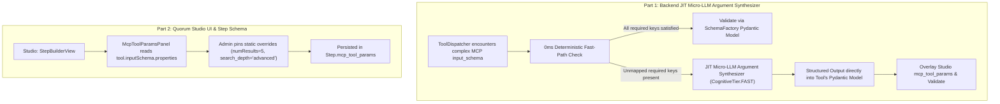

# Implementation Plan: JIT Micro-LLM MCP Argument Synthesizer and Studio Tool Parameter Configuration

<required_context_rules>
  <rule>@[.agents/rules/00-antigravity-core.md]</rule>
  <rule>@[.agents/rules/01-python-backend.md]</rule>
  <rule>@[.agents/rules/02_flutter_desktop.md]</rule>
  <rule>@[.agents/rules/04_directory_reference.md]</rule>
  <rule>@[.agents/rules/05_llm_architecture.md]</rule>
  <knowledge_item>@[ki_mcp_tool_protocol.md]</knowledge_item>
  <knowledge_item>@[ki_god_code_prevention.md]</knowledge_item>
  <knowledge_item>@[ki_desktop_pro_tool_studio_ux.md]</knowledge_item>
  <knowledge_item>@[ki_zero_permissive_typing.md]</knowledge_item>
</required_context_rules>

## 1. Architectural Summary & Objective

This implementation plan delivers a two-part architectural upgrade for Quorum's Dynamic MCP Gateway ecosystem:



1. **Part 1 (Backend): JIT Micro-LLM Argument Synthesizer**:
   - **Problem Solved**: External MCP servers (financial data, legal databases, specialized news gateways) can declare arbitrary required schema parameters (`country`, `category`, `date_range`, `jurisdiction`) that cannot be hardcoded in rule-based adapters.
   - **Mechanism**:
     - `ToolDispatcher` first attempts its 0ms deterministic rule-based binding (`build_search_arguments`), merging any static parameters configured on the workflow step (`configured_params` from `step.mcp_tool_params`).
     - If the tool's `input_schema.required` contains fields not satisfied by the deterministic binding and static overrides, `ToolDispatcher.synthesize_search_arguments` invokes the `CognitiveTier.FAST` micro-model via `LLMTaskExecutor.execute_structured_task`, passing the tool's dynamically compiled Pydantic V2 model (`SchemaFactory.create_mcp_tool_argument_model`) as `response_model`.
     - The micro-LLM receives the XML-fenced `claim_text`, `search_query`, `reasoning`, `tool_description`, and `studio_configured_parameters`, and outputs a schema-valid Pydantic instance matching the exact MCP tool contract.
     - Explicit Studio parameter overrides (`configured_params`) are overlaid onto the synthesized output and validated via `arg_model.model_validate` before dispatching over JSON-RPC 2.0.

2. **Part 2 (Frontend / Studio & Step Persistence): Studio MCP Tool Parameter Panel**:
   - **Problem Solved**: Domain experts and administrators need to tune tool-specific search precision and scope parameters (`numResults: 5` on Exa, `search_depth: "advanced"` and `include_images: false` on Tavily) per workflow step directly from the Quorum Studio GUI without modifying code or gateway defaults.
   - **Mechanism**:
     - Extend `Step` (`backend_v2/models/domain/step.py`), `StepCreateDTO` / `StepUpdateDTO` (`backend_v2/models/dtos/studio.py`), and Flutter `NodeStrategy` (`client_app_v2/lib/features/studio/models/workflow.dart`) with `mcp_tool_params` (`dict[str, dict[str, MCPArgumentValue]]` in Python; `Map<String, Map<String, Object?>>` in Dart).
     - Forward `step_obj.mcp_tool_params` from `LLMNodeStrategy.execute` into `execute_mcp_retrieval` and `ToolDispatcher.synthesize_search_arguments`.
     - Create an isolated widget `[NEW] @[client_app_v2/lib/features/studio/views/widgets/mcp_tool_params_panel.dart]` rendered inside `StepBuilderView` (`client_app_v2/lib/features/studio/views/step_builder_view.dart`) whenever one or more MCP tools are selected in `allowedMcpTools`. The panel dynamically inspects each selected tool's `inputSchema.properties` and renders type-appropriate controls (dropdowns for `enumValues`, switches for `boolean`, numeric inputs with bounds for `integer`/`number`, and text inputs for `string`).

---

## 2. Target & Context Boundaries

### TARGET FILES (Scoped for Modification & Creation)
- `[MODIFY] @[backend_v2/models/dtos/mcp.py]`
- `[MODIFY] @[backend_v2/models/domain/step.py#L41-L176]`
- `[MODIFY] @[backend_v2/models/dtos/studio.py#L144-L210]`
- `[MODIFY] @[backend_v2/models/dtos/studio.py#L617-L636]`
- `[MODIFY] @[backend_v2/models/prompts/execution/mcp_prompts.py#L61-L85]`
- `[MODIFY] @[backend_v2/models/prompts/execution/__init__.py]`
- `[MODIFY] @[backend_v2/models/prompts/__init__.py]`
- `[MODIFY] @[backend_v2/services/mcp/dispatcher.py#L45-L430]`
- `[MODIFY] @[backend_v2/services/mcp/mcp_tool_loop.py#L166-L503]`
- `[MODIFY] @[backend_v2/services/mcp/mcp_tool_loop.py#L506-L689]`
- `[MODIFY] @[backend_v2/services/orchestrator/strategies/llm.py#L216-L1042]`
- `[MODIFY] @[backend_v2/services/studio/workflow_service.py#L594-L643]`
- `[MODIFY] @[backend_v2/tests/unit/services/mcp/test_dispatcher.py#L407-L477]`
- `[MODIFY] @[backend_v2/tests/unit/services/mcp/test_mcp_tool_loop.py#L948-L996]`
- `[MODIFY] @[client_app_v2/lib/features/studio/models/workflow.dart#L74-L167]`
- `[MODIFY] @[client_app_v2/lib/l10n/app_en.arb#L2730-L2760]`
- `[MODIFY] @[client_app_v2/lib/l10n/app_fi.arb#L1980-L2009]`
- `[NEW] @[client_app_v2/lib/features/studio/views/widgets/mcp_tool_params_panel.dart]`
- `[MODIFY] @[client_app_v2/lib/features/studio/views/step_builder_view.dart#L429-L518]`
- `[NEW] @[client_app_v2/test/features/studio/views/widgets/mcp_tool_params_panel_test.dart]`

### CONTEXT FILES (Strictly Read-Only)
- `@[backend_v2/services/orchestrator/schema_factory.py#L328-L366]`
- `@[backend_v2/models/domain/mcp.py#L119-L144]`
- `@[backend_v2/api/routers/studio/steps.py#L118-L137]`
- `@[client_app_v2/lib/features/studio/models/mcp_gateway.dart#L12-L91]`

---

## 3. Pre-Implementation Technical Debt Cleanups (Phase 1)

A pre-flight technical debt sweep was executed across all target files and 1-hop callers via:
- `uv run python scripts/audit_technical_debt.py --targets backend_v2/models/dtos/mcp.py backend_v2/models/domain/step.py backend_v2/models/dtos/studio.py backend_v2/models/prompts/execution/mcp_prompts.py backend_v2/services/mcp/dispatcher.py backend_v2/services/mcp/mcp_tool_loop.py backend_v2/services/orchestrator/strategies/llm.py backend_v2/services/studio/workflow_service.py client_app_v2/lib/features/studio/models/workflow.dart client_app_v2/lib/features/studio/views/step_builder_view.dart --include-one-hop`
- `uv run python scripts/_ast_guardrails.py` (0 violations across all 8 Python target files)
- `uv run python scripts/_dart_guardrails.py` and `uv run python scripts/audit_flutter_theme_sovereignty.py` (0 violations across Flutter target files)

**Findings**:
- **Target Files**: 0 technical debt findings (`Status: PASSED`).
- **1-Hop Untouched Callers**: 9 advisory `TD_DICT_GET` notices in `backend_v2/database/repositories/workflow.py`, `role.py`, and `task_blueprint.py` (`self.driver.get(...)` database driver calls). Per `ban_drive_by_schema_mutations` and the Scoped Boy Scout boundary, untouched repository files outside the task scope are recorded here as audit context and not modified.
- **Preventive Decomposition**: `client_app_v2/lib/features/studio/views/step_builder_view.dart` is currently 1,193 lines. To uphold `monolithic_god_widgets` and `@[ki_god_code_prevention.md]`, the new Studio MCP tool parameter editor is extracted into a dedicated widget `[NEW] @[client_app_v2/lib/features/studio/views/widgets/mcp_tool_params_panel.dart]` rather than inlining form controls into `StepBuilderView`.

---

## 4. 5-Column Architectural Directives Table

| 1. Target Scope & Boundaries | 2. Eradicated Duct-Tape (Under-Engineering Ban) | 3. Approved Best Practice (Target Invariant) | 4. Pruned Over-Engineering (Complexity Slayer) | 5. Verification & Fail-Fast (Proof Anchor) |
| :--- | :--- | :--- | :--- | :--- |
| **MCP Argument Value Types** (`@[backend_v2/models/dtos/mcp.py]`) | Rejecting nested object arguments (`dict[str, MCPArgumentScalar]`) when synthesizing complex MCP schemas containing nested parameter objects. | Extend `MCPArgumentValue` PEP 695 union alias to include `dict[str, MCPArgumentScalar]` while preserving strict scalar and typed list branches. | Zero `Any` or `object` types; 100% closed recursive primitive union. | `uv run python scripts/backend_audit_loop.py backend_v2/models/dtos/mcp.py --test --ast-strict`. |
| **Step Domain & Studio DTOs** (`@[backend_v2/models/domain/step.py#L41-L176]`, `@[backend_v2/models/dtos/studio.py#L144-L210]`, `@[backend_v2/models/dtos/studio.py#L617-L636]`, `@[backend_v2/services/studio/workflow_service.py#L594-L643]`) | Hardcoding tool parameters in backend Python code or losing user-configured tool parameters on step save/clone. | Add `mcp_tool_params: Annotated[dict[str, dict[str, MCPArgumentValue]], Field(default_factory=dict, ...)]` to `Step`, `StepCreateDTO`, and `StepUpdateDTO`; initialize `mcp_tool_params={}` in `create_step_draft`. | Zero separate database collections or join tables; normalized directly inside the `Step` blueprint document. | `uv run python scripts/backend_audit_loop.py backend_v2/models/domain/step.py --test --ast-strict`. |
| **JIT Argument Synthesis Prompt SSOT** (`@[backend_v2/models/prompts/execution/mcp_prompts.py#L61-L85]`, `@[backend_v2/models/prompts/execution/__init__.py]`, `@[backend_v2/models/prompts/__init__.py]`) | Embedding inline system prompt strings inside `dispatcher.py` or `mcp_tool_loop.py`, or injecting dynamic f-string variables into system instructions. | Define `MCP_JIT_ARGUMENT_SYNTHESIS_SYSTEM_INSTRUCTION` as a 100% static XML constant in `mcp_prompts.py` and re-export in execution and root prompt barrels. | Single static system prompt constant; all dynamic context passed in XML-fenced `<user_payload>` message. | `uv run python scripts/backend_audit_loop.py backend_v2/models/prompts/execution/mcp_prompts.py --test --ast-strict`. |
| **ToolDispatcher JIT Synthesizer & Static Overrides** (`@[backend_v2/services/mcp/dispatcher.py#L45-L430]`, `@[backend_v2/tests/unit/services/mcp/test_dispatcher.py#L407-L477]`) | Crashing with `CONFIGURATION_ERROR` whenever an MCP tool requires additional domain fields (`country`, `category`, `date_range`), or ignoring Studio parameter overrides. | Enhance `build_search_arguments` with `configured_params` overlay; add `synthesize_search_arguments` using 0ms fast-path first and falling back to `executor.execute_structured_task` with `SchemaFactory` Pydantic model (`arg_model`). | Zero LLM calls when deterministic binding + `configured_params` satisfy `input_schema.required`; micro-LLM called exclusively when unmapped required keys exist. | `uv run python scripts/backend_audit_loop.py backend_v2/services/mcp/dispatcher.py --test --ast-strict`. |
| **MCP Tool Loop & LLM Strategy Wiring** (`@[backend_v2/services/mcp/mcp_tool_loop.py#L166-L503]`, `@[backend_v2/services/mcp/mcp_tool_loop.py#L506-L689]`, `@[backend_v2/services/orchestrator/strategies/llm.py#L216-L1042]`, `@[backend_v2/tests/unit/services/mcp/test_mcp_tool_loop.py#L948-L996]`) | Dropping `step_obj.mcp_tool_params` during DAG execution or omitting JIT synthesis token usage from `total_usage`. | Pass `mcp_tool_params=step_obj.mcp_tool_params` from `LLMNodeStrategy.execute` to `execute_mcp_retrieval`; invoke `resolved_dispatcher.synthesize_search_arguments` with `fast_client` and accumulate `synth_usage` into `total_usage`. | Single unified pipeline in `execute_mcp_retrieval`; zero duplicate client initializations (reuses existing `fast_client`). | `uv run python scripts/backend_audit_loop.py backend_v2/services/mcp/mcp_tool_loop.py --test --ast-strict`. |
| **Flutter Step Model & Studio Parameter Panel** (`@[client_app_v2/lib/features/studio/models/workflow.dart#L74-L167]`, `@[client_app_v2/lib/l10n/app_en.arb#L2730-L2760]`, `@[client_app_v2/lib/l10n/app_fi.arb#L1980-L2009]`, `[NEW] @[client_app_v2/lib/features/studio/views/widgets/mcp_tool_params_panel.dart]`, `@[client_app_v2/lib/features/studio/views/step_builder_view.dart#L429-L518]`, `[NEW] @[client_app_v2/test/features/studio/views/widgets/mcp_tool_params_panel_test.dart]`) | Bloating `step_builder_view.dart` with inline schema form controls, or hardcoding tool-specific parameter names (`numResults`, `search_depth`) in Flutter UI code. | Add `mcpToolParams` with `@JsonKey(name: 'mcp_tool_params')` to `NodeStrategy` Freezed union; build schema-driven `McpToolParamsPanel` rendering controls dynamically from `AllowedMcpTool.inputSchema.properties`; prune deselected tool params in `StepBuilderView`. | Zero tool-specific hardcoding in Dart; 100% driven by `McpToolInputSchemaDto` properties (`enumValues`, `boolean`, `integer`, `number`, `string`). | `uv run python scripts/flutter_audit_loop.py client_app_v2/test/features/studio/views/widgets/mcp_tool_params_panel_test.dart --build`. |

---

## 5. Execution Protocol

```xml
<execution_protocol>
  <step id="1" name="Backend DTO &amp; Step Domain Model Extension for mcp_tool_params">
    <target_files>
      <file>[MODIFY] @[backend_v2/models/dtos/mcp.py]</file>
      <file>[MODIFY] @[backend_v2/models/domain/step.py#L41-L176]</file>
      <file>[MODIFY] @[backend_v2/models/dtos/studio.py#L144-L210]</file>
      <file>[MODIFY] @[backend_v2/models/dtos/studio.py#L617-L636]</file>
      <file>[MODIFY] @[backend_v2/services/studio/workflow_service.py#L594-L643]</file>
    </target_files>
    <action>
1. In `@[backend_v2/models/dtos/mcp.py]`:
   - Add `"MCPArgumentScalar"` and `"MCPArgumentValue"` to the module `__all__` list (alphabetized after `"MCPDiscoveredToolWireDTO"` / `"MCPExecutionMetaDTO"`).
   - Extend `MCPArgumentValue` to support single-level nested scalar dictionaries for complex MCP object parameters:
```python
type MCPArgumentScalar = str | int | float | bool
type MCPArgumentValue = (
    MCPArgumentScalar
    | list[str]
    | list[int]
    | list[float]
    | list[bool]
    | dict[str, MCPArgumentScalar]
)
```
2. In `@[backend_v2/models/domain/step.py#L41-L176]`, import `MCPArgumentValue` from `backend_v2.models.dtos.mcp` and add `mcp_tool_params` to `Step` immediately after `allowed_mcp_tools`:
```python
    mcp_tool_params: Annotated[
        dict[str, dict[str, MCPArgumentValue]],
        Field(
            default_factory=dict,
            description="Per-tool static parameter overrides keyed by namespaced MCP tool alias.",
        ),
    ]
```
3. In `@[backend_v2/models/dtos/studio.py#L144-L210]` (`StepCreateDTO`) and `@[backend_v2/models/dtos/studio.py#L617-L636]` (`StepUpdateDTO`), import `MCPArgumentValue` from `backend_v2.models.dtos.mcp` and add `mcp_tool_params`:
   - In `StepCreateDTO`:
```python
    mcp_tool_params: Annotated[
        dict[str, dict[str, MCPArgumentValue]],
        Field(
            default_factory=dict,
            description="Per-tool static parameter overrides keyed by namespaced MCP tool alias.",
        ),
    ]
```
   - In `StepUpdateDTO`:
```python
    mcp_tool_params: Annotated[
        dict[str, dict[str, MCPArgumentValue]] | None,
        Field(
            default=None,
            description="Optional per-tool static parameter overrides keyed by namespaced MCP tool alias.",
        ),
    ] = None
```
4. In `@[backend_v2/services/studio/workflow_service.py#L594-L643]` (`StudioWorkflowService.create_step_draft`), pass `mcp_tool_params={}` when instantiating the draft `Step`.
    </action>
    <constraint invariant="the_zero_compromise_pledge">All Pydantic models must enforce ConfigDict(strict=True, extra="forbid") with zero Any or untyped dicts.</constraint>
    <constraint invariant="full_duplex_serialization_parity_mandate">StepResponseDTO inherits from Step, ensuring 1:1 full-duplex serialization parity across GET/POST/PUT /api/studio/steps endpoints.</constraint>
    <verification>Run `uv run python scripts/backend_audit_loop.py backend_v2/models/domain/step.py --test --ast-strict` and `uv run python scripts/backend_audit_loop.py backend_v2/models/dtos/studio.py --test --ast-strict`.</verification>
  </step>

  <step id="2" name="JIT Micro-LLM Argument Synthesis Prompt Asset SSOT">
    <target_files>
      <file>[MODIFY] @[backend_v2/models/prompts/execution/mcp_prompts.py#L61-L85]</file>
      <file>[MODIFY] @[backend_v2/models/prompts/execution/__init__.py]</file>
      <file>[MODIFY] @[backend_v2/models/prompts/__init__.py]</file>
    </target_files>
    <action>
1. In `@[backend_v2/models/prompts/execution/mcp_prompts.py#L61-L85]`, add `MCP_JIT_ARGUMENT_SYNTHESIS_SYSTEM_INSTRUCTION` to `__all__` and define the static XML system instruction constant:
```python
MCP_JIT_ARGUMENT_SYNTHESIS_SYSTEM_INSTRUCTION: str = (
    "<system_directive>\n"
    "<objective>Synthesize schema-compliant invocation arguments for an external MCP tool based on the verification claim, search query, and reasoning.</objective>\n"
    "<role>Deterministic MCP Argument Synthesizer</role>\n"
    "<rules>\n"
    "  <rule>Populate all required fields in the response schema using the semantic context of claim_text, search_query, and reasoning.</rule>\n"
    "  <rule>When studio_configured_parameters are provided in the user payload, preserve those exact values for the corresponding schema fields.</rule>\n"
    "  <rule>Infer domain-specific parameters (specifically country codes, categories, jurisdictions, or date bounds) directly from the claim context and language.</rule>\n"
    "  <rule>Output strictly according to the structured response schema with zero extraneous text.</rule>\n"
    "</rules>\n"
    "</system_directive>"
)
```
2. Re-export `MCP_JIT_ARGUMENT_SYNTHESIS_SYSTEM_INSTRUCTION` in `@[backend_v2/models/prompts/execution/__init__.py]` and `@[backend_v2/models/prompts/__init__.py]`.
    </action>
    <constraint invariant="prompt_asset_ssot_mandate">Static system instructions must reside exclusively in backend_v2/models/prompts/ as 100% static strings for context caching.</constraint>
    <constraint invariant="xml_structural_sovereignty_mandate">Enforce XML structural tags (<system_directive>, <objective>, <role>, <rules>) for all system instructions.</constraint>
    <verification>Run `uv run python scripts/backend_audit_loop.py backend_v2/models/prompts/execution/mcp_prompts.py --test --ast-strict`.</verification>
  </step>

  <step id="3" name="ToolDispatcher JIT Micro-LLM Argument Synthesizer &amp; Static Override Support">
    <target_files>
      <file>[MODIFY] @[backend_v2/services/mcp/dispatcher.py#L45-L430]</file>
      <file>[MODIFY] @[backend_v2/tests/unit/services/mcp/test_dispatcher.py#L407-L477]</file>
    </target_files>
    <action>
1. In `@[backend_v2/services/mcp/dispatcher.py#L45-L430]`:
   - Import `html` and `json` from the standard library, ` Any` from `typing`, `TokenUsage` from `backend_v2.models.domain.usage`, `LLMMessageDTO` from `backend_v2.models.llm`, and `MCP_JIT_ARGUMENT_SYNTHESIS_SYSTEM_INSTRUCTION` from `backend_v2.models.prompts`.
   - Add helper method `get_argument_model(self, tool: MCPToolDescriptorDTO | AllowedMCPTool) -> type[BaseModel]` on `ToolDispatcher`:
```python
    def get_argument_model(self, tool: MCPToolDescriptorDTO | AllowedMCPTool) -> type[BaseModel]:
        """Resolve the dynamically compiled Pydantic argument model for an MCP tool.

        Args:
            tool: Target MCPToolDescriptorDTO or AllowedMCPTool instance.

        Returns:
            Compiled Pydantic BaseModel subclass representing tool.input_schema.

        Raises:
            AppException: If schema compilation fails (ErrorCodes.VALIDATION_FAILED).
        """
        if isinstance(tool, MCPToolDescriptorDTO) and tool.namespaced_alias in self._arg_models:
            return self._arg_models[tool.namespaced_alias]
        alias_key = tool.namespaced_alias if isinstance(tool, MCPToolDescriptorDTO) and tool.namespaced_alias else tool.tool_id
        return SchemaFactory.create_mcp_tool_argument_model(alias_key, tool.input_schema)
```
   - Update `build_search_arguments` (`#L176-L266`) to accept `configured_params: Mapping[str, MCPArgumentValue] | None = None`:
     * If `configured_params` is provided, copy all keys that exist in `props` into `args` (excluding `None` values).
     * Bind the primary query key (`"query"`, `"q"`, `"search_query"`, `"search_term"`) from the runtime `query` string (always binding the active claim search query).
     * Bind `"objective"` if `"objective"` is in `props` and `"objective"` is not already present in `args`.
     * Apply the existing single-required-string and zero-required-single-string rules when no query key was matched yet.
     * Check `if args and set(required_keys).issubset(args.keys()):` -> validate `args` via `arg_model = self.get_argument_model(tool)` using `validated = arg_model.model_validate(args, strict=False)` and return `validated.model_dump(mode="json", exclude_none=True)`.
   - Add `async def synthesize_search_arguments(...) -> tuple[dict[str, MCPArgumentValue], TokenUsage]` on `ToolDispatcher`:
```python
    async def synthesize_search_arguments(
        self,
        tool: MCPToolDescriptorDTO | AllowedMCPTool,
        query: str,
        *,
        claim_text: str | None = None,
        reasoning: str | None = None,
        objective: str | None = None,
        configured_params: Mapping[str, MCPArgumentValue] | None = None,
        llm_client: Any = None,
        executor: Any = None,
        mock_identity: str | None = None,
        validation_context: dict[str, Any] | None = None,
    ) -> tuple[dict[str, MCPArgumentValue], TokenUsage]:
        """Resolve MCP tool arguments via 0ms deterministic fast-path or JIT Micro-LLM synthesis.

        Args:
            tool: Target search tool descriptor or AllowedMCPTool domain object.
            query: Search query string to bind.
            claim_text: Optional claim text being factually audited.
            reasoning: Optional reasoning string justifying the search turn.
            objective: Optional explicit search objective override.
            configured_params: Optional static parameter overrides configured in Studio.
            llm_client: Optional fast-tier LLMClient for JIT argument synthesis.
            executor: Optional LLMTaskExecutor for structured schema generation.
            mock_identity: Optional mock identity string for deterministic unit tests.
            validation_context: Optional validation context dictionary for executor.

        Returns:
            Tuple of validated argument dictionary and TokenUsage consumed during synthesis.

        Raises:
            AppException: If deterministic binding fails and either JIT synthesis dependencies
                are missing or micro-LLM synthesis fails validation (ErrorCodes.CONFIGURATION_ERROR).
        """
        zero_usage = TokenUsage(prompt_tokens=0, completion_tokens=0, total_tokens=0)
        try:
            deterministic_args = self.build_search_arguments(
                tool,
                query,
                claim_text=claim_text,
                reasoning=reasoning,
                objective=objective,
                configured_params=configured_params,
            )
            return deterministic_args, zero_usage
        except AppException:
            if llm_client is None or executor is None:
                raise

        arg_model = self.get_argument_model(tool)
        claim_val = ""
        if claim_text is not None:
            claim_val = html.escape(claim_text)
        reasoning_val = ""
        if reasoning is not None:
            reasoning_val = html.escape(reasoning)
        query_val = html.escape(query)
        tool_desc = ""
        if tool.description is not None:
            tool_desc = html.escape(tool.description)
        configured_json = "{}"
        if configured_params is not None:
            configured_json = json.dumps(dict(configured_params), ensure_ascii=False)

        user_content = TemplateProcessor.render_prompt(
            t"<user_payload>\n"
            t"  <tool_id>{tool.tool_id}</tool_id>\n"
            t"  <tool_description>{tool_desc}</tool_description>\n"
            t"  <search_query>{query_val}</search_query>\n"
            t"  <claim_text>{claim_val}</claim_text>\n"
            t"  <reasoning>{reasoning_val}</reasoning>\n"
            t"  <studio_configured_parameters>{configured_json}</studio_configured_parameters>\n"
            t"</user_payload>"
        )
        synth_messages = [
            LLMMessageDTO(role="system", content=MCP_JIT_ARGUMENT_SYNTHESIS_SYSTEM_INSTRUCTION),
            LLMMessageDTO(role="user", content=user_content),
        ]
        try:
            synthesized_raw, synth_usage = await executor.execute_structured_task(
                client=llm_client,
                messages=synth_messages,
                response_model=arg_model,
                mock_identity=mock_identity,
                validation_context=validation_context,
            )
            if isinstance(synthesized_raw, arg_model):
                synthesized_dict = synthesized_raw.model_dump(mode="json", exclude_none=True)
            elif isinstance(synthesized_raw, BaseModel):
                synthesized_dict = synthesized_raw.model_dump(mode="json", exclude_none=True)
            else:
                validated_initial = arg_model.model_validate(synthesized_raw, strict=False)
                synthesized_dict = validated_initial.model_dump(mode="json", exclude_none=True)

            if configured_params:
                for param_key, param_val in configured_params.items():
                    if param_key in tool.input_schema.properties and param_val is not None:
                        synthesized_dict[param_key] = param_val

            final_validated = arg_model.model_validate(synthesized_dict, strict=False)
            resolved_usage = synth_usage if synth_usage is not None else zero_usage
            return final_validated.model_dump(mode="json", exclude_none=True), resolved_usage
        except Exception as exc:
            msg = f"JIT Micro-LLM argument synthesis failed for MCP tool '{tool.tool_id}': {exc}"
            logger.error(
                "[ToolDispatcher] %s: %s",
                ErrorCodes.CONFIGURATION_ERROR.name,
                msg,
                extra={"error_code": ErrorCodes.CONFIGURATION_ERROR.value, "tool_id": tool.tool_id},
                exc_info=True,
            )
            raise AppException(
                message=msg,
                status_code=500,
                details={"error_code": ErrorCodes.CONFIGURATION_ERROR.value, "tool_id": tool.tool_id},
            ) from exc
```
2. In `@[backend_v2/tests/unit/services/mcp/test_dispatcher.py#L407-L477]`, add comprehensive unit tests covering:
   - `build_search_arguments` with `configured_params` (specifically `numResults=5` and `search_depth="advanced"`).
   - `synthesize_search_arguments` 0ms fast-path (verifying `executor.execute_structured_task` is NOT called when deterministic rules + `configured_params` satisfy required keys).
   - `synthesize_search_arguments` JIT Micro-LLM fallback for a complex legal/financial MCP tool schema requiring `query`, `country`, `category`, and nested `date_range` (`{"from": "2025-01-01", "to": "2026-01-01"}`), plus Studio `configured_params` override priority.
   - Negative test: `synthesize_search_arguments` raising `AppException(ErrorCodes.CONFIGURATION_ERROR)` when micro-LLM returns invalid schema data or raises an exception.
    </action>
    <constraint invariant="role_segregation_and_fencing">All dynamic inputs to the JIT synthesizer must be XML-escaped via html.escape and wrapped inside &lt;user_payload&gt; tags.</constraint>
    <constraint invariant="llm_structured_execution_mandate">Use executor.execute_structured_task passing the dynamically compiled Pydantic model (arg_model) as response_model.</constraint>
    <verification>Run `uv run python scripts/backend_audit_loop.py backend_v2/services/mcp/dispatcher.py --test --ast-strict`.</verification>
  </step>

  <step id="4" name="Wire JIT Argument Synthesis &amp; Step mcp_tool_params into MCP Tool Loop and LLMNodeStrategy">
    <target_files>
      <file>[MODIFY] @[backend_v2/services/mcp/mcp_tool_loop.py#L166-L503]</file>
      <file>[MODIFY] @[backend_v2/services/mcp/mcp_tool_loop.py#L506-L689]</file>
      <file>[MODIFY] @[backend_v2/services/orchestrator/strategies/llm.py#L216-L1042]</file>
      <file>[MODIFY] @[backend_v2/tests/unit/services/mcp/test_mcp_tool_loop.py#L948-L996]</file>
    </target_files>
    <action>
1. In `@[backend_v2/services/mcp/mcp_tool_loop.py#L166-L503]` (`execute_mcp_retrieval`) and `@[backend_v2/services/mcp/mcp_tool_loop.py#L506-L689]` (`execute_tool_loop`):
   - Import `Mapping` from `collections.abc` and `MCPArgumentValue` from `backend_v2.models.dtos.mcp`.
   - Add parameter `mcp_tool_params: Mapping[str, Mapping[str, MCPArgumentValue]] | None = None` to both `execute_mcp_retrieval` and `execute_tool_loop` (forwarding `mcp_tool_params=mcp_tool_params` from `execute_tool_loop` into `execute_mcp_retrieval`).
   - In `execute_mcp_retrieval` (lines 448-463), resolve per-tool configured parameters using positive membership check (zero `.get()` calls):
```python
        tool_configured_params: Mapping[str, MCPArgumentValue] | None = None
        if mcp_tool_params is not None and active_search_tool.namespaced_alias in mcp_tool_params:
            tool_configured_params = mcp_tool_params[active_search_tool.namespaced_alias]

        search_args, synth_usage = await resolved_dispatcher.synthesize_search_arguments(
            active_search_tool,
            query,
            claim_text=claim,
            reasoning=citation.reasoning,
            configured_params=tool_configured_params,
            llm_client=fast_client,
            executor=executor,
            mock_identity=mock_identity,
            validation_context=val_ctx.model_dump(mode="json"),
        )
        total_usage += synth_usage
```
2. In `@[backend_v2/services/orchestrator/strategies/llm.py#L216-L1042]` (`LLMNodeStrategy.execute`):
   - Extract `effective_mcp_tool_params = step_obj.mcp_tool_params` alongside `effective_mcp_tools = step_obj.allowed_mcp_tools`.
   - Pass `mcp_tool_params=effective_mcp_tool_params` into `execute_mcp_retrieval(...)` at lines 702-714.
3. In `@[backend_v2/tests/unit/services/mcp/test_mcp_tool_loop.py#L948-L996]`, add unit tests verifying:
   - `execute_mcp_retrieval` forwards `mcp_tool_params` for the active search tool and includes static overrides in the dispatched tool arguments.
   - `execute_mcp_retrieval` invokes JIT Micro-LLM argument synthesis when the primary search tool has complex required fields (`country`, `category`) and accumulates `synth_usage` into `MCPRetrievalResultDTO.usage`.
    </action>
    <constraint invariant="positive_id_set_filtering_mandate">Resolve tool_configured_params via positive key membership (active_search_tool.namespaced_alias in mcp_tool_params) with zero dictionary .get() calls.</constraint>
    <verification>Run `uv run python scripts/backend_audit_loop.py backend_v2/services/mcp/mcp_tool_loop.py --test --ast-strict` and `uv run python scripts/backend_audit_loop.py backend_v2/services/orchestrator/strategies/llm.py --test --ast-strict`.</verification>
  </step>

  <step id="5" name="Flutter NodeStrategy Model Parity, Localization &amp; Studio McpToolParamsPanel Widget">
    <target_files>
      <file>[MODIFY] @[client_app_v2/lib/features/studio/models/workflow.dart#L74-L167]</file>
      <file>[MODIFY] @[client_app_v2/lib/l10n/app_en.arb#L2730-L2760]</file>
      <file>[MODIFY] @[client_app_v2/lib/l10n/app_fi.arb#L1980-L2009]</file>
      <file>[NEW] @[client_app_v2/lib/features/studio/views/widgets/mcp_tool_params_panel.dart]</file>
      <file>[MODIFY] @[client_app_v2/lib/features/studio/views/step_builder_view.dart#L429-L518]</file>
      <file>[NEW] @[client_app_v2/test/features/studio/views/widgets/mcp_tool_params_panel_test.dart]</file>
    </target_files>
    <action>
1. In `@[client_app_v2/lib/features/studio/models/workflow.dart#L74-L167]`, add `@JsonKey(name: 'mcp_tool_params') @Default(<String, Map<String, Object?>>{}) Map<String, Map<String, Object?>> mcpToolParams,` to all three `NodeStrategy` union constructors (`NodeStrategy.llm`, `NodeStrategy.logic`, `NodeStrategy.causalDiscovery`) immediately after `allowedMcpTools` to guarantee 1:1 snake_case serialization parity with Python `Step.mcp_tool_params`.
2. In `@[client_app_v2/lib/l10n/app_en.arb#L2730-L2760]` and `@[client_app_v2/lib/l10n/app_fi.arb#L1980-L2009]`, add localization keys:
   - `mcpToolParamsPanelTitle`: `"MCP Tool Parameter Overrides"` (EN) / `"MCP-työkalujen parametrien kiinnitys"` (FI)
   - `mcpToolParamsDefaultHint`: `"Default: {defaultValue}"` (EN) / `"Oletus: {defaultValue}"` (FI)
   - `mcpToolParamsUseDefaultOption`: `"Default (Unset)"` (EN) / `"Oletus (Ei kiinnitetty)"` (FI)
   - `mcpToolParamsResetButton`: `"Reset"` (EN) / `"Palauta"` (FI)
3. Create `[NEW] @[client_app_v2/lib/features/studio/views/widgets/mcp_tool_params_panel.dart]`:
   - Define `McpToolParamsPanel extends StatelessWidget` accepting `allowedMcpTools` (`List<String>`), `mcpToolParams` (`Map<String, Map<String, Object?>>`), `mcpGateways` (`List<McpGateway>`), and `onChanged` (`ValueChanged<Map<String, Map<String, Object?>>>`).
   - Resolve each selected `namespacedAlias` (`{gateway.slug}__{tool.toolId}`) against `mcpGateways`.
   - Filter `tool.inputSchema.properties` to configurable parameters (excluding primary runtime query parameters `'query'`, `'q'`, `'search_query'`, `'search_term'`).
   - For each tool with configurable parameters, render a Studio-compliant `Card` containing:
     * Header with tool localized name, `namespacedAlias` badge, and a reset `TextButton.icon` (`l10n.mcpToolParamsResetButton`) when overrides exist for that tool.
     * For each configurable property (`MapEntry<String, McpToolSchemaPropertyDto>`):
       - If `prop.enumValues != null && prop.enumValues!.isNotEmpty`: render a `DropdownButtonFormField<String?>` (`isExpanded: true`) with an initial `null` item (`l10n.mcpToolParamsUseDefaultOption`) and items for every value in `prop.enumValues!`.
       - If `prop.type == JsonSchemaPropertyType.boolean`: render a `SwitchListTile` displaying the property name, `prop.description`, and current boolean value (falling back to `prop.defaultValue is bool ? prop.defaultValue as bool : false` for display, writing explicit `true`/`false` to `mcpToolParams` when toggled).
       - If `prop.type == JsonSchemaPropertyType.integer || prop.type == JsonSchemaPropertyType.number`: render a `TextFormField` with `TextInputType.number`, displaying `prop.defaultValue` in `hintText` (`l10n.mcpToolParamsDefaultHint`), parsing `int.tryParse` / `double.tryParse`, clamping or validating against `prop.minimum` and `prop.maximum`, and removing the override key if the text field is cleared.
       - If `prop.type == JsonSchemaPropertyType.string` (without `enumValues`): render a `TextFormField` displaying `prop.defaultValue` in `hintText`, enforcing `maxLength: prop.maxLength`, and removing the override key if cleared.
4. In `@[client_app_v2/lib/features/studio/views/step_builder_view.dart#L429-L518]`:
   - Import `package:client_app/features/studio/views/widgets/mcp_tool_params_panel.dart`.
   - When a tool `FilterChip` is deselected (`!selected`), remove `namespacedAlias` from a mutable copy of `payload.mcpToolParams` and pass both `allowedMcpTools` and `mcpToolParams` to `payload.copyWith(...)`.
   - Immediately after the `mcpGateways` `FilterChip` list (around line 516), render `McpToolParamsPanel`:
```dart
                McpToolParamsPanel(
                  allowedMcpTools: payload.allowedMcpTools,
                  mcpToolParams: payload.mcpToolParams,
                  mcpGateways: mcpGateways,
                  onChanged: (updatedParams) {
                    ref
                        .read(stepFormProvider(stepId).notifier)
                        .forceRebuild(
                          payload.copyWith(mcpToolParams: updatedParams),
                        );
                  },
                ),
```
5. Create `[NEW] @[client_app_v2/test/features/studio/views/widgets/mcp_tool_params_panel_test.dart]` testing:
   - Positive rendering and modification of integer (`numResults: 5`), enum (`search_depth: 'advanced'`), and boolean (`include_images: false`) schema parameters.
   - Positive reset action clearing tool parameter overrides back to empty map.
   - Negative / boundary cases: clearing numeric input removes override; out-of-range numeric input below `minimum` or above `maximum` is rejected; non-numeric text in integer field is ignored without crashing.
    </action>
    <constraint invariant="studio_unified_visual_design_system">Adhere 100% to Theme.of(context), AppSpacing tokens, and isExpanded: true on all DropdownButtonFormField widgets.</constraint>
    <constraint invariant="frontend_zero_db_hardcoding_mandate">Drive all parameter inputs dynamically from McpToolInputSchemaDto.properties without hardcoding tool names or parameter keys in UI widgets.</constraint>
    <verification>Run `cd client_app_v2; flutter gen-l10n` followed by `uv run python scripts/flutter_audit_loop.py client_app_v2/test/features/studio/views/widgets/mcp_tool_params_panel_test.dart --build`.</verification>
  </step>

  <step id="6" name="Global Two-Stage Quality Gates &amp; Cross-Language DTO Parity Verification">
    <target_files>
      <file>[MODIFY] @[backend_v2/services/mcp/dispatcher.py#L45-L430]</file>
      <file>[MODIFY] @[backend_v2/services/mcp/mcp_tool_loop.py#L166-L503]</file>
      <file>[MODIFY] @[client_app_v2/lib/features/studio/views/step_builder_view.dart#L429-L518]</file>
    </target_files>
    <action>
Execute the global backend and frontend completion gates and cross-language DTO parity verification across `backend_v2/` and `client_app_v2/`.
    </action>
    <constraint invariant="zero_tolerance_audit_loop">Both backend_audit_loop.py and flutter_audit_loop.py must pass with zero warnings or errors.</constraint>
    <verification>
Execute the following commands in PowerShell:
1. `uv run python scripts/audit_dto_parity.py`
2. `uv run python scripts/backend_audit_loop.py backend_v2/ --test --ast-strict`
3. `uv run python scripts/flutter_audit_loop.py client_app_v2/ --build`
4. Live E2E Verification Gate:
   - Windows/PowerShell: `$env:RUN_LIVE_E2E="true"; uv run pytest backend_v2/tests/integration/test_integration_real_llm.py`
   - Unix/Bash: `RUN_LIVE_E2E="true" uv run pytest backend_v2/tests/integration/test_integration_real_llm.py`
    </verification>
  </step>
</execution_protocol>
```

---

## 6. ISTQB Test Scenarios & Coverage Matrix

| Scenario ID | Test Name | Partition Type | Input Condition | Expected Result |
| :--- | :--- | :--- | :--- | :--- |
| **TC-MCP-JIT-01** | `test_build_search_arguments_with_configured_params` | Positive Valid | Exa tool schema (`query`, `objective`, `numResults`) + `configured_params={"numResults": 5}` | Returns `{"query": ..., "objective": ..., "numResults": 5}` in 0ms without LLM call |
| **TC-MCP-JIT-02** | `test_synthesize_search_arguments_fast_path_skips_llm` | Positive Optimization | Standard search tool (`query` required) + `configured_params={"search_depth": "advanced"}` | Satisfies required keys deterministically; returns `(args, TokenUsage(0, 0, 0))` with zero `execute_structured_task` calls |
| **TC-MCP-JIT-03** | `test_synthesize_search_arguments_jit_micro_llm_complex_schema` | Positive JIT Synthesis | Legal/financial MCP tool requiring `query`, `country`, `category`, and `date_range` (`{"from": "...", "to": "..."}`) | Invokes `fast_client` via `executor.execute_structured_task` with `SchemaFactory` model; returns validated dict and accumulates `TokenUsage` |
| **TC-MCP-JIT-04** | `test_synthesize_search_arguments_studio_override_precedence` | Boundary / Priority | Complex tool requiring `query` and `country`, with `configured_params={"country": "FI", "numResults": 5}` while LLM outputs `country="US"` | Studio `configured_params` override LLM output; final validated dict has `"country": "FI"` and `"numResults": 5` |
| **TC-MCP-JIT-05** | `test_synthesize_search_arguments_missing_executor_raises_app_exception` | Negative Fail-Fast | Complex tool with unmapped required fields (`country`, `category`) and `executor=None` | Logs `ErrorCodes.CONFIGURATION_ERROR` and raises `AppException` (HTTP 500) |
| **TC-MCP-JIT-06** | `test_synthesize_search_arguments_llm_failure_raises_app_exception` | Negative Exception Path | `executor.execute_structured_task` raises `ValidationError` or runtime failure during JIT synthesis | Logs `ErrorCodes.CONFIGURATION_ERROR` and raises `AppException` (HTTP 500) |
| **TC-STUDIO-UI-01** | `mcp_tool_params_panel_renders_and_mutates_schema_controls` | Positive UI Widget | Selected tools Exa (`numResults` integer default 10) and Tavily (`search_depth` enum `basic`/`advanced`, `include_images` boolean) | Renders numeric input, dropdown, and switch; mutating values emits updated `mcpToolParams` map |
| **TC-STUDIO-UI-02** | `mcp_tool_params_panel_rejects_out_of_bounds_and_non_numeric` | Negative UI Boundary | User enters `"abc"` or `"-5"` into `numResults` (`minimum: 1`, `maximum: 100`) | Rejects invalid/out-of-bounds value without mutating `mcpToolParams` or crashing |
| **TC-STUDIO-UI-03** | `mcp_tool_params_pruned_when_tool_deselected` | Negative / State Hygiene | User configures `mcpToolParams` for `exa_gateway__web_search_exa` then deselects its `FilterChip` | `exa_gateway__web_search_exa` entry is removed from `payload.mcpToolParams` |

---

## 7. Verification Plan & Commands

### Stage 1: Localized Unit & Widget Verification
```powershell
uv run python scripts/backend_audit_loop.py backend_v2/models/dtos/mcp.py --test --ast-strict
uv run python scripts/backend_audit_loop.py backend_v2/models/domain/step.py --test --ast-strict
uv run python scripts/backend_audit_loop.py backend_v2/models/dtos/studio.py --test --ast-strict
uv run python scripts/backend_audit_loop.py backend_v2/models/prompts/execution/mcp_prompts.py --test --ast-strict
uv run python scripts/backend_audit_loop.py backend_v2/services/mcp/dispatcher.py --test --ast-strict
uv run python scripts/backend_audit_loop.py backend_v2/services/mcp/mcp_tool_loop.py --test --ast-strict
uv run python scripts/backend_audit_loop.py backend_v2/services/orchestrator/strategies/llm.py --test --ast-strict
uv run python scripts/flutter_audit_loop.py client_app_v2/test/features/studio/views/widgets/mcp_tool_params_panel_test.dart --build
```

### Stage 2: Global Completion Gates & Live E2E Verification
```powershell
uv run python scripts/audit_dto_parity.py
uv run python scripts/backend_audit_loop.py backend_v2/ --test --ast-strict
uv run python scripts/flutter_audit_loop.py client_app_v2/ --build
$env:RUN_LIVE_E2E="true"; uv run pytest backend_v2/tests/integration/test_integration_real_llm.py
```
