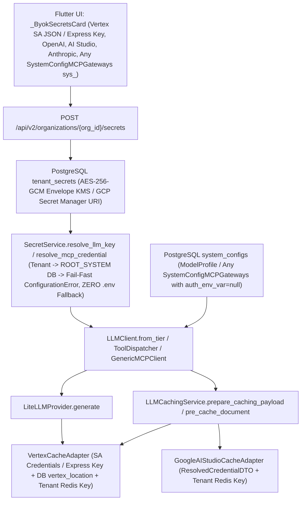

<required_context_rules>
  <rule>@[.agents/rules/00-antigravity-core.md]</rule>
  <rule>@[.agents/rules/01-python-backend.md]</rule>
  <rule>@[.agents/rules/02_flutter_desktop.md]</rule>
  <rule>@[.agents/rules/03_seed_vault.md]</rule>
  <rule>@[.agents/rules/04_directory_reference.md]</rule>
  <rule>@[.agents/rules/05_llm_architecture.md]</rule>
  <knowledge_item>@[ki_god_code_prevention.md]</knowledge_item>
  <knowledge_item>@[ki_global_config_sovereignty.md]</knowledge_item>
  <knowledge_item>@[ki_zero_permissive_typing.md]</knowledge_item>
</required_context_rules>

# IMPLEMENTATION PLAN: Vertex AI 100% BYOK Compatibility, Dynamic UI Secret Provisioning & Runtime LLM/MCP SSOT

## 1. Objective & Architectural Background

This plan establishes 100% dynamic UI secret provisioning, migrates all existing `.env` and `service-account.json` LLM and MCP credentials into PostgreSQL 19 `tenant_secrets`, and enforces a strict Single Source of Truth (SSOT) runtime pipeline with **zero `.env` fallbacks** for all LLM providers (`vertex_ai`, `ai_studio`, `openai`, `anthropic`, `azure_openai`, `local`) and any Studio-configured `SystemConfigMCPGateways` entity (`sys_<hex32>` across `MCPTransportType.STREAMABLE_HTTP` and `MCPTransportType.SSE`, and across `MCPAuthType.NONE`, `MCPAuthType.BEARER`, and `MCPAuthType.API_KEY_HEADER`):
1. **Dynamic UI Secret Provisioning (`OrganizationIamSettingsView` / `_ByokSecretsCard`) & Vendor-Agnostic MCP Gateways (`McpGatewayView`):** Administrators can dynamically provision and rotate secrets in the UI for any `LLMProvider` (including multiline Vertex AI GCP Service Account JSON payloads, Vertex Express Mode API keys, OpenAI keys, Google AI Studio keys, and Anthropic keys) and any `SystemConfigMCPGateways` entity created or managed in Quorum Studio (`McpGatewaysMasterView` / `McpGatewayView`, surfaced dynamically in `_ByokSecretsCard` via `availableMcpGatewaysProvider` -> `GET /api/v2/studio/mcp-gateways`). Any MCP gateway (`MCPAuthType.BEARER` injecting `Authorization: Bearer <secret>` or `MCPAuthType.API_KEY_HEADER` injecting `<gateway.auth_header_name>: <secret>`) authenticates 100% from `tenant_secrets` with `gateway.auth_env_var` set to `None`.
2. **100% Database-Only Secret Resolution & `.env` Fallback Eradication (`SecretService`, `StudioSystemConfigService` & `.env` Migration to PostgreSQL 19):**
   - `SecretService.resolve_llm_key` and `SecretService.resolve_mcp_credential` resolve tenant-specific secrets first (`organization_id` in `tenant_secrets`), then check the `ROOT_SYSTEM` organization (`org_0195f3a0000070008000000000000001` on `SystemOrganizations`) in `tenant_secrets`. If neither the tenant nor `ROOT_SYSTEM` has a configured record in `tenant_secrets`, `SecretService` **fails fast immediately** by raising `ConfigurationError` (`ErrorCodes.SECRET_RESOLUTION_FAILED`).
   - Legacy `.env` / `os.environ` fallback helpers (`_resolve_platform_llm_secret` and `_resolve_platform_mcp_secret`) are **physically deleted** from `SecretService`.
   - In `@[backend_v2/seed/seed_data.json]`, `"auth_env_var"` on `sys_0195f3a00000700080008172bda70c86` (`Tavily MCP Gateway`) is set to `null`.
   - All current `.env` and local credential file values for LLM and MCP (`OPENAI_API_KEY` -> `openai`, `GEMINI_API_KEY` -> `ai_studio`, `service-account.json` -> `vertex_ai`, and `TAVILY_API_KEY` -> `sys_0195f3a00000700080008172bda70c86`) are encrypted with AES-256-GCM Envelope KMS (`SecretService.upsert_secret` with a pinned `JWT_SECRET_KEY` in `.env` so local KEK derivation is deterministic across restarts) and persisted into PostgreSQL 19 `tenant_secrets` under `ROOT_SYSTEM` (`org_0195f3a0000070008000000000000001` on `SystemOrganizations`), and then removed from `.env`.
   - `StudioSystemConfigService.discover_mcp_gateway_tools` forwards the caller's `organization_id` so live MCP tool discovery (`tools/list`) authenticates using database `tenant_secrets`.
3. **100% Runtime Execution & Context Caching Wiring:** All LLM adapters (`VertexCacheAdapter`, `GoogleAIStudioCacheAdapter`, `LiteLLMProvider`), caching services (`LLMCachingService`), orchestrator pre-caching pipelines (`EnrichedDagExecutor`, `TwoPassAtomizer`), `RAGPreflightService`, `mcp_tool_loop` (`ToolDispatcher` + `GenericMCPClient`), and hooks (`interaction_hook`, `linguistics`, `source_verification_hook`) consume the resolved database credentials and database `SystemConfigModelRegistry` / `SystemConfigMCPGateways` parameters (`vertex_location`, `model_name`, `provider`, `tpm_limit`, `rpm_limit`, `thinking_budget_tokens`, `caching_strategy`, `endpoint_url`, `transport_type`, `auth_type`, `auth_header_name`, `allowed_tools`) with zero `.env` fallback.



### 1.1 B2B SaaS BYOK Best-Practice Architecture: NIST SP 800-57 Envelope Encryption (`ENVELOPE_KMS`), UI Self-Service Workflow & Infrastructure Bootstrap Separation

To align Quorum with modern multi-tenant B2B AI SaaS security standards, secret management is strictly partitioned into two orthogonal layers with clear operational responsibilities:

| Secret Layer | Physical Storage Location | Managed By | Contents (Exhaustive) | Operational Lifecycle |
| :--- | :--- | :--- | :--- | :--- |
| **1. Infrastructure Bootstrap Secrets** | Local: `.env` file on developer workstation.<br>Cloud: GCP Secret Manager (`quorum-db-url`, `quorum-jwt-secret`) injected at container startup. | Platform DevOps / `scripts/provision_gcp_cloud.py` | `DATABASE_URL`, `JWT_SECRET_KEY`, `KMS_MASTER_KEY_ID`, `REDIS_HOST`, `REDIS_PORT`, `STORAGE_BACKEND`, `STORAGE_BUCKET_NAME`, `GCP_PROJECT`, `GCP_REGION`, `PRIMARY_DOMAIN`, `LOGFIRE_TOKEN`, `EMAIL_TRANSPORT_MODE`, `EMAIL_API_KEY`. | Provisioned once when standing up the environment so the container can connect to PostgreSQL 19 and derive/unwrap the Master Key-Encryption-Key (KEK). |
| **2. Platform Baseline LLM & MCP Secrets (`ROOT_SYSTEM`)** | PostgreSQL 19 `tenant_secrets` table under `organization_id = "org_0195f3a0000070008000000000000001"` (`ENVELOPE_KMS` AES-256-GCM). | Platform `SYSTEM_ADMIN` via Flutter UI (`_ByokSecretsCard`) | Platform default credentials for `vertex_ai` (full `service-account.json` JSON document or Express API key), `ai_studio`, `openai`, `anthropic`, `azure_openai`, `local`, and platform MCP gateways (`sys_0195f3a00000700080008172bda70c86`). | Managed dynamically at runtime via **Settings -> Organization & IAM -> BYOK & MCP Secrets** with zero container restarts or `.env` edits. |
| **3. Customer Tenant BYOK Secrets (`org_<hex32>`)** | PostgreSQL 19 `tenant_secrets` table under the customer's `organization_id` (`ENVELOPE_KMS` AES-256-GCM). | Customer Organization `ADMIN` via Flutter UI (`_ByokSecretsCard`) | Tenant-specific API keys (`openai`, `anthropic`, `ai_studio`, `azure_openai`, `local`), tenant GCP `service-account.json` (`vertex_ai`), and tenant MCP gateway keys (`sys_<hex32>`). | Self-service provisioning and rotation by the customer's own administrator in the UI; automatically overrides `ROOT_SYSTEM` for that tenant while isolating Redis context caches by `organization_id`. |

#### Why `SecretStorageMode.envelopeKms` (Database Envelope Encryption) is the Primary B2B SaaS Standard
1. **1-Step Customer Self-Service in the UI**: Customer administrators do not have IAM access to the SaaS provider's Google Cloud console. In Flutter (**Settings -> Organization & IAM -> BYOK & MCP Secrets**), the administrator selects the provider (`vertex_ai`, `openai`, `ai_studio`, `anthropic`, `azure_openai`, `local`, or an MCP gateway), pastes the API key or `service-account.json` content into the input field, and clicks **Save** (`PUT /api/v2/iam/organizations/{org_id}/secrets`). The UI immediately clears the input field and displays only the irreversible 4-character `masked_hint` (`****<alnum4>`).
2. **NIST SP 800-57 Two-Tier Envelope Encryption (`DEK` + `KEK`)**:
   - When `SecretService.upsert_tenant_secret` receives a plaintext secret in `ENVELOPE_KMS` mode, it generates a unique 256-bit cryptographically random **Data Encryption Key (DEK)** (`secrets.token_bytes(32)`) and a 96-bit nonce (`secrets.token_bytes(12)`), encrypting the secret payload in memory via `AESGCM(dek).encrypt(nonce, plaintext_bytes, None)` into `ciphertext_payload`.
   - The per-record DEK is then wrapped (encrypted) using the system **Key Encryption Key (KEK)** — derived deterministically via HKDF-SHA256 from `JWT_SECRET_KEY` in local development or wrapped via Google Cloud KMS (`KMS_MASTER_KEY_ID`) in cloud production — producing `encrypted_dek`.
   - Both `ciphertext_payload` and `encrypted_dek` are persisted in PostgreSQL 19 `tenant_secrets`. A compromised database dump cannot be decrypted without the runtime KEK held only in server memory / Cloud KMS.
3. **Sub-Millisecond Latency, Zero Cloud API Bottlenecks & 100% Local-to-Cloud Parity**:
   - Resolving and decrypting `ENVELOPE_KMS` records from PostgreSQL 19 `tenant_secrets` executes in sub-millisecond memory time without making external GCP Secret Manager HTTP calls on every DAG node execution, avoiding external rate limits and per-secret cloud billing across multi-tenant workloads.
   - `SecretStorageMode.cloudSecretManager` remains available solely as an optional enterprise pointer mode (`projects/<project>/secrets/<name>/versions/<ver>`) for regulated enterprise tenants whose compliance policy mandates external secret vault residency, while `SecretStorageMode.envelopeKms` is the default and recommended best practice for both `ROOT_SYSTEM` and customer tenants.

## 2. Scope & Target Boundaries (5-Column Directives Table)

### Context Files (Read-Only)
- `@[backend_v2/settings.py]`
- `@[backend_v2/models/auth.py]`
- `@[backend_v2/models/domain/system_config.py]`
- `@[backend_v2/models/llm.py]`
- `@[backend_v2/services/mcp/dispatcher.py]`
- `@[backend_v2/services/mcp/generic_mcp_client.py]`
- `@[client_app_v2/lib/features/settings/domain/models/tenant_secret_dto.dart]`
- `@[client_app_v2/lib/features/studio/views/mcp_gateway_view.dart]`

### Target Files (`[NEW]`, `[MODIFY]`, `[DELETE]`)

| 1. Target Scope & Boundaries | 2. Eradicated Duct-Tape (Under-Engineering Ban) | 3. Approved Best Practice (Target Invariant) | 4. Pruned Over-Engineering (Complexity Slayer) | 5. Verification & Fail-Fast (Proof Anchor) |
| :--- | :--- | :--- | :--- | :--- |
| `[MODIFY] @[backend_v2/services/auth/secret_service.py]` (`SecretService.resolve_llm_key` [lines 307-361], `SecretService.resolve_mcp_credential` [lines 363-416], `SecretService._build_masked_hint` [lines 449-466], delete `_resolve_platform_llm_secret` [lines 751-807] and `_resolve_platform_mcp_secret` [lines 809-873]) | Falling back to `.env` / `Settings` (`_resolve_platform_llm_secret` and `_resolve_platform_mcp_secret` reading `settings.openai_api_key`, `settings.google_api_key`, `os.environ[gateway.auth_env_var]`, or `"vertex-adc-managed"`), skipping `ROOT_SYSTEM` database secrets, and leaving raw newlines/braces in `masked_hint` for multiline JSON secrets. | Delete `_resolve_platform_llm_secret` and `_resolve_platform_mcp_secret`; resolve `organization_id` in `tenant_secrets`, then check `ROOT_SYSTEM` (`org_0195f3a0000070008000000000000001`) in `tenant_secrets`, and raise `ConfigurationError` (`ErrorCodes.SECRET_RESOLUTION_FAILED`) Fail-Fast if no database secret exists; sanitize multiline JSON `masked_hint` to a clean 4-char alphanumeric suffix. | Pure database-only resolution via `_find_secret_record` and `_decrypt_or_fetch_secret` with zero `.env` fallback and zero cross-tenant leakage between non-root tenants. | `$env:UV_NO_SYNC="1"; $env:UV_OFFLINE="1"; uv run --no-sync --offline python scripts/backend_audit_loop.py backend_v2/services/auth/secret_service.py --test --ast-strict` |
| `[MODIFY] @[backend_v2/seed/seed_data.json]` (`system_config` entry `sys_0195f3a00000700080008172bda70c86` [lines 210-218]) | Binding `"auth_env_var": "TAVILY_API_KEY"` on `sys_0195f3a00000700080008172bda70c86` in `seed_data.json` instead of pure database `tenant_secrets` resolution. | Set `"auth_env_var": null` on `sys_0195f3a00000700080008172bda70c86` in `seed_data.json`, re-seed `system_configs`, and migrate current `.env` / `service-account.json` credentials (`openai`, `ai_studio`, `vertex_ai`, `sys_0195f3a00000700080008172bda70c86`) into PostgreSQL 19 `tenant_secrets` under `ROOT_SYSTEM` (`org_0195f3a0000070008000000000000001`). | Keep `TenantSecretDTO` ciphertexts in PostgreSQL `tenant_secrets` (never hardcoded in git-tracked `seed_data.json`). | `$env:UV_NO_SYNC="1"; $env:UV_OFFLINE="1"; uv run --no-sync --offline python backend_v2/seed/run_seed.py local --dry-run` |
| `[MODIFY] @[backend_v2/services/studio/system_config_service.py]` (`StudioSystemConfigService.discover_mcp_gateway_tools` [lines 626-664]) | Calling `self.mcp_client.list_tools(gateway)` without `organization_id`, bypassing UI-configured MCP gateway secrets during Studio live tool discovery for custom MCP gateways. | Pass `organization_id` from `initiator.organization_id` (defaulting to `ROOT_SYSTEM`) to `self.mcp_client.list_tools` so any custom `SystemConfigMCPGateways` entity authenticates via `tenant_secrets`. | Single parameter pass-through from authenticated `initiator`. | `$env:UV_NO_SYNC="1"; $env:UV_OFFLINE="1"; uv run --no-sync --offline python scripts/backend_audit_loop.py backend_v2/services/studio/system_config_service.py --test --ast-strict` |
| `[MODIFY] @[client_app_v2/lib/features/settings/presentation/organization_iam_settings_view.dart]` (`_ByokSecretsCard.build` [lines 1315-1695]) | Hardcoding `obscureText: true` (single-line only) on `org_secret_value_field` preventing multiline Vertex AI Service Account JSON input, and showing raw opaque IDs for saved MCP gateway secrets. | Add `obscureSecret` visibility toggle (`Key('org_secret_visibility_toggle_btn')`) with `maxLines: obscureSecret.value ? 1 : 6` for multiline JSON / key entry, and resolve human-readable MCP gateway names (`'${matchingGateway.name} (${secret.targetIdentifier})'`) dynamically for any configured `McpGateway` in the saved secrets list. | Keep all state local to `_ByokSecretsCard` via `useState` hooks with zero new providers. | `$env:UV_NO_SYNC="1"; $env:UV_OFFLINE="1"; uv run --no-sync --offline python scripts/flutter_audit_loop.py client_app_v2/lib/features/settings/presentation/organization_iam_settings_view.dart` |
| `[MODIFY] @[backend_v2/llm/adapters/base_adapter.py]` (`BaseLLMAdapter.prepare_caching_payload` [lines 151-164], `BaseLLMAdapter.prepare_kwargs` [lines 252-271]) | Calling caching adapters without `config` or `resolved_credential` context. | Extend abstract caching and kwargs preparation contracts with optional `config` and `resolved_credential` parameters. | No parallel adapter hierarchies. | `$env:UV_NO_SYNC="1"; $env:UV_OFFLINE="1"; uv run --no-sync --offline python scripts/backend_audit_loop.py backend_v2/llm/adapters/base_adapter.py --test --ast-strict` |
| `[MODIFY] @[backend_v2/llm/caching_service.py]` (`LLMCachingService.prepare_caching_payload` [lines 43-68], `LLMCachingService.pre_cache_document` [lines 70-92]) | Dropping `config` and `resolved_credential` before invoking cache adapters. | Propagate `config` and `resolved_credential` into concrete `BaseLLMAdapter.prepare_caching_payload` calls. | Zero conditional provider branching inside `LLMCachingService`. | `$env:UV_NO_SYNC="1"; $env:UV_OFFLINE="1"; uv run --no-sync --offline python scripts/backend_audit_loop.py backend_v2/llm/caching_service.py --test --ast-strict` |
| `[MODIFY] @[backend_v2/llm/client.py]` (`LLMClient.from_tier` [lines 164-385], `LLMClient.run_structured_task` [lines 387-759], `LLMClient.run_chat` [lines 761-944]) | Omitting `vertex_location` on `LLMProviderConfig` and omitting `config` / `resolved_credential` when calling `LLMCachingService`. | Bind `vertex_location=target_strategy.additional_params.vertex_location` onto `LLMProviderConfig` and forward `config` + `resolved_credential` into `LLMCachingService.prepare_caching_payload`. | Reuse existing `LLMProviderConfig` and `ResolvedCredentialDTO`. | `$env:UV_NO_SYNC="1"; $env:UV_OFFLINE="1"; uv run --no-sync --offline python scripts/backend_audit_loop.py backend_v2/llm/client.py --test --ast-strict` |
| `[MODIFY] @[backend_v2/llm/provider/litellm_provider.py]` (`LiteLLMProvider.generate` [lines 196-453]) | Invoking `adapter.prepare_kwargs` without `resolved_credential`. | Forward `resolved_credential=self._resolved_credential` into `adapter.prepare_kwargs(...)`. | Delegate Vertex credential formatting strictly to `VertexCacheAdapter`. | `$env:UV_NO_SYNC="1"; $env:UV_OFFLINE="1"; uv run --no-sync --offline python scripts/backend_audit_loop.py backend_v2/llm/provider/litellm_provider.py --test --ast-strict` |
| `[MODIFY] @[backend_v2/llm/adapters/vertex_adapter.py]` (`VertexCacheAdapter.prepare_caching_payload` [lines 115-355], `VertexCacheAdapter.prepare_kwargs` [lines 484-621]) | Reading `VERTEX_LOCATION` / `VERTEX_PROJECT_ID` directly from `os.getenv` and mutating `os.environ` globally across tenants. | Support Vertex AI BYOK GCP Service Account JSON (`vertex_credentials` + `project_id` extraction + `google.oauth2.service_account.Credentials` + fail-fast validation) and Express API keys, enforce DB `vertex_location` SSOT, remove global `os.environ` mutations, and scope tenant Redis cache keys by `organization_id`. | Keep helper functions static and concise within `vertex_adapter.py`. | `$env:UV_NO_SYNC="1"; $env:UV_OFFLINE="1"; uv run --no-sync --offline python scripts/backend_audit_loop.py backend_v2/llm/adapters/vertex_adapter.py --test --ast-strict` |
| `[MODIFY] @[backend_v2/llm/adapters/ai_studio_adapter.py]` (`GoogleAIStudioCacheAdapter._create_cache_under_lock` [lines 227-302], `GoogleAIStudioCacheAdapter.prepare_caching_payload` [lines 348-426]) | Reading `GEMINI_API_KEY` via raw `os.getenv` during context cache creation and sharing un-scoped Redis cache keys across BYOK tenants. | Resolve Gemini context caching API key from `resolved_credential` / `config` SSOT and isolate tenant Redis cache keys by `organization_id`. | Reuse `_create_cache_under_lock` flow with injected `api_key`. | `$env:UV_NO_SYNC="1"; $env:UV_OFFLINE="1"; uv run --no-sync --offline python scripts/backend_audit_loop.py backend_v2/llm/adapters/ai_studio_adapter.py --test --ast-strict` |
| `[MODIFY] @[backend_v2/llm/adapters/anthropic_adapter.py]` (`AnthropicCacheAdapter.prepare_caching_payload` [lines 54-134], `AnthropicCacheAdapter.prepare_kwargs` [lines 247-308]) | Signature mismatch with `BaseLLMAdapter`. | Align method signatures with `BaseLLMAdapter` optional `config` and `resolved_credential` parameters. | Pure signature alignment. | `$env:UV_NO_SYNC="1"; $env:UV_OFFLINE="1"; uv run --no-sync --offline python scripts/backend_audit_loop.py backend_v2/llm/adapters/anthropic_adapter.py --test --ast-strict` |
| `[MODIFY] @[backend_v2/llm/adapters/openai_adapter.py]` (`OpenAICacheAdapter.prepare_caching_payload` [lines 30-63], `OpenAICacheAdapter.prepare_kwargs` [lines 164-238]) | Signature mismatch with `BaseLLMAdapter`. | Align method signatures with `BaseLLMAdapter` optional `config` and `resolved_credential` parameters. | Pure signature alignment. | `$env:UV_NO_SYNC="1"; $env:UV_OFFLINE="1"; uv run --no-sync --offline python scripts/backend_audit_loop.py backend_v2/llm/adapters/openai_adapter.py --test --ast-strict` |
| `[MODIFY] @[backend_v2/llm/adapters/mock_adapter.py]` (`MockCacheAdapter.prepare_caching_payload` [lines 30-60]) | Signature mismatch with `BaseLLMAdapter`. | Align method signature with `BaseLLMAdapter` optional `config` and `resolved_credential` parameters. | Pure signature alignment. | `$env:UV_NO_SYNC="1"; $env:UV_OFFLINE="1"; uv run --no-sync --offline python scripts/backend_audit_loop.py backend_v2/llm/adapters/mock_adapter.py --test --ast-strict` |
| `[MODIFY] @[backend_v2/services/orchestrator/enriched_dag_executor.py]` (`EnrichedDagExecutor.execute_graph` [lines 52-247]) | Calling `LLMCachingService.pre_cache_document` without `config` or `resolved_credential`. | Forward `config=client_config` and `resolved_credential=self._llm_client.resolved_credential` to `LLMCachingService.pre_cache_document`. | Direct property pass-through from `self._llm_client`. | `$env:UV_NO_SYNC="1"; $env:UV_OFFLINE="1"; uv run --no-sync --offline python scripts/backend_audit_loop.py backend_v2/services/orchestrator/enriched_dag_executor.py --test --ast-strict` |
| `[MODIFY] @[backend_v2/services/orchestrator/two_pass_atomizer.py]` (`TwoPassAtomizer.execute_phase_0` [lines 85-151], `TwoPassAtomizer.execute_phase_1` [lines 181-253], `TwoPassAtomizer.execute_phase_1_drafts` [lines 363-439]) | Calling `LLMCachingService.pre_cache_document` without `config` or `resolved_credential`. | Forward `config=client.config` and `resolved_credential=client.resolved_credential` to `LLMCachingService.pre_cache_document`. | Direct property pass-through from `client`. | `$env:UV_NO_SYNC="1"; $env:UV_OFFLINE="1"; uv run --no-sync --offline python scripts/backend_audit_loop.py backend_v2/services/orchestrator/two_pass_atomizer.py --test --ast-strict` |
| `[MODIFY] @[backend_v2/services/orchestrator/rag_preflight_service.py]` (`RAGPreflightService.execute` [lines 134-325]) | Calling `LLMClient.from_tier` without `exec_record.organization_id`. | Forward `organization_id=effective_org_id` from `exec_record.organization_id` into `LLMClient.from_tier`. | Single `effective_org_id` resolution. | `$env:UV_NO_SYNC="1"; $env:UV_OFFLINE="1"; uv run --no-sync --offline python scripts/backend_audit_loop.py backend_v2/services/orchestrator/rag_preflight_service.py --test --ast-strict` |
| `[MODIFY] @[backend_v2/services/mcp/mcp_tool_loop.py]` (`_resolve_dispatcher` [lines 56-76], `_resolve_fast_extraction_client` [lines 209-233], `execute_mcp_retrieval` [lines 500-661], `execute_tool_loop` [lines 772-891]) | Initializing fallback `ToolDispatcher` and FAST extraction `LLMClient` without tenant `organization_id`. | Propagate tenant `organization_id` from `llm_client` into `_resolve_dispatcher` (`ToolDispatcher`) and `_resolve_fast_extraction_client` (`LLMClient.from_tier`). | Extract `organization_id` directly from bound `llm_client`. | `$env:UV_NO_SYNC="1"; $env:UV_OFFLINE="1"; uv run --no-sync --offline python scripts/backend_audit_loop.py backend_v2/services/mcp/mcp_tool_loop.py --test --ast-strict` |
| `[MODIFY] @[backend_v2/hooks/interaction_hook.py]` (`analyze_interaction_role` [lines 44-185]) | Calling `LLMClient.from_tier` without tenant `organization_id`. | Forward `organization_id` from `state.global_context_vars.organization_id` into `LLMClient.from_tier`. | Single `effective_org_id` resolution. | `$env:UV_NO_SYNC="1"; $env:UV_OFFLINE="1"; uv run --no-sync --offline python scripts/backend_audit_loop.py backend_v2/hooks/interaction_hook.py --test --ast-strict` |
| `[MODIFY] @[backend_v2/hooks/linguistics.py]` (`detect_performative_patterns` [lines 78-231]) | Calling `LLMClient.from_tier` without tenant `organization_id`. | Forward `organization_id` from `state.global_context_vars.organization_id` into `LLMClient.from_tier`. | Single `effective_org_id` resolution. | `$env:UV_NO_SYNC="1"; $env:UV_OFFLINE="1"; uv run --no-sync --offline python scripts/backend_audit_loop.py backend_v2/hooks/linguistics.py --test --ast-strict` |
| `[MODIFY] @[backend_v2/hooks/source_verification_hook.py]` (`source_verification_hook` [lines 161-288]) | Calling `ToolDispatcher` and `LLMClient.from_tier` without tenant `organization_id`. | Forward `organization_id` from `state.global_context_vars.organization_id` into `ToolDispatcher` and `LLMClient.from_tier`. | Single `effective_org_id` resolution. | `$env:UV_NO_SYNC="1"; $env:UV_OFFLINE="1"; uv run --no-sync --offline python scripts/backend_audit_loop.py backend_v2/hooks/source_verification_hook.py --test --ast-strict` |
| `[MODIFY] @[backend_v2/tests/conftest.py]` (`isolate_default_uow_and_secret_service` [lines 157-166]) | Registering an empty `InMemoryUnitOfWork` as the default test `get_secret_service()` UoW factory, which previously relied on `_resolve_platform_llm_secret` reading `os.environ` test defaults. | Seed `ROOT_SYSTEM` (`org_0195f3a0000070008000000000000001`) `TenantSecretDTO` records in `isolate_default_uow_and_secret_service` for `openai`, `ai_studio`, `vertex_ai`, `anthropic`, and `sys_0195f3a00000700080008172bda70c86` so default test `SecretService` instances resolve from `tenant_secrets` after `.env` fallback deletion. | Seed records deterministically inside the existing `autouse=True` fixture while tests asserting missing secrets use an isolated empty `InMemoryUnitOfWork`. | `$env:UV_NO_SYNC="1"; $env:UV_OFFLINE="1"; uv run --no-sync --offline python scripts/backend_audit_loop.py backend_v2/tests/conftest.py --test --ast-strict` |
| `[MODIFY] @[backend_v2/tests/unit/services/auth/test_secret_service.py]` | Legacy unit tests asserting `.env` / `Settings` / `os.environ` fallback when `tenant_secrets` has no record. | Update unit tests to verify 100% database-only resolution (`organization_id` -> `ROOT_SYSTEM` `org_0195f3a0000070008000000000000001` -> Fail-Fast `ConfigurationError` with zero `.env` fallback), custom non-Tavily `SystemConfigMCPGateways` (`MCPAuthType.API_KEY_HEADER`, `auth_header_name="X-Custom-Mcp-Key"`, `auth_env_var=None`) resolution from `tenant_secrets`, strict tenant isolation between non-root tenants, and multiline GCP Service Account JSON `masked_hint` formatting. | Reuse `InMemoryUnitOfWork` fixtures. | `$env:UV_NO_SYNC="1"; $env:UV_OFFLINE="1"; uv run --no-sync --offline python scripts/backend_audit_loop.py backend_v2/services/auth/secret_service.py --test --ast-strict` |
| `[MODIFY] @[backend_v2/tests/unit/services/mcp/test_generic_mcp_client.py]` (`test_generic_mcp_client_initialize_and_list_tools_streamable_http` [lines 87-172], `test_generic_mcp_client_sse_transport_and_event_stream_framing` [lines 175-255], `test_generic_mcp_client_auth_configuration_errors` [lines 373-401]) | Relying on `monkeypatch.setenv("MCP_BEARER_SECRET", ...)` / `monkeypatch.setenv("CUSTOM_API_KEY", ...)` / `monkeypatch.setenv("PRESENT_MCP_SECRET", ...)` via deleted `_resolve_platform_mcp_secret` instead of database `tenant_secrets`. | Provision test MCP gateway secrets (`gw_test_1`, `gw_sse_1`, `gw_missing_header`) in `tenant_secrets` under `ROOT_SYSTEM` (`org_0195f3a0000070008000000000000001`) via `get_secret_service().upsert_secret` and verify `gw_missing_secret` raises `ConfigurationError` (`ErrorCodes.SECRET_RESOLUTION_FAILED`) when unseeded in `tenant_secrets`. | Reuse active default test `SecretService` instance. | `$env:UV_NO_SYNC="1"; $env:UV_OFFLINE="1"; uv run --no-sync --offline python scripts/backend_audit_loop.py backend_v2/services/mcp/generic_mcp_client.py --test --ast-strict` |
| `[MODIFY] @[backend_v2/tests/unit/services/studio/test_system_config_service.py]` | Missing assertion that `discover_mcp_gateway_tools` forwards `initiator.organization_id` to `GenericMCPClient.list_tools` for custom MCP gateways. | Verify `discover_mcp_gateway_tools` passes `organization_id` so UI-configured MCP secrets authenticate live tool discovery for any `SystemConfigMCPGateways` entity. | Reuse `InMemorySystemRepository` and `GenericMCPClient` mock transport. | `$env:UV_NO_SYNC="1"; $env:UV_OFFLINE="1"; uv run --no-sync --offline python scripts/backend_audit_loop.py backend_v2/services/studio/system_config_service.py --test --ast-strict` |
| `[MODIFY] @[client_app_v2/test/features/settings/presentation/organization_iam_settings_view_test.dart]` | Missing widget tests for visibility toggle, multiline Vertex AI Service Account JSON secret submission, and dynamic MCP gateway name resolution in the saved secrets list. | Add widget tests verifying `org_secret_visibility_toggle_btn` unmasks and expands `org_secret_value_field` for multiline Vertex AI Service Account JSON submission and renders MCP gateway display names (`'${matchingGateway.name} (${secret.targetIdentifier})'`) for any configured `McpGateway` in the configured secrets list. | Reuse `_FakeUserRepository` and `_FakeStudioClient`. | `$env:UV_NO_SYNC="1"; $env:UV_OFFLINE="1"; uv run --no-sync --offline python scripts/flutter_audit_loop.py client_app_v2/lib/features/settings/presentation/organization_iam_settings_view.dart` |
| `[MODIFY] @[backend_v2/tests/unit/llm/adapters/test_vertex_adapter.py]` | Missing Vertex AI BYOK Service Account JSON and tenant-scoped caching unit tests. | Add positive and negative ISTQB boundary tests for Vertex AI BYOK Service Account JSON, Express API key, malformed SA JSON Fail-Fast, DB `vertex_location` SSOT, and tenant-scoped Redis cache keys. | Mock `vertexai.init` and `service_account.Credentials` cleanly without network calls. | `$env:UV_NO_SYNC="1"; $env:UV_OFFLINE="1"; uv run --no-sync --offline python scripts/backend_audit_loop.py backend_v2/llm/adapters/vertex_adapter.py --test --ast-strict` |
| `[MODIFY] @[backend_v2/tests/unit/llm/adapters/test_ai_studio_adapter.py]` | Missing BYOK `resolved_credential` caching unit tests. | Add tests verifying BYOK `resolved_credential` API key binding and tenant-scoped Redis cache keys in `GoogleAIStudioCacheAdapter`. | Reuse existing FakeRedis test fixtures. | `$env:UV_NO_SYNC="1"; $env:UV_OFFLINE="1"; uv run --no-sync --offline python scripts/backend_audit_loop.py backend_v2/llm/adapters/ai_studio_adapter.py --test --ast-strict` |
| `[MODIFY] @[backend_v2/tests/unit/llm/test_caching_service.py]` | Missing assertions for `config` and `resolved_credential` forwarding, and `TD_ISTQB_NEGATIVE` warning (missing explicit negative test function matching `test_*_failure` / `test_*_invalid` / `test_*_error`). | Verify `LLMCachingService.prepare_caching_payload` and `pre_cache_document` forward `config` and `resolved_credential` to adapters, and add negative test `test_prepare_caching_payload_invalid_service_account_json_error` verifying Fail-Fast `ConfigurationError` propagation. | Concise spy and negative boundary assertions. | `$env:UV_NO_SYNC="1"; $env:UV_OFFLINE="1"; uv run --no-sync --offline python scripts/backend_audit_loop.py backend_v2/llm/caching_service.py --test --ast-strict` |
| `[MODIFY] @[backend_v2/tests/unit/llm/test_client.py]` | Missing assertion for `provider_config.vertex_location` and caching argument forwarding, and legacy platform credential test assertions in `test_from_tier_resolves_platform_credential_with_root_system_default` [line 836] and `test_from_tier_missing_platform_api_key_without_byok_fails_fast` [line 897]. | Verify `LLMClient.from_tier` populates `provider_config.vertex_location`, forwards `config` and `resolved_credential` during caching payload preparation, resolves `ROOT_SYSTEM` (`is_tenant_byok=True`) from `tenant_secrets`, and fails fast with `ConfigurationError` when given an unseeded `SecretService`. | Reuse existing `LLMClient` test fixtures. | `$env:UV_NO_SYNC="1"; $env:UV_OFFLINE="1"; uv run --no-sync --offline python scripts/backend_audit_loop.py backend_v2/llm/client.py --test --ast-strict` |
| `[MODIFY] @[backend_v2/tests/unit/services/orchestrator/test_rag_preflight_service.py]` | Missing assertion for `organization_id` forwarding in `RAGPreflightService.execute`, plus `TD_MODEL_FACTORY` (`Step.model_validate({...})` raw dict literal at line 68) and `TD_ISTQB_NEGATIVE` (missing negative test function named `test_*_failure` / `test_*_invalid` / `test_*_error`). | Verify `RAGPreflightService.execute` forwards `exec_record.organization_id` to `LLMClient.from_tier`, replace raw dict `Step.model_validate({...})` in `make_valid_step_def` with `StepFactory.build(...)`, and add `test_execute_missing_query_step_configuration_error` for `TD_ISTQB_NEGATIVE` compliance. | Reuse existing `RAGPreflightService` test fixtures and `StepFactory`. | `$env:UV_NO_SYNC="1"; $env:UV_OFFLINE="1"; uv run --no-sync --offline python scripts/backend_audit_loop.py backend_v2/services/orchestrator/rag_preflight_service.py --test --ast-strict` |

## 3. Pre-Implementation Technical Debt Cleanups (Phase 1)

1. **Zero Pre-Existing AST & Dart Guardrail Technical Debt on Production Targets:** `scripts/audit_technical_debt.py --plan docs/implementationplans/IMPLEMENTATION_PLAN_Vertex_AI_BYOK_And_Runtime_SSOT.md --include-one-hop` and `scripts/_dart_guardrails.py` reported 0 findings across all 18 backend production target modules and 1 Flutter production target module.
2. **Touched-Scope Test Suite Technical Debt Remediation (3 Warnings):**
   - `@[backend_v2/tests/unit/llm/test_caching_service.py]` (`TD_ISTQB_NEGATIVE`): Add explicit negative test function `test_prepare_caching_payload_invalid_service_account_json_error` asserting Fail-Fast `ConfigurationError` when an invalid Vertex Service Account JSON credential is passed through `LLMCachingService.prepare_caching_payload`.
   - `@[backend_v2/tests/unit/services/orchestrator/test_rag_preflight_service.py]` (`TD_MODEL_FACTORY` at line 68 & `TD_ISTQB_NEGATIVE`): Replace raw dict literal `Step.model_validate({...})` in `make_valid_step_def` with `StepFactory.build(...)` and add explicit negative test function `test_execute_missing_query_step_configuration_error` matching the `TD_ISTQB_NEGATIVE` naming contract.

## 4. Detailed Execution Protocol (Hybrid XML Sandwich)

```xml
<execution_protocol>
  <step id="1" name="Dynamic UI Secret Provisioning, .env Fallback Eradication, DB Secret Migration &amp; Studio MCP Discovery Wiring">
    <constraint invariant="universal_ssot_and_normalization_mandate">All LLM provider credentials (specifically and exhaustively: vertex_ai, ai_studio, openai, anthropic, azure_openai, local) and MCP gateway credentials (any Studio-configured SystemConfigMCPGateways entity identified by sys_&lt;hex32&gt; across MCPTransportType.STREAMABLE_HTTP / MCPTransportType.SSE and MCPAuthType.NONE / MCPAuthType.BEARER / MCPAuthType.API_KEY_HEADER) are persisted in PostgreSQL 19 tenant_secrets and resolved exclusively from the database (organization_id -&gt; ROOT_SYSTEM org_0195f3a0000070008000000000000001 -&gt; Fail-Fast ConfigurationError) with ZERO .env or os.environ fallback.</constraint>
    <constraint invariant="no_magic_strings_l10n">Use existing AppLocalizations keys, Material icons, and AppSpacing tokens in _ByokSecretsCard with zero hardcoded UI strings or magic numbers.</constraint>
    <action>In `@[backend_v2/services/auth/secret_service.py]`: 1) Delete `_resolve_platform_llm_secret` [lines 751-807] and `_resolve_platform_mcp_secret` [lines 809-873]. 2) In `SecretService.resolve_llm_key` [lines 307-361] and `SecretService.resolve_mcp_credential` [lines 363-416], look up `self._find_secret_record(organization_id=organization_id, ...)`; if `record is None` and `organization_id != root_org_id` (`"org_0195f3a0000070008000000000000001"` from `SystemOrganizations`), look up `self._find_secret_record(organization_id=root_org_id, ...)`; if `record is None`, log and raise `ConfigurationError` (`ErrorCodes.SECRET_RESOLUTION_FAILED`) Fail-Fast with zero `.env` or `os.environ` fallback. When `record is not None`, decrypt via `self._decrypt_or_fetch_secret(record)` and return `ResolvedCredentialDTO(..., is_tenant_byok=True)`. 3) In `SecretService._build_masked_hint` [lines 449-466], sanitize multiline JSON secrets (starting with `"{"`) to a clean 4-char alphanumeric suffix (`****<alnum4>`).</action>
    <action>In `@[backend_v2/seed/seed_data.json]` (`sys_0195f3a00000700080008172bda70c86` [lines 210-218]), set `"auth_env_var": null` and re-seed PostgreSQL 19 (`uv run python backend_v2/seed/run_seed.py local`). Pin a deterministic `JWT_SECRET_KEY` in `.env` (for consistent local AES-256-GCM KEK derivation across restarts), migrate the active `.env` and `service-account.json` credentials (`openai`, `ai_studio`, `vertex_ai` GCP Service Account JSON, and `sys_0195f3a00000700080008172bda70c86` Tavily MCP Gateway key) into PostgreSQL 19 `tenant_secrets` under `ROOT_SYSTEM` (`org_0195f3a0000070008000000000000001` on `SystemOrganizations`) via `SecretService.upsert_secret`, verify roundtrip decryption, and remove `OPENAI_API_KEY`, `GEMINI_API_KEY`, `TAVILY_API_KEY`, `GOOGLE_APPLICATION_CREDENTIALS`, `GOOGLE_CLOUD_PROJECT`, `VERTEX_LOCATION`, `VERTEX_SEARCH_MODEL`, `DISCOVERY_LOCATION`, `ENABLE_VERTEX_SEARCH`, and `DISABLE_VERTEX_CACHE` from `.env`.</action>
    <action>In `@[backend_v2/services/studio/system_config_service.py]` (`StudioSystemConfigService.discover_mcp_gateway_tools` [lines 626-664]), resolve `effective_org_id` from `initiator.organization_id` (defaulting to `ROOT_SYSTEM` `"org_0195f3a0000070008000000000000001"`) and pass `organization_id=effective_org_id` into `await self.mcp_client.list_tools(gateway, organization_id=effective_org_id)` so live tool discovery authenticates via UI-provisioned `tenant_secrets` for any custom `SystemConfigMCPGateways` entity.</action>
    <action>In `@[client_app_v2/lib/features/settings/presentation/organization_iam_settings_view.dart]` (`_ByokSecretsCard.build` [lines 1315-1695]): 1) Add `final obscureSecret = useState<bool>(true);` and update `org_secret_value_field` (`TextFormField`) with `obscureText: obscureSecret.value`, `minLines: 1`, `maxLines: obscureSecret.value ? 1 : 6`, and `suffixIcon: IconButton(key: const Key('org_secret_visibility_toggle_btn'), ...)` so administrators can enter or paste both single-line API keys and multiline Vertex AI GCP Service Account JSON payloads. 2) In the saved secrets list, resolve MCP gateway display names dynamically from `gatewaysAsync` when `secret.scope == SecretScope.mcpGateway` (`'${matchingGateway.name} (${secret.targetIdentifier})'`) and display `secret.scope.name` and `secret.storageMode.name` badges alongside `l10n.orgSecretConfiguredBadge` and `secret.maskedHint`.</action>
    <action>In `@[backend_v2/tests/conftest.py]` (`isolate_default_uow_and_secret_service` [lines 157-166]), pre-populate default `ROOT_SYSTEM` (`org_0195f3a0000070008000000000000001`) `TenantSecretDTO` records in the default `InMemoryUnitOfWork` for `openai`, `ai_studio`, `vertex_ai`, `anthropic`, and `sys_0195f3a00000700080008172bda70c86`. Update `@[backend_v2/tests/unit/services/auth/test_secret_service.py]`, `@[backend_v2/tests/unit/services/mcp/test_generic_mcp_client.py]`, `@[backend_v2/tests/unit/services/studio/test_system_config_service.py]`, and `@[client_app_v2/test/features/settings/presentation/organization_iam_settings_view_test.dart]` to verify 100% database-only secret resolution (failing fast with `ConfigurationError` when neither tenant nor `ROOT_SYSTEM` has a DB secret, even if `.env` / `Settings` / `os.environ` variables are populated), `ROOT_SYSTEM` DB secret inheritance, custom non-Tavily `SystemConfigMCPGateways` (`MCPAuthType.API_KEY_HEADER`, `auth_header_name="X-Custom-Mcp-Key"`, `auth_env_var=None`) resolution from `tenant_secrets`, cross-tenant isolation, multiline JSON hint formatting, and Studio MCP tool discovery organization propagation.</action>
  </step>

  <step id="2" name="Vertex AI &amp; AI Studio Context Caching SSOT, Service Account JSON BYOK &amp; Location Wiring">
    <constraint invariant="provider_abstraction_mandate">Encapsulate all Vertex AI Service Account JSON parsing, credential binding, and location resolution strictly inside VertexCacheAdapter without leaking provider-specific branches into LiteLLMProvider.</constraint>
    <constraint invariant="universal_fail_fast">Raise ConfigurationError (ErrorCodes.CONFIGURATION_ERROR) with structured RFC 7807 logging if a tenant BYOK Service Account JSON payload is malformed or missing required keys.</constraint>
    <action>In `@[backend_v2/llm/adapters/base_adapter.py]` (`BaseLLMAdapter.prepare_caching_payload` [lines 151-164] and `BaseLLMAdapter.prepare_kwargs` [lines 252-271]), add optional parameters `config: LLMProviderConfig | ModelProfile | None = None` and `resolved_credential: ResolvedCredentialDTO | None = None`. Update `@[backend_v2/llm/adapters/anthropic_adapter.py]`, `@[backend_v2/llm/adapters/openai_adapter.py]`, and `@[backend_v2/llm/adapters/mock_adapter.py]` method signatures to accept these optional keyword arguments.</action>
    <action>In `@[backend_v2/llm/caching_service.py]` (`LLMCachingService.prepare_caching_payload` [lines 43-68] and `LLMCachingService.pre_cache_document` [lines 70-92]), accept `config: LLMProviderConfig | ModelProfile | None = None` and `resolved_credential: ResolvedCredentialDTO | None = None` and pass them to `adapter.prepare_caching_payload(compiled_prompt, model_name, config=config, resolved_credential=resolved_credential)`.</action>
    <action>In `@[backend_v2/llm/client.py]`: 1) In `LLMClient.from_tier` [lines 164-385], pass `vertex_location=target_strategy.additional_params.vertex_location` into `LLMProviderConfig(...)`. 2) In `LLMClient.run_structured_task` [lines 387-759] and `LLMClient.run_chat` [lines 761-944], pass `config=self._config` and `resolved_credential=self._resolved_credential` to `LLMCachingService.prepare_caching_payload(...)`.</action>
    <action>In `@[backend_v2/llm/provider/litellm_provider.py]` (`LiteLLMProvider.generate` [lines 196-453]), pass `resolved_credential=self._resolved_credential` into `adapter.prepare_kwargs(call_kwargs, self._config, self.settings, resolved_credential=self._resolved_credential)`.</action>
    <action>In `@[backend_v2/llm/adapters/vertex_adapter.py]`: 1) Resolve `location` deterministically from `call_kwargs["vertex_location"]` -> `config.vertex_location` / `config.additional_params.vertex_location` (Database SSOT) -> `settings.vertex_location` -> `/locations/([^/]+)/` in `cached_content`, removing `os.environ["VERTEX_LOCATION"]` and `os.environ["VERTEXAI_LOCATION"]` mutations from `prepare_kwargs`. 2) Implement `_parse_service_account_json(raw_secret: str) -> dict[str, Any]` validating `"type" == "service_account"`, `"client_email"`, and `"private_key"`, raising `ConfigurationError` Fail-Fast if invalid. 3) In `prepare_kwargs` and `prepare_caching_payload`, support both tenant BYOK Service Account JSON (`vertex_credentials` + `vertex_project` + `google.oauth2.service_account.Credentials`) and Express Mode API keys (`api_key`), and scope Redis cache keys by `resolved_credential.organization_id` when `is_tenant_byok=True`.</action>
    <action>In `@[backend_v2/llm/adapters/ai_studio_adapter.py]` (`GoogleAIStudioCacheAdapter._create_cache_under_lock` [lines 227-302] and `prepare_caching_payload` [lines 348-426]), accept `config` and `resolved_credential`, resolve `api_key` from `resolved_credential` -> `config.api_key` -> `settings.google_api_key`, and scope `redis_key` / `lock_key` by `resolved_credential.organization_id` when `resolved_credential.is_tenant_byok` is `True`.</action>
  </step>

  <step id="3" name="Orchestrator Pre-Caching, RAG Preflight, MCP Tool Loop, Hook Propagation &amp; ISTQB Test Suite">
    <constraint invariant="single_pipeline_invariant_mandate">Every orchestrator pre-caching call, RAG preflight execution, MCP tool loop extraction, and hook invocation must propagate the active tenant organization_id and resolved_credential through the single deterministic pipeline.</constraint>
    <constraint invariant="anti_happy_path_mandate">Include both positive and negative ISTQB boundary test cases covering valid Service Account JSON, Express API key, malformed JSON syntax, and missing required Service Account fields.</constraint>
    <action>In `@[backend_v2/services/orchestrator/enriched_dag_executor.py]` (`EnrichedDagExecutor.execute_graph` [lines 52-247]) and `@[backend_v2/services/orchestrator/two_pass_atomizer.py]` (`execute_phase_0` [lines 85-151], `execute_phase_1` [lines 181-253], `execute_phase_1_drafts` [lines 363-439]), pass `config` and `resolved_credential` into `LLMCachingService.pre_cache_document(...)`.</action>
    <action>In `@[backend_v2/services/orchestrator/rag_preflight_service.py]` (`RAGPreflightService.execute` [lines 134-325]), resolve `effective_org_id` from `exec_record.organization_id` (defaulting to `ROOT_SYSTEM` `"org_0195f3a0000070008000000000000001"`) and pass `organization_id=effective_org_id` into `LLMClient.from_tier(...)`.</action>
    <action>In `@[backend_v2/services/mcp/mcp_tool_loop.py]` (`_resolve_dispatcher` [lines 56-76], `_resolve_fast_extraction_client` [lines 209-233], `execute_mcp_retrieval` [lines 500-661], `execute_tool_loop` [lines 772-891]), extract `organization_id` from `llm_client.organization_id` when `isinstance(llm_client, LLMClient)` and forward it to `ToolDispatcher(gateways=valid_gateways, organization_id=...)` and `LLMClient.from_tier(CognitiveTier.FAST, repository=repository, pipeline_name="mcp_tool_loop", organization_id=...)`.</action>
    <action>In `@[backend_v2/hooks/interaction_hook.py]` (`analyze_interaction_role` [lines 44-185]), `@[backend_v2/hooks/linguistics.py]` (`detect_performative_patterns` [lines 78-231]), and `@[backend_v2/hooks/source_verification_hook.py]` (`source_verification_hook` [lines 161-288]), resolve `effective_org_id` from `state.global_context_vars.organization_id` (defaulting to `ROOT_SYSTEM` `"org_0195f3a0000070008000000000000001"`) and pass `organization_id=effective_org_id` into `LLMClient.from_tier(...)` and `ToolDispatcher(gateways=gateways, organization_id=effective_org_id)`.</action>
    <action>In `@[backend_v2/tests/unit/llm/adapters/test_vertex_adapter.py]`, `@[backend_v2/tests/unit/llm/adapters/test_ai_studio_adapter.py]`, `@[backend_v2/tests/unit/llm/test_caching_service.py]`, `@[backend_v2/tests/unit/llm/test_client.py]`, and `@[backend_v2/tests/unit/services/orchestrator/test_rag_preflight_service.py]`, add unit tests verifying Vertex AI BYOK Service Account JSON, Express API key, malformed SA JSON Fail-Fast, `resolved_credential`, `config`, `vertex_location`, tenant-scoped Redis keys, `organization_id` propagation, `ROOT_SYSTEM` `tenant_secrets` resolution in `test_client.py`, and remediate Phase 1 technical debt (`StepFactory.build(...)` in `test_rag_preflight_service.py` and `TD_ISTQB_NEGATIVE` error test functions in `test_caching_service.py` and `test_rag_preflight_service.py`).</action>
  </step>
</execution_protocol>
```

## 5. Architectural Safeguards & Verification Plan (ISTQB Test Matrix)

### Automated Unit & Structural Tests
- **Scenario 1 (Happy Path - 100% Database-Only Secret Resolution, `.env` Migration & Root System Inheritance):** All active LLM and MCP credentials (`vertex_ai` GCP Service Account JSON, `ai_studio`, `openai`, `sys_0195f3a00000700080008172bda70c86` Tavily MCP Gateway, and custom Studio-created MCP gateways with `auth_env_var=None`) are stored in PostgreSQL 19 `tenant_secrets` under `ROOT_SYSTEM` (`org_0195f3a0000070008000000000000001`) or a tenant `organization_id` -> `SecretService.resolve_llm_key` and `SecretService.resolve_mcp_credential` return the decrypted `ResolvedCredentialDTO(is_tenant_byok=True)` for both `ROOT_SYSTEM` and any tenant without a custom override, and `_ByokSecretsCard` displays `${matchingGateway.name} (${secret.targetIdentifier})` with a single-line `masked_hint`.
- **Scenario 2 (Happy Path - Vertex BYOK Service Account JSON & DB Location SSOT):** `ResolvedCredentialDTO(is_tenant_byok=True)` containing a valid GCP Service Account JSON with `project_id="tenant-gcp-proj"` and `LLMProviderConfig(vertex_location="europe-west1")` -> `VertexCacheAdapter.prepare_kwargs` sets `call_kwargs["vertex_credentials"]`, `call_kwargs["vertex_project"] = "tenant-gcp-proj"`, `call_kwargs["vertex_location"] = "europe-west1"`, removes `call_kwargs["api_key"]`, and `prepare_caching_payload` initializes `vertexai.init` with `service_account.Credentials` and tenant-scoped Redis key `vertex_cache:{org_id}:europe-west1:...`.
- **Scenario 3 (Negative Path 1 - Malformed Vertex BYOK Service Account JSON):** `ResolvedCredentialDTO(is_tenant_byok=True)` starting with `"{"` but containing invalid JSON syntax or missing `"private_key"` / `"client_email"` -> raises `ConfigurationError` with `ErrorCodes.CONFIGURATION_ERROR`.
- **Scenario 4 (Negative Path 2 - Zero `.env` Fallback & Cross-Tenant Secret Isolation):** When neither the requesting `organization_id` nor `ROOT_SYSTEM` has a secret in `tenant_secrets` (even if `settings.openai_api_key`, `settings.google_api_key`, or `os.environ["TAVILY_API_KEY"]` are set in the environment), `SecretService.resolve_llm_key` and `SecretService.resolve_mcp_credential` fail fast by raising `ConfigurationError` (`ErrorCodes.SECRET_RESOLUTION_FAILED`).

### Global Completion Gates & Mandatory Final E2E REST API Verification Gate
- **Global Backend Audit Loop:** `$env:UV_NO_SYNC="1"; $env:UV_OFFLINE="1"; uv run --no-sync --offline python scripts/backend_audit_loop.py backend_v2/ --test`
- **Global Flutter Audit Loop:** `$env:UV_NO_SYNC="1"; $env:UV_OFFLINE="1"; uv run --no-sync --offline python scripts/flutter_audit_loop.py client_app_v2/ --build`
- **Mandatory Final E2E REST API Verification Gate:**
  - Windows / PowerShell: `$env:RUN_LIVE_E2E="true"; uv run pytest backend_v2/tests/integration/test_integration_real_llm.py`
  - Unix / Bash: `RUN_LIVE_E2E="true" uv run pytest backend_v2/tests/integration/test_integration_real_llm.py`
