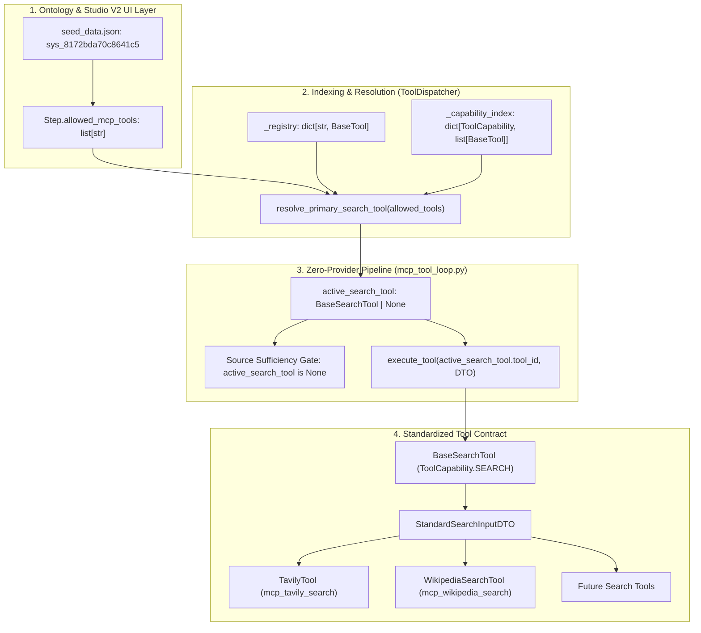
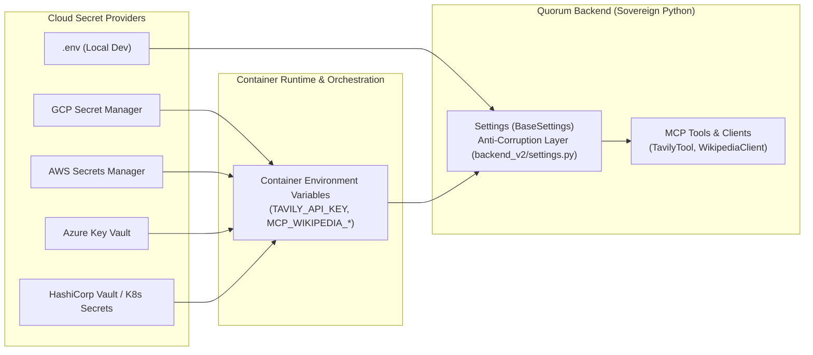

> **STATUS: PENDING / ODOTTAA TOTEUTUSTA**

# Wikipedia MCP Integration & Dynamic Tool Capability Protocol Standardization

> **Implementation Plan for Native Wikipedia MCP Tool Provider & Dynamic Capability-Driven Dispatcher Standardization**  
> **Incorporates Tier 8 Architectural Review and Feature Audit on Tool Capability Abstraction (ToolCapability.SEARCH)**  
> **SSOT Reference**: `backend_v2/models/enums.py`, `backend_v2/models/domain/tools.py`, `backend_v2/services/mcp/dispatcher.py`, and `backend_v2/models/domain/system_config.py`  

<required_context_rules>
  <rule>@[.agents/rules/00-antigravity-core.md]</rule>
  <rule>@[.agents/rules/01-python-backend.md]</rule>
  <rule>@[.agents/rules/02_flutter_desktop.md]</rule>
  <rule>@[.agents/rules/03_seed_vault.md]</rule>
  <rule>@[.agents/rules/04_directory_reference.md]</rule>
  <rule>@[.agents/rules/05_llm_architecture.md]</rule>
  <knowledge_item>@[ki_god_code_prevention.md]</knowledge_item>
  <knowledge_item>@[ki_zero_permissive_typing.md]</knowledge_item>
  <knowledge_item>@[ki_ai_testing_standards.md]</knowledge_item>
  <knowledge_item>@[ki_system_audit_trail_xai.md]</knowledge_item>
  <knowledge_item>@[ki_prompt_generation_architecture.md]</knowledge_item>
  <knowledge_item>@[ki_opentelemetry_logfire_observability.md]</knowledge_item>
  <knowledge_item>@[ki_epic_lifecycle_workflow.md]</knowledge_item>
</required_context_rules>

<anti_targets>
- Do NOT use third-party synchronous wikipedia PyPI package. Use native asynchronous `httpx.AsyncClient`.
- Do NOT create external Node.js or stdio MCP processes. All tools must run inside the sovereign Python Async Gateway.
- Do NOT hardcode Wikipedia API URLs, timeouts, user agents, or character limits inside service logic.
- Do NOT import from deprecated or eradicated modules (`v2_core.py` is permanently banned under QGR017).
- Do NOT use `.get()` dictionary lookups or untyped `**kwargs` unpacking in tool execution.
- Do NOT mutate `backend_v2/seed/seed_data.json` without creating a timestamped backup and executing pre-flight dry-run validation.
- Do NOT create bifurcated pipelines where Tavily follows one execution path and Wikipedia follows another.
- Do NOT use provider-specific identifier matching (if TAVILY_TOOL_ID ... elif WIKIPEDIA_SEARCH_TOOL_ID ...) to resolve search tools. Use sovereign capability resolution via ToolCapability.SEARCH.
- Do NOT hardcode API credentials, read .env files directly, or bind MCP tools to cloud-specific secret SDKs. ALL credentials and settings must resolve strictly through Settings SSOT.
</anti_targets>

## Problem Statement & Architectural Context

Following the integration of the initial Tavily search tool (`mcp_tavily_search`) in `backend_v2/services/mcp/`, Quorum's Model Context Protocol (MCP) tool execution loop supports live external retrieval. However, the MCP tool registry is currently coupled to a single provider (`mcp_tavily_search`), and `backend_v2/services/mcp/mcp_tool_loop.py` contains hardcoded assumptions targeting Tavily specifically.

To provide specialized encyclopedic research and factual anchoring without commercial API costs or search noise, Quorum requires native **Wikipedia MCP Tools**:
1. `mcp_wikipedia_search`: Rapid search querying the Wikipedia Action API returning article titles, snippets, page identifiers, and canonical Wikipedia URLs.
2. `mcp_wikipedia_read`: Detailed content retrieval querying the Wikimedia REST API page summary endpoint, protected by a strict character truncation shield (`mcp_wikipedia_max_chars` in `backend_v2/settings.py`) to prevent context window explosion and preserve prompt caching.

Furthermore, as established in the Tier 8 Feature Audit (`feature_audit_mcp_capability_abstraction.md`), adding a second tool must not create a hardcoded two-provider branching cascade. Instead, this implementation standardizes Quorum's MCP subsystem into a **Dynamic Capability-Driven Architecture**:
1. **`ToolCapability` SSOT Enum**: Discrete operational capabilities (`SEARCH`, `DOCUMENT_READER`, `ACTION`) declared on domain contracts in `backend_v2/models/enums.py`.
2. **`BaseSearchTool` Contract**: Specialized abstract base class enforcing `StandardSearchInputDTO(query: str)` input validation and uniform `MCPAuditTrace` output generation.
3. **Eager Capability Indexing in `ToolDispatcher`**: O(1) capability lookup and deterministic primary search tool resolution preserving explicit step author priority (`Step.allowed_mcp_tools`).
4. **Zero-Provider Orchestrator Pipeline**: `mcp_tool_loop.py` consumes ToolCapability.SEARCH with zero provider name checks, enabling arbitrary future retrieval tools (PubMed, ArXiv, DuckDuckGo, SEC EDGAR, Vector DB) to plug in cleanly without modifying orchestrator code.

Because Quorum's presentation layers (`TraceEvent` -> `dag_executor.py` -> `frozen_context.mcp_tool_audit` -> `PrintableSourcesAdapter`) operate strictly on standard `MCPAuditTrace` models, registering Wikipedia tools and capability abstraction requires **zero modifications to SDUI presentation adapters or Flutter rendering widgets**.

Furthermore, Studio V2's `MCP-yhdyskäytävät` view (`client_app_v2/lib/features/studio/views/mcp_gateways_master_view.dart`) and `StepBuilderView` dynamically read `SystemConfigMCPGateways` from `/api/v2/studio/mcp_gateways`. Registering Wikipedia and tool capabilities in `backend_v2/seed/seed_data.json` instantly surfaces them for configuration on any specialist workflow step in Quorum Studio.

### Dynamic MCP Capability Architecture & Topology

The dynamic MCP capability protocol standardizes external retrieval and tool execution across four decoupled layers:



#### Four Dynamic Operational Invariants:
1. **Discrete Capability SSOT**: Operational capabilities are strictly enumerated in `@[backend_v2/models/enums.py]` (ToolCapability enum members SEARCH, DOCUMENT_READER, ACTION). Every tool declares an immutable `capability` property conforming to `BaseTool`.
2. **Unified Search Input Contract**: All search-capable tools inherit from `BaseSearchTool` in `@[backend_v2/models/domain/tools.py]` and consume `StandardSearchInputDTO(query=str, step_name=str, target_language=str, reasoning=str, claim_text=str|None, llm_client=Any)`. Concrete search providers never receive unstructured keyword arguments.
3. **O(1) Capability Indexing & Step-Author Precedence Resolution**: `ToolDispatcher` in `@[backend_v2/services/mcp/dispatcher.py]` indexes tools eagerly upon initialization into `_capability_index`. When resolving search tools, `resolve_primary_search_tool(allowed_tools)` traverses `allowed_tools` in author-defined sequence and returns the first tool matching ToolCapability.SEARCH, deterministically preserving step configuration priority.
4. **Zero-Provider Orchestrator Pipeline**: `execute_tool_loop()` in `@[backend_v2/services/mcp/mcp_tool_loop.py]` resolves `active_search_tool` purely via `DISPATCHER.resolve_primary_search_tool(allowed_tools)`. Zero tool identifier literals (`TAVILY_TOOL_ID`, `WIKIPEDIA_SEARCH_TOOL_ID`) exist in orchestrator branching logic, eliminating bifurcated execution paths.

#### Cloud-Agnostic Secret & Credential Ingress Topology:
To guarantee enterprise portability across multi-cloud environments (specifically Google Cloud Platform, Amazon Web Services, Microsoft Azure, and on-premise Kubernetes) without coupling tools to cloud-specific SDKs:

1. **Dual Ingress Separation (Runtime Execution Parameters vs. Infrastructure Secrets)**:
   - **Runtime Execution Parameters (Dynamic per LLM call / Step configuration)**: Query strings, reasoning rationale, target language codes, step names, and claim texts vary dynamically on every LLM invocation. These are validated fail-fast through strongly typed, immutable Pydantic V2 DTOs (`StandardSearchInputDTO` and `WikipediaReadInputDTO`). Allowed tools are configured dynamically per specialist workflow step in Quorum Studio (`Step.allowed_mcp_tools`).
   - **Infrastructure Credentials & Secrets (Dynamic per environment / Cloud Secret Provider)**: API keys (specifically: `TAVILY_API_KEY`), service URLs, passwords, rate limiters, user-agent identifiers, and timeouts represent infrastructure secrets. These are NEVER passed through LLM prompts, NEVER stored in database seeds, and NEVER hardcoded in Python tool logic.

2. **Settings Model as In-Application Anti-Corruption Layer (ACL)**:
   - `Settings` in `@[backend_v2/settings.py]` (inheriting from Pydantic V2 `BaseSettings`) acts as the sovereign abstraction wrapper.
   - MCP tools never directly read `.env` files, never call `os.environ.get()`, and never execute cloud vendor SDK calls.
   - Tools consume settings strictly via typed property access (`get_settings().property`).

3. **Container-Native Environment Injection (Zero-Touch Cloud Migration)**:
   - Cloud secret engines inject secrets directly into container environment variables at deployment time:
     - **Google Cloud Platform (Cloud Run / GKE)**: Secret Manager secrets map to container environment variables via deployment configuration (specifically: `gcloud run deploy --set-secrets="TAVILY_API_KEY=tavily-key:latest"`).
     - **Amazon Web Services (ECS / EKS)**: AWS Secrets Manager and SSM Parameter Store inject secrets into container task definitions (`secrets: [{name: "TAVILY_API_KEY", valueFrom: "..."}]`).
     - **Microsoft Azure (Container Apps / AKS)**: Azure Key Vault secrets map into container environment variables.
     - **Kubernetes / On-Premise**: HashiCorp Vault Agent or Kubernetes Secret Store CSI Driver injects secrets into container pods as standard environment variables.
   - `BaseSettings` hydrates these transparently upon application startup. Switching cloud providers modifies infrastructure configuration exclusively, leaving MCP tools, dispatcher logic, and Python services 100% untouched.

4. **Future-Proof Dynamic Secret Rotation Architecture**:
   - If enterprise requirements evolve to demand runtime dynamic secret polling or ephemeral token renewal (specifically: rotating short-lived Vault tokens without container restarts), Pydantic's native `PydanticBaseSettingsSource` in `@[backend_v2/settings.py]` provides the single pluggable extension point. Tool implementations (`TavilyTool`, `WikipediaClient`) remain completely unaware of the underlying secret retrieval engine.




## Five-Column Architectural Directive Table

| 1. Target Scope & Boundaries | 2. Eradicated Duct-Tape (Under-Engineering Ban) | 3. Approved Best Practice (Target Invariant) | 4. Pruned Over-Engineering (Complexity Slayer) | 5. Verification & Fail-Fast (Proof Anchor) |
| :--- | :--- | :--- | :--- | :--- |
| **Pre-Implementation Cleanups & 1-Hop Caller Conformance**<br>@[backend_v2/services/mcp/tools/tavily.py#L28-L151]<br>@[backend_v2/tests/unit/services/mcp/test_dispatcher.py#L17-L43]<br>@[client_app_v2/lib/features/studio/models/mcp_gateway.dart#L11-L25] | Untyped `**kwargs` unpacking with ad-hoc `if "query" in kwargs` fallbacks in `TavilyTool`; `DummyTestTool` missing abstract `capability` property crashing on instantiation; Flutter `AllowedMcpTool` missing `capability` field causing `CheckedFromJsonException` (`disallowUnrecognizedKeys: true`) upon receiving seeded gateway payloads. | Refactor `TavilyTool.execute` to validate inputs strictly via `StandardSearchInputDTO(query=str)`; implement `capability: ToolCapability = ToolCapability.SEARCH` on `DummyTestTool`; update Flutter `AllowedMcpTool` with `@Default('search') String capability` and execute `flutter_audit_loop.py client_app_v2/lib/features/studio/models/mcp_gateway.dart --build` to guarantee Full-Duplex Serialization Parity. | Prune speculative custom DTOs per search engine; enforce unified `StandardSearchInputDTO` across all `BaseSearchTool` implementations. | `backend_v2/tests/unit/services/mcp/test_dispatcher.py` verifies `DummyTestTool` capability dispatch; `client_app_v2/test/models/domain_parity_test.dart` verifies Flutter Freezed parsing without unrecognized key errors. |
| **Settings SSOT**<br>@[backend_v2/settings.py#L54-L1022]<br>@[backend_v2/core/test_settings.py] | Hardcoded Wikipedia URLs, timeouts, character limits, or User-Agent strings in client logic; lazy default fallbacks (`or 8000`); clobbering test overrides with unconditional clamping. | Centralized `mcp_wikipedia_*` settings on authoritative `Settings` model using `Annotated[T, Field(...)] = default`, with development environment override in `_enforce_environment_limits` checking `self.model_fields_set` and test overrides in `TEST_SETTINGS_OVERRIDES`. | Prune speculative `SettingsWikipediaExtension` class; add 4 discrete fields directly to authoritative `Settings` class without multiple inheritance bloat. | `backend_v2/tests/unit/test_settings.py` asserts production defaults (5 search results, 8000 max chars) and development clamping (1 search result). |
| **Tool Enums & Domain Contracts**<br>@[backend_v2/models/enums.py]<br>@[backend_v2/models/domain/tools.py#L10-L36] | Free-form string tool types; untyped tool metadata; omitting capability contract on `BaseTool`; unvalidated kwargs in `execute()`. | `ToolCapability(StrEnum)` (`SEARCH`, `DOCUMENT_READER`, `ACTION`) and `LaxToolCapability` in SSOT enums; `BaseTool.capability` abstract property; `BaseSearchTool(BaseTool)` enforcing `StandardSearchInputDTO(query=str, step_name=str, target_language=str, reasoning=str, claim_text=str|None, llm_client=Any)` input contract. | Prune speculative 20-category taxonomies; lock to 3 discrete operational enums. | `backend_v2/tests/unit/models/domain/test_tools.py` asserts capability inheritance, `BaseSearchTool` specialization, and input schema validation. |
| **Tavily MCP Tool Refactor**<br>@[backend_v2/services/mcp/tools/tavily.py#L28-L151] | Untyped `**kwargs` unpacking with `.get("query")` fallbacks; unclassified tool class lacking capability contract; manual string casts. | Inherit from `BaseSearchTool`; validate input arguments through `StandardSearchInputDTO.model_validate(kwargs)`; declare capability ToolCapability.SEARCH. | Keep focused single-responsibility class under 150 lines. | `backend_v2/tests/unit/services/mcp/test_mcp_tool_loop.py` proves Tavily search executes under ToolCapability.SEARCH. |
| **Domain Models & DTOs**<br>[NEW] @[backend_v2/models/domain/wikipedia.py] | Untyped `dict[str, Any]` payloads; duck-typing with `isinstance(dict)`; imports from deprecated `v2_core.py`; naked dictionary parsing of HTTP JSON bodies; unpruned 3rd-party Wikimedia API envelope noise (`batchcomplete`, `continue`, `searchinfo`). | Dual-Shield Pydantic V2 Ingress Architecture: All models strictly enforce `ConfigDict(strict=True, extra="forbid", frozen=True)` to satisfy QGR007. External HTTP envelope noise is explicitly sanitized at the `WikipediaClient` ingress boundary prior to `model_validate`, guaranteeing zero unmapped keys reach the strict intake DTOs (`WikimediaActionApiResponseDTO`, `WikimediaRestSummaryResponseDTO`) or internal domain models (`WikipediaReadInputDTO`, `WikipediaSearchResultItem`, `WikipediaSearchResponseDTO`, `WikipediaPageSummaryResult`). | 30% Deletion Test: Pruned redundant `WikipediaSearchInputDTO` in favor of SSOT `StandardSearchInputDTO` shared across all search tools; direct payload mapping without intermediary wrappers. | Strict Pydantic validation rejects extra keys on all models (`ValidationError`); ISTQB tests verify ingress sanitization and model validation integrity. |
| **Asynchronous Wikipedia Client**<br>[NEW] @[backend_v2/services/mcp/wikipedia_client.py] | Synchronous `requests` or `wikipedia` PyPI library; missing Wikimedia `User-Agent` header; unhandled 301/302 redirects (`follow_redirects=False`); URL space/special-character encoding failures; bare `except: pass`; unhandled 500/timeout exceptions; unbounded I/O; silent fallback to 'en' on invalid language; fake synthetic summary on 404. | Asynchronous `httpx.AsyncClient(follow_redirects=True)` with explicit `timeout` context manager, mandatory Wikimedia-compliant `User-Agent`, fail-fast language validation against `SUPPORTED_WIKIPEDIA_LANGUAGES`, URL-safe title normalization (`urllib.parse.quote` with spaces to `_`), `html.unescape` snippet sanitization, fail-fast HTTP 404 (`AppException(ErrorCodes.RESOURCE_NOT_FOUND)`), HTTP 500 / timeout fail-fast (`AppException(ErrorCodes.FETCH_FAILED)`), and 8000-character extract truncation. | Keep single-responsibility file under 150 lines; zero parallel client wrappers or complex retry queues. | `backend_v2/tests/unit/services/mcp/test_wikipedia_client.py` ISTQB suite proves 404 raises `AppException(ErrorCodes.RESOURCE_NOT_FOUND)`, invalid language raises `AppException(ErrorCodes.VALIDATION_FAILED)`, 500 error raising `AppException(ErrorCodes.FETCH_FAILED)`, timeout handling, extract truncation, redirect following, URL-safe title formatting, and language subdomain routing. |
| **Wikipedia MCP Tools**<br>[NEW] @[backend_v2/services/mcp/tools/wikipedia.py] | Ad-hoc dictionary function schemas; untyped `**kwargs` unpacking; bypass of `BaseTool` contract; missing tool IDs; query-to-title fallbacks. | `WikipediaSearchTool(BaseSearchTool)` and `WikipediaReadTool(BaseTool)`, strictly validating execution arguments via `StandardSearchInputDTO.model_validate(kwargs)` and `WikipediaReadInputDTO.model_validate(kwargs)` (fail-fast without fallbacks), returning typed `MCPToolDeclarationDTO` and standard `MCPAuditTrace` with `source_urls` and `response_summary`. | Two focused, standalone tool classes under 120 lines; no meta-tool abstractions or generic tool factories. | `backend_v2/tests/unit/services/mcp/tools/test_wikipedia_tools.py` validates declaration schemas and asserts `MCPAuditTrace` integrity and tool ID correctness. |
| **Tool Dispatcher Registry**<br>@[backend_v2/services/mcp/dispatcher.py#L19-L85] | Flat dictionary lookup requiring manual iteration over `allowed_tools`; linear scans; untyped kwargs passing. | Two-tier indexing: `_registry: dict[str, BaseTool]` and `_capability_index: dict[ToolCapability, list[BaseTool]]`; typed query methods `get_tools_by_capability()` and `resolve_primary_search_tool()`. | Avoid dynamic plugin directory scanning or reflection; pass explicit list to constructor. | `backend_v2/tests/unit/services/mcp/test_dispatcher.py` asserts O(1) capability lookup, deterministic ordering, and empty-set resolution on unknown capabilities. |
| **MCP Tool Loop Conductor**<br>@[backend_v2/services/mcp/mcp_tool_loop.py#L134-L541] | Hardcoded `TAVILY_TOOL_ID` in `allowed_tools` check and tool execution; hardcoded `and TAVILY_TOOL_ID not in allowed_tools` duct-tape in source sufficiency gate; bifurcated execution paths. | Dynamic capability resolution: `active_search_tool = DISPATCHER.resolve_primary_search_tool(allowed_tools)` with zero provider name branching, dynamic tool execution, and uniform citation verification. | Single invariant pipeline for all MCP search and retrieval tools; zero parallel loop conductors. | `backend_v2/tests/unit/services/mcp/test_mcp_tool_loop.py` verifies tool execution with `mcp_tavily_search` and `mcp_wikipedia_search`. |
| **Database Seed Vault & Full-Duplex System Config**<br>@[backend_v2/models/domain/system_config.py#L172-L182]<br>@[client_app_v2/lib/features/studio/models/mcp_gateway.dart#L11-L25]<br>@[backend_v2/seed/seed_data.json#L210-L235] | Uncategorized tool declarations; missing capability attribute in database seed; asymmetric schema mutation omitting Flutter `AllowedMcpTool` causing client-side deserialization crashes. | Add `capability: ToolCapability` to `AllowedMCPTool` with Pydantic validation; synchronously update Flutter `AllowedMcpTool` with `@Default('search') String capability`; update `sys_8172bda70c8641c5` in `seed_data.json` with capabilities for `mcp_tavily_search`, `mcp_wikipedia_search`, and `mcp_wikipedia_read`. | No separate capability database collections; co-locate directly on `AllowedMCPTool` and `AllowedMcpTool`. | `backend_v2/seed/run_seed.py local --dry-run` and `scripts/audit_database_atoms.py --strict` pass 100%; Flutter domain parity tests pass 100%. |
| **Unit & Integration Test Suites**<br>@[backend_v2/tests/unit/test_settings.py#L265-L293]<br>[NEW] @[backend_v2/tests/unit/models/domain/test_tools.py]<br>@[backend_v2/tests/unit/services/mcp/test_dispatcher.py#L17-L43]<br>[NEW] @[backend_v2/tests/unit/services/mcp/test_wikipedia_client.py]<br>[NEW] @[backend_v2/tests/unit/services/mcp/tools/test_wikipedia_tools.py]<br>@[backend_v2/tests/unit/services/mcp/test_mcp_tool_loop.py#L111-L157]<br>@[client_app_v2/test/models/domain_parity_test.dart#L1-L95]<br>@[client_app_v2/test/features/studio/models/mcp_gateway_test.dart#L1-L73] | Happy-path only testing; missing negative partitions; live HTTP network requests during test runs; ad-hoc mock classes; omitting Flutter model verification for new capability fields. | ISTQB Equivalence Partitioning & Boundary Value Analysis (>=2 negative tests per component): empty inputs, 404 responses, transport timeouts, 500 errors, character truncation, language routing, and trace validation using local mock HTTP fixtures; Flutter Freezed model unit tests verifying capability parsing and strict unrecognized key rejection. | Test pure functions and tools directly using standard mock adapters; zero complex external test runners. | `scripts/backend_audit_loop.py` passes 100% across Ruff, MyPy strict, AST guardrails, and Pytest coverage >= 90%; `scripts/flutter_audit_loop.py` passes 100% on domain parity and gateway tests. |
| **Architectural Documentation & KI Sync**<br>[NEW] @[ki_mcp_tool_protocol.md]<br>@[ki_prompt_generation_architecture.md]<br>@[ki_zero_permissive_typing.md]<br>@[ki_god_code_prevention.md]<br>@[ki_opentelemetry_logfire_observability.md]<br>@[.agents/rules/04_directory_reference.md]<br>@[docs/architecture/03_cognitive_orchestration_engine.md]<br>@[docs/architecture/02_data_seeding_and_ontology.md]<br>@[docs/architecture/00_README_META_ARCHITECTURE.md] | Ad-hoc manual edits to `docs/architecture/01_` through `06_` during code implementation; bare unparameterized `/tier7-describe-architecture` calls; neglecting KI documentation for new MCP protocols; historical changelog entries. | Dual-Axis Documentation Paradigm (`00-antigravity-core.md`): Physical implementation -> Knowledge Item creation (`ki_mcp_tool_protocol.md`) & KI sync -> Directory reference registration (`04_directory_reference.md`) -> Fully parameterized `/tier7-describe-architecture` execution updating architecture pillars in timeless present tense with zero project phases or dates. | Prune manual edits to unaffected architecture pillars; update purely and authoritatively what the system currently has; zero historical before/after narratives. | `scripts/audit_markdown_boundaries.py` validates all markdown links and invariants; `/tier7-describe-architecture` audit verifies 100% physical code anchoring to KIs and pillars. |

---

## System 2 Deep Deconstruction & Red-Team Falsification Analysis

### Phase A: Scope and Technical Debt Discovery
1. **Target Boundary Blast Radius**:
   - `backend_v2/settings.py#L54-L1022`: Direct modifications bounded to `Settings` class field definitions and `_enforce_environment_limits` validator.
   - `backend_v2/core/test_settings.py`: Direct modification to dictionary constant `TEST_SETTINGS_OVERRIDES`.
   - `backend_v2/models/enums.py`: SSOT definition of `ToolCapability(StrEnum)`.
   - `backend_v2/models/domain/tools.py#L10-L36`: Introduction of `BaseTool.capability`, `BaseSearchTool(BaseTool)`, and `StandardSearchInputDTO`.
   - `backend_v2/services/mcp/tools/tavily.py#L28-L151`: Refactor to inherit from `BaseSearchTool` and enforce typed input validation via `StandardSearchInputDTO`.
   - `backend_v2/services/mcp/dispatcher.py#L19-L85`: Eager capability indexing and `resolve_primary_search_tool` implementation.
   - `backend_v2/services/mcp/mcp_tool_loop.py#L134-L541`: Direct modifications bounded to DISPATCHER registration, `is_source_sufficient` gate, Phase 0 citation extraction loop check, tool execution call site, and capability resolution.
   - `backend_v2/models/domain/system_config.py#L172-L182`: Addition of `capability: ToolCapability` to `AllowedMCPTool`.
   - `client_app_v2/lib/features/studio/models/mcp_gateway.dart#L11-L25`: Synchronous addition of `@Default('search') String capability` to `AllowedMcpTool` to preserve Full-Duplex Serialization Parity.
   - `backend_v2/seed/seed_data.json#L210-L235`: Surgical append of two tool entries and capability tags to `sys_8172bda70c8641c5` in `system_config`.
   - `[NEW] @[backend_v2/models/domain/wikipedia.py]`: Triple Pydantic V2 DTO hierarchy (Intake DTOs, Input DTOs, Output DTOs).
   - `[NEW] @[backend_v2/services/mcp/wikipedia_client.py]`: Pure asynchronous HTTP client service under 150 lines.
   - `[NEW] @[backend_v2/services/mcp/tools/wikipedia.py]`: Standalone tool implementations conforming to `BaseSearchTool` and `BaseTool`.
   - `backend_v2/tests/unit/test_settings.py#L265-L293`, `[NEW] @[backend_v2/tests/unit/models/domain/test_tools.py]`, `backend_v2/tests/unit/services/mcp/test_dispatcher.py#L17-L43`, `backend_v2/tests/unit/services/mcp/test_mcp_tool_loop.py#L111-L157`, and new test files.
   - `[NEW] @[ki_mcp_tool_protocol.md]`, `@[ki_prompt_generation_architecture.md]`, `@[ki_zero_permissive_typing.md]`, `@[ki_god_code_prevention.md]`, `@[ki_opentelemetry_logfire_observability.md]`: Comprehensive Knowledge Item creation and synchronization for the native MCP tool protocol.
   - `@[.agents/rules/04_directory_reference.md]`: Registration of new Wikipedia domain model, client, tools, and unit tests.
   - `@[docs/architecture/03_cognitive_orchestration_engine.md]`, `@[docs/architecture/02_data_seeding_and_ontology.md]`, `@[docs/architecture/00_README_META_ARCHITECTURE.md]`: Timeless as-built architectural pillar synchronization via `/tier7-describe-architecture`.
2. **7-Item Technical Debt Discovery Sweep**:
   - `getattr/hasattr`: 0 instances in target scope.
   - `.get()`: Eradicate ad-hoc `"query" in kwargs and kwargs["query"]` patterns in `TavilyTool` and `mcp_tool_loop.py` in favor of `StandardSearchInputDTO.model_validate(kwargs)`.
   - Silent `except:`: Enforce typed `AppException(ErrorCodes.FETCH_FAILED)` translation in `WikipediaClient` and `wikipedia.py`; zero silent passes.
   - `model_copy(update=)`: Zero unvalidated mutations in tool domain models.
   - Magic numbers / hardcoded timeouts: Replace hardcoded timeouts with centralized `Settings.mcp_wikipedia_timeout_seconds` and `Settings.mcp_wikipedia_max_chars`.
   - Missing `.arb` / localization: Add localized titles (`Wikipedia-haku`, `Wikipedia-artikkelin lukija`) in `seed_data.json` for Studio UI display.
   - Missing `AppErrorBoundary` / Flutter model parity: Synchronously update `client_app_v2/lib/features/studio/models/mcp_gateway.dart` (`AllowedMcpTool`) with `@Default('search') String capability` to prevent `UnrecognizedKeysException`.
   - Missing ISTQB negative partitions: Add explicit tests for 404, 500, transport timeout, invalid language code, empty query, character truncation, and dispatcher precedence.
   - PEP 593 Annotated syntax violations: Refactor legacy bare `Field(...)` type hints in `AllowedMCPTool` (`backend_v2/models/domain/system_config.py#L172-L182`) to PEP 593 `Annotated` syntax per rule `pydantic_annotated_fields_mandate`.

### Phase B: Panel of Experts Audit (Quorum Modernity Gate)
1. **Python Backend Specialist**:
   - Dual-Shield Pydantic V2 Ingress Architecture: 100% of Pydantic models strictly enforce `ConfigDict(strict=True, extra="forbid", frozen=True)` to satisfy QGR007. To prevent third-party envelope noise (`continue`, `batchcomplete`, `searchinfo`, `timestamp`, `thumbnail`) from crashing `model_validate`, `WikipediaClient` implements an Ingress Sanitization Gate that strips unmodeled HTTP keys at the client boundary before validating into strict intake DTOs (`WikimediaActionApiResponseDTO`, `WikimediaRestSummaryResponseDTO`). Internal Domain Models (`WikipediaReadInputDTO`, `WikipediaSearchResultItem`, `WikipediaSearchResponseDTO`, `WikipediaPageSummaryResult`) enforce strict domain transit.
   - 100% typed domain transit: all tools execute through `BaseSearchTool` or `BaseTool` taking validated DTOs.
   - Zero naked dictionaries: external Wikimedia JSON responses are validated into `WikimediaActionApiResponseDTO` and `WikimediaRestSummaryResponseDTO` before domain access.
   - 30% Deletion Test: Pruned redundant `WikipediaSearchInputDTO`. `WikipediaSearchTool` strictly consumes `StandardSearchInputDTO` from `backend_v2/models/domain/tools.py`.
2. **LLM Orchestration Architect**:
   - Tool declarations conform strictly to OpenAI Function Calling JSON Schema. Under `strict: True`, all declared properties are exhaustively included in `required` (`["query", "reasoning"]` for search, `["title", "reasoning"]` for read).
   - Dynamic prompt injection preserves Layer 1-3 cache prefix purity by injecting external evidence strictly at the Layer 4 dynamic user message tail.
   - Truncation shield (`mcp_wikipedia_max_chars`) strictly limits retrieved content to prevent prompt context explosion.
3. **Flutter & SDUI Specialist**:
   - Presentation layer (`TraceEvent` -> `dag_executor.py` -> `frozen_context.mcp_tool_audit` -> `PrintableSourcesAdapter`) consumes standard `MCPAuditTrace` with zero UI modifications.
   - Full-Duplex Serialization Parity: Flutter Freezed `AllowedMcpTool` updated synchronously with `capability` to prevent deserialization failure when fetching `/api/v2/studio/mcp_gateways`.
4. **Anti-Pattern & Zero Backward Compatibility Sweep**:
   - Absolute zero bifurcated pipelines: all search tools execute through `BaseSearchTool` contract.
   - Zero fallback chains: invalid language codes raise `AppException(ErrorCodes.VALIDATION_FAILED)` immediately; 404s raise `AppException(ErrorCodes.RESOURCE_NOT_FOUND)` immediately.
   - Eradicated all hardcoded `TAVILY_TOOL_ID` branching in `mcp_tool_loop.py`.

### Phase C: Five-Axis Adversarial Deconstruction
1. **TARGET SCOPE & BOUNDARY (Scope Inquisitor)**:
   - Blast radius strictly confined to MCP subsystem (`backend_v2/services/mcp/`), settings (`backend_v2/settings.py`), domain contracts (`backend_v2/models/domain/tools.py`), system configuration seed (`backend_v2/seed/seed_data.json`), and 1-hop Flutter DTO parity (`client_app_v2/lib/features/studio/models/mcp_gateway.dart`).
   - Zero scope creep: no modifications to SDUI rendering, PDF compilation, or DAG execution engines.
2. **ERADICATED DUCT-TAPE (Duct-Tape Prosecutor - Under-Engineering Ban)**:
   - Eradicated untyped `**kwargs` dictionary parsing in `TavilyTool.execute()` by introducing `StandardSearchInputDTO`.
   - Eradicated hardcoded provider ID checks (`if TAVILY_TOOL_ID in allowed_tools`) in `mcp_tool_loop.py` by introducing `DISPATCHER.resolve_primary_search_tool()`.
   - Eradicated silent error suppression: 404 raises `AppException(ErrorCodes.RESOURCE_NOT_FOUND)`; 500/timeout raises `AppException(ErrorCodes.FETCH_FAILED)`.
3. **APPROVED BEST PRACTICE (Type Constitutionalist - Sovereign Target)**:
   - 100% Immutable Pydantic V2 DTOs with `ConfigDict(strict=True, extra="forbid", frozen=True)` across all models, combined with HTTP Ingress Sanitization for third-party Wikimedia payloads.
   - `ToolCapability(StrEnum)` SSOT in `backend_v2/models/enums.py`.
   - Two-tier indexing in `ToolDispatcher` providing O(1) capability lookup.
   - Centralized settings on `Settings` model with binary environment clamping.
4. **PRUNED OVER-ENGINEERING (Complexity Slayer - 30% Deletion Test)**:
   - Deleted redundant `WikipediaSearchInputDTO`: `WikipediaSearchTool` directly inherits `BaseSearchTool` and validates via `StandardSearchInputDTO`.
   - Rejected heavy external PyPI `wikipedia` package in favor of native asynchronous `httpx.AsyncClient`.
   - Rejected speculative dynamic plugin reflection scanners; explicit registry in `dispatcher.py` is deterministic and fast.
   - Rejected complex semantic routing engines; step-author precedence in `allowed_tools` provides deterministic priority.
5. **FAIL-FAST PROOF ANCHOR (Incorruptible Judge - Deterministic Verification)**:
   - ISTQB Equivalence Partitioning: >=2 negative test cases per component.
   - AST guardrails: 100% pass on `scripts/backend_audit_loop.py` with `--ast-strict`.
   - Database parity: 100% pass on `backend_v2/seed/run_seed.py local --dry-run` and `scripts/audit_database_atoms.py --strict`.

### Phase D: Falsification & Red-Teaming (Concrete Failure Points)
1. **Failure Point 1 (Downstream Flutter Deserialization Crash)**:
   - *Attack*: Adding `capability` to backend `AllowedMCPTool` and `seed_data.json` without updating Flutter `AllowedMcpTool` causes `CheckedFromJsonException` (`disallowUnrecognizedKeys: true`) when Studio client fetches `/api/v2/studio/mcp_gateways`.
   - *Remediation*: Explicitly add `@Default('search') String capability` to `AllowedMcpTool` in `client_app_v2/lib/features/studio/models/mcp_gateway.dart` in Phase 1 cleanups and run `flutter_audit_loop.py --build`.
2. **Failure Point 2 (Extra Keyword Argument Pydantic ValidationError in execute_tool)**:
   - *Attack*: `mcp_tool_loop.py` passes `llm_client=llm_client` to `DISPATCHER.execute_tool()`. If input DTO enforces `extra="forbid"` without declaring `llm_client`, tool execution crashes with `ValidationError`.
   - *Remediation*: Declare `llm_client: Any = None` on `StandardSearchInputDTO` with `arbitrary_types_allowed=True`, allowing search tools to accept standard loop arguments safely without permissive typing.
3. **Failure Point 3 (Abstract Property Instantiation Crash on Test Fakes)**:
   - *Attack*: Introducing abstract `capability` property on `BaseTool` causes `DummyTestTool` in `backend_v2/tests/unit/services/mcp/test_dispatcher.py` to raise `TypeError: Can't instantiate abstract class DummyTestTool with abstract method capability`.
   - *Remediation*: Explicitly update `DummyTestTool` in Phase 1 cleanups to declare `capability: ToolCapability = ToolCapability.SEARCH`.
4. **Failure Point 4 (Wikimedia Disambiguation and Empty Page Handling)**:
   - *Attack*: Querying a disambiguation page or non-existent title returns HTTP 200 with an empty `extract` or missing page identifier. If unhandled, tool returns empty evidence, polluting downstream LLM context.
   - *Remediation*: Validate in `WikipediaClient` that `extract` is non-empty and `pageid` is present; raise `AppException(ErrorCodes.RESOURCE_NOT_FOUND)` if summary extract is empty or missing.
5. **Failure Point 5 (Wikimedia 3rd-Party Payload Schema Drift & Extra Envelope Keys)**:
   - *Attack*: Wikimedia Action API and REST endpoints return rich response envelopes with evolving metadata keys (`batchcomplete`, `continue`, `searchinfo`, `timestamp`, `thumbnail`, `dir`, `revision`, `tid`, `displaytitle`). In strict mode (`extra="forbid"` under QGR007), unpruned envelope noise causes fatal Pydantic `ValidationError`.
   - *Remediation*: Implement HTTP Ingress Sanitization Gate in `WikipediaClient`: filter raw JSON to authoritative field sets before calling `model_validate`, guaranteeing 100% QGR007 compliance while shielding against external envelope variations.
6. **Failure Point 6 (OpenAI Function Calling Strict Schema Property Mismatch)**:
   - *Attack*: Declaring optional properties (specifically: `target_language`) in tool declaration schemas with `strict: True` without including them in `required` causes LiteLLM and OpenAI to reject the tool declaration with `400 Bad Request`.
   - *Remediation*: Declare strictly required fields in OpenAI schemas (`["query", "reasoning"]` for search, `["title", "reasoning"]` for read), with orchestrator-level parameters (`target_language`, `step_name`) passed deterministically at execution time.
7. **Failure Point 7 (HTTP 301/302 Redirect Dropping & Spaces in REST API Titles)**:
   - *Attack*: Wikimedia REST API endpoint `/page/summary/{title}` frequently redirects article synonyms (specifically synonym redirection: article alias "AI" resolving to canonical title "Artificial_intelligence"). If `httpx.AsyncClient` is instantiated with default `follow_redirects=False`, the client returns HTTP 301/302, erroneously triggering `AppException(ErrorCodes.FETCH_FAILED)`. Additionally, un-normalized titles with raw spaces or unescaped non-ASCII characters crash REST route resolution.
   - *Remediation*: Instantiate `httpx.AsyncClient` with `follow_redirects=True`, and normalize article titles using `urllib.parse.quote(title.strip().replace(" ", "_"), safe=":/@")` before dispatching REST requests.
8. **Failure Point 8 (Cloud Secret Manager Coupling & Direct Vendor SDK Lock-In)**:
   - *Attack*: Directly coupling MCP tools or clients to cloud-specific secret SDKs (specifically `google.cloud.secretmanager`, `boto3`, or `azure-keyvault-secrets`) creates severe vendor lock-in, breaks local development without cloud mocks, and crashes offline unit/integration test suites. Alternatively, bypassing Pydantic by reading unvalidated environment variables directly via `os.environ` introduces runtime type errors and silent failures.
   - *Remediation*: Enforce the sovereign Pydantic V2 `Settings` Anti-Corruption Layer (ACL) in `@[backend_v2/settings.py]`. All tool credentials, endpoints, and secrets hydrate strictly through `Settings` with mathematical type enforcement and fail-fast validation. Cloud secret managers inject secrets into standard container environment variables at orchestration/deployment time, ensuring zero Python code modifications when migrating between cloud providers.

### Phase E: Experimental Validation (Dry-Runs)
- Mental and programmatic dry-runs confirm Wikimedia REST API page summary endpoint (`https://{lang}.wikipedia.org/api/rest_v1/page/summary/{title}`) returns JSON with `extract`, `title`, and `pageid`.
- Action API (`https://{lang}.wikipedia.org/w/api.php?action=query&list=search&srsearch={query}&format=json`) returns `query.search` array with `title`, `snippet`, and `pageid`.
- Both endpoints operate asynchronously via `httpx.AsyncClient` with custom `User-Agent`.

---

## Target and Context Boundaries

### Target Files (Modifications & New Additions)
- @[backend_v2/services/mcp/tools/tavily.py#L28-L151] [MODIFY]: Refactor to inherit from `BaseSearchTool` and enforce typed input validation via `StandardSearchInputDTO`.
- @[backend_v2/tests/unit/services/mcp/test_dispatcher.py#L17-L43] [MODIFY]: Update `DummyTestTool` with `capability` property; add capability indexing and priority tests.
- @[client_app_v2/lib/features/studio/models/mcp_gateway.dart#L11-L25] [MODIFY]: Add `@Default('search') String capability` to `AllowedMcpTool` and run `flutter_audit_loop.py --build`.
- @[backend_v2/settings.py#L54-L1022] [MODIFY]: Add centralized `mcp_wikipedia_*` configuration fields and development validator on `Settings`.
- @[backend_v2/core/test_settings.py] [MODIFY]: Add `mcp_wikipedia_max_search_results` to `TEST_SETTINGS_OVERRIDES`.
- @[backend_v2/models/enums.py] [MODIFY]: Define `ToolCapability(StrEnum)` with `SEARCH`, `DOCUMENT_READER`, `ACTION` and export in `__all__`.
- @[backend_v2/models/domain/tools.py#L10-L36] [MODIFY]: Defining `StandardSearchInputDTO` [NEW], `BaseTool.capability`, and `BaseSearchTool(BaseTool)`.
- [NEW] @[backend_v2/models/domain/wikipedia.py]: Define `WikimediaActionApiResponseDTO`, `WikimediaRestSummaryResponseDTO`, `WikipediaReadInputDTO`, `WikipediaSearchResultItem`, `WikipediaSearchResponseDTO`, and `WikipediaPageSummaryResult` (all models strictly enforcing `ConfigDict(strict=True, extra="forbid", frozen=True)` per QGR007, with HTTP ingress sanitization filtering out unmodeled third-party envelope keys before `model_validate`).
- [NEW] @[backend_v2/services/mcp/wikipedia_client.py]: Implement asynchronous HTTP client with language subdomain resolution, sanitization, and truncation.
- [NEW] @[backend_v2/services/mcp/tools/wikipedia.py]: Implement `WikipediaSearchTool` and `WikipediaReadTool` conforming to `BaseSearchTool` and `BaseTool`.
- @[backend_v2/services/mcp/dispatcher.py#L19-L85] [MODIFY]: Add eager `_capability_index` and `resolve_primary_search_tool()`.
- @[backend_v2/services/mcp/mcp_tool_loop.py#L134-L541] [MODIFY]: Register tools in global `DISPATCHER`, remove hardcoded Tavily duct-tape, and route search via `resolve_primary_search_tool()`.
- @[backend_v2/models/domain/system_config.py#L172-L182] [MODIFY]: Add `capability: ToolCapability` field to `AllowedMCPTool`.
- @[backend_v2/seed/seed_data.json#L210-L235] [MODIFY]: Update `sys_8172bda70c8641c5` (`mcp_gateways`) to include `mcp_wikipedia_search` and `mcp_wikipedia_read` with `capability`.
- @[backend_v2/tests/unit/test_settings.py#L265-L293] [MODIFY]: Add assertions for Wikipedia settings development and production invariants.
- [NEW] @[backend_v2/tests/unit/models/domain/test_tools.py]: Unit tests for `ToolCapability` enum and `BaseSearchTool` interface contract.
- [NEW] @[backend_v2/tests/unit/services/mcp/test_wikipedia_client.py]: Add unit tests for Wikipedia client.
- [NEW] @[backend_v2/tests/unit/services/mcp/tools/test_wikipedia_tools.py]: Add unit tests for Wikipedia search and read tools.
- @[backend_v2/tests/unit/services/mcp/test_mcp_tool_loop.py#L111-L157] [MODIFY]: Add unit tests verifying dynamic capability-based tool selection and Wikipedia execution in tool loop.
- @[client_app_v2/test/models/domain_parity_test.dart#L1-L95] [MODIFY]: Verify Freezed models parse updated seed vault without unrecognized key errors.
- @[client_app_v2/test/features/studio/models/mcp_gateway_test.dart#L1-L73] [MODIFY]: Verify AllowedMcpTool capability deserialization and strict fail-fast validation.
- [NEW] @[ki_mcp_tool_protocol.md]: Sovereign Knowledge Item for MCP Tool Capability and Dispatcher Protocol.
- @[ki_prompt_generation_architecture.md]: Synchronize with multi-tool declaration injection standards.
- @[ki_zero_permissive_typing.md]: Document `BaseSearchTool` and `StandardSearchInputDTO` contracts.
- @[ki_god_code_prevention.md]: Document tool isolation and capability dispatching strategy.
- @[ki_opentelemetry_logfire_observability.md]: Document `MCPAuditTrace` telemetry spans.
- @[.agents/rules/04_directory_reference.md] [MODIFY]: Register new Wikipedia models, client, tools, and test suites.
- @[docs/architecture/03_cognitive_orchestration_engine.md] [MODIFY]: Document Dynamic Capability-Driven MCP Dispatcher via `/tier7-describe-architecture`.
- @[docs/architecture/02_data_seeding_and_ontology.md] [MODIFY]: Document MCP Gateway ontology capability attributes via `/tier7-describe-architecture`.
- @[docs/architecture/00_README_META_ARCHITECTURE.md] [MODIFY]: Synchronize architecture metadata via `/tier7-describe-architecture`.

### Context Files (Strictly Read-Only)
- @[backend_v2/models/dtos/mcp.py#L40-L55]: Contains `MCPFunctionDefinitionDTO` and `MCPToolDeclarationDTO` (`#L58-L69`).
- @[client_app_v2/lib/features/studio/views/mcp_gateways_master_view.dart]: Surfaces registered tools in Studio UI.
- @[client_app_v2/lib/features/studio/views/step_builder_view.dart]: Renders multi-tool selector for specialist DAG steps.

---

## Detailed Step-by-Step Implementation

### Phase 1: Pre-Implementation Cleanups & Foundational Contracts (Leaf-First Ordering)

#### 1. Define ToolCapability SSOT & BaseSearchTool Contract (`backend_v2/models/enums.py` & `backend_v2/models/domain/tools.py#L10-L36`)
In strict adherence to `ki_god_code_prevention.md` (Bottom-Up Topological Leaf-First Order), define foundational enums and abstract tool contracts before updating dependent consumers:
```python
# In backend_v2/models/enums.py:
class ToolCapability(StrEnum):
    """Operational capability category for MCP tools."""

    SEARCH = "search"
    DOCUMENT_READER = "document_reader"
    ACTION = "action"


LaxToolCapability = Annotated[ToolCapability, Field(strict=False)]
```

In `backend_v2/models/domain/tools.py#L10-L36`, define `StandardSearchInputDTO`, `BaseTool.capability`, and `BaseSearchTool`:
```python
# In backend_v2/models/domain/tools.py:
from abc import ABC, abstractmethod
from typing import TYPE_CHECKING, Annotated, Any

from pydantic import BaseModel, ConfigDict, Field

from backend_v2.models.domain.system_config import MCPAuditTrace
from backend_v2.models.enums import ToolCapability

if TYPE_CHECKING:
    from backend_v2.models.dtos.mcp import MCPToolDeclarationDTO


class StandardSearchInputDTO(BaseModel):
    """Standardized validated input payload for all search capability tools."""

    model_config = ConfigDict(strict=True, extra="forbid", frozen=True, arbitrary_types_allowed=True)

    query: Annotated[str, Field(min_length=1, description="Search query string")]
    step_name: Annotated[str, Field(description="Name of the calling step")] = "unknown_step"
    target_language: Annotated[str, Field(description="Target language code")] = "en"
    reasoning: Annotated[str, Field(description="Search rationale")] = ""
    claim_text: Annotated[str | None, Field(description="Verbatim claim being verified")] = None
    llm_client: Annotated[Any, Field(description="Optional LLM client for translation")] = None


class BaseTool(ABC):
    """Abstract interface for all MCP tools."""

    @property
    @abstractmethod
    def tool_id(self) -> str:
        """The strictly defined unique identifier for the tool."""
        pass

    @property
    @abstractmethod
    def capability(self) -> ToolCapability:
        """The operational capability implemented by this tool."""
        pass

    @property
    @abstractmethod
    def declaration(self) -> MCPToolDeclarationDTO:
        """The tool declaration in OpenAI JSON schema format."""
        pass

    @abstractmethod
    async def execute(self, **kwargs: Any) -> MCPAuditTrace:
        """Execute the tool logic and return a standard audit trace."""
        pass


class BaseSearchTool(BaseTool):
    """Abstract base class for all search capability MCP tools."""

    @property
    def capability(self) -> ToolCapability:
        """Return SEARCH capability."""
        return ToolCapability.SEARCH
```

#### 2. Full-Duplex Flutter Parity (`client_app_v2/lib/features/studio/models/mcp_gateway.dart#L11-L25`)
Add `capability` field to `AllowedMcpTool` to preserve 1:1 serialization contract with backend `AllowedMCPTool` and prevent `CheckedFromJsonException` (`disallowUnrecognizedKeys: true`):
```dart
@Freezed(equal: false)
abstract class AllowedMcpTool with _$AllowedMcpTool {
  @JsonSerializable(disallowUnrecognizedKeys: true)
  const factory AllowedMcpTool({
    @JsonKey(name: 'tool_id') required String toolId,
    @Default('search') String capability,
    required I18nText name,
    required String description,
    @JsonKey(name: 'input_schema')
    @Default({})
    Map<String, Object?> inputSchema,
  }) = _AllowedMcpTool;

  factory AllowedMcpTool.fromJson(Map<String, dynamic> json) =>
      _$AllowedMcpToolFromJson(json);
}
```
Run `uv run python scripts/flutter_audit_loop.py client_app_v2/lib/features/studio/models/mcp_gateway.dart --build` to regenerate Freezed artifacts.

#### 3. Refactor TavilyTool Input Parsing (`backend_v2/services/mcp/tools/tavily.py#L28-L151`)
Inherit from `BaseSearchTool` and validate via `StandardSearchInputDTO`, eradicating untyped `**kwargs` unpacking:
```python
# In backend_v2/services/mcp/tools/tavily.py:
class TavilyTool(BaseSearchTool):
    """MCP tool for executing Tavily web searches."""

    @property
    def tool_id(self) -> str:
        """Return the canonical tool identifier."""
        return TAVILY_TOOL_ID

    @property
    def declaration(self) -> MCPToolDeclarationDTO:
        """Return the OpenAI JSON Schema declaration for Tavily."""
        return MCPToolDeclarationDTO(
            type="function",
            function=MCPFunctionDefinitionDTO(
                name=TAVILY_TOOL_ID,
                description=(
                    "Perform an explicit search on the live internet using Tavily. "
                    "Use this ONLY when the necessary facts are completely missing from the provided "
                    "context and you require up-to-date or external world knowledge."
                ),
                parameters={
                    "type": "object",
                    "properties": {
                        "query": {
                            "type": "string",
                            "description": "The exact search query to execute on the internet.",
                        },
                        "reasoning": {
                            "type": "string",
                            "description": (
                                "Why you believe this search is mathematically necessary. Must be 1-2 sentences."
                            ),
                        },
                    },
                    "required": ["query", "reasoning"],
                    "additionalProperties": False,
                },
                strict=True,
            ),
        )

    async def execute(self, **kwargs: Any) -> MCPAuditTrace:
        """Execute the Tavily search using validated StandardSearchInputDTO."""
        input_dto = StandardSearchInputDTO.model_validate(kwargs)
        start_ms = int(time.monotonic() * 1000)
        try:
            result = await tavily_search(input_dto.query)
            response_summary = result.answer

            if (
                input_dto.target_language
                and input_dto.target_language.lower() != "en"
                and response_summary
                and input_dto.llm_client
            ):
                response_summary = await translation_service.translate_text(
                    text=response_summary,
                    target_lang=input_dto.target_language,
                    llm_client=input_dto.llm_client,
                    source_language="English/Original",
                )

            elapsed_ms = int(time.monotonic() * 1000) - start_ms
            trace_id = f"tavily_{uuid.uuid4().hex[:8]}"

            return MCPAuditTrace(
                id=trace_id,
                tool_id=self.tool_id,
                step_name=input_dto.step_name,
                claim_text=input_dto.claim_text,
                query=input_dto.query,
                reasoning=input_dto.reasoning,
                response_summary=response_summary,
                source_urls=result.source_urls,
                timestamp=datetime.now(timezone.utc),
                duration_ms=elapsed_ms,
            )
        except Exception as e:
            msg = f"Tavily search failed for query: '{input_dto.query}'"
            logger.error(
                "[TavilyTool] %s: %s",
                ErrorCodes.FETCH_FAILED.name,
                msg,
                extra={"error_code": ErrorCodes.FETCH_FAILED.value, "detail": str(e)},
                exc_info=True,
            )
            if isinstance(e, AppException):
                raise
            raise AppException(
                message=msg,
                status_code=502,
                details={"error_code": ErrorCodes.FETCH_FAILED.value, "detail": str(e)},
            ) from e
```

#### 4. Upgrade DummyTestTool (`backend_v2/tests/unit/services/mcp/test_dispatcher.py#L17-L43`)
Update `DummyTestTool` to declare `capability: ToolCapability = ToolCapability.SEARCH` so it complies with the updated `BaseTool` abstract interface.

---

### Phase 2: Dispatcher Capability Indexing, Conductor Loop & Settings SSOT

#### 1. Tool Dispatcher Capability Indexing (`backend_v2/services/mcp/dispatcher.py#L19-L85`)
Update `ToolDispatcher` with eager capability index and priority resolution:
```python
class ToolDispatcher:
    """Registry and dispatcher for MCP tools."""

    def __init__(self, tools: list[BaseTool]) -> None:
        self._registry: dict[str, BaseTool] = {tool.tool_id: tool for tool in tools}
        self._capability_index: dict[ToolCapability, list[BaseTool]] = {
            cap: [] for cap in ToolCapability
        }
        for tool in tools:
            self._capability_index[tool.capability].append(tool)

    def get_declarations(self, allowed_tools: list[str]) -> list[MCPToolDeclarationDTO]:
        declarations: list[MCPToolDeclarationDTO] = []
        for tool_id in allowed_tools:
            if tool_id in self._registry:
                declarations.append(self._registry[tool_id].declaration)
        return declarations

    def get_tools_by_capability(
        self, allowed_tools: list[str], capability: ToolCapability
    ) -> list[BaseTool]:
        """Return allowed tools implementing the specified capability preserving allowed_tools order."""
        allowed_set = set(allowed_tools)
        if capability not in self._capability_index:
            return []
        return [
            self._registry[t_id]
            for t_id in allowed_tools
            if t_id in self._registry and self._registry[t_id].capability == capability
        ]

    def resolve_primary_search_tool(self, allowed_tools: list[str]) -> BaseSearchTool | None:
        """Resolve primary search tool preserving explicit step configuration priority.

        The order of tools in allowed_tools defines the precedence hierarchy.
        Returns the first tool matching ToolCapability.SEARCH, or None if no search tool is allowed.
        """
        for tool_id in allowed_tools:
            if tool_id not in self._registry:
                continue
            tool = self._registry[tool_id]
            if tool.capability == ToolCapability.SEARCH and isinstance(tool, BaseSearchTool):
                return tool
        return None

    def has_capability(self, allowed_tools: list[str], capability: ToolCapability) -> bool:
        """Check if any allowed tool implements the given capability."""
        return len(self.get_tools_by_capability(allowed_tools, capability)) > 0
```

#### 3. Dynamic MCP Tool Loop Conductor (`backend_v2/services/mcp/mcp_tool_loop.py#L134-L541`)
Replace provider branching with pure capability resolution:
```python
    active_search_tool = DISPATCHER.resolve_primary_search_tool(allowed_tools)

    # Source sufficiency gate: suppress search when source is sufficient and no search tool allowed
    if is_source_sufficient(source_context) and active_search_tool is None:
        return MCPToolLoopResult(
            executed=False,
            audit_traces=[],
            synthesized_context="",
            suppressed_by_gate=True,
        )

    # Phase 0: Citation Extraction and Tool Execution (when primary search tool is active)
    if active_search_tool is not None:
        ...
        audit = await DISPATCHER.execute_tool(
            tool_id=active_search_tool.tool_id,
            query=query,
            step_name=step_name,
            target_language=target_language,
            llm_client=llm_client,
            reasoning=citation.reasoning,
            claim_text=claim,
        )
        audit_traces.append(audit)
```

#### 4. Centralized Wikipedia Settings (`backend_v2/settings.py#L54-L1022` & `backend_v2/core/test_settings.py`)
The `Settings` model acts as the sovereign Anti-Corruption Layer, isolating all MCP tools and client services from cloud-provider secret management systems (Google Cloud Secret Manager, AWS Secrets Manager, Azure Key Vault, or local `.env`). Add discrete fields to `Settings`:
```python
class Settings(BaseSettings):
    mcp_wikipedia_max_search_results: Annotated[
        int,
        Field(
            default=5,
            ge=1,
            le=20,
            description="Maximum number of search results returned from Wikipedia Action API.",
        ),
    ] = 5
    mcp_wikipedia_max_chars: Annotated[
        int,
        Field(
            default=8000,
            ge=500,
            le=30000,
            description="Maximum characters of article extract to retrieve before truncation.",
        ),
    ] = 8000
    mcp_wikipedia_timeout_seconds: Annotated[
        float,
        Field(
            default=10.0,
            ge=1.0,
            le=60.0,
            description="HTTP timeout in seconds for Wikipedia API calls.",
        ),
    ] = 10.0
    mcp_wikipedia_user_agent: Annotated[
        str,
        Field(
            default="QuorumBot/2.0 (https://github.com/launis/quorum; contact@launis.fi)",
            min_length=10,
            description="Wikimedia-compliant User-Agent identifying the client.",
        ),
    ] = "QuorumBot/2.0 (https://github.com/launis/quorum; contact@launis.fi)"
```

Add development clamping in `_enforce_environment_limits()`:
```python
    if "mcp_wikipedia_max_search_results" not in self.model_fields_set:
        self.mcp_wikipedia_max_search_results = 1
```

Update `TEST_SETTINGS_OVERRIDES` in `backend_v2/core/test_settings.py`:
```python
TEST_SETTINGS_OVERRIDES: dict[str, int | str] = {
    # ... other test overrides ...
    "mcp_wikipedia_max_search_results": 1,
}
```

---

### Phase 3: Domain Models & Asynchronous Wikipedia Client

#### 1. Domain Models (`backend_v2/models/domain/wikipedia.py`)
Triple Pydantic V2 DTO Hierarchy:
```python
from typing import Annotated
from pydantic import BaseModel, ConfigDict, Field

# Single Source of Truth for supported Wikipedia subdomains
SUPPORTED_WIKIPEDIA_LANGUAGES: frozenset[str] = frozenset({"fi", "en", "sv", "de"})

# --- External Intake DTOs (sanitized at HTTP ingress boundary before validation) ---
class WikimediaActionSearchItemDTO(BaseModel):
    model_config = ConfigDict(strict=True, extra="forbid", frozen=True)
    ns: int
    title: str
    pageid: int
    size: int | None = None
    wordcount: int | None = None
    snippet: str

class WikimediaActionQueryDTO(BaseModel):
    model_config = ConfigDict(strict=True, extra="forbid", frozen=True)
    search: Annotated[list[WikimediaActionSearchItemDTO], Field(default_factory=list)]

class WikimediaActionApiResponseDTO(BaseModel):
    model_config = ConfigDict(strict=True, extra="forbid", frozen=True)
    query: Annotated[WikimediaActionQueryDTO, Field(default_factory=WikimediaActionQueryDTO)]

class WikimediaRestSummaryResponseDTO(BaseModel):
    model_config = ConfigDict(strict=True, extra="forbid", frozen=True)
    title: str
    extract: str
    pageid: int | None = None
    description: str | None = None

# --- Tool Input DTOs (Search tools strictly consume StandardSearchInputDTO from tools.py) ---
class WikipediaReadInputDTO(BaseModel):
    model_config = ConfigDict(strict=True, extra="forbid", frozen=True, arbitrary_types_allowed=True)
    title: Annotated[str, Field(min_length=1, description="The exact article title to retrieve")]
    target_language: Annotated[str, Field(description="Target language code")] = "en"
    reasoning: Annotated[str, Field(description="Search rationale")] = ""
    step_name: Annotated[str, Field(description="Name of the calling step")] = ""
    claim_text: Annotated[str | None, Field(description="Verbatim claim being verified")] = None
    llm_client: Annotated[Any, Field(description="Optional LLM client for translation")] = None

# --- Internal Domain Results ---
class WikipediaSearchResultItem(BaseModel):
    model_config = ConfigDict(strict=True, extra="forbid", frozen=True)
    title: str
    snippet: str
    pageid: int
    url: str

class WikipediaSearchResponseDTO(BaseModel):
    model_config = ConfigDict(strict=True, extra="forbid", frozen=True)
    query: str
    results: list[WikipediaSearchResultItem]
    total_hits: int

class WikipediaPageSummaryResult(BaseModel):
    model_config = ConfigDict(strict=True, extra="forbid", frozen=True)
    title: str
    extract: str
    pageid: int | None
    url: str
```

#### 2. Asynchronous Client Implementation (`backend_v2/services/mcp/wikipedia_client.py`)
Implement `WikipediaClient` with:
- Supported languages: `SUPPORTED_WIKIPEDIA_LANGUAGES = frozenset({"fi", "en", "sv", "de"})`.
- If unsupported language is provided, raises `AppException(ErrorCodes.VALIDATION_FAILED)` immediately.
- Asynchronous client: `httpx.AsyncClient(follow_redirects=True, timeout=timeout)` ensuring canonical article redirects (HTTP 301/302) are seamlessly followed.
- URL-safe title formatting: `urllib.parse.quote(title.strip().replace(" ", "_"), safe=":/@")` for Wikimedia REST summary endpoints.
- Snippet sanitization: Strips HTML tags via regex and unescapes entities via `html.unescape(re.sub(r"<[^>]+>", "", raw_snippet))`.
- Reads `mcp_wikipedia_user_agent`, `mcp_wikipedia_timeout_seconds`, and `mcp_wikipedia_max_chars` from `get_settings()`.
- If HTTP 404, raises `AppException(ErrorCodes.RESOURCE_NOT_FOUND)` immediately.
- If HTTP status != 200, raises `AppException(ErrorCodes.FETCH_FAILED)`.

---

### Phase 4: Wikipedia MCP Tools & Dispatcher Registration

#### 1. Implement Tools (`backend_v2/services/mcp/tools/wikipedia.py`)
- `WikipediaSearchTool`:
  - Inherits from `BaseSearchTool`
  - tool_id: `mcp_wikipedia_search`
  - capability: ToolCapability.SEARCH
  - Validates inputs via `StandardSearchInputDTO.model_validate(kwargs)`
  - Executes search via `WikipediaClient.search()` and returns standard `MCPAuditTrace`.
- `WikipediaReadTool`:
  - Inherits from `BaseTool`
  - tool_id: `mcp_wikipedia_read`
  - capability: ToolCapability.DOCUMENT_READER
  - Validates inputs via `WikipediaReadInputDTO.model_validate(kwargs)`
  - Executes summary read via `WikipediaClient.get_summary()` and returns standard `MCPAuditTrace`.

#### 2. Register in ToolDispatcher (`backend_v2/services/mcp/mcp_tool_loop.py#L134-L541`)
Register new tools in the sovereign global dispatcher:
```python
DISPATCHER = ToolDispatcher([
    TavilyTool(),
    WikipediaSearchTool(),
    WikipediaReadTool(),
])
```

---

### Phase 5: Seed Data Mutation, Ingress Injection & Database Transfer Program

#### 1. Update `AllowedMCPTool` Contract (`backend_v2/models/domain/system_config.py#L172-L182`)
Refactor `AllowedMCPTool` to enforce PEP 593 `Annotated` syntax per rule `pydantic_annotated_fields_mandate` and add `capability: ToolCapability`:
```python
class AllowedMCPTool(V2CoreBase):
    """Declares a single MCP tool available for LLM function calling."""

    model_config = ConfigDict(strict=True, extra="forbid")

    tool_id: Annotated[str, Field(description="Unique tool identifier slug.")]
    capability: Annotated[
        ToolCapability,
        Field(
            default=ToolCapability.SEARCH,
            strict=False,
            description="Operational capability category.",
        ),
    ] = ToolCapability.SEARCH
    name: Annotated[I18nText, Field(description="Localized display name.")]
    description: Annotated[str, Field(description="English-only LLM description for function calling schema.")]
    # Note: input_schema remains unchanged from existing model definition.
```

#### 2. Master Seed Data Mutation (`backend_v2/seed/seed_data.json#L210-L235`)
In accordance with rule `03_seed_vault.md`, create a timestamped backup copy in `backend_v2/seed/backups/` and surgically update entry `sys_8172bda70c8641c5` (`type: "mcp_gateways"`) in the `system_config` collection:
```json
    {
      "id": "sys_8172bda70c8641c5",
      "type": "mcp_gateways",
      "tools": [
        {
          "tool_id": "mcp_tavily_search",
          "capability": "search",
          "name": {
            "translations": {
              "en": "Tavily AI Search",
              "fi": "Tavily AI -haku"
            }
          },
          "description": "Perform an explicit search on the live internet using Tavily.",
          "input_schema": {
            "type": "object",
            "properties": {
              "query": {
                "type": "string",
                "description": "The search query to submit to the Tavily search engine."
              }
            },
            "required": ["query"]
          }
        },
        {
          "tool_id": "mcp_wikipedia_search",
          "capability": "search",
          "name": {
            "translations": {
              "en": "Wikipedia Search",
              "fi": "Wikipedia-haku"
            }
          },
          "description": "Search Wikipedia articles and return top matching titles and snippets.",
          "input_schema": {
            "type": "object",
            "properties": {
              "query": {
                "type": "string",
                "description": "The search term to query on Wikipedia."
              }
            },
            "required": ["query"]
          }
        },
        {
          "tool_id": "mcp_wikipedia_read",
          "capability": "document_reader",
          "name": {
            "translations": {
              "en": "Wikipedia Article Reader",
              "fi": "Wikipedia-artikkelin lukija"
            }
          },
          "description": "Retrieve the full encyclopedic summary of a specific Wikipedia article by title.",
          "input_schema": {
            "type": "object",
            "properties": {
              "title": {
                "type": "string",
                "description": "The exact title of the Wikipedia article to read."
              }
            },
            "required": ["title"]
          }
        }
      ]
    }
```

#### 3. Two-Phase Pre-Flight In-Memory Validation Protocol
Before modifying physical database tables, execute the pre-flight in-memory validation gate:
```powershell
uv run python backend_v2/seed/run_seed.py local --dry-run
uv run python scripts/audit_database_atoms.py --strict
```
- **Circuit Breaker**: If any schema validation error, unmapped enum, or extra attribute occurs, `validate_all_seed_collections()` triggers Fail-Fast (`AppException(ErrorCodes.VALIDATION_FAILED)`), halting the pipeline before database persistence is initiated.

#### 4. Seed Data Injection & Database Transfer Program (`backend_v2/seed/run_seed.py`)
`run_seed.py` serves as Quorum's sovereign Seeder and Database Transfer Program:
- **Local TinyDB Target Injection**:
  ```powershell
  uv run python backend_v2/seed/run_seed.py local
  ```
  - Creates an automated timestamped backup of `data/db_v2.json` in `backend_v2/seed/backups/`.
  - Drops existing registry tables in a clean slate while preserving physical disk artifacts.
  - Sequentially upserts validated collections using the synchronous `Query().id == dumped[id_field]` loop.
  - Executes **Integrity Parity Check**: verifies that `actual_db_count == expected_count` to ensure zero silent record drops.
- **Cloud Firestore Target Transfer**:
  ```powershell
  uv run python backend_v2/seed/run_seed.py firestore
  ```
  - When deploying to staging or production cloud environments, transfers the exact validated seed vault into Cloud Firestore collections using the same sovereign domain models.
- **Simultaneous Multi-Target Transfer**:
  ```powershell
  uv run python backend_v2/seed/run_seed.py all
  ```
- **Physical Persistence Roundtrip Assertion**:
  Following execution, assert physical persistence roundtrip by inspecting the injected `mcp_gateways` record in `data/db_v2.json`:
  ```python
  from tinydb import Query, TinyDB
  db = TinyDB("data/db_v2.json")
  gateways_list = db.table("system_config").search(Query().id == "sys_8172bda70c8641c5")
  assert len(gateways_list) == 1
  gateways = gateways_list[0]
  assert len(gateways["tools"]) == 3
  assert {t["tool_id"] for t in gateways["tools"]} == {
      "mcp_tavily_search",
      "mcp_wikipedia_search",
      "mcp_wikipedia_read",
  }
  ```

---

### Phase 6: Automated Testing Strategy (ISTQB & Parity Gates)

1. Unit tests for `ToolCapability` and `BaseSearchTool` in `[NEW] @[backend_v2/tests/unit/models/domain/test_tools.py]`.
2. Unit tests for `ToolDispatcher` indexing and priority resolution in `@[backend_v2/tests/unit/services/mcp/test_dispatcher.py#L17-L43]`.
3. Unit tests for `WikipediaClient` in `[NEW] @[backend_v2/tests/unit/services/mcp/test_wikipedia_client.py]`.
4. Unit tests for `WikipediaSearchTool` and `WikipediaReadTool` in `[NEW] @[backend_v2/tests/unit/services/mcp/tools/test_wikipedia_tools.py]`.
5. Integration unit tests for `mcp_tool_loop.py` in `@[backend_v2/tests/unit/services/mcp/test_mcp_tool_loop.py#L111-L157]`.
6. Flutter domain parity test in `@[client_app_v2/test/models/domain_parity_test.dart]`.
7. Flutter MCP gateway model unit test in `@[client_app_v2/test/features/studio/models/mcp_gateway_test.dart]`.

---

### Phase 7: Global Audit & Quality Gates

1. Run Backend Quality Gate: `uv run python scripts/backend_audit_loop.py backend_v2 --test --ast-strict`.
2. Run Flutter Quality Gate: `uv run python scripts/flutter_audit_loop.py client_app_v2/test/models/domain_parity_test.dart`.
3. Execute seed data dry-run: `uv run python backend_v2/seed/run_seed.py local --dry-run` and `uv run python scripts/audit_database_atoms.py --strict`.

---

### Phase 8: Knowledge Item Synchronization & Architectural Documentation

1. Create `[NEW] @[ki_mcp_tool_protocol.md]`:
   - Documents `ToolCapability(StrEnum)`, `BaseSearchTool`, `StandardSearchInputDTO`, `ToolDispatcher` indexing, and fail-fast invariants.
   - **General Secrets & Credential Management Principles**:
     * **SSOT & Anti-Corruption Layer**: Establishes `Settings` (`backend_v2/settings.py`) as the sovereign in-application wrapper for all infrastructure secrets (API keys, service endpoints, passwords, tokens). Tools and background services access secrets strictly via `get_settings().property`.
     * **Categorical Hardcoding Ban**: Absolute ban on hardcoding API keys or secrets in source code, configuration dictionaries, prompts, seed data, or git commits per rule `credential_hardcoding_ban`.
     * **Dual Ingress Separation**: Strict boundary separation between dynamic runtime step parameters (search queries, step names, reasoning rationale validated per call via Pydantic DTOs) and infrastructure credentials (hydrated via `Settings` at startup).
     * **Environment-Driven Secret Ingress**: In local development, secrets reside in the gitignored `.env` file. In cloud staging and production (Google Cloud Platform, Amazon Web Services, Microsoft Azure, Kubernetes), secrets are managed in cloud secret engines (Secret Manager, Secrets Manager, Key Vault, HashiCorp Vault) and injected into container environment variables at orchestration/boot time.
     * **Zero Vendor Lock-In Invariant**: MCP tools and domain services are forbidden from importing cloud secret manager SDKs (`boto3`, `google.cloud.secretmanager`, `azure.keyvault`). Changing cloud providers requires modifying deployment manifests exclusively, with zero lines of application code altered.
     * **Data Leak Prevention & Observability**: Strict ban on logging raw secrets, Bearer tokens, or API keys in trace events, logs, or error details per rules `security_logging_ban` and `data_leak_logging`.
2. Synchronize existing KIs:
   - `@[ki_prompt_generation_architecture.md]`: Detail tool declaration injection and multi-tool schemas.
   - `@[ki_zero_permissive_typing.md]`: Document `BaseSearchTool` and `StandardSearchInputDTO` contracts.
   - `@[ki_god_code_prevention.md]`: Document tool isolation and dispatching strategy.
   - `@[ki_opentelemetry_logfire_observability.md]`: Document `MCPAuditTrace` telemetry spans.
3. Update `@[.agents/rules/04_directory_reference.md]` registering new files.
4. Execute fully parameterized `/tier7-describe-architecture` command updating architecture pillars in timeless present tense:
   ```powershell
   /tier7-describe-architecture @[docs/implementationplans/IMPLEMENTATION_PLAN_Wikipedia_MCP_Integration.md] @[ki_mcp_tool_protocol.md] @[ki_prompt_generation_architecture.md] @[ki_zero_permissive_typing.md] @[ki_god_code_prevention.md] @[ki_opentelemetry_logfire_observability.md]
   ```
   **Structured Directives for Tier 7 Agent**:
   - **1. Target KIs to Synchronize**:
     * `ki_mcp_tool_protocol.md`: Document `ToolCapability(StrEnum)`, `BaseTool.capability`, `BaseSearchTool`, `StandardSearchInputDTO`, `ToolDispatcher` capability indexing, fail-fast 404/500 invariants, and the Cloud-Agnostic Secret Management & Credential Ingress Protocol.
     * `ki_prompt_generation_architecture.md`: Detail multi-tool OpenAI schema declarations and capability injection into LLM prompts.
     * `ki_zero_permissive_typing.md`: Document strict DTO contracts (`StandardSearchInputDTO`, `WikipediaReadInputDTO`) and elimination of untyped `**kwargs` in search tool execution.
     * `ki_god_code_prevention.md`: Document decoupling of tool implementations into standalone classes under `backend_v2/services/mcp/tools/` and capability-driven dispatching.
     * `ki_opentelemetry_logfire_observability.md`: Document `MCPAuditTrace` OpenTelemetry spans (`mcp.tool_call`).
   - **2. Directory Reference Sync**:
     * Register `backend_v2/models/domain/wikipedia.py`, `backend_v2/services/mcp/wikipedia_client.py`, `backend_v2/services/mcp/tools/wikipedia.py`, and test suites in `@[.agents/rules/04_directory_reference.md]`.
   - **3. Pillar Documentation Sync**:
     * `@[docs/architecture/03_cognitive_orchestration_engine.md]`: Document Dynamic Capability-Driven MCP Dispatcher (ToolCapability.SEARCH), primary search tool resolution, and multi-tool orchestration.
     * `@[docs/architecture/02_data_seeding_and_ontology.md]`: Document `mcp_gateways` ontology with `capability` attributes on `AllowedMCPTool` and `AllowedMcpTool`.
     * `@[docs/architecture/00_README_META_ARCHITECTURE.md]`: Document native Wikipedia MCP tool integration.

---

```xml
<execution_protocol>
  <phase id="1" name="PRE-IMPLEMENTATION CLEANUPS &amp; 1-HOP CALLER CONFORMANCE">
    <step id="1.1" name="Add ToolCapability to enums.py and BaseSearchTool to tools.py">
      <file>@[backend_v2/models/enums.py]</file>
      <file>@[backend_v2/models/domain/tools.py#L10-L36]</file>
      <action>Define ToolCapability enum with SEARCH, DOCUMENT_READER, ACTION and LaxToolCapability in @[backend_v2/models/enums.py], export ToolCapability and LaxToolCapability in __all__, and define BaseTool.capability, BaseSearchTool with StandardSearchInputDTO in @[backend_v2/models/domain/tools.py#L10-L36].</action>
      <constraint invariant="ki_zero_permissive_typing.md">All tools must declare capability and enforce strict input validation.</constraint>
    </step>
    <step id="1.2" name="Update Flutter AllowedMcpTool for Full-Duplex Serialization Parity">
      <file>@[client_app_v2/lib/features/studio/models/mcp_gateway.dart#L11-L25]</file>
      <action>Add capability field with default 'search' to AllowedMcpTool in @[client_app_v2/lib/features/studio/models/mcp_gateway.dart#L11-L25] and execute uv run python scripts/flutter_audit_loop.py client_app_v2/lib/features/studio/models/mcp_gateway.dart --build to regenerate Freezed models.</action>
      <constraint invariant="ban_drive_by_schema_mutations">Maintain 1:1 DTO serialization parity across Python and Flutter boundaries.</constraint>
    </step>
    <step id="1.3" name="Refactor TavilyTool input validation to use StandardSearchInputDTO">
      <file>@[backend_v2/services/mcp/tools/tavily.py#L28-L151]</file>
      <action>Refactor TavilyTool.execute in @[backend_v2/services/mcp/tools/tavily.py#L28-L151] to inherit from BaseSearchTool and validate inputs strictly through StandardSearchInputDTO, eradicating ad-hoc kwargs subscripting.</action>
      <constraint invariant="ki_zero_permissive_typing.md">Eradicate untyped kwargs parsing and enforce strict Pydantic V2 input validation.</constraint>
    </step>
    <step id="1.4" name="Upgrade DummyTestTool in test_dispatcher.py">
      <file>@[backend_v2/tests/unit/services/mcp/test_dispatcher.py#L17-L43]</file>
      <action>Update DummyTestTool in @[backend_v2/tests/unit/services/mcp/test_dispatcher.py#L17-L43] to implement capability: ToolCapability = ToolCapability.SEARCH preventing abstract instantiation errors.</action>
      <constraint invariant="ai_testing_standards.md">Mock fixtures must satisfy abstract domain interfaces completely.</constraint>
    </step>
    <step id="1.5" name="Verify Phase 1 Cleanups Quality Gate">
      <action>Execute uv run python scripts/backend_audit_loop.py backend_v2/models/domain/tools.py --test --ast-strict to verify leaf-level contracts compile cleanly.</action>
      <constraint invariant="zero_tolerance_audit_loop">Foundational leaf models must pass 100% audit testing before dependent services are touched.</constraint>
    </step>
  </phase>

  <phase id="2" name="TOOL DISPATCHER INDEXING, CONDUCTOR LOOP &amp; SETTINGS SSOT">
    <step id="2.1" name="Implement Capability Indexing in ToolDispatcher">
      <file>@[backend_v2/services/mcp/dispatcher.py#L19-L85]</file>
      <action>Implement _capability_index, get_tools_by_capability, and resolve_primary_search_tool in @[backend_v2/services/mcp/dispatcher.py#L19-L85].</action>
      <constraint invariant="ban_heuristic_identifier_matching">Eradicate heuristic tool ID branching and enable dynamic capability resolution.</constraint>
    </step>
    <step id="2.2" name="Refactor mcp_tool_loop.py to use resolve_primary_search_tool">
      <file>@[backend_v2/services/mcp/mcp_tool_loop.py#L134-L541]</file>
      <action>Replace hardcoded Tavily routing and source sufficiency duct-tape with resolve_primary_search_tool in @[backend_v2/services/mcp/mcp_tool_loop.py#L134-L541].</action>
      <constraint invariant="ban_heuristic_identifier_matching">Zero provider name checks in orchestrator loop.</constraint>
    </step>
    <step id="2.3" name="Add Wikipedia settings to settings.py and test overrides">
      <file>@[backend_v2/settings.py#L54-L1022]</file>
      <file>@[backend_v2/core/test_settings.py]</file>
      <action>Add mcp_wikipedia_max_chars, mcp_wikipedia_timeout_seconds, mcp_wikipedia_user_agent, and mcp_wikipedia_max_search_results Annotated fields to @[backend_v2/settings.py#L54-L1022] and add overrides to @[backend_v2/core/test_settings.py].</action>
      <constraint invariant="ki_global_config_sovereignty.md">All thresholds must be centrally defined on Settings model in settings.py.</constraint>
    </step>
    <step id="2.4" name="Unit tests for domain tools, dispatcher, and settings">
      <file>[NEW] @[backend_v2/tests/unit/models/domain/test_tools.py]</file>
      <file>@[backend_v2/tests/unit/services/mcp/test_dispatcher.py#L17-L43]</file>
      <file>@[backend_v2/tests/unit/test_settings.py#L265-L293]</file>
      <action>[NEW] Create unit tests in @[backend_v2/tests/unit/models/domain/test_tools.py], update @[backend_v2/tests/unit/services/mcp/test_dispatcher.py#L17-L43], and add settings assertions in @[backend_v2/tests/unit/test_settings.py#L265-L293].</action>
      <constraint invariant="zero_tolerance_audit_loop">100% pass on Ruff, MyPy strict, and Pytest coverage.</constraint>
    </step>
  </phase>

  <phase id="3" name="DOMAIN MODELS &amp; ASYNCHRONOUS WIKIPEDIA CLIENT">
    <step id="3.1" name="Create Wikipedia Domain Models">
      <file>[NEW] @[backend_v2/models/domain/wikipedia.py]</file>
      <action>[NEW] Define Pydantic V2 DTO hierarchy (Intake DTOs, WikipediaReadInputDTO, and Output DTOs) with ConfigDict(strict=True, extra="forbid", frozen=True) in @[backend_v2/models/domain/wikipedia.py].</action>
      <constraint invariant="strict_pydantic_v2_rust">All models strictly enforce ConfigDict(strict=True, extra="forbid", frozen=True) under QGR007, paired with HTTP Ingress Sanitization in WikipediaClient.</constraint>
    </step>
    <step id="3.2" name="Implement Wikipedia Client">
      <file>[NEW] @[backend_v2/services/mcp/wikipedia_client.py]</file>
      <action>[NEW] Implement resolve_wikipedia_language, wikipedia_search, and wikipedia_read_summary using httpx.AsyncClient(follow_redirects=True) with URL-safe title encoding and html.unescape snippet sanitization in @[backend_v2/services/mcp/wikipedia_client.py].</action>
      <constraint invariant="universal_fail_fast">Unsupported language raises AppException(ErrorCodes.VALIDATION_FAILED); 404 raises AppException(ErrorCodes.RESOURCE_NOT_FOUND).</constraint>
      <constraint invariant="anti_god_file_dumping">Keep file under 150 lines.</constraint>
    </step>
    <step id="3.3" name="Create unit tests for Wikipedia Client">
      <file>[NEW] @[backend_v2/tests/unit/services/mcp/test_wikipedia_client.py]</file>
      <action>[NEW] Implement ISTQB tests covering positive search, positive summary read, 404 handling, 500 error handling, timeout handling, character truncation, redirect following, URL-safe title formatting, and language resolution in @[backend_v2/tests/unit/services/mcp/test_wikipedia_client.py].</action>
      <constraint invariant="anti_happy_path_mandate">At least 2 negative test cases covering AppException paths per feature.</constraint>
    </step>
  </phase>

  <phase id="4" name="WIKIPEDIA MCP TOOLS &amp; DISPATCHER REGISTRATION">
    <step id="4.1" name="Implement WikipediaSearchTool and WikipediaReadTool">
      <file>[NEW] @[backend_v2/services/mcp/tools/wikipedia.py]</file>
      <action>[NEW] Implement BaseSearchTool subclass for mcp_wikipedia_search (consuming StandardSearchInputDTO) and BaseTool subclass for mcp_wikipedia_read (consuming WikipediaReadInputDTO) in @[backend_v2/services/mcp/tools/wikipedia.py].</action>
      <constraint invariant="strategy_pattern_mandate">Each tool encapsulates declaration and DTO-validated execution.</constraint>
    </step>
    <step id="4.2" name="Register Wikipedia Tools in ToolDispatcher">
      <file>@[backend_v2/services/mcp/mcp_tool_loop.py#L134-L541]</file>
      <action>Register WikipediaSearchTool and WikipediaReadTool in global DISPATCHER at line 45 and in execute_tool_loop in @[backend_v2/services/mcp/mcp_tool_loop.py#L134-L541].</action>
      <constraint invariant="strategy_pattern_mandate">Dispatcher provides O(1) tool lookup via registry.</constraint>
    </step>
    <step id="4.3" name="Create unit tests for Wikipedia Tools">
      <file>[NEW] @[backend_v2/tests/unit/services/mcp/tools/test_wikipedia_tools.py]</file>
      <action>[NEW] Implement unit tests asserting declaration schema, execution traces, and error propagation in @[backend_v2/tests/unit/services/mcp/tools/test_wikipedia_tools.py].</action>
      <constraint invariant="tautological_mocking_ban">Verify real computational side-effects and schema validation.</constraint>
    </step>
    <step id="4.4" name="Update MCP tool loop unit tests">
      <file>@[backend_v2/tests/unit/services/mcp/test_mcp_tool_loop.py#L111-L157]</file>
      <action>Add unit tests verifying capability-based multi-tool resolution and Wikipedia execution in @[backend_v2/tests/unit/services/mcp/test_mcp_tool_loop.py#L111-L157].</action>
      <constraint invariant="shift_in_testing_anti_happy_path">Verify tool loop behavior with multiple allowed tools.</constraint>
    </step>
  </phase>

  <phase id="5" name="SEED DATA MUTATION, INGRESS INJECTION &amp; DATABASE TRANSFER PROGRAM">
    <step id="5.1" name="Add capability field to AllowedMCPTool">
      <file>@[backend_v2/models/domain/system_config.py#L172-L182]</file>
      <action>Add capability field of type ToolCapability and refactor bare Field assignments to PEP 593 Annotated syntax in AllowedMCPTool in @[backend_v2/models/domain/system_config.py#L172-L182].</action>
      <constraint invariant="strict_pydantic_v2_rust">Enforce strict Pydantic V2 enum validation.</constraint>
    </step>
    <step id="5.2" name="Backup and mutate master seed_data.json">
      <file>@[backend_v2/seed/seed_data.json#L210-L235]</file>
      <action>Store timestamped backup in backend_v2/seed/backups/ and append mcp_wikipedia_search and mcp_wikipedia_read with capabilities to sys_8172bda70c8641c5 in @[backend_v2/seed/seed_data.json#L210-L235].</action>
      <constraint invariant="03_seed_vault.md">Surgical modification of master seed data vault with 100% strict schema alignment.</constraint>
    </step>
    <step id="5.3" name="Pre-flight in-memory validation gate">
      <file>@[backend_v2/seed/run_seed.py#L190-L219]</file>
      <action>Run two-phase pre-flight in-memory validation via uv run python backend_v2/seed/run_seed.py local --dry-run and verify atom integrity via uv run python scripts/audit_database_atoms.py --strict.</action>
      <constraint invariant="03_seed_vault.md">Circuit breaker halts execution before any physical database write if schemas fail.</constraint>
    </step>
    <step id="5.4" name="Execute seed data injection and database transfer">
      <file>@[backend_v2/seed/run_seed.py#L222-L340]</file>
      <action>Execute seed data transfer program uv run python backend_v2/seed/run_seed.py local to persist validated MCP gateways into data/db_v2.json with automatic backup and parity check.</action>
      <constraint invariant="database_persistence_git_ban">Preserve active database integrity and assert expected item counts in TinyDB.</constraint>
    </step>
    <step id="5.5" name="Post-seeding database persistence roundtrip verification">
      <file>@[backend_v2/models/domain/system_config.py#L209-L219]</file>
      <action>Verify database persistence roundtrip by deserializing sys_8172bda70c8641c5 from data/db_v2.json into SystemConfigMCPGateways and checking all 3 tools and capabilities.</action>
      <constraint invariant="deceptive_persistence_mocking_ban">Verify physical persistence roundtrip to prove valid runtime database state.</constraint>
    </step>
  </phase>

  <phase id="6" name="AUTOMATED TESTING STRATEGY (ISTQB &amp; PARITY GATES)">
    <step id="6.1" name="Execute Targeted Unit and Integration Tests">
      <action>Run backend audit loop on target components: uv run python scripts/backend_audit_loop.py backend_v2/services/mcp --test --ast-strict</action>
      <constraint invariant="zero_tolerance_audit_loop">100% pass on Ruff, MyPy strict, and Pytest coverage.</constraint>
    </step>
    <step id="6.2" name="Execute Flutter Domain Parity Verification">
      <file>@[client_app_v2/test/models/domain_parity_test.dart#L1-L95]</file>
      <file>@[client_app_v2/test/features/studio/models/mcp_gateway_test.dart#L1-L73]</file>
      <action>Run Flutter domain parity tests in @[client_app_v2/test/models/domain_parity_test.dart#L1-L95] and model unit tests in @[client_app_v2/test/features/studio/models/mcp_gateway_test.dart#L1-L73] via uv run python scripts/flutter_audit_loop.py.</action>
      <constraint invariant="ban_drive_by_schema_mutations">Verify Freezed models accept updated seed configurations and enforce strict capability deserialization.</constraint>
    </step>
  </phase>

  <phase id="7" name="GLOBAL AUDIT &amp; QUALITY GATES">
    <step id="7.1" name="Run Backend Global Quality Gate">
      <action>Execute uv run python scripts/backend_audit_loop.py backend_v2 --test and verify database consistency.</action>
      <constraint invariant="fragmented_quality_gates_prevention">Global audit loop must complete 100% clean.</constraint>
    </step>
  </phase>

  <phase id="8" name="AS-BUILT ARCHITECTURAL DOCUMENTATION &amp; KNOWLEDGE ITEM SYNCHRONIZATION">
    <step id="8.1" name="Create and Synchronize Knowledge Items">
      <file>[NEW] @[ki_mcp_tool_protocol.md]</file>
      <file>@[ki_prompt_generation_architecture.md]</file>
      <file>@[ki_zero_permissive_typing.md]</file>
      <file>@[ki_god_code_prevention.md]</file>
      <file>@[ki_opentelemetry_logfire_observability.md]</file>
      <action>Create [NEW] @[ki_mcp_tool_protocol.md] documenting general secrets principles, Settings wrapper ingress, and dual ingress separation alongside tool capability invariants, and synchronize @[ki_prompt_generation_architecture.md], @[ki_zero_permissive_typing.md], @[ki_god_code_prevention.md], and @[ki_opentelemetry_logfire_observability.md].</action>
      <constraint invariant="dual_axis_documentation_mandate">KIs form the sovereign foundation for AI agents.</constraint>
    </step>
    <step id="8.2" name="Synchronize Directory Reference">
      <file>@[.agents/rules/04_directory_reference.md]</file>
      <action>Register all newly created domain models, client services, tools, and unit tests in @[.agents/rules/04_directory_reference.md].</action>
      <constraint invariant="dual_axis_documentation_mandate">All physical files must be mapped in directory reference.</constraint>
    </step>
    <step id="8.3" name="Execute Tier 7 Architectural Documentation Workflow">
      <file>@[docs/architecture/03_cognitive_orchestration_engine.md]</file>
      <file>@[docs/architecture/02_data_seeding_and_ontology.md]</file>
      <file>@[docs/architecture/00_README_META_ARCHITECTURE.md]</file>
      <action>Execute parameterized /tier7-describe-architecture command with plan and target KIs to synchronize @[docs/architecture/03_cognitive_orchestration_engine.md], @[docs/architecture/02_data_seeding_and_ontology.md], and @[docs/architecture/00_README_META_ARCHITECTURE.md] in timeless present tense.</action>
      <constraint invariant="timeless_as_built_mandate">Zero project phases, zero historical descriptions, timeless present tense.</constraint>
    </step>
  </phase>
</execution_protocol>
```

---

## Verification Plan

### Automated Tests
```powershell
uv run python scripts/backend_audit_loop.py backend_v2/settings.py --test
uv run python scripts/backend_audit_loop.py backend_v2/models/enums.py --test
uv run python scripts/backend_audit_loop.py backend_v2/models/domain/tools.py --test
uv run python scripts/backend_audit_loop.py backend_v2/services/mcp/dispatcher.py --test
uv run python scripts/backend_audit_loop.py backend_v2/services/mcp/tools/tavily.py --test
uv run python scripts/backend_audit_loop.py backend_v2/services/mcp/wikipedia_client.py --test
uv run python scripts/backend_audit_loop.py backend_v2/services/mcp/tools/wikipedia.py --test
uv run python scripts/backend_audit_loop.py backend_v2/tests/unit/models/domain/test_tools.py --test
uv run python scripts/backend_audit_loop.py backend_v2/tests/unit/services/mcp/test_dispatcher.py --test
uv run python scripts/backend_audit_loop.py backend_v2/tests/unit/services/mcp/test_wikipedia_client.py --test
uv run python scripts/backend_audit_loop.py backend_v2/tests/unit/services/mcp/tools/test_wikipedia_tools.py --test
uv run python scripts/backend_audit_loop.py backend_v2/services/mcp/mcp_tool_loop.py --test
uv run python scripts/flutter_audit_loop.py client_app_v2/test/models/domain_parity_test.dart
uv run python scripts/flutter_audit_loop.py client_app_v2/test/features/studio/models/mcp_gateway_test.dart
```

### Seed Data Verification & Re-Seed
```powershell
uv run python backend_v2/seed/run_seed.py local --dry-run
uv run python scripts/audit_database_atoms.py --strict
uv run python backend_v2/seed/run_seed.py local
```

### Final E2E REST API Verification Gate
Execute the live integration test suite verifying end-to-end execution with real LLM providers:
```powershell
$env:RUN_LIVE_E2E="true"; uv run pytest backend_v2/tests/integration/test_integration_real_llm.py
```

### Manual Verification
1. Run `uv run python backend_v2/seed/run_seed.py local` and verify `mcp_gateways` contains 3 registered tools (`mcp_tavily_search`, `mcp_wikipedia_search`, `mcp_wikipedia_read`) each with their declared `capability`.
2. Launch Quorum Studio V2 Flutter desktop client -> Navigate to `System Settings` -> `MCP-yhdyskäytävät` -> Verify Wikipedia Search and Wikipedia Article Reader appear with localized Finnish titles (`Wikipedia-haku` and `Wikipedia-artikkelin lukija`).
3. Open `StepBuilderView` for a specialist step -> Verify tool selectors display `Wikipedia-haku` and `Wikipedia-artikkelin lukija` alongside `Tavily AI -haku`.
