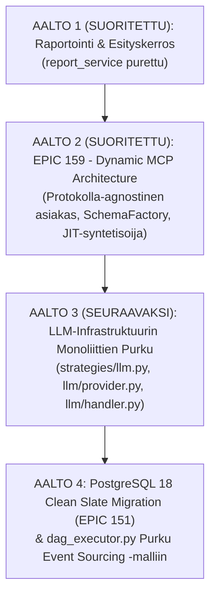

# Koodikannan Monoliittien Purku- ja Migraatiojärjestys

> [!IMPORTANT]
> **Single Source of Truth (SSOT) järjestelmärefaktoroinnin ja migraatioiden suoritusjärjestykselle.**
> Tämä ohje määrittelee `backend_v2/`-koodikannan 368 tuotantotiedoston kartoituksen pohjalta tunnistettujen järjestelmämonoliittien, **EPIC 159:n (Dynamic MCP)** ja **EPIC 151:n (PostgreSQL-migraatio)** välisen optimaalisen, nollakaksoistyön suorituspolun.

---

## 1. Suoritustilanteen Verifiointi (Mitä on jo tehty)

Ennen seuraavien vaiheiden aloittamista koodikanta tarkistettiin fyysisesti. Alkuperäisestä monoliittianalyysistä **viisi merkittävää kohdetta on jo purettu tai parhaillaan valmistumassa**:

| Kohde (Alkuperäinen tiedosto) | Alkuperäinen LOC | Nykytila koodikannassa | Uusi modulaarinen arkkitehtuuri |
| :--- | :--- | :--- | :--- |
| `backend_v2/services/orchestrator/anchor_validation_service.py` | 855 LOC | **SUORITETTU & POISTETTU** | Purettu pakettiin `backend_v2/services/orchestrator/anchor_validation/`<br>(`evidence_validator.py`, `lexical_matcher.py`, `lexical_normalizer.py`, `atom_evaluation_processor.py`) |
| `backend_v2/services/export_service.py` | 1 123 LOC | **SUORITETTU & POISTETTU** | Purettu pakettiin `backend_v2/services/export/`<br>(`excel_exporter.py`, `csv_exporter.py`, `excel_styler.py`, `atom_row_builder.py`, `metadata_resolver.py`, `summary_builder.py`) |
| `backend_v2/services/matrix_domain_parser.py` | 732 LOC | **SUORITETTU & POISTETTU** | Purettu pakettiin `backend_v2/services/matrix_parser/`<br>(`scale_and_atom_stage.py`, `row_builder_stage.py`, `distribution_formatter.py`) |
| `backend_v2/services/ingress/pdf_chat_extractor.py` | 682 LOC | **SUORITETTU & POISTETTU** | Purettu pakettiin `backend_v2/services/ingress/pdf_extractor/`<br>(`bubble_geometry.py`, `turn_assembly_stage.py`, `table_and_card_stage.py`) |
| `backend_v2/services/report_service.py` | 749 LOC | **SUORITETTU & POISTETTU** | Purettu pakettiin `backend_v2/services/report/`<br>(`lifecycle_service.py`, `compilation_service.py`, `format_reader_service.py`). |
| `EPIC 159 (Dynamic MCP & JIT Synthesizer)` | - | **SUORITETTU & KOVENNETTU** | Toteutettu `GenericMCPClient`, `SchemaFactory`, `AliasRegistry`, JIT Micro-LLM Argument Synthesizer ja `McpToolParamsPanel`. |

---

## 2. Jäljellä Olevat Monoliitit (Nykytilanne)

Koodikannassa jäljellä olevat suuret tiedostot mitattuna nykyisestä tilasta:

| Tiedosto | Nykylinjat (LOC) | Suurin funktio | Riippuvuuskytkös |
| :--- | :--- | :--- | :--- |
| `backend_v2/services/orchestrator/dag_executor.py` | **1 640 LOC** | `execute_workflow` (1 118 LOC) | **Suora kytkös PostgreSQL-migraatioon (EPIC 151).** Monimutkaisuus johtuu TinyDB-tiedostolukoista ja koko tilan uudelleenkirjoituksesta. |
| `backend_v2/llm/provider.py` | **1 580 LOC** | `generate` (740 LOC) | **Suora kytkös EPIC 159:ään.** Käsittelee työkalujen skeemoja ja kutsusilmukoita. |
| `backend_v2/services/orchestrator/strategies/llm.py` | **931 LOC** | `execute` (828 LOC) | **Suora kytkös EPIC 159:ään.** Sisältää vanhoja MCP-alaviivareitityksiä, jotka poistuvat EPIC 159:ssä. |
| `backend_v2/llm/handler.py` | **911 LOC** | `_fetch_vertex_models` | Kytkeytyy `provider.py`:hyn ja mallirekisteriin. |
| `backend_v2/llm/client.py` | **845 LOC** | `from_strategy` | Kytkeytyy `provider.py`:hyn ja LLM-strategioihin. |
| `backend_v2/services/mcp/mcp_tool_loop.py` | **651 LOC** | `execute_tool_loop` | **EPIC 159:n pääkohde.** Staattinen DISPATCHER poistuu. |

---

## 3. Kriittiset Arkkitehtoniset Riippuvuussäännöt

### Sääntö 1: EPIC 159 (Dynamic MCP) TOTEUTETAAN ENNEN LLM-monoliittien purkua
- **Syy**: `docs/epic/EPIC_159_DYNAMIC_MCP_ARCHITECTURE.md` on jo täysin auditoitu ja hyväksytty (`docs/epic/EPIC_159_audit_report.md` on **HARDENED & VERIFIED**).
- EPIC 159 viittaa suoraan nykyisten tiedostojen (`mcp_tool_loop.py`, `strategies/llm.py`, `provider.py`) funktioihin ja riveihin.
- Jos `strategies/llm.py` tai `provider.py` pilkotaan ennen EPIC 159:ää, EPIC 159:n suunnitelma desynkronoituu ja se joudutaan auditoimaan uudelleen.
- Lisäksi EPIC 159 **siivoaa jo itsessään** vanhat työkalut (`tavily.py`, `wikipedia.py`, `models/domain/tools.py`), jolloin LLM-kerroksen purkaminen sen jälkeen on huomattavasti suoraviivaisempaa.

### Sääntö 2: `dag_executor.py` PURETAAN VASTA PostgreSQL-migraatiossa (EPIC 151)
- **Syy**: `dag_executor.py`:n suurin monimutkaisuus ja rivimäärä johtuu nykyisestä **TinyDB-tiedostolukituksesta** (`_update_lock`, `msvcrt/fcntl`) ja monen megatavun `execution_trace`-blobin toistuvasta sarjallistamisesta levylle.
- EPIC 151 korvaa tämän **append-only `trace_events` -tapahtumavirralla** PostgreSQL:ään.
- Jos `dag_executor.py` purettaisiin nyt, jouduttaisiin rakentamaan monimutkaisia väliaikaisia lukitusmoduuleita TinyDB:lle, jotka heitettäisiin heti perään roskiin PostgreSQL-migraatiossa.

### Sääntö 3: EPIC 159 TOTEUTETAAN ENNEN PostgreSQL-migraatiota
- **Syy**: EPIC 159 lyö lukkoon lopulliset Pydantic V2 DTO -skeemat (`MCPToolInputSchemaDTO`, `MCPToolSchemaPropertyDTO`, `SystemConfigMCPGateways`) ja poistaa vanhat työkalumallit (`BaseTool`, `Wikipedia*`).
- Kun PostgreSQL-migraatio tehdään tämän jälkeen, tietokantataulut ja `asyncpg`-kyselyt luodaan suoraan lopulliselle puhtaalle skeemalle ilman välimigraatioita.

---

## 4. Neljän Aallon Master-Suorituspolku (The 4-Wave Master Plan)



---

### AALTO 1: Raportoinnin Viimeistely (SUORITETTU)
- **Kohde**: `backend_v2/services/report_service.py`
- **Tila**: Purettu onnistuneesti pakettiin `backend_v2/services/report/`.

---

### AALTO 2: Dynaaminen MCP ja Työkalukerroksen Modernisointi (EPIC 159) (SUORITETTU)
- **Kohde**: `docs/epic/EPIC_159_DYNAMIC_MCP_ARCHITECTURE.md` ja `docs/implementationplans/IMPLEMENTATION_PLAN_JIT_MCP_Argument_Synthesizer_and_Studio_Params.md`
- **Tila**: Suoritettu, kovennettu ja arkkitehtuuridokumentoitu. Vanhat staattiset työkalut poistettu, `GenericMCPClient`, `SchemaFactory`, JIT Micro-LLM Argument Synthesizer ja `McpToolParamsPanel` tuotantovalmiina.

---

### AALTO 3: LLM-Infrastruktuurin Monoliittien Purku (Klusteri B)
- **Miksi vasta tässä**: Koska EPIC 159 on poistanut staattiset työkalut ja stabiloinut `GenericMCPClient`:in ja `ToolDispatcher`:in.

#### Askel 3.1: `backend_v2/services/orchestrator/strategies/llm.py` (931 LOC)
- **Suunnittelukomento**:
  ```powershell
  /tier3-god-code-decomposition backend_v2/services/orchestrator/strategies/llm.py
  ```
- **Syntyvät kohdemoduulit**:
  - `backend_v2/services/orchestrator/strategies/llm/prompt_assembler.py` (promptin kasaus, XML-direktiivit)
  - `backend_v2/services/orchestrator/strategies/llm/tool_coordinator.py` (MCP-kutsusilmukan ohjaus)
  - `backend_v2/services/orchestrator/strategies/llm/output_validator.py` (vastausskeeman validointi)
  - `backend_v2/services/orchestrator/strategies/llm/__init__.py`

#### Askel 3.2: `backend_v2/llm/provider.py` (1 580 LOC) & `handler.py` (911 LOC)
- **Suunnittelukomento**:
  ```powershell
  /tier3-god-code-decomposition backend_v2/llm/provider.py
  ```
- **Syntyvät kohdemoduulit**:
  - `backend_v2/llm/engine/semaphore_pool.py` (dynaamiset RPM/TPM-semaforit)
  - `backend_v2/llm/engine/cost_calculator.py` (LiteLLM-hinnoittelurekisterin SSOT)
  - `backend_v2/llm/engine/error_classifier.py` (transientit virheet ja retry-säännöt)
  - `backend_v2/llm/engine/execution_engine.py` (puhdas LiteLLM-kutsupatki)

---

### AALTO 4: PostgreSQL 18 Clean Slate Migration & `dag_executor.py` (EPIC 151)
- **Kohde**: `docs/epic/EPIC_151_PostgreSQL_Clean_Slate_Migration_and_TinyDB_Eradication.md`
- **Tavoite**:
  1. Korvataan `TinyDBDriver` ja `data/db_v2.json` `asyncpg`-yhteysaltaalla ja PostgreSQL 18:lla.
  2. Luodaan tietokantataulut suoraan Aaltojen 1–3 puhtaille DTO- ja domain-malleille ilman legacy-painolastia.
  3. Puretaan suurin yksittäinen järjestelmämonoliitti `backend_v2/services/orchestrator/dag_executor.py` (1 640 LOC) **suoraan tapahtumapohjaiseen malliin**:
     - `backend_v2/services/orchestrator/execution/wave_scheduler.py` (Kahnin aaltosuoritus TaskGroupissa)
     - `backend_v2/services/orchestrator/execution/state_machine.py` (`trace_events` append-only siirtymät kantaan)
     - `backend_v2/services/orchestrator/execution/cancellation_manager.py` (TaskGroup-peruutukset ja DLQ-kirjaukset)
     - `backend_v2/services/orchestrator/execution/telemetry_broadcaster.py` (SSE- ja WebSocket-päivitykset)

---

## 5. Komentojen Pikaopas (Cheatsheet)

### Yksittäisen God Code -tiedoston purkaminen (Tier 3)
```powershell
# 1. Luodaan Strangler Fig -purkusuunnitelma
/tier3-god-code-decomposition backend_v2/polku/tiedosto.py

# 2. Luodaan suoritustrackeri
/tier1-tracker-generator docs/epic/tiedosto_decomposition_plan.md

# 3. Suoritetaan autonomisesti
uv run python scripts/auto_phase_runner.py --tracker docs/epic/tiedosto_decomposition_tracker.md
```

### Eepoksen suorittaminen (Epic Execution)
```powershell
# 1. Luodaan trackeri valmiista auditoidusta eepoksesta
/tier1-tracker-generator docs/epic/EPIC_XXX.md

# 2. Ajetaan monivaiheinen toteutus
uv run python scripts/auto_phase_runner.py --tracker docs/epic/EPIC_XXX_tracker.md
```

### Laatutarkistukset aina vaiheiden välissä
```powershell
uv run python scripts/backend_audit_loop.py backend_v2/ --test --ast-strict
uv run python scripts/flutter_audit_loop.py client_app_v2/ --build
```
